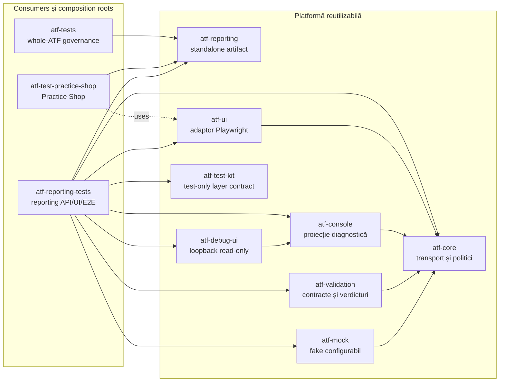
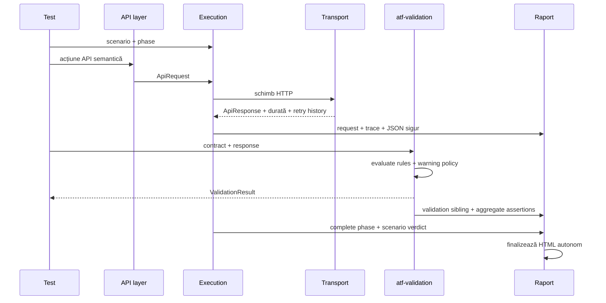
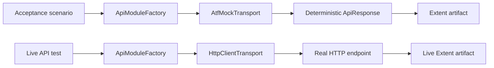
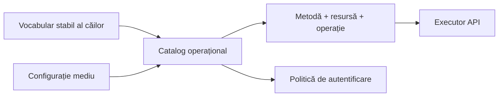
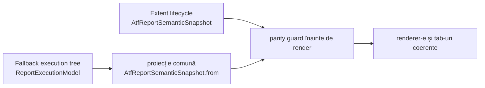
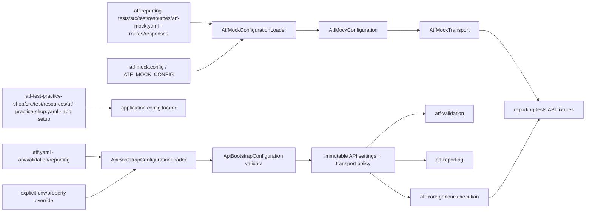
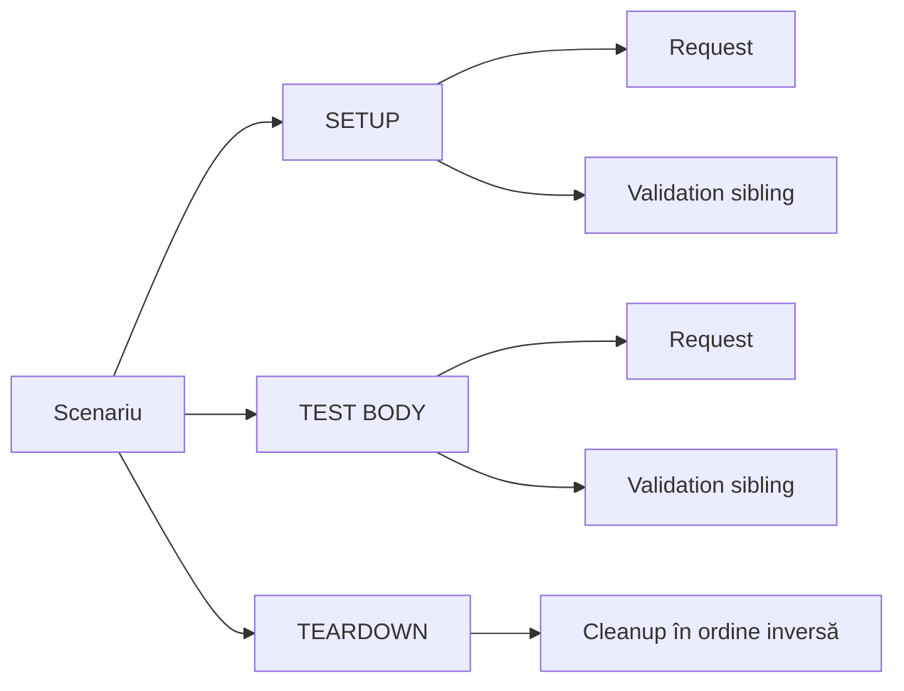
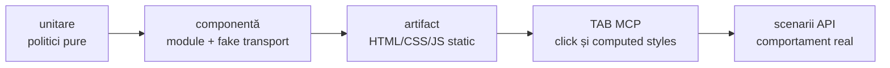

# Arhitectura ATF Java

ATF Java este împărțit în module cu responsabilități distincte. Direcția
dependențelor este de la scenarii spre infrastructură; infrastructura nu
cunoaște rutele sau intenția unui test de produs.

## Overall

| Boundary | Owner | Contract stabil | Gate executabil |
|---|---|---|---|
| kernel și politici | `atf-core` | modele, porturi, snapshot-uri și vocabular fizic | unit + governance |
| execuție API generică | `atf-core` | executor, lifecycle și binding de transport | unit/component + consumer |
| verdicturi | `atf-validation` | reguli și `ValidationResult` prin port neutru | unit/component |
| artifact | `atf-reporting` | renderer semantic standalone, Extent/HTML și contracte pure | POM standalone + unit/component |
| reporting composition | `atf-reporting-tests` | mock → API → raport → browser/E2E pentru contractul reporting | integration/API + Chromium/Playwright |
| Practice Shop consumer | `atf-test-practice-shop` | journey de purchase, config, pages, flow-uri și locatori | component + E2E |
| guvernanță whole-ATF | `atf-tests` | graph, dependency direction și architecture boundary | architecture/component |

`atf-reporting` este biblioteca reutilizabilă, nu composition root-ul suitei.
Poate fi construită și testată singură; API/UI/E2E sunt demonstrate de
`atf-reporting-tests`, iar regulile asupra întregului reactor sunt deținute de
`atf-tests`. Feedback-ul activ nu redefinește aceste contracte: păstrează doar
riscuri reproductibile care mai pot schimba codul sau packaging-ul.

### Harta modulelor: platformă și consumatori



<details>
<summary><strong>Legendă — hartă module și direcția dependency</strong></summary>

- săgeata solidă înseamnă dependență directă a modulului din stânga;
- săgeata punctată marchează o relație de consum, nu ownership transferat;
- `Consumers` arată composition roots, iar `Platform` arată modulele reutilizabile;
- `atf-reporting` rămâne standalone în producție;
- `atf-reporting-tests` este composition root-ul care leagă fixture-uri, mock,
  UI și reporting în test scope.

</details>

În această diagramă săgeata înseamnă „modulul din stânga depinde de modulul
din dreapta”. `atf-validation` și fixture-urile reporting depind de `atf-core`, iar
`atf-reporting` nu depinde de niciun modul ATF în producție. Testele care verifică aceste responsabilități
sunt în `atf-reporting-tests/src/test/java`, unde dependențele spre mock, consolă,
Playwright și debug UI sunt strict test-scope. `atf-tests` rulează separat
`atf.api.tests.governance.ArchitectureModuleBoundaryTest`, care guvernează
întregul reactor. `atf-test-practice-shop` găzduiește testele aplicației
consumatoare. Configurația și flow-urile unei aplicații nu intră în
`atf-reporting-tests`.

În sens de packaging, standalone înseamnă zero dependențe ATF pentru
`atf-reporting/src/main`. Testele de integrare pot compune modulele ATF în
test-scope prin adaptoare explicite. `ReportModelAdapters` este seam de
migrare, nu layer de business și nu trebuie importat în codul de producție al
consumatorilor.

`atf-test-kit` este strict test-scope: expune meta-anotațiile unit/component/
integration/e2e și guard-ul global, fără să intre în classpath-ul de producție.
`atf-mock` depinde numai de `atf-core`, iar `atf-debug-ui` este un launcher
read-only; faptul că este pornit de teste sau IntelliJ nu îl transformă într-o
dependență de runtime a rendererului.

### Platformă reutilizabilă versus composition root

Contractele generice care nu au nevoie de JUnit, filesystem, YAML sau browser
stau în modulele de jos. `atf-core` oferă contractul neutru pentru selecția
programatică a scenariilor API, iar `atf-reporting` oferă contractul pur pentru
validarea unui artifact UI static:

```mermaid
flowchart LR
    Annotation[atf-core<br/>@ApiScenarioSetup + selection] --> Catalog[atf-reporting-tests<br/>reporting contract catalog + setup]
    Catalog --> ApiArtifact[API Extent artifact]
    Browser[atf-reporting-tests<br/>Page/Locator inspector] --> UiContract[atf-reporting<br/>UI contract + snapshot validator]
    ApiArtifact --> Browser
    Browser --> UiContract
    UiContract --> UiArtifact[UI Extent audit artifact]
```

<details>
<summary><strong>Legendă — separarea production și composition</strong></summary>

- core expune selecția typed, iar catalogul concret aparține consumerului;
- API artifactul este input read-only pentru inspectorul UI;
- validatorul UI aparține librăriei reporting, iar browserul rămâne în test scope;
- niciun `Page`, `Locator` sau JUnit nu intră în production reporting.

</details>

`atf-reporting-tests` este composition root-ul librăriei reporting: rezolvă
surse de test deterministe, pornește lifecycle-ul JUnit și execută Playwright
numai pentru auditul raportului. `atf-tests` deține testele aplicațiilor și
configurația lor, pe lângă testul de guvernanță globală din
`src/test/java/atf/api/tests/governance`. Nici reporting production nu primește Page/Locator
sau JUnit.
`atf-core` nu primește catalogul concret sau loaderul YAML, iar `atf-reporting`
nu primește Page/Locator. Aceasta este limita care permite testare unit,
component și E2E fără dublarea aceleiași reguli.

## Responsabilități

| Modul | Deține | Nu deține |
|---|---|---|
| atf-core | request/response, transport, configurație, autentificare, retry, redaction, status, porturi și contractul neutru de selecție API (`ApiScenarioSetup`, `ApiTestRef`, `ApiScenarioSelection`) | HTML, CSS, Extent, JUnit, YAML, browser, cataloguri concrete și rute de produs |
| atf-mock | transport fake configurabil și catalog de răspunsuri deterministe | HTTP real, Extent, JUnit, validare de business |
| atf-validation | contracte response, reguli, evaluator, verdict și publicare prin port neutru | HTTP, Extent, HTML, CSS, lifecycle |
| atf-console | formatter pentru evenimentele de consolă, `ConsoleSettings`, YAML, nesting, statusuri, fallback ASCII/UTF-8 și ownership-ul exclusiv al stdout/stderr | HTML, Extent, apeluri HTTP, verdicturi inventate |
| atf-reporting | sesiune, arbore Extent, theme, finalizare HTML, audit kernel renderer-neutral, planuri de audit, contracte API renderer-neutral, metadata failure surfaces, motorul pur `api.contract`, auditul static al artifactului API, auditorul JSON static, contractul pur al raportului UI și lifecycle-ul generic de evidence | apeluri HTTP/transport, consolă concretă, acceptance scenarios, browser/Playwright și fixture-uri de test; nu depinde runtime de `atf-mock` |
| atf-ui | configurație browser și adaptor Java Playwright pentru verificări UI automate | generarea HTML-ului și testele executabile |
| atf-debug-ui | publică read-only un HTML existent pe loopback și furnizează target-ul pentru TAB MCP | renderer, modificarea artifactului, verdicturi și teste executabile |
| atf-test-kit | meta-anotații JUnit pentru niveluri și guard transversal al tuturor testelor | cod production, fixture-uri, browser și business rules |
| atf-reporting-tests | contracte API/mock și E2E UI care verifică exclusiv `atf-reporting`; fixture-uri și adaptoare ale raportului | nu devine suita unei aplicații și nu mută aceste responsabilități în production |
| atf-test-practice-shop | testele aplicației consumatoare, config/flows/locators/pages și purchase E2E | renderer, publisher și guvernanța whole-ATF |
| atf-tests | guvernanța whole-ATF și gates de arhitectură | teste de produs și contracte interne ale `atf-reporting` |

Regula practică: dacă verificarea este despre renderer, markup, CSS/JavaScript,
snapshot, contract sau publisher și poate rula cu un fake fără browser, testul
aparține în `atf-reporting`. Dacă verificarea dovedește un scenariu API/UI,
setup-ul JUnit, integrarea cu mock-ul ori comportamentul DOM/computed-style al
raportului aparține în `atf-reporting-tests/src/test/java`; comportamentul unei
aplicații reale aparține în modulul consumer, de exemplu `atf-test-practice-shop`.
Un serviciu real este testat doar printr-un scenariu
explicit opt-in; nu este implicit în niciunul dintre aceste niveluri.

<details>
<summary><strong>Aprofundare — boundary-uri, fluxuri și proof</strong></summary>

## Boundary-ul testelor API și al auditului UI

`atf.api.tests.api` este exclusiv pentru teste API: resurse, request-uri,
headere, contracte, scenarii stateful și lifecycle. Nu poate importa browser,
Playwright, `Page`, `Locator`, DOM, screenshot sau Debug UI.

Auditul browser al raportului Extent aparține `atf.ui.tests.extent` din
`atf-reporting-tests/src/test/java`. Contractul pur al artifactului — snapshot-uri, verdicturi,
reconciliere, planuri de secțiune, executorul checks, validatorii, metadata
failure surfaces și ordinea generică evidence→phase→scenario — aparține
`atf.api.reporting.audit` și
`atf.api.reporting.ui.audit.*` din `atf-reporting`. `atf-ui` furnizează numai
politicile generice de browser/captură și adaptorul Playwright; configurația
de output, audit suite și input report este test-owned în
`atf-reporting-tests/src/test/java/atf/ui/tests/extent/support/config`, iar
`atf-debug-ui` servește read-only HTML-ul rezultat pentru inspecție prin TAB
MCP. Precondiția API pentru un audit UI este compusă prin
`ApiReportAuditSetup`; aceasta este singura fațadă de setup pentru auditul API→UI;
nu există un alias paralel în `atf-tests`.
`UiAuditLifecycle` și contractele pure de secțiune sunt implementate și testate
în reporting; browserul rămâne doar pentru
DOM, computed-style, click, collapse și randare.
Planul de acceptance și publisherul care traduc execuția API în evidence Extent
sunt în `atf.api.reporting.api.acceptance`; testele din reporting composition scope doar
le compun în scenarii și le verifică.

Contractul raportului API are un boundary suplimentar, fără browser:

```text
catalog YAML/mock sau live adapter
        → ApiReportContractCatalog
        → ApiReportContractAuditor
        → body / metadata / execution / JSON-tree validators
        → ValidationResult
        → optional HTML evidence publisher
```

`atf-reporting` expune doar portul și modelele renderer-neutral. `atf-mock` este
folosit de testele reporting prin scope `test`, nu de producția reporting;
`atf-reporting-tests` păstrează exclusiv adaptorul care extrage
`ApiReportContractInput` din DOM. Astfel același contract poate fi verificat ca
unit, componentă sau integrare, iar browserul rămâne un nivel separat de
verificare.

Există două niveluri pentru contractul UI, cu browserul doar în composition scope-ul
`atf-reporting-tests`:

| Pachet | Input | Scop |
|---|---|---|
| `atf.ui.tests.extent.e2e.section` | raport API generat sau static | setup/mock, projection, request/response evidence, paritate API în browser |
| `atf.api.reporting.ui.contract` | annotation, spec, check-uri, snapshot și validator pur | reguli structurale fără DOM/browser |
| `atf.ui.tests.extent.e2e.uireport` | raport UI anterior, static | rezolvare input, tab-uri, structură DOM, stil, collapsed state, Fails și Screen validation |

Al doilea nu citește expected business values din YAML și nu cere request-uri
API. El este pornit cu `@UiExtentReportContract` și `-Datf.ui.report=...`, apoi
publică un artifact UI nou fără să modifice inputul.

Lanțul observabil este:

```text
setup configurabil
  → scenarii API
  → atf-reporting-tests/src/test/resources/atf-mock.yaml / AtfMockTransport
  → raport API read-only
  → audit Playwright în atf.ui.tests.extent
  → validare DOM/evidence
  → raport UI separat
```

Expected-ul UI se construiește înainte de browser din selecția API, catalog și
mock; actualul se citește din DOM prin locatorii semantici. Selectorii stau
numai în `ReportUiLocators` și sub-locatorii dedicați, acțiunile în adapters,
ordinea în flows, iar verdictul în validators/snapshot-uri. Nu se introduce
`ui.enabled`; selecția suitei și a regulilor este configurată prin adnotare,
YAML sau proprietăți JVM.

Pentru smoke E2E, `@ApiScenarioSetup(tests = { @ApiTestRef(owner = ..., method = ...) })`
are prioritate peste `families`: alegem câteva metode API exacte și
ne-redundante, iar familia rămâne fallback pentru suite/YAML. Matricea completă
de API și contractele reporting păstrează coverage-ul larg; browserul dovedește
doar legarea setup → mock → artifact → DOM și interacțiile reale.

`SETUP` rămâne precondiție de lifecycle: pentru `report-setup` se publică doar
un tabel compact `Setup evidence` (`CHECK / EXPECTED / ACTUAL / RESULT`). Nu
este request/response și nu este `UI validation`; `Screen validation` există
numai în `TEST BODY`, după acțiunile reale de browser.

## Fluxul unei cereri



<details>
<summary><strong>Legendă — fluxul semantic al unei cereri</strong></summary>

- executorul publică faptele transportului și istoricul retry;
- validation-ul calculează verdictul, iar reporting-ul doar proiectează evidence;
- request-ul și validation-ul rămân surori în aceeași fază;
- finalizarea produce un artifact autonom, fără a muta verdictul.

</details>

Faptele transportului, satisfacerea contractului și verdictul scenariului sunt
lucruri diferite:

```text
schimb HTTP finalizat  !=  contract satisfăcut  !=  scenariu trecut
```

## Profile de transport și boundary-ul acceptance

ATF are două profile de transport, cu scopuri diferite:

| Profil | Implementare | Rețea | Proprietar | Scop |
|---|---|---:|---|---|
| `acceptance` | `AtfMockTransport` (`atf-mock`) | nu | `atf-reporting-tests` test scope | raport determinist, contracte, lifecycle și randare |
| `live` | `HttpClientTransport` | da | testul live / consumator | verificarea unui serviciu HTTP disponibil |

`AtfMockTransport` nu este un HTTP server local și nu este un proxy către
`atf.local`. El este un test double din `atf-mock`, injectat explicit în
`ApiModuleFactory`.
URL-ul construit de `ApiExecutor` rămâne în evidence pentru ca raportul să
arate ruta semantică, însă transportul fake nu execută DNS, TLS sau request
network. Această separare este intenționată: raportarea și contractele nu
trebuie să depindă de un serviciu extern.



<details>
<summary><strong>Legendă — acceptance offline versus live opt-in</strong></summary>

- acceptance folosește fake transport și produce un response determinist;
- live folosește HTTP numai prin policy și opt-in explicit;
- URL-ul afișat în acceptance este evidence semantică, nu dovadă de trafic;
- cele două profile nu se convertesc implicit unul în celălalt.

</details>

Regula verificabilă este:

```text
ApiReportAuditSetup -> AtfMockTransport -> offline artifact
Live API test       -> HttpClientTransport -> real endpoint
```

Un URL precum `https://atf.local/public/v2/users` dintr-un acceptance report
este metadata a request-ului, nu o afirmație că host-ul a fost contactat.
Disponibilitatea DNS, TLS, autentificarea și contractul serviciului sunt
verificabile numai în profilul `live`.

`ApiTransportProvenance` circulă în `ApiExecutionResult` până la publisher-ul
API. Raportul afișează astfel adevărul transportului și un replay manual sigur:

```text
acceptance → ACCEPTANCE / MOCK → URL metadata + MANUAL REPLAY: NOT EXECUTABLE
live       → LIVE / HTTP       → URL contactat + cURL method/headers/body redacted
```

Nu se introduce în raport un URL de fallback inventat și nu se declară că un
endpoint a fost contactat dacă a fost folosit `AtfMockTransport`. Pentru live,
operatorul completează credențialele redacted înainte de a executa cURL-ul.

Testele live sunt opt-in prin `-Datf.api.live.optIn=true` sau
`ATF_API_LIVE_OPT_IN=true`, iar baza URL este explicită prin `api.baseUri`.
`ApiLiveTransportCatalog` este adaptorul public pentru endpoint-uri live numite;
el respinge atât politica acceptance, cât și placeholder-ul `https://atf.local`.
Testele acceptance nu consultă catalogul și nu pot fi convertite implicit în
teste de rețea.

## Vocabularul rutelor

Rutele nu se scriu ca string-uri repetate în teste. Vocabularul stabil al
căilor este separat de catalogul operațional și de configurația mediului:



<details>
<summary><strong>Legendă — vocabularul rutelor</strong></summary>

- `Paths` definește vocabularul stabil, fără endpoint de business hardcodat;
- catalogul combină ruta, operația și politica de autentificare;
- configurația mediului poate schimba baza URL fără să schimbe testele;
- executorul primește un request deja compus semantic.

</details>

Catalogul descrie operația, metoda, resursa și autentificarea. Configurația
poate suprascrie baza URL sau șabloanele fără ca testele să cunoască detaliile
de mediu.

## Configurație și snapshot

`atf.yaml` este configurația generală a proiectului consumator, nu un asset al
unui modul și nu o configurație citită de fiecare request. Fișierul versionat
poate conține secțiunile `api`, `validation` și `reporting`; configurația UI de
audit și catalogul mock ale contractului reporting sunt resurse test-owned ale
`atf-reporting-tests`. Configurația unei aplicații, inclusiv
`atf-practice-shop.yaml`, este test-owned de `atf-test-practice-shop`. Nu există
`ui.enabled`. Rutele, răspunsurile, body-urile și fallback-ul folosite pentru
raportare sunt în `atf-reporting-tests/src/test/resources/atf-mock.yaml`, încărcate
explicit prin `ReportingTestResources`.
API-ul este asamblat la composition root prin `ApiBootstrapConfiguration`, care
conține snapshot-ul `ApiSettings` și `ApiTransportPolicy`. Loaderul
`ApiBootstrapConfigurationLoader` citește o singură dată secțiunea `api`, o
validează și o transmite către `ApiModuleFactory`; request-urile nu recitesc
YAML-ul și nu își construiesc singure configurația.

În configurația actuală, `api.baseUri`, timeout-ul, retry-ul, auth profile-ul și
`transport` sunt tipizate la bootstrap. `ApiReportAuditSetup` injectează intenționat
`AtfMockTransport` când politica este `acceptance`; simpla prezență a unui
`baseUri` în YAML nu activează rețeaua. Loaderul `atf-reporting` consumă
efectiv doar `reporting.extent` pentru artifactul HTML; consola nu este
fallback-ul rendererului și nu este încărcată de modulul Extent.

`api.transport` acceptă `acceptance` (alias compatibil `mock`) sau `live`.
`acceptance` este implicit și selectează transportul mock; `live` este respins
fără `-Datf.api.live.optIn=true` sau `ATF_API_LIVE_OPT_IN=true`. Astfel YAML-ul
centralizează base URI, timeout și retry fără să ascundă diferența dintre un
fake și o conexiune reală; politica nu poate fi schimbată accidental de un
test UI.

## Contracte de arhitectură verificate în codul live

Reconcilierea curentă separă contractul implementat de riscurile de evoluție:

| Contract verificat | Implementare | Dovadă |
|---|---|---|
| secțiuni `Overview`, `Tests`, `Categories`, `Fails`, `Evidence`, `Screen validation` | `SectionAuditCheckExecutor` → `SectionAuditCheckPolicy` → `SectionAuditResult` | `ExtentSectionAuditPublisher` + teste component/E2E |
| raport UI read-only pe tab-urile principale | `@UiExtentReportContract` și `StaticUiExtentReportContractTest` | `atf-reporting-tests` |
| HTML/CSS/JavaScript și asset manifest | contracte pure în `atf-reporting` | `UiReportArtifactContractTest` |
| direcție module, ownership constante/CSS, output și import graph | boundary-uri Maven/source | `atf-tests` + architecture tests |
| parity Extent ↔ fallback | `AtfReportSemanticSnapshot.from(ReportExecutionModel)` | parity guard înainte de render |

Acestea sunt capabilități închise și normative. Un document de feedback nu le
repetă și nu le transformă într-un scor; se redeschid numai printr-o regresie
reproductibilă, o schimbare de consumator sau o schimbare publică de contract.

### Parity semantică între renderer-e



<details>
<summary><strong>Legendă — parity semantică între renderer-e</strong></summary>

- Extent și fallback-ul intră în aceeași comparație semantică;
- adapterul normalizează modelul, fără să forțeze aceeași structură internă;
- guard-ul compară class, scenario, phase, request, validation și evidence counts;
- diferența se repară în provider/model, nu prin ascunderea ei în UI.

</details>

`ReportExecutionModel` rămâne optimizat pentru proiecțiile fallback
(`Overview`, `Categories`, `Fails`), iar `AtfReportSemanticSnapshot` rămâne
contractul lifecycle-ului Extent. Adapterul comun compară class → scenario →
phase → request → validation, package-ul și evidence counts înainte de
publicare; modelele nu sunt duplicate accidental și nu trebuie unificate prin
forțarea aceleiași structuri interne.

### Evoluție controlată și redeschidere

Contractele consolidate sunt stabile: inspectorii DOM/browser produc snapshot-uri
neutre, acestea sunt consumate de mai multe fluxuri, iar validatorii puri sunt
apărați de `ExtractionValidationConvergenceTest`. Protecția sync-ului
live↔staging este acum executabilă prin `AtfPromotionManifest` și
`AtfPromotionGuard`, iar adaptorul live explicit este
`ApiLiveTransportCatalog`. Nu se face split cosmetic și nu se redeschid
layout-uri închise fără defect reproductibil.

`AtfReportTheme` și `UiExtentReportSession` au boundary-uri documentate și
colaboratori semantici suficienți pentru codul live. Nu sunt backlog-uri active:
se redeschid numai dacă apare un defect concret sau un al doilea consumator care
justifică snapshot/golden coverage.

`ExtentReportRuntimeBehaviour` are aceeași decizie închisă: compune
`Core`, `Tests`, `Overview`, `Evidence`, `Navigation`, `Duration` și `Failure`,
iar `ExtentReportRuntimeScriptTest` apără compoziția. Această decizie rămâne în
README-ul reporting și nu se copiază în registrul de feedback.

Fallback-ul HTML respectă aceeași direcție: `HtmlReportSession` este
composition root pentru document/lifecycle, iar comportamentul de tab-uri este
un asset injectabil prin `HtmlReportScript`, implementat de
`HtmlReportNavigationScript`. Astfel markup-ul semantic, lifecycle-ul și
JavaScript-ul au seam-uri independente fără a introduce browser sau DOM în
modelul de raportare.

În interiorul acestui boundary, lifecycle-ul este împărțit în
`atf.api.reporting.html.scope`: `HtmlReportScenarioScope`,
`HtmlReportPhaseScope`, `HtmlReportRequestScope` și
`HtmlReportValidationScope` implementează porturile `AtfReportPorts`. Sesiunea
creează scope-urile, iar modelul semantic oferă numai mutații controlate;
renderer-ul nu primește câmpuri interne și nu devine dependent de lifecycle.

Acesta este rezumatul normativ al boundary-urilor verificate. Feedback-ul
păstrează numai regresii viitoare; implementările închise, inclusiv guard-ul de
promovare, catalogul live explicit și split-ul contractelor Extent, sunt
consolidate în README-urile ownerilor și apărate de teste.



<details>
<summary><strong>Legendă — compoziția configurației</strong></summary>

- YAML-ul și override-urile sunt citite la composition root;
- snapshot-ul immutable intră în core, fără ca acesta să recitească mediul;
- mock-ul produce fixture-ul, iar reporting-tests îl consumă în test scope;
- output-ul și căile rămân configurabile, nu devin valori de documentație.

</details>

`AtfRuntimeSnapshot` este boundary-ul typed pentru execuție: păstrează
`ApiSettingsSnapshot` și `ReportingSettings` împreună, fără să introducă YAML,
environment sau Extent în `atf-core`. `ApiModuleFactory` îl proiectează în
executorul API, iar reporting consumă separat politica sa. Astfel un
composition root poate crea două snapshots independente pentru rulări
paralele, iar modificarea ulterioară a configurației de input nu schimbă
executorul deja creat.

Reguli obligatorii:

- `atf-core` deține modelele typed și snapshot-urile, dar nu parsează YAML și
  nu citește filesystem/env; în repository-ul curent loaderul complet aparține
  composition root-ului de test din `atf-reporting`/proiectul consumator;
- loaderul citește configurația o singură dată la bootstrap și eșuează clar la
  chei necunoscute, URI invalid, timeout invalid, root de schema absent sau
  output path nesigur;
- `reporting.extent` rămâne responsabilitatea reporting; timeout, retry, auth,
  routes, redaction și schema roots sunt setări runtime neutre;
- căile relative se rezolvă față de fișierul YAML, nu față de `user.dir` al
  IDE-ului; fallback-ul implicit este permis doar ca compatibilitate temporară;
- secretele nu sunt valori YAML publicate, ci referințe către un provider
  explicit;
- după bootstrap, toate modulele primesc snapshot-uri immutable, iar două
  rulări paralele nu își pot modifica reciproc configurația.

Nu se introduce un modul `atf-config`. `atf-reporting` își păstrează loaderul
specializat pentru `reporting.extent`, iar composition root-ul poate compune
setările API și validation în același bootstrap folosind modelele din core.

## Lifecycle și ownership



<details>
<summary><strong>Legendă — lifecycle și ownership</strong></summary>

- fazele apar numai când au conținut real;
- request-ul și validation-ul sunt ramuri surori;
- cleanup-ul închide resursele create în ordine inversă;
- precedence-ul verdictului rămâne responsabilitatea lifecycle-ului, nu a rendererului.

</details>

Un request rămâne deschis până când evidence-ul lui tehnic și validarea asociată
au fost publicate. Validarea este următorul frate direct al request-ului, în
aceeași fază; nu este mutată într-o listă globală și nu este ascunsă într-un
teardown. Mai multe assertions pentru același response formează un singur tabel.

Responsabilități obligatorii:

- executorul publică faptele HTTP și durata;
- validatorul calculează rezultatele și publică tabelul agregat;
- lifecycle-ul închide fazele și aplică precedence-ul verdictului;
- reporting-ul redă structura fără să modifice verdictul;
- cleanup-ul deține resursele create și rulează best effort în ordine inversă.

## Reguli OOP

1. Fațadele coordonează; politicile de status, retry, redaction și agregare sunt
   obiecte mici, pure și testabile.
2. Modelele din atf-core nu cunosc HTML, CSS, selectorii sau
   viewport-ul.
3. Starea de execuție este per sesiune și per scenariu; nu se introduce state
   static mutabil între teste.
4. O interfață apare pentru un seam real: transport, reporter, clock, auth sau
   cleanup. Nu se creează interfețe decorative.
5. Orice componentă care decide simultan transportul, verdictul și layout-ul
   are prea multe responsabilități și trebuie separată.

## Testabilitate



<details>
<summary><strong>Legendă — nivelurile de proof</strong></summary>

- unit verifică politica pură;
- component verifică modulul și fake transportul;
- artifactul verifică markup/CSS/JavaScript produs;
- TAB MCP verifică interacțiunea reală, iar scenariul API verifică behavior-ul live.

</details>

Fiecare schimbare de raportare care afectează structură, collapse, tab-uri,
font, culoare, scroll sau overflow are nevoie de test de cod și verificare a
artifactului. Un string găsit în HTML nu dovedește că elementul se comportă
corect la click.

</details>

