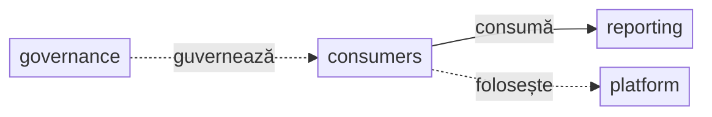
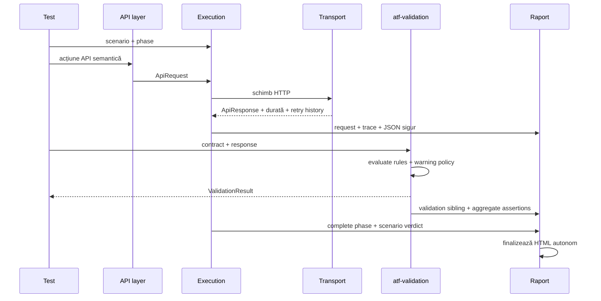
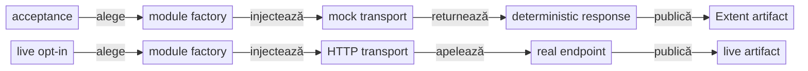
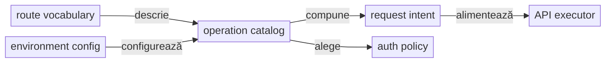
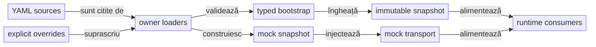
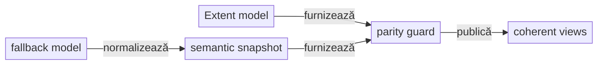
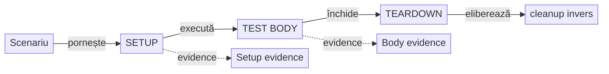
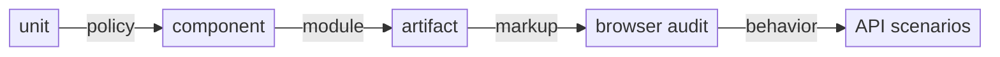

# Arhitectura ATF Java

ATF Java este împărțit în module cu responsabilități distincte. Direcția
dependențelor este de la scenarii spre infrastructură; infrastructura nu
cunoaște rutele sau intenția unui test de produs.

## Overall

| Boundary | Owner | Contract stabil | Gate executabil |
|---|---|---|---|
| kernel și politici | `atf-core` | modele, porturi, snapshot-uri și vocabular fizic | unit + governance |
| execuție API generică | `atf-core` | executor, lifecycle și binding de transport | unit/component + consumer |
| verdicturi | `atf-validation` | reguli și `ValidationResult` prin port neutru | unit/component |
| artifact | `atf-reporting` | renderer semantic standalone, Extent/HTML și contracte pure | POM standalone + unit/component |
| reporting composition | `atf-reporting-tests` | mock → API → raport → browser/E2E pentru contractul reporting | integration/API + Chromium/Playwright |
| Practice Shop consumer | `atf-test-practice-shop` | journey de purchase, config, pages, flow-uri și locatori | component + E2E |
| guvernanță whole-ATF | `atf-tests` | graph, dependency direction și architecture boundary | architecture/component |

`atf-reporting` este biblioteca reutilizabilă, nu composition root-ul suitei.
Poate fi construită și testată singură; API/UI/E2E sunt demonstrate de
`atf-reporting-tests`, iar regulile asupra întregului reactor sunt deținute de
`atf-tests`. Feedback-ul activ nu redefinește aceste contracte: păstrează doar
riscuri reproductibile care mai pot schimba codul sau packaging-ul.

### Harta modulelor: platformă și consumatori



<details>
<summary><strong>Legendă — hartă module și direcția dependency</strong></summary>

- `guvernează` = `atf-tests` protejează direcția și boundary-urile întregului
  reactor;
- `consumă` = composition roots folosesc API-ul public al `atf-reporting`;
- `folosește test scope` = consumatorii leagă suportul platformei numai în
  test scope; nu transferă ownership-ul în production;
- `governance` este `atf-tests`, iar `consumers` sunt
  `atf-reporting-tests` și `atf-test-practice-shop`;
- `reporting` este `atf-reporting`, iar `platform` grupează
  `atf-core`, `atf-mock`, `atf-validation`, `atf-console`, `atf-ui`,
  `atf-debug-ui` și `atf-test-kit`;
- `consumers` grupează `atf-reporting-tests` și `atf-test-practice-shop`, fără să le
  transforme într-un modul comun;
- `platform` grupează adaptoarele și suportul de test; relațiile interne sunt
  explicate în textul de sub diagramă și în README-urile ownerilor;
- `atf-reporting` rămâne standalone în producție;
- `atf-reporting-tests` este composition root-ul care leagă fixture-uri, mock,
  UI și reporting în test scope.

</details>

În această diagramă, semnificația este dată de eticheta muchiei și nu trebuie
dedusă din poziția nodurilor:

- `atf-validation` și fixture-urile reporting depind de `atf-core`;
- `atf-reporting` nu depinde de niciun modul ATF în production;
- testele acestor responsabilități sunt în
  `atf-reporting-tests/src/test/java`, cu mock, consolă, Playwright și debug UI
  strict în test scope;
- `atf-tests` rulează separat `atf.api.tests.governance.ArchitectureModuleBoundaryTest`
  pentru guvernanța întregului reactor;
- `atf-test-practice-shop` găzduiește testele aplicației consumatoare; configurația
  și flow-urile aplicației nu intră în `atf-reporting-tests`.

În sens de packaging, standalone înseamnă zero dependențe ATF pentru
`atf-reporting/src/main`. Testele de integrare pot compune modulele ATF în
test-scope prin adaptoare explicite. `ReportModelAdapters` este seam de
migrare, nu layer de business și nu trebuie importat în codul de producție al
consumatorilor.

`atf-test-kit` este strict test-scope: expune meta-anotațiile unit/component/
integration/e2e și guard-ul global, fără să intre în classpath-ul de producție.
`atf-mock` depinde numai de `atf-core`, iar `atf-debug-ui` este un launcher
read-only; faptul că este pornit de teste sau IntelliJ nu îl transformă într-o
dependență de runtime a rendererului.

### Platformă reutilizabilă versus composition root

Contractele generice care nu au nevoie de JUnit, filesystem, YAML sau browser
stau în modulele de jos. `atf-core` oferă contractul neutru pentru selecția
programatică a scenariilor API, iar `atf-reporting` oferă contractul pur pentru
validarea unui artifact UI static:

```mermaid
%%{init: {"themeVariables": {"fontSize": "16px"}, "themeCSS": ".edgeLabel p { font-size: 13px; line-height: 1.1; margin: 0; padding: 0 2px; }", "flowchart": {"nodeSpacing": 16, "rankSpacing": 48, "padding": 4}}}%%
flowchart LR
    Core["core contract"] -->|oferă contract| Catalog["test catalog"]
    Catalog -->|compune| ApiArtifact["API artifact"]
    ApiArtifact -->|este inspectat de| Browser["browser audit"]
    Browser -->|verifică| Reporting["reporting contract"]
    Reporting -->|publică| UiArtifact["UI artifact"]
```



<details>
<summary><strong>Legendă — separarea production și composition</strong></summary>

- core expune selecția typed, iar catalogul concret aparține consumerului;
- API artifactul este input read-only pentru inspectorul UI;
- validatorul UI aparține librăriei reporting, iar browserul rămâne în test scope;
- niciun `Page`, `Locator` sau JUnit nu intră în production reporting.

</details>

Limitele de compoziție și ownership sunt:

- `atf-reporting-tests` rezolvă sursele deterministe, lifecycle-ul JUnit și auditul Playwright al raportului;
- `atf-tests` deține testele aplicațiilor și guvernanța whole-ATF;
- production reporting nu primește `Page`, `Locator` sau JUnit;
- `atf-core` nu primește catalogul concret sau loaderul YAML;
- `atf-reporting` nu primește `Page` sau `Locator`;
- separarea permite testare unit, component și E2E fără dublarea regulilor.

## Responsabilități

| Modul | Deține | Nu deține |
|---|---|---|
| atf-core | request/response, transport, configurație, autentificare, retry, redaction, status, porturi și contractul neutru de selecție API (`ApiScenarioSetup`, `ApiTestRef`, `ApiScenarioSelection`) | HTML, CSS, Extent, JUnit, YAML, browser, cataloguri concrete și rute de produs |
| atf-mock | transport fake configurabil și catalog de răspunsuri deterministe | HTTP real, Extent, JUnit, validare de business |
| atf-validation | contracte response, reguli, evaluator, verdict și publicare prin port neutru | HTTP, Extent, HTML, CSS, lifecycle |
| atf-console | formatter pentru evenimentele de consolă, `ConsoleSettings`, YAML, nesting, statusuri, fallback ASCII/UTF-8 și ownership-ul exclusiv al stdout/stderr | HTML, Extent, apeluri HTTP, verdicturi inventate |
| atf-reporting | sesiune, arbore Extent, theme, finalizare HTML, audit kernel renderer-neutral, planuri de audit, contracte API renderer-neutral, metadata failure surfaces, motorul pur `api.contract`, auditul static al artifactului API, auditorul JSON static, contractul pur al raportului UI și lifecycle-ul generic de evidence | apeluri HTTP/transport, consolă concretă, acceptance scenarios, browser/Playwright și fixture-uri de test; nu depinde runtime de `atf-mock` |
| atf-ui | configurație browser și adaptor Java Playwright pentru verificări UI automate | generarea HTML-ului și testele executabile |
| atf-debug-ui | publică read-only un HTML existent pe loopback și furnizează target-ul pentru TAB MCP | renderer, modificarea artifactului, verdicturi și teste executabile |
| atf-test-kit | meta-anotații JUnit pentru niveluri și guard transversal al tuturor testelor | cod production, fixture-uri, browser și business rules |
| atf-reporting-tests | contracte API/mock și E2E UI care verifică exclusiv `atf-reporting`; fixture-uri și adaptoare ale raportului | nu devine suita unei aplicații și nu mută aceste responsabilități în production |
| atf-test-practice-shop | testele aplicației consumatoare, config/flows/locators/pages și purchase E2E | renderer, publisher și guvernanța whole-ATF |
| atf-tests | guvernanța whole-ATF și gates de arhitectură | teste de produs și contracte interne ale `atf-reporting` |

Regula practică: dacă verificarea este despre renderer, markup, CSS/JavaScript,
snapshot, contract sau publisher și poate rula cu un fake fără browser, testul
aparține în `atf-reporting`. Dacă verificarea dovedește un scenariu API/UI,
setup-ul JUnit, integrarea cu mock-ul ori comportamentul DOM/computed-style al
raportului aparține în `atf-reporting-tests/src/test/java`; comportamentul unei
aplicații reale aparține în modulul consumer, de exemplu `atf-test-practice-shop`.
Un serviciu real este testat doar printr-un scenariu
explicit opt-in; nu este implicit în niciunul dintre aceste niveluri.

## Boundary-ul testelor API și al auditului UI

`atf.api.tests.api` este exclusiv pentru teste API: resurse, request-uri,
headere, contracte, scenarii stateful și lifecycle. Nu poate importa browser,
Playwright, `Page`, `Locator`, DOM, screenshot sau Debug UI.

Auditul API→UI este împărțit astfel:

- browser audit: `atf.ui.tests.extent` din `atf-reporting-tests/src/test/java`;
- contract pur: snapshot-uri, verdicturi, reconciliere, planuri, checks, validatori și failure surfaces în `atf.api.reporting.audit` și `atf.api.reporting.ui.audit.*`;
- browser generic și captură: `atf-ui`;
- configurație output, audit suite și input report: `atf-reporting-tests/src/test/java/atf/ui/tests/extent/support/config`;
- servire read-only pentru TAB MCP: `atf-debug-ui`;
- singura fațadă pentru precondiția API: `ApiReportAuditSetup`;
- lifecycle și contracte pure de secțiune: `atf-reporting`;
- DOM, computed-style, click, collapse și randare: browser test scope;
- acceptance plan și publisher API→Extent: `atf.api.reporting.api.acceptance`.

Contractul raportului API are un boundary suplimentar, fără browser:

```text
catalog YAML/mock sau live adapter
        → ApiReportContractCatalog
        → ApiReportContractAuditor
        → body / metadata / execution / JSON-tree validators
        → ValidationResult
        → optional HTML evidence publisher
```

`atf-reporting` expune doar portul și modelele renderer-neutral. `atf-mock` este
folosit de testele reporting prin scope `test`, nu de producția reporting;
`atf-reporting-tests` păstrează exclusiv adaptorul care extrage
`ApiReportContractInput` din DOM. Astfel același contract poate fi verificat ca
unit, componentă sau integrare, iar browserul rămâne un nivel separat de
verificare.

Există două niveluri pentru contractul UI, cu browserul doar în composition scope-ul
`atf-reporting-tests`:

| Pachet | Input | Scop |
|---|---|---|
| `atf.ui.tests.extent.e2e.section` | raport API generat sau static | setup/mock, projection, request/response evidence, paritate API în browser |
| `atf.api.reporting.ui.contract` | annotation, spec, check-uri, snapshot și validator pur | reguli structurale fără DOM/browser |
| `atf.ui.tests.extent.e2e.uireport` | raport UI anterior, static | rezolvare input, tab-uri, structură DOM, stil, collapsed state, Fails și Screen validation |

Al doilea nu citește expected business values din YAML și nu cere request-uri
API. El este pornit cu `@UiExtentReportContract` și `-Datf.ui.report=...`, apoi
publică un artifact UI nou fără să modifice inputul.

Lanțul observabil este:

```text
setup configurabil
  → scenarii API
  → atf-reporting-tests/src/test/resources/atf-mock.yaml / AtfMockTransport
  → raport API read-only
  → audit Playwright în atf.ui.tests.extent
  → validare DOM/evidence
  → raport UI separat
```

Regulile pentru expected și selecția suitei sunt:

- expected-ul UI se construiește înainte de browser din selecția API, catalog și mock;
- actualul se citește din DOM prin locatorii semantici;
- selectorii stau în `ReportUiLocators`, acțiunile în adapters, ordinea în flows, iar verdictul în validators/snapshot-uri;
- nu se introduce `ui.enabled`; selecția suitei și a regulilor vine din adnotare, YAML sau proprietăți JVM.

Regulile pentru smoke E2E sunt:
- selecția explicită prin `@ApiScenarioSetup` are prioritate peste `families`;
- metodele sunt exacte și ne-redundante; familia rămâne fallback pentru suite/YAML;
- matricea completă de API și contractele reporting păstrează coverage-ul larg;
- browserul dovedește doar legarea setup → mock → artifact → DOM și interacțiunile reale.

Regula pentru `SETUP` este:

- publică doar tabelul compact `Setup evidence` (`CHECK / EXPECTED / ACTUAL / RESULT`);
- nu este request/response și nu este `UI validation`;
- `Screen validation` există numai în `TEST BODY`, după acțiunile reale de browser.

## Fluxul unei cereri



<details>
<summary><strong>Legendă — fluxul semantic al unei cereri</strong></summary>

- executorul publică faptele transportului și istoricul retry;
- validation-ul calculează verdictul, iar reporting-ul doar proiectează evidence;
- request-ul și validation-ul rămân surori în aceeași fază;
- finalizarea produce un artifact autonom, fără a muta verdictul.

</details>

Faptele transportului, satisfacerea contractului și verdictul scenariului sunt
lucruri diferite:

```text
schimb HTTP finalizat  !=  contract satisfăcut  !=  scenariu trecut
```

## Profile de transport și boundary-ul acceptance

ATF are două profile de transport, cu scopuri diferite:

| Profil | Implementare | Rețea | Proprietar | Scop |
|---|---|---:|---|---|
| `acceptance` | `AtfMockTransport` (`atf-mock`) | nu | `atf-reporting-tests` test scope | raport determinist, contracte, lifecycle și randare |
| `live` | `HttpClientTransport` | da | testul live / consumator | verificarea unui serviciu HTTP disponibil |

Boundary-ul acceptance este explicit:

- `AtfMockTransport` este test double din `atf-mock`, nu HTTP server local și nu proxy către `atf.local`;
- este injectat explicit în `ApiModuleFactory`;
- URL-ul construit de `ApiExecutor` rămâne în evidence pentru ruta semantică;
- transportul fake nu execută DNS, TLS sau request network;
- raportarea și contractele nu depind de un serviciu extern.



<details>
<summary><strong>Legendă — acceptance offline versus live opt-in</strong></summary>

- acceptance folosește fake transport și produce un response determinist;
- live folosește HTTP numai prin policy și opt-in explicit;
- URL-ul afișat în acceptance este evidence semantică, nu dovadă de trafic;
- cele două profile nu se convertesc implicit unul în celălalt.

</details>

Regula verificabilă este:

```text
ApiReportAuditSetup -> AtfMockTransport -> offline artifact
Live API test       -> HttpClientTransport -> real endpoint
```

Un URL precum `https://atf.local/public/v2/users` dintr-un acceptance report
este metadata a request-ului, nu o afirmație că host-ul a fost contactat.
Disponibilitatea DNS, TLS, autentificarea și contractul serviciului sunt
verificabile numai în profilul `live`.

`ApiTransportProvenance` circulă în `ApiExecutionResult` până la publisher-ul
API. Raportul afișează astfel adevărul transportului și un replay manual sigur:

```text
acceptance → ACCEPTANCE / MOCK → URL metadata + MANUAL REPLAY: NOT EXECUTABLE
live       → LIVE / HTTP       → URL contactat + cURL method/headers/body redacted
```

Nu se introduce în raport un URL de fallback inventat și nu se declară că un
endpoint a fost contactat dacă a fost folosit `AtfMockTransport`. Pentru live,
operatorul completează credențialele redacted înainte de a executa cURL-ul.

Testele live sunt opt-in prin `-Datf.api.live.optIn=true` sau
`ATF_API_LIVE_OPT_IN=true`, iar baza URL este explicită prin `api.baseUri`.
`ApiLiveTransportCatalog` este adaptorul public pentru endpoint-uri live numite;
el respinge atât politica acceptance, cât și placeholder-ul `https://atf.local`.
Testele acceptance nu consultă catalogul și nu pot fi convertite implicit în
teste de rețea.

## Vocabularul rutelor

Rutele nu se scriu ca string-uri repetate în teste. Vocabularul stabil al
căilor este separat de catalogul operațional și de configurația mediului:



<details>
<summary><strong>Legendă — vocabularul rutelor</strong></summary>

- `Paths` definește vocabularul stabil, fără endpoint de business hardcodat;
- catalogul combină ruta, operația și politica de autentificare;
- configurația mediului poate schimba baza URL fără să schimbe testele;
- executorul primește un request deja compus semantic.

</details>

Catalogul descrie operația, metoda, resursa și autentificarea. Configurația
poate suprascrie baza URL sau șabloanele fără ca testele să cunoască detaliile
de mediu.

## Configurație și snapshot

Configurația urmează un singur traseu operațional:



<details>
<summary><strong>Legendă — de la sursă la runtime</strong></summary>

- `YAML sources` = `atf.yaml`, catalogul `atf-mock.yaml` și configurația
  consumatorului, inclusiv `atf-practice-shop.yaml`;
- `owner loaders` = loader-e distincte pentru API, mock și aplicație;
- `typed bootstrap` = validare la composition root, înaintea execuției;
- `immutable snapshot` = configurație înghețată, transmisă consumatorilor;
- `mock transport` = transport selectat de politica `acceptance`;
- `runtime consumers` = executor, validation, reporting și fixture-urile de test;
- săgeata nu reprezintă un import Maven, ci fluxul datelor de configurare.

</details>

<details>
<summary><strong>Surse și ownership</strong></summary>

- `atf.yaml` este configurația generală a proiectului consumator;
- secțiunile `api`, `validation` și `reporting` aparțin proiectului care compune
  rularea, nu unui request individual;
- configurația UI de audit și catalogul mock pentru contractul reporting sunt
  test-owned de `atf-reporting-tests`;
- catalogul este în
  `atf-reporting-tests/src/test/resources/atf-mock.yaml` și este încărcat prin
  `ReportingTestResources`;
- configurația aplicației este test-owned de `atf-test-practice-shop`;
- configurația aplicației este în
  `atf-test-practice-shop/src/test/resources/atf-practice-shop.yaml`;
- nu există `ui.enabled`;
- rutele, răspunsurile, body-urile și fallback-ul pentru raportare sunt încărcate
  explicit prin resursa de test, nu dintr-un endpoint extern.

</details>

<details>
<summary><strong>Bootstrap și politica de transport</strong></summary>

- `ApiBootstrapConfiguration` compune `ApiSettings` și `ApiTransportPolicy`;
- `ApiBootstrapConfigurationLoader` citește secțiunea `api` o singură dată,
  o validează și o transmite către `ApiModuleFactory`;
- `AtfMockConfigurationLoader` citește catalogul mock; override-urile acceptate
  sunt `atf.mock.config`, `ATF_MOCK_CONFIG` și surse explicite de test;
- `api.baseUri`, timeout-ul, retry-ul, auth profile-ul și `transport` sunt
  tipizate la bootstrap;
- `ApiReportAuditSetup` injectează `AtfMockTransport` pentru `acceptance`;
- un `baseUri` în YAML nu activează singur rețeaua;
- `api.transport` acceptă `acceptance` — alias compatibil `mock` — sau `live`;
- `acceptance` este implicit; `live` cere
  `-Datf.api.live.optIn=true` sau `ATF_API_LIVE_OPT_IN=true`;
- loaderul `atf-reporting` consumă `reporting.extent` pentru artifactul HTML;
  consola nu este fallback-ul rendererului și nu este încărcată de Extent.

</details>

<details>
<summary><strong>Snapshot și reguli operaționale</strong></summary>

- `AtfRuntimeSnapshot` păstrează `ApiSettingsSnapshot` și `ReportingSettings`
  fără YAML, filesystem, environment sau Extent în `atf-core`;
- `atf-core` deține modelele typed și snapshot-urile; loaderul complet rămâne în
  composition root-ul testului din `atf-reporting` sau al consumatorului;
- `ApiModuleFactory` proiectează snapshot-ul în executorul API, iar reporting
  consumă separat politica sa;
- `reporting.extent` rămâne responsabilitatea reporting; timeout, retry, auth,
  routes, redaction și schema roots sunt setări runtime neutre;
- loaderul eșuează clar la chei necunoscute, URI invalid, timeout invalid, root
  de schemă absent sau output path nesigur;
- căile relative se rezolvă față de fișierul YAML, nu față de `user.dir`;
- secretele sunt referințe către un provider explicit, nu valori YAML publicate;
- fiecare rulare primește snapshot-uri immutable; rulările paralele nu se pot
  modifica reciproc;
- nu se introduce un modul `atf-config`; `atf-reporting` își păstrează loaderul
  specializat pentru `reporting.extent`.

</details>

## Contracte de arhitectură verificate în codul live

Reconcilierea curentă separă contractul implementat de riscurile de evoluție:

| Contract verificat | Implementare | Dovadă |
|---|---|---|
| secțiuni `Overview`, `Tests`, `Categories`, `Fails`, `Evidence`, `Screen validation` | `SectionAuditCheckExecutor` → `SectionAuditCheckPolicy` → `SectionAuditResult` | `ExtentSectionAuditPublisher` + teste component/E2E |
| raport UI read-only pe tab-urile principale | `@UiExtentReportContract` și `StaticUiExtentReportContractTest` | `atf-reporting-tests` |
| HTML/CSS/JavaScript și asset manifest | contracte pure în `atf-reporting` | `UiReportArtifactContractTest` |
| direcție module, ownership constante/CSS, output și import graph | boundary-uri Maven/source | `atf-tests` + architecture tests |
| parity Extent ↔ fallback | `AtfReportSemanticSnapshot.from(ReportExecutionModel)` | parity guard înainte de render |

Acestea sunt capabilități închise și normative. Un document de feedback nu le
repetă și nu le transformă într-un scor; se redeschid numai printr-o regresie
reproductibilă, o schimbare de consumator sau o schimbare publică de contract.

### Parity semantică între renderer-e



<details>
<summary><strong>Legendă — parity semantică între renderer-e</strong></summary>

- Extent și fallback-ul intră în aceeași comparație semantică;
- adapterul normalizează modelul, fără să forțeze aceeași structură internă;
- guard-ul compară class, scenario, phase, request, validation și evidence counts;
- diferența se repară în provider/model, nu prin ascunderea ei în UI.

</details>

`ReportExecutionModel` rămâne optimizat pentru proiecțiile fallback
(`Overview`, `Categories`, `Fails`), iar `AtfReportSemanticSnapshot` rămâne
contractul lifecycle-ului Extent. Adapterul comun compară class → scenario →
phase → request → validation, package-ul și evidence counts înainte de
publicare; modelele nu sunt duplicate accidental și nu trebuie unificate prin
forțarea aceleiași structuri interne.

### Evoluție controlată și redeschidere

```mermaid
%%{init: {"themeVariables": {"fontSize": "16px"}, "themeCSS": ".edgeLabel p { font-size: 13px; line-height: 1.1; margin: 0; padding: 0 2px; }", "flowchart": {"nodeSpacing": 16, "rankSpacing": 48, "padding": 4}}}%%
flowchart LR
    Closed["contract closed"] -->|activează| Guarded["guards active"]
    Guarded -->|detectează| Trigger["valid signal"]
    Trigger -->|limitează| Scope["targeted change"]
    Scope -->|cere| Recheck["owner revalidation"]
```



<details>
<summary><strong>Legendă — când se redeschide un contract</strong></summary>

- **Închis**: boundary-ul este documentat, iar implementarea are consumatori și teste.
- **Protejat**: snapshot-urile neutre sunt validate de `ExtractionValidationConvergenceTest`;
  sync-ul live↔staging este apărat de `AtfPromotionManifest` și `AtfPromotionGuard`;
  transportul live explicit este `ApiLiveTransportCatalog`.
- **Redeschidere justificată**: defect reproductibil, al doilea consumator sau schimbare publică de contract.
- **Schimbare țintită**: se adaugă numai coverage-ul necesar, de exemplu snapshot/golden; nu se face split cosmetic.
- **Închidere**: se revalidează codul și testele, apoi decizia se consolidează în README-ul ownerului.
- **Feedback**: păstrează doar regresiile viitoare; nu dublează deciziile deja închise.

`AtfReportTheme` și `UiExtentReportSession` au boundary-uri documentate și
colaboratori semantici suficienți pentru codul live. `ExtentReportRuntimeBehaviour`
compune `Core`, `Tests`, `Overview`, `Evidence`, `Navigation`, `Duration` și
`Failure`, iar `ExtentReportRuntimeScriptTest` apără compoziția. Aceste decizii
rămân în README-ul reporting și nu se copiază în registrul de feedback.

Fallback-ul HTML păstrează aceeași separare: `HtmlReportSession` este composition
root pentru document/lifecycle, iar comportamentul tab-urilor este un asset
injectabil prin `HtmlReportScript`, implementat de `HtmlReportNavigationScript`.
Markup-ul semantic, lifecycle-ul și JavaScript-ul au seam-uri independente fără
browser sau DOM în modelul de raportare.

În `atf.api.reporting.html.scope`, `HtmlReportScenarioScope`,
`HtmlReportPhaseScope`, `HtmlReportRequestScope` și `HtmlReportValidationScope`
implementează porturile `AtfReportPorts`. Sesiunea creează scope-urile, modelul
semantic oferă numai mutații controlate, iar renderer-ul nu primește câmpuri
interne și nu devine dependent de lifecycle.

</details>

## Lifecycle și ownership



<details>
<summary><strong>Legendă — lifecycle și ownership</strong></summary>

- săgeata solidă = progresul lifecycle-ului; fazele apar numai când au
  conținut real;
- săgeata punctată = grupare vizuală a evidence-ului local, nu o fază nouă;
- request-ul și validation-ul rămân surori în fiecare grup de evidence;
- cleanup-ul închide resursele create în ordine inversă;
- precedence-ul verdictului rămâne responsabilitatea lifecycle-ului, nu a rendererului.

</details>

Un request rămâne deschis până când evidence-ul lui tehnic și validarea asociată
au fost publicate. Validarea este următorul frate direct al request-ului, în
aceeași fază; nu este mutată într-o listă globală și nu este ascunsă într-un
teardown. Mai multe assertions pentru același response formează un singur tabel.

Responsabilități obligatorii:

- executorul publică faptele HTTP și durata;
- validatorul calculează rezultatele și publică tabelul agregat;
- lifecycle-ul închide fazele și aplică precedence-ul verdictului;
- reporting-ul redă structura fără să modifice verdictul;
- cleanup-ul deține resursele create și rulează best effort în ordine inversă.

## Reguli OOP

1. Fațadele coordonează; politicile de status, retry, redaction și agregare sunt
   obiecte mici, pure și testabile.
2. Modelele din atf-core nu cunosc HTML, CSS, selectorii sau
   viewport-ul.
3. Starea de execuție este per sesiune și per scenariu; nu se introduce state
   static mutabil între teste.
4. O interfață apare pentru un seam real: transport, reporter, clock, auth sau
   cleanup. Nu se creează interfețe decorative.
5. Orice componentă care decide simultan transportul, verdictul și layout-ul
   are prea multe responsabilități și trebuie separată.

## Testabilitate



<details>
<summary><strong>Legendă — nivelurile de proof</strong></summary>

- unit verifică politica pură;
- component verifică modulul și fake transportul;
- artifactul verifică markup/CSS/JavaScript produs;
- TAB MCP verifică interacțiunea reală, iar scenariul API verifică behavior-ul live.

</details>

Fiecare schimbare de raportare care afectează structură, collapse, tab-uri,
font, culoare, scroll sau overflow are nevoie de test de cod și verificare a
artifactului. Un string găsit în HTML nu dovedește că elementul se comportă
corect la click.

