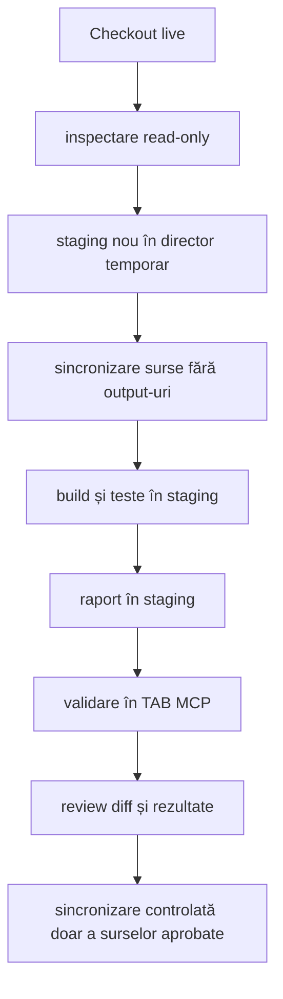

# Build și execuție sigură pentru ATF

Acest ghid protejează execuțiile ATF care rulează deja. Principiul este simplu:

```text
codul live rămâne sursa de lucru;
build-ul și testele se execută într-un staging separat;
output-urile intermediare nu se sincronizează în checkout-ul activ;
doar artifactul final, validat prin TAB MCP, se publică explicit în
`artifacts/reports/` sau `artifacts/reports/ui/`.
```

## Ce nu se face

- nu se opresc procese sau rulări existente;
- nu se folosește reset --hard, checkout -- sau git clean;
- nu se șterg target, bin, obj, artifacts sau fișierele altui proces;
- nu se reutilizează un staging care poate aparține unei alte execuții;
- nu se suprascrie raportul deschis de utilizator;
- nu se deschide browserul Windows pentru validarea raportului; interacțiunea se
  face în TAB MCP.

## Rezolvarea sigură a configurației

Configurația de raportare este capturată o singură dată, la composition root.
O cale YAML relativă se rezolvă față de `startDirectory`-ul capturat, iar
`reporting.extent.outputDirectory` se rezolvă față de directorul YAML. Căile
care ies prin `..` din acel director sunt respinse înainte de publicare. Astfel
două rulări IntelliJ cu rădăcini diferite nu pot ajunge accidental la același
output printr-un `user.dir` schimbat sau printr-un path relativ ambiguu.

## Fluxul izolat



## Protocol obligatoriu pentru refactorizare

Acest protocol se reia pentru fiecare increment, chiar dacă schimbarea pare
locală. Codul live și testele existente sunt contextul curent; staging-ul este
doar locul sigur de lucru și nu devine automat o nouă sursă de adevăr.

1. **Sincronizează contextul live.** Recitește sursele, testele, README-urile,
   statusul checkout-ului și artifactul relevant înainte de a formula soluția.
   Nu porni de la o copie veche și nu presupune că un ToDo a rămas neschimbat.
2. **Capturează baseline-ul.** Rulează numai verificările necesare pentru zona
   atinsă în staging și păstrează failure-urile ca semnale de implementare;
   testele nu se șterg, nu se relaxează și nu se rescriu ca să ascundă o
   regresie.
3. **Creează staging unic.** Copiază numai sursele și documentele revizuite,
   cu `target`, `artifacts`, cache-uri, log-uri și output-uri generate excluse.
   Nu opri procesele existente și nu reutiliza un director al altui proces.
4. **Aplică un increment delimitat.** Schimbarea trebuie să aibă o
   responsabilitate clară, un test nominal și un failure-path. Dacă apare un
   conflict cu live-ul, oprește doar editarea acelui fișier, recitește-l și
   reconciliază explicit; nu face overwrite sau reset.
5. **Construiește și verifică.** Rulează testele unitare, de componentă și de
   artifact relevante, apoi suita afectată. Build-ul verde singur nu închide
   incrementul.
6. **Generează un artifact nou.** Raportul trebuie să fie timestamped și să
   rămână în staging; nu suprascrie raportul deschis sau output-ul unei rulări.
7. **Verifică în TAB MCP.** Deschide artifactul exact generat și execută click-
   uri pe suprafața schimbată: tab-uri, filtre, disclosure-uri, deep-link-uri,
   request/validation, Fails și Overview după caz. Verifică și un scenariu
   nominal, și unul negativ.
8. **Re-sincronizează înainte de publicare.** Compară staging-ul cu live-ul
   actual, păstrează doar sursele/documentele aprobate și nu propaga output-uri.
   După sincronizare, recitește fișierele atinse și verifică linkurile.
9. **Închide doar ce este demonstrat.** Actualizează README-urile cu contractul
   stabil. În feedback păstrează numai ToDo-urile încă deschise, fiecare cu
   testul cerut și criteriul observabil de acceptare.

### Guard software pentru sync live↔staging

Protocolul de mai sus are și un mecanism executabil, nu doar o convenție
operațională. Înainte de editare, composition root-ul capturează fișierele
aprobate prin `AtfPromotionManifest.capture(liveRoot, approvedFiles)` și poate
scrie manifestul JSON pentru auditul procesului. După gate-ul din staging,
`AtfPromotionGuard.promote(stagingRoot, liveRoot, baseline)` verifică drift-ul
paralel și copiază atomic numai fișierele din manifest. O modificare sau o
creare live concurentă oprește promovarea înainte de primul fișier; o cale
absentă în baseline este singura aprobare explicită pentru crearea unui fișier
nou. Nu se face overwrite neaprobat, reset sau ștergere implicită. Manifestul
stochează numai căi relative, prezență, dimensiuni și digest-uri, nu căi locale
absolute și nu este inclus în raportul HTML.

Ordinea dovezilor este: cod live → teste → artifact HTML → interacțiune TAB MCP
→ documentație. Dacă două surse se contrazic, nu se declară succesul până când
diferența nu este investigată și reconciliată.

Exemplu PowerShell, cu căi înlocuite de operator:

```powershell
$source = '.'
$stage = Join-Path $env:ATF_STAGING_ROOT 'atf-java-staging-<id>'

New-Item -ItemType Directory -Force $stage | Out-Null
robocopy $source $stage /E /XD '.git' 'target' 'artifacts' 'spark' 'bin' 'obj' /XF '*.log' 'hs_err_pid*.log'
mvn -o -f "$stage\pom.xml" test
```

Pentru execuția Java se păstrează aceeași regulă într-un staging extern
checkout-ului, de exemplu `${ATF_STAGING_ROOT}/Atf-java-feedback-<id>`. Sursele se
resynchronizează înainte de build; `target`, rapoartele și dump-urile rămân
excluse din sync. Testele de raportare acceptă
`-Datf.test.reportDirectory=<stage>\artifacts\reports`, iar testul configured
report folosește `-Datf.report.config=<stage>\atf.yaml`; astfel raportul de
verificat este determinist sub `<stage>\artifacts\reports`, indiferent de
working directory-ul IDE/Maven.

### Reactorul este obligatoriu pentru contracte între module

Când un modul de test consumă API-uri schimbate în `atf-core`, `atf-ui` sau
alte module ale reactorului, verificarea se rulează cu `-am` (de exemplu
`mvn -pl atf-reporting-tests -am test`). Pentru librăria standalone, `mvn -f atf-reporting/pom.xml test`
este gate-ul izolat intenționat; un `mvn -pl atf-reporting-tests test` izolat poate
rezolva un JAR instalat anterior din repository-ul local și poate raporta
constructori/metode lipsă care nu există în sursele stage-ului. Rezultatul
izolat este acceptabil numai după un reactor build verde sau dacă dependențele
folosite sunt explicit construite din același stage; altfel nu este dovadă
pentru codul live.

### Bucla periodică de sync pentru feedback și build

La fiecare reluare a unui ToDo se pornește de la checkout-ul live, se recreează
staging-ul și se copiază numai sursele; `target`, rapoartele HTML, capturile și
dump-urile nu sunt surse de adevăr și nu se sincronizează înapoi. După build se
leagă dovada de codul sincronizat prin trei identificatori: commit/snapshot-ul
de lucru, artifactul timestamped și verificarea interactivă în TAB MCP. Dacă
un agent lucrează într-o altă locație, aceeași secvență se repetă înainte de
fiecare build; nu se acceptă un artifact vechi ca dovadă pentru codul live.

Publicația pe aceeași cale finală este serializată printr-un lock per cale în
directorul temporar al procesului; lock-ul nu este scris lângă raport și nu
schimbă staging-ul privat al sesiunii.

Fiecare staging Extent este marcat printr-un fișier versionat și ținut sub un
lease exclusiv cât timp sesiunea este activă. După o întrerupere forțată,
operatorul poate rula explicit sweeper-ul bounded din
`atf.api.reporting.ReportStagingWorkspace`, de exemplu:

```java
var result = ReportStagingWorkspace.sweep(
        reportDirectory,
        Duration.ofHours(1));
```

Sweeper-ul inspectează numai directoarele `.atf-extent-session-*` marcate direct
sub `reportDirectory`, păstrează workspace-urile fresh, active, malformate sau
nemarcate și returnează cardinalitatea `scanned/deleted/skipped/failures`.
Implicit procesează cel mult 256 de candidate; pentru operaționalizare se poate
folosi overload-ul cu `maxCandidates`, iar `limitReached=true` face limitarea
observabilă în test și în diagnostic.

<id> este unic pentru sesiunea curentă. Dacă există fișiere modificate local,
se verifică înainte ca sincronizarea să nu le suprascrie. Orice proiect extern
care rulează în paralel își redirecționează output-ul în propriile directoare
de staging; build-ul ATF Java folosește separat `target` și artifactele sale.

## Ce se sincronizează și ce nu

Se pot propaga numai surse și documente revizuite explicit:

- proiecte, surse și testele aferente;
- README-uri și documente Markdown;
- fișiere de configurație urmărite, dacă schimbarea le cere;
- patch-uri validate și reproducibile.

Nu se propagă:

- target, bin, obj, artifacts, spark sau cache-uri;
- rapoarte generate și snapshot-uri de execuție;
- log-uri, dump-uri și fișiere temporare;
- fișiere create de un alt proces în checkout-ul live.

Sincronizarea înapoi este o operație selectivă, după review de diff. Dacă există
modificări concurente în același fișier, se oprește doar editarea acelui fișier
și se recitește conținutul live; nu se repară prin overwrite sau reset.

### Regula anti-undo la revenirea din staging

Staging-ul este o copie de lucru, nu o sursă autoritară. La revenirea în live nu
se face mirror al directorului și nu se copiază recursiv staging-ul peste
checkout. Se promovează numai fișierele din zona task-ului, după această
secvență:

```text
live actual → baseline pentru fișierele aprobate
staging     → diff limitat la aceleași fișiere
reconciliere cu modificările paralele din live
promovare selectivă numai dacă baseline-ul este neschimbat
re-citire live și verificare a ownerului/documentației
```

Dacă live-ul conține o modificare mai nouă sau o mutare făcută de alt proces,
acea modificare se păstrează și se integrează punctual; nu se reintroduc fișiere
șterse din staging doar pentru că existau în copia inițială. Un fișier absent din
staging nu este autorizație de ștergere în live. Orice conflict devine ToDo
explicit și oprește doar promovarea fișierului conflictual, nu rulările active
și nu celelalte fișiere aprobate.

## Raportul din staging

Raportul generat în staging este singura sursă pentru verificarea vizuală a
schimbării. În TAB MCP:

1. se deschide exact artifactul din staging;
2. se verifică Tests, Category, Fails și Overview;
3. se expandează cel puțin un test pozitiv și unul negativ;
4. se confirmă ownership-ul request/validation, tabelul agregat și JSON-ul
   scrollabil;
5. se testează link-ul din Fails către testul original;
6. se verifică faptul că Overview este implicit și că nodurile de evidence sunt
   colapsate implicit.

O verificare statică a HTML-ului este utilă, dar nu înlocuiește click-ul în TAB
MCP pentru schimbări de layout, selector, collapse, tab sau scroll.

## Definition of Done pentru o execuție sigură

- procesul existent nu a fost oprit;
- staging-ul este separat și nu conține output-uri copiate din rulări vechi;
- build-ul și testele au rulat în staging;
- artifactul este autonom și nu a suprascris raportul live;
- verificarea interactivă a fost făcută în TAB MCP când este necesară;
- sincronizarea înapoi conține doar surse/documente aprobate;
- nu au fost șterse fișiere sau modificate checkout-uri străine.

