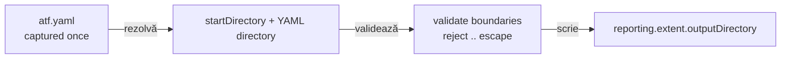
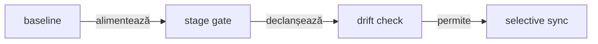
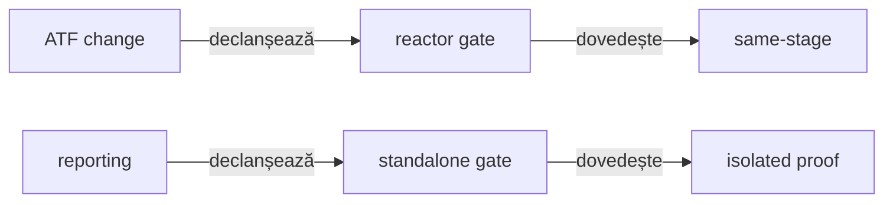
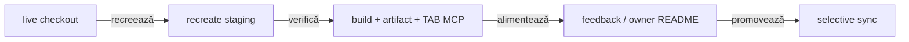

# Build și execuție sigură pentru ATF

## Pe scurt

- live-ul este contextul de lucru și sursa de sincronizare;
- build-ul și testele rulează într-un staging extern;
- output-urile intermediare nu se promovează în checkout;
- artifactul final se publică numai după verificarea în TAB MCP;
- procesele și rulările existente nu se opresc.

## Fluxul izolat

```mermaid
flowchart LR
    Live[Checkout live] -->|inspectează| Inspect[inspectare read-only]
    Inspect -->|izolează| Stage[staging nou în director temporar]
    Stage -->|sincronizează| Sync[sincronizare surse fără output-uri]
    Sync -->|rulează| Build[build și teste în staging]
    Build -->|publică| Report[raport în staging]
    Report -->|validează| MCP[validare în TAB MCP]
    MCP -->|revizuiește| Review[review diff și rezultate]
    Review -->|promovează| SyncBack[sincronizare controlată doar a surselor aprobate]
```



<details>
<summary><strong>Legendă — flux izolat și anti-undo</strong></summary>

- live-ul este contextul verificat, iar staging-ul este locul temporar de build;
- output-ul generat nu revine în surse și nu devine baseline implicit;
- review-ul compară sursele și dovezile înainte de orice sync-back;
- ultima muchie este selectivă: promovează numai fișiere aprobate și reconciliate.

</details>

## Ce nu se face

- nu se opresc procese sau rulări existente;
- nu se folosește reset --hard, checkout -- sau git clean;
- nu se șterg target, bin, obj, artifacts sau fișierele altui proces;
- nu se reutilizează un staging care poate aparține unei alte execuții;
- nu se rulează două build-uri Maven în același checkout sau stage: ambele
  folosesc `target`, iar un `clean` concurent poate produce false-negative de
  classloading în Surefire; fiecare execuție are staging propriu;
- nu se suprascrie raportul deschis de utilizator;
- nu se deschide browserul Windows pentru validarea raportului; interacțiunea se
  face în TAB MCP.

## Rezolvarea sigură a configurației



<details>
<summary><strong>Legendă — configurație capturată la composition root</strong></summary>

Configurația de raportare este capturată o singură dată, la composition root.
O cale YAML relativă se rezolvă față de `startDirectory`-ul capturat, iar
`reporting.extent.outputDirectory` se rezolvă față de directorul YAML. Căile
care ies prin `..` din acel director sunt respinse înainte de publicare. Astfel
două rulări IntelliJ cu rădăcini diferite nu pot ajunge accidental la același
output printr-un `user.dir` schimbat sau printr-un path relativ ambiguu.

</details>

## Regula de lucru pentru orice schimbare

```mermaid
flowchart LR
    Live["cod live<br/>README + feedback"] -->|capturează| Baseline["baseline<br/>inspect + capture"]
    Baseline -->|izolează| Stage["staging izolat<br/>surse aprobate"]
    Stage -->|delimitează| Change["increment delimitat<br/>test nominal + failure"]
    Change -->|verifică| Verify["build + teste<br/>artifact nou"]
    Verify -->|auditează| Audit["TAB MCP<br/>UI + negative path"]
    Audit -->|reconciliază| Reconcile["re-sync live<br/>drift check"]
    Reconcile -->|închide| Close["feedback + owner README<br/>dovadă observabilă"]
```



<details>
<summary><strong>Legendă — protocolul obligatoriu al unui increment</strong></summary>

- **Live**: recitește codul, testele, README-urile, feedback-ul și artifactul relevant.
- **Baseline**: păstrează failure-urile; nu șterge, relaxa sau rescrie teste pentru false-green.
- **Staging**: folosește un director unic; copiază doar sursele și documentele, fără output-uri generate.
- **Change**: limitează responsabilitatea și definește test nominal + failure-path; nu face overwrite sau reset la conflict.
- **Verify**: rulează testele unitare, componentă și artifact relevante, apoi suita afectată.
- **Audit**: verifică artifactul nou în TAB MCP, inclusiv suprafața schimbată și un scenariu negativ.
- **Reconcile**: compară din nou staging-ul cu live-ul; sincronizează numai fișiere aprobate.
- **Close**: actualizează owner README-ul; în feedback închide doar ce are dovadă observabilă.

<details>
<summary><strong>Detalii operaționale — staging, artifact și publicare</strong></summary>

Codul live și testele existente sunt contextul curent; staging-ul este doar
locul sigur de lucru și nu devine automat o nouă sursă de adevăr. Nu opri
procesele existente și nu reutiliza directorul altui proces.

Raportul trebuie să fie nou, timestamped și păstrat în staging; nu se
suprascrie raportul deschis sau output-ul unei rulări. În TAB MCP se verifică
tab-uri, filtre, disclosure-uri, deep-link-uri, request/validation, Fails și
Overview după caz.

Înainte de publicare, staging-ul se compară cu live-ul actual. Se păstrează
numai sursele și documentele aprobate; `target`, `artifacts`, cache-urile,
log-urile și output-urile generate nu se propagă. După sincronizare se recitesc
fișierele atinse și se verifică linkurile.

</details>

</details>

### Guard software pentru sync live↔staging



<details>
<summary><strong>Legendă — manifest, drift și promovare</strong></summary>

- **Baseline**: manifestul conține numai fișiere aprobate și căi relative.
- **Staging**: build-ul și testele rulează separat de checkout-ul live.
- **Guard**: orice drift concurent oprește promovarea înainte de primul fișier.
- **Sync**: se copiază atomic numai sursele aprobate; nu există overwrite, reset sau ștergere implicită.

Protocolul de mai sus are și un mecanism executabil, nu doar o convenție
operațională. Înainte de editare, composition root-ul capturează fișierele
aprobate prin `AtfPromotionManifest.capture(liveRoot, approvedFiles)` și poate
scrie manifestul JSON pentru auditul procesului. După gate-ul din staging,
`AtfPromotionGuard.promote(stagingRoot, liveRoot, baseline)` verifică drift-ul
paralel și copiază atomic numai fișierele din manifest. O modificare sau o
creare live concurentă oprește promovarea înainte de primul fișier; o cale
absentă în baseline este singura aprobare explicită pentru crearea unui fișier
nou. Nu se face overwrite neaprobat, reset sau ștergere implicită. Manifestul
stochează numai căi relative, prezență, dimensiuni și digest-uri, nu căi locale
absolute și nu este inclus în raportul HTML.

Ordinea dovezilor este: cod live → teste → artifact HTML → interacțiune TAB MCP
→ documentație. Dacă două surse se contrazic, nu se declară succesul până când
diferența nu este investigată și reconciliată.

Exemplu PowerShell, cu căi înlocuite de operator:

```powershell
$source = '.'
$stage = Join-Path $env:ATF_STAGING_ROOT 'atf-java-staging-<id>'

New-Item -ItemType Directory -Force $stage | Out-Null
robocopy $source $stage /E /XD '.git' 'target' 'artifacts' 'spark' 'bin' 'obj' /XF '*.log' 'hs_err_pid*.log'
mvn -o -f "$stage\pom.xml" test
```

Pentru execuția Java se păstrează aceeași regulă într-un staging extern
checkout-ului, de exemplu `${ATF_STAGING_ROOT}/Atf-java-feedback-<id>`. Sursele se
resynchronizează înainte de build; `target`, rapoartele și dump-urile rămân
excluse din sync. Testele de raportare acceptă
`-Datf.test.reportDirectory=<stage>\artifacts\reports`, iar testul configured
report folosește `-Datf.report.config=<stage>\atf.yaml`; astfel raportul de
verificat este determinist sub `<stage>\artifacts\reports`, indiferent de
working directory-ul IDE/Maven.

</details>

### Staging pentru guvernanța schimbării testelor

`TestChangeGovernanceTest` cere un checkout Git real și baseline-ul revizuirii.
O copie simplă fără istoric nu constituie dovadă pentru acest gate și eșuează
explicit; nu se dezactivează verificarea pentru a face staging-ul verde.

- Creează o clonă locală izolată, fără checkout și fără hardlink-uri.
- Inițializează indexul clonei din `HEAD`, apoi copiază sursele live fără `.git`,
  `target`, `artifacts` sau configurații locale cu credentiale.
- Păstrează diferența surselor față de baseline; nu o ascunde printr-un commit
  artificial al snapshot-ului înaintea verificării.
- Rulează cu `-Datf.governance.testChanges.baseRef=<review-base>`; controlul de schimbare fixează
  SHA-ul acelei baze. CI cere explicit baza, iar checkout-ul live nu este reutilizat
  pentru output-uri intermediare.

Exemplul completează sincronizarea de surse de mai sus:

```powershell
git clone --no-checkout --no-hardlinks . $stage
git -C $stage read-tree HEAD
robocopy . $stage /E /XD .git target artifacts spark bin obj /XF '*.log' '*.local.properties'
mvn -f "$stage\pom.xml" '-Dtest=WholeAtfGovernanceSuiteTest' '-Dsurefire.failIfNoSpecifiedTests=false' '-Datf.governance.testChanges.baseRef=<review-base>' test
```

### Reactorul este obligatoriu pentru contracte între module



<details>
<summary><strong>Legendă — două gate-uri independente</strong></summary>

- **Reactor gate**: `mvn -pl <consumer> -am test`; recompilă modulul schimbat împreună cu consumatorii din același stage.
- **Standalone gate**: `mvn -f atf-reporting/pom.xml test`; verifică reporting-ul izolat, fără consumatori.
- **Proof**: rezultatul trebuie să provină din sursele stage-ului, nu dintr-un JAR local vechi.

Când un modul de test consumă API-uri schimbate în `atf-core`, `atf-ui` sau
alte module ale reactorului, verificarea se rulează cu `-am` (de exemplu
`mvn -pl atf-reporting-tests -am test`). Pentru librăria standalone, `mvn -f atf-reporting/pom.xml test`
este gate-ul izolat intenționat; un `mvn -pl atf-reporting-tests test` izolat poate
rezolva un JAR instalat anterior din repository-ul local și poate raporta
constructori/metode lipsă care nu există în sursele stage-ului. Rezultatul
izolat este acceptabil numai după un reactor build verde sau dacă dependențele
folosite sunt explicit construite din același stage; altfel nu este dovadă
pentru codul live.

</details>

### Bucla periodică de sync pentru feedback și build



<details>
<summary><strong>Legendă — reluarea unui ToDo și izolarea output-ului</strong></summary>

La fiecare reluare a unui ToDo se pornește de la checkout-ul live, se recreează
staging-ul și se copiază numai sursele; `target`, rapoartele HTML, capturile și
dump-urile nu sunt surse de adevăr și nu se sincronizează înapoi. După build se
leagă dovada de codul sincronizat prin trei identificatori: commit/snapshot-ul
de lucru, artifactul timestamped și verificarea interactivă în TAB MCP. Dacă
un agent lucrează într-o altă locație, aceeași secvență se repetă înainte de
fiecare build; nu se acceptă un artifact vechi ca dovadă pentru codul live.

Publicația pe aceeași cale finală este serializată printr-un lock per cale în
directorul temporar al procesului; lock-ul nu este scris lângă raport și nu
schimbă staging-ul privat al sesiunii.

Fiecare staging Extent este marcat printr-un fișier versionat și ținut sub un
lease exclusiv cât timp sesiunea este activă. După o întrerupere forțată,
operatorul poate rula explicit sweeper-ul bounded din
`atf.api.reporting.publication.ReportStagingWorkspace`, de exemplu:

```java
var result = ReportStagingWorkspace.sweep(
        reportDirectory,
        Duration.ofHours(1));
```

Sweeper-ul inspectează numai directoarele `.atf-extent-session-*` marcate direct
sub `reportDirectory`, păstrează workspace-urile fresh, active, malformate sau
nemarcate și returnează cardinalitatea `scanned/deleted/skipped/failures`.
Implicit procesează cel mult 256 de candidate; pentru operaționalizare se poate
folosi overload-ul cu `maxCandidates`, iar `limitReached=true` face limitarea
observabilă în test și în diagnostic.

<id> este unic pentru sesiunea curentă. Dacă există fișiere modificate local,
se verifică înainte ca sincronizarea să nu le suprascrie. Orice proiect extern
care rulează în paralel își redirecționează output-ul în propriile directoare
de staging; build-ul ATF Java folosește separat `target` și artifactele sale.

</details>

## Memoria JVM pentru teste și publicare

| Proces | Configurație | Rol |
|---|---|---|
| Maven | `.mvn/jvm.config`, `MAVEN_OPTS` | Rulează build-ul, nu dimensionează fork-ul de teste |
| Surefire | `pom.xml`: `atf.test.heap.max=2g` | Heap maxim de 2 GiB per JVM de teste; inițial 64 MiB |
| IntelliJ JUnit direct | Run Configuration → VM options | Setează explicit `-Xms64m -Xmx2g -XX:MaxMetaspaceSize=128m` |

- Override Maven explicit: `mvn "-Datf.test.heap.max=3g" ... test`; limita se
  aplică fiecărui fork, nu întregului reactor.
- `-DargLine=...` nu înlocuiește `argLine` configurat explicit în acest POM;
  folosește `atf.test.heap.max` pentru override-ul heap-ului.
- Păstrează fork-ul normal Surefire; `-DforkCount=0` schimbă modul de execuție
  și nu este remedierea recomandată pentru memoria raportului.
- Rapoartele cu PNG-uri inline cer memorie și la finalizare: pipeline-ul
  postprocesează întregul HTML înainte de publicarea atomică.
- Un `OutOfMemoryError: Java heap space` la finalizare invalidează publicarea,
  chiar dacă metodele de test au trecut; verifică și exit code-ul Maven.
- Nu dezactiva capturile pentru a masca lipsa de heap. Cei 2 GiB sunt bugetul
  implicit, nu o garanție pentru orice volum; fork-urile concurente și
  browserele consumă memorie suplimentară.

## Ce se sincronizează și ce nu

Se pot propaga numai surse și documente revizuite explicit:

- proiecte, surse și testele aferente;
- README-uri și documente Markdown;
- fișiere de configurație urmărite, dacă schimbarea le cere;
- patch-uri validate și reproducibile.

Nu se propagă:

- target, bin, obj, artifacts, spark sau cache-uri;
- rapoarte generate și snapshot-uri de execuție;
- log-uri, dump-uri și fișiere temporare;
- fișiere create de un alt proces în checkout-ul live.

Sincronizarea înapoi este o operație selectivă, după review de diff. Dacă există
modificări concurente în același fișier, se oprește doar editarea acelui fișier
și se recitește conținutul live; nu se repară prin overwrite sau reset.

### Regula anti-undo la revenirea din staging

Staging-ul este o copie de lucru, nu o sursă autoritară. La revenirea în live nu
se face mirror al directorului și nu se copiază recursiv staging-ul peste
checkout. Se promovează numai fișierele din zona task-ului, după această
secvență:

```text
live actual → baseline pentru fișierele aprobate
staging     → diff limitat la aceleași fișiere
reconciliere cu modificările paralele din live
promovare selectivă numai dacă baseline-ul este neschimbat
re-citire live și verificare a ownerului/documentației
```

La reconciliere, live-ul rămâne autoritar pentru modificările apărute în paralel:

- modificările noi și mutările se păstrează și se integrează punctual;
- fișierul absent din staging nu autorizează ștergerea lui din live;
- conflictul devine ToDo explicit și oprește promovarea acelui fișier;
- celelalte fișiere aprobate și rulările active pot continua.

## Raportul din staging

Raportul generat în staging este singura sursă pentru verificarea vizuală a
schimbării. În TAB MCP:

1. se deschide exact artifactul din staging;
2. se verifică Tests, Category, Fails și Overview;
3. se expandează cel puțin un test pozitiv și unul negativ;
4. se confirmă ownership-ul request/validation, tabelul agregat și JSON-ul
   scrollabil;
5. se testează link-ul din Fails către testul original;
6. se verifică faptul că Overview este implicit și că nodurile de evidence sunt
   colapsate implicit.

O verificare statică a HTML-ului este utilă, dar nu înlocuiește click-ul în TAB
MCP pentru schimbări de layout, selector, collapse, tab sau scroll.

## Criterii de finalizare pentru o execuție sigură

- procesul existent nu a fost oprit;
- staging-ul este separat și nu conține output-uri copiate din rulări vechi;
- build-ul și testele au rulat în staging;
- artifactul este autonom și nu a suprascris raportul live;
- verificarea interactivă a fost făcută în TAB MCP când este necesară;
- sincronizarea înapoi conține doar surse/documente aprobate;
- nu au fost șterse fișiere sau modificate checkout-uri străine.

