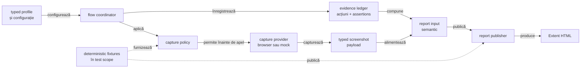
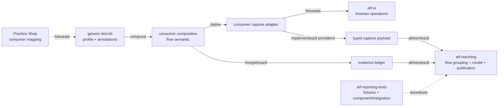
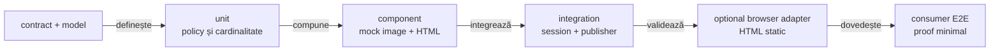

# ATF — contract transversal pentru capturarea configurabilă a dovezilor

## Pe scurt

- soluție generică pentru evidence vizual și tehnic;
- reutilizabilă pentru orice consumer UI, nu pentru un singur site;
- separă **cum curge flow-ul**, **când se capturează** și **cine furnizează imaginea**;
- păstrează `atf-reporting` ca publisher standalone, fără browser sau Playwright în production;
- verifică suportul mai întâi prin teste unitare, component și integration;
- folosește E2E doar pentru efectul observabil în browser.

Acest document fixează contractul transversal. Profilul typed este implementat în
`atf-reporting`; adapterul concret de browser/mock rămâne responsabilitatea
consumerului și nu este ascuns în renderer. Practice Shop este un consumer de
referință; nu este owner-ul soluției.

## Diagramă de bază



<details>
<summary><strong>Legendă — traseul unei dovezi</strong></summary>

- `Config` descrie intenția consumerului, nu un selector sau o cale locală;
- `Flow` ordonează pașii și păstrează evidența neutră;
- `Policy` decide momentele permise înainte de invocarea providerului;
- `Source` furnizează payload-ul; poate fi Playwright în consumer sau mock în teste;
- `Input` este boundary-ul semantic consumat de reporting;
- `Publisher` publică HTML-ul; nu reia acțiuni de browser;
- `Fixtures` probează policy-ul și publisherul fără endpoint sau browser extern.

</details>

## Dimensiuni independente ale dovezilor

| Axă | Întrebarea | Valori de contract | Owner conceptual |
|---|---|---|---|
| flow mode | cum este reprezentat flow-ul? | `SCREEN_CHECKPOINTS`, `UNIFIED_FLOW` | `atf-reporting` lifecycle/publisher, configurat de consumer |
| screenshot policy | când se publică imaginea? | `EACH_CHECKPOINT`, `FINAL_ONLY`, `FAILURE_ONLY`, `FINAL_AND_FAILURE`, `NONE` | contract evidence + publisher |
| capture source | de unde vine payload-ul? | `BROWSER`, `MOCK`, `CUSTOM_PROVIDER` | adapterul consumerului / test scope |
| action details mode | cât din acțiunile deja capturate se dezvăluie? | `INCLUDED_COLLAPSED`, `SUMMARY_ONLY` | renderer generic; consumerul alege profilul |

`flow mode` și `screenshot policy` sunt independente. Un flow unificat poate avea
`FINAL_ONLY`, `FAILURE_ONLY`, `FINAL_AND_FAILURE` sau `NONE`; un flow pe checkpoint-uri
poate păstra `EACH_CHECKPOINT` fără să schimbe rendererul. `action details mode`
schimbă numai disclosure-ul acțiunilor: nu filtrează capturarea și nu schimbă
asserțiile ori verdictul.

<details>
<summary><strong>Starea live</strong></summary>

- **existent**: `atf-reporting` deține `ReportScreenshotPolicy`, modelul screenshot,
  session lifecycle și publication sink;
- **existent**: `atf-ui` poate furniza captură PNG Base64 și acțiuni neutre;
- **existent**: `atf-reporting-tests` are fixture-uri PNG deterministe și verifică
  policy-ul fără browser;
- **existent**: `ReportEvidenceProfile` compune typed `ReportEvidenceFlowMode`,
  `ReportScreenshotPolicy`, `ReportEvidenceCaptureSource` și
  `ReportUiActionDetailsMode`; mapping-ul se poate face prin `fromConfig(...)` sau
  builder și traversează `UiExtentReportSession`;
- **distincție**: setările `reporting.extent` rămân configurarea publisherului;
  `evidence.flowMode` și mapping-ul unui flow nu se ascund în acel loader;
- **implementat**: `ReportEvidenceCaptureProvider` este seam-ul browser-neutral;
  `ReportEvidenceProfile.capture(point, title, target, provider)` filtrează înainte
  de apel, verifică source-ul declarat și refuză target-ul lipsă ori payload-ul
  care nu este PNG Base64. Mock-ul determinist și adapterul Playwright folosesc
  același contract;
- **implementat**: `SCREEN_CHECKPOINTS` păstrează fiecare request Gherkin;
  `UNIFIED_FLOW` bufferizează checkpoint-urile UI dintr-o fază și publică un
  singur request Gherkin: ultimul `THEN` disponibil, sau ultimul checkpoint ca
  fallback. Numele scenariului/fazei rămân metadata distinctă, fără children
  `Checkpoint N` și fără duplicarea propoziției în details;
- **implementat**: toate acțiunile/assertions UI sunt publicate într-o singură
  validare `Screen validation`; dacă profilul conține API evidence, exchange-urile
  rămân într-o singură validare `API validation`, soră cu validarea UI sub același
  checkpoint Gherkin și în ordinea execuției;
- **independent**: screenshot policy decide capturile înainte de buffer; numai
  capturile permise ajung în validarea UI agregată (`FINAL_ONLY` → captura finală);
- **implementat**: `INCLUDED_COLLAPSED` și `SUMMARY_ONLY` schimbă disclosure-ul
  acțiunilor deja înregistrate, fără să elimine dovezi de aserțiune sau să modifice
  verdictul; testele component acoperă ambele randări;
- **boundary**: consumerul furnizează semantică și profile, iar reporting-ul
  deține grouping-ul generic. Practice Shop doar mapează config-ul propriu și nu
  conține reguli de publisher;

</details>

Policy-ul de publicare existent rămâne API public al librăriei reporting. Contractul
transversal este evidențiat separat pentru a putea fi reutilizat ulterior de un
test-kit sau de o bibliotecă de compoziție, fără a confunda publisherul cu executorul.

## Responsabilități și limite



<details>
<summary><strong>Legendă — unde se oprește fiecare zonă</strong></summary>

- `test-kit` definește reutilizabil configurația și compoziția permisă;
- consumerul definește flow-ul semantic, ținta finală și locatori;
- `atf-ui` execută operațiile browserului; adapterul consumerului implementează
  `ReportEvidenceCaptureProvider` și întoarce payload neutru;
- `atf-reporting` normalizează și publică evidence-ul primit;
- `atf-reporting-tests` validează biblioteca prin fixture-uri, nu devine production;
- Practice Shop demonstrează consumul, dar nu deține contractul transversal;
- niciun publisher nu trebuie să importe un page object sau un endpoint de aplicație.

</details>

## Ordinea de implementare și de testare



<details>
<summary><strong>Legendă — de ce nu începem cu Practice Shop</strong></summary>

- unit verifică valori, tranziții, target obligatoriu și duplicate;
- component verifică direct markup-ul, statusul, disclosure-ul și numărul de capturi;
- integration verifică `session → model → HTML` fără browser;
- browser adapter verifică numai captura reală pe un HTML local static;
- consumer E2E confirmă integrarea, nu suportul generic;
- un defect de policy sau markup trebuie să pice înainte de E2E.

</details>

## Contract minim pentru orice implementare

- `PASS`, `FAIL`, `WARNING` și `SKIP` rămân statusuri semantice independente de captură;
- acțiunile și assertions rămân publicate când policy-ul este `NONE`;
- `FINAL_ONLY` cere o țintă finală explicită;
- `FAILURE_ONLY` nu pretinde că flow-ul are evidence de succes;
- `FINAL_AND_FAILURE` separă dovada finală de diagnosticul failure;
- cardinalitatea așteptată este verificabilă: `0`, `1` sau `N` capturi;
- payload-ul duplicat este deduplicat numai printr-o regulă internă documentată;
- lipsa payload-ului, target-ul lipsă și providerul invalid eșuează diagnostic;
- HTML-ul este verificat direct pentru text, structură, referință media și disclosure;
- Playwright nu intră în modelele de production.

## Configurație generică

Configurația trebuie să poată fi furnizată prin YAML sau printr-un builder typed.
Cheile de mai jos sunt un contract conceptual; numele finale se aliniază cu
implementarea aprobată, fără a lega soluția de Practice Shop:

```yaml
evidence:
  flowMode: unified-flow
  screenshotPolicy: final-only
  captureSource: mock
  finalTarget: <consumer-defined-key>
```

- `flowMode` alege reprezentarea flow-ului;
- `screenshotPolicy` alege momentele de captură;
- `captureSource` descrie proveniența payload-ului (`browser`, `mock`, `provider`);
- `finalTarget` este o cheie semantică opacă, nu un locator hardcodat în reporting;
- pentru `none`, flow-ul rămâne auditabil prin acțiuni și assertions;
- mapping-ul YAML → `ReportEvidenceProfile` aparține composition root-ului și
  folosește enum-urile sau builder-ul typed, fără string-uri propagate în renderer;
- configurarea publisherului (`reporting.extent`) rămâne separată de profilul evidence.

## Reutilizare API și UI

Aceeași strategie se aplică dovezilor API fără a introduce browser:

- source: request/response exchange sau fixture deterministic;
- policy: ce evidence se păstrează și în ce punct al lifecycle-ului;
- model: body, headers, status, assertions și execution metadata typed;
- publisher: disclosure-uri și HTML semantic;
- test: fixture → component → integration → audit browser numai pentru efectul UI.

Captura vizuală este o variantă de evidence, nu un motiv pentru a duplica rendererul,
session lifecycle-ul sau testele de status.

## Unde se aprofundează

| Întrebare | Owner |
|---|---|
| care este contractul transversal al capturii? | acest document |
| cum publică reporting-ul policy-ul și HTML-ul? | [`atf-reporting/README.md`](../atf-reporting/README.md) |
| cum se testează biblioteca fără browser? | [`atf-reporting-tests/README.md`](../atf-reporting-tests/README.md) |
| cum se auditează artifactul în browser? | [`atf-reporting-tests/src/test/java/atf/ui/tests/extent/README.md`](../atf-reporting-tests/src/test/java/atf/ui/tests/extent/README.md) |
| cum furnizează browserul un payload neutru? | [`atf-ui/README.md`](../atf-ui/README.md) |
| cum mapează un consumer propriul YAML și flow? | README-ul consumerului |
| ce mai lipsește și cum se închide? | [`feedback/README.md`](feedback/README.md) și feedback-ul ownerului |

Nu se copiază această matrice în fiecare modul. README-ul local păstrează numai
ownership-ul și linkul către contractul transversal.
