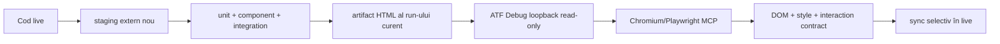

# ATF Reporting — guard de referință vizuală și funcțională

ATF nu păstrează un HTML real ca sursă normativă. Sursa de adevăr este contractul
din cod, testele statice/component și verificarea browser a artifactului generat
de run-ul curent. Un raport anterior poate fi folosit local pentru investigație,
dar nu este exemplu permanent și nu este referențiat de README-uri.

## Contractul protejat

| Suprafață | Invariantă |
|---|---|
| navigare | `Tests`, `Overview`, `Categories`, `Fails`; deep-link-ul activează view-ul corect |
| ierarhie | `SETUP → TEST BODY → TEARDOWN`, faze doar când există în lifecycle |
| ownership | request și validation sunt surori; Fails indică testul original |
| evidence | request/response JSON sau `null` explicit, execution trace și assertion table |
| UI evidence | acțiuni, observații și assertions separate; `Screen validation` după pașii relevanți |
| layout | `＋/−` inline, wrapping, fără `<hr>` decorativ și fără overflow orizontal |
| offline | HTML autonom, asset-uri cunoscute, fără resurse externe obligatorii |
| failure | cauză distinctă pentru setup/action/audit/assertion și link `Open in Tests` |

## Bucla de verificare



1. Se pornește de la codul live și se construiește numai în staging extern.
2. Se execută testele relevante și contractul static al artifactului.
3. Se deschide exact output-ul generat prin ATF Debug; nu se validează doar prin
   substring-uri HTML sau printr-un fișier istoric.
4. Se verifică toate tab-urile, disclosure-urile, click-urile, collapse,
   computed-style, wrapping, screenshot link, console/page errors și deep-link.
5. Se sincronizează în live doar sursele reconciliate; procesele active rămân
   pornite.

## Ce se compară

Comparația este semantică și contractuală, nu pixel-diff între două fișiere
generate:

```text
vocabulary + model → markup/CSS/JavaScript
                         ↓
                 DOM + accessibility
                         ↓
              interaction + computed-style
```

Dacă există o abatere, se adaugă mai întâi un test de contract/componentă sau un
test E2E pentru comportamentul imposibil de demonstrat static. Nu se modifică
testul ori inputul doar pentru a ascunde diferența.

Detaliile de implementare sunt în
[`atf-reporting/README.md`](../atf-reporting/README.md), contractul observabil în
[`ATF_Reporting_Contract.md`](ATF_Reporting_Contract.md), iar protocolul de
staging/sync în [`ATF_Build_And_Execution_Safety.md`](ATF_Build_And_Execution_Safety.md).
