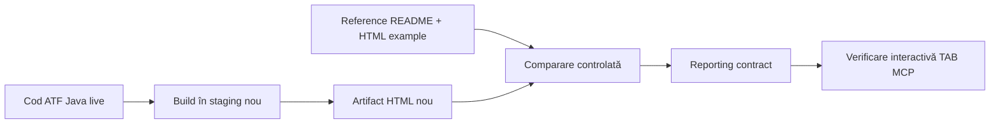

# ATF Reporting — guard de referință vizuală

ATF Java are un reper vizual și funcțional extern păstrat în:

```text
../../.net/Atf/artifacts/reports/
```

Referința este relativă la root-ul proiectului Java; folderul `.net` este
workspace-ul frate de la nivelul rădăcinii comune.

Folderul conține propriul `README.md` și un artifact HTML exemplu. README-ul
din acel folder este indexul local al snapshot-ului și descrie exact ce poate fi
comparat: tab-uri, ierarhie, expand/collapse, alinierea textului cu durata și
statusul, geometria badge-urilor, adnotările, evidence-ul, Fails și funcționarea
offline.

## Rolul reperului

Reperul este un gard de regresie vizuală și funcțională, nu sursa de rezultate
ale unei execuții noi. Codul ATF Java și contractele sale normative rămân sursa
de adevăr pentru comportamentul intenționat; snapshot-ul extern se folosește
numai pentru a detecta o abatere accidentală de structură, navigare sau randare.



## Ce trebuie protejat

- ordinea `Tests → Category → Fails → Overview`, cu Overview implicit;
- navigatorul claselor fără tag-uri sau timestamp în tabelul Tests;
- scenariile, fazele `SETUP → TEST BODY → TEARDOWN` și sibling-ul
  `request → validation`;
- statusul și durata pe același rând, cu unitatea `ms` și geometrie comună;
- culorile semantic distincte pentru `Pass`, `Warning`, `Fail` și `Info`;
- dropdown-urile dark pentru filtrele de status și tag;
- evidence-ul tehnic compact, JSON scrollabil și assertion table agregat;
- Fails ca index cu `Open in Tests`, nu ca al doilea arbore executabil;
- suprafețe uniforme și artifact offline fără resurse externe obligatorii.

## Procedură de comparație

1. Citește README-ul și artifactul de referință din folderul indicat.
2. Generează artifactul Java într-un staging derivat din codul live; nu
   suprascrie raportul de referință și nu opri rulările existente.
3. Deschide artifactul nou în TAB MCP și verifică toate tab-urile, nu doar
   primul ecran.
4. Compară mai întâi semantica și ierarhia, apoi layout-ul, culorile,
   alinierea, filtrele și stările de collapse.
5. Pentru orice abatere, adaugă sau extinde testul de contract/componentă și
   repară implementarea. Nu modifica testul sau reperul pentru a ascunde
   diferența.
6. Actualizează reperul numai după ce raportul nou trece testele și verificarea
   interactivă; păstrează un motiv clar al actualizării în README-ul reperului.

Detaliile implementării rămân în
[atf-reporting/README.md](../atf-reporting/README.md), iar contractul general
al artifactului în [ATF_Reporting_Contract.md](ATF_Reporting_Contract.md).
