# Contractul de raportare Extent pentru ATF Java

## Pe scurt

- raportul reprezintă execuția; nu creează un al doilea verdict;
- runnerul și evaluatorul de contract rămân autoritățile rezultatului;
- Extent publică evidence-ul într-o formă lizibilă și navigabilă;
- fiecare suprafață reutilizează aceeași identitate și aceeași semantică.

### Overview/System — instantaneu semantic

System răspunde la o singură întrebare: **cu ce setări operaționale a rulat acest
raport?** Este un rezumat plat, nu un al doilea loc pentru identitatea testului
sau pentru dovezile execuției.

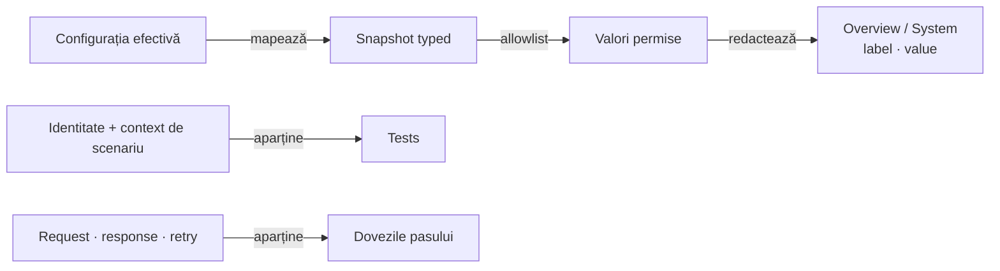

<details>
<summary><strong>Legendă — ce aparține fiecărei suprafețe</strong></summary>

- `Snapshot` păstrează setări typed; allowlist-ul și redaction-ul preced publicarea;
- `System` este rezumatul operațional, în format plat `label · value`;
- identitatea și rezultatele scenariilor merg în `Tests`, iar datele transportului
  rămân lângă exchange-ul care le-a produs.

</details>

| System include — dacă este relevant | System exclude — are deja un owner |
|---|---|
| Environment, profil și build | Suite, test package și identitatea scenariului → `Tests` |
| Host-uri și mod de transport | Flow, fixture și precondiție specifică journey-ului → `Tests` |
| Browser, viewport și timeout-uri lizibile | Checkout și alte date business → pașii de test |
| Authentication mode, retry/network settings | Request, response, retry history și payload → evidence-ul exchange-ului |
| Reporting, screenshot policy și limite de preview | Secrete, YAML brut, căi locale și identificatori instabili → nu se publică |

- `ReportEnvironmentField` definește vocabularul typed și categoriile semantice;
- `ReportEnvironmentSnapshot` ignoră valorile goale și filtrează câmpurile
  invizibile în System;
- `ReportEnvironment` aplică redaction la boundary-ul de publicare;
- `Client` este metadata operațională opțională;
- categoriile (`Run`, `Targets`, `Browser`, `Time`, `Flow`, `Auth`, `Network`,
  `Evidence`, `Reporting`) nu devin grupuri sau headere vizuale în tabel.

<details>
<summary><strong>Detalii — boundary, formatare și compatibilitate</strong></summary>

- `Precondition` în System descrie numai un setting operațional global; starea
  pregătită pentru un anumit journey rămâne în `Tests`;
- `Body preview` afișează limita configurată și locul evidence-ului complet, nu
  conținutul body-ului. Este distinct de limita JSON-ului Request/Response și de
  preview-ul observațiilor Network Inspector;
- duratele sunt afișate în unități umane (`20s`, `45s`), nu ca valori ISO opace;
- `Map<String,String>` rămâne doar pentru compatibilitatea consumatorilor
  existenți; codul nou folosește snapshot-ul typed;
- snapshot-ul System descrie configurația efectivă, nu înlocuiește evidence-ul
  observat și nu deduce valori din YAML brut, nume de test sau payload business.

</details>

## Schema auth a dovezilor API

| Câmp din request | Valoare | Regulă comună |
|---|---|---|
| `AUTH PROFILE` | Identitatea profilului configurat, de exemplu `shop-user` | Nu este mecanismul auth; browserul nu inventează un profil |
| `AUTH TYPE` | Mecanismul observat, de exemplu `bearer`, `basic`, `none`, `other/unknown` | Nu se înlocuiește cu numele profilului |

- API standalone, auditul API, API din UI+API și fallback HTML folosesc aceeași
  pereche de câmpuri, în aceeași ordine, în `Request details`.
- Headerul sau query-ul observat are prioritate față de un indiciu din numele
  profilului. Clasificarea profilului rămâne fallback de compatibilitate.
- Observația typed se păstrează când headerele sunt redactate; mecanismul auth
  nu se recalculează din credentiale deja mascate.
- Aliasurile `auth.type` și `Auth type` produc `AUTH TYPE`;
  aliasurile legacy per exchange păstrează doar calificarea `API n ·`.
- `auth.mode` rămâne modul operațional, cu eticheta `AUTHENTICATION`; nu este
  un alias pentru mecanismul observat al request-ului.
- `Authentication` din System și `Authentication evidence` din inspector sunt
  alte suprafețe; nu se redenumesc pentru a repara schema unui request.

## Ordinea suprafețelor

Ordinea aprobată și rolul fiecărei suprafețe sunt vizibile într-un singur flux:

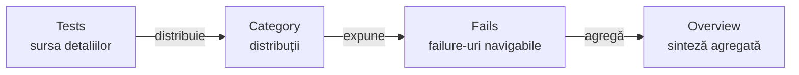

<details>
<summary><strong>Legendă — suprafețe și reguli de navigare</strong></summary>

- `Tests` este sursa autoritativă pentru clase, scenarii, status, durată și
  evidence selectabilă;
- `Category` și `Overview` sunt proiecții, nu verdicturi alternative;
- `Fails` păstrează fiecare failure individual și oferă legătura către `Tests`;
- `Overview` se deschide implicit la load/refresh, dar nu se mută înaintea lui
  `Tests` în ordinea semantică;
- hash-urile și click-urile trebuie să ajungă la aceeași suprafață.

| Suprafață | Conținut |
|---|---|
| Tests | clase/scenarii, status, durată și detalii selectabile |
| Category | distribuții și legături către scenariile relevante |
| Fails | toate failure-urile, fără grupare care ascunde testele individuale |
| Overview | totaluri și metadate agregate, fără a crea verdicturi alternative |

</details>

## Arborele unui test

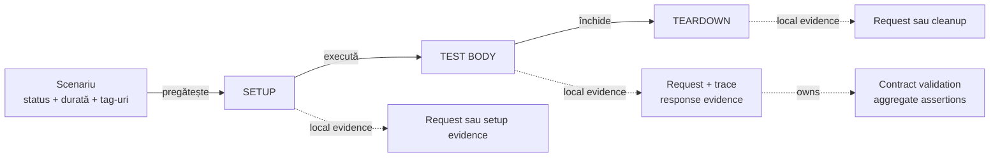

<details>
<summary><strong>Legendă — ierarhia vizuală a unui test</strong></summary>

- coloana solidă arată lifecycle-ul; fazele sunt create numai când au conținut
  real;
- ramificațiile punctate grupează local evidence-ul și nu introduc pași noi;
- `SETUP` poate publica setup evidence, iar `TEST BODY` publică request și
  response-contract validation când există un contract evaluat;
- în raportul API direct, validation-ul contractului este copilul request-ului
  care deține schimbul; în raportul UI, UI/API validation rămân copii semantici
  ai aceluiași checkpoint Gherkin;
- `TEARDOWN` publică numai cleanup/read-back real;
- tabelul agregat aparține validation-ului, nu request-ului și nu fazei;
- failure-ul se afișează o singură dată, în zona care îl produce.

</details>

În raportul API direct, request-ul și dovezile sale tehnice sunt urmate în același
card de `Contract validation` nested, când răspunsul a fost evaluat printr-un
contract. În raportul UI, checkpoint-ul Gherkin deține validările UI și API ca
evidence soră; exchange-urile aparțin validării API, nu devin pași Gherkin noi.

Auditul consumerului păstrează câte un nod pentru fiecare schimb observat și
atașează `Contract validation` numai când producătorul a asociat schimbului un
contract HTTP tipizat. Statusul așteptat este explicit și comparat cu statusul
observat; statusul observat sau verdictul JUnit nu îl înlocuiește. Completitudinea
capturii și eșecul metodei JUnit sunt detalii la nivel de fază, publicate o singură
dată, nu aserțiuni repetate pe fiecare schimb.

Reguli de ownership:

1. request-ul conține metoda, calea, durata, trace-ul tehnic și JSON-ul;
2. pentru API direct, validation-ul contractului este nested sub request-ul
   evaluat; pentru UI, validările UI și API sunt atașate checkpoint-ului Gherkin;
3. tabelul de assertions aparține validation-ului;
4. faza nu repetă failure-ul deja detaliat în tabel;
5. scenariul arată verdictul agregat, nu duplică evidence-ul fiecărei faze.

## Dovezile configurării inițiale

`SETUP` deține precondițiile și achiziția/verificarea fixture-ului; nu este
rezervat doar inputurilor read-only. Un consumer poate selecta explicit o
operație de pregătire cu efect extern, precum înregistrarea unui cont, înainte
de `TEST BODY`. Contractul raportului separă rezumatul verificărilor de
dovezile transportului:

- un singur bloc `Setup evidence`;
- tabelul `CHECK | EXPECTED | ACTUAL | RESULT`;
- check-urile rezumă sursa selectată, rezultatul setup-ului și pregătirea pentru
  faza următoare; tabelul nu dublează request/response sau JSON-ul transportului;
- acțiunile UI și exchange-urile API reale rămân dovezi distincte ale aceluiași
  checkpoint `SETUP`; când API evidence este selectată, `API validation` păstrează
  structura canonică `Exchange → Request → Response → Execution`;
- setup-ul nu este `UI validation` sau `Screen validation`; aceasta din urmă
  aparține `TEST BODY`, după acțiunile și observațiile de business;
- transportul nu produce un checkpoint Gherkin duplicat și nu schimbă singur
  verdictul business.

## Dovezile unei cereri

### Etichete canonice

Tab-ul `Tests` este sursa vizibilă de adevăr pentru denumirile evidence-ului.
Aceleași label-uri trebuie păstrate în `Category`, `Fails`, `Overview` și în
rendererul fallback:

| Rol | Label |
|---|---|
| request context | `Request details · N fields` |
| disclosure trace | `Response details · N fields` |
| clasificare internă | `TECHNICAL TRACE` |
| request payload | `REQUEST JSON` |
| response payload | `RESPONSE JSON` |
| transport execution | `Execution evidence · N attempts` |
| assertions | `Assertions · N` |

<details>
<summary><strong>Detalii — payload, provenance și replay</strong></summary>

- `TECHNICAL TRACE` descrie conținutul din `Response details`; `N` este numărul
  real de rânduri ale tabelului trace;
- `Request details` conține method, URL/path, headers, params, auth și request
  body înainte de transport;
- `request.action` și `request.target` identifică intern checkpoint-ul UI și
  nu sunt câmpuri HTTP publice. Proiecția Extent/fallback le exclude din ambele
  tabele request/response, păstrând modelul semantic. Un checkpoint ale cărui
  singure detalii sunt aceste chei nu publică tabelul `Status / Details / Info`
  sau un disclosure gol; validările UI/API rămân copiii propoziției;
- filtrarea acestor două chei nu elimină țintele acțiunilor Playwright și nu
  suprimă `Request details`, JSON-ul sau execution evidence ale exchange-urilor
  HTTP din `API validation`;
- în artefactele noi, fiecare exchange UI+API are propriul nod și cele trei
  disclosure-uri canonice, fără prefix `API n ·` repetat în fiecare câmp;
- formatterul recunoaște în continuare cheile flat legacy `request.api.n.*`
  și `response.api.n.*`; prefixul `API n ·` este compatibilitate de citire,
  nu formatul implicit sau un nivel diferit de detaliu;
- pentru `0..N` exchange-uri, prefixul nu este suficient ca structură: fiecare
  exchange trebuie să păstreze disclosure-ul API canonical
  `Request details` → `Response details` → `Execution evidence`; metadata precum
  `TRACE PARENT STEP` și `TRACE POSITION` aparține contextului trace-ului, nu
  tabelului response;
- în UI trace, acest spine este copilul semantic `API validation`, poziționat
  între pasul Gherkin și disclosure-urile collapsed; `API validation` are stilul
  și statusul unei `UI validation`, dar nu creează un test sau un verdict paralel;
- nu există un canal generic de captură sau publicare pentru console/page
  diagnostics; raportul nu pretinde că aceste semnale au fost verificate;
- `Technical diagnostics` în Network Inspector se derivă numai din exchange-uri
  HTTP eșuate; nu devine pas Gherkin, validare de business sau exchange nou;
- inspectorul primește exchange-urile contractuale și checkpoint-urile cauzale;
  orice verdict rămâne owner-ul validării de checkpoint/scenariu;
- inspectorul de rețea este un nod synthetic unic, iar `Network aggregate · N
  exchanges` este copilul său real; copilul deține disclosure-urile typed pentru
  auth, correlation, transport, unique signatures și diagnostics, fără să
  repete titlul sau request-urile în părinte;
- summary-ul compact comun are înălțimea de bază `34px`; excepțiile sunt
  deliberate și trebuie să rămână puține;
- `Unique request signatures` și `Technical diagnostics`, când sunt randate ca
  rânduri în Network Inspector aggregate, folosesc același summary compact de
  `34px` și sunt collapsed implicit. Titlul poate curge natural pe mai multe
  linii la viewport îngust, fără să rezerve o înălțime dublă când încape pe un
  singur rând;
- `Playwright action sequence`, `Audit observations` și `Assertions` păstrează
  summary-ul compact de bază, dar tabelele lor folosesc același viewport
  vertical bounded și scrollabil, cu header sticky; wrapper-ul este comun
  rendererelor Extent și fallback și nu mută screenshot-ul în viewport-ul
  tabelului;
- toate tabelele care pot derula vertical folosesc același plafon de viewport ca
  `Overview → System/Environment`: tokenul unic
  `AtfReportThemeTokens.TABLE_SCROLL_HEIGHT` (`500px` în profilul curent),
  publicat ca `--atf-table-scroll-height`. Wrapper-ul folosește `height:auto` și
  `max-height`, ca un tabel scurt să nu rezerve spațiu gol, iar unul lung să
  deruleze până la ultimul rând cu header sticky. Regula acoperă
  System/Environment, Category/Overview, tag audit, Playwright action, audit
  observations, assertions, tabelul `TECHNICAL TRACE` din `Response details` și
  echivalentele API/UI; nu există înălțimi hardcodate per renderer. Tabelul
  `TECHNICAL TRACE` folosește wrapperul comun `atf-trace-table-wrap` și
  derulează în containerul său, fără să includă disclosure-ul exterior sau
  blocul JSON. Blocurile JSON/code sunt payload panes, nu tabele,
  și își păstrează limita compactă proprie;
- la viewport-uri înguste (`≤991px`), Overview începe după rail-ul fix de
  navigare (`70px`) și ocupă doar spațiul rămas; layout-ul desktop păstrează
  indentarea existentă;
- când există mai multe exchange-uri, `Execution evidence` trebuie să păstreze
  identitatea exchange-ului în disclosure-ul părinte sau în titlu; repetarea
  unui titlu generic fără context nu este auditabilă;
- retry-ul aceluiași request nu este exchange nou: request/response rămân o
  singură unitate API, iar attempts, retry events și outcome rămân în
  `Execution evidence`;
- `REQUEST JSON` și `RESPONSE JSON` există și pentru body absent, caz în care
  valoarea explicită este `null`;
- `TRANSPORT PROVENANCE` vine din composition root: `ACCEPTANCE / MOCK` nu a
  executat rețea, `LIVE / HTTP` a contactat endpointul, iar `UNKNOWN` nu dovedește
  un apel;
- `MANUAL REPLAY` este safe: acceptance este `NOT EXECUTABLE`, live publică un
  cURL redacted, iar operatorul completează credentialele din profil.
- proiecția UI păstrează request headers relevante după filtrarea browser noise
  și publică response headers numai când rămân stabile/relevante după aceeași
  redaction policy; response headers volatile nu schimbă nivelul canonical al
  raportului API direct.

</details>

Pentru inspectorul journey, corelarea Gherkin și inspectorul de rețea sunt două
axe distincte, nu două copii ale aceluiași tabel:

```text
Gherkin checkpoint
├── UI validation
├── API validation
└── Network inspector
    ├── Scenario correlation       → pași Gherkin + count/assertions
    └── Unique request signatures  → method/route/status/count + metadate
```

`Response details` din inspector este un index bounded:

- nu repetă request rows, `NETWORK EXCHANGE n` sau propoziții Gherkin;
- fiecare fapt apare o singură dată în disclosure-ul semantic potrivit;
- UI și API rămân sub aceeași propoziție Gherkin, fără pași duplicați;
- request-urile retry/repetate se grupează după semnătură, iar attempt history
  rămâne în `Execution evidence`.

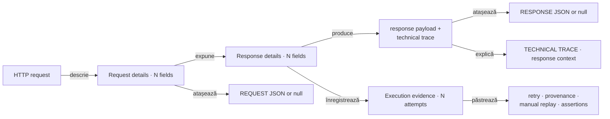

<details>
<summary><strong>Legendă — provenance și evidence</strong></summary>

- coloana principală citește `HTTP request → request details → response details`;
- `ResponseEvidence` și `ExecutionContext` sunt grupări vizuale locale pentru a
  evita săgețile lungi și nu introduc disclosure-uri noi;
- JSON-ul și trace-ul sunt detalii locale ale request/response, iar retry,
  provenance, replay și assertions sunt detalii locale ale execuției;
- `Request details`, `Response details` și `Execution evidence` sunt
  disclosure-uri separate în artifact; schema le leagă printr-un spine compact.
  Într-un UI trace cu mai multe exchange-uri, același spine se repetă per
  exchange sub un singur nod Gherkin. Nodul are copii semantici separați pentru
  `UI validation` și `API validation`; un al doilea card cu aceeași propoziție
  Gherkin este duplicare de intent și nu este contract canonical. Concatenarea
  tuturor rândurilor într-un tabel comun `API 1/API 2` nu este contract
  canonical;
- `TECHNICAL TRACE` descrie response context, nu înlocuiește response-ul;
- provenance și replay-ul explică transportul, fără să pretindă că mock-ul a făcut trafic real;
- assertions rămân legate de request-ul și validation-ul care le-au produs.

</details>

<details>
<summary><strong>Detalii — execution evidence, durată și redacție</strong></summary>

Evidence-ul de execuție este renderer-neutral. Înregistrează statusul response-
ului, URL-ul redacted, durata măsurată, numărul de attempt-uri și istoricul de
retry/attempt. Motivele retry și URL-urile trec prin aceeași limită de redaction
ca headers, JSON și valorile assertions; un renderer nu reconstruiește secrete.

Trace-ul tehnic este compact și relevant. El păstrează URL-ul cererii, dar nu
repetă statusul response-ului sau mecanica execuției:

```text
URL
CONTENT-TYPE
FAILURE CAUSE (dacă există)
alte facts HTTP non-duplicative
```

`Execution evidence · N attempts` este disclosure-ul separat pentru mecanica
transportului. El păstrează URL-ul efectiv, durata response-ului, numărul de
încercări, numărul de retry events și istoricul attempt-urilor. Este închis
implicit și nu trebuie contopit cu `TECHNICAL TRACE`.

Un `request-failed` înainte de orice răspuns HTTP este un caz diferit de un
răspuns existent cu body absent:

- sentinelul intern `status=-1` se afișează `Unavailable`, nu ca status HTTP;
- încercarea are outcome `FAILURE` și motiv bounded; nu se fabrică `RESPONSE JSON`;
- exchange-ul și inspectorul sunt `Warning`, iar agregarea păstrează scenariul
  `Warning` chiar dacă un consumer îl închide cu `PASS`. Testul de business
  decide separat dacă acel failure este `FAIL`.

Retry-ul Playwright are aceeași regulă de fail-closed, dar este o policy de UI
separată de retry-ul transportului: `UiRetryPolicy` pornește cu un singur
attempt și niciun operation eligibil. Configurarea poate enumera numai operații
read-only (`navigate` și wait-uri), poate seta `maxAttempts`, `backoff` și un
motiv bounded, iar fiecare reluare este un rând `Info` în secvența Playwright.
`click`, `fill`, `select-option` și replay-ul întregului test nu sunt eligibile;
failure-ul final rămâne verdictul acțiunii.

Durata se afișează explicit ca `RESPONSE DURATION` în execution evidence și ca
`N ms` pentru valori de până la `300 ms`, respectiv `N s` pentru valori peste
prag, în header-ele navigabile. `1`, `16` sau `25` fără unitate nu sunt forme
acceptate deoarece pot fi confundate cu număr de pași sau assertions.
Timestamp-ul nu este identitatea semantică a testului și nu este folosit pentru
triere sau grupare.

Durata unui nod respectă aceeași regulă în întregul arbore:

```text
leaf      = measured duration
parent    = exclusive self duration, dacă există
            + suma totalurilor copiilor structurali direcți
inclusive = valoare deja calculată de Extent; nu se mai adaugă descendenții
```

Un total părinte nu însumează toți descendenții și nu amestecă o durată
inclusivă cu aceiași copii. Durata tehnică proprie, dacă există, trebuie
marcată distinct de totalul inclusiv.
Pentru navigatorul `Tests`, totalul clasei este suma totalurilor scenariilor
directe vizibile în panoul clasei. Valoarea din stânga și cea din header-ul
clasei trebuie să fie aceeași; o durată brută Extent care include deja
scenariile nu se recopiază peste suma lor.
Valoarea auth este profilul/modul, niciodată secretul.

Request JSON și Response JSON sunt blocuri de cod autonome. Liniile se rup sau
se derulează în interiorul blocului; pagina nu trebuie să dobândească scroll
orizontal din cauza unui payload. Dacă payload-ul este mic, blocul rămâne
compact; nu se impune o înălțime mare doar pentru uniformitate.
Body-urile JSON Request/Response sunt limitate după redaction prin
`reporting.bodyMaxDisplayCharacters` (implicit `100`); depășirea este marcată
cu `… [truncated; showing first N of TOTAL chars]`, iar scroll-ul intern rămâne
activ. Valoarea `0` dezactivează limita numai pentru body preview.

Redacția se aplică la limita de publicare pentru ambele renderere. Detaliile
request-ului și fazei, JSON-ul, URL-ul, retry history, cauza failure-ului și
valorile assertions trec prin aceeași politică a redactorului sensibil;
cheia și parametrii query neconfidențiali rămân vizibili, iar valorile secrete
sunt înlocuite cu markerul de redacție. Niciun renderer nu poate publica direct
input-ul primit de la transport sau de la validator.

</details>

## Tabelul agregat de aserțiuni

Toate verificările pentru același response apar într-o singură structură:

```text
ASSERTION | EXPECTED | ACTUAL | RESULT
```

RESULT poate fi PASS, FAIL sau WARNING, iar statusul tabelului derivă din
rândurile sale. În cazul unui failure sunt păstrate toate rândurile deja
evaluate, nu doar primul mismatch. Nu se publică încă un nod duplicat în
TEST BODY pentru aceleași assertions.

Precedence-ul unic este:

```text
FAIL > SKIP > WARNING > PASS
```

Această regulă se aplică la rând, tabel, validation, phase și scenario. Dacă
runnerul are o regulă mai strictă, raportul o reflectă și nu o suprascrie.

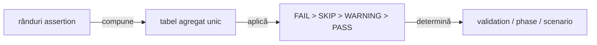

<details>
<summary><strong>Legendă — agregare și precedence</strong></summary>

- toate rândurile evaluate rămân în același tabel;
- precedence-ul se propagă în sus, fără a crea un verdict paralel;
- `TEST BODY` nu repetă assertion table-ul deja publicat în validation.

</details>

### Aranjare adaptivă pentru aserțiuni

<details>
<summary><strong>Detalii — layout adaptiv și payload-uri lungi</strong></summary>

Tabelul își păstrează cele patru coloane în ordinea `ASSERTION`, `EXPECTED`,
`ACTUAL`, `RESULT`, însă lățimile nu sunt contractate prin pixeli fixați.
Runtime-ul măsoară textul vizibil din toate rândurile, alocă proporțional mai
mult spațiu coloanei cu valorile flexibile cele mai lungi și păstrează `RESULT`
compact. Recalcularea se repetă la redimensionarea viewport-ului. Astfel,
body-urile, listele și mesajele lungi rămân lizibile fără overflow orizontal,
iar verificarea browser confirmă atât suma lățimilor, cât și faptul că acea
coloană dominantă primește lățimea dominantă.

</details>

### Aranjare pentru dovezile `FIELD | VALUE`

În tabelele key/value din trace și din detaliile request/response:

- `FIELD`: lățimea cheilor vizibile, limitată la 20–38%;
- `VALUE`: spațiul rămas, minimum 62% la lățimea disponibilă;
- alte tabele: alocarea content-aware existentă, nemodificată;
- viewport îngust: textul se rupe în celule, fără scroll orizontal al paginii.

Markerii `data-atf-key-value-layout` și `data-atf-key-column-width` expun
decizia de layout pentru audit. `ValidationTableLayoutComponentTest` verifică
contractul runtime, iar `ValidationTableLayoutInspector` verifică lățimile și
absența overflow-ului în browser.

## Fails și legături

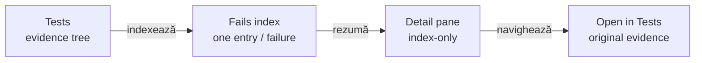

<details>
<summary><strong>Legendă — Fails este index, Tests este sursa</strong></summary>

- **Fails**: o intrare pentru fiecare failure, nu o grupare care pierde scenarii.
- **Conținut minim**: status, test/scenario, phase/request, assertion/cause și durată.
- **Link**: anchor intern stabil, independent de path-ul Windows sau de numele artifactului.
- **Detail pane**: proiecție index-only; nu clonează `test-contents` și nu creează alt evidence tree.
- **Open in Tests**: navighează la nodul original, fără să schimbe verdictul sau ownership-ul evidence-ului.
- **Evidence complet**: request/response JSON, trace, response details și assertions rămân în `Tests`.

### Semantica eșecului în ciclul de viață API

Un raport API poate fi `Fail` intenționat atunci când fixture-ul negativ verifică
vizibilitatea unui contract respins. Acest verdict nu se confundă cu un failure
al testului UI care inspectează raportul: raportul sursă rămâne roșu, iar auditul
UI este verde dacă redarea este corectă.

Rezumatul semantic al unui failure de contract este:

```text
FAILURE CAUSE | Contract assertion failed: HTTP status
ASSERTION     | HTTP status
EXPECTED      | 201
ACTUAL        | 200
```

Pentru mai multe assertion-uri se păstrează perechi `name = value`, iar pentru
un failure de teardown se publică o cauză lizibilă, fără să expună doar
`FailureSignal` sau numele clasei Java. Tabelul agregat din request rămâne
evidence-ul detaliat; faza are numai proiecția compactă necesară navigării și
tab-ului Fails.

Durata din indexul Fails este derivată din `RESPONSE DURATION`, nu din
timestamp. Dacă failure-ul nu are response măsurat, indexul afișează explicit
`No response duration recorded`; timpul de execuție rămâne disponibil în
evidence-ul requestului și în tab-ul Tests.

Navigarea funcționează prin click pe tab și prin hash direct:

- `#atf-fails-view`;
- `#test-view`;
- `#category-view`;
- `#dashboard-view`.

Runtime-ul sincronizează hash-ul inițial și evenimentele `hashchange`; altfel un
artifact offline poate afișa un view gol deși datele există în document.

</details>

## Prezentare generală și agregări

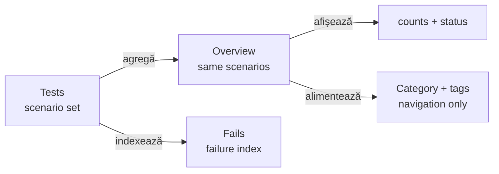

<details>
<summary><strong>Legendă — agregare fără duplicare</strong></summary>

- **Overview**: agregă exact scenariile publicate în `Tests`.
- **Counts + status**: un singur total semantic; proiectele unitare nu devin teste API.
- **Category + tags**: navigare și filtrare; nu schimbă verdictul și nu clonează noduri.
- **Fails**: index controlat către evidence-ul concret din `Tests`.
- **Scanare**: lista afișează nume, status și durată; evită pills și metadate decorative.

Regulile de randare pentru cardul scenariului sunt:

- titlul și adnotările rămân pe aceeași axă stângă;
- grupul titlu + adnotări este centrat numai vertical în header;
- expandarea și toolbar-ul durată/status rămân în coloane separate;
- regula rămâne valabilă pentru nume lungi, tag-uri multiple și durata în `ms`.

</details>

Un scenariu `WARNING` rămâne diagnostic, dar intră în totalurile pass-like din
Overview:

- `Tests Passed`, sumarul `Tests`/`Steps` și procentele: `PASS + WARNING`;
- graficele, categoriile, badge-urile și linia `warnings` păstrează `WARNING`
  distinct, fără a-l converti în `PASS`;
- `Fails` indexează numai failure-uri reale, nu warning-uri.

## Vizual și autonom

AtfReportTheme este sursa unică pentru fonturi, suprafețe, linii, statusuri,
tabele și blocuri JSON. Extent și fallback-ul nu își definesc palete separate.

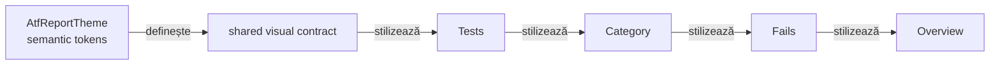

<details>
<summary><strong>Legendă — tokens, badge-uri și geometrie</strong></summary>

Linia după `shared visual contract` este o ordine de citire a suprafețelor, nu
o dependență de runtime între tab-uri. Toate suprafețele consumă aceleași
token-uri; `Tests → Category → Fails → Overview` este doar traseul de navigare
documentat.

Badge-urile `Pass`, `Warning` și `Fail` au aceeași geometrie în `Tests`,
`Category`, `Fails`, `Overview` și în detail projections:

```text
height 18.2px · padding 0 5px · border 0 · radius 4px
font-size 9.52px · line-height 18.2px · font-weight 400
```

Lățimea este `auto` și `min-width:0`: textul poate produce lățimi naturale
diferite (`Pass`, `Warning`, `Fail`), dar înălțimea, padding-ul, fontul,
alinierea și stilul de bordură rămân identice în toate tab-urile. Badge-urile
neutre de durată/metadata păstrează separat `22.4px`, padding `5px 7px` și
line-height `10.6624px`, pentru a nu modifica scara statusurilor.

Paleta semantică este comună: Pass `#9ccc65`, Warning `#ffc107`, Fail
`#e57373`, cu text `#fff` pentru Pass/Fail și `#f6f7f6` pentru Warning.
Selectorii de tab sau container nu pot introduce altă geometrie ori altă
culoare semantică.

</details>

### Metadatele antetului: durată, link direct și controale

<details>
<summary><strong>Detalii — metadata și controale</strong></summary>

În `detail-head .info` există trei tipuri diferite de elemente și nu trebuie
tratate printr-un selector generic de `badge-default`:

```text
durată                 → badge neutru, normalizat numeric (`9 ms`, `1.2 s`)
uri-anchor             → deep-link machine-readable, păstrat în DOM, ascuns vizual
Expand/Collapse        → controale pointer, păstrează iconițele vendor (`fa-expand` / `fa-compress`)
```

Runtime-ul de durate consumă selectorul tipizat `DURATION_MARKERS` și exclude
explicit `.uri-anchor` și `.pointer`. Astfel nu mai poate transforma accidental
un anchor sau o iconiță într-un `—`, iar metadata-ul nu concurează vizual cu
timpul. Deep-link-ul rămâne disponibil pentru navigarea programatică, în timp
ce acțiunea vizibilă pentru utilizator este `Open in Tests` din Fails. Separatorul
vendor `·` dintre durata măsurată și ancora ascunsă este eliminat din DOM numai
când este un text-node izolat, astfel încât headerul să nu rămână cu un simbol
fără semnificație.

Artifactul final trebuie să fie un singur HTML autonom:

- CSS și JavaScript incluse;
- fonturile și iconițele disponibile fără rețea;
- fără referințe extent/... sau folder auxiliar livrat;
- noduri de evidence închise implicit;
- phase shells colapsate implicit;
- cardurile scenariilor din Tests colapsate implicit, dar expandabile prin click;
- Overview deschis implicit;
- fără linii verticale decorative care rup interiorul test body-ului;
- contraste și fonturi consistente între tabelele de Overview și detaliile testului.

</details>

### Stabilitatea secțiunilor expandabile — verificare în browser

Disclosure-urile formează un arbore de stare, nu controale independente:

- deschiderea unui copil nu închide părintele sau faza care îl conține;
- închiderea scenariului închide și ascunde toate fazele, checkpoint-urile și
  disclosure-urile descendente;
- redeschiderea scenariului deschide numai containerul scenariului; copiii rămân
  închiși până la o acțiune explicită;
- starea vizuală, panelul, `aria-expanded` și glyph-ul se actualizează împreună;
  normalizarea întârziată nu inversează o tranziție deja stabilită.

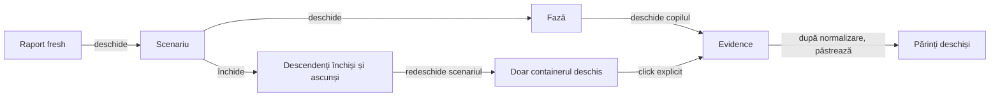

<details>
<summary><strong>Legendă — tranziții stabile ale disclosure-urilor</strong></summary>

- copilul deschis nu își închide părinții;
- închiderea scenariului resetează descendenții;
- redeschiderea scenariului nu extinde automat copiii.

</details>

Testele component/interaction verifică tranzițiile și sincronizarea atributelor;
proba în browser folosește un artifact fresh prin ATF Debug/TAB MCP și verifică
expandare succesivă, stabilitatea părintelui, resetarea la închiderea scenariului
și redeschiderea fără expandarea automată a copiilor. Un artifact vechi sau o
assertion doar pe text nu dovedește acest contract.

## Dovezi obligatorii pentru schimbări

| Schimbare | Dovadă minimă |
|---|---|
| agregare assertions | test unitar pentru agregare + artifact cu tabel |
| arbore request/validation | test de componentă + expandare în TAB MCP |
| tab-uri și deep-link | test de contract + click pe fiecare suprafață |
| fonturi, culori, linii | token tests + verificare computed style în TAB MCP |
| durate și totaluri | test pentru pragul `300 ms`/`301 ms` + agregare exclusive/direct children |
| status badge-uri | token test pentru geometrie și paletă în toate tab-urile |
| JSON, scroll și overflow | artifact real + payload mic și payload mare |
| Fails | cazuri fail/warning/skip + verificarea linkului |

Un test care verifică doar textul HTML nu înlocuiește verificarea interactivă a
DOM-ului când problema este de randare, click, collapse sau navigare.

## Guard de referință vizuală și funcțională

Contractul este verificat pe codul și artifactul run-ului curent. Un HTML mai
vechi poate ajuta la investigație locală, dar nu este baseline permanent și nu
este referențiat în README-uri.

```mermaid
flowchart LR
    Live[Cod + teste live] -->|capturează| Stage[staging extern nou]
    Stage -->|rulează| Build[unit + component + integration]
    Build -->|produce| Artifact[artifact HTML fresh]
    Artifact -->|servește| Debug[ATF Debug read-only]
    Debug -->|deschide| Browser[Chromium / Playwright MCP]
    Browser -->|verifică| Verdict[DOM + style + interaction]
    Verdict -->|promovează| Sync[sync selectiv în live]
```

<details>
<summary><strong>Legendă — ce validează guard-ul</strong></summary>

- inputul este raportul generat de run-ul curent sau un fișier static configurat explicit;
- se verifică tab-uri, deep-link-uri, disclosure-uri, click, computed-style,
  wrapping, screenshot, consolă și page errors;
- comparația este semantică: vocabular + model → markup/CSS/JavaScript → DOM + accessibility → interaction;
- orice abatere devine mai întâi test de componentă/contract sau E2E, nu o relaxare a testului;
- sincronizarea în live se face numai după reconcilierea surselor și a artifactului.

</details>

## Numele raportului și diferențierea rulărilor

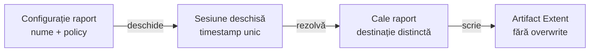

<details>
<summary><strong>Legendă — nume determinist și rulări distincte</strong></summary>

- **Config**: numele și politica de captură aparțin configurației, nu testului.
- **Session**: timestamp-ul se rezolvă o singură dată, la deschiderea sesiunii.
- **Path**: fiecare rulare publicată primește o destinație distinctă.
- **Artifact**: raportul deschis nu este suprascris.

</details>

<details>
<summary><strong>Detalii — configurație și reguli de publicare</strong></summary>

Configurația minimală este:

```yaml
reporting:
  bodyMaxDisplayCharacters: 100
  extent:
    outputDirectory: artifacts/reports
    fileName: ${REPORT_FILE_NAME}
    timestampEnabled: true
    timestampPattern: yyyy-MM-dd_HH-mm-ss-SSS
    timestampZone: system
    screenshotPolicy: each-checkpoint
```

Regulile runtime sunt:

- `timestampEnabled: true` inserează timestamp-ul înainte de extensie;
- `timestampPattern` folosește sintaxa Java `DateTimeFormatter`;
- `timestampZone` acceptă `system` sau un identificator IANA;
- pattern-urile cu caractere nesigure pentru nume de fișier sunt respinse;
- testele deterministe pot folosi un `Clock` fix prin `resolveReportPath(Clock)`;
- `timestampEnabled: false` este rezervat testelor interne cu destinație stabilă;
- rulările ATF publicate folosesc nume timestamped, inclusiv fără YAML explicit.

Politica de screenshot este typed, nu un boolean duplicat în testele UI:

- `each-checkpoint`;
- `final-only`;
- `failure-only`;
- `final-and-failure`;
- `none`.

Un flow `final-only` marchează explicit checkpoint-ul prin
`ReportScreenshotPolicy.CapturePoint.FINAL`; reporting nu ghicește starea finală.
Când policy-ul acceptă screenshot-ul, target-ul este obligatoriu, iar acțiunile
și assertions rămân publicate chiar dacă imaginea este dezactivată.

Pentru evidence, composition root-ul poate mapa `flowMode`, `screenshotPolicy`,
`captureSource` și `actionDetailsMode` în `ReportEvidenceProfile`, prin
`fromConfig(...)` sau builder. `actionDetailsMode` schimbă doar disclosure-ul
acțiunilor deja capturate. Profilul nu execută Playwright și nu mută mock-ul în
reporting.

Acest contract descrie politica de publicare și efectul în artifact. Separarea
generică dintre flow mode, capture source, action-details mode și composition root este în
[`ATF_Evidence_Capture_Contract.md`](ATF_Evidence_Capture_Contract.md); nu este
specifică Practice Shop și nu se deduce din `reporting.extent`.

Schimbarea timestamp-ului nu modifică arborele Extent, statusurile, agregările
sau randarea HTML.

</details>

