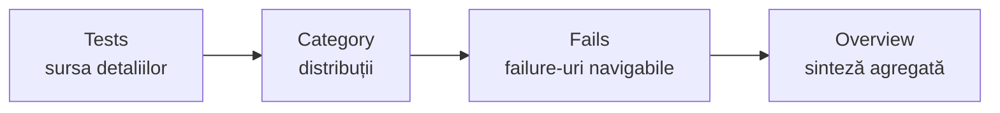
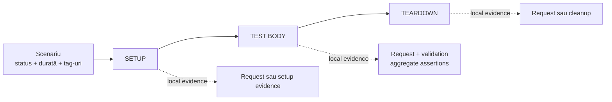
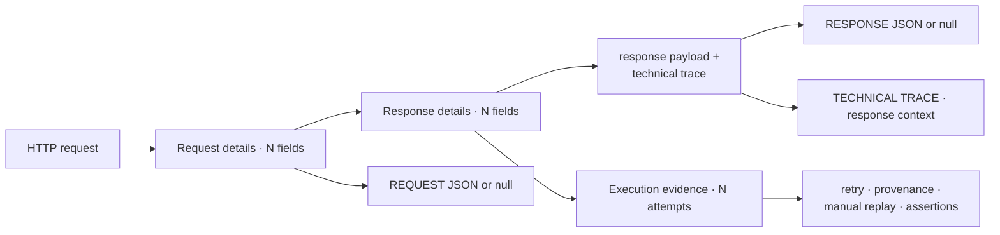
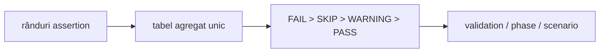
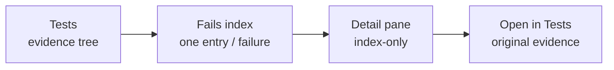
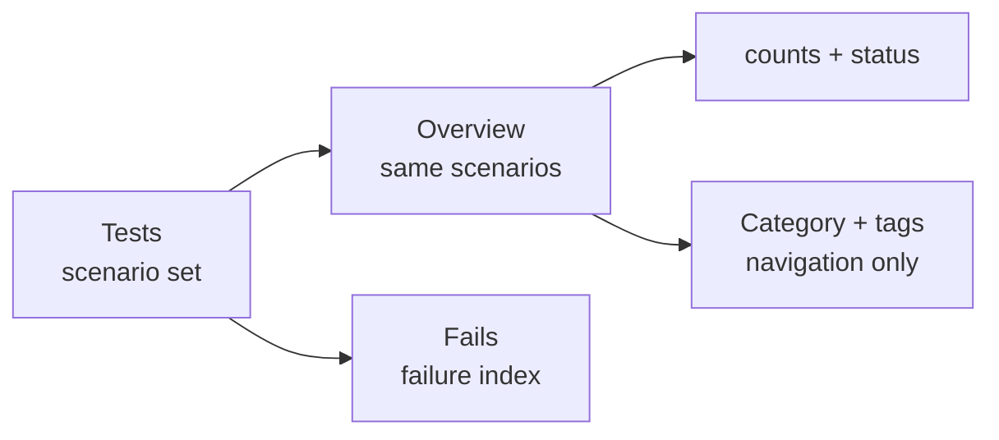
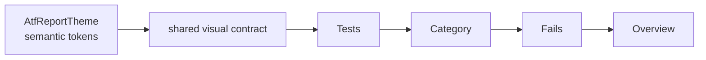
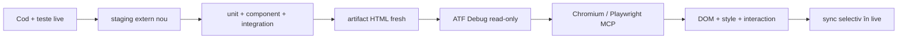
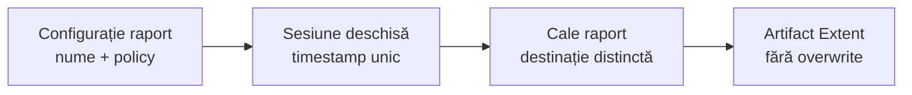

# Contractul de raportare Extent pentru ATF Java

## Overall

- raportul reprezintă execuția; nu creează un al doilea verdict;
- runnerul și evaluatorul de contract rămân autoritățile rezultatului;
- Extent publică evidence-ul într-o formă lizibilă și navigabilă;
- fiecare suprafață reutilizează aceeași identitate și aceeași semantică.

## Ordinea suprafețelor

Ordinea aprobată și rolul fiecărei suprafețe sunt vizibile într-un singur flux:



<details>
<summary><strong>Legendă — suprafețe și reguli de navigare</strong></summary>

- `Tests` este sursa autoritativă pentru clase, scenarii, status, durată și
  evidence selectabilă;
- `Category` și `Overview` sunt proiecții, nu verdicturi alternative;
- `Fails` păstrează fiecare failure individual și oferă legătura către `Tests`;
- `Overview` se deschide implicit la load/refresh, dar nu se mută înaintea lui
  `Tests` în ordinea semantică;
- hash-urile și click-urile trebuie să ajungă la aceeași suprafață.

| Suprafață | Conținut |
|---|---|
| Tests | clase/scenarii, status, durată și detalii selectabile |
| Category | distribuții și legături către scenariile relevante |
| Fails | toate failure-urile, fără grupare care ascunde testele individuale |
| Overview | totaluri și metadate agregate, fără a crea verdicturi alternative |

</details>

## Arborele unui test



<details>
<summary><strong>Legendă — ierarhia vizuală a unui test</strong></summary>

- coloana solidă arată lifecycle-ul; fazele sunt create numai când au conținut
  real;
- ramificațiile punctate grupează local evidence-ul și nu introduc pași noi;
- `SETUP` poate publica setup evidence, iar `TEST BODY` publică request și
  validation când există contract;
- request-ul și validation-ul sunt surori în aceeași fază;
- `TEARDOWN` publică numai cleanup/read-back real;
- tabelul agregat aparține validation-ului, nu request-ului și nu fazei;
- failure-ul se afișează o singură dată, în zona care îl produce.

</details>

În fiecare fază, request-ul și validation-ul sunt ramuri surori ale fazei;
legătura lor semantică este aceeași, dar validation-ul nu este copil vizual al
request-ului.

Reguli de ownership:

1. request-ul conține metoda, calea, durata, trace-ul tehnic și JSON-ul;
2. validation-ul este fratele direct al request-ului, în aceeași fază;
3. tabelul de assertions aparține validation-ului;
4. faza nu repetă failure-ul deja detaliat în tabel;
5. scenariul arată verdictul agregat, nu duplică evidence-ul fiecărei faze.

## Evidence-ul de setup

`SETUP` poate publica disponibilitatea unui artifact read-only pentru un audit
UI, dar nu este un request HTTP și nu este o validare de ecran. Când detaliul
`evidence.type` are valoarea `report-setup`, rendererul publică un singur bloc
`Setup evidence` cu tabelul `CHECK | EXPECTED | ACTUAL | RESULT`. Sunt permise
doar check-urile de input și rezultatul lor; nu se repetă în această zonă
`Request details`, `Response details`, JSON de transport, `UI validation` sau
`Screen validation`. Acestea rămân în ownerii lor: API request evidence,
respectiv `TEST BODY` → `Screen validation` pentru browser/DOM/style.

## Evidence-ul unui request

### Label-uri canonice

Tab-ul `Tests` este sursa vizibilă de adevăr pentru denumirile evidence-ului.
Aceleași label-uri trebuie păstrate în `Category`, `Fails`, `Overview` și în
rendererul fallback:

| Rol | Label |
|---|---|
| request context | `Request details · N fields` |
| disclosure trace | `Response details · N fields` |
| clasificare internă | `TECHNICAL TRACE` |
| request payload | `REQUEST JSON` |
| response payload | `RESPONSE JSON` |
| transport execution | `Execution evidence · N attempts` |
| assertions | `Assertions · N` |

<details>
<summary><strong>Detalii — payload, provenance și replay</strong></summary>

- `TECHNICAL TRACE` descrie conținutul din `Response details`; `N` este numărul
  real de rânduri ale tabelului trace;
- `Request details` conține method, URL/path, headers, params, auth și request
  body înainte de transport;
- `REQUEST JSON` și `RESPONSE JSON` există și pentru body absent, caz în care
  valoarea explicită este `null`;
- `TRANSPORT PROVENANCE` vine din composition root: `ACCEPTANCE / MOCK` nu a
  executat rețea, `LIVE / HTTP` a contactat endpointul, iar `UNKNOWN` nu dovedește
  un apel;
- `MANUAL REPLAY` este safe: acceptance este `NOT EXECUTABLE`, live publică un
  cURL redacted, iar operatorul completează credentialele din profil.

</details>



<details>
<summary><strong>Legendă — provenance și evidence</strong></summary>

- coloana principală citește `HTTP request → request details → response details`;
- `ResponseEvidence` și `ExecutionContext` sunt grupări vizuale locale pentru a
  evita săgețile lungi și nu introduc disclosure-uri noi;
- JSON-ul și trace-ul sunt detalii locale ale request/response, iar retry,
  provenance, replay și assertions sunt detalii locale ale execuției;
- `Request details`, `Response details` și `Execution evidence` sunt
  disclosure-uri separate în artifact; schema le leagă printr-un spine compact;
- `TECHNICAL TRACE` descrie response context, nu înlocuiește response-ul;
- provenance și replay-ul explică transportul, fără să pretindă că mock-ul a făcut trafic real;
- assertions rămân legate de request-ul și validation-ul care le-au produs.

</details>

<details>
<summary><strong>Detalii — execution evidence, durată și redacție</strong></summary>

Evidence-ul de execuție este renderer-neutral. Înregistrează statusul response-
ului, URL-ul redacted, durata măsurată, numărul de attempt-uri și istoricul de
retry/attempt. Motivele retry și URL-urile trec prin aceeași limită de redaction
ca headers, JSON și valorile assertions; un renderer nu reconstruiește secrete.

Trace-ul tehnic este compact și relevant. El păstrează URL-ul cererii, dar nu
repetă statusul response-ului sau mecanica execuției:

```text
URL
CONTENT-TYPE
FAILURE CAUSE (dacă există)
alte facts HTTP non-duplicative
```

`Execution evidence · N attempts` este disclosure-ul separat pentru mecanica
transportului. El păstrează URL-ul efectiv, durata response-ului, numărul de
încercări, numărul de retry events și istoricul attempt-urilor. Este închis
implicit și nu trebuie contopit cu `TECHNICAL TRACE`.

Durata se afișează explicit ca `RESPONSE DURATION` în execution evidence și ca
`N ms` pentru valori de până la `300 ms`, respectiv `N s` pentru valori peste
prag, în header-ele navigabile. `1`, `16` sau `25` fără unitate nu sunt forme
acceptate deoarece pot fi confundate cu număr de pași sau assertions.
Timestamp-ul nu este identitatea semantică a testului și nu este folosit pentru
triere sau grupare.

Durata unui nod respectă aceeași regulă în întregul arbore:

```text
leaf      = measured duration
parent    = exclusive self duration, dacă există
            + suma totalurilor copiilor structurali direcți
inclusive = valoare deja calculată de Extent; nu se mai adaugă descendenții
```

Un total părinte nu însumează toți descendenții și nu amestecă o durată
inclusivă cu aceiași copii. Durata tehnică proprie, dacă există, trebuie
marcată distinct de totalul inclusiv.
Pentru navigatorul `Tests`, totalul clasei este suma totalurilor scenariilor
directe vizibile în panoul clasei. Valoarea din stânga și cea din header-ul
clasei trebuie să fie aceeași; o durată brută Extent care include deja
scenariile nu se recopiază peste suma lor.
Valoarea auth este profilul/modul, niciodată secretul.

Request JSON și Response JSON sunt blocuri de cod autonome. Liniile se rup sau
se derulează în interiorul blocului; pagina nu trebuie să dobândească scroll
orizontal din cauza unui payload. Dacă payload-ul este mic, blocul rămâne
compact; nu se impune o înălțime mare doar pentru uniformitate.
Conținutul publicat este limitat după redaction prin
`reporting.bodyMaxDisplayCharacters` (implicit `12000`); depășirea este marcată
cu `… [truncated]`, iar scroll-ul intern rămâne activ.

Redacția se aplică la limita de publicare pentru ambele renderere. Detaliile
request-ului și fazei, JSON-ul, URL-ul, retry history, cauza failure-ului și
valorile assertions trec prin aceeași politică a redactorului sensibil;
cheia și parametrii query neconfidențiali rămân vizibili, iar valorile secrete
sunt înlocuite cu markerul de redacție. Niciun renderer nu poate publica direct
input-ul primit de la transport sau de la validator.

</details>

## Tabelul agregat de assertions

Toate verificările pentru același response apar într-o singură structură:

```text
ASSERTION | EXPECTED | ACTUAL | RESULT
```

RESULT poate fi PASS, FAIL sau WARNING, iar statusul tabelului derivă din
rândurile sale. În cazul unui failure sunt păstrate toate rândurile deja
evaluate, nu doar primul mismatch. Nu se publică încă un nod duplicat în
TEST BODY pentru aceleași assertions.

Precedence-ul unic este:

```text
FAIL > SKIP > WARNING > PASS
```

Această regulă se aplică la rând, tabel, validation, phase și scenario. Dacă
runnerul are o regulă mai strictă, raportul o reflectă și nu o suprascrie.



<details>
<summary><strong>Legendă — agregare și precedence</strong></summary>

- toate rândurile evaluate rămân în același tabel;
- precedence-ul se propagă în sus, fără a crea un verdict paralel;
- `TEST BODY` nu repetă assertion table-ul deja publicat în validation.

</details>

### Layout adaptiv pentru assertions

<details>
<summary><strong>Detalii — layout adaptiv și payload-uri lungi</strong></summary>

Tabelul își păstrează cele patru coloane în ordinea `ASSERTION`, `EXPECTED`,
`ACTUAL`, `RESULT`, însă lățimile nu sunt contractate prin pixeli fixați.
Runtime-ul măsoară textul vizibil din toate rândurile, alocă proporțional mai
mult spațiu coloanei cu valorile flexibile cele mai lungi și păstrează `RESULT`
compact. Recalcularea se repetă la redimensionarea viewport-ului. Astfel,
body-urile, listele și mesajele lungi rămân lizibile fără overflow orizontal,
iar verificarea browser confirmă atât suma lățimilor, cât și faptul că acea
coloană dominantă primește lățimea dominantă.

</details>

## Fails și legături



<details>
<summary><strong>Legendă — Fails este index, Tests este sursa</strong></summary>

- **Fails**: o intrare pentru fiecare failure, nu o grupare care pierde scenarii.
- **Conținut minim**: status, test/scenario, phase/request, assertion/cause și durată.
- **Link**: anchor intern stabil, independent de path-ul Windows sau de numele artifactului.
- **Detail pane**: proiecție index-only; nu clonează `test-contents` și nu creează alt evidence tree.
- **Open in Tests**: navighează la nodul original, fără să schimbe verdictul sau ownership-ul evidence-ului.
- **Evidence complet**: request/response JSON, trace, response details și assertions rămân în `Tests`.

### Failure semantics pentru lifecycle API

Un raport API poate fi `Fail` intenționat atunci când fixture-ul negativ verifică
vizibilitatea unui contract respins. Acest verdict nu se confundă cu un failure
al testului UI care inspectează raportul: raportul sursă rămâne roșu, iar auditul
UI este verde dacă redarea este corectă.

Rezumatul semantic al unui failure de contract este:

```text
FAILURE CAUSE | Contract assertion failed: HTTP status
ASSERTION     | HTTP status
EXPECTED      | 201
ACTUAL        | 200
```

Pentru mai multe assertion-uri se păstrează perechi `name = value`, iar pentru
un failure de teardown se publică o cauză lizibilă, fără să expună doar
`FailureSignal` sau numele clasei Java. Tabelul agregat din request rămâne
evidence-ul detaliat; faza are numai proiecția compactă necesară navigării și
tab-ului Fails.

Durata din indexul Fails este derivată din `RESPONSE DURATION`, nu din
timestamp. Dacă failure-ul nu are response măsurat, indexul afișează explicit
`No response duration recorded`; timpul de execuție rămâne disponibil în
evidence-ul requestului și în tab-ul Tests.

Navigarea funcționează prin click pe tab și prin hash direct:

- `#atf-fails-view`;
- `#test-view`;
- `#category-view`;
- `#dashboard-view`.

Runtime-ul sincronizează hash-ul inițial și evenimentele `hashchange`; altfel un
artifact offline poate afișa un view gol deși datele există în document.

</details>

## Overview și agregări



<details>
<summary><strong>Legendă — agregare fără duplicare</strong></summary>

- **Overview**: agregă exact scenariile publicate în `Tests`.
- **Counts + status**: un singur total semantic; proiectele unitare nu devin teste API.
- **Category + tags**: navigare și filtrare; nu schimbă verdictul și nu clonează noduri.
- **Fails**: index controlat către evidence-ul concret din `Tests`.
- **Scanare**: lista afișează nume, status și durată; evită pills și metadate decorative.

Regulile de randare pentru cardul scenariului sunt:

- titlul și adnotările rămân pe aceeași axă stângă;
- grupul titlu + adnotări este centrat numai vertical în header;
- expandarea și toolbar-ul durată/status rămân în coloane separate;
- regula rămâne valabilă pentru nume lungi, tag-uri multiple și durata în `ms`.

</details>

## Vizual și autonom

AtfReportTheme este sursa unică pentru fonturi, suprafețe, linii, statusuri,
tabele și blocuri JSON. Extent și fallback-ul nu își definesc palete separate.



<details>
<summary><strong>Detalii — tokens, badge-uri și geometrie</strong></summary>

Linia după `shared visual contract` este o ordine de citire a suprafețelor, nu
o dependență de runtime între tab-uri. Toate suprafețele consumă aceleași
token-uri; `Tests → Category → Fails → Overview` este doar traseul de navigare
documentat.

Badge-urile `Pass`, `Warning` și `Fail` au aceeași geometrie în `Tests`,
`Category`, `Fails`, `Overview` și în detail projections:

```text
height 18.2px · padding 0 5px · border 0 · radius 4px
font-size 9.52px · line-height 18.2px · font-weight 400
```

Lățimea este `auto` și `min-width:0`: textul poate produce lățimi naturale
diferite (`Pass`, `Warning`, `Fail`), dar înălțimea, padding-ul, fontul,
alinierea și stilul de bordură rămân identice în toate tab-urile. Badge-urile
neutre de durată/metadata păstrează separat `22.4px`, padding `5px 7px` și
line-height `10.6624px`, pentru a nu modifica scara statusurilor.

Paleta semantică este comună: Pass `#9ccc65`, Warning `#ffc107`, Fail
`#e57373`, cu text `#fff` pentru Pass/Fail și `#f6f7f6` pentru Warning.
Selectorii de tab sau container nu pot introduce altă geometrie ori altă
culoare semantică.

</details>

### Header metadata: durată, deep-link și controale

<details>
<summary><strong>Detalii — metadata și controale</strong></summary>

În `detail-head .info` există trei tipuri diferite de elemente și nu trebuie
tratate printr-un selector generic de `badge-default`:

```text
durată                 → badge neutru, normalizat numeric (`9 ms`, `1.2 s`)
uri-anchor             → deep-link machine-readable, păstrat în DOM, ascuns vizual
Expand/Collapse        → controale pointer, păstrează iconițele vendor (`fa-expand` / `fa-compress`)
```

Runtime-ul de durate consumă selectorul tipizat `DURATION_MARKERS` și exclude
explicit `.uri-anchor` și `.pointer`. Astfel nu mai poate transforma accidental
un anchor sau o iconiță într-un `—`, iar metadata-ul nu concurează vizual cu
timpul. Deep-link-ul rămâne disponibil pentru navigarea programatică, în timp
ce acțiunea vizibilă pentru utilizator este `Open in Tests` din Fails. Separatorul
vendor `·` dintre durata măsurată și ancora ascunsă este eliminat din DOM numai
când este un text-node izolat, astfel încât headerul să nu rămână cu un simbol
fără semnificație.

Artifactul final trebuie să fie un singur HTML autonom:

- CSS și JavaScript incluse;
- fonturile și iconițele disponibile fără rețea;
- fără referințe extent/... sau folder auxiliar livrat;
- noduri de evidence închise implicit;
- phase shells colapsate implicit;
- cardurile scenariilor din Tests colapsate implicit, dar expandabile prin click;
- Overview deschis implicit;
- fără linii verticale decorative care rup interiorul test body-ului;
- contraste și fonturi consistente între tabelele de Overview și detaliile testului.

</details>

## Dovezi obligatorii pentru schimbări

| Schimbare | Dovadă minimă |
|---|---|
| agregare assertions | test unitar pentru agregare + artifact cu tabel |
| arbore request/validation | test de componentă + expandare în TAB MCP |
| tab-uri și deep-link | test de contract + click pe fiecare suprafață |
| fonturi, culori, linii | token tests + verificare computed style în TAB MCP |
| durate și totaluri | test pentru pragul `300 ms`/`301 ms` + agregare exclusive/direct children |
| status badge-uri | token test pentru geometrie și paletă în toate tab-urile |
| JSON, scroll și overflow | artifact real + payload mic și payload mare |
| Fails | cazuri fail/warning/skip + verificarea linkului |

Un test care verifică doar textul HTML nu înlocuiește verificarea interactivă a
DOM-ului când problema este de randare, click, collapse sau navigare.

## Guard de referință vizuală și funcțională

Contractul este verificat pe codul și artifactul run-ului curent. Un HTML mai
vechi poate ajuta la investigație locală, dar nu este baseline permanent și nu
este referențiat în README-uri.



<details>
<summary><strong>Legendă — ce validează guard-ul</strong></summary>

- inputul este raportul generat de run-ul curent sau un fișier static configurat explicit;
- se verifică tab-uri, deep-link-uri, disclosure-uri, click, computed-style,
  wrapping, screenshot, consolă și page errors;
- comparația este semantică: vocabular + model → markup/CSS/JavaScript → DOM + accessibility → interaction;
- orice abatere devine mai întâi test de componentă/contract sau E2E, nu o relaxare a testului;
- sincronizarea în live se face numai după reconcilierea surselor și a artifactului.

</details>

## Numele raportului și diferențierea rulărilor



<details>
<summary><strong>Legendă — nume determinist și rulări distincte</strong></summary>

- **Config**: numele și politica de captură aparțin configurației, nu testului.
- **Session**: timestamp-ul se rezolvă o singură dată, la deschiderea sesiunii.
- **Path**: fiecare rulare publicată primește o destinație distinctă.
- **Artifact**: raportul deschis nu este suprascris.

</details>

<details>
<summary><strong>Detalii — configurație și reguli de publicare</strong></summary>

Configurația minimală este:

```yaml
reporting:
  bodyMaxDisplayCharacters: 12000
  extent:
    outputDirectory: artifacts/reports
    fileName: ${REPORT_FILE_NAME}
    timestampEnabled: true
    timestampPattern: yyyy-MM-dd_HH-mm-ss-SSS
    timestampZone: system
    screenshotPolicy: each-checkpoint
```

Regulile runtime sunt:

- `timestampEnabled: true` inserează timestamp-ul înainte de extensie;
- `timestampPattern` folosește sintaxa Java `DateTimeFormatter`;
- `timestampZone` acceptă `system` sau un identificator IANA;
- pattern-urile cu caractere nesigure pentru nume de fișier sunt respinse;
- testele deterministe pot folosi un `Clock` fix prin `resolveReportPath(Clock)`;
- `timestampEnabled: false` este rezervat testelor interne cu destinație stabilă;
- rulările ATF publicate folosesc nume timestamped, inclusiv fără YAML explicit.

Politica de screenshot este typed, nu un boolean duplicat în testele UI:

- `each-checkpoint`;
- `final-only`;
- `failure-only`;
- `final-and-failure`;
- `none`.

Un flow `final-only` marchează explicit checkpoint-ul prin
`ReportScreenshotPolicy.CapturePoint.FINAL`; reporting nu ghicește starea finală.
Când policy-ul acceptă screenshot-ul, target-ul este obligatoriu, iar acțiunile
și assertions rămân publicate chiar dacă imaginea este dezactivată.

Pentru evidence, composition root-ul poate mapa `flowMode`, `screenshotPolicy`
și `captureSource` în `ReportEvidenceProfile`, prin `fromConfig(...)` sau builder.
Profilul nu execută Playwright și nu mută mock-ul în reporting.

Acest contract descrie politica de publicare și efectul în artifact. Separarea
generică dintre flow mode, capture source și composition root este în
[`ATF_Evidence_Capture_Contract.md`](ATF_Evidence_Capture_Contract.md); nu este
specifică Practice Shop și nu se deduce din `reporting.extent`.

Schimbarea timestamp-ului nu modifică arborele Extent, statusurile, agregările
sau randarea HTML.

</details>

