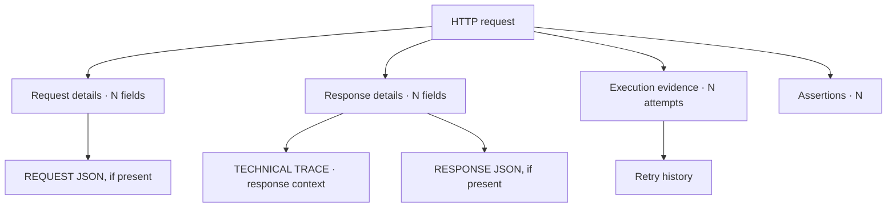

# Contractul de raportare Extent pentru ATF Java

Raportul este o reprezentare a execuției, nu un al doilea motor de verdicturi.
Runnerul și evaluatorul de contract rămân autoritățile pentru rezultat; Extent
publică evidence-ul într-o formă lizibilă și navigabilă.

## Ordinea suprafețelor

Ordinea aprobată a tab-urilor este:

~~~text
Tests → Category → Fails → Overview
~~~

Overview este suprafața de sinteză și se deschide implicit la încărcarea sau
refresh-ul raportului. Nu se mută în față doar pentru că este sumarul. Fiecare
suprafață are un rol:

| Suprafață | Conținut |
|---|---|
| Tests | clase/scenarii, status, durată și detalii selectabile |
| Category | distribuții și legături către scenariile relevante |
| Fails | toate failure-urile, fără grupare care ascunde testele individuale |
| Overview | totaluri și metadate agregate, fără a crea verdicturi alternative |

## Arborele unui test

~~~mermaid
flowchart TD
    Scenario[Scenariu<br/>status + durată + tag-uri] --> Setup[SETUP]
    Scenario --> Body[TEST BODY]
    Scenario --> Teardown[TEARDOWN]
    Setup --> SR[Request]
    Body --> BR[Request]
    Teardown --> TR[Request sau cleanup]
    Setup --> SV[Validation sibling când există contract]
    Body --> BV[Validation sibling]
    Teardown --> TV[Validation sibling când există contract]
    SV --> ST[Un tabel de assertions]
    BV --> BT[Un tabel de assertions]
    TV --> TT[Un tabel de assertions]
~~~

În fiecare fază, request-ul și validation-ul sunt ramuri surori ale fazei;
legătura lor semantică este aceeași, dar validation-ul nu este copil vizual al
request-ului.

Reguli de ownership:

1. request-ul conține metoda, calea, durata, trace-ul tehnic și JSON-ul;
2. validation-ul este fratele direct al request-ului, în aceeași fază;
3. tabelul de assertions aparține validation-ului;
4. faza nu repetă failure-ul deja detaliat în tabel;
5. scenariul arată verdictul agregat, nu duplică evidence-ul fiecărei faze.

## Evidence-ul unui request

### Label-uri canonice

Tab-ul `Tests` este sursa vizibilă de adevăr pentru denumirile evidence-ului.
Aceleași label-uri trebuie păstrate în `Category`, `Fails`, `Overview` și în
rendererul fallback:

| Rol | Label |
|---|---|
| request context | `Request details · N fields` |
| disclosure trace | `Response details · N fields` |
| clasificare internă | `TECHNICAL TRACE` |
| request payload | `REQUEST JSON` |
| response payload | `RESPONSE JSON` |
| transport execution | `Execution evidence · N attempts` |
| assertions | `Assertions · N` |

`TECHNICAL TRACE` nu este titlul disclosure-ului. El descrie conținutul din
`Response details`; `N` este numărul real de rânduri ale tabelului trace.
`Request details` descrie contextul cererii înainte de transport: method, URL/path,
headers, params, auth și request body când există. Response JSON este inclus în
aceeași zonă colapsabilă cu `Response details`.



Evidence-ul de execuție este renderer-neutral. Înregistrează statusul response-
ului, URL-ul redacted, durata măsurată, numărul de attempt-uri și istoricul de
retry/attempt. Motivele retry și URL-urile trec prin aceeași limită de redaction
ca headers, JSON și valorile assertions; un renderer nu reconstruiește secrete.

Trace-ul tehnic este compact și relevant. El păstrează URL-ul cererii, dar nu
repetă statusul response-ului sau mecanica execuției:

~~~text
URL
CONTENT-TYPE
FAILURE CAUSE (dacă există)
alte facts HTTP non-duplicative
~~~

`Execution evidence · N attempts` este disclosure-ul separat pentru mecanica
transportului. El păstrează URL-ul efectiv, durata response-ului, numărul de
încercări, numărul de retry events și istoricul attempt-urilor. Este închis
implicit și nu trebuie contopit cu `TECHNICAL TRACE`.

Durata se afișează explicit ca `RESPONSE DURATION` în execution evidence și ca
`N ms` pentru valori de până la `300 ms`, respectiv `N s` pentru valori peste
prag, în header-ele navigabile. `1`, `16` sau `25` fără unitate nu sunt forme
acceptate deoarece pot fi confundate cu număr de pași sau assertions.
Timestamp-ul nu este identitatea semantică a testului și nu este folosit pentru
triere sau grupare.

Durata unui nod respectă aceeași regulă în întregul arbore:

```text
leaf      = measured duration
parent    = exclusive self duration, dacă există
            + suma totalurilor copiilor structurali direcți
inclusive = valoare deja calculată de Extent; nu se mai adaugă descendenții
```

Un total părinte nu însumează toți descendenții și nu amestecă o durată
inclusivă cu aceiași copii. Durata tehnică proprie, dacă există, trebuie
marcată distinct de totalul inclusiv.
Pentru navigatorul `Tests`, totalul clasei este suma totalurilor scenariilor
directe vizibile în panoul clasei. Valoarea din stânga și cea din header-ul
clasei trebuie să fie aceeași; o durată brută Extent care include deja
scenariile nu se recopiază peste suma lor.
Valoarea auth este profilul/modul, niciodată secretul.

Request JSON și Response JSON sunt blocuri de cod autonome. Liniile se rup sau
se derulează în interiorul blocului; pagina nu trebuie să dobândească scroll
orizontal din cauza unui payload. Dacă payload-ul este mic, blocul rămâne
compact; nu se impune o înălțime mare doar pentru uniformitate.
Conținutul publicat este limitat după redaction prin
`reporting.bodyMaxDisplayCharacters` (implicit `12000`); depășirea este marcată
cu `… [truncated]`, iar scroll-ul intern rămâne activ.

Redacția se aplică la limita de publicare pentru ambele renderere. Detaliile
request-ului și fazei, JSON-ul, URL-ul, retry history, cauza failure-ului și
valorile assertions trec prin aceeași politică a redactorului sensibil;
cheia și parametrii query neconfidențiali rămân vizibili, iar valorile secrete
sunt înlocuite cu markerul de redacție. Niciun renderer nu poate publica direct
input-ul primit de la transport sau de la validator.

## Tabelul agregat de assertions

Toate verificările pentru același response apar într-o singură structură:

~~~text
ASSERTION | EXPECTED | ACTUAL | RESULT
~~~

RESULT poate fi PASS, FAIL sau WARNING, iar statusul tabelului derivă din
rândurile sale. În cazul unui failure sunt păstrate toate rândurile deja
evaluate, nu doar primul mismatch. Nu se publică încă un nod duplicat în
TEST BODY pentru aceleași assertions.

Precedence-ul unic este:

~~~text
FAIL > SKIP > WARNING > PASS
~~~

Această regulă se aplică la rând, tabel, validation, phase și scenario. Dacă
runnerul are o regulă mai strictă, raportul o reflectă și nu o suprascrie.

## Fails și legături

Tab-ul Fails arată fiecare failure ca intrare distinctă. Nu grupează doar după
clasă, deoarece astfel se pierd scenariile individuale. Fiecare intrare trebuie
să expună schematic:

- status;
- numele testului/scenariului;
- faza și request-ul implicat, dacă există;
- assertion-ul sau excepția relevantă;
- durata;
- link către testul original din tab-ul Tests.

Link-ul este stabil și intern raportului. Nu depinde de un path de Windows sau
de un nume de artifact care se schimbă între rulări.

După selectarea unei intrări, detail pane-ul Fails este o proiecție index-only:
expune phase, request, validation/assertion, actual, cause și durata, fără să
cloneze `test-contents` și fără să creeze un al doilea arbore de evidence.
Evidence-ul complet — request/response JSON, trace, response details și tabelul
de assertions — rămâne în arborele Tests. `Open in Tests` este legătura
autoritativă către nodul original și nu schimbă verdictul sau ownership-ul
evidence-ului.

Durata din indexul Fails este derivată din `RESPONSE DURATION`, nu din
timestamp. Dacă failure-ul nu are response măsurat, indexul afișează explicit
`No response duration recorded`; timpul de execuție rămâne disponibil în
evidence-ul requestului și în tab-ul Tests.

Navigarea trebuie să funcționeze atât prin click pe tab, cât și prin încărcarea
directă a hash-ului (`#atf-fails-view`, `#test-view`, `#category-view` sau
`#dashboard-view`). Runtime-ul trebuie să sincronizeze hash-ul inițial și
evenimentele `hashchange`; altfel un artifact offline poate afișa un view gol
deși datele există în document.

## Overview și agregări

Overview-ul agregă aceleași scenarii care apar în Tests. Nu numără proiectele
unitare ca teste API și nu introduce un total paralel. Category și tag-urile
sunt proiecții de navigare; nu schimbă verdictul și nu clonează noduri. Fails
folosește numai copia controlată descrisă mai sus pentru a păstra dovada
concretă în contextul failure-ului.

Tag-urile utile apar în header-ul scenariului și în Overview. Lista claselor din
stânga rămâne scanabilă: nume, status și durată, fără pills sau metadate care
îngreunează trierea.

În cardul scenariului, titlul este aliniat la stânga în zona proprie a titlului,
iar rândul de adnotări rămâne imediat sub el, pe aceeași axă stângă. Grupul
titlu+adnotări este centrat vertical în header. Indicatorul de expandare și
toolbar-ul cu durată/status rămân în coloanele lor separate și sunt centrate
vertical pe același header; această aliniere nu mută și nu combină zonele.
Regula se aplică și atunci când numele este lung, când există mai multe tag-uri
sau când durata este afișată cu unitatea `ms`: alinierea la stânga este
orizontală, iar centrarea este numai verticală.

## Vizual și autonom

AtfReportTheme este sursa unică pentru fonturi, suprafețe, linii, statusuri,
tabele și blocuri JSON. Extent și fallback-ul nu își definesc palete separate.
Badge-urile `Pass`, `Warning` și `Fail` au aceeași geometrie în `Tests`,
`Category`, `Fails`, `Overview` și în detail projections:

```text
height 18.2px · padding 0 5px · border 0 · radius 4px
font-size 9.52px · line-height 18.2px · font-weight 400
```

Lățimea este `auto` și `min-width:0`: textul poate produce lățimi naturale
diferite (`Pass`, `Warning`, `Fail`), dar înălțimea, padding-ul, fontul,
alinierea și stilul de bordură rămân identice în toate tab-urile. Badge-urile
neutre de durată/metadata păstrează separat `22.4px`, padding `5px 7px` și
line-height `10.6624px`, pentru a nu modifica scara statusurilor.

Paleta semantică este comună: Pass `#9ccc65`, Warning `#ffc107`, Fail
`#e57373`, cu text `#fff` pentru Pass/Fail și `#f6f7f6` pentru Warning.
Selectorii de tab sau container nu pot introduce altă geometrie ori altă
culoare semantică.

Artifactul final trebuie să fie un singur HTML autonom:

- CSS și JavaScript incluse;
- fonturile și iconițele disponibile fără rețea;
- fără referințe extent/... sau folder auxiliar livrat;
- noduri de evidence închise implicit;
- phase shells colapsate implicit;
- cardurile scenariilor din Tests colapsate implicit, dar expandabile prin click;
- Overview deschis implicit;
- fără linii verticale decorative care rup interiorul test body-ului;
- contraste și fonturi consistente între tabelele de Overview și detaliile testului.

## Dovezi obligatorii pentru schimbări

| Schimbare | Dovadă minimă |
|---|---|
| agregare assertions | test unitar pentru agregare + artifact cu tabel |
| arbore request/validation | test de componentă + expandare în TAB MCP |
| tab-uri și deep-link | test de contract + click pe fiecare suprafață |
| fonturi, culori, linii | token tests + verificare computed style în TAB MCP |
| durate și totaluri | test pentru pragul `300 ms`/`301 ms` + agregare exclusive/direct children |
| status badge-uri | token test pentru geometrie și paletă în toate tab-urile |
| JSON, scroll și overflow | artifact real + payload mic și payload mare |
| Fails | cazuri fail/warning/skip + verificarea linkului |

Un test care verifică doar textul HTML nu înlocuiește verificarea interactivă a
DOM-ului când problema este de randare, click, collapse sau navigare.

## Numele raportului și diferențierea rulărilor

Numele fișierului este parte din configurația raportării, nu o convenție
ascunsă în test. Configurația minimală este:

```yaml
reporting:
  bodyMaxDisplayCharacters: 12000
  extent:
    outputDirectory: artifacts/reports
    fileName: api-atf-extent-report.html
    timestampEnabled: true
    timestampPattern: yyyy-MM-dd_HH-mm-ss-SSS
    timestampZone: system
```

Cu `timestampEnabled: true`, numele devine, de exemplu,
`api-atf-extent-report_2026-10-14_12-34-56-789.html`. Timestamp-ul este
inserat înainte de extensie și este rezolvat exact o dată, la deschiderea
sesiunii. Acest lucru diferențiază rulările, păstrează linkul raportului stabil
în timpul execuției și evită suprascrierea accidentală a unei rulări deschise.

`timestampPattern` folosește sintaxa Java `DateTimeFormatter`, iar
`timestampZone` acceptă `system` sau un identificator IANA. Pentru verificări
deterministe, testele folosesc un `Clock` fix prin `resolveReportPath(Clock)`;
codul de execuție folosește ceasul zonei configurate. Pattern-urile care ar
produce caractere nesigure pentru un nume de fișier sunt respinse.

Cu `timestampEnabled: false`, `reportPath()` rămâne exact
`outputDirectory/fileName`, dar această variantă este rezervată testelor
interne care cer explicit o destinație stabilă. Rulările ATF publicate folosesc
numai nume timestamped; dacă nu există configurație YAML, timestamp-ul este
activ implicit. Schimbarea timestamp-ului nu modifică arborele Extent,
statusurile, agregările sau randarea HTML.

