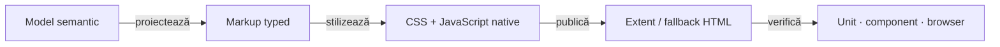

# ATF Reporting — contract de display și layout

## Pe scurt

Acest document este sursa normativă pentru forma vizibilă și interacțiunile
raportului Extent și ale fallback-ului HTML. El completează
[Contractul de raportare ATF](ATF_Reporting_Contract.md), care deține semantica
evidence-ului, ownership-ul verdictelor și schema API.

`atf-reporting` deține markup-ul, token-urile, CSS-ul și JavaScript-ul publicat;
`atf-reporting-tests` deține probele unit/component/integration/browser;
consumerii verifică doar integrarea propriilor adaptoare. Documentul nu descrie
un artifact concret, un URL sau o captură istorică.

<strong>Legendă — boundary și ownership</strong>

- **Model semantic**: decide rolul, ordinea, statusul și evidence-ul; nu decide
  CSS sau interacțiunea browserului.
- **Markup typed**: proiectează structura HTML și atributele de accesibilitate;
  nu deduce roluri din titluri sau din string-uri de business.
- **CSS + JavaScript native**: dețin layout-ul și interacțiunile; sursele rămân
  fișiere `.css`/`.js` lizibile, iar Java este doar composition/facade seam.
- **Artifact**: este autonom și inspectabil fără rețea.
- **Proof**: verifică mai întâi contractul semantic, apoi DOM-ul, stilul efectiv
  și interacțiunea; un `contains` global nu înlocuiește acest traseu.

## Ierarhia vizibilă obligatorie

| Zonă | Regulă stabilă |
|---|---|
| test case | `SETUP` este opțional și rămâne setup; `TEST BODY` conține acțiunea și validarea; `TEARDOWN` este cleanup/read-back când există |
| checkpoint Gherkin | `UI validation` și `API validation` sunt copii surori ale aceluiași checkpoint; Network Inspector este agregat separat și nu dublează exchange-urile |
| exchange API | `Request details`, `Response details` și `Execution evidence` sunt disclosures surori; `Contract validation` este copilul exchange-ului care deține contractul |
| UI validation | acțiunile Playwright, observațiile de audit și aserțiunile aparțin validării UI; setup evidence nu este redenumit `UI validation` |
| setup context | cheile interne `request.action`, `request.target`, `evidence.type` și `evidence.policy` pot rămâne în model, dar nu devin tabel HTTP vizibil fără evidence HTTP real |

Titlurile sunt propoziții scurte și explicative. Structura semantică nu depinde
de textul `Contract validation`, de metoda HTTP sau de numărul de câmpuri.

## Invariante de interacțiune

- glyph-ul `＋/−` este inline, pe aceeași primă linie și imediat înaintea
  propoziției; nu este împins pe o linie separată de wrapping artificial;
- disclosure-urile sunt collapsed implicit, cu excepția suprafețelor declarate
  explicit ca deschise implicit, precum Overview;
- închiderea unui părinte ascunde întregul subarbore și sincronizează simultan
  vizibilitatea, `open`, `aria-expanded` și glyph-ul; redeschiderea părintelui nu
  deschide automat copiii;
- deschiderea unui copil nu închide părintele sau frații; mouse, Enter și Space
  produc aceeași tranziție semantică;
- nu se folosesc linii orizontale decorative între acțiuni, observații și
  aserțiuni din interiorul unui test body; separarea este dată de disclosures,
  spațiere și ierarhia semantică;
- screenshot-ul este un link inline cu emoji-ul curent; fingerprint-ul sau
  digest-ul deduplicării rămâne intern și nu înlocuiește linkul uman;
- o captură deduplicată deschide aceeași imagine prin click sau Enter, inclusiv
  când sursa este într-un scenariu colapsat; nu face doar salt la o ancoră ascunsă;
- controalele de navigare și deep-link-urile păstrează aceeași identitate în
  `Tests`, `Overview`, `Categories` și `Fails`.

## Contractul API, UI și UI+API

| Canal | Ce trebuie să fie vizibil | Ce nu se inventează |
|---|---|---|
| API | method/path, request/response details, JSON sau `null`, execution attempts și validarea contractului când aceasta există | request sintetic pentru un pas UI, verdict din status HTTP fără contract, durată `0 ms` pentru o durată necapturată |
| UI | acțiunile relevante inclusiv `getText`/text extraction, audit observations, assertions și capturi relevante | request/response HTTP pentru setup intern, duplicate de propoziție Gherkin sau verdict business dedus din screenshot |
| UI+API | cei doi copii de validare, corelarea explicită și un Network Inspector care referă exchange-urile publicate | republicarea aceluiași exchange ca apel nou sau mutarea tuturor aserțiunilor în `Screen validation` |

Pentru `POST` și `PUT`, request-ul și response-ul publicate trebuie să păstreze
body JSON parseable și non-empty atunci când contractul endpointului îl cere.
Pentru body absent, valoarea publică este explicit `null`; body necapturat și
body absent sunt stări diferite. Etichetele de cardinalitate sunt produse de
vocabularul comun, nu de publisheri locali.

## Cerințe de layout și responsive

| Suprafață | Cerință |
|---|---|
| document | fără overflow orizontal; wrapping-ul păstrează identificatorii și URL-urile lizibile, fără crop sau break arbitrar |
| tabel de date | wrapper comun, `height: auto`, `max-height: var(--atf-table-scroll-height)`; conținutul scurt rămâne natural, iar conținutul lung derulează local |
| tabel lung | header sticky, ultimul rând accesibil prin mouse și tastatură; titlul și contoarele nu se schimbă când apare scroll-ul |
| payload JSON/code | este pane de payload, nu tabel; nu intră în wrapper-ul de viewport al tabelului |
| viewport îngust | padding-ul și coloanele se adaptează prin token-uri/media queries; nu se ascunde overflow-ul pentru a masca o geometrie greșită |
| summary | geometrie compactă comună; textul poate curge natural, fără înălțime fixă duplicată pentru cazul obișnuit |
| delimitare | nu se adaugă `
` sau linii decorative pentru a separa zonele unui test; border-ul structural al cardului rămâne doar la boundary-ul semantic necesar |

`--atf-table-scroll-height` este tokenul comun al temei. Valoarea profilului
curent este verificată prin token și nu trebuie copiată în renderer-e sau în
teste ca prag local.

## Assets și responsabilitate Java/CSS/JavaScript

- fișierele native `.css` și `.js` din `atf-reporting/src/main/resources` sunt
  formatate multiline și organizate pe responsabilități mici: vocabulary,
  layout, disclosure, navigation, evidence, duration și failure;
- clasele Java compun asset-uri și expun seams typed; nu reconstruiesc corpuri
  mari de funcții JavaScript sau blocuri CSS prin concatenări fragile;
- copia injectată în HTML poate fi compactată de `ReportAssetCompactor`, dar
  sursa formatată rămâne accesibilă pentru review și testare component;
- JavaScript-ul publicat nu folosește `onclick` inline; hash-ul și atributele
  semantice sunt contractul static, iar controllerul nativ activează
  interacțiunea;
- Extent și fallback consumă aceeași semantică, aceleași token-uri și aceleași
  politici de viewport; adaptorul de publicare este singura diferență legitimă.

## Matricea minimă de verificare

| Nivel | Verifică | Owner |
|---|---|---|
| unit | vocabular, modele, token-uri, policy și funcții JS/CSS publicate | `atf-reporting` |
| component | markup real, ordine, ownership, disclosure, JSON, viewport și asset manifest | `atf-reporting-tests` |
| integration | Extent/fallback, publication, input mock și paritatea proiecțiilor | `atf-reporting-tests` |
| E2E/browser | click, Enter/Space, expand/collapse, computed style, scroll, deep-link și page errors pe artifact fresh | `atf-reporting-tests`, prin ATF Debug + Playwright/Chromium headless |
| consumer | intenția business și adaptorul aplicației, fără renderer paralel | modulul consumer |

Verificarea vizuală nu folosește browser Windows real și nu oprește rulările
active. Se construiește în staging extern, se generează un artifact fresh,
apoi se inspectează prin ATF Debug/TAB MCP sau Playwright MCP. Artifactele și
capturile de rulare nu se copiază în README-uri.

## Promovarea și redeschiderea contractului

O regulă trece din feedback în acest document numai după ce codul live și proba
potrivită o demonstrează. Feedback-ul păstrează gap-urile active și criteriul
lor de închidere; controalele tehnice `VERIFIED` necesare baseline-ului stau în
[`ATF_Test_Changes_Baseline.md`](ATF_Test_Changes_Baseline.md), nu în
feedback-ul funcțional sau în backlog.

Dacă un artifact istoric contrazice acest contract, este marcat stale și nu
redeschide singur un ToDo. Redeschiderea cere o abatere reproductibilă în codul
și testele live sau o schimbare explicită de cerință.

## Referințe

- [Contractul semantic de raportare](ATF_Reporting_Contract.md)
- [Contractul de captură a evidence-ului](ATF_Evidence_Capture_Contract.md)
- [README `atf-reporting`](../atf-reporting/README.md)
- [README `atf-reporting-tests`](../atf-reporting-tests/README.md)
- [Registrul feedback-ului activ](feedback/README.md)
