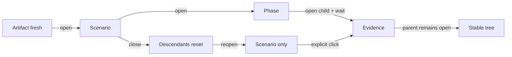

# Ghid de testare ATF — straturi, responsabilități și dovezi

## Pe scurt

Ghidul explică unde aparține un test, cum alegem cel mai mic nivel care poate
dovedi comportamentul și cum trecem de la o verificare locală la proof de
compoziție sau randare. Matricea reflectă adnotările executabile din codul live;
nu este un obiectiv de a umple fiecare celulă și nu conține count-uri de teste.

## Traseul canonic al unei verificări

```mermaid
flowchart LR
    Requirement["cerință observabilă"] -->|identifică| Owner["modul owner"]
    Owner -->|delimitează| Boundary["boundary de test"]
    Boundary -->|alege cel mai mic proof| Layer["unit / component / integration / E2E"]
    Layer -->|folosește| Setup["setup typed și controlat"]
    Setup -->|exercită| Contract["comportament public"]
    Contract -->|produce| Evidence["assertions și evidence"]
    Evidence -. dacă depinde de browser .-> Browser["artifact randat și interacțiune"]
```



<details>
<summary><strong>Legendă — cum se citește traseul</strong></summary>

- nivelul se alege după boundary-ul care trebuie dovedit, nu după pachet sau
  numele clasei;
- setup-ul este un fixture, config typed, fake sau adapter explicit;
- testul afirmă un rezultat observabil la API-ul public al ownerului;
- proof-ul în browser este necesar numai pentru comportamente de DOM, layout,
  navigation ori interacțiune; nu înlocuiește testele lower-level.

</details>

## Alegerea nivelului

| Nivel | Alege-l când verifici | Setup tipic | Nu îl folosi pentru |
|---|---|---|---|
| `unit` | policy, model, formatter, parser sau validator pur | input typed și dependențe locale | browser, server sau colaborare între module |
| `component` | contractul unui modul ori adapter, cu boundary-urile vecine izolate | fake/mock, fixture sau artifact local | o călătorie completă prin aplicație |
| `integration` | colaborarea reală dintre mai multe componente/module | fixture determinist și reactor `-am` | fiecare invariant deja dovedit la nivel inferior |
| `e2e` | comportamentul care depinde de browser și journey-ul vizibil | browser și config explicit; extern numai opt-in | logică pură, fiecare variantă de date sau înlocuirea suitei lower-level |

`support` nu este un nivel executabil. Fixture-urile, builder-ele, locators,
loader-ele și adapters rămân auxiliare; metoda de test deține assertion-ul și
clasa executabilă declară exact o adnotare `@AtfUnitTest`, `@AtfComponentTest`,
`@AtfIntegrationTest` sau `@AtfE2eTest`.

## Matricea detaliată module × nivel de testare

Celulele arată doar nivelurile care există în suitele executabile curente.
`—` nu cere crearea unei suite sau a unui director artificial.

| Modul | Unit | Component | Integration | E2E | Owner și scopul principal |
|---|:---:|:---:|:---:|:---:|---|
| [`atf-core`](../atf-core/README.md) | ✅ | — | — | — | contracte neutre și politici reutilizabile |
| [`atf-validation`](../atf-validation/README.md) | ✅ | ✅ | — | — | reguli de validare și rezultate typed |
| [`atf-console`](../atf-console/README.md) | ✅ | — | — | — | formatter, output și lifecycle de consolă |
| [`atf-mock`](../atf-mock/README.md) | — | ✅ | — | — | transport fake și comportament determinist |
| [`atf-ui`](../atf-ui/README.md) | ✅ | ✅ | — | — | policy și adapter Playwright generic |
| [`atf-debug-ui`](../atf-debug-ui/README.md) | — | ✅ | — | — | server și launcher read-only pentru inspecție |
| [`atf-reporting`](../atf-reporting/README.md) | — | — | — | — | excepție: suite standalone fără adnotări sau dependențe ATF |
| [`atf-reporting-tests`](../atf-reporting-tests/README.md) | ✅ | ✅ | ✅ | ✅ | composition și proof pentru librăria reporting |
| [`atf-test-practice-shop`](../atf-test-practice-shop/README.md) | ✅ | ✅ | ✅ | ✅ | consumer: contracte, API, flow-uri și journey browser |
| [`atf-tests`](../atf-tests/README.md) | — | ✅ | ✅ | — | boundary și guvernanță whole-reactor |
| [`atf-test-kit`](../atf-test-kit/README.md) | ✅ | ✅ | — | — | vocabularul layer-elor și contractele test-only |

Guard-ul reflectă ownerii fără a falsifica structura reactorului:

- `atf-reporting` este `standalone-independent`; cele trei teste ale sale nu
  aparțin reactorului;
- `AtfTestLayerArchitectureTest` verifică excepția și cere o adnotare per test
  executabil din reactor;
- matricea acestui ghid navighează către owneri; nu duplică validatorul pe celulă.

## Traseul UI/API și ce verifică testele

Contractul checkpoint-ului mixt este deținut de
[ATF Reporting Contract](ATF_Reporting_Contract.md#evidence-ul-unui-request):

- o propoziție Gherkin are copii frați `UI validation` și `API validation`;
- exchange-urile reale apar numai sub `API validation`;
- journey inspectorul indexează sumarul, fără să cloneze lista request-urilor.

| Zonă | Invariant urmărit | Proof potrivit |
|---|---|---|
| checkpoint Gherkin | o singură propoziție semantică deține validările UI și API | integration pentru compoziție; E2E pentru arborele randat |
| `UI validation` | assertions observate în browser rămân distincte de verdictul transportului | component pentru publisher; E2E numai pentru DOM/interacțiune |
| `API validation` | fiecare exchange păstrează `Request → Response → Execution`; retry-ul rămâne în execution evidence | component pentru format și publisher; integration pentru exchange-ul selectat |
| typed trace ledger | identitatea, ordinea și corelarea leagă schimbul de checkpoint-ul care l-a cauzat | unit/component pentru model și mapping; integration pentru cauzalitate |
| journey aggregate | auth, correlation, counters, signatures și diagnostics sunt rezumate bounded, fără body duplicat | unit/component pentru aggregate; browser proof pentru disclosures și collapse |
| `Overview / System` | rămâne configurație operațională allowlist-uită, nu jurnal de pași ori payload | component pentru snapshot și contract; nu E2E dacă nu se verifică randarea |

Nu se testează două proiecții prin duplicarea aceluiași payload. Trace-ul per
checkpoint deține exchange-ul canonical; inspectorul grupează numai faptele
necesare navigării și nu înlocuiește request/response details. Pentru ownerul
consumer, configurație și lifecycle, continuă în README-ul Practice Shop; pentru
renderer, markup și disclosure, continuă în README-ul `atf-reporting-tests`.

### Precondiții E2E și `SETUP`

Pregătirea contului, sesiunii sau fixture-ului este separată de acțiunea de
business. O declarație typed selectează sursa; setup-ul trebuie să treacă înainte
ca `TEST BODY` să înceapă.

```text
SETUP
├─ GIVEN <sursă / precondiție pregătită>
│  ├─ Setup evidence: CHECK / EXPECTED / ACTUAL / RESULT
│  └─ API validation → exchange canonical (numai dacă este selectat)
├─ AND <precondiție confirmată>
└─ PASS → TEST BODY
   └─ o propoziție Gherkin → UI validation + API validation (frați)
```

- `Setup evidence` explică ce a fost selectat, ce s-a observat și dacă faza
  următoare poate porni; nu este substitut pentru request/response;
- `REUSE_FIXTURE` trebuie să spună că fixture-ul a fost selectat, nu că s-a
  creat un cont nou; orice mod de creare trebuie să fie explicit;
- o mutație externă incertă nu se reexecută automat fără un contract de
  idempotency; reutilizarea unei resurse are scope declarat și testat la acel
  scope;
- `UI validation` și `API validation` exprimă dovezi diferite pentru aceeași
  propoziție de business; nu dubla titlul Gherkin pentru a le separa;
- diagnosticele runtime nu devin pași Gherkin și nu schimbă verdictul business.

Forma raportului și ownership-ul fiecărei dovezi sunt normative în
[ATF Reporting Contract](ATF_Reporting_Contract.md#evidence-ul-de-setup).

### Stabilitatea secțiunilor expandabile — verificare în browser

Stabilitatea se probează ca tranziție de stare a arborelui, nu doar prin
prezența textului în HTML:



<details>
<summary><strong>Legendă — starea arborelui de disclosure</strong></summary>

- interacțiunea cu un copil păstrează părintele deschis;
- închiderea scenariului închide descendenții;
- redeschiderea arată doar containerul, până la un click explicit.

</details>

| Nivel | Ce demonstrează |
|---|---|
| component/interaction | panel, `aria-expanded`, glyph și starea părinte-copil rămân sincronizate; închiderea scenariului resetează descendenții |
| browser pe artifact fresh | după normalizarea întârziată părintele rămâne deschis; redeschiderea scenariului nu deschide automat copiii |

Detaliile normative și pașii browser-proof sunt în
[contractul de raportare](ATF_Reporting_Contract.md). Acest gate se aplică
schimbărilor de disclosure/navigare; nu justifică un E2E nou pentru fiecare
variație de conținut.

## Principii pentru teste scurte și plug-and-play

- un test are o intenție principală și numește comportamentul, nu mecanismul
  intern;
- setup-ul repetabil intră în fixture/builder-ul ownerului, iar scenariile
  selectabile folosesc configurație și adnotări typed existente;
- fake-ul dovedește contractul determinist; un test cu HTTP live dovedește
  integrarea externă numai când este explicit opt-in și are fixture valid;
- assertions verifică efectul public și explică diferența expected/actual;
  nu se copiază aceeași suită la fiecare layer doar pentru count;
- importurile statice sunt potrivite pentru assertions și DSL-uri neambigue;
  wildcard imports și static imports care ascund ownerul sunt evitate;
- layer-ul vine din adnotarea clasei, în timp ce pachetul organizează domeniul;
- codul `support` nu deține verdict executabil și nu introduce lifecycle ascuns.

Regulile detaliate despre OOP, fixtures, importuri, package cohesion și
anti-duplication sunt în [bunele practici de cod](README_Atf_CodeBestPractices.md).
Contractele test-only și adnotările sunt în [`atf-test-kit`](../atf-test-kit/README.md).

## Rulare și dovada randată

| Scop | Comandă de bază |
|---|---|
| un test țintit într-un modul și dependențele sale | `mvn -pl <modul> -am "-Dtest=<ClasaTest>" "-Dsurefire.failIfNoSpecifiedTests=false" test` |
| suitea whole-ATF | `mvn -pl atf-tests -am "-Dtest=WholeAtfGovernanceSuiteTest" "-Dsurefire.failIfNoSpecifiedTests=false" test` |
| librăria `atf-reporting` izolată | `mvn -f atf-reporting/pom.xml test` |
| Practice Shop — teste component selectate | `mvn -pl atf-test-practice-shop -am "-Dtest=PracticeShopArchitectureTest,PracticeShopConfigurationTest,PracticeShopCheckoutConfigurationTest" test` |

Aceste comenzi descriu selecția, nu autorizează build în checkout-ul cu procese
active. Pentru staging extern, source sync, execuții E2E și promovare, urmează
[Build and Execution Safety](ATF_Build_And_Execution_Safety.md). E2E-urile
Practice Shop care ating un serviciu extern se rulează numai cu precondiția și
opt-in-ul documentate de owner.

| Afirmație | Dovada minimă |
|---|---|
| HTML, CSS, JavaScript, disclosure sau ordine vizuală | component test pentru markup și contract |
| randare sau interacțiune | artifact fresh verificat în ATF Debug/TAB MCP, conform [gate-ului](README_Atf_BestPractices.md) |
| run vechi sau nume de artifact | nu reprezintă dovadă permanentă |

## Criterii de finalizare

- [ ] testul este plasat în modulul ownerului și declară un singur layer;
- [ ] nivelul ales este cel mai mic care poate dovedi cerința;
- [ ] setup-ul și datele sunt typed, locale și reutilizate numai în ownerul lor;
- [ ] assertion-ul verifică un rezultat public, fără duplicarea logicii lower-level;
- [ ] testele modulelor și guard-urile de reactor relevante trec în staging sigur;
- [ ] dacă cerința este vizuală, artifactul fresh este verificat prin interacțiune;
- [ ] regula stabilă este documentată în README-ul ownerului, iar feedback-ul
      păstrează numai limita rămasă.

## Unde continui

| Întrebare | Document owner |
|---|---|
| care este boundary-ul unui modul? | [ATF Architecture](ATF_Architecture.md) |
| cum se adaugă un test API? | [ATF API Test Guide](ATF_Api_Test_Guide.md) |
| ce formă are evidence-ul și raportul? | [ATF Reporting Contract](ATF_Reporting_Contract.md) |
| unde sunt testate flows și config-ul Practice Shop? | [Practice Shop README](../atf-test-practice-shop/README.md) |
| ce protejează suita whole-reactor? | [ATF Tests README](../atf-tests/README.md) |
| cum se execută build-ul fără a afecta rulări active? | [Build and Execution Safety](ATF_Build_And_Execution_Safety.md) |
