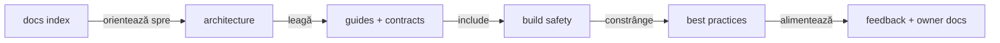

# Documentația ATF Java

Acest director este indexul contractelor stabile ale ATF Java.

- arhitectură și boundaries;
- adăugare de teste API;
- contractul de raportare Extent;
- build, staging și sync sigur;
- feedback activ și criterii de închidere.

Documentele descriu framework-ul și ownerii lui, nu un run sau un artifact
particular.

## Pe scurt

| Nivel | Documente | Întrebarea la care răspund |
|---|---|---|
| hartă | `ATF_Architecture.md`, README-ul root | cine deține ce și în ce direcție curg dependențele? |
| contract | `ATF_Reporting_Contract.md`, ghidurile de modul | ce comportament este stabil? |
| evidence transversal | `ATF_Evidence_Capture_Contract.md` | cum se separă flow-ul, policy-ul, sursa și publisherul? |
| practică | `README_Atf_BestPractices.md` | cum adăugăm cod fără drift? |
| testare | `ATF_Testing_Guide.md` | ce layer, modul și proof aleg pentru un comportament? |
| execuție | `ATF_Build_And_Execution_Safety.md` | cum lucrăm fără să oprim run-uri? |
| feedback | `feedback/README.md` și documentele active pe owner | ce gap observabil rămâne? |

Indexul păstrează harta; detaliile sunt în documentul ownerului și cresc în
specificitate pe măsură ce coborâm în pagină.

## Diagramă de bază



<details>
<summary><strong>Legendă — cum citești harta documentației</strong></summary>

- săgeata solidă arată traseul de orientare în documentație, nu o dependență
  între module;
- `Architecture` fixează modulele, boundaries și direcția dependențelor;
- `Guides` și contractele descriu folosirea stabilă a framework-ului;
- `Safety` descrie staging-ul, sync-ul și gate-urile de execuție;
- `Practices` descrie regulile transversale, iar `Feedback` păstrează numai gap-uri
  reproductibile și ownership-ul lor.

</details>

## Ordinea recomandată de lectură

| Scop | Documente de pornire |
|---|---|
| Orientare și ownership | [Arhitectură](ATF_Architecture.md) · [README root](../README.md) |
| Scriere și stratificarea testelor | [Ghid de testare](ATF_Testing_Guide.md) · [Ghid API](ATF_Api_Test_Guide.md) · [Bune practici de cod](README_Atf_CodeBestPractices.md) |
| Reporting și evidence | [Contract reporting](ATF_Reporting_Contract.md) · [Contract evidence](ATF_Evidence_Capture_Contract.md) · [README reporting](../atf-reporting/README.md) |
| Consumatori și guvernanță | [Practice Shop](../atf-test-practice-shop/README.md) · [ATF Tests](../atf-tests/README.md) · [registrul feedback](feedback/README.md) |
| Contribuție și operare | [Siguranța build-ului](ATF_Build_And_Execution_Safety.md) · [Bune practici ATF](README_Atf_BestPractices.md) · [Bune practici documentație](README_Atf_DocumentationBestPractices.md) |

Indexul complet și ordinea detaliată rămân disponibile la cerere:

<details>
<summary>Ordinea completă de lectură și toate documentele</summary>

1. [ATF_Architecture.md](ATF_Architecture.md) — module, dependențe și responsabilități.
2. [../atf-core/README.md](../atf-core/README.md) — kernelul neutru, porturile
   și modelele comune.
3. [../atf-mock/README.md](../atf-mock/README.md) — fake-ul determinist,
   catalogul YAML și transportul acceptance.
4. [../atf-test-kit/README.md](../atf-test-kit/README.md) — contractul test-only
   pentru nivelurile unit/component/integration/e2e și guard-ul transversal.
5. [../atf-reporting-tests/README.md](../atf-reporting-tests/README.md) — fixture-uri
   API, composition root și lifecycle de test.
6. [../atf-validation/README.md](../atf-validation/README.md) — validarea
   independentă și portul de publicare.
7. [../atf-reporting/README.md](../atf-reporting/README.md) — rendererul,
   contractele pure ale librăriei și suita de compoziție component/E2E pentru raportare.
8. [../atf-test-practice-shop/README.md](../atf-test-practice-shop/README.md) —
   consumer Practice Shop, config, flow-uri și purchase E2E.
9. [../atf-tests/README.md](../atf-tests/README.md) — guvernanța întregului reactor.
10. [../atf-console/README.md](../atf-console/README.md) — proiecția diagnostică
   de consolă și contractul de output.
11. [../atf-ui/README.md](../atf-ui/README.md) — politicile generice și adaptorul
   Playwright.
12. [../atf-reporting-tests/src/test/java/atf/ui/tests/extent/README.md](../atf-reporting-tests/src/test/java/atf/ui/tests/extent/README.md)
   — contractul stabil pentru selecția API, mock-backed expected projection,
   secțiuni Extent și validarea UI reutilizabilă.
13. [../atf-debug-ui/README.md](../atf-debug-ui/README.md) — publicarea
   read-only a unui HTML pentru investigație manuală în Playwright/TAB MCP.
14. [ATF_Api_Test_Guide.md](ATF_Api_Test_Guide.md) — pașii minimali pentru un test API nou.
15. [ATF_Evidence_Capture_Contract.md](ATF_Evidence_Capture_Contract.md) — contractul
    transversal pentru flow mode, screenshot policy, source și testare pe niveluri.
16. [ATF_Reporting_Contract.md](ATF_Reporting_Contract.md) — arborele Extent,
   evidence-ul, guardul de referință și regulile de randare.
17. [ATF_Build_And_Execution_Safety.md](ATF_Build_And_Execution_Safety.md) —
   build, sincronizare și validare fără oprirea execuțiilor existente.
18. [README_Atf_BestPractices.md](README_Atf_BestPractices.md) — indexul regulilor;
   [README_Atf_CodeBestPractices.md](README_Atf_CodeBestPractices.md) pentru cod,
   OOP și testare; [README_Atf_DocumentationBestPractices.md](README_Atf_DocumentationBestPractices.md)
   pentru structură, diagrame și lizibilitate.
19. [ATF_Testing_Guide.md](ATF_Testing_Guide.md) — alegerea layer-ului, matricea
    module × layer și dovada potrivită pentru UI/API și raportare.
20. [feedback/README.md](feedback/README.md) — ToDo active, criterii de închidere
    și registrul de ownership pentru API, UI și reporting.

</details>

Harta modulelor are un singur owner: [ATF_Architecture.md](ATF_Architecture.md).
Acest index oferă doar trasee de lectură și trimiteri către contractele detaliate.

## Regula de lucru pentru orice schimbare

```text
cod și feedback live → staging separat → teste relevante → audit artifact/UI → promovare selectivă
```

Păstrează rulările existente; nu copia artefactele generate în surse.
Detaliile operaționale sunt în
[ATF_Build_And_Execution_Safety.md](ATF_Build_And_Execution_Safety.md).

| Stare | Locul normativ |
|---|---|
| Contract stabil | README-ul ownerului și testele sale |
| Gap încă deschis | [registrul de feedback](feedback/README.md) și documentul ownerului |
| Analiză închisă sau datată | În afara documentației normative |

Testele aplicației rămân la consumer. Astfel, `atf-reporting` poate fi folosit
ca JAR fără dependență de `atf-reporting-tests`.

### Regula de promovare

- **când:** un ToDo devine parte din soluție;
- **în README-ul ownerului:** contractul stabil, ownership-ul și modul de folosire;
- **în feedback:** limita rămasă, criteriul de închidere și dovada necesară;
- **interdicție:** feedback-ul nu este sursa normativă pentru o capabilitate deja
  livrată.

## Reguli de documentație

- README-urile descriu contracte, ownership și fluxuri reproductibile.
- Numele documentelor descriptive folosesc `ATF_<PascalCase>`; acronimul `ATF`
  apare o singură dată, în primul segment. README-ul unui modul rămâne
  `README.md`, iar indexul feedback-ului rămâne `docs/feedback/README.md`.
- Nu se introduc scoruri, timestamp-uri, nume de rapoarte sau stări intermediare.
- Nu se păstrează linkuri către artefacte HTML generate; se documentează doar
  tipul de output, locația configurabilă și criteriul de verificare.
- O diagramă trebuie să reflecte responsabilitățile și fluxurile existente;
  dacă acestea se schimbă, diagrama se actualizează împreună cu testele.
- Codul și raportul sunt sursa comportamentului; documentația nu poate inventa
  o capabilitate care nu este protejată de un test.
- Orice schimbare vizuală sau de navigare se verifică în artifactul HTML și,
  când este relevant, prin interacțiune în TAB MCP.

### Verificare obligatorie pentru raportul UI randat

Orice schimbare de clasă mare, CSS, markup, disclosure sau evidence urmează
aceeași probă, indiferent dacă raportul este produs dinamic sau auditat static:

```text
GENERATED_API: setup → API/mock → API report → ATF Debug/browser MCP
STATIC_*:      HTML existent → ATF Debug/browser MCP
                                 ↓
                         UI audit → UI report → ATF Debug/browser MCP
```

Se verifică DOM-ul, accessibility tree, computed-style, console/network,
expand/collapse, taburile și cel puțin un caz pozitiv și unul negativ. Pentru
`Screen validation`, acțiunile, observațiile și assertions rămân zone-soră fără
separator orizontal decorativ, iar `📷 base64 img` este link inline, cu aceeași
încadrare verticală pe rând. POST/PUT trebuie să arate request și response JSON
valid/nevid și să reconcilieze mock expectation-ul cu `ValidationResult`.

Build-ul se face în staging extern, sub `${ATF_STAGING_ROOT}`, nu în staging-ul
proiectului; raportul fresh se copiază în
`${ATF_REPORT_OUTPUT_DIR}` sau subdirectorul UI configurat numai după verificarea prin
ATF Debug UI și browser MCP. Browserul Windows real și oprirea rulărilor curente
sunt interzise.

## Vocabular scurt

test = intenția de produs verificată  
request = schimbul HTTP și evidence-ul lui tehnic  
validation = fratele direct al request-ului, cu tabelul agregat de assertions  
phase = SETUP, TEST BODY sau TEARDOWN; fazele SETUP și TEARDOWN sunt opționale
scenario = testul complet, cu fazele și verdictul final  
artifact = raportul HTML autonom rezultat după finalizarea sesiunii

