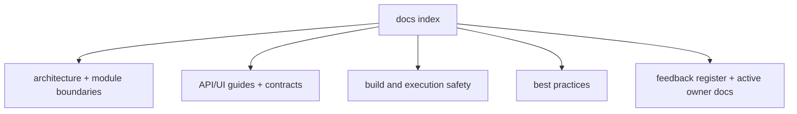
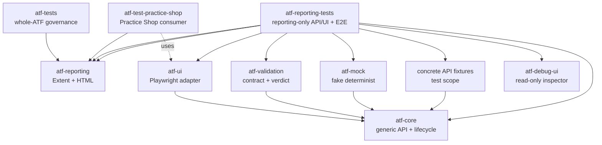

# Documentația ATF Java

Acest director descrie contractele stabile ale ATF Java: arhitectura, modul de
adăugare a testelor API, raportarea Extent și modul sigur de lucru atunci când
există execuții active în alt checkout. Documentele sunt scrise pentru oameni
care întrețin framework-ul, nu pentru o singură rulare sau pentru un singur
artifact.

## Overall

| Nivel | Documente | Întrebarea la care răspund |
|---|---|---|
| hartă | `ATF_Architecture.md`, README-ul root | cine deține ce și în ce direcție curg dependențele? |
| contract | `ATF_Reporting_Contract.md`, ghidurile de modul | ce comportament este stabil? |
| practică | `README_Atf_BestPractices.md` | cum adăugăm cod fără drift? |
| execuție | `ATF_Build_And_Execution_Safety.md` | cum lucrăm fără să oprim run-uri? |
| feedback | `feedback/README.md` și documentele active pe owner | ce gap observabil rămâne? |

Indexul păstrează harta; detaliile sunt în documentul ownerului și cresc în
specificitate pe măsură ce coborâm în pagină.

## Diagramă de bază



<details>
<summary><strong>Legendă — cum citești harta documentației</strong></summary>

- `Architecture` fixează modulele, boundaries și direcția dependențelor;
- `Guides` și contractele descriu folosirea stabilă a framework-ului;
- `Safety` descrie staging-ul, sync-ul și gate-urile de execuție;
- `Practices` descrie regulile transversale, iar `Feedback` păstrează numai gap-uri
  reproductibile și ownership-ul lor.

</details>

## Ordinea recomandată de lectură

1. [ATF_Architecture.md](ATF_Architecture.md) — module, dependențe și responsabilități.
2. [../atf-core/README.md](../atf-core/README.md) — kernelul neutru, porturile
   și modelele comune.
3. [../atf-test-kit/README.md](../atf-test-kit/README.md) — contractul test-only
   pentru nivelurile unit/component/integration/e2e și guard-ul transversal.
4. [../atf-reporting-tests/README.md](../atf-reporting-tests/README.md) — fixture-uri
   API, composition root și lifecycle de test.
5. [../atf-validation/README.md](../atf-validation/README.md) — validarea
   independentă și portul de publicare.
6. [../atf-reporting/README.md](../atf-reporting/README.md) — rendererul,
   contractele pure ale librăriei și suita de compoziție component/E2E pentru raportare.
7. [../atf-test-practice-shop/README.md](../atf-test-practice-shop/README.md) —
   consumer Practice Shop, config, flow-uri și purchase E2E.
8. [../atf-tests/README.md](../atf-tests/README.md) — guvernanța întregului reactor.
9. [../atf-console/README.md](../atf-console/README.md) — proiecția diagnostică
   de consolă și contractul de output.
10. [../atf-ui/README.md](../atf-ui/README.md) — politicile generice și adaptorul
   Playwright.
11. [../atf-reporting-tests/src/test/java/atf/ui/tests/extent/README.md](../atf-reporting-tests/src/test/java/atf/ui/tests/extent/README.md)
   — contractul stabil pentru selecția API, mock-backed expected projection,
   secțiuni Extent și validarea UI reutilizabilă.
12. [../atf-debug-ui/README.md](../atf-debug-ui/README.md) — publicarea
   read-only a unui HTML pentru investigație manuală în Playwright/TAB MCP.
13. [ATF_Api_Test_Guide.md](ATF_Api_Test_Guide.md) — pașii minimali pentru un test API nou.
14. [ATF_Reporting_Contract.md](ATF_Reporting_Contract.md) — arborele Extent,
   evidence-ul și regulile de randare.
15. [ATF_Reporting_Reference_Guard.md](ATF_Reporting_Reference_Guard.md) —
   reperul vizual/funcțional și procedura de comparație în TAB MCP.
16. [ATF_Build_And_Execution_Safety.md](ATF_Build_And_Execution_Safety.md) —
   build, sincronizare și validare fără oprirea execuțiilor existente.
17. [README_Atf_BestPractices.md](README_Atf_BestPractices.md) — reguli OOP,
   testabilitate și mentenanță.
18. [feedback/README.md](feedback/README.md) — ToDo active, criterii de închidere
    și registrul de ownership pentru API, UI și reporting.

## Hartă rapidă a responsabilităților



<details>
<summary><strong>Legendă — harta responsabilităților</strong></summary>

- săgeata solidă înseamnă „folosește/deține o dependență”;
- săgeata punctată marchează o limită read-only sau de guvernanță;
- `atf-reporting` este librăria standalone, iar modulele de testare sunt
  consumatori/composition roots;
- `atf-reporting-tests` verifică reporting-ul, `atf-test-practice-shop` verifică
  aplicația Practice Shop, iar `atf-tests` guvernează întregul reactor.
- `atf-ui` controlează browserul, iar `atf-debug-ui` servește read-only un HTML
  deja generat;
- detaliile exacte sunt în `README.md` din root și în `ATF_Architecture.md`.

</details>

Pentru auditul UI Extent, sursa normativă de implementare este README-ul
pachetului `atf.ui.tests.extent` din `atf-reporting-tests/src/test/java`:
`SectionAuditRegistry` leagă cele șase module,
`SectionAuditCheckExecutor` aplică policy-ul comun pe rezultate renderer-neutral,
iar `ExtentSectionAuditPublisher` publică separat Extent/JUnit. Feedback-ul
istoric nu mai este sursa contractului închis; el păstrează doar limite,
criterii de redeschidere și dovezi.

## Regula de lucru pentru orice schimbare

Înainte de refactorizare se sincronizează contextul live, apoi se lucrează
într-un staging unic și separat. Fiecare increment trebuie să treacă prin
testele relevante, să genereze un artifact nou și să fie verificat prin click-uri
în TAB MCP înainte de orice sincronizare selectivă înapoi. Procesele și rulările
existente nu se opresc, iar output-urile generate nu se copiază în surse.

Ordinea obligatorie și criteriile detaliate sunt în
[ATF_Build_And_Execution_Safety.md](ATF_Build_And_Execution_Safety.md) și
[README_Atf_BestPractices.md](README_Atf_BestPractices.md).

Lucrările încă neînchise sunt păstrate în [feedback/README.md](feedback/README.md)
și în documentul activ pe responsabilitate. Analizele datate cu toate ToDo-urile
închise sunt arhivate în afara proiectului, nu sunt surse normative. Deciziile
închise sunt reflectate direct în README-urile ownerilor și în teste; feedback-ul
activ rămâne concentrat pe riscurile și pașii care mai trebuie validați.

Testele aplicațiilor nu se documentează în README-ul de reporting. De exemplu,
Practice Shop și configurația sa sunt în `atf-test-practice-shop/src/test`; un viitor
consumator poate folosi `atf-reporting` dintr-un jar fără să importe
`atf-reporting-tests`.

Regula de promovare este strictă: când un ToDo devine parte din soluție, contractul
stabil, ownership-ul și modul de folosire se mută în README-ul ownerului. Feedback-ul
păstrează doar limita rămasă, criteriul de închidere și dovada necesară; nu este
sursa normativă pentru o capabilitate deja livrată.

## Reguli de documentație

- README-urile descriu contracte, ownership și fluxuri reproductibile.
- Numele documentelor descriptive folosesc `ATF_<PascalCase>`; acronimul `ATF`
  apare o singură dată, în primul segment. README-ul unui modul rămâne
  `README.md`, iar indexul feedback-ului rămâne `docs/feedback/README.md`.
- Nu se introduc scoruri, timestamp-uri, nume de rapoarte sau stări intermediare.
- Nu se păstrează linkuri către artefacte HTML generate; se documentează doar
  tipul de output, locația configurabilă și criteriul de verificare.
- O diagramă trebuie să reflecte responsabilitățile și fluxurile existente;
  dacă acestea se schimbă, diagrama se actualizează împreună cu testele.
- Codul și raportul sunt sursa comportamentului; documentația nu poate inventa
  o capabilitate care nu este protejată de un test.
- Orice schimbare vizuală sau de navigare se verifică în artifactul HTML și,
  când este relevant, prin interacțiune în TAB MCP.

### Gate obligatoriu pentru raportul UI randat

Orice schimbare de clasă mare, CSS, markup, disclosure sau evidence urmează
aceeași probă, indiferent dacă raportul este produs dinamic sau auditat static:

```text
GENERATED_API: setup → API/mock → API report → ATF Debug/browser MCP
STATIC_*:      HTML existent → ATF Debug/browser MCP
                                 ↓
                         UI audit → UI report → ATF Debug/browser MCP
```

Se verifică DOM-ul, accessibility tree, computed-style, console/network,
expand/collapse, taburile și cel puțin un caz pozitiv și unul negativ. Pentru
`Screen validation`, acțiunile, observațiile și assertions rămân zone-soră fără
separator orizontal decorativ, iar `📷 base64 img` este link inline, cu aceeași
încadrare verticală pe rând. POST/PUT trebuie să arate request și response JSON
valid/nevid și să reconcilieze mock expectation-ul cu `ValidationResult`.

Build-ul se face în staging extern, sub `${ATF_STAGING_ROOT}`, nu în staging-ul
proiectului; raportul fresh se copiază în
`${ATF_REPORT_OUTPUT_DIR}` sau subdirectorul UI configurat numai după verificarea prin
ATF Debug UI și browser MCP. Browserul Windows real și oprirea rulărilor curente
sunt interzise.

## Vocabular scurt

test = intenția de produs verificată  
request = schimbul HTTP și evidence-ul lui tehnic  
validation = fratele direct al request-ului, cu tabelul agregat de assertions  
phase = SETUP, TEST BODY sau TEARDOWN; fazele SETUP și TEARDOWN sunt opționale
scenario = testul complet, cu fazele și verdictul final  
artifact = raportul HTML autonom rezultat după finalizarea sesiunii

