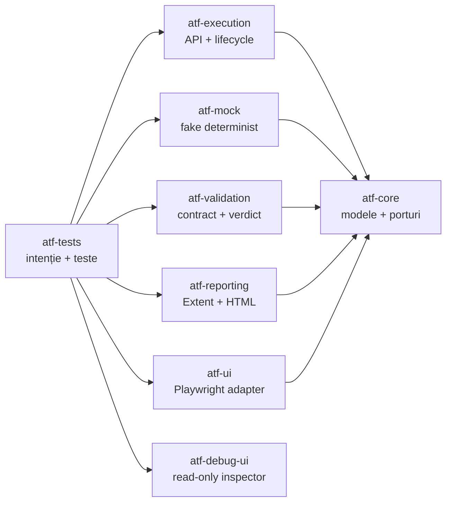

# Documentația ATF Java

Acest director descrie contractele stabile ale ATF Java: arhitectura, modul de
adăugare a testelor API, raportarea Extent și modul sigur de lucru atunci când
există execuții active în alt checkout. Documentele sunt scrise pentru oameni
care întrețin framework-ul, nu pentru o singură rulare sau pentru un singur
artifact.

## Ordinea recomandată de lectură

1. [ATF_Architecture.md](ATF_Architecture.md) — module, dependențe și responsabilități.
2. [../atf-core/README.md](../atf-core/README.md) — kernelul neutru, porturile
   și modelele comune.
3. [../atf-execution/README.md](../atf-execution/README.md) — API layer,
   servicii, composition root și lifecycle.
4. [../atf-validation/README.md](../atf-validation/README.md) — validarea
   independentă și portul de publicare.
5. [../atf-tests/README.md](../atf-tests/README.md) — scenarii, integrare și
   secvența end-to-end.
6. [../atf-console/README.md](../atf-console/README.md) — proiecția diagnostică
   de consolă și contractul de output.
7. [../atf-ui/README.md](../atf-ui/README.md) — configurația și adaptorul
   Playwright; testele executabile pentru rapoarte Extent rămân în pachetul `atf.ui.tests.extent` din
   `atf-tests`.
   [../atf-tests/src/test/java/atf/ui/tests/extent/README.md](../atf-tests/src/test/java/atf/ui/tests/extent/README.md)
   — contractul stabil pentru selecția API, mock-backed expected projection,
   secțiuni Extent și validarea UI reutilizabilă.
8. [../atf-debug-ui/README.md](../atf-debug-ui/README.md) — publicarea
   read-only a unui HTML pentru investigație manuală în Playwright/TAB MCP.
9. [ATF_API_TEST_GUIDE.md](ATF_API_TEST_GUIDE.md) — pașii minimali pentru un test API nou.
10. [../atf-reporting/README.md](../atf-reporting/README.md) — contractul vizual
   complet al raportului Extent și criteriile de acceptare.
11. [ATF_Reporting_Contract.md](ATF_Reporting_Contract.md) — arborele Extent,
   evidence-ul și regulile de randare.
12. [ATF_REPORTING_REFERENCE_GUARD.md](ATF_REPORTING_REFERENCE_GUARD.md) —
   reperul vizual/funcțional și procedura de comparație în TAB MCP.
13. [ATF_BUILD_AND_EXECUTION_SAFETY.md](ATF_BUILD_AND_EXECUTION_SAFETY.md) —
   build, sincronizare și validare fără oprirea execuțiilor existente.
14. [README_Atf_BestPractices.md](README_Atf_BestPractices.md) — reguli OOP,
   testabilitate și mentenanță.

## Hartă rapidă a responsabilităților

Săgeata înseamnă „depinde de”. `atf-tests` compune modulele pentru rulările
acceptance și UI; `atf-reporting` publică artifactul, `atf-ui` controlează
browserul, iar `atf-debug-ui` doar servește read-only un HTML deja generat.
Pentru detalii și limitele exacte, `README.md` din root și
`ATF_Architecture.md` sunt sursele normative.

## Regula de lucru pentru orice schimbare

Înainte de refactorizare se sincronizează contextul live, apoi se lucrează
într-un staging unic și separat. Fiecare increment trebuie să treacă prin
testele relevante, să genereze un artifact nou și să fie verificat prin click-uri
în TAB MCP înainte de orice sincronizare selectivă înapoi. Procesele și rulările
existente nu se opresc, iar output-urile generate nu se copiază în surse.

Ordinea obligatorie și criteriile detaliate sunt în
[ATF_BUILD_AND_EXECUTION_SAFETY.md](ATF_BUILD_AND_EXECUTION_SAFETY.md) și
[README_Atf_BestPractices.md](README_Atf_BestPractices.md).

Lucrările încă neînchise sunt păstrate în [feedback/README.md](feedback/README.md)
și în documentele ToDo pe responsabilități. Deciziile închise sunt reflectate
direct în README-urile ownerilor și în teste; feedback-ul rămâne concentrat pe
riscurile și pașii care mai trebuie validați.

Regula de promovare este strictă: când un ToDo devine parte din soluție, contractul
stabil, ownership-ul și modul de folosire se mută în README-ul ownerului. Feedback-ul
păstrează doar limita rămasă, criteriul de închidere și dovada necesară; nu este
sursa normativă pentru o capabilitate deja livrată.

## Reguli de documentație

- README-urile descriu contracte, ownership și fluxuri reproductibile.
- Nu se introduc scoruri, timestamp-uri, nume de rapoarte sau stări intermediare.
- O diagramă trebuie să reflecte responsabilitățile și fluxurile existente;
  dacă acestea se schimbă, diagrama se actualizează împreună cu testele.
- Codul și raportul sunt sursa comportamentului; documentația nu poate inventa
  o capabilitate care nu este protejată de un test.
- Orice schimbare vizuală sau de navigare se verifică în artifactul HTML și,
  când este relevant, prin interacțiune în TAB MCP.

## Vocabular scurt

test = intenția de produs verificată  
request = schimbul HTTP și evidence-ul lui tehnic  
validation = fratele direct al request-ului, cu tabelul agregat de assertions  
phase = SETUP, TEST BODY sau TEARDOWN; fazele SETUP și TEARDOWN sunt opționale
scenario = testul complet, cu fazele și verdictul final  
artifact = raportul HTML autonom rezultat după finalizarea sesiunii

