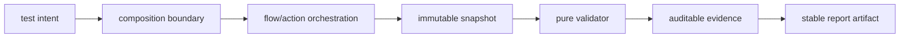

# Bune practici pentru ATF Java

Aceste reguli urmăresc trei lucruri: cod ușor de întreținut, comportament
testabil și raport care explică execuția fără zgomot.

## Diagramă de bază



## Politica limbii proiectului

README-urile, feedback-ul și documentele de proiect sunt documentația locală
și pot fi scrise în română, pentru a fi ușor de urmărit de echipă. Codul și
artefactele executabile folosesc exclusiv engleza:

- codul de producție și codul de test, inclusiv clase, metode, variabile,
  teste, constante și identificatori;
- comentariile inline, Javadoc-ul, TODO/FIXME și mesajele de assertion sau
  de raportare;
- fișierele de configurare și comentariile din YAML, XML și properties;
- identificatorii din diagramele Mermaid și exemplele de cod executabil.

Un fixture poate păstra o valoare românească numai dacă testul
verifică explicit un serviciu sau un payload care trebuie să conțină acea
valoare; comentariul și explicația testului rămân în engleză.

### Naming pentru README-uri și documentație

Numele fișierelor README și ale documentelor Markdown descriptive folosesc
`PascalCase` după primul separator `_`: numai primul segment este acronimul
scris integral cu majuscule, iar segmentele următoare au doar inițiala mare.
Exemple conforme: `ATF_Architecture.md` și
`README_Atf_BestPractices.md`. Nu se introduc nume precum
`ATF_UI_Extent_Inventory.md`; forma nouă este
`ATF_Reporting_Contract.md`. `README.md` rămâne forma canonicală pentru
README-ul principal al unui modul.

Fișierele existente cu naming istoric nu se redenumesc într-un refactor de cod
fără actualizarea tuturor linkurilor și a indexurilor; normalizarea lor este o
schimbare documentațională separată.

## Documentație fără artefacte generate

Documentația descrie contracte stabile, nu rezultatul unei rulări locale:

| Se documentează | Nu se documentează |
|---|---|
| tipul output-ului, owner-ul și locația configurabilă | nume timestamped de raport sau link către un fișier generat |
| proprietăți simbolice precum `<configured-report-file>` | căi absolute, drive-uri locale sau URL-uri `file:///` |
| schema request → validation → publication și criteriul de verificare | payload copiat dintr-un artifact temporar doar pentru ilustrare |
| diagramă, tabel și placeholder semantic | rezultat de test prezentat ca regulă permanentă |

Dacă o explicație are nevoie de un raport generat ca să poată fi înțeleasă,
contractul este incomplet: se îmbunătățește README-ul ownerului cu schema,
exemplul minimal simbolic și testul care îl protejează. Feedback-ul păstrează
doar gap-ul reproductibil; când acesta este închis, regula se mută în README și
dispare din lista de ToDo-uri.

## Principii de design

1. O clasă are un motiv dominant de schimbare.
2. Fațadele coordonează; nu ascund politici de retry, verdict sau randare.
3. Modelele și contractele sunt neutre față de Extent și HTML.
4. Starea este per sesiune/per scenariu, nu globală și statică.
5. Endpoint-urile și constantele de rutare nu se repetă în teste.
6. Validările pentru un response sunt agregate într-un singur tabel.
7. Cleanup-ul are ownership clar și rulează în ordine inversă.
8. O interfață se introduce numai pentru o dependență care trebuie înlocuită,
   observată sau izolată.
9. O opțiune declarativă trebuie să aibă efect executabil și evidence; nu se
   adaugă câmpuri în adnotări/config doar pentru vocabular sau documentație.
10. Un validator nu își construiește expectation-ul din aceeași observație pe
    care o verifică; sursa expected trebuie să fie independentă de DOM-ul
    actual, mai ales pentru artifactele statice.
11. Un modul de audit returnează un rezultat renderer-neutral; JUnit, Extent și
    orice alt publisher sunt adaptoare, nu responsabilitatea contractului pur.
12. Comportamentul injectabil al unui renderer trece printr-un port semantic
    (`HtmlReportScript`, `AtfReportPorts` sau echivalent); lifecycle-ul nu
    păstrează JavaScript/CSS inline care aparține altui owner.

### Clase mari și CSS compus

Dimensiunea declanșează review, nu o împărțire mecanică. Se extrage numai când
există un boundary semantic stabil: facade, provider, extractor, validator,
publisher sau lifecycle. Fațada rămâne API-ul folosit de consumatori, iar
colaboratorii nu reintroduc selectorii, verdicturile sau randarea în altă zonă.

Pentru CSS-ul raportului, composition root-ul trebuie să păstreze ordinea
provider-elor și să aibă test de contract. În reporting, `AtfReportEvidenceCss`
compune separat `AtfReportEvidenceTableCss`,
`AtfReportEvidenceInteractionCss`, `AtfReportEvidenceDisclosureCss` și
`AtfEvidenceStackCss`. Fiecare provider deține o singură suprafață vizuală;
nu se adaugă valori locale sau reguli duplicate doar pentru a scurta un fișier.

Pentru JavaScript, aceeași regulă înseamnă că un document/lifecycle compune un
asset printr-o interfață mică și testabilă. În fallback HTML, `HtmlReportScript`
este portul, iar `HtmlReportNavigationScript` deține navigarea tab-urilor. Un
split este justificat de responsabilitate și substituibilitate, nu de numărul
de linii.

Pentru lifecycle-ul HTML, scope-urile se țin într-un boundary separat
(`html.scope`) și implementează porturile `AtfReportPorts` pe niveluri:
scenario, phase, request și validation. Modelul semantic expune operații
controlate, nu câmpuri mutabile către renderer sau test; astfel interfața dintre
module rămâne clară, iar o refactorizare de markup nu schimbă contractul de
execuție.

Un refactor de clasă/CSS este acceptat numai după: build/test în staging extern,
artifact API/UI fresh, verificare statică a contractului și verificare efectivă
prin ATF Debug UI + browser MCP. Se folosesc atât sursa `GENERATED_API` dinamică,
cât și `STATIC_PATH`/`STATIC_RESOURCE` când schimbarea afectează auditul unui
raport existent. Renderul final trebuie inspectat în DOM și vizual; testul Java
singur nu este dovadă suficientă.

### Limita de coeziune: maximum 8 clase per pachet

Fiecare pachet de producție și fiecare pachet de test are maximum 8 clase Java.
Limita se verifică pe source-set, nu prin agregarea accidentală a modulelor.
La 8 se oprește creșterea; la 9 se caută un boundary semantic real: `request`,
`response`, `auth`, `transport`, `configuration`, `semantic`, `theme`,
`runtime`, `fixture`, `extractor`, `validator` sau `publisher`. Nu se mută o
clasă doar pentru a satisface numărul și nu se creează un pachet `misc`.

`atf-tests`/`ArchitectureModuleBoundaryTest` apără invariantă pentru întregul
reactor: source imports, Maven direction, process-state ownership și mutable
static state. `ArchitectureCohesionBoundaryTest` și
`ArchitectureOwnershipBoundaryTest` rămân în `atf-reporting` pentru coeziunea și
ownership-ul propriu reporting-ului. `atf-tests` nu primește suport, fixture-uri,
API tests sau UI tests.
În reporting, suportul generic pentru renderer stă în `src/main/java`, iar
fixture-urile și adaptoarele rămân în `src/test/java`. Nu există folder
intermediar `java` între source root și package. Orice excepție trebuie să aibă un owner
semantic, motivul și plan de eliminare, altfel refactorizarea nu este acceptată.

### Separarea testelor, fixture-urilor și infrastructurii OOP

O clasă `*Test`/`*Tests` este composition root pentru intenția scenariului, nu
un container pentru orice cod de care are nevoie. Regula de ownership este:

```text
test intent (@Test/@TestFactory)
  → fixture / builder / test data
  → flow / action
  → locator facade
  → observation / snapshot
  → pure validator
  → publisher / JUnit verdict
```

- modulele de producție folosesc `src/main/java` pentru infrastructură
  reutilizabilă și renderer-neutrală; `atf-reporting` deține snapshot-urile,
  verdicturile și validatorii puri ai artifactului, iar testele, fixture-urile
  și adaptoarele de integrare sunt în `atf-reporting/src/test/java`;
- `atf-tests` conține numai testele explicite de guvernanță globală în
  `src/test/java/atf/api/tests/governance`; nu deține scenarii API/UI sau cod de suport;
- un `Profile` care selectează scenarii sau setup, un payload mock, un HTML
  artificial și un engine care construiește dynamic JUnit nodes rămân în
  namespace-uri `support`/`fixtures`/`flows` din `src/test`;
- clasele executabile declarative trebuie să păstreze doar annotation/profile,
  lifecycle minimal și delegarea către flow; nu dețin JSON, selectori, browser
  calls sau reguli de business;
- orice mutare este acceptată numai cu import graph verificat, test arhitectural
  pentru locația nouă și coverage de replacement; nu se mută mecanic fișiere
  doar pentru a reduce numărul de linii.

### Stratificare executabilă a testelor

Fiecare clasă concretă de test declară exact un nivel prin meta-anotațiile JUnit
din `atf.api.testkit`: `@AtfUnitTest`, `@AtfComponentTest`,
`@AtfIntegrationTest` sau `@AtfE2eTest`. Acestea proiectează în tag-urile
standard `unit`, `component`, `integration` și `e2e`, astfel încât runnerul să
poată selecta nivelul fără convenții fragile de nume.

`support` nu este nivel de test și nu primește tag propriu. El rămâne
infrastructură pentru fixtures, flows/actions, locators, extractors, auditors
și adapters; un test care verifică o regulă din support este clasificat după
regula verificată. `AtfTestLayerArchitectureTest` apără această convenție,
verifică importurile interzise pentru unit/component și permite harness-uri
abstracte numai ca infrastructură.

### Ownership pentru configurarea UI și reporting

Configurarea generică și configurarea unui produs de raportare nu se amestecă:

```text
atf-ui
  UiBrowserConfiguration
  UiScreenValidationConfiguration
  Playwright runtime
        ↓ politici reutilizabile
atf-reporting test scope
  output Extent, audit suites, API families, input report și YAML reader
```

În concret, `atf-ui` nu trebuie să dețină `report.directory`, `filePrefix`,
`apiSetup`, `audit.suites`, `audit.inputReport` sau loaderul proprietăților
`atf.ui.config`/`atf.ui.report`. Acestea sunt intenția testelor Extent și rămân
în `atf-reporting/src/test/java/.../support/config`, lângă resursa
`atf-reporting-ui.yaml`. Dacă un al doilea proiect folosește Playwright fără
Extent, dependența lui trebuie să fie doar pe politica generică și session;
nu se introduce un `ui.enabled` sau un wrapper de raportare în `atf-ui` pentru
convenience.

Regula se verifică prin suita `Architecture*BoundaryTest` și prin import graph: un
modul generic nu importă Extent, HTML, CSS, mock, audit suites sau cataloguri
concrete. Orice câmp nou se clasifică înainte de implementare: browser/capture
generic → `atf-ui`; model/renderer/audit/output → `atf-reporting`; setup și
fixture de test → `atf-reporting/src/test`.

În implementarea curentă, loaderul generic `atf.yaml` și decoratorul
`RecordingApiTransport` sunt în `atf-core` ca platformă plug-and-play fără
JUnit/browser; catalogul concret de scenarii și composition roots sunt în
`atf-reporting/src/test/java`. Locatori, contextul browser și lifecycle-ul
test-only sunt în același source root, iar
contractul renderer-neutral este în
`atf-reporting/src/main/java/atf/api/reporting/audit` și
`atf-reporting/src/main/java/atf/api/reporting/ui/audit`. Contractul static de
display `UiReportArtifactContract` este tot în `atf-reporting`, iar fiecare
  regulă de HTML/CSS/JS care nu cere browser trebuie să fie apărată acolo înainte
  de smoke-ul Playwright. `atf-reporting` păstrează un singur slice declarativ care
  dovedește lanțul setup → mock → raport → DOM și un
  singur gate pentru un raport UI extern; nu se adaugă câte un E2E separat pentru
  fiecare secțiune când aceeași regulă poate fi verificată pe HTML publicat.
  Pentru smoke E2E se preferă `@ApiScenarioSetup(tests = { @ApiTestRef(...) })`
  cu câteva scenarii exacte, nu o familie completă: un GET pozitiv, un POST/PUT
  cu JSON request/response și doar edge/warning/negative sau lifecycle SKIP/FAIL
  dacă acel status este necesar pentru suprafața UI. Familia rămâne fallback de
  suite, iar matricea completă se testează în API/reporting.
  Contractul static verifică și că cele trei zone Screen validation sunt frați
  vizuali fără delimitatoare orizontale intermediare; browserul confirmă apoi
  randarea efectivă. Metadata de contract
pentru failure surfaces (`UiFailureReportAudit`, input, surface și spec) urmează
aceeași regulă și nu rămâne în test-kit separat; în `atf-reporting/src/test/java`
rămân factory-ul, fixture-ul browser, inspectorul și engine-ul JUnit.
`ApiReportUiTestProfile` rămâne metadata compatibilă pentru flow-ul API legacy;
composition root-ul activ este
`atf-reporting/src/test/java/atf/ui/tests/extent/e2e/section/SelectedApiTestsReportUiTest`, iar
`SectionAuditDynamicEngine` este adapter JUnit în
`atf-reporting/src/test/java/atf/ui/tests/extent/support/section/runtime`; fixture-urile sunt în namespace-uri dedicate:
`support/configurable` pentru `CategoryCardinalityFixture` și publisherul lui,
`support/sanity` pentru `UiThenDisclosureReportFixtures`, `support/api`
pentru `ApiReportSetupDeclarations` și `support/section/fixtures` pentru
`MissingApiSetupDeclaration`. Fixture-urile de audit și mock rămân în namespace-
urile lor proprii. `ArchitectureOwnershipBoundaryTest` protejează aceste granițe și
împiedică revenirea la teste care conțin setup artificial, JSON, HTML sau
publisheri în loc de intenție de test.

### Catalogul API este sursa de adevăr pentru testele UI

Testele UI care verifică un raport API nu reconstruiesc local identitatea
scenariilor. Owner-ele, metodele de selecție, titlurile raportate și identitățile
de rută sunt constante publice ale catalogului API (`*ApiScenarios`), iar
`UiTestData.ApiFamily` doar le proiectează în configurația UI. O expresie de
forma `List.of(...)` poate compune constante canonice, dar nu poate conține
string-uri duplicate precum `GET /public/... — ...` sau nume de owner API.

Regula este protejată de `DeclarativeUiTestArchitectureTest`, iar proiecția
`ReportProjection.from(...)` consumă aceleași selecții tipizate ca setup-ul API. Când se
introduce un scenariu nou, se actualizează întâi catalogul API și lista lui
referința lui `ApiScenarioSelection`; apoi testele UI folosesc proiecția renderer-neutral. Astfel
schimbarea unui route/title nu poate lăsa UI-ul cu un expected fals pozitiv sau
cu un raport greu de auditat.

### Constante și enum-uri cu ownership semantic

Valorile repetate nu se mută mecanic într-o clasă globală `Constants`. Folosim
`HttpMethod` pentru verbe, `HttpHeader` pentru nume de header, `MediaTypes` pentru
media type-uri, `RoutePaths` pentru rute, `ApiFixtureData` pentru identități și
payload-uri cross-family, iar enum-uri dedicate pentru vocabular închis precum
`MockRequestBodyMode` și `AtfReportStatus` pentru verdicturile raportului. Cheile
unei proiecții sau ale unui auditor au propriul
owner semantic, de exemplu `ApiReportEvidenceField` pentru contractul
renderer-neutral al raportului; adapterul concret al mock-ului nu se exportă
din `atf-reporting` ca regulă de producție.

Regula de decizie este: dacă valoarea este protocol, sentinel, rută, enum de
configurație sau date reutilizate de minimum două scenarii, are owner tipizat;
dacă este un payload strict local de edge-case, rămâne în builderul scenariului
cu nume semantic. Nu se introduc constante doar pentru a ascunde un literal și
nu se reintroduc string-uri canonice direct în testele API/UI. Regula este
Pentru statusuri, CSS și filtre, `AtfReportStatus.displayValue()` este conversia
unică spre vocabularul lowercase; filtrele care nu sunt verdicturi, precum
`CLEAR`, au enum-ul lor și nu extind artificial statusul. Regula este stabilă și
nu mai are un feedback separat: aplicațiile concrete o
documentează în README-ul ownerului (`atf-mock/README.md`, respectiv
`atf-reporting/README.md`), iar feedback-ul păstrează numai regresii noi sau
excepții care cer o schimbare.

The ownership rule is also regression-protected by the narrow
`ConstantsOwnershipArchitectureTest`: it checks only canonical protocol,
route, header and transport-verb identities in the audited sources and leaves
scenario-local JSON/YAML edge-case data where it is owned. A generic
`Constants` bucket is not an acceptable replacement for semantic owners.

În runtime-ul Extent, `ExtentReportRuntimeVocabulary` este ownerul tipizat al
funcțiilor JavaScript, selectorilor, atributelor, claselor CSS semantice și
statusurilor. `ExtentReportRuntimeCore` folosește emitătoare mici și static
import pentru vocabular; nu repetă literalul în mai multe concatenări de
stringuri. Contractul se testează unit/component prin unicitatea funcțiilor și
proiecția DOM, apoi E2E verifică numai comportamentul dependent de browser.
Raportul API generat din mock poate fi precondiție pentru UI, dar JSON-ul,
provenance-ul și structura raportului se verifică înainte, fără browser.

Pentru raportarea HTML, clasele CSS și id-urile de navigare au aceeași regulă:
`AtfReportCssSelectors.Surface` deține suprafețele de top-level și hash-urile,
iar `AtfReportCssSelectors.Component` deține elementele repetate dintr-o
suprafață, precum `.test-list`, `.test-item`, `.test-content-detail` și
`.card-header`. Selectorii compuși se construiesc prin `descendant(...)`, iar
vizibilitatea prin `visible()`; nu se copiază literal selectorul în CSS
provider, locator, auditor și test. Așteptările statice care verifică markup-ul
pot păstra textul HTML rezultat, deoarece acolo se verifică artifactul publicat,
dar codul care îl construiește trebuie să folosească ownerul semantic al
selectorului.

În `atf-reporting`, aceeași regulă se aplică și evidence-ului: `ReportField`,
`ReportJsonBody`, `ReportScreenshot` și `ReportCheck` sunt records immutable pentru
date; `AtfReportHtmlVocabulary` deține `Tag`, `Attribute`, `CssClass` și valorile
finite ale markup-ului; builder-ele serializează rezultatul. Nu se introduc
enum-uri pentru titluri, URL-uri, JSON sau mesaje provenite din test. Array-urile
`String[]`/`String[][]` sunt permise numai la marginea serializerului Extent sau
în adaptoare legacy, nu între model, renderer și validator.

Un link de screenshot trebuie să rămână un singur element inline cu payload
Base64, emoji-ul consacrat și atributele Featherlight/`target`/`rel` verificate
de contract; orice schimbare de markup, CSS sau JavaScript cere artifact fresh,
ATF Debug și browser MCP, nu doar un test Java verde.

## Boundary obligatoriu pentru locatori UI

Testele UI nu folosesc direct `page.locator(...)`, `locator.locator(...)` sau
selectorii CSS împrăștiați în metodele de test. Locatori trebuie deținuți de
clase dedicate din pachetul UI, cu metode numite după intenție și responsabilitate:

```text
ReportUiLocators
├── flow()       navigare, tab-uri, owner/scenario/phase
├── action()     acțiuni Playwright, tabel de pași și screenshot link
└── validation() Screen validation, assertions și evidence tables
```

Regulile sunt stricte:

- testul descrie Gherkin-ul, ordinea flow-ului și verdictul; nu cunoaște
  selectorul intern;
- `action` expune ținte pentru `click`, `getText`, `focus`, `wait` și `expect`,
  iar fiecare acțiune este înregistrată prin `UiAuditFlow`;
- identitatea human-facing a raportului rămâne numele dinamic al fișierului;
  identitatea tehnică poate exista în metadată internă și gate-uri, dar nu se
  afișează în propozițiile sau target-urile raportului Extent;
- `flow` expune doar navigarea și nodurile structurale necesare tranziției;
- `validation` expune doar suprafețele validate și tabelele de evidence;
- schimbarea unui selector se face într-un singur owner de locatori și se
  protejează printr-un test de contract, nu prin modificarea tuturor testelor;
- locatorii dinamici primesc metode cu parametri semantică (`scenario(int)`,
  `phase(String)`, `actionSequence()`), nu concatenări de selector în test.

Un test nou care introduce `page.locator` direct este regresie arhitecturală.
Migrarea suprafețelor existente pentru testele, flow-urile și auditorii UI Extent
este închisă pentru codul live verificat; selectorii rămași în adaptoarele
`section.extract` sau în clasele din `locators` sunt infrastructură DOM, nu
intenție de test. Orice suprafață nouă intră numai prin același boundary și prin
un guard arhitectural focalizat.

## Contract write API și raportare

Serviciile API construiesc acțiuni semantice, iar `ApiRoute.requestBody(...)`
este owner-ul construcției JSON pentru `POST` și `PUT`. Ambele body-uri — request
și response — trebuie să fie documente JSON ne-goale și valide; `null` este
rezervat exchange-urilor fără body. Mock-ul YAML, publisher-ul Extent și
auditorul UI verifică aceeași regulă, astfel încât lanțul auditabil rămâne:

```text
setup → API action → mock route → request/response evidence → UI audit → deep validation
```

### Reproducibilitate API fără afirmații inventate

Nu deduce niciodată că un URL a fost contactat doar pentru că arată real. Raportul
trebuie să păstreze provenance-ul transportului: `ACCEPTANCE / MOCK` pentru
schimburi offline și `LIVE / HTTP` numai după opt-in explicit. Pentru fiecare
exchange API se publică URL-ul, method, headers efective și `REQUEST JSON` /
`RESPONSE JSON`; câmpul `MANUAL REPLAY` oferă cURL doar pentru live și marchează
mock-ul ca neexecutabil. Secretele auth sunt redacted. Astfel pașii pot fi
refăcuți manual fără să transformăm acceptance într-un apel accidental la rețea.

Testele nu pun JSON, locatori sau comparații de arbori direct în metodele
Gherkin. Payload-urile sunt deținute de modele/routes/mock, locatori de clase
dedicate, acțiunile de adaptoare, ordinea de flows, iar verificările de
validatori/auditori.

## Coeziunea pachetelor

Un package de producție sau de test nu ar trebui să depășească, ca regulă de
bună practică, 8 clase concrete, record-uri sau interfețe. Pragul este un semnal obligatoriu
de review pentru coeziune și ownership:

- peste 8 clase se caută mai întâi responsabilități distincte, fațade prea mari
  și dependențe amestecate;
- împărțirea se face după responsabilitate semantică, nu prin directoare create
  artificial doar pentru a coborî numărul;
- regula se aplică separat pe fiecare package din `src/main/java` al modulelor
  de producție și din `src/test/java` al modulului `atf-reporting`;
- testele, codul generat și asset-urile vendor nu intră în numărătoarea de
  producție;
- o excepție trebuie documentată și protejată printr-un test arhitectural sau
  printr-o justificare explicită în README-ul modulului.

Pragul nu înlocuiește analiza de design: un package cu 8 clase poate fi încă
slab coeziv, iar unul cu mai mult de 8 poate necesita o separare justificată.
`ArchitectureCohesionBoundaryTest` inventariază package-urile de producție și toate
source-set-urile de test și respinge orice hotspot peste 8. `ArchitectureModuleBoundaryTest`
este rulat de `atf-tests`, iar `ArchitectureOwnershipBoundaryTest` este rulat de
`atf-reporting`. Allow-list-ul de
coeziune pentru producție este gol; pachetele care au ajuns la 8 rămân la
limită, iar orice al nouălea owner cere split semantic înainte de build.

## Separarea modulelor

~~~mermaid
flowchart LR
    Scenario[scenariu] --> Service[serviciu semantic]
    Service --> Executor[executor]
    Executor --> Transport[transport]
    Executor --> Evidence[evidence neutru]
    Evidence --> Reporter[reporting Extent]
    Service --> Validator[validator]
    Validator --> Assertions[tabel agregat]
~~~

Aceasta este o diagramă de colaborare runtime, nu o diagramă de dependențe
Maven. Modulele, direcția importurilor și composition root-ul sunt definite în
[ATF_Architecture.md](ATF_Architecture.md).

Testele nu construiesc transportul, nu manipulează HTML-ul și nu decid local
precedence-ul statusurilor. Reporting-ul nu face apeluri HTTP și nu modifică
assertions pentru a obține o randare mai convenabilă.

## Teste care merită păstrate

- unitare pentru route building, configurație, redaction, retry, timeout,
  cancellation, precedence și agregare;
- de componentă pentru executor + fake transport + reporter;
- de artifact pentru HTML autonom, tab-uri, collapse, JSON și theme;
- de integrare pentru modul, lifecycle și cleanup;
- scenarii API pentru contractul real al serviciului.

Un bug de raportare are nevoie de testul cel mai ieftin care dovedește regula,
apoi de un test de componentă sau artifact dacă schimbarea traversează module.

## Raport fără duplicare

~~~text
phase
├── request
│   ├── technical trace
│   ├── request/response JSON
│   └── durată
└── validation sibling
    └── assertion table agregat
~~~

TEST BODY nu repetă failure-urile detaliate mai jos în tabel. Fazele rămân
compacte și colapsate; detaliile se deschid doar când sunt necesare.

## Mesaje de consolă fără responsabilități amestecate

Consola este o proiecție diagnostică a aceluiași lifecycle, nu o sursă de
verdict și nu un înlocuitor pentru artifactul Extent. `atf-core` definește
`AtfConsoleEvent`/`AtfConsoleSink`, iar modulul separat `atf-console` formatează
evenimentele în `AtfConsoleReporter` și citește numai `reporting.console` din
YAML. Adapterul JUnit este opțional și este inclus în `atf-console`, în
subpachetul `atf.api.console.junit`.
`atf-reporting` consumă numai sink-ul injectat și rămâne fără formatter sau
loader de consolă concret. Ordinea observabilă este:

```text
scenario → phase → request → validation → complete(status, duration-ms)
```

Reguli obligatorii:

- mesajele de bază includ nivelul (`[PASS]`, `[FAIL]`, `[WARNING]`, `[SKIP]`),
  numele nodului și durata formatată de politica comună: `ms` până la `300 ms`,
  apoi secunde (`0.301 s`, `1 s`);
- detaliile sunt opt-in prin `reporting.console.detailsEnabled` și sunt
  redacted înainte de a ajunge la sink;
- JSON-ul și stacktrace-ul nu se tipăresc implicit;
- un sink care nu poate scrie nu modifică verdictul și nu întrerupe reportarea;
- rulările paralele folosesc sink-uri per sesiune și output-uri timestamped;
- testele pot folosi `ExtentReportSession.openConfigured()` pentru rularea
  directă din IntelliJ, iar `atf.yaml` rămâne singura sursă de output policy.
- `System.out`/`System.err` apar numai în `atf-console`; orice launcher, test-kit
  sau modul de raportare folosește `AtfConsoleReporter.configuredStdout()` ori
  un sink injectat. Regula este apărată de
  `ArchitectureModuleBoundaryTest.processStreamOutputBelongsOnlyToTheConsoleModule`.

## Reguli pentru metadata

- lista Tests din stânga rămâne scanabilă: nume, status și durată cu unitate
  (`N ms` până la `300 ms`, apoi `N s`), niciodată un număr fără semnificație;
- tag-urile apar în detaliile scenariului și în Overview, nu ca pills în lista
  claselor;
- Category este navigare, nu o a doua sursă de verdict;
- Fails listează toate testele individuale, nu doar grupuri pe clasă;
- Overview este ultimul tab și se deschide implicit;
- durata se afișează în `ms` pentru valori de până la `300 ms`, iar peste prag
  în secunde cu precizie de milisecunde (`0.301 s`, `1.5 s`, `12.345 s`);
  timestamp-ul este metadata de eveniment, nu durată, count sau identitate logică;
- o frunză păstrează durata măsurată; un părinte însumează numai copiii
  structurali direcți și adaugă durata proprie exclusivă când există;
- totalul clasei din navigator este suma scenariilor directe din panoul din
  dreapta și trebuie să fie identic cu totalul din header-ul clasei;
- o durată sursă deja inclusivă nu se adună din nou cu descendenții;
- statusul și durata sunt informații distincte: `Pass` + `16 ms`, nu un număr
  interpretabil ca assertion count sau step count;
- badge-urile `Pass`, `Warning` și `Fail` păstrează aceeași geometrie în toate
  tab-urile: `18.2px` înălțime, `0 5px` padding, `4px` radius, `9.52px`
  font/line-height, `400` weight și border `0`.

## Schimbări vizuale

Tema este centralizată. Nu se adaugă fonturi, culori, grosimi de linii sau
dimensiuni direct în rendererul unui singur nod. Pentru orice schimbare de UI:

1. actualizează token-ul comun;
2. adaugă test pentru token și componentă;
3. generează artifactul în staging;
4. verifică randarea și computed styles în TAB MCP;
5. confirmă că Extent și fallback-ul arată la fel.

Pentru culori folosim exclusiv notația hexadecimală în sursa CSS și în tokenii
temei: `#RRGGBB` sau `#RRGGBBAA` când este necesar alpha. Nu introducem
`rgb(...)`, `rgba(...)` sau variantele lor cu spații în cod, markup ori
configurație — inclusiv valori de test de tipul `rgb(1, 2, 3)`. Culorile rămân
token-uri semantice centralizate în `AtfReportColors`, iar un test nou trebuie
să verifice token-ul sursă și componenta care îl consumă. Browserul poate
normaliza o valoare HEX într-o reprezentare funcțională atunci când citim
`computedStyle`; adaptorul de evidence trebuie să o convertească imediat în
HEX înainte de publicare. Nici raportul Extent nu afișează reprezentarea
normalizată: evidence-ul trebuie să arate codurile canonice, de exemplu
`#101723 / #e5ecf7`. Regula se verifică repo-wide, în sursă și în artifactul
HTML final.

Pentru pașii executabili ai unui test folosim `AtfGherkinKeyword` (`GIVEN`,
`WHEN`, `THEN`, `AND`, `BUT`) și overload-urile typed ale lifecycle-ului. Nu se
introduc string-uri duplicate pentru aceste cuvinte în teste, flows sau
publisheri; textul rezultat în raport rămâne neschimbat.

Pentru header-ele din `Tests`, regula este separată pe axe: titlul și tag-urile
sunt aliniate la stânga, tag-urile rămân sub titlu, iar grupul lor este centrat
vertical în header. Toolbar-ul din dreapta păstrează statusul și durata cu
`ms`, pe aceeași centrare verticală; nu este permis ca aceste valori să coboare
pe rândul tag-urilor sau să se centreze orizontal împreună cu titlul.
Badge-urile semantice (`Pass`, `Warning`, `Fail`, `Info`) reutilizează în toate
tab-urile aceeași geometrie compactă (`18.2px`, padding `0 5px`, rază `4px`,
font `9.52px`, line-height `18.2px`). Lățimea rămâne naturală după text; nu se
introduc variante locale pentru Category, Fails sau Overview. Duratele și
ancorele neutre folosesc token-ul meta separat, fără să mărească statusurile.

## Lucrul sigur cu execuții active

Build-ul și testele se fac într-un staging nou, separat de checkout-ul sau
artifactul folosit de o rulare existentă. Nu se folosesc operații destructive și
nu se copiază output-uri generate înapoi în surse. Procedura completă este în
[ATF_Build_And_Execution_Safety.md](ATF_Build_And_Execution_Safety.md).

## Căi dinamice și semantica auditului UI

Nicio documentație, diagramă, comentariu sau mesaj human-facing din raport nu
publică o cale absolută locală. Exemplele folosesc `${ATF_STAGING_ROOT}`,
`${ATF_DEBUG_BASE_URL}` sau căi relative la repository; locația reală se rezolvă
la boundary-ul de configurație/I/O. În evidence se afișează numele logic al
artifactului, nu `Path.toString()` și nu drive-ul mașinii care a rulat testul.
Regula este protejată de `DynamicPathDocumentationArchitectureTest`; output-urile
generate (`target`, `artifacts` și log-urile de rulare) nu sunt documentație și
nu devin input pentru alte execuții.

Pentru auditul unui raport UI, inputul este static, dar observația este dinamică:

```text
HTML anterior configurat
  → browser MCP / ATF Debug
  → DOM + computed style + collapse + tab navigation
  → snapshot neutru
  → validare UI în TEST BODY
```

`SETUP` are doar rol de inițializare read-only și trebuie să rămână fără carduri
de `UI validation`; `setupValidationCount = 0` este un invariant verificat, nu o
validare omisă. `TEST BODY` este zona care publică `Screen validation`, acțiunile,
observațiile, screenshot-ul inline și assertions. Astfel un setup static poate
fi reutilizat pentru multe rapoarte, fără să falsifice verdictul UI.

În randarea setup-ului, păstrează un singur bloc compact `Setup evidence` cu
`CHECK / EXPECTED / ACTUAL / RESULT`. Nu transforma precondiția într-un
request/response artificial și nu amesteca validarea de ecran în ea; evidence-ul
API și `Screen validation` trebuie să rămână în zonele lor de ownership.

Tabelul Playwright trebuie să fie o proiecție a acțiunilor reale, nu un rezumat
scris manual în test. Recorderul publică operații precum `Navigate`, `Click`,
`Get text`, `Find element`, `Expect text`, `Focus`, `Press key`, `Wait for
visible`, `Expect visible`, `Wait for state` și `Wait for disclosure`, împreună
cu target, expected, observed, durată și rezultat. Rendererul folosește exact
șase coloane pentru acțiunile Playwright: `ACTION`, `TARGET`, `EXPECTED`,
`OBSERVED`, `TIME`, `RESULT`. `Audit observations` este separat: are cinci
coloane (`ACTION`, `TARGET`, `EXPECTED`, `OBSERVED`, `RESULT`), deoarece este
o analiză statică a checkpoint-urilor și nu trebuie să inventeze `0 ms`.
Operația și `#N` stau în aceeași celulă `ACTION`, pe două rânduri; disclosure-ul
`＋` și propoziția rămân pe aceeași linie. Acțiunile noi se adaugă în recorder
și în contractele sale, apoi se verifică prin DOM/computed style în browser MCP.

Coloana `TIME` din tabelul acțiunilor Playwright nu este decorativă. Ea este
proiecția human-facing a `durationMillis` din `AtfUiActionRecord`, iar clasa
semantică `.atf-ui-action-time` este citită de auditorul de durate pentru
agregările din `Tests`, `Overview`, `Categories` și `Fails`. Regula nu se aplică
observațiilor statice: pentru ele `TIME` este eliminat, nu afișat ca `0 ms`.

### Apeluri de raportare lizibile

Un apel fluent de raportare trebuie să arate intenția, nu să expună detalii de
rezolvare sau expresii repetate. Tipurile și valorile de vocabular se importă
normal; pentru verbe finite folosite repetat este permis un static import
explicit (`GIVEN`, `WHEN`, `THEN`). Nu se folosesc membri fully-qualified în
expresii de producție sau de test, iar o valoare derivată din fișier, rută ori
obiect se calculează o singură dată într-o variabilă cu nume semantic.

```java
String reportName = inputReport.getFileName().toString();
boolean reportExists = Files.isRegularFile(inputReport);
var setup = scenario.startPhase(ReportUiContract.Phase.SETUP.displayName());
setup.setup(GIVEN, UiAuditGherkin.CONFIGURED_REPORT_READY, reportName,
        List.of(check("Input report", "published HTML", reportName, reportExists)),
        AtfReportStatus.PASS);
```

Folosim `var` numai când tipul rezultă fără ambiguitate din factory sau din
contextul imediat. Numele locale (`reportName`, `reportExists`, `setup`,
`body`) trebuie să reducă duplicarea și să facă ușor de urmărit relația dintre
setup, acțiune și validare. Regula este apărată de
`ReportingTestReadabilityArchitectureTest`; nu se introduce un bucket global
de constante ca soluție pentru importuri sau pentru valori strict locale. Guard-ul
respinge și importurile duplicate în toate source-set-urile Java, pentru ca un
merge sau refactor paralel să nu ascundă dependențele reale ale clasei.

O clasă de contract de test rămâne coezivă: interaction/evidence, failure
projection și navigation/filter sunt boundary-uri diferite. Dacă o clasă începe
să le combine, se deschide un ToDo de coeziune și se face split numai când fiecare
clasă nouă poate păstra fixture-ul, verdictul și acoperirea independent; nu se
mută metode mecanic doar pentru a reduce numărul de linii.

## Protocol pentru fiecare refactorizare

Orice îmbunătățire ATF Java urmează aceeași buclă verificabilă:

```text
sync live
  → baseline în staging
  → un increment cu responsabilitate clară
  → test nominal + failure-path
  → artifact timestamped
  → click-uri și verificare în TAB MCP
  → re-sync cu live
  → README contract stabil + feedback doar cu ToDo-uri rămase
```

Reguli obligatorii:

- live-ul se recitește înainte de fiecare increment și înainte de sincronizarea
  înapoi; o copie locală veche nu este suficientă;
- staging-ul este unic, separat și fără `target`, `artifacts`, cache-uri sau
  log-uri copiate din alte rulări;
- un failure de test este diagnostic de implementare, nu motiv pentru relaxarea
  testului;
- o modificare de reporting se acceptă numai după verificarea artifactului în
  TAB MCP, inclusiv interacțiunea relevantă, nu doar sursa HTML;
- documentația permanentă descrie comportamentul stabil, iar feedback-ul nu
  repetă explicații sau rezultate deja închise;
- sincronizarea în live este selectivă și se oprește la conflict, fără overwrite
  sau reset destructiv.

## Review final

Înainte de a considera o schimbare terminată:

- responsabilitatea este mai clară decât înainte;
- testele protejează contractul, nu detalii accidentale;
- request-ul și validation-ul au ownership corect;
- assertions sunt agregate și nu sunt duplicate;
- importurile sunt unice și nu există fully-qualified calls sau duplicate
  introduse de merge-uri;
- artifactul este autonom și navigabil;
- raportul a fost verificat în TAB MCP dacă s-a schimbat randarea;
- README-ul și diagrama descriu codul actual, fără statusuri temporare.

