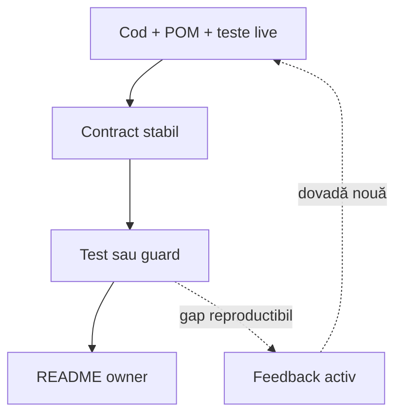

# Bune practici ATF — index și guvernanță

Acesta este punctul de intrare pentru regulile transversale ATF. Nu duplică
reguli de cod sau reguli editoriale; trimite către documentul care deține
fiecare contract. Contractele stabile sunt protejate de testele și guard-urile
lor, iar feedback-ul rămâne registrul dinamic al gap-urilor.

## Overall

Regulile se împart în trei proprietari: cod și arhitectură, documentație și
feedback dinamic. Fiecare regulă stabilă are un singur owner și o dovadă
verificabilă.

## Cum alegi documentul

| Întrebarea | Document owner | Conține |
|---|---|---|
| Cum proiectez modulele, clasele și testele? | [README_Atf_CodeBestPractices.md](README_Atf_CodeBestPractices.md) | OOP, boundary-uri, modele, constante, CSS/JavaScript, layere de test |
| Cum scriu și mențin documentația? | [README_Atf_DocumentationBestPractices.md](README_Atf_DocumentationBestPractices.md) | structură, diagrame, tabele, naming, feedback și linkuri |
| Ce gap-uri sunt încă active? | [feedback/README.md](feedback/README.md) | ToDo-uri, owneri și criterii de închidere |
| Care este arhitectura modulelor? | [ATF_Architecture.md](ATF_Architecture.md) | module, dependențe și direcția boundary-urilor |
| Cum se verifică build-ul și sincronizarea? | [ATF_Build_And_Execution_Safety.md](ATF_Build_And_Execution_Safety.md) | staging, build, browser gate și sync live |

## Regula comună: contract stabil, feedback dinamic

<strong>Legendă — ce rămâne stabil și ce se actualizează</strong>

- codul și testele live sunt sursa de adevăr;
- README-ul ownerului descrie comportamentul stabil;
- testul sau guard-ul protejează afirmația;
- feedback-ul păstrează numai ce mai trebuie decis sau implementat și se poate
  actualiza, restrânge sau închide dinamic;
- README-urile normative și testele-gate existente nu se schimbă incidental;
  schimbarea lor cere cerință, aprobare, motiv și dovadă nouă;
- rezultatele unui run nu devin documentație permanentă.

## Checklist rapid

- [ ] Am identificat owner-ul înainte să schimb codul sau documentația.
- [ ] Regula există într-un singur document normativ.
- [ ] Există test, guard sau criteriu de acceptare verificabil.
- [ ] Nu am modificat un README normativ sau un gate existent fără scope și
      aprobare explicită.
- [ ] Nu am introdus cale absolută, timestamp, nume de artifact sau număr de
      teste care poate deveni învechit.
- [ ] Feedback-ul conține doar gap-ul rămas, nu o copie a regulii închise.
- [ ] Linkurile sunt relative și rezistă mutării checkout-ului.

Pentru implementare se citește documentul ownerului, apoi README-ul modulului
afectat. Acest index trebuie să rămână scurt și stabil.
