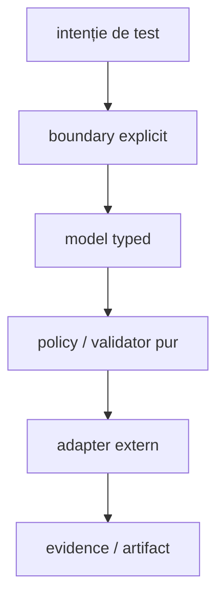
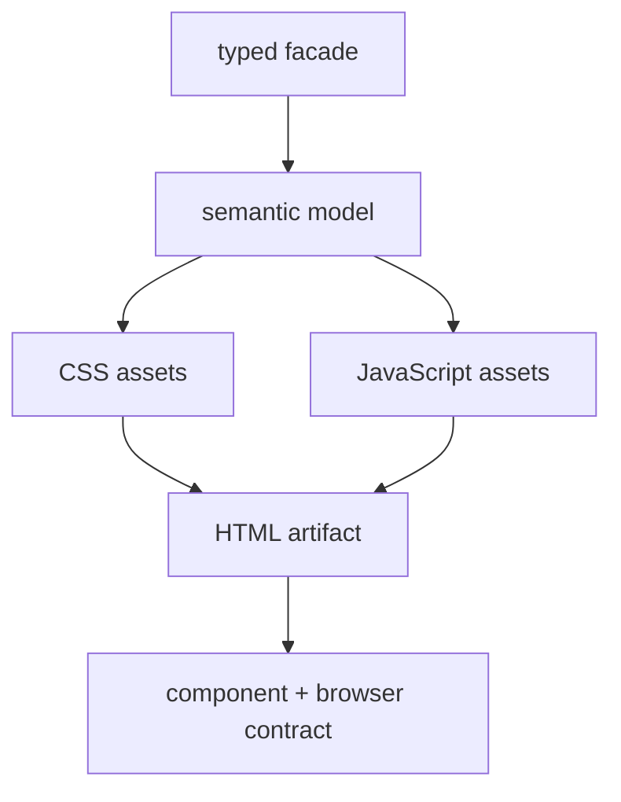

# Bune practici ATF — cod și testare

Acest document este owner-ul regulilor de implementare: module, OOP, modele,
constante, asset-uri de raportare și stratificarea testelor. Pentru redactarea
README-urilor și a feedback-ului se folosește
[README_Atf_DocumentationBestPractices.md](README_Atf_DocumentationBestPractices.md).

## Overall

Codul ATF trebuie să fie ușor de citit din boundary spre detaliu:



<details>
<summary><strong>Legendă — pipeline de implementare</strong></summary>
- intenția pornește din test, dar boundary-ul stabilește ownerul;
- modelul typed intră într-o policy pură înainte de adapterul extern;
- evidence-ul este output verificabil, nu logică ascunsă în renderer.
</details>

| Principiu | Dovadă preferată |
|---|---|
| boundary și ownership explicite | architecture guard + compile |
| modele imutabile și fațade mici | unit/component |
| module decuplate prin porturi | component/integration |
| output și asset-uri stabile | contract test + artifact audit |
| E2E minim și configurabil | selecție semantică + coverage matrix |

## Boundary și ownership

| Zonă | Responsabilitate | Nu deține |
|---|---|---|
| `atf-core` | contracte neutre, lifecycle generic, utilități reutilizabile | Extent, browser, fixture business |
| `atf-reporting` | modele, renderer, asset-uri și contracte reporting standalone | mock, browser și aplicație consumatoare |
| `atf-mock` | transport/fixture determinist | reguli de randare |
| `atf-ui` | Playwright și politici browser generice | configurarea concretă a raportului |
| `atf-reporting-tests` | consumer, composition root și fixture-uri de reporting | producție reutilizabilă |
| `atf-tests` | governance whole-reactor | teste de produs sau fixture-uri concrete |

```text
consumer test
  → atf-core ports/policies
  → API/mock/UI adapters
  → atf-reporting
  → HTML/Extent artifact
```

`atf-reporting` trebuie să poată fi compilat și consumat independent. Orice
dependență către mock, browser sau fixture de aplicație rămâne în test scope-ul
consumerului. Compatibilitatea legacy se face într-un adapter cu owner și test,
nu prin reflecție răspândită în renderer.

## Contracte protejate și schimbări controlate

README-urile ownerilor și testele-gate existente sunt parte din contractul de
mentenanță, nu material de curățare incidentală.

- [ ] Un gate existent nu este șters, relaxat, redenumit sau dezactivat doar
      pentru a face verde un run.
- [ ] Schimbarea unui gate sau a unui README normativ are cerință explicită,
      aprobare, motiv și dovadă nouă pentru contractul modificat.
- [ ] Un failure este urmărit către ownerul real: producție, test, fixture,
      renderer sau configurație; assertion-ul nu este mascat.
- [ ] Feedback-ul este actualizat dinamic în timpul investigației și păstrează
      doar gap-ul rămas, fără să devină o a doua sursă de contract.
- [ ] O regulă închisă este promovată în README-ul ownerului, iar feedback-ul
      este eliminat sau arhivat numai după ce testul confirmă închiderea.

## OOP și modele

- [ ] O clasă are un motiv dominant de schimbare.
- [ ] Fațada coordonează; nu citește YAML, nu face I/O, nu construiește HTML și
      nu decide verdicturi în aceeași metodă.
- [ ] Un `record`/POJO reprezintă o zonă semantică stabilă: setup, request,
      response, assertion, evidence, section sau verdict.
- [ ] Builder-ul gestionează opționale; validatorul verifică invariants; niciunul
      nu ascunde efecte externe.
- [ ] Interfața reprezintă un port real care poate fi observat, înlocuit sau
      izolat (`ReportSource`, `ReportValidator`, `BrowserActions`).
- [ ] I/O, transport, browser și randare sunt adapters separate.

Un split de clasă este justificat de boundary semantic — facade, provider,
extractor, validator, publisher sau lifecycle — nu doar de numărul de linii.
Nu se creează pachete `misc` și nu se mută mecanic fișiere doar pentru a atinge
un număr.

## Constante, enum-uri și string-uri

Valorile stabile ale contractului nu se repetă ca string-uri brute.

| Tip de valoare | Owner recomandat |
|---|---|
| HTTP method/header/media type | enum sau catalog HTTP |
| rută API | catalog de rute al ownerului API |
| status reporting | `AtfReportStatus` |
| fază, tab, evidence type | vocabular reporting |
| CSS class, `id`, `data-*`, rol DOM | vocabular HTML/UI |
| culoare și spacing | token semantic de temă |
| payload strict local | builderul scenariului |

- [ ] Enum-ul reprezintă un vocabular închis și are conversie explicită spre
      textul rendererului.
- [ ] Constanta este pusă în ownerul semantic, nu într-un bucket global.
- [ ] Rutele și header-ele provin din catalog, nu din testul concret.
- [ ] Textele variabile se construiesc cu `String.format` sau builder typed;
      nu se concatenează HTML în assertions.
- [ ] Un literal rămâne local numai când este un edge-case nereutilizabil și are
      nume semantic.

## Reporting: HTML, CSS și JavaScript



<details>
<summary><strong>Legendă — asset-uri și contract vizual</strong></summary>
- Java compune și expune token-uri; CSS și JavaScript rămân asset-uri native pe responsabilități;
- modelul semantic este sursa comună pentru HTML, CSS și JavaScript;
- contractul component verifică asset-urile, iar E2E verifică efectul în browser.
</details>

- [ ] Java orchestrează; nu devine depozit de JavaScript inline.
- [ ] CSS este împărțit după responsabilitate: layout, theme, evidence,
      disclosure și responsive.
- [ ] JavaScript este împărțit după responsabilitate: DOM contract, disclosure,
      navigation, filters și controller.
- [ ] Clasele CSS, id-urile și `data-*` au vocabular centralizat.
- [ ] Locatorii de test preferă `element[attribute=value]`, `class~=` și
      `[id=value]`, nu shorthand-uri împrăștiate.
- [ ] Orice schimbare de markup/CSS/JS are test component și artifact fresh
      verificat în ATF Debug/browser MCP.

## Structura testelor

`support` este zonă auxiliară, nu al cincilea nivel de test.

```text
src/test/java/<owner>/
├─ <domain-or-feature>/       # organizare după comportament
│  └─ *Test.java              # layer declarat prin adnotare
└─ support/                   # fixture, builder, loader, adapter, locator
```

| Nivel | Verifică | Nu verifică |
|---|---|---|
| unit | model, policy, parser, validator, formatter | browser, server sau flux complet |
| component | fragment HTML/CSS/JS, asset, boundary de modul | aplicația completă |
| integration | colaborarea dintre module, mock și reporting | fiecare assertion deja testată jos |
| e2e | browser, tab-uri, filtre, click-uri și randare | toate combinațiile posibile |
| support | fixture, flow, locator, builder și adapter | verdict executabil propriu |

- [ ] Fiecare clasă executabilă declară exact un layer prin adnotare.
- [ ] Adnotarea este sursa de adevăr; path-ul este doar convenție și diagnostic.
- [ ] Nu se creează directoare goale pentru layere inexistente.
- [ ] Support-ul nu primește tag de test și nu deține browser execution.
- [ ] E2E rămâne mic, configurabil și selectează scenarii punctuale prin
      adnotări/configurație typed.
- [ ] Combinațiile exhaustive sunt coborâte în unit/component/integration.

Pentru API, mock-ul poate furniza `pass`, `fail`, `warning` și `skip`. Pentru
UI, inputul poate fi un raport static sau unul generat; validarea verifică
structura și randarea observabilă, fără să inventeze rezultate de business.

## Configurare și căi

- [ ] Nicio cale absolută nu apare în cod, comentarii, mesaj sau README.
- [ ] Root-ul, staging-ul și output-ul sunt rezolvate la boundary-ul de
      configurație/I/O.
- [ ] Utilitățile generice de file/YAML/source-root stau în core sau într-un
      owner reutilizabil, nu în teste duplicate.
- [ ] YAML-ul configurează fixture și runtime; adnotarea exprimă selecția și
      intenția semantică a testului.
- [ ] Un output este referit prin nume logic sau placeholder configurabil,
      niciodată prin `Path.toString()` într-un raport permanent.

## Consolă și reporting

Consola este responsabilitatea modulului console. API/UI/reporting emit evenimente
structurate și evidence, nu mesaje de diagnostic direct în renderer. Un pas
observabil conține acțiune, țintă, rezultat și cauza clară la fail. Verdictul
aparține zonei care a eșuat efectiv: action, audit, assertion sau setup.

## Protocol de schimbare

- [ ] Recitește codul live și identifică owner-ul.
- [ ] Verifică dacă README-ul sau gate-ul atins este contract protejat; cere
      scope și aprobare explicită înainte de a-l schimba.
- [ ] Scrie întâi testul de contract pentru schimbarea propusă.
- [ ] Rulează în ordinea unit → component → integration → e2e relevant.
- [ ] Dacă se schimbă randarea, generează artifact fresh și verifică DOM,
      computed style, disclosure, overflow și console errors.
- [ ] Sincronizează selectiv în live; conflictul oprește fișierul afectat.
- [ ] Mută regula stabilă în README-ul ownerului și păstrează în feedback doar
      gap-ul rămas.

## Definition of done

- [ ] Responsabilitatea este mai clară decât înainte.
- [ ] Boundary-ul poate fi substituit printr-o interfață sau un adapter real.
- [ ] Constantele și enum-urile au ownership semantic.
- [ ] CSS/JavaScript au asset-uri și teste separate după responsabilitate.
- [ ] Testul de nivel inferior protejează schimbarea; E2E rămâne minim.
- [ ] Raportul spune precis ce a eșuat.
- [ ] Documentația nu conține date de rulare, timestamp-uri, numărări de run,
      căi locale, linkuri `file:///` sau artifacte generate.
