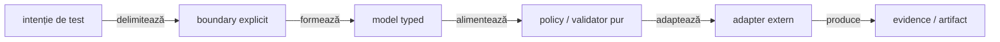
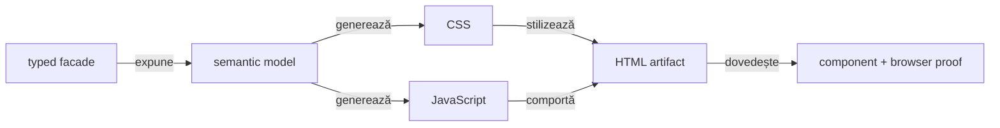

# Bune practici ATF — cod și testare

Acest document este owner-ul regulilor de implementare: module, OOP, modele,
constante, asset-uri de raportare și stratificarea testelor. Pentru redactarea
README-urilor și a feedback-ului se folosește
[README_Atf_DocumentationBestPractices.md](README_Atf_DocumentationBestPractices.md).

## Overall

Codul ATF trebuie să fie ușor de citit din boundary spre detaliu:



<details>
<summary><strong>Legendă — pipeline de implementare</strong></summary>

- intenția pornește din test, dar boundary-ul stabilește ownerul;
- modelul typed intră într-o policy pură înainte de adapterul extern;
- evidence-ul este output verificabil, nu logică ascunsă în renderer.
</details>

| Principiu | Dovadă preferată |
|---|---|
| boundary și ownership explicite | architecture guard + compile |
| modele imutabile și fațade mici | unit/component |
| module decuplate prin porturi | component/integration |
| output și asset-uri stabile | contract test + artifact audit |
| E2E minim și configurabil | selecție semantică + coverage matrix |

## Boundary și ownership

| Zonă | Responsabilitate | Nu deține |
|---|---|---|
| `atf-core` | contracte neutre, lifecycle generic, utilități reutilizabile | Extent, browser, fixture business |
| `atf-reporting` | modele, renderer, asset-uri și contracte reporting standalone | mock, browser și aplicație consumatoare |
| `atf-mock` | transport/fixture determinist | reguli de randare |
| `atf-ui` | Playwright și politici browser generice | configurarea concretă a raportului |
| `atf-reporting-tests` | consumer, composition root și fixture-uri de reporting | producție reutilizabilă |
| `atf-tests` | governance whole-reactor | teste de produs sau fixture-uri concrete |

```text
consumer test
  → atf-core ports/policies
  → API/mock/UI adapters
  → atf-reporting
  → HTML/Extent artifact
```

`atf-reporting` trebuie să poată fi compilat și consumat independent. Orice
dependență către mock, browser sau fixture de aplicație rămâne în test scope-ul
consumerului. Compatibilitatea legacy se face într-un adapter cu owner și test,
nu prin reflecție răspândită în renderer.

## Contracte protejate și schimbări controlate

README-urile ownerilor și testele-gate existente sunt parte din contractul de
mentenanță, nu material de curățare incidentală.

- [ ] Un gate existent nu este șters, relaxat, redenumit sau dezactivat doar
      pentru a face verde un run.
- [ ] Schimbarea unui gate sau a unui README normativ are cerință explicită,
      aprobare, motiv și dovadă nouă pentru contractul modificat.
- [ ] Un failure este urmărit către ownerul real: producție, test, fixture,
      renderer sau configurație; assertion-ul nu este mascat.
- [ ] Feedback-ul este actualizat dinamic în timpul investigației și păstrează
      doar gap-ul rămas, fără să devină o a doua sursă de contract.
- [ ] O regulă închisă este promovată în README-ul ownerului, iar feedback-ul
      este eliminat sau arhivat numai după ce testul confirmă închiderea.

## OOP și modele

- [ ] O clasă are un motiv dominant de schimbare.
- [ ] Fațada coordonează; nu citește YAML, nu face I/O, nu construiește HTML și
      nu decide verdicturi în aceeași metodă.
- [ ] Un `record`/POJO reprezintă o zonă semantică stabilă: setup, request,
      response, assertion, evidence, section sau verdict.
- [ ] Metadata de run pentru `Overview/System` folosește un snapshot typed și
      allowlist-uit (`ReportEnvironmentField`/`ReportEnvironmentSnapshot`);
      `Map<String,String>` rămâne numai boundary de compatibilitate.
- [ ] Builder-ul gestionează opționale; validatorul verifică invariants; niciunul
      nu ascunde efecte externe.
- [ ] Interfața reprezintă un port real care poate fi observat, înlocuit sau
      izolat (`ReportSource`, `ReportValidator`, `BrowserActions`).
- [ ] I/O, transport, browser și randare sunt adapters separate.

Un split de clasă este justificat de boundary semantic — facade, provider,
extractor, validator, publisher sau lifecycle — nu doar de numărul de linii.
Nu se creează pachete `misc` și nu se mută mecanic fișiere doar pentru a atinge
un număr.

### Coeziunea pachetelor — pragul de opt clase

```text
un pachet
   ├─ maximum 8 clase
   ├─ un boundary semantic dominant
   └─ peste prag → split coeziv sau excepție revizuită explicit
```

- `AtfPackageCohesionGovernanceTest` verifică producția și source-set-urile
  de test relevante;
- un pachet peste opt clase nu devine automat acceptat printr-o allow-list;
- o excepție trebuie să aibă motiv semantic, owner și dovadă de boundary;
- diagnosticul guard-ului enumeră pachetul, numărul și clasele concrete;
- split-ul urmărește responsabilități — `api`, `runtime`, `evidence`,
  `lifecycle`, `support` — nu o împărțire arbitrară a fișierelor;
- feedback-ul păstrează hotspot-ul până când split-ul sau excepția revizuită
  este demonstrată de test.

<details>
<summary><strong>De ce pragul nu se rezolvă prin mutări mecanice</strong></summary>

Pragul de opt clase este un semnal de navigare și coeziune, nu o regulă de
formatare. Un pachet mare poate ascunde mai multe motive de schimbare; un
split bun separă ownership-ul și păstrează dependențele lizibile. Nu se creează
pachete artificiale și nu se șterg clase fără dovadă de nefolosire.
</details>

## Constante, enum-uri și string-uri

Valorile stabile ale contractului nu se repetă ca string-uri brute.

| Tip de valoare | Owner recomandat |
|---|---|
| HTTP method/header/media type | enum sau catalog HTTP |
| rută API | catalog de rute al ownerului API |
| status reporting | `AtfReportStatus` |
| fază, tab, evidence type | vocabular reporting |
| CSS class, `id`, `data-*`, rol DOM | vocabular HTML/UI |
| culoare și spacing | token semantic de temă |
| payload strict local | builderul scenariului |

- [ ] Enum-ul reprezintă un vocabular închis și are conversie explicită spre
      textul rendererului.
- [ ] Constanta este pusă în ownerul semantic, nu într-un bucket global.
- [ ] Rutele și header-ele provin din catalog, nu din testul concret.
- [ ] Textele variabile se construiesc cu `String.format` sau builder typed;
      nu se concatenează HTML în assertions.
- [ ] Un literal rămâne local numai când este un edge-case nereutilizabil și are
      nume semantic.

### Importuri statice

Importurile statice sunt o scurtătură de citire, nu o scurtătură de ownership:

- assertions JUnit și DSL-uri de assertion stabile (`check`) sunt permise;
- constantele nominale dintr-un singur fixture semantic sunt permise când nu
  există ambiguitate (`PRODUCT_NAME`, `QUANTITY`, `COUNTRY`);
- wildcard imports, metode de business și valori dinamice nu se importă static;
- enum-urile și owner-ul unui contract rămân explicite când numele ar putea
  ascunde domeniul sau ar amesteca două vocabularuri.

```java
import static atf.ui.tests.practiceshop.api.support.PracticeShopApiScenarioFixture.PRODUCT_NAME;
import static org.junit.jupiter.api.Assertions.assertEquals;
```

## Reporting: HTML, CSS și JavaScript



<details>
<summary><strong>Legendă — asset-uri și contract vizual</strong></summary>

- Java compune și expune token-uri; CSS și JavaScript rămân asset-uri native pe responsabilități;
- modelul semantic este sursa comună pentru HTML, CSS și JavaScript;
- contractul component verifică asset-urile, iar E2E verifică efectul în browser.
</details>

- [ ] Java orchestrează; nu devine depozit de JavaScript inline.
- [ ] CSS este împărțit după responsabilitate: layout, theme, evidence,
      disclosure și responsive.
- [ ] JavaScript este împărțit după responsabilitate: DOM contract, disclosure,
      navigation, filters și controller.
- [ ] Clasele CSS, id-urile și `data-*` au vocabular centralizat.
- [ ] Locatorii de test preferă `element[attribute=value]`, `class~=` și
      `[id=value]`, nu shorthand-uri împrăștiate.
- [ ] Orice schimbare de markup/CSS/JS are test component și artifact fresh
      verificat în ATF Debug/browser MCP.

## Structura testelor

`support` este zonă auxiliară, nu al cincilea nivel de test.

```text
src/test/java/<owner>/
├─ <domain-or-feature>/       # organizare după comportament
│  └─ *Test.java              # layer declarat prin adnotare
└─ support/                   # fixture, builder, loader, adapter, locator
```

| Nivel | Verifică | Nu verifică |
|---|---|---|
| unit | model, policy, parser, validator, formatter | browser, server sau flux complet |
| component | fragment HTML/CSS/JS, asset, boundary de modul | aplicația completă |
| integration | colaborarea dintre module, mock și reporting | fiecare assertion deja testată jos |
| e2e | browser, tab-uri, filtre, click-uri și randare | toate combinațiile posibile |
| support | fixture, flow, locator, builder și adapter | verdict executabil propriu |

- [ ] Fiecare clasă executabilă declară exact un layer prin adnotare.
- [ ] Adnotarea este sursa de adevăr; path-ul este doar convenție și diagnostic.
- [ ] Nu se creează directoare goale pentru layere inexistente.
- [ ] Support-ul nu primește tag de test și nu deține browser execution.
- [ ] E2E rămâne mic, configurabil și selectează scenarii punctuale prin
      adnotări/configurație typed.
- [ ] Combinațiile exhaustive sunt coborâte în unit/component/integration.

Pentru API, mock-ul poate furniza `pass`, `fail`, `warning` și `skip`. Pentru
UI, inputul poate fi un raport static sau unul generat; validarea verifică
structura și randarea observabilă, fără să inventeze rezultate de business.

<details>
<summary><strong>Modelul unui test ATF elegant și plug-and-play</strong></summary>

### Ordinea de proiectare

1. **Alege layer-ul** — unit, component, integration sau E2E.
2. **Declară intenția** — adnotarea și metadata typed spun ce se testează, cu ce
   transport și cu ce precondiție.
3. **Încarcă inputul** — configurația/fixture-ul este rezolvat o singură dată,
   printr-un loader/harness reutilizabil.
4. **Compune flow-ul** — testul apelează un flow semantic, nu locatori, request
   factory, report session sau cleanup intern.
5. **Verifică efectul** — `expected` vine din config/fixture, `actual` vine din
   sistemul observat; assertions sunt scurte și reale.
6. **Publică evidence** — support-ul atașează acțiunile, observations și
   artifactul; testul nu reconstruiește HTML-ul.
7. **Închide prin owner** — extension/harness-ul închide browserul, transportul
   și sesiunea; testul nu adaugă `try/catch/finally`.

### Forma preferată

```text
@layer + metadata
class BusinessJourneyTest {
    @Test
    void configuredJourneyProducesExpectedOutcome() {
        flow.execute(configuredScenario());
        assertObservedOutcome();
    }
}
```

### Reguli de lizibilitate

- un test are un singur motiv de failure și un singur rezultat dominant;
- `given → when → then` este vizibil din numele metodelor sau al flow-ului;
- nu se repetă loader/context/locators în fiecare composition root;
- nu se folosesc assertions tautologice: `check(expected, expected, true)`;
- nu se acceptă `true` hardcodat ca dovadă a unei proprietăți observabile;
- rutele și starea se verifică semantic, nu prin `URL.contains(...)` sau text
  copiat din aceeași configurație;
- `contains` rămâne permis doar pentru smoke text și forbidden-secret checks;
- matricea de variații se mută în component/parameterized tests;
- E2E rămâne o dovadă de wiring și business journey, nu un loc pentru toate
  cazurile de status, body și selector;
- importurile statice sunt nominale și fac testul mai ușor de citit numai când
  owner-ul rămâne evident.

### Criteriu vizual pentru un test bun

```text
metadata → fixture → flow → observed assertions → evidence
```

Dacă cititorul vede înainte de flow inițializări de browser, directoare de
raport, request factory, selectori sau cleanup, composition root-ul este prea
încărcat și responsabilitatea trebuie mutată într-un harness/support typed.

</details>

## Configurare și căi

- [ ] Nicio cale absolută nu apare în cod, comentarii, mesaj sau README.
- [ ] Root-ul, staging-ul și output-ul sunt rezolvate la boundary-ul de
      configurație/I/O.
- [ ] Discovery-ul de module/source-root și traversal-ul generic de fișiere stau
      în `atf-core.files`; testele nu reimplementează `locateModuleRoot()`,
      `sourceFiles()`, `user.dir` traversal sau `Files.walk` pentru aceeași
      responsabilitate.
- [ ] Helper-ul generic primește markere relative și excluderi explicite;
      nu cunoaște module concrete, package-uri de produs sau reguli ascunse ale
      unui singur test.
- [ ] Un helper nou se adaugă numai dacă API-ul existent nu exprimă contractul;
      în acest caz se extinde ownerul `files`, nu se creează o copie în consumer.
- [ ] YAML-ul configurează fixture și runtime; adnotarea exprimă selecția și
      intenția semantică a testului.
- [ ] Un output este referit prin nume logic sau placeholder configurabil,
      niciodată prin `Path.toString()` într-un raport permanent.

## Consolă și reporting

Regula de separare pentru consolă și reporting este:

- consola este responsabilitatea modulului `atf-console`;
- API/UI/reporting emit evenimente structurate și evidence, nu diagnostic direct în renderer;
- un pas observabil conține acțiune, țintă, rezultat și cauza clară la fail;
- verdictul aparține zonei care a eșuat efectiv: action, audit, assertion sau setup.

<details>
<summary><strong>Regula `try/catch`: support/runtime versus teste</strong></summary>

### Comportamentul dorit

Regula ATF este separată pe boundary:

- **support/runtime** — folosește `try-with-resources` pentru orice sesiune,
  raport sau resource `AutoCloseable`;
- **support/parser/config** — acceptă numai `catch` cu tip îngust, context și
  cauză; eroarea se propagă sau devine `Result`/evidence explicit;
- **teste** — nu conțin niciodată `try/catch` sau `try/finally` ad-hoc;
  testul exprimă intenția, acțiunea și expected-ul;
- **teardown/retry** — aparțin unui lifecycle helper, runner sau extension, nu
  corpului testului;
- **failure** — nu este convertit în `false`, `0`, listă goală sau fallback.

Anti-pattern-uri interzise:

```java
try {
    action();
} catch (Exception ignored) {
    // false-green: failure-ul a dispărut
}
```

```java
try {
    return parse(body);
} catch (RuntimeException error) {
    return false; // malformed input devine „nu există”
}
```

Forma preferată în clasele de support este:

```java
try (ExtentReportSession session = ExtentReportSession.openConfigured()) {
    publish(session);
}
```

Un parser poate converti o eroare într-un `Optional`/`Result` numai dacă absența
este parte din contract. Dacă inputul este malformed, caller-ul trebuie să poată
produce un failure distinct. Un validator UI poate păstra o linie `AtfAssertion`
cu status FAIL pentru o indisponibilitate, dar nu are voie să ocolească statusul,
să piardă cauza sau să lase scenariul PASS.

Checklist obligatoriu pentru un modul de test:

- [ ] Testele noi nu conțin `try/catch` sau `try/finally` în corpul testului.
- [ ] Nu există `catch` gol, `ignored`, `return false/0/empty` sau fallback
      implicit pentru o excepție de execuție/configurație.
- [ ] Orice catch din support păstrează contextul semantic, cauza și verdictul
      observabil; tipul excepției este cât mai îngust.
- [ ] Resource/session/report lifecycle folosește `try-with-resources` sau un
      helper comun; close failure nu maschează primary failure.
- [ ] Testele componente acoperă input malformed, selector indisponibil și
      eroare de teardown unde boundary-ul o poate întâlni.
- [ ] `assertThrows` este folosit pentru excepții așteptate; nu se scrie
      `try/catch` manual doar pentru a valida că o mutație este respinsă.

</details>

## Protocol de schimbare

- [ ] Recitește codul live și identifică owner-ul.
- [ ] Verifică dacă README-ul sau gate-ul atins este contract protejat; cere
      scope și aprobare explicită înainte de a-l schimba.
- [ ] Scrie întâi testul de contract pentru schimbarea propusă.
- [ ] Rulează în ordinea unit → component → integration → e2e relevant.
- [ ] Dacă se schimbă randarea, generează artifact fresh și verifică DOM,
      computed style, disclosure, overflow și console errors.
- [ ] Auditează fiecare `try/catch/finally` din diff; justifică resource
      management-ul și demonstrează că failure-ul nu este înghițit.
- [ ] Sincronizează selectiv în live; conflictul oprește fișierul afectat.
- [ ] Mută regula stabilă în README-ul ownerului și păstrează în feedback doar
      gap-ul rămas.

## Definition of done

- [ ] Responsabilitatea este mai clară decât înainte.
- [ ] Boundary-ul poate fi substituit printr-o interfață sau un adapter real.
- [ ] Constantele și enum-urile au ownership semantic.
- [ ] CSS/JavaScript au asset-uri și teste separate după responsabilitate.
- [ ] Testul de nivel inferior protejează schimbarea; E2E rămâne minim.
- [ ] Nu există `try` ad-hoc în corpul testului și nicio excepție nu este
      convertită în false-green; lifecycle-ul este centralizat și fail-safe.
- [ ] Raportul spune precis ce a eșuat.
- [ ] Documentația nu conține date de rulare, timestamp-uri, numărări de run,
      căi locale, linkuri `file:///` sau artifacte generate.
