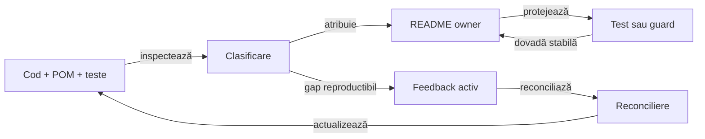

# Bune practici ATF — documentație

Acest document este owner-ul regulilor pentru README-uri, diagrame, tabele,
legende, linkuri și feedback. Regulile de cod, OOP și testare sunt în
[README_Atf_CodeBestPractices.md](README_Atf_CodeBestPractices.md).

## Pe scurt — ce trebuie să ofere un README

Un README bun este o hartă navigabilă a unui contract, nu un jurnal de lucru și
nu o copie a codului. Primul ecran trebuie să fie suficient pentru orientare;
linkurile conduc către aprofundare, nu sunt condiție pentru a înțelege scopul.

| Întrebarea cititorului | Dovada vizibilă în primul ecran |
|---|---|
| ce este? | scopul și rezultatul produs |
| cine deține? | ownerul și limita responsabilității |
| cum curge? | o schemă scurtă, bullets sau tabel minimal |
| cum verific? | testul, guard-ul sau criteriul observabil |
| unde aprofundez? | linkuri către owneri și documente normative |

Regula de economie:

- overview-ul explică produsul sau modulul înaintea detaliilor;
- schema poartă relația principală, nu inventarul tuturor claselor;
- explicațiile lungi, excepțiile și tabelele secundare sunt colapsabile;
- un document nou apare numai dacă deține un boundary sau un proces real;
- informația stabilă se mută în documentul ownerului, nu rămâne în feedback.

<details>
<summary><strong>Harta de lectură</strong></summary>

- [ownership și promovare](#responsabilitatea-documentelor-și-promovarea-feedback-ului),
  [păstrarea/ștergerea feedback-ului](#păstrarea-și-ștergerea-feedback-ului) și
  [procesul de revizuire](#procesul-de-redactare-și-revizuire);
- [primul ecran](#structura-recomandată-a-primului-ecran),
  [diagrame](#diagrame-o-întrebare-o-perspectivă) și
  [tabele/disclosure](#tabele-bullets-și-disclosure);
- [durabilitatea linkurilor](#denumiri-linkuri-și-durabilitate),
  [feedback](#feedback-fără-zgomot) și
  [criterii de finalizare](#criterii-de-finalizare).

</details>

## Stilul intern ATF — uniformitate fără fonturi locale

Uniformitatea README-urilor se obține prin Markdown semantic, nu prin CSS sau
fonturi injectate în fiecare document:

- fontul, dimensiunea și culoarea aparțin rendererului Markdown;
- README-urile folosesc un singur `#`, secțiuni `##`, subsections progresive și
  bullets `-` pentru scanare rapidă;
- fiecare bloc de cod sau schemă are fence tipizat: `mermaid`, `text`, `java`,
  `xml`, `yaml` sau limbajul real al exemplului;
- sunt interzise tagurile de prezentare HTML, atributul `style` și CSS inline;
- stilul vizual este exprimat prin titluri, bullets, tabele minimale, diagrame și
  `<details>`, nu prin markup de prezentare dependent de un singur viewer;
- `DocumentationStyleGovernanceTest` protejează această regulă pentru toate
  README-urile și documentele normative Markdown desemnate, precum
  `docs/ATF_Architecture.md`; explică dinamic fișierul, linia, regula și remedierea.

## Responsabilitatea documentelor și promovarea feedback-ului

Documentația stabilă și feedback-ul au ritmuri diferite. README-ul ownerului
descrie contractul validat; feedback-ul se schimbă dinamic pe măsură ce apar
dovezi, se închid TODO-uri sau se modifică limita rămasă.

### Precedența baseline-ului aprobat

- root README-ul aprobat este baseline-ul editorial și vizual al proiectului;
- bunele practici trebuie să explice și să protejeze acest baseline, nu să îl
  reinterpreteze retroactiv;
- o preferință pentru o formă nouă — de exemplu `LR` pentru un flowchart nou —
  nu autorizează rescrierea unei diagrame deja acceptate;
- o nealiniere între README-ul aprobat și regulile de practică se notează întâi
  în feedback, cu dovadă și impact; nu se repară prin alegere implicită;
- root README-ul, testele-gate și contractele normative se schimbă numai prin
  cerință explicită, motiv documentat, aprobare și dovadă nouă.
- testele de guvernanță din `atf-tests` nu se modifică, dezactivează sau relaxează
  pentru a face un README să treacă; orice schimbare a regulii cere feedback
  direct, owner clar, motiv și un criteriu nou verificabil.



<details>
<summary><strong>Legendă — când se schimbă fiecare zonă</strong></summary>

- **Cod + POM + teste live**: stabilesc ce există efectiv și ce boundary este
  protejat;
- **README owner**: primește regula stabilă, ownership-ul și modul de folosire
  după ce dovada este suficientă;
- **test/guard**: protejează afirmația și definește criteriul reproductibil;
- **feedback activ**: păstrează numai gap-ul, ownerul, prioritatea, criteriul
  de închidere și dovada lipsă; poate fi actualizat, reorganizat sau închis;
- **evidence** nu devine automat contract: un raport, screenshot sau log al
  unui run rămâne dovadă de execuție;
- un README normativ sau un test-gate existent nu se modifică incidental;
  schimbarea cere cerință, aprobare, motiv și dovadă nouă.
- dacă un test de guvernanță pică, se repară documentul țintă înaintea testului;
  testul se schimbă numai când feedback-ul direct schimbă regula guvernată.

</details>

### Păstrarea și ștergerea feedback-ului

Feedback-ul este un backlog de lacune, nu un al doilea README și nici un jurnal
al deciziilor deja închise. Înainte de a șterge un fișier, reconciliază fiecare
secțiune cu codul, testul ownerului și README-ul normativ:

- mută regula stabilă în README-ul ownerului înainte să elimini explicația din
  feedback; păstrează un singur owner normativ și linkuri către acesta;
- șterge secțiunile închise după ce criteriul este demonstrat și contractul
  necesar există la owner; nu păstra istoricul raportului, artifactului sau
  execuției ca substitut pentru cerință;
- șterge fișierul de feedback numai dacă nu mai conține niciun criteriu
  neîndeplinit și niciun control activ care trebuie reconciliat;
- un README de modul sau un contract stabil nu se șterge pentru că nu are
  ToDo-uri: este documentație de utilizare, nu backlog;
- păstrează fișierul dacă există cel puțin un gap real sau un control `testChanges`
  activ, chiar dacă restul conținutului poate fi promovat ori eliminat;
- nu închide, rescrie sau șterge un control `testChanges` doar pentru că a
  expirat ori a apărut un commit nou: compară schimbările față de baseline și
  aplică procedura din [baseline-ul schimbărilor de teste](ATF_Test_Changes_Baseline.md)
  și [guvernanța testelor](../atf-tests/README.md#guvernanța-schimbării-testelor).

Testele de guvernanță rămân contract protejat. Dacă documentul țintă nu trece,
se repară documentul; regula testului se schimbă numai prin feedback direct,
owner, motiv și criteriu nou, conform README-ului `atf-tests`.

## Procesul de redactare și revizuire

Fiecare document trece prin aceeași buclă. Nu începem de la un raport vechi și
nu marcăm un TODO ca rezolvat numai pentru că textul a fost modificat.

- [ ] recitește codul, POM-ul, testele și README-ul live al ownerului;
- [ ] identifică întrebarea documentului și cititorul principal;
- [ ] clasifică fiecare informație: contract stabil, gap activ sau evidence;
- [ ] scrie primul ecran cu titlu, orientare, schemă și criteriu de verificare;
- [ ] alege un singur owner normativ pentru fiecare regulă;
- [ ] mută detaliile secundare în `<details>` sau în documentul ownerului;
- [ ] verifică toate linkurile relative, naming-ul și delimitarea `<details>`;
- [ ] aliniază feedback-ul cu codul și testele înainte de închidere.

La revizuirile arhitecturale, păstrează o trasabilitate scurtă pentru fiecare
afirmație care poate schimba o decizie tehnică:

```text
afirmație → sursă live → README owner → test/guard → verificare executată
```

Sursa live trebuie să fie cea care deține faptul:

- `pom.xml` pentru dependențe, scope și propagarea `optional`;
- codul public pentru API și ownership;
- testul pentru comportamentul verificat.

O diagramă sau un raport generat este o reprezentare ori o dovadă de run, nu
sursa canonică. Dacă sursa, documentația și verificarea nu concordă, documentează
drift-ul ca gap; nu transforma comportamentul observat într-un contract
intenționat fără confirmare.

Rezumatul verificărilor distinge explicit nivelurile executate:

| Nivel | Ce confirmă | Ce nu confirmă singur |
|---|---|---|
| verificare statică Markdown | structură, linkuri și reguli editoriale inspectate | compilarea sau comportamentul modulului |
| test de guvernanță/componentă | regula verificată de testul respectiv | alte teste sau randarea unui raport real |
| build/test de modul | compilarea și testele efectiv incluse în comanda rulată | suite neincluse sau medii externe |
| randare/UI | aspectul artifactului și scenariul observat | validitatea generală a contractului ori toate configurațiile |

Raportează comanda și nivelul efectiv rulat; marchează separat `passed`, `not run`
și `blocked`. O comandă documentată, un path de artifact sau un test omis din
cauza unei precondiții nu constituie dovadă de trecere.

Un document este gata când cititorul poate decide unde să continue fără să
caute prin alte README-uri pentru scopul, ownerul sau limita principală.

## Structura recomandată a primului ecran

Ordinea nu este o explicație despre „cum să citești” proiectul; este o regulă
de compoziție pentru ca documentul să poată fi parcurs natural:

1. **Titlu clar** — spune ce boundary sau rezultat descrie documentul;
2. **Pe scurt** — două-trei idei despre scop, proprietar și limite;
3. **Dovada principală** — bullets, o schemă sau un tabel scurt;
4. **Legendă imediată** — dacă există diagramă, unica legendă aferentă urmează
   imediat după ea;
5. **Aprofundare** — contracte, excepții și referințe, colapsate sau legate;
6. **Criteriu de verificare** — test, guard sau procedură reproductibilă.

Reguli de spațiere și digestie:

- nu așeza două tabele principale unul după altul;
- după un tabel de orientare urmează o schemă, o explicație scurtă sau o
  secțiune cu altă funcție;
- nu pune un paragraf liber sau un alt tabel între diagramă și legenda ei;
- nu ascunde scopul, ownerul, boundary-ul sau criteriul principal în
  `<details>`;
- dacă un tabel secundar aparține aceleiași diagrame, pune-l în legenda
  compusă, nu într-o a doua legendă consecutivă.

## Diagrame: o întrebare, o perspectivă

Fiecare diagramă trebuie să răspundă unei singure întrebări și să aibă un titlu
care poate fi înțeles fără contextul capitolului anterior.

| Întrebarea | Formă preferată | Limită |
|---|---|---|
| ce module colaborează? | `flowchart LR` | harta modulelor și ownership-ul se citesc stânga → dreapta |
| cum curg datele? | `flowchart LR` | direcția input → transformare → output trebuie să fie imediat vizibilă |
| în ce ordine se execută? | `sequenceDiagram` | doar participanții esențiali |
| cum se schimbă starea? | `stateDiagram-v2` | stări și tranziții relevante |
| ce contract este public? | `classDiagram` | porturi și modele stabile |

Pattern-ul obligatoriu este:

```text
întrebare → orientare scurtă → diagramă → legendă colapsată → contract → proof
```

<details>
<summary>Preferința de stil</summary>

- `LR` este orientarea preferată pentru flowchart-urile noi când modulele,
  ownership-ul, pipeline-ul sau dependența se citesc natural stânga → dreapta;
- `TB` este acceptabil pentru o hartă grupată când relația principală este între
  niveluri sau boundary-uri, nu între pași succesivi;
- într-o hartă `TB`, modulele din fiecare grup pot fi dispuse pe orizontală;
  direcția semantică este verticală, dar lectura vizuală rămâne compactă pe
  lățime;
- alegerea `TB` este justificată dacă păstrează gruparea, reduce muchiile
  încrucișate, evită etichetele rupte sau face varianta `LR` mai lată și mai
  greu de urmărit;
- nu folosim `TB` pentru a ascunde o schemă nesimplificată: reducem nodurile,
  grupăm semantic conținutul și verificăm explicit costul vizual al ambelor
  orientări;
- diagramele deja aprobate nu se normalizează mecanic la `LR`; baseline-ul lor
  rămâne valabil până la o cerință explicită de schimbare;
- `sequenceDiagram` când ordinea interacțiunilor este mai importantă decât
  gruparea modulelor;
- pentru un flow de date sau evidence, evităm schema radială cu un singur nod
  central și multe săgeți lungi: construim întâi o coloană principală
  stânga → dreapta și ramificăm doar detaliile locale;
- dacă un nod are mai mult de două ramificații vizibile, introducem o grupare
  semantică locală sau separăm întrebarea în două diagrame; nu lăsăm săgețile
  să traverseze întreaga schemă;
- nodul poartă numai conceptul necesar relației; modulele, clasele, tehnologiile
  și listele lungi se mută în legendă sau în tabelul colapsat;
- evităm chenarele mari obținute din etichete cu multe rânduri: scurtăm nodul,
  păstrăm o singură idee pe muchie și explicăm vocabularul imediat după schemă;
- stilul de referință este o schemă `LR` compactă, cu noduri etichetate scurt,
  legături puține și o legendă imediată care explică ramificațiile;
- dimensiunea vizuală se controlează separat de semantică: etichete scurte în
  noduri, font/padding reduse și vocabularul complet în legendă;
- în harta de module a root README-ului, un nod are cel mult 18 caractere
  vizibile și nu introduce `<br>`; o muchie are cel mult 12 caractere;
- `DocumentationDiagramGovernanceTest` verifică această compactare și explică
  dinamic linia, limita și remedierea când un chenar devine disproporționat;
- orientarea se alege după întrebarea diagramei și costul vizual, nu după o
  regulă absolută de sintaxă;
- o schemă orizontală nu trebuie lățită artificial cu noduri secundare;
- săgețile au o singură semnificație și aceasta este explicată în legendă;
- pentru relațiile de ownership, consum sau flow, etichetați muchia direct cu un
  verb scurt (`guvernează`, `consumă`, `validează`, `publică`); nu obligați
  cititorul să deducă relația numai din poziția nodurilor;
- eticheta muchiei nu repetă numele nodurilor și nu devine o propoziție; detaliile
  despre clase, module sau scope rămân în legenda colapsată;
- textul de pe muchie este mai mic decât textul nodului: explică relația fără să
  concureze cu conceptele principale;
- într-un același README, diagramele folosesc aceeași bază vizuală — font,
  padding, densitate și stil de săgeată; `rankSpacing` poate varia numai pentru
  densitate sau pentru lizibilitatea etichetelor, fără să schimbe orientarea;
- culorile nu sunt singura formă de diferențiere;
- clasele, metodele și valorile care nu schimbă orientarea rămân în README-ul
  ownerului sau în tabelul colapsat.

</details>

### Criteriul formal pentru o excepție `TB`

O diagramă `TB` este acceptată numai dacă toate condițiile următoare sunt
adevărate:

- întrebarea cere separarea unor grupuri, straturi sau boundary-uri;
- fiecare grup are o compoziție internă scurtă și lizibilă pe orizontală;
- varianta `LR` ar produce trasee mai lungi, mai multe intersecții sau wrapping
  mai greu de urmărit;
- legenda explică relația dintre niveluri fără să repete mecanic diagrama;
- cititorul poate identifica direcția și ownership-ul fără zoom sau crop.

### Pattern de referință: Harta modulelor

`Harta modulelor` este exemplul pozitiv pentru ATF deoarece combină orientarea
orizontală cu detaliul controlat:

- grupuri semantice, nu inventar Maven brut;
- puține muchii principale și ownership explicit;
- o coloană principală pentru consumers → library, cu platforma reutilizabilă
  agregată într-un singur nod vizual;
- relațiile secundare sunt punctate și locale, nu o rețea radială de module;
- `LR` face ownership-ul și direcția de citire vizibile fără a transforma
  schema într-un inventar Maven;
- diagramă compactă, urmată imediat de o singură legendă;
- tabelul de ownership este în legenda aceleiași unități vizuale;
- modulele care nu sunt producție — consumers și governance — sunt delimitate;
- contractele locale rămân în README-urile modulelor.

La revizuirea unei alte diagrame, nu adăugăm noduri doar pentru că există în
cod. Întrebarea diagramei decide ce rămâne vizibil.

## Tabele, bullets și disclosure

Bullets sunt preferate când informația este o listă de decizii. Tabelul este
preferat când cititorul trebuie să compare coloane sau să aleagă un owner.

### Regula prozei vizibile

În zona parcursă rapid, informația trebuie să poată fi scanată fără a citi
fraze consecutive. Pentru fiecare secțiune alegem forma care comprimă cel mai
bine decizia:

- **bullets** — responsabilități, limite, reguli, criterii și pași;
- **tabel** — comparații între module, owneri, input/output sau niveluri de test;
- **diagramă** — relații, fluxuri și boundary-uri;
- **un paragraf scurt** — doar pentru scopul secțiunii și concluzia ei;
- **`<details>`** — rationale, excepții, exemple lungi și tabele secundare.

Nu folosim un bloc de text pentru a descrie o listă, o relație sau o comparație
care poate fi exprimată schematic. Dacă o explicație depășește orientarea
imediată, o mutăm în legenda colapsată sau în README-ul ownerului; nu încărcăm
primul ecran ca să evităm un link.

- [ ] coloanele sunt scurte și semantice: `Owner`, `Input`, `Output`, `Gate`,
      `Verdict`;
- [ ] tabelul rezumă schema, nu reconstruiește o rețea de săgeți;
- [ ] două tabele principale sunt separate vizual și semantic;
- [ ] tabelele de detaliu, excepțiile și rationale-ul sunt în `<details>`;
- [ ] fiecare `<summary>` spune ce se deschide și de ce este util;
- [ ] după `<summary>` există un rând gol înainte de bullets, tabel sau paragraf;
      altfel rendererul Markdown poate uni conținutul într-un singur rând;
- [ ] textul lung nu este pus într-o celulă care provoacă overflow;
- [ ] claims importante urmează relația `claim → owner → test/guard`.

`DocumentationProseGovernanceTest` verifică această regulă în toate README-urile
de owner: un paragraf parcurs rapid are implicit cel mult trei propoziții, iar o
secțiune nu înșiră mai mult de două paragrafe dense consecutive. Pragurile sunt
constante explicite în test, nu o euristică ascunsă; dacă regula se schimbă, se
calibrează acolo și se păstrează același diagnostic dinamic.

Pentru o verificare punctuală, fără duplicarea regulilor în fiecare modul:

- `@DocumentationTarget("module/README.md")` selectează documentul;
- `DocumentationTargetGovernanceTest` apelează toate validatoarele de documentație;
- calea este relativă la root-ul proiectului și poate fi schimbată fără modificarea
  validatoarelor;
- diagnosticul păstrează fișierul, linia, regula și remedierea minimă.

O legendă bună explică nodurile, săgețile, limitele și tabelul colapsat al
aceleiași diagrame. Nu repetă mecanic textul vizibil și nu devine al doilea
document de arhitectură.

Pentru diagramele de module:

- fiecare muchie exprimă un singur tip de relație și corespunde sursei live;
- dacă schimbă interpretarea, legenda distinge scope-uri Maven precum `compile`,
  `test`, `runtime` și `provided`, precum și propagarea `optional`;
- plugin-urile și extensiile nu sunt prezentate ca dependențe de runtime;
- validarea semantică se face prin compararea cu POM-urile relevante, nu printr-un
  test care potrivește rigid formularea liberă a diagramei.

### Documentarea dovezilor în funcție de scop

Când un README descrie un raport, fiecare fapt trebuie pus în zona care îi
exprimă sensul. Folosește o singură schemă canonică și trimite la owner pentru
detalii, în loc să copiezi arborele complet în fiecare modul:

| Fapt documentat | Zonă canonică | Evită |
|---|---|---|
| precondiție sau fixture pregătit | `SETUP` → `Setup evidence` | `Overview / System` ori un pas de business inventat |
| observație din browser | `UI validation` a checkpoint-ului Gherkin | amestecarea verdictului UI cu verdictul transportului |
| request/response și retry | `API validation` → exchange-ul său | trace plat, duplicat sau pas Gherkin separat |
| rezultat al journey-ului | propoziția Gherkin care afirmă rezultatul | repetarea aceleiași propoziții pentru UI și API |
| sumar de network | un aggregate terminal, dacă este cerut | a doua listă de request-uri sau payload repetat |

`SETUP` poate include o pregătire cu efect extern dacă este selectată explicit;
`Setup evidence` rezumă check-urile, iar acțiunile și exchange-urile rămân dovezi
tehnice separate sub checkpoint-ul cauzal. Într-un pas mixt, `UI validation` și
`API validation` sunt frați ai aceleiași propoziții Gherkin. Contractul complet
este deținut de [ATF Reporting Contract](ATF_Reporting_Contract.md); README-ul
consumerului explică numai modul său de configurare.

## Prezentarea proiectului și legături către proprietarii documentației

Root-ul trebuie să fie self-explanatory ca overview al produsului, dar nu trebuie
să conțină contractele interne ale tuturor modulelor.

- root: scop, flux principal, harta modulelor, guvernanță și referințe;
- `docs/README.md`: indexul documentației și ordinea de aprofundare;
- README de modul: ownership, input/output, boundary, contract și teste;
- document normativ: un contract transversal care deservește mai multe module;
  o capabilitate reutilizabilă nu se ascunde în README-ul unui consumer și nu se
  confundă cu publisherul unui singur modul;
- feedback: gap-uri dinamice și criterii de închidere;
- artifacte generate: evidence temporară, niciodată navigație normativă.

Linkurile din root trebuie să răspundă natural la „unde aprofundez?” și să nu
introducă o a doua versiune a aceleiași hărți. O referință bună are o etichetă
semantică și o întrebare clară, nu doar un path.

## Denumiri, linkuri și durabilitate

README-ul unui modul rămâne `README.md`. Documentele descriptive folosesc
`ATF_<PascalCase>` sau `README_Atf_<PascalCase>`: acronimul poate apărea în
primul segment, iar segmentele următoare au doar inițiala mare.

| Stabil și documentabil | Volatil și exclus din documentația normativă |
|---|---|
| contract, owner și boundary | data unei verificări |
| schema input → output | numărul testelor dintr-un run |
| criteriu de acceptare | timestamp-ul artifactului |
| test/guard care protejează regula | screenshot sau raport generat |
| placeholder configurabil | path local, drive sau URL temporar |

<details>
<summary><strong>Regula pentru artefacte generate</strong></summary>

- README-urile și documentele normative descriu contractul și criteriul de
  verificare, nu numele unui raport produs într-un run;
- nu se păstrează linkuri către HTML, screenshot-uri, URL-uri MCP sau directoare
  de artifacte reale;
- pentru output se folosesc placeholder-e precum `<configured-report-file>` sau
  `${ATF_REPORT_DIRECTORY}`;
- pentru randare se documentează structura observabilă — tab, selector, tabel,
  verdict sau manifest — nu un fișier generat concret;
- feedback-ul poate folosi dovada temporară în investigație, dar regula promovată
  în README trebuie să rămână reproductibilă fără acel fișier;
- sunt acceptate linkurile către sursa, contractul sau testul ownerului, nu către
  output-ul unei rulări.

</details>

- [ ] linkurile sunt relative și au destinație existentă;
- [ ] fragmentul `#secțiune` indică un heading existent, inclusiv după promovarea
      sau ștergerea feedback-ului; existența fișierului nu validează ancora;
- [ ] nu există căi absolute în text, comentarii sau diagrame;
- [ ] nu există `file:///`, nume de rapoarte reale sau timestamp-uri;
- [ ] `${ATF_STAGING_ROOT}` și `<configured-report-file>` sunt folosite doar ca
      placeholder-e, nu ca valori de run;
- [ ] o redenumire actualizează toate linkurile și indexurile;
- [ ] clasamentul reunește toate feedback-urile active din perimetrul declarat;
      un criteriu doar parțial verificat nu dispare din top ca efect al mutării textului;
- [ ] documentația rămâne validă după mutarea checkout-ului și următoarea
      execuție.

## Feedback fără zgomot

Feedback-ul este singura zonă care se schimbă intenționat dinamic. El nu trebuie
să concureze cu README-urile stabile.

- [ ] fiecare ToDo are owner, prioritate, reproducere, criteriu de închidere și
      nivel de test;
- [ ] descrierea este a problemei observabile, nu copia unei reguli deja
      implementate;
- [ ] scorul 1–100 din backlog indică prioritatea și nu este confundat cu un
      scor editorial al documentului;
- [ ] un scor editorial folosește criterii declarate și dovezi din codul live,
      linkuri, ownership și lizibilitate; este comparativ, nu o țintă de
      acceptare și nu înlocuiește verificarea factuală; într-un clasament,
      toate documentele folosesc aceeași rubrică și aceleași ponderi;
- [ ] nu se păstrează rapoarte HTML, capturi, timestamp-uri sau rezultate ale
      unui run ca documentație permanentă;
- [ ] când gap-ul este închis, regula stabilă se promovează în README-ul
      ownerului, iar itemul se elimină sau se arhivează justificat;
- [ ] înainte de eliminarea fișierului, se verifică linkurile și țintele
      `@DocumentationTarget`; o țintă încă guvernată se reduce la un index scurt
      către owner până la schimbarea explicită a selecției, fără relaxarea testelor;
- [ ] dacă codul și testul nu confirmă închiderea, feedback-ul rămâne deschis;
- [ ] conflictul sau drift-ul live/staging devine feedback auditabil, nu
      overwrite implicit.

## Criterii de finalizare

- [ ] primul ecran este self-explanatory;
- [ ] titlul și orientarea spun întrebarea documentului;
- [ ] ownerul, boundary-ul și limita sunt vizibile;
- [ ] există cel mult o schemă pentru aceeași întrebare;
- [ ] legenda urmează imediat diagrama și este unică pentru unitatea vizuală;
- [ ] tabelele au coloane scurte și nu produc overflow;
- [ ] linkurile și `<details>` sunt validate;
- [ ] contractul este în README-ul ownerului, iar feedback-ul conține doar gap-ul;
- [ ] documentul a fost recitit împreună cu codul live.
