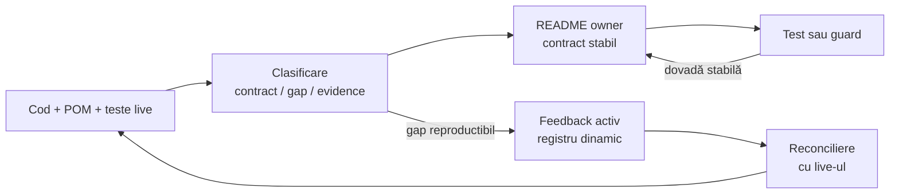

# Bune practici ATF — documentație

Acest document este owner-ul regulilor pentru README-uri, diagrame, tabele,
legende, linkuri și feedback. Regulile de cod, OOP și testare sunt în
[README_Atf_CodeBestPractices.md](README_Atf_CodeBestPractices.md).

## Overall — ce trebuie să obțină un README

Un README bun este o hartă navigabilă a unui contract, nu un jurnal de lucru și
nu o copie a codului. Primul ecran trebuie să fie suficient pentru orientare;
linkurile conduc către aprofundare, nu sunt condiție pentru a înțelege scopul.

| Întrebarea cititorului | Dovada vizibilă în primul ecran |
|---|---|
| ce este? | scopul și rezultatul produs |
| cine deține? | ownerul și limita responsabilității |
| cum curge? | o schemă scurtă, bullets sau tabel minimal |
| cum verific? | testul, guard-ul sau criteriul observabil |
| unde aprofundez? | linkuri către owneri și documente normative |

Regula de economie:

- overview-ul explică produsul sau modulul înaintea detaliilor;
- schema poartă relația principală, nu inventarul tuturor claselor;
- explicațiile lungi, excepțiile și tabelele secundare sunt colapsabile;
- un document nou apare numai dacă deține un boundary sau un proces real;
- informația stabilă se mută în documentul ownerului, nu rămâne în feedback.

## Ownership și promovarea feedback-ului

Documentația stabilă și feedback-ul au ritmuri diferite. README-ul ownerului
descrie contractul validat; feedback-ul se schimbă dinamic pe măsură ce apar
dovezi, se închid TODO-uri sau se modifică limita rămasă.

### Precedența baseline-ului aprobat

- root README-ul aprobat este baseline-ul editorial și vizual al proiectului;
- bunele practici trebuie să explice și să protejeze acest baseline, nu să îl
  reinterpreteze retroactiv;
- o preferință pentru o formă nouă — de exemplu `LR` pentru un flowchart nou —
  nu autorizează rescrierea unei diagrame deja acceptate;
- o nealiniere între README-ul aprobat și regulile de practică se notează întâi
  în feedback, cu dovadă și impact; nu se repară prin alegere implicită;
- root README-ul, testele-gate și contractele normative se schimbă numai prin
  cerință explicită, motiv documentat, aprobare și dovadă nouă.



<details>
<summary><strong>Legendă — când se schimbă fiecare zonă</strong></summary>

- **Cod + POM + teste live**: stabilesc ce există efectiv și ce boundary este
  protejat;
- **README owner**: primește regula stabilă, ownership-ul și modul de folosire
  după ce dovada este suficientă;
- **test/guard**: protejează afirmația și definește criteriul reproductibil;
- **feedback activ**: păstrează numai gap-ul, ownerul, prioritatea, criteriul
  de închidere și dovada lipsă; poate fi actualizat, reorganizat sau închis;
- **evidence** nu devine automat contract: un raport, screenshot sau log al
  unui run rămâne dovadă de execuție;
- un README normativ sau un test-gate existent nu se modifică incidental;
  schimbarea cere cerință, aprobare, motiv și dovadă nouă.

</details>

## Procesul de redactare și revizuire

Fiecare document trece prin aceeași buclă. Nu începem de la un raport vechi și
nu marcăm un TODO ca rezolvat numai pentru că textul a fost modificat.

- [ ] recitește codul, POM-ul, testele și README-ul live al ownerului;
- [ ] identifică întrebarea documentului și cititorul principal;
- [ ] clasifică fiecare informație: contract stabil, gap activ sau evidence;
- [ ] scrie primul ecran cu titlu, orientare, schemă și criteriu de verificare;
- [ ] alege un singur owner normativ pentru fiecare regulă;
- [ ] mută detaliile secundare în `<details>` sau în documentul ownerului;
- [ ] verifică toate linkurile relative, naming-ul și delimitarea `<details>`;
- [ ] aliniază feedback-ul cu codul și testele înainte de închidere.

Un document este gata când cititorul poate decide unde să continue fără să
caute prin alte README-uri pentru scopul, ownerul sau limita principală.

## Structura recomandată a primului ecran

Ordinea nu este o explicație despre „cum să citești” proiectul; este o regulă
de compoziție pentru ca documentul să poată fi parcurs natural:

1. **Titlu clar** — spune ce boundary sau rezultat descrie documentul;
2. **Overall** — două-trei idei despre scop, owner și limită;
3. **Dovada principală** — bullets, o schemă sau un tabel scurt;
4. **Legendă imediată** — dacă există diagramă, unica legendă aferentă urmează
   imediat după ea;
5. **Aprofundare** — contracte, excepții și referințe, colapsate sau legate;
6. **Criteriu de verificare** — test, guard sau procedură reproductibilă.

Reguli de spațiere și digestie:

- nu așeza două tabele principale unul după altul;
- după un tabel de orientare urmează o schemă, o explicație scurtă sau o
  secțiune cu altă funcție;
- nu pune un paragraf liber sau un alt tabel între diagramă și legenda ei;
- nu ascunde scopul, ownerul, boundary-ul sau criteriul principal în
  `<details>`;
- dacă un tabel secundar aparține aceleiași diagrame, pune-l în legenda
  compusă, nu într-o a doua legendă consecutivă.

## Diagrame: o întrebare, o perspectivă

Fiecare diagramă trebuie să răspundă unei singure întrebări și să aibă un titlu
care poate fi înțeles fără contextul capitolului anterior.

| Întrebarea | Formă preferată | Limită |
|---|---|---|
| ce module colaborează? | `flowchart LR` | harta modulelor și ownership-ul se citesc stânga → dreapta |
| cum curg datele? | `flowchart LR` | direcția input → transformare → output trebuie să fie imediat vizibilă |
| în ce ordine se execută? | `sequenceDiagram` | doar participanții esențiali |
| cum se schimbă starea? | `stateDiagram-v2` | stări și tranziții relevante |
| ce contract este public? | `classDiagram` | porturi și modele stabile |

Pattern-ul obligatoriu este:

```text
întrebare → orientare scurtă → diagramă → legendă colapsată → contract → proof
```

Preferința de stil:

- `LR` este orientarea preferată pentru flowchart-urile noi când modulele,
  ownership-ul, pipeline-ul sau dependența se citesc natural stânga → dreapta;
- `TB` este acceptabil pentru o hartă grupată când relația principală este între
  niveluri sau boundary-uri, nu între pași succesivi;
- într-o hartă `TB`, modulele din fiecare grup pot fi dispuse pe orizontală;
  direcția semantică este verticală, dar lectura vizuală rămâne compactă pe
  lățime;
- alegerea `TB` este justificată dacă păstrează gruparea, reduce muchiile
  încrucișate, evită etichetele rupte sau face varianta `LR` mai lată și mai
  greu de urmărit;
- nu folosim `TB` pentru a ascunde o schemă nesimplificată: reducem nodurile,
  grupăm semantic conținutul și verificăm explicit costul vizual al ambelor
  orientări;
- diagramele deja aprobate nu se normalizează mecanic la `LR`; baseline-ul lor
  rămâne valabil până la o cerință explicită de schimbare;
- `sequenceDiagram` când ordinea interacțiunilor este mai importantă decât
  gruparea modulelor;
- orientarea se alege după întrebarea diagramei și costul vizual, nu după o
  regulă absolută de sintaxă;
- o schemă orizontală nu trebuie lățită artificial cu noduri secundare;
- săgețile au o singură semnificație și aceasta este explicată în legendă;
- culorile nu sunt singura formă de diferențiere;
- clasele, metodele și valorile care nu schimbă orientarea rămân în README-ul
  ownerului sau în tabelul colapsat.

### Criteriul formal pentru o excepție `TB`

O diagramă `TB` este acceptată numai dacă toate condițiile următoare sunt
adevărate:

- întrebarea cere separarea unor grupuri, straturi sau boundary-uri;
- fiecare grup are o compoziție internă scurtă și lizibilă pe orizontală;
- varianta `LR` ar produce trasee mai lungi, mai multe intersecții sau wrapping
  mai greu de urmărit;
- legenda explică relația dintre niveluri fără să repete mecanic diagrama;
- cititorul poate identifica direcția și ownership-ul fără zoom sau crop.

### Pattern de referință: Harta modulelor

`Harta modulelor` este exemplul pozitiv pentru ATF deoarece combină orientarea
vizibilă cu detaliul controlat:

- grupuri semantice, nu inventar Maven brut;
- puține muchii principale și ownership explicit;
- două niveluri semantice distincte, cu modulele fiecărui grup dispuse compact
  pe lățime;
- `TB` este justificat la nivelul grupurilor, deoarece o conversie mecanică la
  `LR` ar fragmenta relațiile și ar produce o schemă mai greu de urmărit;
- diagramă compactă, urmată imediat de o singură legendă;
- tabelul de ownership este în legenda aceleiași unități vizuale;
- modulele care nu sunt producție — consumers și governance — sunt delimitate;
- contractele locale rămân în README-urile modulelor.

La revizuirea unei alte diagrame, nu adăugăm noduri doar pentru că există în
cod. Întrebarea diagramei decide ce rămâne vizibil.

## Tabele, bullets și disclosure

Bullets sunt preferate când informația este o listă de decizii. Tabelul este
preferat când cititorul trebuie să compare coloane sau să aleagă un owner.

### Regula prozei vizibile

În zona parcursă rapid, informația trebuie să poată fi scanată fără a citi
fraze consecutive. Pentru fiecare secțiune alegem forma care comprimă cel mai
bine decizia:

- **bullets** — responsabilități, limite, reguli, criterii și pași;
- **tabel** — comparații între module, owneri, input/output sau niveluri de test;
- **diagramă** — relații, fluxuri și boundary-uri;
- **un paragraf scurt** — doar pentru scopul secțiunii și concluzia ei;
- **`<details>`** — rationale, excepții, exemple lungi și tabele secundare.

Nu folosim un bloc de text pentru a descrie o listă, o relație sau o comparație
care poate fi exprimată schematic. Dacă o explicație depășește orientarea
imediată, o mutăm în legenda colapsată sau în README-ul ownerului; nu încărcăm
primul ecran ca să evităm un link.

- [ ] coloanele sunt scurte și semantice: `Owner`, `Input`, `Output`, `Gate`,
      `Verdict`;
- [ ] tabelul rezumă schema, nu reconstruiește o rețea de săgeți;
- [ ] două tabele principale sunt separate vizual și semantic;
- [ ] tabelele de detaliu, excepțiile și rationale-ul sunt în `<details>`;
- [ ] fiecare `<summary>` spune ce se deschide și de ce este util;
- [ ] după `<summary>` există un rând gol înainte de bullets, tabel sau paragraf;
      altfel rendererul Markdown poate uni conținutul într-un singur rând;
- [ ] textul lung nu este pus într-o celulă care provoacă overflow;
- [ ] claims importante urmează relația `claim → owner → test/guard`.

O legendă bună explică nodurile, săgețile, limitele și tabelul colapsat al
aceleiași diagrame. Nu repetă mecanic textul vizibil și nu devine al doilea
document de arhitectură.

## Root overview și click-through către owneri

Root-ul trebuie să fie self-explanatory ca overview al produsului, dar nu trebuie
să conțină contractele interne ale tuturor modulelor.

- root: scop, flux principal, harta modulelor, guvernanță și referințe;
- `docs/README.md`: indexul documentației și ordinea de aprofundare;
- README de modul: ownership, input/output, boundary, contract și teste;
- document normativ: un contract transversal care deservește mai multe module;
  o capabilitate reutilizabilă nu se ascunde în README-ul unui consumer și nu se
  confundă cu publisherul unui singur modul;
- feedback: gap-uri dinamice și criterii de închidere;
- artifacte generate: evidence temporară, niciodată navigație normativă.

Linkurile din root trebuie să răspundă natural la „unde aprofundez?” și să nu
introducă o a doua versiune a aceleiași hărți. O referință bună are o etichetă
semantică și o întrebare clară, nu doar un path.

## Naming, linkuri și durabilitate

README-ul unui modul rămâne `README.md`. Documentele descriptive folosesc
`ATF_<PascalCase>` sau `README_Atf_<PascalCase>`: acronimul poate apărea în
primul segment, iar segmentele următoare au doar inițiala mare.

| Stabil și documentabil | Volatil și exclus din documentația normativă |
|---|---|
| contract, owner și boundary | data unei verificări |
| schema input → output | numărul testelor dintr-un run |
| criteriu de acceptare | timestamp-ul artifactului |
| test/guard care protejează regula | screenshot sau raport generat |
| placeholder configurabil | path local, drive sau URL temporar |

- [ ] linkurile sunt relative și au destinație existentă;
- [ ] nu există căi absolute în text, comentarii sau diagrame;
- [ ] nu există `file:///`, nume de rapoarte reale sau timestamp-uri;
- [ ] `${ATF_STAGING_ROOT}` și `<configured-report-file>` sunt folosite doar ca
      placeholder-e, nu ca valori de run;
- [ ] o redenumire actualizează toate linkurile și indexurile;
- [ ] documentația rămâne validă după mutarea checkout-ului și următoarea
      execuție.

## Feedback fără zgomot

Feedback-ul este singura zonă care se schimbă intenționat dinamic. El nu trebuie
să concureze cu README-urile stabile.

- [ ] fiecare ToDo are owner, prioritate, reproducere, criteriu de închidere și
      nivel de test;
- [ ] descrierea este a problemei observabile, nu copia unei reguli deja
      implementate;
- [ ] scorul 1–100 este folosit numai pentru prioritizare;
- [ ] nu se păstrează rapoarte HTML, capturi, timestamp-uri sau rezultate ale
      unui run ca documentație permanentă;
- [ ] când gap-ul este închis, regula stabilă se promovează în README-ul
      ownerului, iar itemul se elimină sau se arhivează justificat;
- [ ] dacă codul și testul nu confirmă închiderea, feedback-ul rămâne deschis;
- [ ] conflictul sau drift-ul live/staging devine feedback auditabil, nu
      overwrite implicit.

## Definition of done

- [ ] primul ecran este self-explanatory;
- [ ] titlul și orientarea spun întrebarea documentului;
- [ ] ownerul, boundary-ul și limita sunt vizibile;
- [ ] există cel mult o schemă pentru aceeași întrebare;
- [ ] legenda urmează imediat diagrama și este unică pentru unitatea vizuală;
- [ ] tabelele au coloane scurte și nu produc overflow;
- [ ] linkurile și `<details>` sunt validate;
- [ ] contractul este în README-ul ownerului, iar feedback-ul conține doar gap-ul;
- [ ] documentul a fost recitit împreună cu codul live.
