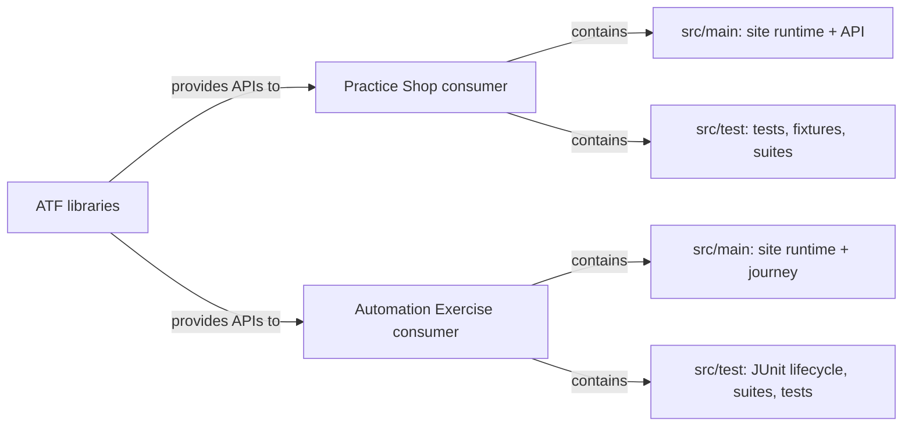

# Feedback închis — arhitectura testelor consumer Shop și AutoEx

**Stare: cerințele de arhitectură din această revizie sunt implementate și probate.**
Acest document păstrează deciziile și dovada de închidere; nu mai conține ToDo-uri
active. Contractele generice rămân la ownerii ATF, iar regulile specifice aplicației
rămân în consumatorul lor.

## Boundary-ul rezultat

<strong>Legendă — boundary-ul consumerilor</strong>

ATF furnizează contracte reutilizabile; fiecare consumer își păstrează separat
suportul de site în `main` și suitele/testele în `test`.

| Responsabilitate | Practice Shop | Automation Exercise |
|---|---|---|
| Rute, selectori, config, pagini și journey consumer | `src/main` | `src/main` |
| Teste, suites, fixtures și lifecycle JUnit | `src/test` | `src/test` |
| E2E business | `ShopE2eSuite` — selecție explicită a celor 5 scenarii | `AutoExPurchaseSuite` — exact cele 3 configurații UI / UI+API / final-only |
| Componente consumer | `ShopComponentSuite` | `AutoExComponentSuite` |
| API call audit | `ShopApiCallAuditSuite`, selecție tag `api-call` | Nu există o suită API separată; API-ul este observat în aceeași sesiune UI+API |
| Contracte generice ATF | modulul ATF owner | modulul ATF owner |

În AutoEx, page objects și journey-ul depind de interfața consumer
`AutoExPurchaseSession`, implementată de `AutoExE2eRun` din `src/test`.
Astfel suportul business poate fi compilat separat, fără să tragă în `main`
JUnit, Test Kit sau lifecycle-ul raportului. Configurația publică demo este
resursă de `main`; datele și wrapper-ul de execuție rămân explicite.

## Decizii de selecție și eliminare

- `ShopComponentSuite` este suita umbrelă fără E2E live; includerea verificărilor
  API și support este intenționată. `ShopApiComponentSuite` este filtrul API
  concentrat, iar `ShopApiCallAuditSuite` este filtrul pentru testele care fac
  apeluri auditabile. Suprapunerea între aceste entry points este selecție
  deliberată, nu duplicate în aceeași execuție.
- `ShopApiScreenFlowIntegrationTest` a fost eliminat: executa același flow
  autentificare → catalog → coș → checkout ca
  `ShopStandaloneApiReportTest`, dar valida numai statusuri HTTP și nu producea
  un artifact distinct. Testul standalone păstrează flow-ul live, verificări
  business mai puternice, cerința `LIVE_HTTP` și raportul cu exchange-uri.
  Rularea sa rămâne opt-in și directă, nu este ascunsă într-o suită componentă.
- AutoEx avea cinci teste componente, nu trei: patru teste erau doar în pachetul
  `autoex.support`. Toate sunt acum în `tests.autoex.component`, alături de
  testul consent, și sunt selectate de `AutoExComponentSuite`.
- Helpers rămân helpers, nu entry points. Suitele selectează pachete/clase și nu
  dețin logică de business sau fixture-uri. Nu s-au mutat primitive generice în
  consumer.

## Catalogul Gherkin și guvernanța

- `ShopPurchaseTraceStep` deține vocabularul guest purchase, setup-ul
  autentificat, reutilizarea contului, fixture-ul local și failure boundary.
  Flow-ul terminal UI-only primește tot o valoare din catalog, nu un titlu liber.
- `AutoExPurchaseTraceStep` deține cele 13 checkpoint-uri și starea terminală.
  Journey-ul și page objects nu mai compun perechi inline keyword + titlu;
  `AutoExE2eRun` expune către flow numai overload-ul tipizat.
- Testele de componentă verifică mapările keyword/title, unicitatea și cardinalitatea.
  Guardrail-ul AutoEx verifică suite membership și faptul că sursele `main`
  nu importă JUnit sau ATF Test Kit.
- Testele și fixture-urile nu au fost mutate mecanic doar pentru simetrie:
  ownership-ul este decis după rol și dependențe. Configurația, API-ul public,
  page objects și vocabularul specific rămân consumer-owned.

## Dovada de verificare

- `mvn -pl atf-test-auto-ex,atf-test-practice-shop -am -DskipTests test-compile`
  — compilează sursele main și test ale ambelor consumatoare.
- `mvn -pl atf-test-auto-ex,atf-test-practice-shop -am "-Dtest=AutoExComponentSuite,ShopComponentSuite" "-Dsurefire.failIfNoSpecifiedTests=false" test`
  — gate-ul componentă este separat de E2E-urile publice; execuția curentă:
  Shop **221 teste**, AutoEx **10 teste**, **0 failures / 0 errors**.
- E2E-urile AutoEx nu au fost pornite de acest gate; suita lor rămâne opt-in.
  Rapoartele E2E verificate anterior sunt dovadă pentru matricea evidence, nu
  înlocuiesc gate-ul componentă de mai sus.

## Domeniu în afara acestei închideri

Această revizie nu adaugă o colecție separată de teste pentru endpoint-urile API
Automation Exercise și nu mută lifecycle-ul Extent/JUnit în `main`. Orice
cerință viitoare pentru contractele endpoint-urilor trebuie să definească separat
izolarea datelor externe, efectele mutațiilor și cleanup-ul; nu va fi dedusă din
suitele UI/UI+API existente.
