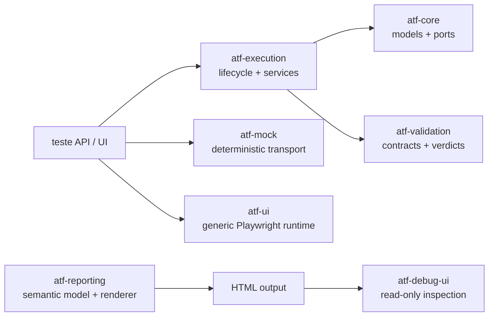
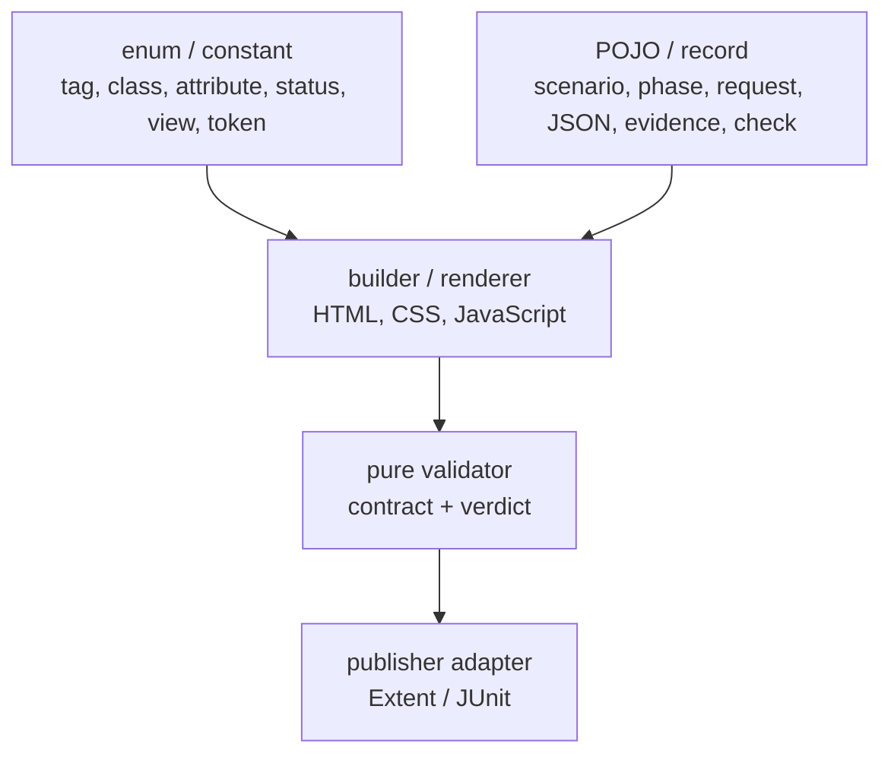

# ATF Java — analiză live reconciliată

Acesta este auditul tehnic curent al codului live, nu un jurnal de rapoarte.
Orice rezultat HTML este efemer; documentația descrie numai contractul și
procedura prin care este verificat.

## Diagramă de ownership



Producția `atf-reporting` consumă porturi și modele neutre. `atf-mock`,
Playwright, fixture-urile și Debug UI intră numai în test scope. `atf-tests` este
shell de compatibilitate, nu composition root executabil.

## Scorecard curent

| Dimensiune | Stare | Observație verificabilă |
|---|---|---|
| module și dependențe | verde | `atf-core` rămâne inferior; reporting production nu importă test/UI/browser |
| API/UI boundary | verde | namespace-ul `atf.api.tests.api` este apărat de `ApiTestBoundaryArchitectureTest` |
| typed reporting | verde | vocabularul finit este enum/constant; datele runtime sunt POJO/record |
| test layering | verde | `unit → component → integration → e2e`, cu `support` separat |
| UI contract | verde | contract static/component pentru markup și E2E numai pentru browser/layout |
| documentație | verde | contractele stabile au fost mutate în README-urile ownerilor; feedback-ul conține doar gap-uri |
| typed status/path ownership | închis | `AtfReportStatus` și `AtfPathLocator` sunt reusable, cu teste core; filtrele UI nu duplică statusuri ca string-uri |
| test cohesion | închis | contractul interaction/failure/navigation este separat în clase independente și apărat de architecture guard |
| runtime JavaScript functions | închis | `ExtentReportRuntimeVocabulary` deține funcțiile, selectorii, atributele, clasele și statusurile; core-ul emite helperi coeziți, iar `failureContext`, `renderFails` și duratele au owner unic |
| runtime module graph | închis | `ExtentReportRuntimeModule` mapează fiecare controller la un singur owner și source; `ExtentReportRuntimeModuleTest` respinge coliziunile de funcții și drift-ul de ordine |
| HTML vocabulary escaping | închis | `AtfReportHtmlVocabulary.escapeHtml` encodează și apostroful; contractul de markup este acum consistent pentru text și atribute |
| semantic parity | închis | `AtfReportSemanticSnapshot.from(ReportExecutionModel)` este adapterul comun și parity-ul este verificat înainte de render |
| test source hygiene | verde | importurile duplicate au fost eliminate repo-wide, iar `ReportingTestReadabilityArchitectureTest` le respinge înainte de promovare |
| undo guard | închis | `AtfPromotionManifest` + `AtfPromotionGuard`, testate pentru drift și promovare selectivă |
| live catalog | închis | `ApiLiveTransportCatalog`, opt-in explicit, fail-closed și limitare la originea endpoint-ului |

## Audit runtime core și promovarea verificărilor din E2E

Core-ul runtime a fost verificat pe două axe care nu trebuie amestecate:

```text
Vocabulary enum-uri → emitere JavaScript → artifact HTML static
                                      ↘ browser E2E: click / disclosure / layout
```

`ExtentReportRuntimeCore` nu mai este o concatenare monolitică: fiecare
primitive semantic are un emitător local, iar `ExtentReportRuntimeScriptTest`
verifică o declarație pentru fiecare funcție din vocabular. Verificările pentru
markup, atribute, CSS/JS, JSON, mock provenance și proiecții pot rula ca
unit/component/integration fără browser. În E2E rămân doar tab-urile, click-ul,
expand/collapse, computed-style, wrapping-ul, screenshot-ul inline și consola.

Registry-ul `ExtentReportRuntimeModule` extinde aceeași regulă la toate
controller-ele: `Duration`, `Evidence`, `Overview`, `Navigation`, `Tests` și
`Failure` sunt producători independenți, compuși o singură dată într-o ordine
stabilă. Testul component verifică această topologie înainte de orice raport
generat; ATF Debug + Playwright verifică ulterior efectul vizibil și interactiv.

Pentru flow-urile UI configurabile, raportul API generat din mock este doar
precondiție read-only. `SelectedApiTestsReportUiTest` selectează explicit
metodele API, iar testul de UI validează randarea și comportamentul browserului;
nu se mută browser în `atf.api.tests.api` și nu se multiplică testele pentru
fiecare secțiune a raportului.

`AtfReportStatus` este owner-ul pentru `PASS`, `FAIL`, `WARNING`, `SKIP` și
`INFO`, inclusiv conversia lowercase folosită de CSS și filtre. `CategoryFilter.CLEAR`
rămâne intenționat filtru UI, nu verdict. `AtfPathLocator` deține discovery-ul
configurației și al source-root-ului, inclusiv convenția reutilizabilă pentru
testele ATF; testele nu mai păstrează metode private cu traversal duplicat.

## Auditul boundary-ului API

`atf.api.tests.api` conține scenarii, fixtures și teste pentru HTTP, headers,
route coverage, lifecycle și response contracts. Nu conține browser, DOM,
Playwright sau auditul vizual al raportului.

```text
atf.api.tests.api
  → atf.api.tests.support.ApiTestResources
  → atf-mock / atf-execution / atf-validation

atf.ui.tests.extent
  → setup API read-only
  → atf-reporting renderer
  → atf-ui browser adapter
  → section validators + publisher
```

`ApiRouteCoverageMatrixTest` nu mai depinde de `ReportingTestResources`, care
este UI/report test support. Helper-ul API-only rezolvă catalogul mock din
classpath și poate fi reutilizat de testele API fără să introducă o dependență
semantică spre browser.

## Auditul reporting typed



Implementarea live include vocabular pentru markup, asset manifest, module JS,
CSS properties, selectorii vizuali, labels tehnice și palette tokens. Evidence
fields, JSON body, screenshot, checks și execution tree sunt modele immutable.
Nu se enumerează URL-uri, propoziții, titluri, JSON sau inputuri runtime.

### Parity închis

Extent și fallback păstrează modele immutable distincte pentru responsabilități
locale, dar folosesc aceeași proiecție semantică verificabilă:

| Model | Owner | Rol |
|---|---|---|
| `AtfReportSemanticSnapshot` | lifecycle Extent | class → scenario → phase → node și counters pentru publisherul Extent |
| `ReportExecutionModel` | fallback renderer | scenario → phase → request/validation și proiecții Overview/Categories/Fails |

`AtfReportSemanticSnapshot.from(ReportExecutionModel)` păstrează package-ul,
request/response JSON metadata, validările și numărul de acțiuni/screenshot-uri.
`HtmlReportSession` compară snapshot-ul derivat cu recorderul înainte de render,
iar testul semantic acoperă class → scenario → phase → request → validation.
Modelele nu sunt duplicate accidental: proiecțiile Overview/Categories/Fails
rămân specifice fallback-ului.

## Auditul test-kit-ului UI Extent

```text
component  → models, contracts, projection, architecture/cohesion guards
e2e        → browser, click, collapse, computed-style, responsive/rendered DOM
support    → API setup, fixtures, locators, extraction, flows, inspection, publish
```

Selectorii sunt compuși numai în `support/locators`. Extractoarele produc input
typed; validatorii puri verifică inputul; publisherul este singurul adapter care
scrie evidence Extent/JUnit. `Setup evidence` rămâne setup, iar `Screen
validation` rămâne în `TEST BODY` după acțiunile și observațiile relevante.

## Documentația mutată în owneri

Informația permanentă nu mai este duplicată în feedback:

| Informație | README owner |
|---|---|
| module și direcția dependențelor | `docs/ATF_Architecture.md` + root `README.md` |
| typed vocabulary, POJO și renderer | `atf-reporting/README.md` |
| component/e2e/support și rulare IntelliJ | `atf-reporting/src/test/java/atf/ui/tests/extent/README.md` |
| matricea testelor și guard-urile | `ATF_Test_Layering_Feedback.md` + test-kit README |
| reguli de sync și build | `docs/ATF_Build_And_Execution_Safety.md` |
| contract vizual și accessibility | `docs/ATF_Reporting_Contract.md` |
| ToDo-uri reale | acest registru |

## Gate de revalidare

```text
live source
  → staging extern nou
  → targeted architecture/component tests
  → clean reactor gate
  → static artifact contract
  → ATF Debug + Chromium/Playwright MCP
  → live/staging reconciliation
  → README owner + feedback gap update
```

Pentru un raport UI se verifică `Tests`, `Overview`, `Categories`, `Fails`,
evidence JSON, disclosure-uri, `＋/−` inline, screenshot link inline, overflow,
computed-style, console/page errors și deep-link navigation. Nu se păstrează în
README numele rezultatului HTML; se păstrează doar tipul de output și regula de
verificare.

## Stare ToDo-uri

Nu există ToDo-uri active în auditul reconciliat. Contractul manifestului este
documentat în `docs/ATF_Build_And_Execution_Safety.md`, iar contractul
catalogului live este documentat în `atf-core/README.md`; feedback-ul nu mai
duplică aceste reguli închise.
`TEST-COHESION-01` este de asemenea închis: contractele interactive, failure
projection și navigation sunt separate semantic, fără duplicarea fixture-urilor,
iar `ExtentReportContractCohesionArchitectureTest` previne regresia într-o
singură clasă mixtă.

Nu mai există gap separat pentru status projection, API/UI package boundary,
asset/vocabulary typing, test organization sau providerii CSS/JavaScript care
au deja boundary semantic și teste dedicate. Orice nou split trebuie justificat
prin contract independent, nu prin line count.

## Hardening închis — `RUNTIME-JS-FUNCTION-COHESION-01`

Auditul funcțiilor JavaScript generate a fost tratat la nivel de responsabilitate,
nu de număr de linii. `ExtentReportFailureRuntime` publică o singură definiție
pentru `failureContext` și `renderFails`; colectarea cardurilor, derivarea
contextului, ordonarea și construirea rândului sunt helperi distincti. În
`ExtentReportDurationRuntime`, traversarea copiilor, decizia de precedență și
publicarea duratei în DOM sunt separate. `causeChainScript` furnizează helperii
de îmbogățire fără rebinding global. Contractele statice numără ownerii și
verifică seams-urile; gate-ul complet și verificarea browser confirmă că
`Fails`, `Tests` și duratele își păstrează comportamentul.

Criteriile de revizie pentru o schimbare viitoare sunt centralizate în
[`feedback/README.md`](README.md); această analiză nu deschide un ToDo separat
pentru un trigger care nu există în codul live.

## Hardening închis — `RUNTIME-JS-DURATION-FRAGMENTS-07`

`ExtentReportDurationRuntime` este acum facade-ul stabil pentru patru fragmente
cu responsabilități distincte: parsing/normalizare, măsurare/agregare,
projection/publicare și lifecycle/observer. Component test-ul verifică
concatenarea și unicitatea celor 39 de declarații de funcții; gate-ul E2E
confirmă parity pentru durate `measured`, `aggregated` și `absent`. Artefactul
fresh a fost deschis în ATF Debug și verificat vizual pe API și UI: tab-uri și
disclosure-uri funcționale, `＋/−` inline, fără overflow orizontal, fără
`<hr>` decorative și fără erori de consolă. ToDo-ul este închis; nu se păstrează
rapoarte generate sau timestamp-uri în documentație.

## Hardening închis — `TEST-SOURCE-HYGIENE-01`

Auditul live a identificat importuri duplicate lăsate în urma unor refactorizări
paralele, inclusiv în `atf-execution` și `atf-validation`, precum și în testele
de core/execution/validation. Duplicatele au fost eliminate fără schimbare de
comportament, iar `ReportingTestReadabilityArchitectureTest` verifică acum toate
source-set-urile Java pentru importuri repetate și invocații ATF fully-qualified.
Închiderea este susținută de guard-ul focalizat verde și de recompilarea întregului
reactor în staging extern.

## Hardening închis — `REPORTING-PUBLICATION-ROBUSTNESS-01`

Auditul live a reprodus un lock Windows tranzitoriu la mutarea unui raport UI
din workspace-ul de staging în fișierul final; fixture-ul și aserțiunile UI au
fost verzi. `ReportPublicationCoordinator` tratează acum această fereastră
scurtă prin retry bounded după tentativa atomică și folosește fallback-ul
non-atomic numai când filesystem-ul declară explicit că atomic move nu este
suportat. După ultima încercare eroarea originală rămâne vizibilă.

Închiderea este susținută de testul focalizat al raportării, gate-ul complet
`531 teste / 0 failures / 0 errors / 3 skip-uri intenționate` în reactor, dintre
care `365` în `atf-reporting`, și verificarea
fresh a rapoartelor în Chromium headless: tab-uri vizibile, disclosure-uri
colapsate implicit, fără overflow orizontal, fără `<hr>` intermediare, fără
imagini rupte și fără erori de consolă/page. Nu se opresc rulări active și nu
se folosește browserul Windows real.
