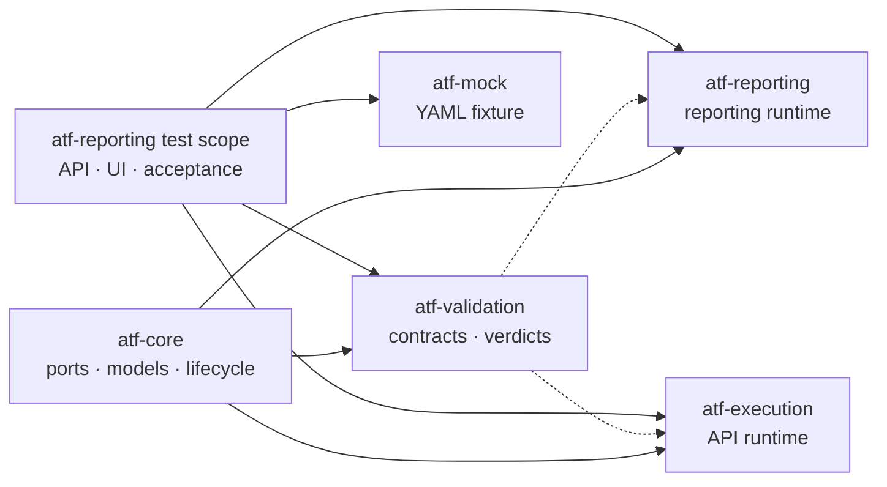

# ATF Java — analiză live și hardening de arhitectură

## Verdict executiv

Scorul live înaintea acestei intervenții a fost `84/100`. După închiderea
boundary-ului de runtime și adăugarea guard-urilor, scorul arhitectural
recalculat este `87/100`.



Linia solidă înseamnă dependență runtime. Linia punctată înseamnă adapter
`scope=test`. `ExtentReports`, Jackson și alte biblioteci tehnice rămân
dependențe runtime legitime ale rendererului; nu sunt ATF orchestration
dependencies și nu trebuie eliminate artificial prin duplicarea codului.

## Ce a fost rezolvat chirurgical

### `ARCH-01` — acceptance API nu mai este runtime reporting

- `ApiAcceptancePlanBuilder` și `ApiAcceptancePublisher` au fost mutate din
  `atf-reporting/src/main` în `atf-reporting/src/test`.
- `atf-reporting` rămâne capabil să publice artifactul prin porturi neutre,
  fără să exporte DSL-ul de scenarii sau decizii de validation.
- `ArchitectureOwnershipBoundaryTest` apără poziția test-only.

### `ARCH-02` — validation este adapter de test

- `atf-reporting/pom.xml` declară `atf-validation` cu `scope=test`.
- `atf-execution/pom.xml` declară `atf-validation` cu `scope=test`.
- Codul de producție execution și reporting nu importă validation; testele îl
  compun explicit unde au nevoie de contracte și verdicturi.
- `ArchitectureModuleBoundaryTest` verifică scope-ul, nu doar existența
  artifactId-ului în POM.

### `ARCH-03` — execution poate fi decupat ca librărie peste core

`atf-execution` are acum un runtime graph minimal: core, API runtime și
bibliotecile sale tehnice. Lifecycle-ul generic stă în core. Validation rămâne
un seam de test, nu este copiat în execution și nu este mutat în reporting.
Aceasta este forma sigură pentru o viitoare librărie: separă responsabilitatea
fără să rupă contractele publice și fără să creeze al treilea lifecycle engine.

### `ARCH-04` — mock-ul rămâne fixture, nu dependență externă de reporting

`atf-mock.yaml` este consumat în test scope-ul reporting. El descrie request,
response, body JSON, status, headers și auth pentru contractele de test. Runtime
reporting nu cunoaște rutele concrete și nu trebuie să cunoască mock-ul. Testele
folosesc `MockRoutePaths`/loaderul YAML prin adaptoare explicite.

Consecința dorită este:

```text
atf-mock.yaml
    → mock adapter / deterministic response
    → API execution test
    → renderer-neutral evidence ports
    → atf-reporting artifact
```

Pentru un fat-jar sau un packaging shaded se va deschide un task separat. Nu se
introduce acum o dependență artificială și nu se ascunde test fixture-ul în
runtime.

## Dovezi de verificare

Gate-ul complet a trecut în staging extern, fără oprirea rulărilor live:

| Gate | Rezultat |
|---|---|
| test compile reactor | PASS |
| boundary tests | 8 PASS + 7 PASS |
| `atf-reporting` full suite | 380 teste, 0 failures, 0 errors, 3 skip-uri intenționate |
| `atf-tests` | 7 PASS, 0 failures, 0 errors, 0 skipped |
| POST/PUT request + response JSON | PASS în flow-urile API |
| API headers/auth/execution evidence | PASS în artifact |
| UI Categories/Tests/Failures/Overview navigation | PASS în testele interne |

Staging-ul folosit a fost într-un director extern proiectului, sub `.tmp`.
Artifactele finale au fost promovate în directoarele configurate de raportare;
verificarea statică a confirmat request/response details, execution evidence și
statusurile PASS/FAIL/WARNING/SKIP în HTML.

## ToDo ordonat după risc

1. **P0 — verificare vizuală fresh a artifactului final prin ATF Debug.**
   Deschide un raport generat de gate-ul final, verifică renderizarea, starea
   collapsed-by-default, evidența JSON și screenshot links. Nu se folosește
   browser Windows real.
2. **P1 — înghețarea boundary-ului `ReportUiLocators`.**
   Păstrează locatorii într-o fațadă dedicată și verifică să nu existe
   selector direct în testele UI, în paralel cu refactorizările deja existente.
3. **P1 — contract de packaging pentru librăria reporting.**
   Definește separat API-ul public, transitive dependencies și dacă se dorește
   artifact slim sau shaded; apoi adaugă test de consumator extern.
4. **P2 — contract de packaging pentru execution.**
   Adaugă un smoke consumer care depinde numai de `atf-execution` + `atf-core`
   și verifică bootstrap, lifecycle și cleanup fără validation.
5. **P2 — curățenie documentară.**
   Păstrează în README-urile modulelor aceeași convenție: diagramă la început,
   solid runtime, dotted test adapter, apoi ownership și comenzi reproducibile.

## Regula de sincronizare

Orice schimbare paralelă se verifică înainte de promovare prin comparație de
fișiere și compile/test în staging extern. Se promovează numai patch-uri
confirmate; nu se copiază `target`, `artifacts` sau `.tmp` și nu se opresc
procesele deja pornite.

## Criteriu de închidere

- [x] acceptance boundary mutat în test scope;
- [x] validation runtime eliminat din reporting și execution;
- [x] guards pentru ownership și Maven scope;
- [x] full reactor gate verde în staging;
- [ ] artifact fresh deschis prin ATF Debug și verificat vizual;
- [ ] packaging consumer test pentru reporting și execution.
