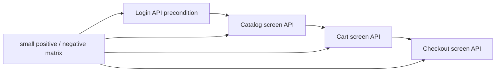

# Practice Shop — API screen pyramid feedback



## Scope

Acest feedback urmărește separarea dintre runtime-ul reutilizabil al aplicației
Practice Shop și testele care îl consumă. `src/main/java/atf/ui/practiceshop`
deține configurația typed, locatori, page objects, flow-uri UI, clientul API
și screen API flows. `src/test/java/atf/ui/tests/practiceshop` deține numai
teste organizate pe `component`, `api/component`, `api/integration` și `e2e`.

## Închise în această iterație

| Item | Rezultat | Dovadă |
|---|---|---|
| `SHOP-API-SCREEN-01` | ✅ screen boundaries | `PracticeShopLoginApi`, `PracticeShopCatalogApi`, `PracticeShopCartApi`, `PracticeShopCheckoutApi` compuse de `PracticeShopApiScreenFlow` |
| `SHOP-API-SCREEN-02` | ✅ login reutilizabil ca precondiție | `PracticeShopApiSession` păstrează token-ul; screen flow-ul următor reutilizează aceeași sesiune |
| `SHOP-API-SCREEN-03` | ✅ variație fără multiplicare E2E | fake transport pentru `401` login/current user, `404` product, `400` quantity și `2xx` payment; enum pentru metodele de payment |
| `SHOP-API-SCREEN-04` | ✅ packaging | reusable support mutat în `src/main/java`; testele au rămas exclusiv în namespace-ul `atf.ui.tests.practiceshop` |
| `SHOP-API-SCREEN-05` | ✅ locator boundary | locatorul de produs folosește ruta UI exactă configurată, nu text parțial ambiguu; `waitForEnabled` sincronizează controlul după încărcarea datelor |
| `SHOP-UI-VALIDATION-01` | ✅ contracte declarative pe fiecare ecran traversat | `@PracticeShopPageContract` + `PracticeShopPageValidator` pentru home, product, cart, guest, billing, payment, confirmation, login și account; `PracticeShopPageContractTest` verifică rutele, controalele semantice și rezultatul agregat |
| `SHOP-UI-VALIDATION-02` | ✅ validator plug-and-play și gate pentru toate contractele declarate | `PracticeShopPageValidator` oferă `validate`, `validateValues` și `validateValue`; testul component verifică cele 9 ecrane și numărul de controale, fără browser/network |
| `SHOP-API-SCREEN-10` | ✅ jurnalul API este modular și nu amestecă orchestration, assertions și reporting | `PracticeShopApiNetworkJournal` capturează/selectează, `PracticeShopApiAssertions` validează JSON/headers/status, iar `PracticeShopApiEvidenceMapper` publică request/response/execution evidence |

### Regula de validare a formularelor

Validarea se face înainte ca UI-ul să treacă la ecranul următor. Flow-ul
folosește `fill → validate → submit`: valorile dinamice din YAML sunt verificate
în câmpurile reale înainte de submit, iar tranziția este acoperită de checkpoint-ul
următor. Aceasta evită contracte fragile pentru controale tranzitorii și păstrează
în raport motivul exact al unui fail.

## Matricea minimă intenționată

```text
component/API
  login valid                 → 2xx + JSON token
  login invalid               → 401 + application/json
  current user anonim         → 401 + application/json
  product inexistent          → 404 + application/json
  cart quantity <= 0          → fail-fast înainte de transport
  payment cash/card variants  → request JSON + 2xx JSON

integration/API (opt-in)
  login credential file       → session token
  catalog → cart → checkout   → dynamic IDs și status/content-type

E2E (un singur journey)
  UI product → cart → billing → payment
  API evidence atașat checkpoint-urilor UI existente
```

Nu adăugăm câte un E2E pentru fiecare endpoint. Varianta rapidă aparține
component tests; integrarea live este opt-in și necesită account file extern;
E2E-ul rămâne dovada de orchestration UI + API.

## ToDo rămase

| Prioritate | ToDo | Criteriu de acceptare |
|---|---|---|
| P1 | `SHOP-API-SCREEN-06`: atașarea aceluiași model de evidence și pentru rularea standalone a API screen flow-ului | raport API separat cu request/response JSON, headers, auth, status și execution evidence pentru matrix, fără browser |
| P1 | `SHOP-API-SCREEN-07`: live integration cu account file extern | testul rulează doar cu `-Datf.practice.api-mode=live` și `-Datf.practice.account-file=...`; implicit rămâne skip, fără secret în repository |
| P2 | `SHOP-API-SCREEN-08`: validare explicită a `productName`/`productPath` înainte de click | setup/checkpoint arată produsul din UI și confirmă că ruta este prezentă; schimbarea catalogului produce fail diagnostic, nu strict-mode ambiguity |
| P2 | `SHOP-API-SCREEN-09`: contracte pentru sort/filter, out-of-stock și cart update/remove | component/integration tests distincte, fără al doilea purchase E2E |

## Verificare și sync

Build-ul acestei iterații se face în staging extern proiectului. Promovarea în
live trebuie să fie selectivă: se recitesc versiunile live ale fișierelor
existente, se aplică numai hunks-urile acestui boundary, iar refactorizările
paralele din alte module nu se suprascriu. După sync se rulează component/API
gate, apoi singurul E2E și se verifică fresh report-ul UI prin ATF Debug sau
Chromium/Playwright headless.
