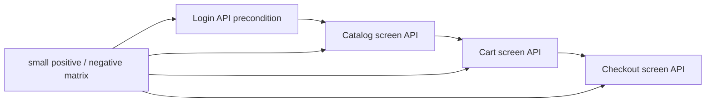
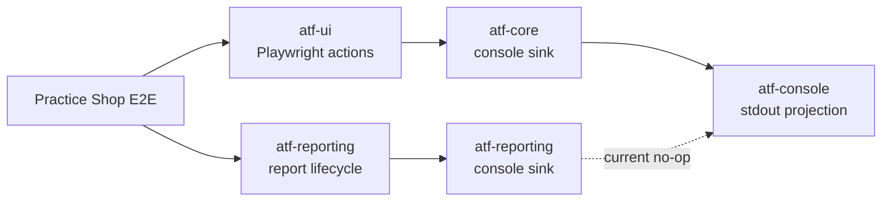
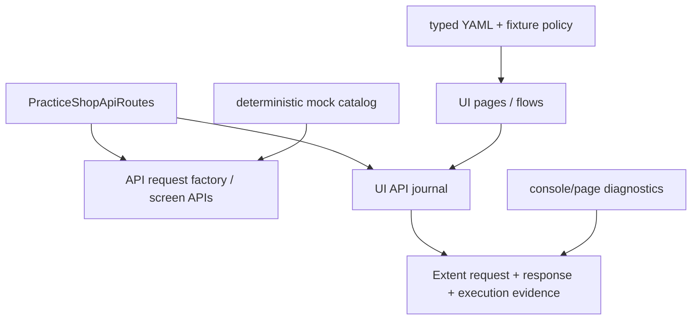

# Practice Shop — API screen pyramid feedback



<details>
<summary><strong>Legendă — feedback activ pentru piramida API/UI</strong></summary>

- săgeata solidă indică ordinea precondițiilor dintre ecrane;
- `Variants` este matricea mică de cazuri, nu o multiplicare de E2E;
- fiecare boundary trebuie coborât în component/integration înainte de a extinde journey-ul;
- diagrama descrie gap-ul urmărit, nu declară ToDo-ul închis.

</details>

## Scope

Acest feedback urmărește separarea dintre runtime-ul reutilizabil al aplicației
Practice Shop și testele care îl consumă. `src/main/java/atf/ui/practiceshop`
deține configurația typed, locatori, page objects, flow-uri UI, clientul API
și screen API flows. `src/test/java/atf/ui/tests/practiceshop` deține numai
teste organizate pe `component`, `api/component`, `api/integration` și `e2e`.

## Gap live — Practice Shop nu consumă încă `atf-console`



<details>
<summary><strong>Legendă — ce este demonstrat de codul live</strong></summary>

- `PracticeShopE2eContext` trimite `AtfConsoleSink.noOp()` către `PlaywrightUiSession`;
- aceeași clasă trimite `event -> {}` către `UiExtentReportSession`;
- `atf-test-practice-shop/pom.xml` nu declară `atf-console`;
- `PracticeShopRuntimeDiagnostics` capturează erori ale browserului, dar nu este
  proiecția lifecycle-ului ATF în stdout;
- `atf-console` poate formata evenimentele neutre din `atf-core`, dar nu primește
  acum evenimentele duplicate din package-ul `atf-reporting`;
- HTML-ul păstrează acțiunile, însă consola nu arată flow-ul UI al Practice Shop
  și nu există dovadă pentru politica enabled/disabled.

</details>

Problema nu se rezolvă printr-un `println` în flow. Consumerul trebuie să injecteze
reporterul configurat, iar alegerea dintre un port comun și un adapter typed trebuie
făcută la boundary, nu duplicată în `PracticeShopE2eContext`.

## Închise în această iterație

| Item | Rezultat | Dovadă |
|---|---|---|
| `SHOP-API-SCREEN-01` | ✅ screen boundaries | `PracticeShopLoginApi`, `PracticeShopCatalogApi`, `PracticeShopCartApi`, `PracticeShopCheckoutApi` compuse de `PracticeShopApiScreenFlow` |
| `SHOP-API-SCREEN-02` | ✅ login reutilizabil ca precondiție | `PracticeShopApiSession` păstrează token-ul; screen flow-ul următor reutilizează aceeași sesiune |
| `SHOP-API-SCREEN-03` | ✅ variație fără multiplicare E2E | fake transport pentru `401` login/current user, `404` product, `400` quantity și `2xx` payment; enum pentru metodele de payment |
| `SHOP-API-SCREEN-04` | ✅ packaging | reusable support mutat în `src/main/java`; testele au rămas exclusiv în namespace-ul `atf.ui.tests.practiceshop` |
| `SHOP-API-SCREEN-05` | ✅ locator boundary | locatorul de produs folosește ruta UI exactă configurată, nu text parțial ambiguu; `waitForEnabled` sincronizează controlul după încărcarea datelor |
| `SHOP-API-SCREEN-06` | ✅ standalone API evidence | `PracticeShopStandaloneApiReportTest` rulează screen flow-ul pe transport fake și publică în `artifacts/reports` request JSON, response JSON, headers, auth, status și execution evidence, fără browser; request metadata (URL/auth/query/request headers) și response metadata (content type/response headers) sunt publicate în zona lor semantică |
| `SHOP-API-SCREEN-07` | ✅ live opt-in account fixture | `PracticeShopApiScreenFlowIntegrationTest` și account E2E sunt activate numai cu `api-mode=live` și account file extern; acceptance/guest rămân implicite și niciun secret nu este comis |
| `SHOP-API-SCREEN-08` | ✅ product selection diagnostic | purchase flow publică `productName`, ruta configurată, ruta selectată și URL-ul încărcat; fallback-ul pe nume nu mai poate ascunde o schimbare de catalog |
| `SHOP-API-SCREEN-09` | ✅ catalog/cart variation matrix | query typed pentru sort/filter/category și `in_stock`, plus `PUT` quantity / `DELETE` product cart, sunt acoperite în component tests; nu s-a adăugat un al doilea E2E |
| `SHOP-UI-VALIDATION-01` | ✅ contracte declarative pe fiecare ecran traversat | `@PracticeShopPageContract` + `PracticeShopPageValidator` pentru home, product, cart, guest, billing, payment, confirmation, login și account; `PracticeShopPageContractTest` verifică rutele, controalele semantice și rezultatul agregat |
| `SHOP-UI-VALIDATION-02` | ✅ validator plug-and-play și gate pentru toate contractele declarate | `PracticeShopPageValidator` oferă `validate`, `validateValues` și `validateValue`; testul component verifică cele 9 ecrane și numărul de controale, fără browser/network |
| `SHOP-UI-VALIDATION-03` | ✅ home screen modularizat în sub-checkpoint-uri | același purchase E2E publică structure, filters și product-grid; fiecare are Playwright actions, assertions dinamice de cardinalitate/style și screenshot inline; HOME contract are 16 controale semantice |
| `SHOP-UI-VALIDATION-04` | ✅ celelalte ecrane au component evidence fără multiplicare E2E | `PracticeShopPurchaseScreenValidator` adaugă, în checkpoint-ul existent al fiecărui ecran, assertions compacte de cardinalitate, bounding box și readiness interactivă pentru product, cart, guest, billing, payment și confirmation; fiecare păstrează screenshot-ul complet la zoom 100% |
| `SHOP-API-SCREEN-10` | ✅ jurnalul API este modular și nu amestecă orchestration, assertions și reporting | `PracticeShopApiNetworkJournal` capturează/selectează, `PracticeShopApiAssertions` validează JSON/headers/status, iar `PracticeShopApiEvidenceMapper` publică request/response/execution evidence |
| `SHOP-AUTH-01` | ✅ registration a fost explorat manual și modelat semantic | ATF Debug/browser MCP a confirmat formularul `first_name`, `last_name`, `dob`, `country`, `postal_code`, `house_number`, `street`, `city`, `state`, `phone`, `email`, `password` și submit-ul; `PracticeShopRegistrationPage` + `PracticeShopRegistrationData` dețin automatizarea fără selectori în test |
| `SHOP-AUTH-02` | ✅ cont reutilizabil, configurabil și redacted | `practice-software-testing-account.properties` este fixture module-owned în `src/test/resources`; `PracticeShopConfigurationLoader` permite override extern; `PracticeShopCredentials` nu publică parola în actions/assertions/HTML |
| `SHOP-AUTH-03` | ✅ login setup + purchase authenticated complet | `PracticeShopAuthenticatedPurchaseE2eTest` reutilizează login-ul, account precondition, catalog, product, cart, authenticated checkout, billing, payment și confirmarea finală; nu se adaugă E2E pentru fiecare endpoint |
| `SHOP-AUTH-04` | ✅ evidence API a fost legată de precondiția UI | login POST, users/me GET, headers/auth/status și execution evidence sunt atașate checkpoint-ului `GIVEN reusable account login...`; cart/payment păstrează request și response JSON în checkpoint-urile lor |
| `SHOP-AUTH-05` | ✅ fallback documentat pentru body-ul login-ului extern | dacă Chromium eliberează payload-ul gzip înainte de `Network.getResponseBody`, raportul afișează explicit `body unavailable` plus content-type/content-length; sesiunea este validată prin `/users/me` 200, fără token inventat; politica are test component dedicat |
| `SHOP-AUTH-06` | ✅ component gate pentru politica de login | `PracticeShopApiLoginAssertionsTest` verifică status 200, request JSON redacted și acceptarea transportului JSON non-empty atunci când body-ul nu mai este accesibil CDP |
| `SHOP-AUTH-07` | ✅ fixture live revalidat și înlocuit chirurgical | contul demo expirat a fost înlocuit prin registration JSON real (`201`), apoi login-ul a fost verificat separat (`200` + token); fixture-ul rămâne în `src/test/resources`, iar credentialele nu sunt copiate în evidence |

Nota de robustețe: locatorii de colecție rămân utilizați pentru count/cardinality,
iar sincronizarea folosește explicit primul element (`homeProductGridFirst`),
deoarece API-ul Playwright pentru `waitForVisible` este strict.

Selecția produsului este plug-and-play: o rută `/product/<id>` configurată are
prioritate și rămâne strictă; pentru fixture-ul extern volatil, `productPath: auto`
alege primul card pentru `productName` și validează obligatoriu ruta `/product/*`.
ID-ul observat din catalog rămâne sursa de adevăr pentru product detail și cart;
nu se maschează o lipsă a produsului, deoarece selecția eșuează dacă nici numele
nu apare.

### Regula de validare a formularelor

Validarea se face înainte ca UI-ul să treacă la ecranul următor. Flow-ul
folosește `fill → validate → submit`: valorile dinamice din YAML sunt verificate
în câmpurile reale înainte de submit, iar tranziția este acoperită de checkpoint-ul
următor. Aceasta evită contracte fragile pentru controale tranzitorii și păstrează
în raport motivul exact al unui fail.

Pentru ecranele purchase, component evidence este intenționat agregat pe ecran:
un checkpoint = o captură completă + acțiuni + assertions de componente. Nu
creăm sub-checkpoint-uri doar pentru a separa câmpuri care încap în aceeași
imagine. `guest-proceed` este tranzitoriu și se validează prin acțiunea de
submit/proceed, nu prin contractul ecranului Guest înainte de submit.

## Matricea minimă intenționată

```text
component/API
  login valid                 → 2xx + JSON token
  login invalid               → 401 + application/json
  current user anonim         → 401 + application/json
  product inexistent          → 404 + application/json
  cart quantity <= 0          → fail-fast înainte de transport
  payment cash/card variants  → request JSON + 2xx JSON

integration/API (opt-in)
  login credential file       → session token
  catalog → cart → checkout   → dynamic IDs și status/content-type

E2E (un singur journey)
  UI product → cart → billing → payment
  API evidence atașat checkpoint-urilor UI existente
```

Nu adăugăm câte un E2E pentru fiecare endpoint. Varianta rapidă aparține
component tests; integrarea live este opt-in și necesită account file extern;
E2E-ul rămâne dovada de orchestration UI + API.

## Refactor findings

| `SHOP-ARCH-11` | ✅ test-source purity | `PracticeShopStandaloneApiReportTest` nu mai deține publisher-ul Extent/API; responsabilitatea reusable este în `src/main/java/atf/ui/practiceshop/support/PracticeShopApiReportPublisher`, iar testul păstrează doar scenariul, fake transport-ul și assertions-ul artifactului. Publisher-ul separă explicit request details de response details, inclusiv headers și content type |
| `SHOP-ARCH-12` | ✅ architecture guard pentru test-only scope | `PracticeShopArchitectureTest` permite în `src/test` doar clase `*Test`, `*TestSupport` sau `*Fixture` și continuă să respingă Page/Flow/Locators/E2eContext reutilizabile; fake transports rămân intenționat test-only |
| `SHOP-ARCH-13` | ✅ închis pe scope-ul modulului | `PracticeShopApiNetworkJournal` este orchestration/state; capture + sanitizare sunt în `PracticeShopApiTrafficCapture`, selecția pură în `PracticeShopApiExchangeSelector`, iar purchase-ul este compus semantic prin `PracticeShopCatalogPurchaseStage`, `PracticeShopCheckoutPurchaseStage` și `PracticeShopPurchaseJourneyContext`. `PracticeShopPurchaseFlow` păstrează facade-ul public existent; nu s-au adăugat E2E-uri. Gate component: 27/27; full module gate: 44 teste, 0 failure, 0 error, 1 skip opt-in |
| `SHOP-CONSOLE-01` | 🔎 observat, neînchis | `PracticeShopE2eContext` injectează `noOp` pentru acțiunile Playwright și un lambda gol pentru lifecycle-ul raportului; `atf-console` nu apare în POM |
| `SHOP-CONSOLE-02` | 🔎 observat, neînchis | `atf-core` și `atf-reporting` definesc fiecare `AtfConsoleEvent`/`AtfConsoleSink`; aceeași instanță `AtfConsoleReporter` nu poate fi conectată typed la ambele boundary-uri |

## ToDo rămase

> Notă de versiune: această secțiune păstrează istoricul iterației precedente;
> lista normativă și prioritățile curente sunt în „Reaudit agresiv-constructiv —
> 2026-10-20”, mai jos.

`SHOP-CONSOLE-01` și `SHOP-CONSOLE-02` rămân ToDo-uri active cross-module pe
această analiză. `SHOP-ARCH-13` este închis pe scope-ul `atf-test-practice-shop`:
capture/select și orchestration-ul purchase sunt separate pe seam-uri business
testabile, fără schimbarea API-ului public și fără multiplicarea E2E. Pentru
consolă, criteriul de închidere este:

- `reporting.console` este încărcat prin `atf-console`, fără stream deținut de
  Practice Shop;
- reporterul configurat primește pașii UI și lifecycle-ul relevant printr-un
  boundary typed, fără lambda-uri no-op implicite;
- `enabled=false` rămâne complet silențios, iar `detailsEnabled` controlează
  numai detaliile, nu existența verdictului sau a testului;
- acțiunile, URL-urile și body-urile sensibile respectă redaction-ul existent;
- un test component cu sink in-memory verifică ordinea
  `scenario → phase → ui action → complete(status)` pentru `PASS`, `WARNING`,
  `FAIL` și `SKIP`;
- un test integration al consumerului confirmă wiring-ul real fără E2E nou;
- reconcilierea celor două tipuri `AtfConsoleEvent/Sink` este decisă explicit și
  testată; Practice Shop nu devine owner al unui adapter duplicat.

Nu se acceptă doar adăugarea dependinței Maven sau înlocuirea mecanică a
`noOp()` cu `configuredStdout()` dacă lifecycle-ul reporting rămâne mut și
contractele de evenimente rămân duplicate.

Nu mai există ToDo-uri active pe scope-ul `SHOP-API-SCREEN-06..09`. Orice
extensie nouă trebuie să adauge mai întâi un contract component sau integration
în aceeași piramidă; nu se multiplică purchase E2E pentru o variație de endpoint.

Pentru scope-ul registration → login → authenticated purchase nu mai există ToDo
activ: explorarea, fixture-ul, page object-ul, component gate-ul și E2E-ul au fost
închise și verificate. Singura limită observată este tehnică și documentată, nu
un defect mascat: body-ul POST `/users/login` poate fi eliberat de Chromium
înaintea citirii prin CDP. Se redeschide `SHOP-AUTH-05` numai dacă versiunea
Playwright/Chromium trebuie să ofere body-ul brut în raport; criteriul este
`RESPONSE JSON` redacted disponibil pentru login fără a introduce un al doilea
request sau credentiale în clar.

Statusul istoric `SHOP-INT-04` este superseded de `SHOP-DIAG-01`: `/users/me`
`401` trebuie să rămână ramură guest acceptată, dar codul live clasifică încă
și `Cannot read properties of null (reading 'cart_items')` ca semnal așteptat.
Până la un diagnostic structurat pe rută/status/source, nu declarăm acest
boundary închis și nu afirmăm că un TypeError real este garantat FAIL.

`SHOP-INT-05` este închis: `postcode-lookup` este contractat ca advisory, iar
`PracticeShopCheckoutApi.CheckoutScreen` păstrează valorile introduse ca sursă
de adevăr. Răspunsul lookup-ului poate informa UI-ul, dar nu suprascrie billing.

`SHOP-INT-06` este închis pentru boundary-urile documentate ale aplicației:
sort/filter/category, `in_stock`, quantity update și product removal. Invalid
guest/billing/payment rămân variații UI/API separate când contractele lor vor
fi observate, fără a pretinde că există endpoint-uri care nu au fost capturate.

`PracticeShopCatalogFlow` aplică aceeași regulă de selecție ca purchase flow-ul:
un fixture exact rămâne strict, iar `auto` este explicit și acceptă doar o rută
`/product/*`; nu există fallback tăcut între cele două politici.
`PracticeShopGuestResilienceTest`
apelează clientul API pe transport fake, astfel încât contractul `401` este testat
prin aceeași cale de execuție ca aplicația, iar canalul de runtime browser rămâne
separat.

## Reaudit structural — 2026-10-20 (istoric, superseded)

Reauditul după închiderea `SHOP-ARCH-13` nu a identificat un alt ToDo
module-owned care să justifice o mutare mecanică de cod:

- `PracticeShopLocators` rămâne mai mare deoarece este boundary-ul unic pentru
  selectorii Practice Shop; împărțirea arbitrară ar reintroduce ownership
  distribuit și ar slăbi `PracticeShopArchitectureTest`;
- `PracticeShopE2eContext` rămâne composition root pentru browser, report,
  network journal și runtime diagnostics; nu este page/flow reutilizabil și
  nu ascunde selectorii sau business transitions;
- `PracticeShopApiNetworkJournal`, `PracticeShopApiAssertions` și mapper-ul
  Extent au responsabilități distincte, fără TODO/FIXME în `src/main` sau
  `src/test`;
- stage-urile purchase sunt în `src/main`, iar testele rămân exclusiv în
  `atf.ui.tests.practiceshop`; component gate-ul și full module gate-ul au
  reconfirmat această limită.

Această concluzie era incompletă: `SHOP-CONSOLE-01/02` rămâne cross-module, dar
reauditul normativ de mai jos adaugă și gap-urile de diagnostic, provenance,
JSON contract, mock catalog, configurare, tracing, auth și lifecycle.

Fixture-ul YAML folosește acum `productPath: auto`, deoarece raporturile live au
confirmat rotația ID-ului pentru `Pliers` între rulări. O rută exactă rămâne
disponibilă pentru medii cu fixture stabil; schimbarea este acoperită de
`PracticeShopConfigurationTest` și de gate-ul complet.

## Verificare și sync

Build-ul acestei iterații se face în staging extern proiectului. Promovarea în
live trebuie să fie selectivă: se recitesc versiunile live ale fișierelor
existente, se aplică numai hunks-urile acestui boundary, iar refactorizările
paralele din alte module nu se suprascriu. După sync se rulează component/API
gate, apoi singurul E2E și se verifică fresh report-ul UI prin ATF Debug sau
Chromium/Playwright headless.

## Reaudit agresiv-constructiv — 2026-10-20

Această secțiune supersedează formularea anterioară potrivit căreia, în afara
consolei, nu mai există ToDo-uri active. Relectura codului live a găsit mai multe
riscuri de corectitudine și trasabilitate care pot lăsa un raport verde fără să
demonstreze corect ce s-a întâmplat. Nu sunt probleme cosmetice de README.

### Verdict executiv



| Axă | Notă | Observație dură |
|---|---:|---|
| Boundary și separarea page/flow/support | 88/100 | Structura este bună; composition root-ul este încă prea încărcat. |
| Vocabular de rute și reutilizare | 82/100 | `PracticeShopApiRoutes` exista, dar nu era folosit de journal și fake transport-urile din teste; fixul acestei iterații acoperă ruptura. |
| Configurație autoritativă | 69/100 | Există chei YAML care sunt încă decorative sau ignorate de unele overload-uri. |
| Contract API JSON | 72/100 | Request-urile de write sunt mai bine protejate; response-ul nu este validat uniform de publisher. |
| Corelare UI → API → evidence | 66/100 | „latest matching exchange” nu este suficient pentru retry-uri, duplicate și request-uri concurente. |
| Diagnostic browser | 55/100 | Un TypeError concret este clasificat ca semnal guest acceptat. Acesta este risc P0. |
| Mock și variații | 58/100 | Mai multe transport-uri fake sunt switch-uri duplicate; YAML-ul de mock nu este sursa de adevăr a Practice Shop. |
| Auth și siguranța fixture-ului | 70/100 | Fixture-ul urmărit în repository poate activa E2E autentificat doar prin existența fișierului. |
| Test pyramid | 84/100 | Baza component este solidă; integrarea și E2E nu dovedesc încă toate policy-urile configurabile. |
| Lifecycle și fail-safe reporting | 76/100 | Închiderea browserului și a raportului nu are o protecție suficientă prin `finally`. |
| **Overall current** | **70/100** | Bun ca schelet de consumer, nu încă suficient ca referință auditabilă pentru contractul UI/API. |

### Ce a fost reparat chirurgical în această iterație

| Item | Status | Dovadă |
|---|---|---|
| `SHOP-ROUTE-01` | ✅ în staging / de sincronizat live | `PracticeShopApiRoutes` este owner-ul rutelor Practice Shop; `PracticeShopApiNetworkJournal`, fake transport-urile API și testele de factory/selector folosesc constantele și metodele dinamice ale owner-ului. |
| `SHOP-ROUTE-02` | ✅ în staging / de sincronizat live | `PracticeShopApiRoutesTest` verifică `/products/{id}`, `/carts/{id}`, update/remove și respinge ID-uri blank; literalul rămâne doar în testul care verifică explicit contractul de compunere. |
| `SHOP-ROUTE-03` | 🔎 rămas | Rutele mock și răspunsurile nu sunt încă declarate într-un catalog YAML Practice Shop care să fie consumat de toate testele API. Constantele elimină duplicarea de path, nu rezolvă singure duplicarea payload-urilor. |

Regula de întreținere este acum explicită: string-urile de rută nu se repetă în
teste sau în support; se folosesc constantele pentru endpoint-uri fixe și metodele
`product`, `cart`, `updateCartQuantity`, `removeCartProduct` pentru endpoint-uri
cu parametri. Un literal este acceptat numai în `PracticeShopApiRoutes` sau într-un
test de contract al acelei clase, unde literalul este chiar expected-ul verificat.
Metodele HTTP, cheile JSON și valorile business nu se mută într-un enum global
doar pentru a elimina orice string: fiecare valoare trebuie să aibă owner semantic
(`PracticeShopPaymentMethod`, request factory, mock fixture sau config typed).

### Gap-uri active — ordonate după impact și risc

#### P0 — poate produce verdict verde fals

| ID | Problemă live | De ce este grav | Criteriu de închidere |
|---|---|---|---|
| `SHOP-DIAG-01` | `PracticeShopRuntimeDiagnostics.isExpectedGuestSignal(...)` acceptă mesajul `Cannot read properties of null (reading 'cart_items')` ca semnal guest. | Un defect JavaScript real poate ajunge warning/ignored și E2E-ul poate rămâne verde. Un `401` acceptat trebuie identificat prin rută și status, nu prin substring de mesaj. | Model de diagnostic structurat cu URL/rută/status/source; acceptă numai `GET /users/me` + `401` ca guest expected; TypeError-ul este FAIL. Component tests pentru 401 pe ruta corectă, 401 pe rută greșită și TypeError. README-ul nu mai declară `SHOP-INT-04` închis înainte de acest gate. |

#### P1 — corectitudine, reproducibilitate și audit

| ID | Problemă live | Criteriu de închidere |
|---|---|---|
| `SHOP-API-PROV-01` | `PracticeShopApiClient.forTransport(...)` construiește `ApiExecutor(..., ApiTransportMode.LIVE)`, deși primește un transport fake. Evidence-ul poate pretinde LIVE HTTP pentru trafic acceptance. | `forTransport` publică `ACCEPTANCE_MOCK`, iar `live` publică `LIVE_HTTP`; testul verifică provenance în model și în HTML. |
| `SHOP-API-CONTRACT-01` | Publisher-ul verifică în principal POST/PUT request body; response body gol/malformed este protejat de testul standalone, nu de publisher-ul reutilizabil. | Policy comun pentru request și response: method/status/content-type/body non-empty și JSON parseabil; teste pentru body gol, malformed JSON, non-JSON content type și status de eroare. |
| `SHOP-API-JSON-02` | `PracticeShopApiAssertions` folosește `contains(...)` pentru product ID/name, quantity și mesajul de payment. | Assertions pe JSON tree/path/type și relații exacte (`data[*].id`, `cart_items[*].quantity`, `message`); payload-urile near-miss trebuie să eșueze. |
| `SHOP-API-TRACE-01` | Journal-ul păstrează method/path/body/headers/status, dar nu sequence, timestamp, unique request signature sau legătura exactă cu checkpoint-ul UI. Selectorul folosește `contains(path)` și `latest`. | Exchange immutable cu `sequence`, signature/digest și checkpoint/phase; matching exact după route normalizată; retry/duplicate sunt raportate distinct, nu absorbite de „latest”. |
| `SHOP-MOCK-01` | `PracticeShopStandaloneApiReportTest`, `PracticeShopApiScreenFlowTest` și variantele au switch-uri fake și payload-uri duplicate. `atf-mock` există, dar Practice Shop nu îl consumă pentru contractul său. | `src/test/resources/practice-shop-api-mock.yaml`/catalog typed cu rute, query/auth/header matching, request JSON și response JSON; toate testele API compun `AtfMockTransport`, fără switch local repetat. |
| `SHOP-CONFIG-01` | `screenshotOnFailure` este încărcat, dar contextul capturează fără să aplice policy-ul; `api.precondition` nu are consumer; report output este hardcodat în `artifacts/reports/ui`; overload-ul public al purchase flow poate crea journal cu profil `UI_ONLY`. | Fiecare cheie YAML are consumer sau este eliminată; test de config-to-runtime; output/API/UI sunt configurabile; overload-urile propagă profilul real; screenshot policy are teste PASS/FAIL. |
| `SHOP-AUTH-08` | `accountConfigured()` verifică doar existența fixture-ului urmărit în `src/test/resources`, deci E2E-ul autentificat poate fi activat implicit prin fișier, contrar formulării „opt-in extern”. | Separă „fixture există” de „live authenticated E2E este permis”; flag explicit de execuție/profile și test care confirmă default disabled. Nicio parolă în raport/git. |
| `SHOP-SEC-01` | Redaction-ul JSON este regex și capture model-ul păstrează raw request/response headers înainte de publisher. Nested arrays, escaped values și header names variante nu sunt acoperite complet. | Redaction parse-aware pentru JSON + headers la boundary-ul capture; test pentru token/password/cookie/API key nested, array și escaped; raw secret absent din `Exchange`/HTML. |
| `SHOP-SELECT-01` | Catalog stage poate face click pe fallback înainte să raporteze că ruta exactă configurată nu există; `CatalogFlow` și purchase stage nu au aceeași politică strict/auto. | Ruta exactă fail-fast înainte de click; fallback numai pentru `productPath: auto`; aceeași policy în toate flow-urile și assertion distinct pentru ruta selectată. |

#### P2 — robustețe și cost de întreținere

| ID | Problemă live | Criteriu de închidere |
|---|---|---|
| `SHOP-LIFECYCLE-01` | `PracticeShopE2eContext.close()` închide browserul înaintea reportului fără `finally`; o eroare de teardown poate lăsa HTML neterminat. | Close ordering fail-safe: report flush în `finally`, primary failure păstrat, test pentru eroare browser/report și artifact finalizabil. |
| `SHOP-ARCH-14` | `PracticeShopArchitectureTest` folosește scanare textuală și exclude path-uri care conțin `component`; guard-ul poate ocoli accidental chiar zona testelor component. | Scan explicit pe toate sursele UI-test, allowlist minim și test de regression pentru locator în test component; fără bypass după numele directorului. |
| `SHOP-LOC-01` | `PracticeShopLocators.cssText` escape-uiește doar apostroful; nume/rute configurabile cu backslash sau caractere CSS speciale pot produce selector invalid. | Selector builder cu escaping CSS robust și test pentru apostrof, backslash, ghilimele, Unicode și duplicate display names; preferința rămâne `element[attribute=value]`. |
| `SHOP-TEST-01` | Repetarea fake transport-urilor crește costul și poate face ca testele să valideze fixture-uri diferite fără să fie evident. | Fixture factory/mock catalog comun; testele păstrează doar scenariul și expected-ul local. Publisher parity generică se mută în `atf-reporting-tests`, iar Practice Shop rămâne consumer demonstrativ. |
| `SHOP-CONSOLE-01/02` | Gap deja documentat: `noOp` UI/lifecycle și două perechi typed `AtfConsoleEvent/Sink`. | Rămâne închis numai după wiring typed real, sink in-memory și integration test pentru `PASS/FAIL/WARNING/SKIP`, fără `println` local. |

### Cerința de rutare și fixture trebuie să rămână două lucruri diferite

```text
PracticeShopApiRoutes
    = vocabular stabil de endpoint-uri și template-uri

practice-shop-api-mock.yaml
    = scenariu configurabil: method + route + query + auth + headers
      + request JSON + response JSON + status + expected projection
```

`PracticeShopApiRoutes` explică și reutilizează path-ul în request factory,
screen APIs, journal, selectors și teste. Nu trebuie să devină catalogul de
răspunsuri și nu trebuie să conțină ID-uri dinamice de fixture. YAML-ul mock
deține răspunsurile, variațiile și contractele de scenariu. Astfel putem schimba
`product-1`, token-ul mock sau cazul 404 fără să modificăm vocabularul endpoint-ului.

### Ordinea recomandată de implementare

1. `SHOP-DIAG-01`: eliminarea false-green-ului de diagnostic;
2. `SHOP-API-PROV-01` și `SHOP-API-CONTRACT-01`: provenance și JSON policy;
3. `SHOP-API-TRACE-01`: sequence/signature/checkpoint pentru corelare UI/API;
4. `SHOP-MOCK-01`: mutarea switch-urilor în catalogul mock YAML și projection-ul expected;
5. `SHOP-CONFIG-01`, `SHOP-AUTH-08`, `SHOP-SEC-01`: configurare efectivă și secret safety;
6. `SHOP-SELECT-01`, `SHOP-LIFECYCLE-01`, `SHOP-ARCH-14`, `SHOP-LOC-01`;
7. `SHOP-CONSOLE-01/02`: numai împreună cu boundary-ul cross-module deja documentat.

### Gate de acceptare pentru următoarea iterație

- component gate pentru rute, diagnostics, JSON policy, provenance și mock catalog;
- integration gate care demonstrează `setup → mock API → UI flow → API projection → Extent evidence`;
- un singur E2E guest și unul authenticated doar dacă flag-ul live este explicit;
- raport API și UI fresh, generate de rularea curentă, verificate prin ATF Debug/Chromium headless;
- click manual pe `Tests`, `Fails`, `Categories`, `Tags`, `Overview`, disclosures,
  request JSON, response JSON, execution evidence și screenshot inline;
- `scrollWidth <= clientWidth`, zero console/page errors neașteptate, JSON pretty;
- căutare finală fără endpoint literals în support/teste, cu excepția testului
  explicit de contract al `PracticeShopApiRoutes`;
- README-ul dedicat și registry-ul `docs/feedback/README.md` reflectă exact
  statusul live; niciun ToDo închis doar prin afirmație.

Auditul de mai sus este static și bazat pe sursele live recitite; nu pretinde un
nou build sau o nouă verificare de browser până când gate-ul de mai sus nu este
rulat și artifactele fresh nu sunt inspectate.
