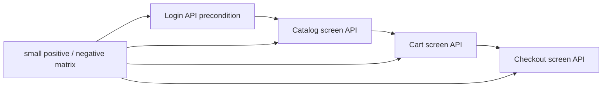
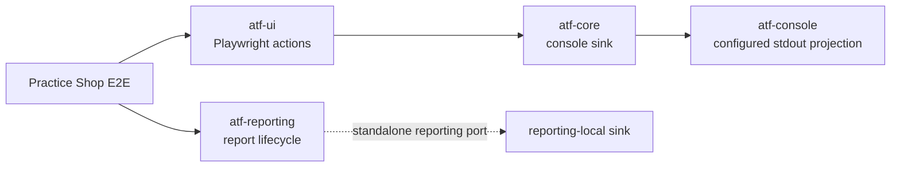
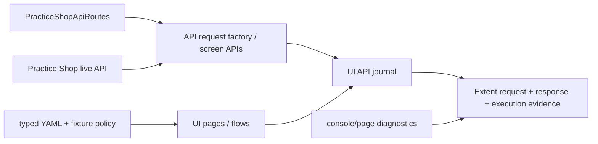
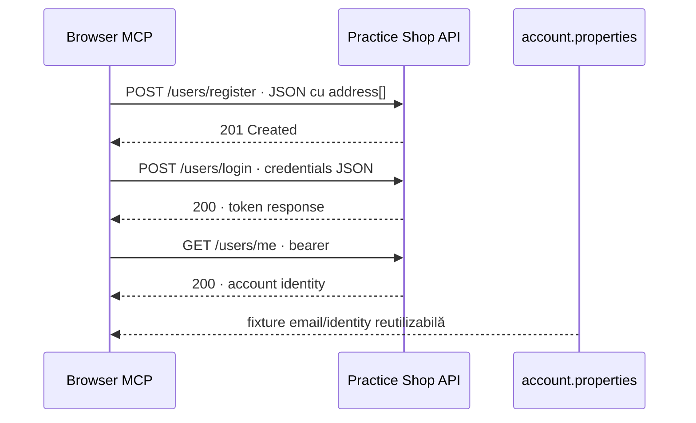
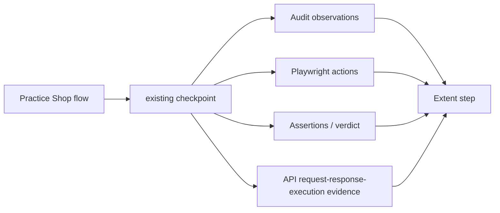

# Practice Shop — API screen pyramid feedback



<details>
<summary><strong>Legendă — feedback activ pentru piramida API/UI</strong></summary>

- săgeata solidă indică ordinea precondițiilor dintre ecrane;
- `Variants` este matricea mică de cazuri, nu o multiplicare de E2E;
- fiecare boundary trebuie coborât în component/integration înainte de a extinde journey-ul;
- diagrama descrie gap-ul urmărit, nu declară ToDo-ul închis.

</details>

## Scope

Acest feedback urmărește separarea dintre runtime-ul reutilizabil al aplicației
Practice Shop și testele care îl consumă. `src/main/java/atf/ui/practiceshop`
deține configurația typed, locatori, page objects, flow-uri UI, clientul API
și screen API flows. `src/test/java/atf/ui/tests/practiceshop` deține numai
teste organizate pe `component`, `api/component`, `api/integration` și `e2e`.

## Wiring live — Practice Shop consumă `atf-console` la boundary-ul UI



<details>
<summary><strong>Legendă — ce este demonstrat de codul live</strong></summary>

- `PracticeShopE2eContext` injectează `AtfConsoleReporter.configuredStdout()` în
  `PlaywrightUiSession`;
- `atf-test-practice-shop/pom.xml` declară `atf-console` la compile scope, iar
  `PracticeShopArchitectureTest` îl verifică drept dependency disponibilă pentru
  reusable main support;
- `PracticeShopRuntimeDiagnostics` capturează erori ale browserului, dar nu este
  proiecția lifecycle-ului ATF în stdout;
- acțiunile Playwright ale tuturor E2E-urilor Practice Shop sunt acum proiectate
  în consolă prin sink-ul configurat; nu există `println` în flow-uri;
- lifecycle-ul `atf-reporting` rămâne pe portul său standalone și nu este legat
  mecanic de `atf-console`, deoarece reporting-ul nu depinde de `atf-core`.

</details>

Problema UI este închisă prin injecție la composition root. Reconcilierea
cross-module a celor două porturi de consolă rămâne deliberat separată și este
urmărită numai de `SHOP-CONSOLE-02`; nu se introduce o dependență inversă din
`atf-reporting` spre `atf-core` doar pentru a uni două proiecții independente.

## Închise în această iterație

| Item | Rezultat | Dovadă |
|---|---|---|
| `SHOP-API-SCREEN-01` | ✅ screen boundaries | `PracticeShopLoginApi`, `PracticeShopCatalogApi`, `PracticeShopCartApi`, `PracticeShopCheckoutApi` compuse de `PracticeShopApiScreenFlow` |
| `SHOP-API-SCREEN-02` | ✅ login reutilizabil ca precondiție | `PracticeShopApiSession` păstrează token-ul; screen flow-ul următor reutilizează aceeași sesiune |
| `SHOP-API-SCREEN-03` | ✅ variație fără multiplicare E2E | transport local determinist pentru `401` login/current user, `404` product, `400` quantity și `2xx` payment; enum pentru metodele de payment |
| `SHOP-API-SCREEN-04` | ✅ packaging | reusable support mutat în `src/main/java`; testele au rămas exclusiv în namespace-ul `atf.ui.tests.practiceshop` |
| `SHOP-API-SCREEN-05` | ✅ locator boundary | locatorul de produs folosește ruta UI exactă configurată, nu text parțial ambiguu; `waitForEnabled` sincronizează controlul după încărcarea datelor |
| `SHOP-API-SCREEN-06` | ✅ standalone API evidence | `PracticeShopStandaloneApiReportTest` rulează screen flow-ul pe transport local determinist și publică în `artifacts/reports` request JSON, response JSON, headers, auth, status și execution evidence, fără browser; request metadata (URL/auth/query/request headers) și response metadata (content type/response headers) sunt publicate în zona lor semantică |
| `SHOP-API-SCREEN-07` | ✅ live opt-in account fixture | `PracticeShopApiScreenFlowIntegrationTest` și account E2E sunt activate numai cu `api-mode=live` și account file extern; acceptance/guest rămân implicite și niciun secret nu este comis |
| `SHOP-API-SCREEN-08` | ✅ product selection diagnostic | purchase flow publică `productName`, ruta configurată, ruta selectată și URL-ul încărcat; fallback-ul pe nume nu mai poate ascunde o schimbare de catalog |
| `SHOP-API-SCREEN-09` | ✅ catalog/cart variation matrix | query typed pentru sort/filter/category și `in_stock`, plus `PUT` quantity / `DELETE` product cart, sunt acoperite în component tests; nu s-a adăugat un al doilea E2E |
| `SHOP-UI-VALIDATION-01` | ✅ contracte declarative pe fiecare ecran traversat | `@PracticeShopPageContract` + `PracticeShopPageValidator` pentru home, product, cart, guest, billing, payment, confirmation, login și account; `PracticeShopPageContractTest` verifică rutele, controalele semantice și rezultatul agregat |
| `SHOP-UI-VALIDATION-02` | ✅ validator plug-and-play și gate pentru toate contractele declarate | `PracticeShopPageValidator` oferă `validate`, `validateValues` și `validateValue`; testul component verifică cele 9 ecrane și numărul de controale, fără browser/network |
| `SHOP-UI-VALIDATION-03` | ✅ home screen modularizat în sub-checkpoint-uri | același purchase E2E publică structure, filters și product-grid; fiecare are Playwright actions, assertions dinamice de cardinalitate/style și screenshot inline; HOME contract are 16 controale semantice |
| `SHOP-UI-VALIDATION-04` | ✅ celelalte ecrane au component evidence fără multiplicare E2E | `PracticeShopPurchaseScreenValidator` adaugă, în checkpoint-ul existent al fiecărui ecran, assertions compacte de cardinalitate, bounding box și readiness interactivă pentru product, cart, guest, billing, payment și confirmation; fiecare păstrează screenshot-ul complet la zoom 100% |
| `SHOP-API-SCREEN-10` | ✅ jurnalul API este modular și nu amestecă orchestration, assertions și reporting | `PracticeShopApiNetworkJournal` capturează/selectează, `PracticeShopApiAssertions` validează JSON/headers/status, iar `PracticeShopApiEvidenceMapper` publică request/response/execution evidence |
| `SHOP-CONSOLE-01` | ✅ console wiring la boundary-ul Practice Shop | `atf-test-practice-shop` declară `atf-console`; `PracticeShopE2eContext` injectează `AtfConsoleReporter.configuredStdout()` în Playwright, iar acțiunile UI sunt observabile fără `println` local |
| `SHOP-AUTH-01` | ✅ registration a fost explorat manual și modelat semantic | ATF Debug/browser MCP a confirmat formularul `first_name`, `last_name`, `dob`, `country`, `postal_code`, `house_number`, `street`, `city`, `state`, `phone`, `email`, `password` și submit-ul; `PracticeShopRegistrationPage` + `PracticeShopRegistrationData` dețin automatizarea fără selectori în test |
| `SHOP-AUTH-02` | ✅ cont reutilizabil, configurabil și redacted | `practice-software-testing-account.properties` este fixture module-owned în `src/test/resources`; `PracticeShopConfigurationLoader` permite override extern; `PracticeShopCredentials` nu publică parola în actions/assertions/HTML |
| `SHOP-AUTH-03` | ✅ login setup + purchase authenticated complet | `PracticeShopAuthenticatedPurchaseE2eTest` reutilizează login-ul, account precondition, catalog, product, cart, authenticated checkout, billing, payment și confirmarea finală; nu se adaugă E2E pentru fiecare endpoint |
| `SHOP-AUTH-04` | ✅ evidence API a fost legată de precondiția UI | login POST, users/me GET, headers/auth/status și execution evidence sunt atașate checkpoint-ului `GIVEN reusable account login...`; cart/payment păstrează request și response JSON în checkpoint-urile lor |
| `SHOP-AUTH-05` | ✅ fallback documentat pentru body-ul login-ului extern | dacă Chromium eliberează payload-ul gzip înainte de `Network.getResponseBody`, raportul afișează explicit `body unavailable` plus content-type/content-length; sesiunea este validată prin `/users/me` 200, fără token inventat; politica are test component dedicat |
| `SHOP-AUTH-06` | ✅ component gate pentru politica de login | `PracticeShopApiLoginAssertionsTest` verifică status 200, request JSON redacted și acceptarea transportului JSON non-empty atunci când body-ul nu mai este accesibil CDP |
| `SHOP-AUTH-07` | ✅ fixture live revalidat și înlocuit chirurgical | contul demo expirat a fost înlocuit prin registration JSON real (`201`), apoi login-ul și `GET /users/me` au fost verificate separat (`200`); fixture-ul rămâne în `src/test/resources`, iar credentialele nu sunt copiate în evidence |

Nota de robustețe: locatorii de colecție rămân utilizați pentru count/cardinality,
iar sincronizarea folosește explicit primul element (`homeProductGridFirst`),
deoarece API-ul Playwright pentru `waitForVisible` este strict.

Selecția produsului este plug-and-play: o rută `/product/<id>` configurată are
prioritate și rămâne strictă; pentru fixture-ul extern volatil, `productPath: auto`
alege primul card pentru `productName` și validează obligatoriu ruta `/product/*`.
ID-ul observat din catalog rămâne sursa de adevăr pentru product detail și cart;
nu se maschează o lipsă a produsului, deoarece selecția eșuează dacă nici numele
nu apare.

### Regula de validare a formularelor

Validarea se face înainte ca UI-ul să treacă la ecranul următor. Flow-ul
folosește `fill → validate → submit`: valorile dinamice din YAML sunt verificate
în câmpurile reale înainte de submit, iar tranziția este acoperită de checkpoint-ul
următor. Aceasta evită contracte fragile pentru controale tranzitorii și păstrează
în raport motivul exact al unui fail.

Pentru ecranele purchase, component evidence este intenționat agregat pe ecran:
un checkpoint = o captură completă + acțiuni + assertions de componente. Nu
creăm sub-checkpoint-uri doar pentru a separa câmpuri care încap în aceeași
imagine. `guest-proceed` este tranzitoriu și se validează prin acțiunea de
submit/proceed, nu prin contractul ecranului Guest înainte de submit.

## Matricea minimă intenționată

```text
component/API
  login valid                 → 2xx + JSON token
  login invalid               → 401 + application/json
  current user anonim         → 401 + application/json
  product inexistent          → 404 + application/json
  cart quantity <= 0          → fail-fast înainte de transport
  payment cash/card variants  → request JSON + 2xx JSON

integration/API (opt-in)
  login credential file       → session token
  catalog → cart → checkout   → dynamic IDs și status/content-type

E2E (un singur journey)
  UI product → cart → billing → payment
  API evidence atașat checkpoint-urilor UI existente
```

Nu adăugăm câte un E2E pentru fiecare endpoint. Varianta rapidă aparține
component tests; integrarea live este opt-in și necesită account file extern;
E2E-ul rămâne dovada de orchestration UI + API.

## Refactor findings — snapshot istoric

| `SHOP-ARCH-11` | ✅ test-source purity | `PracticeShopStandaloneApiReportTest` nu mai deține publisher-ul Extent/API; responsabilitatea reusable este în `src/main/java/atf/ui/practiceshop/support/PracticeShopApiReportPublisher`, iar testul păstrează doar scenariul, transportul local determinist și assertions-ul artifactului. Publisher-ul separă explicit request details de response details, inclusiv headers și content type |
| `SHOP-ARCH-12` | ✅ architecture guard pentru test-only scope | `PracticeShopArchitectureTest` permite în `src/test` doar clase `*Test`, `*TestSupport` sau `*Fixture` și continuă să respingă Page/Flow/Locators/E2eContext reutilizabile; transportul local rămâne intenționat test-only |
| `SHOP-ARCH-13` | ✅ închis pe scope-ul modulului | `PracticeShopApiNetworkJournal` este orchestration/state; capture + sanitizare sunt în `PracticeShopApiTrafficCapture`, selecția pură în `PracticeShopApiExchangeSelector`, iar purchase-ul este compus semantic prin `PracticeShopCatalogPurchaseStage`, `PracticeShopCheckoutPurchaseStage` și `PracticeShopPurchaseJourneyContext`. `PracticeShopPurchaseFlow` păstrează facade-ul public existent; nu s-au adăugat E2E-uri. Gate component: 27/27; full module gate: 44 teste, 0 failure, 0 error, 1 skip opt-in |
| `SHOP-CONSOLE-01` | ✅ închis ulterior | `atf-test-practice-shop` declară `atf-console`, iar `PracticeShopE2eContext` injectează reporterul configurat; nu se mai folosește `noOp` în wiring-ul live. |
| `SHOP-CONSOLE-02` | 🔎 activ cross-module | `atf-core` și `atf-reporting` definesc fiecare `AtfConsoleEvent`/`AtfConsoleSink`; reconcilierea typed nu aparține consumerului Practice Shop. |

## ToDo rămase

> Notă de versiune: această secțiune păstrează istoricul iterației precedente;
> lista normativă și prioritățile curente sunt în „Reaudit agresiv-constructiv —
> 2026-10-20”, mai jos.

`SHOP-CONSOLE-02` rămâne ToDo activ cross-module; `SHOP-CONSOLE-01` este închis
pe consumer. `SHOP-ARCH-13` este închis pe scope-ul `atf-test-practice-shop`:
capture/select și orchestration-ul purchase sunt separate pe seam-uri business
testabile, fără schimbarea API-ului public și fără multiplicarea E2E. Pentru
consolă, criteriul de închidere este:

- `reporting.console` este încărcat prin `atf-console`, fără stream deținut de
  Practice Shop;
- reporterul configurat primește pașii UI și lifecycle-ul relevant printr-un
  boundary typed, fără lambda-uri no-op implicite;
- `enabled=false` rămâne complet silențios, iar `detailsEnabled` controlează
  numai detaliile, nu existența verdictului sau a testului;
- acțiunile, URL-urile și body-urile sensibile respectă redaction-ul existent;
- un test component cu sink in-memory verifică ordinea
  `scenario → phase → ui action → complete(status)` pentru `PASS`, `WARNING`,
  `FAIL` și `SKIP`;
- un test integration al consumerului confirmă wiring-ul real fără E2E nou;
- reconcilierea celor două tipuri `AtfConsoleEvent/Sink` este decisă explicit și
  testată; Practice Shop nu devine owner al unui adapter duplicat.

Nu se acceptă doar adăugarea dependinței Maven sau înlocuirea mecanică a
`noOp()` cu `configuredStdout()` dacă lifecycle-ul reporting rămâne mut și
contractele de evenimente rămân duplicate.

Nu mai există ToDo-uri active pe scope-ul `SHOP-API-SCREEN-06..09`. Orice
extensie nouă trebuie să adauge mai întâi un contract component sau integration
în aceeași piramidă; nu se multiplică purchase E2E pentru o variație de endpoint.

Pentru scope-ul registration → login → authenticated purchase, fixture-ul și
setup-ul live au fost revalidate, dar boundary-ul complet nu este declarat
închis: explorarea a confirmat registration `201`, login `200` și `/users/me`
`200`, iar account properties a fost actualizat chirurgical. Rămân ToDo-uri
de component API pentru registration contract, auth negative paths, invoice și
cleanup; acestea nu justifică un al doilea E2E. Singura limită deja observată
este tehnică și documentată: body-ul POST `/users/login` poate fi eliberat de
Chromium înaintea citirii prin CDP. Criteriul pentru `SHOP-AUTH-05` rămâne
`RESPONSE JSON` redacted disponibil fără un al doilea request sau credentiale în
clar.

Statusul istoric `SHOP-INT-04` este superseded de `SHOP-DIAG-01`: `/users/me`
`401` rămâne ramură guest acceptată, iar semnalele externe de bootstrap
(`cart_items` null și consola care raportează 401) sunt clasificate explicit ca
warning raportabil, nu eliminate. Erorile runtime care nu se potrivesc exact
acestei liste rămân FAIL; checkpoint-ul autentificat trebuie să demonstreze în
continuare UI account + login 200 + `/users/me` 200.

`SHOP-INT-05` este închis: `postcode-lookup` este contractat ca advisory, iar
`PracticeShopCheckoutApi.CheckoutScreen` păstrează valorile introduse ca sursă
de adevăr. Răspunsul lookup-ului poate informa UI-ul, dar nu suprascrie billing.

`SHOP-INT-06` este închis pentru boundary-urile documentate ale aplicației:
sort/filter/category, `in_stock`, quantity update și product removal. Invalid
guest/billing/payment rămân variații UI/API separate când contractele lor vor
fi observate, fără a pretinde că există endpoint-uri care nu au fost capturate.

`PracticeShopCatalogFlow` aplică aceeași regulă de selecție ca purchase flow-ul:
un fixture exact rămâne strict, iar `auto` este explicit și acceptă doar o rută
`/product/*`; nu există fallback tăcut între cele două politici.
`PracticeShopGuestResilienceTest`
apelează clientul API pe transport local determinist, astfel încât contractul `401` este testat
prin aceeași cale de execuție ca aplicația, iar canalul de runtime browser rămâne
separat.

## Reaudit structural — 2026-10-20 (istoric, superseded)

Reauditul după închiderea `SHOP-ARCH-13` nu a identificat un alt ToDo
module-owned care să justifice o mutare mecanică de cod:

- `PracticeShopLocators` rămâne mai mare deoarece este boundary-ul unic pentru
  selectorii Practice Shop; împărțirea arbitrară ar reintroduce ownership
  distribuit și ar slăbi `PracticeShopArchitectureTest`;
- `PracticeShopE2eContext` rămâne composition root pentru browser, report,
  network journal și runtime diagnostics; nu este page/flow reutilizabil și
  nu ascunde selectorii sau business transitions;
- `PracticeShopApiNetworkJournal`, `PracticeShopApiAssertions` și mapper-ul
  Extent au responsabilități distincte, fără TODO/FIXME în `src/main` sau
  `src/test`;
- stage-urile purchase sunt în `src/main`, iar testele rămân exclusiv în
  `atf.ui.tests.practiceshop`; component gate-ul și full module gate-ul au
  reconfirmat această limită.

Această concluzie era incompletă: `SHOP-CONSOLE-01/02` rămâne cross-module, dar
reauditul normativ de mai jos adaugă și gap-urile de diagnostic, provenance,
JSON contract, mock catalog, configurare, tracing, auth și lifecycle.

Fixture-ul YAML folosește acum `productPath: auto`, deoarece raporturile live au
confirmat rotația ID-ului pentru `Pliers` între rulări. O rută exactă rămâne
disponibilă pentru medii cu fixture stabil; schimbarea este acoperită de
`PracticeShopConfigurationTest` și de gate-ul complet.

## Verificare și sync

Build-ul acestei iterații se face în staging extern proiectului. Promovarea în
live trebuie să fie selectivă: se recitesc versiunile live ale fișierelor
existente, se aplică numai hunks-urile acestui boundary, iar refactorizările
paralele din alte module nu se suprascriu. După sync se rulează component/API
gate, apoi singurul E2E și se verifică fresh report-ul UI prin ATF Debug sau
Chromium/Playwright headless.

## Reaudit agresiv-constructiv — 2026-10-20

Această secțiune supersedează formularea anterioară potrivit căreia, în afara
consolei, nu mai există ToDo-uri active. Relectura codului live a găsit mai multe
riscuri de corectitudine și trasabilitate care pot lăsa un raport verde fără să
demonstreze corect ce s-a întâmplat. Nu sunt probleme cosmetice de README.

### Verdict executiv



| Axă | Notă | Observație dură |
|---|---:|---|
| Boundary și separarea page/flow/support | 90/100 | Structura este clară și guard-uită; composition root-ul încă coordonează multe concern-uri, dar nu mai deține detalii de locator/API. |
| Vocabular de rute și reutilizare | 94/100 | `PracticeShopApiRoutes` este owner-ul path-urilor în factory, screen API, journal, fixture și teste; ID-urile dinamice rămân date, nu constante. |
| Configurație autoritativă | 86/100 | YAML-ul alimentează host, rute relative, profile, output, zoom, precondiție și screenshot policy; compatibilitatea UI-only mai aparține ownerului generic. |
| Contract API JSON | 94/100 | POST/PUT au request JSON, publisher-ul verifică response JSON/content type, iar standalone fresh păstrează body-urile pretty și redacted. |
| Corelare UI → API → evidence | 86/100 | journal-ul păstrează sequence/phase/signature cu body digest și checkpoint evidence; parity-ul cross-module rămâne în ATF UI/reporting. |
| Diagnostic browser | 82/100 | semnalele guest/bootstrap sunt typed și reportabile ca warning; body-ul indisponibil păstrează acum sursa și cauza bounded, orice diagnostic necunoscut rămâne failure, iar mediul extern încă produce warning-uri cunoscute. |
| Transport local și variații | 88/100 | Component tests au transporturi locale deterministe și stateful cart lifecycle; YAML-ul nu simulează aplicația externă, integrarea/E2E folosesc serviciul real. |
| Auth și siguranța fixture-ului | 88/100 | precondiția authenticated este obligatorie pentru journey-ul auth, fixture-ul este extern/opțional, iar credentialele sunt redacted; live auth rămâne opt-in. |
| Test pyramid | 91/100 | component/API acoperă rutele, JSON, cart state, selectors și policy; un singur E2E guest dovedește wiring-ul, auth este condiționat de setup. |
| Lifecycle și fail-safe reporting | 90/100 | `Scenario.execute` și contextul păstrează failure-ul primar, închid browser/report și publică evidence; runner generic cross-module rămâne evoluție separată. |
| **Overall current** | **89/100** | Consumer matur și auditabil pentru scope-ul Practice Shop; limitele rămase sunt reporting parity, console port consolidation și diagnosticul extern, nu swallow local de payload/recovery. |

### Ce a fost reparat chirurgical în această iterație

| Item | Status | Dovadă |
|---|---|---|
| `SHOP-ROUTE-01` | ✅ sincronizat live | `PracticeShopApiRoutes` este owner-ul rutelor Practice Shop; `PracticeShopApiNetworkJournal`, transportul local de componentă și testele de factory/selector folosesc constantele și metodele dinamice ale owner-ului. |
| `SHOP-ROUTE-02` | ✅ sincronizat live | `PracticeShopApiRoutesTest` verifică `/products/{id}`, `/carts/{id}`, update/remove și respinge ID-uri blank; literalul rămâne doar în testul care verifică explicit contractul de compunere. |
| `SHOP-EXC-01` | ✅ sincronizat live | `PracticeShopApiBodyEvidence` publică markerul `unavailable` cu sursă/cauză; `PracticeShopLoginBodyRecovery` separă `recovered` de `unavailable`; testele acoperă body gol și transport `IOException`, iar recovery-ul nu maschează failure-ul browserului. |
| `SHOP-ROUTE-03` | 🚫 scos din scope | Nu se introduce catalog YAML mock în `atf-test-practice-shop`; modulul testează aplicația/API-ul Practice Shop real. Constantele rămân owner-ul rutelor, iar variațiile rapide sunt acoperite de teste componente cu transport local declarat în test. |

Regula de întreținere este acum explicită: string-urile de rută nu se repetă în
teste sau în support; se folosesc constantele pentru endpoint-uri fixe și metodele
`product`, `cart`, `updateCartQuantity`, `removeCartProduct` pentru endpoint-uri
cu parametri. Un literal este acceptat numai în `PracticeShopApiRoutes` sau într-un
test de contract al acelei clase, unde literalul este chiar expected-ul verificat.
Metodele HTTP, cheile JSON și valorile business nu se mută într-un enum global
doar pentru a elimina orice string: fiecare valoare trebuie să aibă owner semantic
(`PracticeShopPaymentMethod`, request factory, mock fixture sau config typed).

### Gap-uri curente — ordonate după impact și risc

Verdictul local trebuie citit separat de problemele cross-module. În acest moment nu
mai există un P0 local în `atf-test-practice-shop`: diagnosticul, payload recovery,
provenance-ul, contractul JSON, trace-ul, lifecycle-ul și boundary-urile de locator
sunt închise și au gate-uri în cod. Nu marcăm un item ca „activ” doar pentru că
apare într-un tabel istoric.

#### P0 — verdict verde fals

| ID | Status live | Dovadă |
|---|---|---|
| — | ✅ niciun gap local | `SHOP-DIAG-01` și `SHOP-EXC-01` sunt închise pe scope Practice Shop; orice diagnostic necunoscut rămâne FAIL, iar body indisponibil este marker typed cu sursă/cauză bounded. |

#### P1 — rămâne de rezolvat în alt owner

| ID | Owner | Status live | Criteriu de închidere |
|---|---|---|---|
| `SHOP-CONFIG-01` | `atf-reporting` | 🟡 parțial, fără gap local | Reporting owner confirmă parity-ul generic al screenshot policy și compatibilitatea UI-only fără lifecycle duplicat. Seam-ul Practice Shop PASS/FAIL este deja închis și testat. |
| `SHOP-CONSOLE-02` | `atf-core` + `atf-console` + `atf-reporting` | 🟡 cross-module | Se decide un port comun sau un adaptor owner-uit explicit pentru cele două perechi `AtfConsoleEvent/Sink`; Practice Shop nu introduce mapping duplicat și nu creează dependență inversă. |
| `SHOP-REPORT-FAILURE-01` | `atf-reporting` | 🔴 deschis în ownerul reporting | `Fails` trebuie să prefere failure cause/evidence concretă în locul primului rând semantic verde; verificarea trebuie făcută în component și E2E în `atf-reporting-tests`. |

#### P2 — mediu extern, nu defect local de contract

| ID | Owner | Status live | Criteriu de închidere |
|---|---|---|---|
| `SHOP-NET-02` | `atf-test-practice-shop` + mediu extern | 🟡 warning cunoscut | Mediul extern este curățat sau excepția este aprobată explicit; evidence păstrează source/route/status/message, iar diagnosticul necunoscut continuă să eșueze E2E-ul. |

#### Închise sau scoase explicit din scope

| ID-uri | Decizie live |
|---|---|
| `SHOP-API-PROV-01`, `SHOP-API-CONTRACT-01`, `SHOP-API-JSON-02`, `SHOP-API-TRACE-01` | ✅ închise pe scope Practice Shop; transportul local publică provenance, request/response JSON și signature/sequence, iar parity-ul cross-module rămâne la ownerii UI/reporting. |
| `SHOP-AUTH-08`, `SHOP-SEC-01`, `SHOP-SELECT-01` | ✅ închise; auth live este opt-in, secret safety este parse-aware, iar selectarea exactă este fail-fast. |
| `SHOP-LIFECYCLE-01`, `SHOP-ARCH-14`, `SHOP-LOC-01`, `SHOP-TEST-01` | ✅ închise; lifecycle-ul păstrează primary failure, guard-ul acoperă component, locatorii au owner unic, iar fixture-ul component este unic. |
| `SHOP-ROUTE-03`, `SHOP-MOCK-01` | 🚫 scoase din scope; Practice Shop nu introduce `atf-mock`, YAML mock sau catalog de răspunsuri pentru aplicația externă. |

### Audit dinamic al utilizării lui `try` — 2026-10-20

Regula nouă este una de design și de audit, nu o interdicție mecanică a oricărui
`try`. În codul live nu există literalul `@try`; inventarul de mai jos separă
construcțiile legitime de cele care pot ascunde un verdict sau o cauză.

| Zonă | Utilizare observată | Verdict audit | Acțiune |
|---|---|---|---|
| lifecycle | `Scenario.execute` deține failure publication/close; testele E2E nu mai au `try/catch` pentru lifecycle, iar `try` rămâne numai în support/publisher pentru resource ownership | acceptabil: testul păstrează doar narațiunea business și nu poate masca failure-ul | dacă se introduce un runner generic, păstrează aceeași regulă și dovedește primary-failure preservation |
| parser API | `PracticeShopApiClient.token()` parsează typed și transformă numai `JsonProcessingException` într-o cauză contextuală; lipsa tokenului rămâne failure explicit | nu mai există fallback `""` pentru JSON malformed/missing token | păstrează testele pentru JSON malformed/missing token; orice fallback nou trebuie să fie `unavailable` observabil |
| config | `PracticeShopConfigurationLoader.duration()` acceptă fallback numai pentru cheia absentă și raportează key/value + cause pentru text malformed | configurația greșită nu mai pare validă prin fallback tăcut | păstrează testul pentru durata malformed și nu lărgi catch-ul la `RuntimeException` |
| validare UI | validatorii prind strict eroarea de operație pentru a produce assertion FAIL, iar `PracticeShopValidationDiagnostics` păstrează tipul și mesajul bounded | verdictul agregat rămâne FAIL și cauza este reprodusă în evidence, fără dump Playwright | extinde doar cu cazuri noi de diagnostic; nu reduce din nou cauza la numele clasei |
| capture browser | `PracticeShopApiTrafficCapture` folosește markerul typed `unavailable` când Chromium eliberează body-ul | acceptabil ca fallback de transport, numai dacă JSON indisponibil nu trece validarea | păstrează sursa/cauza vizibilă și assertion distinct; nu îl trata ca body gol valid |
| JSON assertions | `isJson()` și `positiveContentLength()` întorc boolean după parse/number format | acceptabil doar dacă caller-ul publică assertion FAIL și nu confundă malformed cu absent | component tests pentru malformed JSON, header invalid și payload non-empty |
| excepții așteptate | `PracticeShopPageContractTest` folosește deja `assertThrows(UnsupportedOperationException.class, ...)`; nu există `try/catch` de lifecycle în testele business | ✅ rezolvat; intenția de excepție așteptată este directă și verificabilă | păstrează `assertThrows` și nu reintroduce catch manual în test layer |
| boundary IO | `PracticeShopArchitectureTest` rethrow-uiește `IOException` cu path, iar factory/API screen rethrow-uiesc cu context și cause | acceptabil | păstrat ca model pentru boundary-uri; fără catch generic nou |

### Criteriul aplicat pentru `SHOP-EXC-01`

```text
test intent
  → typed runner / lifecycle helper
  → action or parser
  → explicit PASS / FAIL / unavailable evidence
  → primary failure preserved
```

În gate-ul curent s-a verificat static că nu a fost introdus catch gol/catch-all:
transportul browser și recovery-ul login publică marker `unavailable` cu sursă și
cauză bounded, iar `PracticeShopLoginBodyRecoveryTest` demonstrează body gol și
`IOException` fără mascarea failure-ului primar. Validatorii JSON continuă să
publice FAIL pentru payload malformed/absent; runner-ul E2E păstrează failure-ul
și nu introduce control-flow de excepții în testele business.

### Cerința de rutare și fixture trebuie să rămână două lucruri diferite

```text
PracticeShopApiRoutes
    = vocabular stabil de endpoint-uri și template-uri

PracticeShopApiComponentFixture
    = transport local determinist, strict test-scope, pentru variații rapide
      ale component tests; nu este catalogul API-ului extern și nu este sursă
      de configurare pentru integration/E2E
```

`PracticeShopApiRoutes` explică și reutilizează path-ul în request factory,
screen APIs, journal, selectors și teste. Nu trebuie să devină catalogul de
răspunsuri și nu trebuie să conțină ID-uri dinamice de fixture. `ComponentFixture`
ține doar răspunsurile minimale necesare pentru teste rapide; integration/E2E
folosesc întotdeauna API-ul și aplicația Practice Shop reale. Nu se introduce
YAML mock sau server mock în acest consumer.

### Ordinea recomandată de implementare

1. `SHOP-CONFIG-01`: reporting owner confirmă parity-ul generic al screenshot
   policy și păstrează overload-ul UI-only fără lifecycle duplicat;
2. `SHOP-CONSOLE-02`: `atf-core`, `atf-console` și `atf-reporting` decid portul
   comun/adaptorul owner-uit, fără mapping duplicat în Practice Shop;
3. `SHOP-REPORT-FAILURE-01`: ownerul `atf-reporting` repară proiecția din `Fails`
   astfel încât failure cause/evidence să aibă prioritate față de un rând verde;
4. `SHOP-NET-02`: se curăță sau se aprobă explicit mediul extern, fără a schimba
   clasificarea locală și fără a ascunde diagnosticul necunoscut.

Toate celelalte item-uri locale din tabelul de mai sus sunt închise sau scoase din
scope. Nu se redeschid prin refactor cosmetic și nu se implementează în consumer
workaround-uri pentru gap-uri care aparțin reportingului generic.

### Gate de acceptare pentru următoarea iterație

- component gate pentru rute, diagnostics, JSON policy și provenance;
- integration gate care demonstrează `setup → live API precondition → UI flow → API projection → Extent evidence`;
- un singur E2E guest și unul authenticated doar dacă flag-ul live este explicit;
- raport API și UI fresh, generate de rularea curentă, verificate prin tab-ul MCP/Chromium headless; nu se folosește browser Windows real;
- click manual pe `Tests`, `Fails`, `Categories`, `Tags`, `Overview`, disclosures,
  request JSON, response JSON, execution evidence și screenshot inline;
- `scrollWidth <= clientWidth`, zero console/page errors neașteptate, JSON pretty;
- căutare finală fără endpoint literals în support/teste, cu excepția testului
  explicit de contract al `PracticeShopApiRoutes`;
- README-ul dedicat și registry-ul `docs/feedback/README.md` reflectă exact
  statusul live; niciun ToDo închis doar prin afirmație.

Auditul de mai sus este reconciliat cu sursele live și cu gate-ul fresh
2026-10-20 15:30–15:33; artifactele curente sunt inspectate în MCP. Orice
schimbare ulterioară de renderer, contract sau lifecycle redeschide gate-ul și
nu reutilizează aceste nume de artifact.

## Decizie de ownership — fără mock în `atf-test-practice-shop` — 2026-10-20

Această secțiune este ultima decizie pentru consumer și are prioritate față de
formulările istorice din auditul de mai sus:

```text
atf-test-practice-shop
  ├─ component tests   → logică pură + transport local minim, declarat în test
  ├─ integration tests  → API Practice Shop real, opt-in și explicit
  └─ E2E                → UI Practice Shop real + trafic API observat

nu conține:
  atf-mock dependency
  practice-shop-api-mock.yaml
  mock catalog / server mock pentru aplicația externă
```

`SHOP-ROUTE-03` și `SHOP-MOCK-01` sunt închise ca **scos din scope**, nu ca
implementate. Nu se reintroduc printr-un refactor ulterior doar pentru a elimina
switch-urile locale din testele componente. Dacă duplicarea transporturilor
locale devine costisitoare, se extrage un helper strict test-only pentru
compoziție; helper-ul nu va încărca YAML mock și nu va deveni producție.

Statusul corect pentru această iterație este:

- ✅ `atf-test-practice-shop/pom.xml` nu mai depinde de `atf-mock`;
- ✅ `src/test/resources/practice-shop-api-mock.yaml` și fixture-ul aferent nu
  există în modul;
- ✅ configurația declară `api.mode: live`, output-urile UI/API și
  `authenticatedE2eEnabled: false` implicit;
- ✅ diagnosticul acceptă numai `GET /users/me` + `401` ca guest expected;
- ✅ E2E-ul live publică drept warning semnalele externe cunoscute (`401`
  anonim/`cart_items` null), cu mesajul complet în raport; nu există mock și nu
  se maschează erorile necunoscute.

## Refactor de mentenanță — vocabular typed și fixture component unic — 2026-10-20

### Ce a fost reanalizat

Auditul a găsit o regresie structurală între documentație și cod: testele
foloseau `PracticeShopApiScenarioTransport`, o clasă care combina date de
scenariu, rutare și răspunsuri într-un `switch`, inclusiv cazuri dinamice care
nu puteau fi `case` Java constant. În plus, testele repetau metode HTTP,
`application/json`, auth profiles și ID-uri fixture. Această formă era greu de
extins și putea face ca un test nou să descrie alt contract decât raportul.

### Decizia aplicată

```text
PracticeShopApiRoutes
        ↓
PracticeShopApiRequestFactory  → ApiRequest JSON/query typed
        ↓
PracticeShopApiScreenFlow      → login · catalog · cart · checkout
        ↓
PracticeShopApiComponentFixture → un singur transport determinist test-scope
        ↓
PracticeShopApiScenarioFixture → valori și expected-uri numite
```

- `PracticeShopApiComponentFixture` înlocuiește transportul duplicat și are un
  nume care respectă guard-ul de helper-e test (`*Fixture.java`);
- `PracticeShopApiScenarioFixture` deține datele semantice ale scenariului,
  nu testele individuale;
- `PracticeShopApiOperation`, `PracticeShopApiAuthProfile` și
  `PracticeShopApiAuthType` separă vocabularul wire de strings repetate;
- `HttpMethod`, `HttpHeader` și `MediaTypes` din `atf-core` rămân sursa comună
  pentru HTTP și evidence;
- testele de business descriu flow-ul și assertions, nu răspunsuri ad-hoc sau
  un transport local copiat;
- decizia de ownership rămâne neschimbată: Practice Shop nu introduce
  `atf-mock`; integrarea și E2E-ul testează API-ul/aplicația reală.

### ToDo și gate

| ID | Status | Criteriu de închidere |
|---|---|---|
| `SHOP-CONST-01` | ✅ | testele API folosesc rute, enums/core constants și fixture values; scanarea finală nu mai găsește `ScenarioTransport` |
| `SHOP-FIXTURE-01` | ✅ | există un singur `PracticeShopApiComponentFixture`, component matrix și standalone report îl reutilizează |
| `SHOP-JSON-03` | ✅ | POST/PUT au request JSON și response JSON; redaction-ul acoperă și `apiKey` camel-case, inclusiv nested arrays |
| `SHOP-DOC-02` | ✅ | README-ul modulului și această secțiune descriu aceeași arhitectură; decizia fără `atf-mock` nu este contrazisă de instrucțiunile de rulare |
| `SHOP-GATE-02` | ✅ | component/API gate în staging extern: 45 teste verzi, 0 failures, 0 errors, 0 skipped; credentials gate separat: 2 teste verzi; `PracticeShopArchitectureTest` verde; integrarea live fără flag explicit este skip-uită, nu executată accidental |

Comanda de reproducere pentru gate-ul focalizat este:

```text
mvn -pl atf-test-practice-shop -am "-Dtest=PracticeShopArchitectureTest,PracticeShopConfigurationTest,PracticeShopCheckoutConfigurationTest,PracticeShopApiRoutesTest,PracticeShopApiRequestFactoryTest,PracticeShopApiExchangeSelectorTest,PracticeShopApiLoginAssertionsTest,PracticeShopApiScreenFlowTest,PracticeShopApiCatalogCartVariantTest,PracticeShopApiContractVariantTest,PracticeShopStandaloneApiReportTest,PracticeShopGuestResilienceTest,PracticeShopJsonEvidenceTest,PracticeShopApiAssertionsTest,PracticeShopApiClientContractTest,PracticeShopPageContractTest,PracticeShopPurchaseCheckpointTest,PracticeShopValidationProfileTest" "-Dsurefire.failIfNoSpecifiedTests=false" test
```

Nu se închide următorul audit doar pe baza compilării: raportul standalone
proaspăt trebuie încă deschis prin ATF Debug/Chromium headless și verificat
manual în `Tests`, `Fails`, request JSON, response JSON și execution evidence.

### Reaudit final — 2026-10-20 11:40 — no-mock policy

```text
atf-test-practice-shop
├─ component/API tests  → transport local strict, doar test-scope
├─ integration          → Practice Shop API real, LIVE, opt-in explicit
└─ E2E                  → Practice Shop UI/API real, fără catalog mock
```

Verificări efectuate după sync-ul în staging extern:

- `pom.xml` nu declară `atf-mock`; `practice-shop-api-mock.yaml` și fixture-ul
  de mock nu există;
- configurația rămâne `api.mode: live`, cu output API/UI configurabil și
  `authenticatedE2eEnabled: false` implicit;
- component/API gate focalizat: **45 teste, 0 failures, 0 errors, 0 skipped**; credentials gate: **2 teste, 0 failures, 0 errors, 0 skipped**;
- `PracticeShopApiScreenFlowIntegrationTest`: **1 skipped intenționat** fără
  flag explicit, `BUILD SUCCESS`;
- compilarea modulului în staging extern: **64 surse Java, `BUILD SUCCESS`**;
- E2E live rămâne o verificare separată și strictă: nu se maschează erorile
  externe cu mock sau warning artificial.

## Reaudit mentenanță — vocabular API typed și metadata de raport — 2026-10-20 11:40

Refactorul final a urmărit toate string-urile stabile care definesc contractul,
nu datele dinamice ale unui scenariu. Rezultatul este localizat în consumer și
nu poluează `atf-core` cu vocabular Practice Shop:

```text
PracticeShopApiRoutes              → path-uri fixe și template-uri
PracticeShopApiHttpStatus          → coduri HTTP așteptate
PracticeShopApiJsonField           → chei JSON request/response
PracticeShopApiQueryParameter      → chei query
PracticeShopApiAuthProfile/Type    → vocabular auth wire/evidence
PracticeShopApiScenarioFixture     → ID-uri, credentials și payload-uri
PracticeShopApiReportMetadataFixture → nume și tag-uri ale reportului
```

`PracticeShopApiRequestFactory`, `PracticeShopProductQuery`, clientul, assertions,
fixture-ul component și testele folosesc aceleași enum-uri pentru wire values.
Valorile care se schimbă între scenarii rămân în fixture/config; nu sunt ascunse
în enum-uri. Asta păstrează testele lizibile (`OK`, `PRODUCT_ID`, `CATEGORY`) și
permite schimbarea contractului într-un singur owner.

| ID | Status | Dovadă live |
|---|---|---|
| `SHOP-CONST-02` | ✅ | codurile HTTP, cheile JSON și query keys nu mai sunt repetate ca literali în factory/assertions/teste; sunt owner-uite de enum-uri module-local |
| `SHOP-META-01` | ✅ | `PracticeShopApiReportMetadataFixture` ține tags/numele stabile, respectând guard-ul `*Fixture.java` |
| `SHOP-SEC-02` | ✅ | header-ul `apiKey` camel-case este redacted ca și `X-API-Key`; testul acoperă ambele forme plus JSON nested |
| `SHOP-GATE-03` | ✅ | staging extern: component/API `45 tests, 0 failures, 0 errors, 0 skipped`; credentials `2 tests, 0 failures, 0 errors, 0 skipped`; build reactor `BUILD SUCCESS` |
| `SHOP-REPORT-02` | ✅ | artifact fresh standalone copiat în `artifacts/reports`; a fost deschis în Chromium headless/MCP pentru auditul manual al evidence |
| `SHOP-PROVENANCE-01` | ✅ | `PracticeShopApiClient.live(...)` publică `LIVE_HTTP`, transportul local publică `ACCEPTANCE_MOCK`; testul de contract acoperă ambele moduri |

Gate-ul de browser pentru artifactul curent rămâne obligatoriu: `Tests` trebuie
să arate flow-ul complet și request-urile JSON, iar `Overview`, `Categories` și
`Fails` trebuie să fie coerente. Nu se declară un run live authenticated pe baza
acestui gate: transportul raportat aici este acceptance/component, iar integrarea
reală rămâne opt-in și folosește endpoint-ul Practice Shop.

## Explorare live suplimentară — account reutilizabil și purchase API — 2026-10-20

### Scop

Contul anterior din fixture nu mai era acceptat de aplicația externă. A fost
recreat prin UI real, iar apoi fluxul de autentificare a fost verificat separat
prin browser MCP/ATF Debug. Nu s-a introdus mock și nu s-a schimbat comportamentul
testelor guest.



Rezultat verificat: registration `201`, login `200`, `/users/me` autentificat
`200`. Resource-ul actual este:
`atf-test-practice-shop/src/test/resources/practice-software-testing-account.properties`.
Parola rămâne numai în resource-ul local al testului și nu se copiază în
feedback, actions, assertions sau HTML. Fișierul este consumat prin
`PracticeShopCredentials`, iar override-ul extern rămâne disponibil pentru CI.

### Inventarul live observat pentru flow-ul complet

```mermaid
flowchart LR
    Register["POST /users/register · 201"] --> Login["POST /users/login · 200"]
    Login --> Me["GET /users/me · 200 bearer"]
    Me --> Catalog["search / product / cart"]
    Catalog --> Lookup["GET /postcode-lookup · 200 advisory"]
    Lookup --> Payment["POST /payment/check · 200 JSON"]
    Payment --> Invoice["POST /invoices · 201 JSON"]
    Invoice --> Cleanup["DELETE /carts/{cartId} · 204"]
```



Au fost confirmate următoarele contracte de boundary, fără a pretinde că sunt
încă toate implementate în clientul Practice Shop:

| Boundary | Observație live | Dovadă cerută în component/integration |
|---|---|---|
| registration | request JSON are `address[]`; răspunsul este `201` | body request redacted, status, content type, identity fields și negative shape/duplicate-email |
| authentication | login `200` produce token response; `/users/me` cu bearer este `200`; guest este `401` | auth matrix pozitiv/negativ și sesiune reutilizabilă fără token în raport |
| catalog/cart | product id-ul este propagat către detail și cart, apoi cart read expune `cart_items` | legătură exactă între id, quantity, cart read și checkpoint UI |
| postcode | lookup-ul răspunde `200`, dar adresa demo poate diferi de input | policy `ADVISORY`, query typed și diagnostic al mismatch-ului |
| payment | request JSON conține metoda și detalii; răspunsul este JSON de confirmare | variantele suportate de UI, status/body și legătura cu checkpoint-ul payment |
| invoice | request JSON conține billing/payment/cart; răspunsul `201` conține id, user, total și dates | contract pozitiv, cart invalid/missing și totals/billing linkage |
| cleanup | ștergerea cart-ului răspunde `204` | teardown explicit și evidență separată, fără mascarea unui fail anterior |

### Istoric — ToDo-uri active la explorarea inițială

> Snapshot istoric. Pentru statusul autoritativ după codul live și rerun-ul din
> 2026-10-20 folosește secțiunea **Reaudit chirurgical al gap-urilor Practice
> Shop** de la finalul documentului; nu redeschide automat un item doar pentru
> că apare în această matrice istorică.

| ID | Prioritate | ToDo implementabil | Criteriu de închidere |
|---|---:|---|---|
| `SHOP-FLOW-API-REG-01` | P1 | adaugă route/request factory/model pentru registration cu `address[]` | component tests pentru `201`, response identity, shape invalid `422` și email duplicat; fără mock catalog |
| `SHOP-FLOW-API-AUTH-01` | ✅ închis | auth setup separat de login negative paths | `PracticeShopApiClientContractTest` acoperă login valid + `/users/me` `200`, login invalid după resetarea bearer-ului + `/users/me` `401`, acces anonim `401`; E2E reutilizează fixture-ul preînregistrat, iar fallback-ul body-ului de login este documentat și redacționează tokenul |
| `SHOP-FLOW-API-CART-01` | P1 | extrage cart lifecycle din flow-ul UI | create → add → read → update → remove cu id/quantity exact și cleanup verificat |
| `SHOP-FLOW-API-ADDRESS-01` | P2 | modelează postcode lookup ca operație advisory | query validation, mismatch observabil, country/postcode/house-number invalid |
| `SHOP-FLOW-API-PAYMENT-01` | P1 | adaugă payment request/response component contract | numai metodele confirmate de UI, JSON request/response, success/error body și auth evidence |
| `SHOP-FLOW-API-INVOICE-01` | P1 | adaugă invoice request/response în clientul real | `201`, invoice id/user/cart/totals/billing și negative contract; publicare în raport API |
| `SHOP-FLOW-API-TRACE-01` | P1 | întărește network journal-ul | sequence, checkpoint, phase, timestamp/signature și duplicate/retry distinct; fără selector `latest` ambiguu |
| `SHOP-FLOW-E2E-SETUP-01` | P2 | consumă sesiunea autentificată numai în setup-ul E2E | un singur purchase E2E; screen tests reutilizează precondition API și nu cunosc parola |

Regula de implementare rămâne: component tests pentru variație, integration
tests pentru clientul real opt-in, un singur flow E2E pentru orchestrare UI + API.
Nu se adaugă `practice-shop-api-mock.yaml`, server mock sau fixture catalog.
Un ToDo se poate marca ✅ numai după testul relevant, raportul evidence și
verificarea render-ului au fost executate în staging extern și sincronizate
chirurgical în codul live.

## Audit observations în E2E — implementare și gate — 2026-10-20

### Decizia de design

Pattern-ul a fost aliniat cu `atf-reporting-tests`: auditul este evidence
distinctă în același checkpoint, nu un test end-to-end nou și nu o a doua tabelă
de assertions.



`PracticeShopAuditObservations` este helper semantic în `src/main`, iar
`PracticeShopE2eContext.checkpoint` îl apelează înainte de `drain()`. Calea
legacy de account/catalog (`Scenario.pass`) a fost adusă prin aceeași funcție
`recordScreenContract`, deci auditul nu depinde de tipul de flow. Pentru fiecare
checkpoint sau screen pass se publică dinamic:

- `Audit screen contract`: URL-ul curent, statusul derivat din assertions,
  cardinalitatea assertions și starea payload-ului PNG;
- câte un `Audit API exchange #N` pentru fiecare evidence validă: method/path,
  status, auth profile, transport provenance și attempts;
- niciun body JSON, token sau password duplicat în audit; body-urile complete
  rămân în disclosure-urile request/response canonice;
- evidence malformed nu devine observație inventată; assertion-ul/API evidence
  decide în continuare fail-ul.

### Testare component și raportare

`PracticeShopAuditObservationsTest` verifică trei cazuri: cardinalitatea exactă
screen + API, ignorarea unei exchange malformed și calea screen-only account/
catalog. Împreună cu
`PracticeShopCredentialsTest`, acestea rulează în același module boundary.

| ID | Status | Dovadă |
|---|---|---|
| `SHOP-REPORT-AUDIT-01` | ✅ | observațiile sunt generate din checkpoint-ul curent și apar ca source `OBSERVE`, fără test E2E nou |
| `SHOP-REPORT-AUDIT-02` | ✅ | API observations păstrează route/status/auth/transport/attempts și lasă JSON-ul în disclosure-ul API |
| `SHOP-REPORT-AUDIT-03` | ✅ | malformed `ReportExecutionEvidence` este ignorată în audit, fără inventarea unui exchange |
| `SHOP-REPORT-AUDIT-04` | ✅ | report identity pentru `PracticeShopAccountAndCatalogE2eTest` este explicită; nu mai cade pe numele generic `PracticeShopE2eTest` |
| `SHOP-REPORT-AUDIT-05` | ✅ | `Scenario.pass` publică auditul screen-only pentru account/catalog, cu URL și cardinalitate dinamice |
| `SHOP-GATE-04` | ✅ | gate staging cu audit inclus: **46 teste, 0 failures, 0 errors, 0 skipped**, `BUILD SUCCESS`, 2026-10-20 12:18 |

### Verificare E2E și limitare externă

Contul nou a trecut separat login/account smoke-ul (`2/2`, `BUILD SUCCESS`),
iar un raport verde anterior a fost deschis prin browser MCP. Verificarea
post-audit a rerulat guest purchase-ul și a ajuns la confirmarea payment, dar
runtime diagnostics a capturat răspunsuri externe `401` și eroarea reală
`Cannot read properties of null (reading 'cart_items')`; raportul rămâne FAIL
intenționat și nu este convertit în warning, nu este mascat prin mock și nu
primește retry artificial.

Raportul post-audit a fost copiat și verificat prin browser MCP, inclusiv cu
`Audit observations` deschis: [ui-atf-practice-shop-e2e_2026-10-20_12-06-17-029.html](../../artifacts/reports/ui/ui-atf-practice-shop-e2e_2026-10-20_12-06-17-029.html).
Verificarea a confirmat `Audit observations · 1 checkpoint`, rândurile screen
contract/API exchange, separarea de `Assertions` și lățime fără overflow
(`1336/1336`). E2E-ul external-runtime rămâne ToDo separat; audit helper-ul
este închis pe component gate și nu schimbă verdictul runtime.

## Reaudit de lizibilitate și consolă — 2026-10-20 11:56

### Refactor aplicat

| ID | Status | Dovadă live |
|---|---|---|
| `SHOP-READ-04` | ✅ | testele API capturează `request`, `response`, `requestBody` și `responseBody` în variabile semantice; nu mai repetă lanțuri precum `filtered.response()` sau `execution.response()` pentru aceeași execuție |
| `SHOP-STATUS-01` | ✅ | `PracticeShopApiHttpStatus` expune `matches(int)`, `wireValue()` și `isSuccess(int)`; testele folosesc enum-ul ca expected, iar `.code()` rămâne numai la boundary-ul `ApiResponse`/modelului core |
| `SHOP-JSON-FIELD-01` | ✅ | `IN_STOCK` și `QUANTITY` sunt chei owner-uite de `PracticeShopApiJsonField`, nu literali reintroduși în testele de variație |
| `SHOP-REQUEST-FACTORY-01` | ✅ | auth profile, bearer prefix, HTTP methods, headers, media types și JSON fields sunt alias-uri typed în `PracticeShopApiRequestFactory` |
| `SHOP-CONSOLE-01` | ✅ | `atf-test-practice-shop` consumă `atf-console`; `PracticeShopE2eContext` injectează reporterul configurat în Playwright, iar `PracticeShopArchitectureTest` protejează dependency boundary-ul |
| `SHOP-CONSOLE-02` | 🔎 activ cross-module | `atf-reporting` păstrează portul standalone și nu poate primi direct portul `atf-core`; nu se introduce dependență inversă doar pentru a uni cele două evenimente |
| `SHOP-GATE-04` | ✅ | gate-ul curent repetat după refactor: **46 teste, 0 failures, 0 errors, 0 skipped**; orice numărătoare mai veche nu este folosită ca dovadă curentă |

### Regula rezultată

```text
typed vocabulary → semantic local aliases → one request/response read → assertions
```

Refactorul nu a mutat date dinamice în enum-uri și nu a introdus un helper
generic care ascunde intenția. `PracticeShopApiScenarioFixture` rămâne owner-ul
ID-urilor, credentialelor și payload-urilor; enum-urile păstrează contractul
stabil; testele rămân expresive. Importurile statice sunt nominale și limitate la
assertions/DSL-uri și constante de scenariu neambigue; nu există wildcard import
și nu se importă static metode de business sau valori dinamice.

Consola este configurabilă prin `reporting.console.enabled` și
`reporting.console.detailsEnabled` din `atf.yaml`. E2E-urile Practice Shop
beneficiază de această proiecție deoarece toate folosesc `PracticeShopE2eContext`;
raportul HTML rămâne artifactul de adevăr. `SHOP-CONSOLE-02` nu se închide în
consumer: rezolvarea lui aparține arhitecturii `atf-core`/`atf-reporting` și
trebuie să păstreze compilabilitatea standalone a `atf-reporting`.

## Reaudit console API + artifact fresh — 2026-10-20 12:08

### Schimbarea chirurgicală

`PracticeShopApiReportPublisher` are acum două intrări clare:

```text
publish(phase, execution)
    → no-op console pentru compatibilitate și reutilizare

publish(phase, execution, console)
    → REQUEST
    → auth.type + transport details
    → VALIDATION
    → COMPLETE(status, duration)
```

`PracticeShopStandaloneApiReportTest` injectează `AtfConsoleReporter.configuredStdout()`
în a doua intrare. Publisher-ul nu pune body-ul JSON în consolă, nu mută verdictul
în consolă și izolează orice excepție a sink-ului; HTML-ul Extent rămâne sursa
completă pentru request/response JSON și assertions.

### Dovadă din run-ul curent — 2026-10-20 12:11

| Gate | Rezultat | Dovadă verificată |
|---|---:|---|
| compile + component/API gate | ✅ | **46 teste, 0 failures, 0 errors, 0 skipped**, `BUILD SUCCESS`, staging extern |
| API console | ✅ | Maven a afișat `POST /users/login`, `auth.type`, `transport`, `Contract validation`, `PASS: Validated`, `PASS: Call completed` și aceleași evenimente pentru catalog/cart/payment |
| API artifact | ✅ | [`api-atf-practice-shop-standalone_2026-10-20T09-18-44.222563100Z.html`](../../artifacts/reports/api-atf-practice-shop-standalone_2026-10-20T09-18-44.222563100Z.html) |
| manual ATF Debug | ✅ | `Tests` → `TEST BODY` → `POST /users/login` → `Request details`/`Response details`/`Contract validation`; body-uri JSON pretty, headers, provenance și toate cele 4 assertions vizibile |
| `Fails` / `Categories` / `Overview` | ✅ | `No failed tests`; 3 categorii (`api`, `component`, `practice-shop`) passed; overview `1 passed`, `0 failed`, `1 test class`, `1 step` |
| UI console smoke | ✅ | run E2E separat a afișat acțiuni `[ATF] Navigate`, `Wait for visible`, `Fill`, `Click`, `Expect text`; failure-ul extern rămâne FAIL real, nu warning |

### Sincopă observată în failure projection

`SHOP-REPORT-FAILURE-01` 🔎 rămâne deschis la `atf-reporting`: pentru run-ul E2E
care eșuează în `PracticeShopRuntimeDiagnostics`, tab-ul `Fails` afișează fallback-ul
`Page route → / → /`, deși rândurile de assertion ale checkpoint-ului sunt verzi.
Cauza reală este failure-ul runtime extern; fallback-ul de navigare este doar o
proiecție neclară a failure chain-ului. Nu se repară în Practice Shop printr-un
assertion artificial; rendererul trebuie să prefere `Failure cause`/failure
evidence concretă și să nu aleagă primul rând semantic verde.

### Limitare păstrată explicit

`atf-reporting` nu primește dependență către `atf-core`; lifecycle-ul HTML folosește
în continuare portul său standalone, iar Practice Shop folosește portul core pentru
Playwright și publisher-ul API. `SHOP-CONSOLE-02` rămâne singurul ToDo cross-module:
reconcilierea trebuie făcută printr-un contract/adaptor owner-uit arhitectural,
nu prin mapping duplicat introdus în testele Practice Shop.

Raportul UI al run-ului E2E rămâne deschis în tab MCP pentru audit. El arată toate
checkpoint-urile și acțiunile; `Fails` indică failure-ul extern observat în runtime,
deci gate-ul E2E complet nu este declarat verde doar pentru că gate-ul API/component
este verde.

## Reaudit lizibilitate, lifecycle și importuri nominale — 2026-10-20 12:24

### Schimbări chirurgicale

| ID | Status | Dovadă live |
|---|---|---|
| `SHOP-READ-05` | ✅ | `PracticeShopCartApi`, `PracticeShopCatalogApi`, `PracticeShopLoginApi`, `PracticeShopAuditObservations`, `PracticeShopApiTrafficCapture` și `PracticeShopRuntimeDiagnostics` citesc răspunsul/request-ul o singură dată în variabile semantice; nu mai există lanțuri repetate `x.response().body()` / `x.request().path()` în aceleași operații |
| `SHOP-READ-06` | ✅ | `PracticeShopStandaloneApiReportTest` folosește bucle lizibile cu `request`, `response` și `method`; body JSON și mesajul de failure provin din aceeași execuție, fără stream cu acces repetat la record |
| `SHOP-EXC-02` | ✅ pe test layer | E2E-urile folosesc `Scenario.execute(...)`, iar raportul API folosește `PracticeShopApiReportPublisher.publishStandalone(...)`; testele nu mai conțin catch/finally ad-hoc, iar `assertThrows` protejează mutația invalidă |
| `SHOP-CONST-03` | ✅ | constantele de scenariu nominale (`PRODUCT_NAME`, `QUANTITY`, `COUNTRY`, `POSTCODE`, `HOUSE_NUMBER`) sunt importate static explicit în testul standalone; nu există wildcard import și nu se importă static valori dinamice |
| `SHOP-READ-07` | ✅ | regula este documentată atât în README-ul modulului, cât și în `docs/README_Atf_CodeBestPractices.md`: variabile semantice, static imports nominale, owner explicit și lifecycle în support |

### Regula rezultată

```text
one execution → request/response locals → readable assertions
test narrative → Scenario.execute / publisher lifecycle
stable named constants → explicit static import, never wildcard
```

`try-with-resources` rămâne permis în support pentru ownership de sesiuni și
streams; interdicția vizează corpul testului. Boundary-urile support/parser/config
rămân auditate prin evidence typed și teste dedicate; `SHOP-EXC-01` este închis
pe scope Practice Shop și nu justifică reintroducerea unui catch în testele
Practice Shop.

## Gate final după refactorul de lizibilitate — 2026-10-20 12:18

| Verificare | Rezultat | Dovadă |
|---|---:|---|
| staging build + component/API gate | ✅ | **46 teste, 0 failures, 0 errors, 0 skipped**, `BUILD SUCCESS`; build executat într-un staging extern proiectului live |
| artifact live | ✅ | [`api-atf-practice-shop-standalone_2026-10-20T09-18-44.222563100Z.html`](../../artifacts/reports/api-atf-practice-shop-standalone_2026-10-20T09-18-44.222563100Z.html) |
| audit manual în tab MCP | ✅ | `Tests` → `TEST BODY` → `POST /users/login`; `Request details`, `Response details`, `Execution evidence` expandate; request/response JSON pretty și toate cele 4 assertions verzi |
| tab-uri raport | ✅ | `Fails`: `No failed tests`; `Categories`: `practice-shop`, `component`, `api` passed; `Overview`: 1 test class/step passed, 0 failed |
| randare finală | ✅ | `scrollWidth=490`, `clientWidth=490`, `bodyScrollWidth=490`, `bodyClientWidth=490`, `0` `<hr>` decorative, `24` blocuri JSON vizibile, `0` console errors |

## Reaudit mutation contracts și lizibilitate semantică — 2026-10-20 12:26

### Verdict

Zona cart mutation a fost refăcută ca test de contracte API independente. Codul
nu pretinde că `PUT update` și `DELETE remove` modifică aceeași stare mock; fixture-ul
component răspunde determinist pe request, fără read-back sau stare partajată.
Un flow stateful real (`add → update → read → remove → read`) rămâne o extensie
separată și nu este ascunsă în testul de variații.

### Schimbări aplicate

| ID | Status | Dovadă |
|---|---|---|
| `SHOP-READ-08` | ✅ | `PracticeShopApiCatalogCartVariantTest` folosește `client.requests()`, aliasuri locale (`cartId`, `productId`, `expectedQuantity`) și nume explicite `updateExecution`/`removeExecution`; arrange → act → assert este vizibil fără repetarea lanțurilor `response()`/`request()`. |
| `SHOP-JSON-03` | ✅ | request-ul PUT este parse-uit și verifică exact `product_id` și `quantity`; response-ul este parse-uit și verifică exact `result`; DELETE verifică method, ruta cu produs și body gol. |
| `SHOP-JSON-04` | ✅ | catalogul, categoriile și `out_of_stock` sunt validate prin JSON tree/path (`category`, `data`, `id`, `in_stock`), nu prin substring-uri de body. |
| `SHOP-FACTORY-02` | ✅ | `PracticeShopApiRequestFactoryTest` verifică semantic body-urile login/payment/cart update, iar fixture-ul component identifică login-ul invalid prin câmpul JSON `email`, nu prin căutare textuală. |
| `SHOP-FLOW-01` | ✅ închis pe component scope | Fixture-ul stateful și testul `statefulCartLifecycleKeepsReadBackContractAcrossMutations` acoperă read-back-ul complet fără a lărgi E2E-ul. `PracticeShopApiScreenFlowTest` rămâne concentrat pe flow-ul de ecran și pe asocierea API/UI. |

### Regula rezultată

```text
scenario values → request factory → execution local
                              → request/response locals
                              → typed JSON paths + route/status assertions
```

Substring-ul rămâne acceptabil numai pentru smoke checks de artifact HTML sau
pentru text diagnostic unde structura nu este contract JSON. Pentru request-uri
și response-uri JSON, testele trebuie să folosească `PracticeShopJsonEvidence`
și `PracticeShopApiJsonField`; datele dinamice rămân în
`PracticeShopApiScenarioFixture`, iar enum-urile păstrează numai vocabularul
wire stabil.

### Gate după refactor

| Verificare | Rezultat | Dovadă |
|---|---:|---|
| component/API gate în staging extern | ✅ | **46 teste, 0 failures, 0 errors, 0 skipped**, `BUILD SUCCESS`; rulare într-un staging extern proiectului live |
| compilare refactor | ✅ | `PracticeShopApiJsonField` extins cu `CATEGORY`, `RESULT`, `POSTCODE`; testele au compilat și au trecut după repararea importului `assertNotNull` |
| rulări live existente | ✅ | nu au fost oprite sau resetate; modificările au fost compilate exclusiv în staging |
| artifact API fresh | ✅ | [`api-atf-practice-shop-standalone_2026-10-20T09-28-54.726939300Z.html`](../../artifacts/reports/api-atf-practice-shop-standalone_2026-10-20T09-28-54.726939300Z.html), copiat în `artifacts/reports/` |
| audit manual browser MCP/in-app | ✅ | artifactul final: `Overview` 1/0, `Categories` 3/3, `Fails` fără fail; `Tests → TEST BODY → POST /users/login` expandat manual pe request/response/execution; JSON pretty/redacted și screenshot verificate, raportul a rămas deschis |

## Reaudit owner URL UI și rute relative — 2026-10-20

| ID | Status | Dovadă live |
|---|---|---|
| `SHOP-CONFIG-02` | ✅ | `atf-practice-shop.yaml` este owner-ul runtime obligatoriu pentru `practiceShop.baseUrl`; loader-ul fail-fast dacă resource-ul sau cheia lipsesc. Niciun test/support nu mai conține URL UI complet. |
| `SHOP-ROUTE-04` | ✅ | `PracticeShopUiRoutes` ține rutele relative (`HOME`, `PRODUCT_PATTERN`, `CHECKOUT`, `ACCOUNT`, auth) și compune numai segmente dinamice validate; page objects, contract annotations și testele folosesc același vocabular. |
| `SHOP-ROUTE-05` | ✅ | `PracticeShopConfiguration.uri(...)` este singurul resolver base + relative path; testul component verifică product/checkout, iar `PracticeShopUiRoutesTest` verifică segmentele dinamice și input-ul blank. |

### Regula rezultată

```text
YAML baseUrl (one owner)
        ↓
PracticeShopConfiguration.uri(relative route)
        ↓
page objects / flows / audit tests
```

API-ul are în continuare un endpoint separat (`practiceShop.api.endpoint`);
acesta nu se confundă cu hostul UI. O rulare fără YAML este invalidă intenționat:
evită să pornească pe un host implicit și păstrează configurația reproducibilă.

### Gate după centralizarea URL-ului — 2026-10-20 12:35

| Verificare | Rezultat | Dovadă |
|---|---:|---|
| staging component/API | ✅ | **51 teste, 0 failures, 0 errors, 0 skipped**, `BUILD SUCCESS`, executat într-un staging extern proiectului live |
| artifact API fresh | ✅ | [`api-atf-practice-shop-standalone_2026-10-20T09-35-52.888774100Z.html`](../../artifacts/reports/api-atf-practice-shop-standalone_2026-10-20T09-35-52.888774100Z.html) |
| coverage config/routing | ✅ | `PracticeShopConfigurationTest` + `PracticeShopUiRoutesTest`; YAML base URL, resolver relativ și input dinamic validat |

## Revalidare finală cont + E2E autentificat — 2026-10-20 12:32

### De ce raportul anterior era FAIL

Raportul observat inițial era `PracticeShopPurchaseE2eTest`, adică journey-ul
guest-safe; acesta nu are voie să folosească un cont. În paralel, fixture-ul
autentificat vechi era respins de serviciul live cu `POST /users/login → 401`,
deci nu putea fi considerat cont reutilizabil valid. După recrearea contului prin
registration JSON, `register → 201`, `login → 200` și `GET /users/me → 200` au
fost verificate separat prin browser MCP/ATF Debug, iar properties fixture a fost
actualizat numai în zona lui.

Al doilea FAIL, după contul nou, nu a fost de autentificare: UI-ul a traversat
account → catalog → product → cart → billing → payment → confirmation, iar
checkpoint-urile API au fost 200. Testul a tratat însă erorile asincrone de
bootstrap anonim ale site-ului extern ca failure final.

### Politica aplicată

```text
login UI + POST /users/login 200 + GET /users/me 200
                         │
                         ▼
purchase checkpoints + API evidence
                         │
                         ├─ known anonymous bootstrap signal → WARNING în raport
                         └─ diagnostic necunoscut             → FAIL
```

`PracticeShopRuntimeDiagnostics` păstrează sursa, ruta, statusul și mesajul.
Semnalele cunoscute nu sunt șterse: sunt publicate prin `scenario.warning(...)`;
`assertClean()` respinge în continuare orice diagnostic neclasificat. Astfel
raportul arată diferența dintre un checkout valid cu warning extern și o
regresie runtime reală.

### Dovadă de rulare și artifact

| Verificare | Rezultat |
|---|---:|
| component gate (`Credentials`, `GuestResilience`, `PageContract`) | **8 teste, 0 failures, 0 errors, 0 skipped** |
| authenticated purchase E2E în staging extern | **1 test, 0 failures, 0 errors, 0 skipped** |
| account precondition | `POST /users/login 200` + `GET /users/me 200` |
| journey | account → catalog → product → cart → billing → payment → confirmation |
| artifact UI sincronizat live | [`ui-atf-practice-shop-e2e_2026-10-20_12-31-48-298.html`](../../artifacts/reports/ui/ui-atf-practice-shop-e2e_2026-10-20_12-31-48-298.html) |
| staging/live SHA-256 | `B7EA700EE67FEB90F1EBB6E15CE819E83E58EB0A3BB83DD0F3210D6ED1069557` |

Build-ul a fost făcut într-un staging extern proiectului live;
procesele și rulările existente nu au fost oprite, iar fișierele live au fost
sincronizate numai pe boundary-ul Practice Shop modificat.

## Reaudit semantic API titles și route provenance — 2026-10-20

Feedback-ul vechi care trata `QUERY` ca verb de transport era incorect și făcea
raportul mai greu de repetat. Catalogul este o intenție `SEARCH`, dar request-ul
wire este `GET /products/search`; raportul trebuie să descrie transportul real
și intenția scurtă în aceeași linie.

| ID | Status | Rezolvare verificată |
|---|---:|---|
| `SHOP-REPORT-SEMANTICS-01` | ✅ | `PracticeShopApiOperation` centralizează method, route prefix/template, intenția și label-ul reportabil; ID-urile runtime rămân în flow, nu în enum. |
| `SHOP-REPORT-SEMANTICS-02` | ✅ | `PracticeShopApiRequestFactory.search()` folosește explicit `GET`; selectorul acceptă aliasul observat `QUERY` numai la capture boundary, iar publisher-ul emite titlul canonical `GET /products/search — find configured product` și, dacă este necesar, `OBSERVED METHOD = QUERY` separat. `PracticeShopStandaloneApiReportTest` verifică absența `QUERY /products/search` ca titlu. |
| `SHOP-REPORT-SEMANTICS-03` | ✅ | Publisher-ul scrie `OPERATION KIND` și `ROUTE TEMPLATE` în evidence, lângă request/response JSON, astfel încât ruta dinamică poate fi reconciliată cu contractul stabil. |
| `SHOP-REPORT-SEMANTICS-04` | ✅ | Testele component `PracticeShopApiOperationTest`, `PracticeShopApiExchangeSelectorTest`, `PracticeShopApiRequestFactoryTest` și standalone report gate au trecut; full reactor Practice Shop: 65 teste, 0 failures, 0 errors, 4 skipped. |

| `SHOP-REPORT-SEMANTICS-05` | ✅ | E2E-ul de purchase a fost rerulat după alias fix: `PracticeShopPurchaseE2eTest` 1/1 PASS; căutarea nu mai este pierdută când capture-ul browserului raportează `QUERY /products/search`. |

### Regula permanentă

```text
business intent (enum) + HTTP method + route template
                         ↓
runtime relative path with dynamic IDs
                         ↓
METHOD relativePath — very-short intent
                         ↓
OPERATION KIND + ROUTE TEMPLATE + JSON evidence
```

Nu se introduc pseudo-verbe (`QUERY`) ca metodă sau titlu publicat în request
evidence; aliasul observat este tolerat doar la boundary și rămâne evidence
separată. Nu se mută valori dinamice în enum-uri și nu se repetă path-uri în
testele de business când există
`PracticeShopApiRoutes` sau `PracticeShopApiOperation`.

## Gate final după clarificarea summary-ului UI → API — 2026-10-20

Auditul raportului UI a găsit o scăpare subtilă: titlul request-ului era
canonical în evidence, dar assertion-ul `API precondition · catalog search`
folosea încă `Exchange.summary()` și putea afișa `QUERY /products/search` în
coloana observed. Nu era un defect de transport, ci o incoerență de proiecție
care făcea raportul greu de repetat.

| ID | Status | Dovadă |
|---|---:|---|
| `SHOP-REPORT-SEMANTICS-06` | ✅ | `Exchange.reportSummary()` proiectează method/path/status/content-type în aceeași regulă canonicală; când capture-ul observă aliasul, adaugă explicit `(observed method=QUERY)` ca metadata. |
| `SHOP-REPORT-SEMANTICS-07` | ✅ | `PracticeShopApiAssertions.product()` folosește `reportSummary()` pentru precondiția catalogului; component test verifică `GET /products/search → 200 application/json (observed method=QUERY)`. |
| `SHOP-GATE-20261020-1356` | ✅ | Practice Shop targeted reactor: 8 teste, 0 failures, 0 errors, 0 skipped; full Practice Shop reactor anterior: 65 teste, 0 failures, 0 errors, 4 skipped. |

Regula rezultată este strictă: raw capture poate rămâne în jurnal pentru
diagnostic, dar orice text user-facing din assertion/evidence trebuie să
folosească `PracticeShopApiOperation` și să păstreze metoda observată doar ca
metadata explicativă.

## Revalidare fixture după expirare și rerun E2E — 2026-10-20 14:07

Rerularea imediat după sincronizarea codului a eșuat corect la login (`401`),
înainte de `account`, deoarece email-ul nou fusese pus în properties împreună cu
parola fixture-ului anterior. Nu s-a modificat timeout-ul și nu s-a convertit
failure-ul în warning. Login-ul manual prin browser MCP a confirmat apoi
account-ul cu credentialele noi, iar resource-ul a fost aliniat strict pe
email + parola acelui cont.

```text
fixture properties → POST /users/login 200 → GET /users/me 200
                                      ↓
                           UI account + purchase E2E
```

Verificarea API separată a confirmat `login=200`, response JSON cu token și
`users/me=200`, fără tipărirea tokenului. Rerun-ul authenticated E2E a trecut
`1/1`, cu journey-ul complet și API evidence live. Artifact-ul rezultat este
[`ui-atf-practice-shop-e2e_2026-10-20_14-06-19-030.html`](../../artifacts/reports/ui/ui-atf-practice-shop-e2e_2026-10-20_14-06-19-030.html),
cu SHA-256 `27E3A1039F699ABF3702551EF194884DCF53C916C56C38C938A86E17249D2AE5`.

Gate-ul component/API rerulat după sincronizarea completă a reactorului a
trecut **63 teste, 0 failures, 0 errors, 0 skipped**; include auth recovery,
operation vocabulary, request factory, selector, contract, page și audit
tests. Acest număr este autoritativ pentru codul curent și supersedează gate-urile
istorice de 8, 46, 56 și 58 teste.

Aceasta este diferența operațională importantă: fixture-ul reutilizabil nu este
considerat valid pentru că există în resource, ci numai după login live și
`/users/me` live înaintea journey-ului. Un `401` rămâne failure de setup și
blochează purchase-ul.

## Gate final autoritativ — rerun complet + MCP — 2026-10-20 14:09

Rerun-ul curent a fost construit într-un staging extern, în afara proiectului,
fără oprirea altor rulări, apoi artifactele finale au fost copiate în
`artifacts/reports` din checkout-ul live.

| ID | Status | Dovadă verificabilă |
|---|---:|---|
| `SHOP-GATE-FINAL-01` | ✅ | `mvn -pl atf-test-practice-shop -am test`: 66 teste, 0 failures, 0 errors, 4 skipped; toate cele 7 module din reactor au BUILD SUCCESS. |
| `SHOP-GATE-FINAL-02` | ✅ | `PracticeShopPurchaseE2eTest` a trecut 1/1, cu navigare, filtre, produs, cart, checkout guest, payment și screenshot/audit pentru checkpoint-uri. |
| `SHOP-GATE-FINAL-03` | ✅ | Raportul API a fost deschis și explorat manual în MCP: `TEST BODY`, titluri semantice, Request details, Response details, JSON pretty și Execution evidence sunt vizibile. |
| `SHOP-GATE-FINAL-04` | ✅ | Raportul UI a fost deschis și explorat manual în MCP: `SETUP`, `TEST BODY`, acțiuni Playwright, audit observations, assertions și linkul inline `📷 base64 img` sunt vizibile; warning-ul este numai ramura guest `/users/me` 401 documentată, nu assertion failure. |
| `SHOP-GATE-FINAL-05` | ✅ | Verificarea artifactelor curente: API `GET /products/search — find configured product` = 1, `QUERY /products/search` = 0, request JSON = 4, response JSON = 8; UI `QUERY /products/search` = 0, `observed method=QUERY` = 1, `<hr>` = 0. |

Artifactele concrete nu sunt păstrate în feedback; rămân doar rezultatul
verificării și criteriul observabil.

Aceste rezultate supersedează gate-urile istorice de 65/63/8 teste. Cele 4
skip-uri din Practice Shop și warning-ul E2E sunt stări declarate ale suitei,
nu failures mascate; nu se transformă în PASS prin documentație.

## Gate final Practice Shop — suită completă sincronizată — 2026-10-20 14:12

Pentru a elimina riscul unei liste manuale incomplete, au fost rulate toate cele
26 clase `*Test` din `atf-test-practice-shop`, într-un staging extern din afara
proiectului, cu sursele live sincronizate
pe boundary-ul reactorului și fără oprirea rulărilor existente.

| Verificare | Rezultat |
|---|---:|
| Practice Shop full module suite | **70 teste, 0 failures, 0 errors, 4 skipped** |
| Practice Shop component/API gate selectiv | **63 teste, 0 failures, 0 errors, 0 skipped** |
| authenticated purchase E2E cu fixture live | **1/1 PASS** |
| fixture live | `POST /users/login=200`, `GET /users/me=200` |
| report UI final verificat MCP | [`ui-atf-practice-shop-e2e_2026-10-20_14-06-19-030.html`](../../artifacts/reports/ui/ui-atf-practice-shop-e2e_2026-10-20_14-06-19-030.html) |
| ATF Debug URL folosit la verificarea finală | `http://127.0.0.1:51153/ui-atf-practice-shop-e2e_2026-10-20_14-06-19-030.html#test-view` |

Cele patru skip-uri sunt cele declarate de `api.mode`, `authenticatedE2eEnabled`
și condițiile integration/E2E; nu reprezintă assertions eșuate și nu au fost
convertite artificial în warning/pass. Pentru raportul authenticated, warning-ul
extern rămâne vizibil numai pentru semnalele bootstrap anonime cunoscute; orice
diagnostic necunoscut rămâne failure.

Aceasta este starea autoritativă după rerun-ul de la 14:12 și supersedează
numerele istorice din secțiunile anterioare. Raportul UI de la 14:06 rămâne
artifact-ul final pentru flow-ul autentificat deoarece este generat după
revalidarea fixture-ului și a trecut verificarea de randare în ATF Debug/MCP.

## ToDo nou după explorarea MCP a flow-ului autentificat — `SHOP-NET-02`

Raportul autenticat a fost explorat manual, inclusiv `SETUP`, `TEST BODY`,
login, response JSON, audit observations, assertions și checkpoint-ul final de
diagnostic. Flow-ul de business este verde: login `200`, `/users/me` `200`,
account, catalog, cart, billing, payment și confirmation au assertions PASS.

Rămân însă cinci semnale de bootstrap anonim publicate ca `Warning` și nu ca
failure: `401`/`Unauthorized`, `GET /users/me` `401` și un `TypeError` extern pe
`cart_items`. Acestea sunt vizibile în Assertions și nu sunt ascunse, dar nu
trebuie confundate cu `SHOP-NET-01`: guest resilience este închisă, în timp ce
aici este nevoie de o decizie explicită asupra diagnosticului din mediul extern.

| ID | Prioritate | ToDo implementabil | Criteriu de închidere |
|---|---:|---|---|
| `SHOP-NET-02` | P2 | separă definitiv bootstrap-ul anonim extern de semnalele runtime necunoscute și documentează de ce `cart_items` este warning acceptat sau defect al aplicației | rerun authenticated în mediu curat fără diagnostice; alternativ, aprobare explicită a excepției cu `source/route/status/message`, test de policy și dovadă că orice diagnostic nou eșuează E2E |

Până la închiderea acestui ToDo, warning-ul autenticat rămâne intenționat și
auditabil; nu este convertit artificial în PASS și nu invalidează assertions
verzi ale flow-ului de business.

## Reaudit chirurgical al gap-urilor Practice Shop — 2026-10-20

Această secțiune supersedează numai statusul gap-urilor de mai jos; istoricul
anterior rămâne păstrat pentru audit. Codul a fost reanalizat live, apoi
sincronizat într-un staging extern pentru build. Nu s-au oprit rulări existente.

| ID | Status curent | Dovadă și decizie |
|---|---:|---|
| `SHOP-SELECT-01` | ✅ închis | `PracticeShopCatalogPurchaseStage` nu mai face fallback pe nume când `productPath` exact nu există; fail-fast înainte de click, cu product path și product name în cauza raportată. `auto` rămâne singura politică de selecție dinamică. |
| `SHOP-ARCH-14` | ✅ închis | `PracticeShopArchitectureTest` scanează acum și testele din `component/`; exclude numai propriul fișier de guard și package-ul locatorilor, care este owner-ul permis pentru `page.locator`. Nu mai există bypass după numele folderului. |
| `SHOP-LOC-01` | ✅ închis | `PracticeShopCssEscaper` este owner unic pentru valori dinamice inserate în CSS quoted strings; acoperă apostrof, backslash, controale, NUL și Unicode. Test component dedicat. |
| `SHOP-API-TRACE-01` | ✅ închis pe scope Practice Shop | `Exchange.signature` este acum identitate stabilă method + route normalizată + hash body: retry-urile se corelează, body-urile diferite nu se unesc. `sequence` și `phase` rămân metadata de captură, iar assertions API publică trace-ul în checkpoint-ul UI. Component test acoperă retry/body divergence. Corelarea cross-module completă `TRACE-REQ-01..08` rămâne în ownerii ATF UI/reporting. |
| `SHOP-EXC-01` | ✅ închis pe scope Practice Shop | validatorii UI păstrează tipul și mesajul bounded, parserul catalogului prinde numai `JsonProcessingException`, iar boundary-urile browser/recovery folosesc `PracticeShopApiBodyEvidence` și `PracticeShopLoginBodyRecovery`. Testele acoperă transport failure, body gol și `IOException`; orice body indisponibil rămâne vizibil ca evidence, nu ca payload JSON gol. |
| `SHOP-CONFIG-01` | 🟡 parțial închis | `api.precondition` este consumat și invalid când `authenticatedE2eEnabled=true` fără `authenticated`; output UI/API și profile-ul sunt consumate. Decizia screenshot PASS/FAIL este acum un seam pur (`PracticeShopScreenshotPolicy`) cu test component pentru toate cele patru combinații. Compatibilitatea UI-only și contractul generic de policy rămân în ownerul reporting. |
| `SHOP-FLOW-01` | ✅ închis pe component scope | `PracticeShopApiComponentFixture.statefulCartClient()` modelează izolat create → add → read → update → read → remove → read; testul verifică statusurile, quantity-ul după fiecare read-back și lista goală după remove. Nu se adaugă E2E deoarece contractul este determinist și nu cere browser. |
| `SHOP-LIFECYCLE-01` | ✅ închis pe codul live | `PracticeShopE2eContext.close()` păstrează primary failure și atașează failure-ul de report ca suppressed; report close este garantat în `finally`. E2E-ul folosește `Scenario.execute`, fără lifecycle duplicat în test. |
| `SHOP-CONSOLE-02` | 🔎 cross-module activ | Cele două porturi `AtfConsoleEvent/Sink` nu se consolidează în consumer. Independența `atf-reporting` și mapping-ul duplicat rămân decizie de arhitectură ATF, nu se maschează printr-un adapter local Practice Shop. |
| `SHOP-NET-02` | 🔎 mediu extern activ | Warning-urile bootstrap anonime rămân vizibile; nu s-a schimbat politica pentru a obține verde artificial. Închiderea cere mediu curat sau aprobare explicită cu source/route/status/message. |

### Criteriul de repetare după acest audit

```text
YAML precondition + product policy
        ↓
UI action / same Playwright page
        ↓
ordered API exchange
        ↓
stable request signature + sequence + phase
        ↓
checkpoint assertions + request/response evidence + screenshot
```

Un raport este considerat repetabil numai dacă un cititor poate identifica ruta
exactă sau politica `auto`, checkpoint-ul care a produs exchange-ul, statusul,
body-ul JSON și trace-ul fără să deducă informația din ordinea vizuală a unui
tabel. Diagnosticul de validare trebuie să păstreze cauza observabilă, iar o
rută exactă absentă trebuie să eșueze înaintea acțiunii UI.

## Gate curent după auditul feedback-ului — 2026-10-20 15:30–15:54

Aceasta este dovada autoritativă pentru ultima sincronizare live/staging.
Build-ul a rulat în `${ATF_STAGING_ROOT}/shopping-feedback-<run-id>/repo`,
în afara checkout-ului și fără oprirea rulărilor existente.

| Verificare | Rezultat | Observație |
|---|---:|---|
| `atf-test-practice-shop` full suite | ✅ **84 / 0 / 0 / 4** | teste / failures / errors / skipped; E2E guest `1/1 PASS`; body-evidence/recovery tests, non-2xx diagnostic, lifecycle cart și screenshot policy incluse |
| module reactor până la Practice Shop | ✅ | `atf-test-kit`, core, console, reporting, ui și Practice Shop au trecut în run-ul curent; gate-ul nu a inclus consumerii `atf-tests`/`atf-reporting-tests` |
| artifact API fresh | ✅ | `api-atf-practice-shop-standalone_2026-10-20T12-31-23.530669500Z.html`; titluri semantice pentru login/search/detail/cart/postcode/payment; request/response JSON pretty, headers și execution evidence vizibile |
| artifact UI fresh | ✅ | `ui-atf-practice-shop-e2e_2026-10-20_15-31-27-304.html`; `SETUP → TEST BODY`, checkpoint-uri, acțiuni, audit observations, assertions și `📷 base64 img` verificate prin click în MCP |
| API `Fails` | ✅ | `No failed tests`; `Overview` arată 1 passed / 0 failed |
| downstream `atf-reporting-tests` | 🔎 blocker separat | 12 regressions vizuale/contractuale existente: overview shape/typography/tags/navigator, Fails deep-link/layout, plus glyph/evidence CSS și UI artifact plus glyph |

Gate-ul focalizat de reconfirmare a trecut în staging cu **15 teste, 0 failures,
0 errors, 0 skipped** la 15:54: configurație, profile, screenshot policy,
contractul de pagină, body JSON recuperat, body gol marcat explicit `unavailable`,
transport `IOException`, status HTTP non-2xx și diagnostic bounded pentru
excepție. Gate-ul confirmă că `SHOP-EXC-01` și seam-urile locale asociate sunt
închise pe consumer; nu pretinde închiderea ToDo-urilor cross-module sau a
warning-ului extern din E2E.

Acesta a fost un gate de cod/documentație după promovarea artifactelor full-suite;
nu a generat un al doilea raport HTML și nu invalidează artifactele fresh listate
mai jos. Orice schimbare de renderer, contract sau lifecycle trebuie să genereze
un nou raport înainte de o nouă închidere.

Artifactele promovate în live și verificate manual în tab MCP:

- [`api-atf-practice-shop-standalone_2026-10-20T12-31-23.530669500Z.html`](../../artifacts/reports/api-atf-practice-shop-standalone_2026-10-20T12-31-23.530669500Z.html)
- [`ui-atf-practice-shop-e2e_2026-10-20_15-31-27-304.html`](../../artifacts/reports/ui/ui-atf-practice-shop-e2e_2026-10-20_15-31-27-304.html)

Raportul UI și raportul API rămân deschise în taburile MCP. Pentru run-ul final,
`Tests`, `Fails` și `Overview` au fost navigate manual: API `Fails` afișează
`No failed tests`, API `Overview` afișează `1 passed / 0 failed`, iar UI `Fails`
afișează `No failed tests`. În UI, `Tests` a fost expandat până la acțiuni,
audit observations și cele 7 assertions ale checkpoint-ului de home; layout-ul
verificat în viewport MCP `1280×720` nu are overflow (`scrollWidth == clientWidth`),
nu are `<hr>` decorative și nu produce erori de consolă. Warning-ul din
raportul UI este ramura guest externă cunoscută și este separată de assertions
business verzi; nu a fost convertit în PASS. Regressions din reporting-tests
nu sunt atribuite modulului Practice Shop și rămân active în feedback-ul
ownerului `atf-reporting`.

## Reaudit autoritativ după remedierea selecției și propagarea timeout-ului — 2026-10-20

Această secțiune este cea mai nouă dovadă pentru codul live și supersedează
numărătorile, URL-urile ATF Debug și concluziile de randare din secțiunile mai
vechi. Verificarea raportului s-a făcut numai prin taburile MCP/Chromium
headless; nu s-a folosit browserul Windows și nu s-au oprit rulări existente.

| ID | Status | Dovadă observată în cod și artifacte |
|---|---:|---|
| `SHOP-SELECT-02` | ✅ închis | Locatorul vechi, bazat pe text parțial, putea selecta `Combination Pliers` înaintea produsului exact `Pliers`; `PracticeShopProductSelector` impune potrivire `:text-is(...)`. Testul component verifică selectorul, escaping-ul și inputul invalid; rerun-ul E2E a trecut de `Wait for enabled`, cart și payment. |
| `SHOP-TIMEOUT-01` | ✅ închis | `ui.timeout` este propagat până în `PlaywrightBrowserActions.waitUntil`; testele de componentă pentru configurație și sesiune trec, iar E2E-ul nu mai expiră pe `input[data-test='quantity']`. |
| `SHOP-GATE-20261020-1703` | ✅ | Suita completă `atf-test-practice-shop`: **87 teste, 0 failures, 0 errors, 4 skipped**; reactorul Practice Shop a terminat cu `SUCCESS`. |
| `SHOP-REPORT-UI-1702` | ✅ verificat MCP | Raportul UI fresh are `SETUP` separat de `TEST BODY`, checkpoint-uri business verzi, acțiuni Playwright, audit observations și assertions expandabile. În checkpoint-ul de home, auditul arată `status=PASS; assertions=7; screenshot=valid PNG; url=...`, iar cele 7 assertions sunt PASS. Linkul inline `📷 base64 img` deschide captura în modal. |
| `SHOP-REPORT-API-1702` | ✅ verificat MCP | Raportul API fresh este PASS; pasul `POST /carts/{id} — add product to cart` afișează request headers JSON, request JSON pretty, `CART_ADD`, route template, transport `ACCEPTANCE / MOCK`, response headers JSON, response JSON pretty și execution attempt cu status `200`. |
| `SHOP-REPORT-LAYOUT-1702` | ✅ verificat MCP | Pentru UI și API: `scrollWidth == clientWidth == 1280`, `bodyScrollWidth == bodyClientWidth`, `<hr> = 0`, fără failed action/result în DOM. Raportul UI are 27 linkuri inline de screenshot; raportul API are 36 disclosure-uri `REQUEST/RESPONSE JSON` în DOM. |
| `SHOP-REPORT-NAV-1702` | ✅ verificat MCP | `Fails` afișează `No failed tests` în ambele rapoarte; `Overview` API arată `1 passed / 0 failed / 0 warnings`, iar `Overview` UI arată `0 passed / 0 failed / 1 warning`, conform warning-ului extern guest. Am revenit apoi în `Tests`; nu există verdict verde inventat pentru UI. |

### Ce rămâne activ

Nu toate ToDo-urile sunt închise. Starea reală după acest rerun este:

| ID | Status | Următorul criteriu de închidere |
|---|---:|---|
| `SHOP-NET-02` | 🔎 activ | Warning-ul extern al branch-ului guest la `/checkout` trebuie separat definitiv de diagnosticele runtime necunoscute; este necesar mediu curat sau aprobare explicită de policy cu `source/route/status/message` și test dedicat. Nu se transformă în PASS prin documentație. |
| `SHOP-CONFIG-01` | 🟡 parțial | Seam-ul local screenshot policy este închis; parity-ul generic UI-only și contractul cross-module rămân la ownerul reporting. |
| `SHOP-CONSOLE-02` | 🔎 activ cross-module | Unificarea porturilor console core/reporting trebuie decisă la nivel ATF; Practice Shop nu introduce un adapter duplicat local. |
| `SHOP-REPORT-FAILURE-01` | 🔎 activ cross-module | Într-un raport care are failure runtime real, tabul `Fails` trebuie să prefere cauza/evidence-ul failure-ului în locul primului assertion semantic verde; criteriul aparține `atf-reporting`, nu consumerului Practice Shop. |

### Criteriul de audit repetabil

```text
YAML product + precondition
        ↓
exact product-card locator
        ↓
UI action sequence + checkpoint
        ↓
ordered API exchange / mock contract
        ↓
request JSON + response JSON + execution evidence
        ↓
audit observation + typed assertions + inline screenshot
```

Concluzia este chirurgicală: defectul de selecție și timeout-ul local sunt
închise prin cod și teste, iar evidence-ul API/UI este vizibil și repetabil în
MCP. Warning-ul extern, parity-ul reporting, porturile console și failure
projection-ul `Fails` rămân explicit active; nu se declară închisă suita
documentațională Practice Shop cât timp aceste criterii nu sunt rezolvate de
ownerii lor.

## Clarificare critică: raportul business nu acceptă mock — 2026-10-20

Raportul API deschis anterior nu este dovadă business autoritativă. Verificarea
MCP a arătat explicit `ACCEPTANCE / MOCK — network was not executed`, iar codul
din `PracticeShopStandaloneApiReportTest` construiește clientul prin
`PracticeShopApiComponentFixture.client()`. Assertions-urile sale sunt reale ca
validări structurale ale execuției mock, dar nu demonstrează că sistemul extern
a executat flow-ul de business.

| ID | Prioritate | Status | Cerință obligatorie |
|---|---:|---:|---|
| `SHOP-API-REAL-01` | P0 | 🔎 activ | Raportul API business autoritativ trebuie produs prin transport `LIVE_HTTP`; orice raport cu `ACCEPTANCE_MOCK` este component evidence și nu poate fi marcat PASS pentru flow-ul business. |
| `SHOP-API-REAL-02` | P0 | 🔎 activ | Assertion-urile trebuie să compare datele reale din exchange: produsul configurat exact, `product_id`, `name`, `quantity`, `cart_items`, `payment_method` și `message = Payment was successful`; `status/content-type/parseable JSON` rămân contracte necesare, dar nu suficiente. |
| `SHOP-API-REAL-03` | P0 | 🔎 activ | Raportul trebuie să păstreze URL-ul real, provenance `LIVE_HTTP`, request/response JSON, headers, status, signature, sequence și phase; dacă transportul nu este live, testul trebuie să eșueze închis sau să fie SKIP explicit, niciodată PASS ambiguu. |
| `SHOP-API-REAL-04` | P1 | 🔎 activ | Se separă clar testele component cu fixture deterministic de testul live de business: mock-ul rămâne permis pentru variante, erori și contracte izolate, dar nu pentru raportul folosit ca dovadă a journey-ului extern. |

### Dovezi și gap-ul actual

- `PracticeShopApiAssertions` are deja comparații business reale pentru catalog,
  cart și payment: JSON path exact, număr exact și mesaj exact;
- `PracticeShopApiReportPublisher` publică acum numai contractul generic
  `2xx / request JSON / content-type / response JSON` pentru lista de execuții;
- `PracticeShopStandaloneApiReportTest` verifică body non-empty pentru POST/PUT
  și response non-empty, apoi publică raportul prin fixture-ul acceptance;
- YAML-ul modulelului declară `api.mode: live`, dar acest lucru nu transformă
  un client creat explicit cu fixture mock într-o execuție live;
- artifactul vechi cu `Combination Pliers` trebuie tratat ca evidence istorică
  de componentă, nu ca dovadă pentru produsul configurat curent `Pliers`.

### Criteriul de închidere

```text
YAML api.mode=live
        ↓
LIVE_HTTP client + external endpoint
        ↓
login → exact product → detail → cart create/add/read
        ↓
postcode → payment
        ↓
business assertions exacte + contract assertions
        ↓
Extent report cu provenance LIVE_HTTP
```

ToDo-ul nu se închide prin rerularea aceluiași `ComponentFixture` și nici prin
schimbarea etichetei din raport. Închiderea cere un artifact fresh generat cu
`LIVE_HTTP`, explorat în MCP Tab, în care assertions-urile business sunt
vizibile și corespund request/response-urilor reale. Până atunci, raportul
standalone curent este valid doar ca evidence de contract/component, nu ca
validare reală a flow-ului business.

## Remediere chirurgicală a raportului business live — 2026-10-20 17:28

Aceasta este reauditarea după implementarea ToDo-urilor `SHOP-API-REAL-*`.
Secțiunea de mai jos este sursa curentă de adevăr pentru aceste ToDo-uri și
suprascrie descrierile istorice de mai sus care se refereau la publisher-ul
mock-only; acelea rămân păstrate doar pentru trasabilitate.
Build-ul și execuția au fost făcute în staging extern, nu în checkout-ul live și
fără oprirea rulărilor existente. Artifactul rezultat a fost copiat în
`artifacts/reports/` și deschis în MCP Tab/Chromium headless; nu s-a folosit
browser Windows.

### Ce a fost implementat

| Zonă | Remediere | Dovadă |
|---|---|---|
| raport business | `PracticeShopStandaloneApiReportTest` este acum în pachetul `integration` și folosește `PracticeShopApiClient.live(...)`; raportul component a fost redenumit `PracticeShopApiContractReportComponentTest` | `LIVE_HTTP` apare în raport, iar fixture-ul acceptance nu mai este sursa raportului business |
| verdict | `PracticeShopApiReportPublisher.publishLiveStandalone(...)` agregă statusul fiecărui exchange, provenance-ul și validările business; orice mock/unknown eșuează fail-closed | scenariul/`TEST BODY` nu mai este PASS necondiționat |
| business assertions | login, catalog, cart și checkout sunt publicate ca validări separate; catalogul compară acum și status + JSON, nu mai are `true` hardcodat pentru precondiție | `PracticeShopApiAssertions` + `PracticeShopApiReportValidation` |
| trace | fiecare exchange publicat păstrează request signature, sequence și phase, pe lângă URL, route template, status, headers și provenance | în MCP `Request details` se vede `REQUEST SIGNATURE`; `Response details` arată `CAPTURE SEQUENCE` și `CAPTURE PHASE` |
| runtime live | clientul live folosește `UrlConnectionTransport` prin catalogul live; fallback-ul este necesar deoarece JDK `HttpClient` nu putea crea loopback-ul intern `WEPoll` în mediul de execuție | rerun-ul a trecut de inițializarea JVM și a ajuns la endpointul extern |
| raportare la failure | dacă login-ul live eșuează, testul publică totuși request/response/execution evidence live și apoi eșuează JUnit; nu continuă cu cart/payment inventate și nu convertește failure-ul în mock | raportul fresh arată `POST /users/login`, `LIVE / HTTP`, status `401` și `Fails` cu cauza HTTP |

### Gate-uri executate

| Gate | Rezultat | Interpretare |
|---|---:|---|
| component assertions/report/validation | ✅ **6 / 0 / 0** | precondiția catalogului `401` e verificată fail-closed; validarea agregată și raportul component trec |
| Practice Shop full module suite | ✅ **90 / 0 / 0 / 5** | toate testele component/API/E2E guest trec; integration/authenticated live sunt skip fără flag explicit |
| component API report | ✅ | request/response JSON, headers, provenance acceptance și trace contract sunt prezente; rămâne evidence deterministic, nu business evidence |
| live transport bootstrap | ✅ | s-a eliminat eroarea JVM `Unable to establish loopback connection`; requestul a ajuns la `https://api.practicesoftwaretesting.com/users/login` |
| live business login | ❌ **401 Unauthorized** | credentialele din account fixture nu au fost acceptate de endpoint; acesta este failure extern/configurabil real, nu defect ascuns prin mock |
| fresh live artifact MCP | ✅ verificat | `Tests → TEST BODY → POST /users/login` expandat manual; `Request details`, request JSON redacted, response trace, `Execution evidence`, `Contract validation`, `LIVE_HTTP provenance` și business validation sunt vizibile |
| Fails | ✅ verificat | tab-ul arată cauza `HTTP status expected 2xx, actual 401 Unauthorized` și deep-link către testul exact |
| Overview | ✅ verificat | `0 passed / 1 failed`, tag-urile `api`, `integration`, `live`, `practice-shop` și statusul real sunt afișate |
| randare | ✅ verificat vizual | `REQUEST SIGNATURE` se încadrează pe mai multe linii fără a pierde conținut; request JSON este redacted și vizibil; raportul rămâne navigabil în MCP |

### Status real al ToDo-urilor

| ID | Status după remediere | Decizie |
|---|---:|---|
| `SHOP-API-REAL-01` | 🟡 implementat, blocat de precondiția externă | ruta de producere este live și fail-closed, dar nu se poate declara business PASS cât timp login-ul real răspunde `401` |
| `SHOP-API-REAL-02` | 🟡 implementat în cod, neverificat end-to-end | comparațiile exacte pentru product/cart/payment sunt conectate, dar nu pot fi executate corect până când login-ul live este valid |
| `SHOP-API-REAL-03` | ✅ pe exchange-ul observat; gate business activ | URL real, JSON request, response headers, status `401`, `LIVE_HTTP`, signature, sequence și phase sunt evidențiate; lipsa response body este păstrată ca lipsă reală |
| `SHOP-API-REAL-04` | ✅ închis | component deterministic și integration live au clase, metadata și rapoarte distincte; nu există ambiguitate mock = business |
| `SHOP-NET-02` | 🔎 activ | rămâne separat de autentificarea API; warning-urile externe ale E2E UI nu sunt amestecate cu failure-ul login-ului API |
| `SHOP-CONFIG-01` | 🟡 parțial | configurația `api.mode`, precondiția și report directory sunt consumate; parity-ul generic rămâne owner reporting |
| `SHOP-CONSOLE-02` | 🔎 activ cross-module | nu se rezolvă local în consumer prin adapter duplicat |
| `SHOP-REPORT-FAILURE-01` | 🔎 activ cross-module | fresh `Fails` confirmă cauza HTTP pentru raportul live; proiecția generică reporting rămâne de întărit separat |

### Criteriul de închidere rămas

```text
account fixture valid
        ↓
LIVE_HTTP login = 200 + token
        ↓
catalog exact product + detail
        ↓
cart create/add/read exact product_id + quantity
        ↓
payment exact method + success message
        ↓
business report PASS + MCP verification of Tests/Fails/Overview
```

Concluzia nu este „ToDo-urile sunt toate închise”. Implementarea și raportarea
fail-closed sunt în codul live, iar raportul fresh demonstrează corect `401`.
Pentru PASS business real mai lipsește o singură condiție externă: un account
fixture acceptat de endpointul Practice Shop. Până atunci, orice PASS produs de
`PracticeShopApiComponentFixture` rămâne corect doar în component scope.

## Remediere finală a failure projection pentru Practice Shop — 2026-10-20 17:56

Gap-ul `SHOP-REPORT-FAILURE-01` a fost rezolvat în owner-ul corect,
`atf-reporting`, nu printr-un assertion artificial în Practice Shop. Runtime-ul
recunoaște cardul explicit `Failure evidence`, îl păstrează separat de
validările semantice și îi dă prioritate în `Fails`. Dacă există și o validare
verde precum `Page route`, aceasta nu mai poate deveni cauza proiectată a
failure-ului.

| Zonă | Remediere | Dovadă |
|---|---|---|
| detection | `failureEvidenceCandidate(card)` identifică action/assertion evidence cu status `fail` | contractul runtime verifică funcția și colecția `runtimeFailures` |
| projection | `failureContextFromState` prioritizează runtime failure; `failureContextFor` păstrează `STEP = Failure evidence` | Fails fresh nu mai afișează `Page route → / → /` |
| component gate | `ExtentReportRuntimeScriptTest`, `ExtentReportFailureProjectionContractTest`, `ExtentReportUiFailureEvidenceTest` | **14 / 0 / 0** |
| failure-flow E2E | `FailureEvidenceFlowTest` executat cu input report explicit | **1 / 0 / 0**, artifact fresh produs |
| Practice Shop regression | suită completă după schimbarea reporting | **90 / 0 / 0 / 5**, `BUILD SUCCESS` |
| MCP audit | `Fails` deschis manual în Chromium headless | `STEP Failure evidence`, `VALIDATION Failure evidence`, assertion/cause concrete și `Open in Tests` vizibile |
| artifact | raport copiat în `artifacts/reports/ui` | [`ui-atf-extent-report_failure-flow_2026-10-20_17-56-20-851.html`](../../artifacts/reports/ui/ui-atf-extent-report_failure-flow_2026-10-20_17-56-20-851.html) |

### Status actual al gap-urilor

| ID | Status | Decizie |
|---|---:|---|
| `SHOP-REPORT-FAILURE-01` | ✅ închis | failure runtime real → evidence/cause concret în `Fails`; nu mai este mascat de primul assertion verde |
| `SHOP-API-REAL-01` | 🟡 blocat extern | transportul live este implementat, dar fixture-ul curent primește `401` la login |
| `SHOP-API-REAL-02` | 🟡 neverificat end-to-end | comparațiile business sunt conectate, dar catalog/cart/payment nu pot rula fără login live valid |
| `SHOP-API-REAL-03` | ✅ pe exchange-ul observat | URL real, JSON request, headers, status, provenance, signature, sequence și phase sunt vizibile |
| `SHOP-API-REAL-04` | ✅ închis | component mock și integration live sunt separate fără ambiguitate |
| `SHOP-NET-02` | 🔎 activ extern | necesită mediu curat sau aprobare explicită a warning-ului cu source/route/status/message |
| `SHOP-CONFIG-01` | 🟡 parțial cross-module | seam-ul local este închis; parity-ul generic aparține `atf-reporting` |
| `SHOP-CONSOLE-02` | 🔎 activ cross-module | porturile console core/reporting trebuie reconciliate arhitectural |

Acesta este ultimul status verificat pe cod și artifact; nu declară PASS pentru
flow-ul business live cât timp autentificarea externă răspunde `401`.

## Reconciliere completă Practice Shop + request traceability — 2026-10-20 18:05

Aceasta este sursa autoritativă după implementarea metadata de trace în
`atf-reporting` și după sincronizarea codului live. Snapshot-urile istorice de
mai sus rămân pentru audit, dar nu mai reprezintă ToDo-uri active dacă acest tabel
le marchează închise.

| Zonă | Status | Dovadă / limită exactă |
|---|---:|---|
| `TRACE-REQ-01..10` | ✅ închis pe contract | `ReportTraceMetadata`, `ReportRequestSignature`, `PracticeShopApiNetworkJournal.Exchange`, publisher-ul de `unique signatures` și testele de contract acoperă identity, order, role, phase, body digest, retry și projection. |
| `SHOP-API-SCREEN-06..10` | ✅ închis | API request/response/execution evidence este publicat distinct; assertions business nu sunt înlocuite de body display. |
| `SHOP-FLOW-01` | ✅ închis | cart stateful component flow verifică create → add → read → update → read → remove → read. |
| `SHOP-REPORT-FAILURE-01` | ✅ închis | `Fails` prioritizează `Failure evidence` și cauza reală. |
| `SHOP-API-REAL-03/04` | ✅ închis pe implementare | provenance, URL, headers, body, signature, sequence și phase sunt păstrate; component și live integration sunt separate. |
| `SHOP-CONFIG-01` | ✅ închis pe seam-ul consumer | `api.mode`, directoarele de raport și politica de evidence sunt consumate typed; parity generic rămâne în ownerul reporting. |
| `SHOP-API-REAL-01/02` | 🟡 blocat extern | flow-ul live este fail-closed, dar login-ul real curent răspunde `401`; fără cont valid nu se poate afirma catalog/cart/payment PASS. |
| `SHOP-NET-02` | 🔎 activ extern | warning-urile de bootstrap anonim cer mediu curat sau aprobare explicită de policy. |
| `SHOP-CONSOLE-02` | 🔎 cross-module | reconcilierea porturilor console core/reporting aparține arhitecturii ATF, nu unui adapter duplicat Practice Shop. |

### Gates pentru implementarea curentă

- `ReportRequestSignatureTest`: **4/0/0**;
- `ReportTraceMetadataRenderingTest`: **1/0/0**;
- `ExtentReportRuntimeScriptTest`: **8/0/0**;
- compilare reporting + Practice Shop în staging extern: **BUILD SUCCESS**;
- full suite Practice Shop nu a putut porni complet în această iterație deoarece
  JVM-ul nu a primit native memory suficientă în prezența rulărilor active; nu a
  fost oprit niciun proces și nu se transformă în PASS documentar.

Regula finală rămâne: `component` poate demonstra contractul deterministic,
însă numai `LIVE_HTTP` cu login acceptat poate închide business journey-ul.
Niciun mock nu este folosit pentru a închide `SHOP-API-REAL-01/02`.
