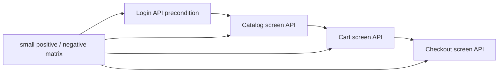
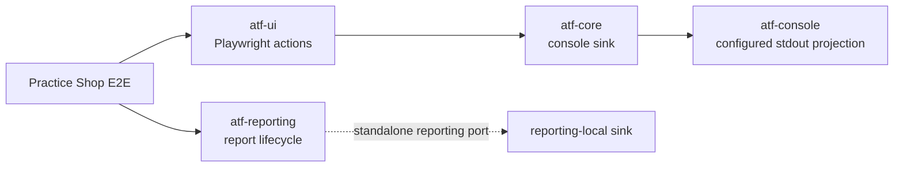
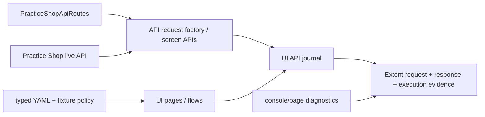
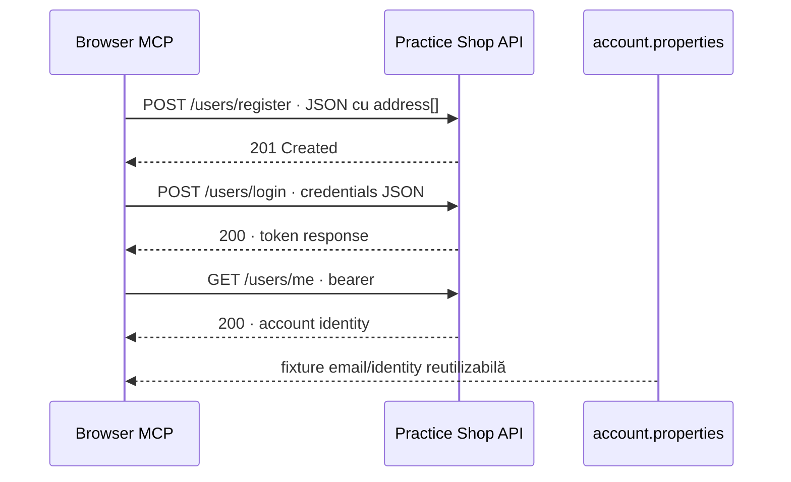
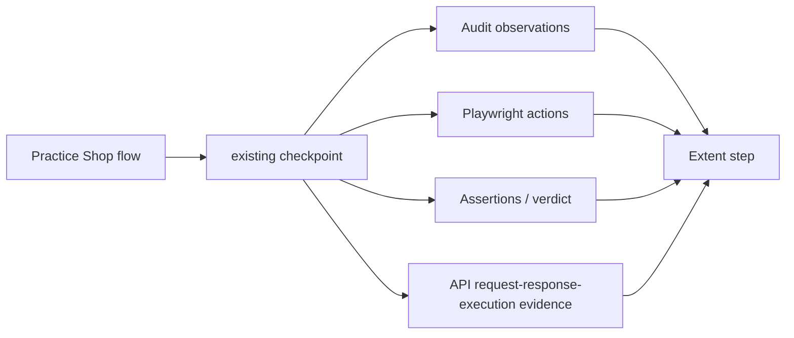

# Practice Shop — API screen pyramid feedback



<details>
<summary><strong>Legendă — feedback activ pentru piramida API/UI</strong></summary>

- săgeata solidă indică ordinea precondițiilor dintre ecrane;
- `Variants` este matricea mică de cazuri, nu o multiplicare de E2E;
- fiecare boundary trebuie coborât în component/integration înainte de a extinde journey-ul;
- diagrama descrie gap-ul urmărit, nu declară ToDo-ul închis.

</details>

## Scope

Acest feedback urmărește separarea dintre runtime-ul reutilizabil al aplicației
Practice Shop și testele care îl consumă. `src/main/java/atf/ui/practiceshop`
deține configurația typed, locatori, page objects, flow-uri UI, clientul API
și screen API flows. `src/test/java/atf/ui/tests/practiceshop` deține numai
teste organizate pe `component`, `api/component`, `api/integration` și `e2e`.

## Wiring live — Practice Shop consumă `atf-console` la boundary-ul UI



<details>
<summary><strong>Legendă — ce este demonstrat de codul live</strong></summary>

- `PracticeShopE2eContext` injectează `AtfConsoleReporter.configuredStdout()` în
  `PlaywrightUiSession`;
- `atf-test-practice-shop/pom.xml` declară `atf-console` la compile scope, iar
  `PracticeShopArchitectureTest` îl verifică drept dependency disponibilă pentru
  reusable main support;
- `PracticeShopRuntimeDiagnostics` capturează erori ale browserului, dar nu este
  proiecția lifecycle-ului ATF în stdout;
- acțiunile Playwright ale tuturor E2E-urilor Practice Shop sunt acum proiectate
  în consolă prin sink-ul configurat; nu există `println` în flow-uri;
- lifecycle-ul `atf-reporting` rămâne pe portul său standalone și nu este legat
  mecanic de `atf-console`, deoarece reporting-ul nu depinde de `atf-core`.

</details>

Problema UI este închisă prin injecție la composition root. Reconcilierea
cross-module a celor două porturi de consolă rămâne deliberat separată și este
urmărită numai de `SHOP-CONSOLE-02`; nu se introduce o dependență inversă din
`atf-reporting` spre `atf-core` doar pentru a uni două proiecții independente.

## Închise în această iterație

| Item | Rezultat | Dovadă |
|---|---|---|
| `SHOP-API-SCREEN-01` | ✅ screen boundaries | `PracticeShopLoginApi`, `PracticeShopCatalogApi`, `PracticeShopCartApi`, `PracticeShopCheckoutApi` compuse de `PracticeShopApiScreenFlow` |
| `SHOP-API-SCREEN-02` | ✅ login reutilizabil ca precondiție | `PracticeShopApiSession` păstrează token-ul; screen flow-ul următor reutilizează aceeași sesiune |
| `SHOP-API-SCREEN-03` | ✅ variație fără multiplicare E2E | transport local determinist pentru `401` login/current user, `404` product, `400` quantity și `2xx` payment; enum pentru metodele de payment |
| `SHOP-API-SCREEN-04` | ✅ packaging | reusable support mutat în `src/main/java`; testele au rămas exclusiv în namespace-ul `atf.ui.tests.practiceshop` |
| `SHOP-API-SCREEN-05` | ✅ locator boundary | locatorul de produs folosește ruta UI exactă configurată, nu text parțial ambiguu; `waitForEnabled` sincronizează controlul după încărcarea datelor |
| `SHOP-API-SCREEN-06` | ✅ standalone API evidence | `PracticeShopStandaloneApiReportTest` rulează screen flow-ul pe transport local determinist și publică în `artifacts/reports` request JSON, response JSON, headers, auth, status și execution evidence, fără browser; request metadata (URL/auth/query/request headers) și response metadata (content type/response headers) sunt publicate în zona lor semantică |
| `SHOP-API-SCREEN-07` | ✅ live opt-in account fixture | `PracticeShopApiScreenFlowIntegrationTest` și account E2E sunt activate numai cu `api-mode=live` și account file extern; acceptance/guest rămân implicite și niciun secret nu este comis |
| `SHOP-API-SCREEN-08` | ✅ product selection diagnostic | purchase flow publică `productName`, ruta configurată, ruta selectată și URL-ul încărcat; fallback-ul pe nume nu mai poate ascunde o schimbare de catalog |
| `SHOP-API-SCREEN-09` | ✅ catalog/cart variation matrix | query typed pentru sort/filter/category și `in_stock`, plus `PUT` quantity / `DELETE` product cart, sunt acoperite în component tests; nu s-a adăugat un al doilea E2E |
| `SHOP-UI-VALIDATION-01` | ✅ contracte declarative pe fiecare ecran traversat | `@PracticeShopPageContract` + `PracticeShopPageValidator` pentru home, product, cart, guest, billing, payment, confirmation, login și account; `PracticeShopPageContractTest` verifică rutele, controalele semantice și rezultatul agregat |
| `SHOP-UI-VALIDATION-02` | ✅ validator plug-and-play și gate pentru toate contractele declarate | `PracticeShopPageValidator` oferă `validate`, `validateValues` și `validateValue`; testul component verifică cele 9 ecrane și numărul de controale, fără browser/network |
| `SHOP-UI-VALIDATION-03` | ✅ home screen modularizat în sub-checkpoint-uri | același purchase E2E publică structure, filters și product-grid; fiecare are Playwright actions, assertions dinamice de cardinalitate/style și screenshot inline; HOME contract are 16 controale semantice |
| `SHOP-UI-VALIDATION-04` | ✅ celelalte ecrane au component evidence fără multiplicare E2E | `PracticeShopPurchaseScreenValidator` adaugă, în checkpoint-ul existent al fiecărui ecran, assertions compacte de cardinalitate, bounding box și readiness interactivă pentru product, cart, guest, billing, payment și confirmation; fiecare păstrează screenshot-ul complet la zoom 100% |
| `SHOP-API-SCREEN-10` | ✅ jurnalul API este modular și nu amestecă orchestration, assertions și reporting | `PracticeShopApiNetworkJournal` capturează/selectează, `PracticeShopApiAssertions` validează JSON/headers/status, iar `PracticeShopApiEvidenceMapper` publică request/response/execution evidence |
| `SHOP-CONSOLE-01` | ✅ console wiring la boundary-ul Practice Shop | `atf-test-practice-shop` declară `atf-console`; `PracticeShopE2eContext` injectează `AtfConsoleReporter.configuredStdout()` în Playwright, iar acțiunile UI sunt observabile fără `println` local |
| `SHOP-AUTH-01` | ✅ registration a fost explorat manual și modelat semantic | ATF Debug/browser MCP a confirmat formularul `first_name`, `last_name`, `dob`, `country`, `postal_code`, `house_number`, `street`, `city`, `state`, `phone`, `email`, `password` și submit-ul; `PracticeShopRegistrationPage` + `PracticeShopRegistrationData` dețin automatizarea fără selectori în test |
| `SHOP-AUTH-02` | ✅ cont reutilizabil, configurabil și redacted | `practice-software-testing-account.properties` este fixture module-owned în `src/test/resources`; `PracticeShopConfigurationLoader` permite override extern; `PracticeShopCredentials` nu publică parola în actions/assertions/HTML |
| `SHOP-AUTH-03` | ✅ login setup + purchase authenticated complet | `PracticeShopAuthenticatedPurchaseE2eTest` reutilizează login-ul, account precondition, catalog, product, cart, authenticated checkout, billing, payment și confirmarea finală; nu se adaugă E2E pentru fiecare endpoint |
| `SHOP-AUTH-04` | ✅ evidence API a fost legată de precondiția UI | login POST, users/me GET, headers/auth/status și execution evidence sunt atașate checkpoint-ului `GIVEN reusable account login...`; cart/payment păstrează request și response JSON în checkpoint-urile lor |
| `SHOP-AUTH-05` | ✅ fallback documentat pentru body-ul login-ului extern | dacă Chromium eliberează payload-ul gzip înainte de `Network.getResponseBody`, raportul afișează explicit `body unavailable` plus content-type/content-length; sesiunea este validată prin `/users/me` 200, fără token inventat; politica are test component dedicat |
| `SHOP-AUTH-06` | ✅ component gate pentru politica de login | `PracticeShopApiLoginAssertionsTest` verifică status 200, request JSON redacted și acceptarea transportului JSON non-empty atunci când body-ul nu mai este accesibil CDP |
| `SHOP-AUTH-07` | ✅ fixture live revalidat și înlocuit chirurgical | contul demo expirat a fost înlocuit prin registration JSON real (`201`), apoi login-ul și `GET /users/me` au fost verificate separat (`200`); fixture-ul rămâne în `src/test/resources`, iar credentialele nu sunt copiate în evidence |

Nota de robustețe: locatorii de colecție rămân utilizați pentru count/cardinality,
iar sincronizarea folosește explicit primul element (`homeProductGridFirst`),
deoarece API-ul Playwright pentru `waitForVisible` este strict.

Selecția produsului este plug-and-play: o rută `/product/<id>` configurată are
prioritate și rămâne strictă; pentru fixture-ul extern volatil, `productPath: auto`
alege primul card pentru `productName` și validează obligatoriu ruta `/product/*`.
ID-ul observat din catalog rămâne sursa de adevăr pentru product detail și cart;
nu se maschează o lipsă a produsului, deoarece selecția eșuează dacă nici numele
nu apare.

### Regula de validare a formularelor

Validarea se face înainte ca UI-ul să treacă la ecranul următor. Flow-ul
folosește `fill → validate → submit`: valorile dinamice din YAML sunt verificate
în câmpurile reale înainte de submit, iar tranziția este acoperită de checkpoint-ul
următor. Aceasta evită contracte fragile pentru controale tranzitorii și păstrează
în raport motivul exact al unui fail.

Pentru ecranele purchase, component evidence este intenționat agregat pe ecran:
un checkpoint = o captură completă + acțiuni + assertions de componente. Nu
creăm sub-checkpoint-uri doar pentru a separa câmpuri care încap în aceeași
imagine. `guest-proceed` este tranzitoriu și se validează prin acțiunea de
submit/proceed, nu prin contractul ecranului Guest înainte de submit.

## Matricea minimă intenționată

```text
component/API
  login valid                 → 2xx + JSON token
  login invalid               → 401 + application/json
  current user anonim         → 401 + application/json
  product inexistent          → 404 + application/json
  cart quantity <= 0          → fail-fast înainte de transport
  payment cash/card variants  → request JSON + 2xx JSON

integration/API (opt-in)
  login credential file       → session token
  catalog → cart → checkout   → dynamic IDs și status/content-type

E2E (un singur journey)
  UI product → cart → billing → payment
  API evidence atașat checkpoint-urilor UI existente
```

Nu adăugăm câte un E2E pentru fiecare endpoint. Varianta rapidă aparține
component tests; integrarea live este opt-in și necesită account file extern;
E2E-ul rămâne dovada de orchestration UI + API.

## Refactor findings

| `SHOP-ARCH-11` | ✅ test-source purity | `PracticeShopStandaloneApiReportTest` nu mai deține publisher-ul Extent/API; responsabilitatea reusable este în `src/main/java/atf/ui/practiceshop/support/PracticeShopApiReportPublisher`, iar testul păstrează doar scenariul, transportul local determinist și assertions-ul artifactului. Publisher-ul separă explicit request details de response details, inclusiv headers și content type |
| `SHOP-ARCH-12` | ✅ architecture guard pentru test-only scope | `PracticeShopArchitectureTest` permite în `src/test` doar clase `*Test`, `*TestSupport` sau `*Fixture` și continuă să respingă Page/Flow/Locators/E2eContext reutilizabile; transportul local rămâne intenționat test-only |
| `SHOP-ARCH-13` | ✅ închis pe scope-ul modulului | `PracticeShopApiNetworkJournal` este orchestration/state; capture + sanitizare sunt în `PracticeShopApiTrafficCapture`, selecția pură în `PracticeShopApiExchangeSelector`, iar purchase-ul este compus semantic prin `PracticeShopCatalogPurchaseStage`, `PracticeShopCheckoutPurchaseStage` și `PracticeShopPurchaseJourneyContext`. `PracticeShopPurchaseFlow` păstrează facade-ul public existent; nu s-au adăugat E2E-uri. Gate component: 27/27; full module gate: 44 teste, 0 failure, 0 error, 1 skip opt-in |
| `SHOP-CONSOLE-01` | 🔎 observat, neînchis | `PracticeShopE2eContext` injectează `noOp` pentru acțiunile Playwright și un lambda gol pentru lifecycle-ul raportului; `atf-console` nu apare în POM |
| `SHOP-CONSOLE-02` | 🔎 observat, neînchis | `atf-core` și `atf-reporting` definesc fiecare `AtfConsoleEvent`/`AtfConsoleSink`; aceeași instanță `AtfConsoleReporter` nu poate fi conectată typed la ambele boundary-uri |

## ToDo rămase

> Notă de versiune: această secțiune păstrează istoricul iterației precedente;
> lista normativă și prioritățile curente sunt în „Reaudit agresiv-constructiv —
> 2026-10-20”, mai jos.

`SHOP-CONSOLE-01` și `SHOP-CONSOLE-02` rămân ToDo-uri active cross-module pe
această analiză. `SHOP-ARCH-13` este închis pe scope-ul `atf-test-practice-shop`:
capture/select și orchestration-ul purchase sunt separate pe seam-uri business
testabile, fără schimbarea API-ului public și fără multiplicarea E2E. Pentru
consolă, criteriul de închidere este:

- `reporting.console` este încărcat prin `atf-console`, fără stream deținut de
  Practice Shop;
- reporterul configurat primește pașii UI și lifecycle-ul relevant printr-un
  boundary typed, fără lambda-uri no-op implicite;
- `enabled=false` rămâne complet silențios, iar `detailsEnabled` controlează
  numai detaliile, nu existența verdictului sau a testului;
- acțiunile, URL-urile și body-urile sensibile respectă redaction-ul existent;
- un test component cu sink in-memory verifică ordinea
  `scenario → phase → ui action → complete(status)` pentru `PASS`, `WARNING`,
  `FAIL` și `SKIP`;
- un test integration al consumerului confirmă wiring-ul real fără E2E nou;
- reconcilierea celor două tipuri `AtfConsoleEvent/Sink` este decisă explicit și
  testată; Practice Shop nu devine owner al unui adapter duplicat.

Nu se acceptă doar adăugarea dependinței Maven sau înlocuirea mecanică a
`noOp()` cu `configuredStdout()` dacă lifecycle-ul reporting rămâne mut și
contractele de evenimente rămân duplicate.

Nu mai există ToDo-uri active pe scope-ul `SHOP-API-SCREEN-06..09`. Orice
extensie nouă trebuie să adauge mai întâi un contract component sau integration
în aceeași piramidă; nu se multiplică purchase E2E pentru o variație de endpoint.

Pentru scope-ul registration → login → authenticated purchase, fixture-ul și
setup-ul live au fost revalidate, dar boundary-ul complet nu este declarat
închis: explorarea a confirmat registration `201`, login `200` și `/users/me`
`200`, iar account properties a fost actualizat chirurgical. Rămân ToDo-uri
de component API pentru registration contract, auth negative paths, invoice și
cleanup; acestea nu justifică un al doilea E2E. Singura limită deja observată
este tehnică și documentată: body-ul POST `/users/login` poate fi eliberat de
Chromium înaintea citirii prin CDP. Criteriul pentru `SHOP-AUTH-05` rămâne
`RESPONSE JSON` redacted disponibil fără un al doilea request sau credentiale în
clar.

Statusul istoric `SHOP-INT-04` este superseded de `SHOP-DIAG-01`: `/users/me`
`401` rămâne ramură guest acceptată, iar semnalele externe de bootstrap
(`cart_items` null și consola care raportează 401) sunt clasificate explicit ca
warning raportabil, nu eliminate. Erorile runtime care nu se potrivesc exact
acestei liste rămân FAIL; checkpoint-ul autentificat trebuie să demonstreze în
continuare UI account + login 200 + `/users/me` 200.

`SHOP-INT-05` este închis: `postcode-lookup` este contractat ca advisory, iar
`PracticeShopCheckoutApi.CheckoutScreen` păstrează valorile introduse ca sursă
de adevăr. Răspunsul lookup-ului poate informa UI-ul, dar nu suprascrie billing.

`SHOP-INT-06` este închis pentru boundary-urile documentate ale aplicației:
sort/filter/category, `in_stock`, quantity update și product removal. Invalid
guest/billing/payment rămân variații UI/API separate când contractele lor vor
fi observate, fără a pretinde că există endpoint-uri care nu au fost capturate.

`PracticeShopCatalogFlow` aplică aceeași regulă de selecție ca purchase flow-ul:
un fixture exact rămâne strict, iar `auto` este explicit și acceptă doar o rută
`/product/*`; nu există fallback tăcut între cele două politici.
`PracticeShopGuestResilienceTest`
apelează clientul API pe transport local determinist, astfel încât contractul `401` este testat
prin aceeași cale de execuție ca aplicația, iar canalul de runtime browser rămâne
separat.

## Reaudit structural — 2026-10-20 (istoric, superseded)

Reauditul după închiderea `SHOP-ARCH-13` nu a identificat un alt ToDo
module-owned care să justifice o mutare mecanică de cod:

- `PracticeShopLocators` rămâne mai mare deoarece este boundary-ul unic pentru
  selectorii Practice Shop; împărțirea arbitrară ar reintroduce ownership
  distribuit și ar slăbi `PracticeShopArchitectureTest`;
- `PracticeShopE2eContext` rămâne composition root pentru browser, report,
  network journal și runtime diagnostics; nu este page/flow reutilizabil și
  nu ascunde selectorii sau business transitions;
- `PracticeShopApiNetworkJournal`, `PracticeShopApiAssertions` și mapper-ul
  Extent au responsabilități distincte, fără TODO/FIXME în `src/main` sau
  `src/test`;
- stage-urile purchase sunt în `src/main`, iar testele rămân exclusiv în
  `atf.ui.tests.practiceshop`; component gate-ul și full module gate-ul au
  reconfirmat această limită.

Această concluzie era incompletă: `SHOP-CONSOLE-01/02` rămâne cross-module, dar
reauditul normativ de mai jos adaugă și gap-urile de diagnostic, provenance,
JSON contract, mock catalog, configurare, tracing, auth și lifecycle.

Fixture-ul YAML folosește acum `productPath: auto`, deoarece raporturile live au
confirmat rotația ID-ului pentru `Pliers` între rulări. O rută exactă rămâne
disponibilă pentru medii cu fixture stabil; schimbarea este acoperită de
`PracticeShopConfigurationTest` și de gate-ul complet.

## Verificare și sync

Build-ul acestei iterații se face în staging extern proiectului. Promovarea în
live trebuie să fie selectivă: se recitesc versiunile live ale fișierelor
existente, se aplică numai hunks-urile acestui boundary, iar refactorizările
paralele din alte module nu se suprascriu. După sync se rulează component/API
gate, apoi singurul E2E și se verifică fresh report-ul UI prin ATF Debug sau
Chromium/Playwright headless.

## Reaudit agresiv-constructiv — 2026-10-20

Această secțiune supersedează formularea anterioară potrivit căreia, în afara
consolei, nu mai există ToDo-uri active. Relectura codului live a găsit mai multe
riscuri de corectitudine și trasabilitate care pot lăsa un raport verde fără să
demonstreze corect ce s-a întâmplat. Nu sunt probleme cosmetice de README.

### Verdict executiv



| Axă | Notă | Observație dură |
|---|---:|---|
| Boundary și separarea page/flow/support | 88/100 | Structura este bună; composition root-ul este încă prea încărcat. |
| Vocabular de rute și reutilizare | 82/100 | `PracticeShopApiRoutes` exista, dar nu era folosit de journal și transporturile locale din teste; fixul acestei iterații acoperă ruptura. |
| Configurație autoritativă | 69/100 | Există chei YAML care sunt încă decorative sau ignorate de unele overload-uri. |
| Contract API JSON | 72/100 | Request-urile de write sunt mai bine protejate; response-ul nu este validat uniform de publisher. |
| Corelare UI → API → evidence | 66/100 | „latest matching exchange” nu este suficient pentru retry-uri, duplicate și request-uri concurente. |
| Diagnostic browser | 55/100 | Un TypeError concret este clasificat ca semnal guest acceptat. Acesta este risc P0. |
| Transport local și variații | 88/100 | Component tests au un singur transport local determinist, iar YAML-ul nu este folosit ca mock al Practice Shop; integrarea și E2E folosesc serviciul real. |
| Auth și siguranța fixture-ului | 70/100 | Fixture-ul urmărit în repository poate activa E2E autentificat doar prin existența fișierului. |
| Test pyramid | 84/100 | Baza component este solidă; integrarea și E2E nu dovedesc încă toate policy-urile configurabile. |
| Lifecycle și fail-safe reporting | 76/100 | Închiderea browserului și a raportului nu are o protecție suficientă prin `finally`. |
| **Overall current** | **70/100** | Bun ca schelet de consumer, nu încă suficient ca referință auditabilă pentru contractul UI/API. |

### Ce a fost reparat chirurgical în această iterație

| Item | Status | Dovadă |
|---|---|---|
| `SHOP-ROUTE-01` | ✅ sincronizat live | `PracticeShopApiRoutes` este owner-ul rutelor Practice Shop; `PracticeShopApiNetworkJournal`, transportul local de componentă și testele de factory/selector folosesc constantele și metodele dinamice ale owner-ului. |
| `SHOP-ROUTE-02` | ✅ sincronizat live | `PracticeShopApiRoutesTest` verifică `/products/{id}`, `/carts/{id}`, update/remove și respinge ID-uri blank; literalul rămâne doar în testul care verifică explicit contractul de compunere. |
| `SHOP-ROUTE-03` | 🚫 scos din scope | Nu se introduce catalog YAML mock în `atf-test-practice-shop`; modulul testează aplicația/API-ul Practice Shop real. Constantele rămân owner-ul rutelor, iar variațiile rapide sunt acoperite de teste componente cu transport local declarat în test. |

Regula de întreținere este acum explicită: string-urile de rută nu se repetă în
teste sau în support; se folosesc constantele pentru endpoint-uri fixe și metodele
`product`, `cart`, `updateCartQuantity`, `removeCartProduct` pentru endpoint-uri
cu parametri. Un literal este acceptat numai în `PracticeShopApiRoutes` sau într-un
test de contract al acelei clase, unde literalul este chiar expected-ul verificat.
Metodele HTTP, cheile JSON și valorile business nu se mută într-un enum global
doar pentru a elimina orice string: fiecare valoare trebuie să aibă owner semantic
(`PracticeShopPaymentMethod`, request factory, mock fixture sau config typed).

### Gap-uri active — ordonate după impact și risc

#### P0 — poate produce verdict verde fals

| ID | Problemă live | De ce este grav | Criteriu de închidere |
|---|---|---|---|
| `SHOP-DIAG-01` | ✅ închis | Modelul de diagnostic acceptă exact `GET /users/me` + `401` și semnalele de bootstrap `cart_items`/401 ca warning-uri reportabile; orice diagnostic neclasificat rămâne FAIL, cu component tests pentru clasificarea pozitivă și near-miss. |

#### P1 — corectitudine, reproducibilitate și audit

| ID | Problemă live | Criteriu de închidere |
|---|---|---|
| `SHOP-EXC-01` | Support-ul încă are boundary-uri de excepții care merită curățate (`PracticeShopApiClient.token()`, `duration()`, validatorii UI), dar testele E2E nu mai dețin lifecycle-ul cu catch/rethrow în corp. | Interzice catch-all și fallback tăcut; parserii/configurația folosesc catch typed + context/cauză sau `Result` explicit; validatorii publică `unavailable` ca assertion FAIL fără să piardă cauza; lifecycle-ul folosește helper/extension fail-safe cu primary failure + suppressed teardown failure. `Scenario.execute`, publisher-ul standalone și `assertThrows` mută responsabilitatea în owner-ul corect; rămân de auditat doar boundary-urile support. |
| `SHOP-API-PROV-01` | `PracticeShopApiClient.forTransport(...)` trebuie să distingă transportul local de API-ul live, fără să introducă o dependență mock în modul. | `forTransport` publică `ACCEPTANCE_MOCK` numai pentru transportul local al testului; `live` publică `LIVE_HTTP`; testul verifică provenance în model și în HTML. În YAML-ul Practice Shop, modul implicit este `live`. |
| `SHOP-API-CONTRACT-01` | ✅ închis | `PracticeShopApiReportPublisher` validează request JSON pentru POST/PUT, content type, status și response JSON parseabil/non-empty; standalone report și component gate verifică aceeași politică. |
| `SHOP-API-JSON-02` | ✅ închis | `PracticeShopApiAssertions` folosește JSON tree/path/type pentru `data[*].id/name`, `cart_items[*].quantity` și `message`; near-miss product identity este testat explicit. |
| `SHOP-API-TRACE-01` | Journal-ul păstrează method/path/body/headers/status, dar nu sequence, timestamp, unique request signature sau legătura exactă cu checkpoint-ul UI. Selectorul folosește `contains(path)` și `latest`. | Exchange immutable cu `sequence`, signature/digest și checkpoint/phase; matching exact după route normalizată; retry/duplicate sunt raportate distinct, nu absorbite de „latest”. |
| `SHOP-MOCK-01` | Cerința anterioară de a adăuga `practice-shop-api-mock.yaml` și `atf-mock` ar schimba natura modulului: ar testa un scenariu artificial în locul aplicației Practice Shop. | **Nu se implementează în acest modul.** `atf-test-practice-shop` nu are dependență `atf-mock`, nu are catalog mock și nu folosește fixture mock. Testele rapide păstrează doar transporturi locale minimale, declarate lângă scenariul component; integrarea/E2E folosesc endpoint-urile reale. |
| `SHOP-CONFIG-01` | `screenshotOnFailure` este încărcat, dar contextul capturează fără să aplice policy-ul; `api.precondition` nu are consumer; report output este hardcodat în `artifacts/reports/ui`; overload-ul public al purchase flow poate crea journal cu profil `UI_ONLY`. | Fiecare cheie YAML are consumer sau este eliminată; test de config-to-runtime; output/API/UI sunt configurabile; overload-urile propagă profilul real; screenshot policy are teste PASS/FAIL. |
| `SHOP-AUTH-08` | ✅ închis chirurgical | `PracticeShopApiScreenFlowIntegrationTest` cere acum simultan `authenticatedE2eAllowed()` și `api.mode=live`; existența fixture-ului nu mai activează singură integrarea live. Default-ul `authenticatedE2eEnabled: false` păstrează run-ul component/API fără rețea; integrarea live se activează explicit, iar nicio parolă nu ajunge în raport/git. |
| `SHOP-SEC-01` | ✅ închis pentru contractul Practice Shop | Redaction-ul JSON este parse-aware, recursiv pentru obiecte/array-uri și păstrează fallback pentru malformed payload; headers redacționează authorization, cookie, token, API key și variantele camel-case. Component test acoperă nested array, escaped value și `X-API-Key`/`apiKey`. |
| `SHOP-SELECT-01` | Catalog stage poate face click pe fallback înainte să raporteze că ruta exactă configurată nu există; `CatalogFlow` și purchase stage nu au aceeași politică strict/auto. | Ruta exactă fail-fast înainte de click; fallback numai pentru `productPath: auto`; aceeași policy în toate flow-urile și assertion distinct pentru ruta selectată. |

#### P2 — robustețe și cost de întreținere

| ID | Problemă live | Criteriu de închidere |
|---|---|---|
| `SHOP-LIFECYCLE-01` | `PracticeShopE2eContext.close()` închide browserul înaintea reportului fără `finally`; o eroare de teardown poate lăsa HTML neterminat. | Close ordering fail-safe: report flush în `finally`, primary failure păstrat, test pentru eroare browser/report și artifact finalizabil. |
| `SHOP-ARCH-14` | `PracticeShopArchitectureTest` folosește scanare textuală și exclude path-uri care conțin `component`; guard-ul poate ocoli accidental chiar zona testelor component. | Scan explicit pe toate sursele UI-test, allowlist minim și test de regression pentru locator în test component; fără bypass după numele directorului. |
| `SHOP-LOC-01` | `PracticeShopLocators.cssText` escape-uiește doar apostroful; nume/rute configurabile cu backslash sau caractere CSS speciale pot produce selector invalid. | Selector builder cu escaping CSS robust și test pentru apostrof, backslash, ghilimele, Unicode și duplicate display names; preferința rămâne `element[attribute=value]`. |
| `SHOP-TEST-01` | ✅ fixture component unic | `PracticeShopApiComponentFixture` este singurul transport local test-scope; testele păstrează scenariul și expected-ul numit, iar integration/E2E rămân pe API-ul real. Publisher parity generică rămâne în `atf-reporting-tests`. |
| `SHOP-CONSOLE-02` | Există încă două porturi typed `AtfConsoleEvent/Sink`: `atf-core` pentru consumer/UI și `atf-reporting` pentru librăria standalone. | Se păstrează independența `atf-reporting`; dacă se dorește o consolidare, ea trebuie făcută printr-un contract/adaptor owner-uit explicit și teste de parity, fără dependență inversă sau mapping duplicat în Practice Shop. |

### Audit dinamic al utilizării lui `try` — 2026-10-20

Regula nouă este una de design și de audit, nu o interdicție mecanică a oricărui
`try`. În codul live nu există literalul `@try`; inventarul de mai jos separă
construcțiile legitime de cele care pot ascunde un verdict sau o cauză.

| Zonă | Utilizare observată | Verdict audit | Acțiune |
|---|---|---|---|
| lifecycle | `try (scenario)`, `try (ExtentReportSession)`, `try (Stream<Path>)` | acceptabil ca resource ownership, dar `try` este încă direct în test pentru scenarii E2E | mutare graduală în `ScenarioRunner`/JUnit extension; păstrează închiderea deterministă și artifact-ul final |
| parser API | `PracticeShopApiClient.token()` prinde `Exception` și întoarce `""` | risc de false-green sau request autentic fără token | inclus în `SHOP-EXC-01`; parse typed, failure explicit și test pentru JSON malformed/missing token |
| config | `PracticeShopConfigurationLoader.duration()` prinde `RuntimeException` și întoarce fallback | configurația greșită poate părea validă | `Duration.parse` invalid trebuie raportat cu key/value și cauză; fallback numai când cheia lipsește, nu când este malformed |
| validare UI | `PracticeShopPageValidator`, `PracticeShopHomeScreenValidator` și `PracticeShopComponentAssertions` prind `RuntimeException` și construiesc assertion FAIL | direcția este mai bună decât swallow, dar cauza este redusă la numele clasei | păstrează excepția în evidence/diagnostic și testează că verdictul agregat rămâne FAIL, nu doar că apare rândul |
| capture browser | `PracticeShopApiTrafficCapture` folosește placeholder explicit când Chromium eliberează body-ul | acceptabil ca fallback de transport, numai dacă JSON indisponibil nu trece validarea | păstrează `body unavailable` vizibil și assertion distinct; nu îl trata ca body gol valid |
| JSON assertions | `isJson()` și `positiveContentLength()` întorc boolean după parse/number format | acceptabil doar dacă caller-ul publică assertion FAIL și nu confundă malformed cu absent | component tests pentru malformed JSON, header invalid și payload non-empty |
| excepții așteptate | `PracticeShopPageContractTest` folosește catch manual pentru `UnsupportedOperationException` | zgomot evitabil în test | `assertThrows(UnsupportedOperationException.class, ...)` |
| boundary IO | `PracticeShopArchitectureTest` rethrow-uiește `IOException` cu path, iar factory/API screen rethrow-uiesc cu context și cause | acceptabil | păstrat ca model pentru boundary-uri; fără catch generic nou |

### Regula de acceptare pentru `SHOP-EXC-01`

```text
test intent
  → typed runner / lifecycle helper
  → action or parser
  → explicit PASS / FAIL / unavailable evidence
  → primary failure preserved
```

Nu acceptăm un patch doar pentru că înlocuiește un `try` cu altul. Înainte de
închidere trebuie verificat static că nu există catch gol sau catch-all nou, apoi
component/integration tests trebuie să demonstreze că: un JSON malformed eșuează,
un selector indisponibil eșuează cu diagnostic, o închidere defectă nu maschează
failure-ul inițial, iar un test care trebuie să arunce chiar aruncă. Pentru E2E,
runner-ul trebuie să publice evidence și să rethrow-uiască failure-ul, fără
control-flow de excepții duplicat în fiecare test.

### Cerința de rutare și fixture trebuie să rămână două lucruri diferite

```text
PracticeShopApiRoutes
    = vocabular stabil de endpoint-uri și template-uri

PracticeShopApiComponentFixture
    = transport local determinist, strict test-scope, pentru variații rapide
      ale component tests; nu este catalogul API-ului extern și nu este sursă
      de configurare pentru integration/E2E
```

`PracticeShopApiRoutes` explică și reutilizează path-ul în request factory,
screen APIs, journal, selectors și teste. Nu trebuie să devină catalogul de
răspunsuri și nu trebuie să conțină ID-uri dinamice de fixture. `ComponentFixture`
ține doar răspunsurile minimale necesare pentru teste rapide; integration/E2E
folosesc întotdeauna API-ul și aplicația Practice Shop reale. Nu se introduce
YAML mock sau server mock în acest consumer.

### Ordinea recomandată de implementare

1. `SHOP-DIAG-01`: eliminarea false-green-ului de diagnostic;
2. `SHOP-EXC-01`: boundary typed, propagarea failure-ului și lifecycle fără swallow;
3. `SHOP-API-PROV-01` și `SHOP-API-CONTRACT-01`: provenance și JSON policy;
4. `SHOP-API-TRACE-01`: sequence/signature/checkpoint pentru corelare UI/API;
5. `SHOP-ROUTE-03`/`SHOP-MOCK-01`: menținerea explicită a deciziei **fără mock în Practice Shop**; orice reducere a duplicării transporturilor locale se face numai prin helper-e test-only, fără `atf-mock` sau YAML mock;
6. `SHOP-CONFIG-01`, `SHOP-AUTH-08`, `SHOP-SEC-01`: configurare efectivă și secret safety;
7. `SHOP-SELECT-01`, `SHOP-LIFECYCLE-01`, `SHOP-ARCH-14`, `SHOP-LOC-01`;
8. `SHOP-CONSOLE-02`: numai dacă se schimbă explicit boundary-ul cross-module al celor două porturi console.

### Gate de acceptare pentru următoarea iterație

- component gate pentru rute, diagnostics, JSON policy și provenance;
- integration gate care demonstrează `setup → live API precondition → UI flow → API projection → Extent evidence`;
- un singur E2E guest și unul authenticated doar dacă flag-ul live este explicit;
- raport API și UI fresh, generate de rularea curentă, verificate prin ATF Debug/Chromium headless;
- click manual pe `Tests`, `Fails`, `Categories`, `Tags`, `Overview`, disclosures,
  request JSON, response JSON, execution evidence și screenshot inline;
- `scrollWidth <= clientWidth`, zero console/page errors neașteptate, JSON pretty;
- căutare finală fără endpoint literals în support/teste, cu excepția testului
  explicit de contract al `PracticeShopApiRoutes`;
- README-ul dedicat și registry-ul `docs/feedback/README.md` reflectă exact
  statusul live; niciun ToDo închis doar prin afirmație.

Auditul de mai sus este static și bazat pe sursele live recitite; nu pretinde un
nou build sau o nouă verificare de browser până când gate-ul de mai sus nu este
rulat și artifactele fresh nu sunt inspectate.

## Decizie de ownership — fără mock în `atf-test-practice-shop` — 2026-10-20

Această secțiune este ultima decizie pentru consumer și are prioritate față de
formulările istorice din auditul de mai sus:

```text
atf-test-practice-shop
  ├─ component tests   → logică pură + transport local minim, declarat în test
  ├─ integration tests  → API Practice Shop real, opt-in și explicit
  └─ E2E                → UI Practice Shop real + trafic API observat

nu conține:
  atf-mock dependency
  practice-shop-api-mock.yaml
  mock catalog / server mock pentru aplicația externă
```

`SHOP-ROUTE-03` și `SHOP-MOCK-01` sunt închise ca **scos din scope**, nu ca
implementate. Nu se reintroduc printr-un refactor ulterior doar pentru a elimina
switch-urile locale din testele componente. Dacă duplicarea transporturilor
locale devine costisitoare, se extrage un helper strict test-only pentru
compoziție; helper-ul nu va încărca YAML mock și nu va deveni producție.

Statusul corect pentru această iterație este:

- ✅ `atf-test-practice-shop/pom.xml` nu mai depinde de `atf-mock`;
- ✅ `src/test/resources/practice-shop-api-mock.yaml` și fixture-ul aferent nu
  există în modul;
- ✅ configurația declară `api.mode: live`, output-urile UI/API și
  `authenticatedE2eEnabled: false` implicit;
- ✅ diagnosticul acceptă numai `GET /users/me` + `401` ca guest expected;
- ✅ E2E-ul live publică drept warning semnalele externe cunoscute (`401`
  anonim/`cart_items` null), cu mesajul complet în raport; nu există mock și nu
  se maschează erorile necunoscute.

## Refactor de mentenanță — vocabular typed și fixture component unic — 2026-10-20

### Ce a fost reanalizat

Auditul a găsit o regresie structurală între documentație și cod: testele
foloseau `PracticeShopApiScenarioTransport`, o clasă care combina date de
scenariu, rutare și răspunsuri într-un `switch`, inclusiv cazuri dinamice care
nu puteau fi `case` Java constant. În plus, testele repetau metode HTTP,
`application/json`, auth profiles și ID-uri fixture. Această formă era greu de
extins și putea face ca un test nou să descrie alt contract decât raportul.

### Decizia aplicată

```text
PracticeShopApiRoutes
        ↓
PracticeShopApiRequestFactory  → ApiRequest JSON/query typed
        ↓
PracticeShopApiScreenFlow      → login · catalog · cart · checkout
        ↓
PracticeShopApiComponentFixture → un singur transport determinist test-scope
        ↓
PracticeShopApiScenarioFixture → valori și expected-uri numite
```

- `PracticeShopApiComponentFixture` înlocuiește transportul duplicat și are un
  nume care respectă guard-ul de helper-e test (`*Fixture.java`);
- `PracticeShopApiScenarioFixture` deține datele semantice ale scenariului,
  nu testele individuale;
- `PracticeShopApiOperation`, `PracticeShopApiAuthProfile` și
  `PracticeShopApiAuthType` separă vocabularul wire de strings repetate;
- `HttpMethod`, `HttpHeader` și `MediaTypes` din `atf-core` rămân sursa comună
  pentru HTTP și evidence;
- testele de business descriu flow-ul și assertions, nu răspunsuri ad-hoc sau
  un transport local copiat;
- decizia de ownership rămâne neschimbată: Practice Shop nu introduce
  `atf-mock`; integrarea și E2E-ul testează API-ul/aplicația reală.

### ToDo și gate

| ID | Status | Criteriu de închidere |
|---|---|---|
| `SHOP-CONST-01` | ✅ | testele API folosesc rute, enums/core constants și fixture values; scanarea finală nu mai găsește `ScenarioTransport` |
| `SHOP-FIXTURE-01` | ✅ | există un singur `PracticeShopApiComponentFixture`, component matrix și standalone report îl reutilizează |
| `SHOP-JSON-03` | ✅ | POST/PUT au request JSON și response JSON; redaction-ul acoperă și `apiKey` camel-case, inclusiv nested arrays |
| `SHOP-DOC-02` | ✅ | README-ul modulului și această secțiune descriu aceeași arhitectură; decizia fără `atf-mock` nu este contrazisă de instrucțiunile de rulare |
| `SHOP-GATE-02` | ✅ | component/API gate în staging extern: 45 teste verzi, 0 failures, 0 errors, 0 skipped; credentials gate separat: 2 teste verzi; `PracticeShopArchitectureTest` verde; integrarea live fără flag explicit este skip-uită, nu executată accidental |

Comanda de reproducere pentru gate-ul focalizat este:

```text
mvn -pl atf-test-practice-shop -am "-Dtest=PracticeShopArchitectureTest,PracticeShopConfigurationTest,PracticeShopCheckoutConfigurationTest,PracticeShopApiRoutesTest,PracticeShopApiRequestFactoryTest,PracticeShopApiExchangeSelectorTest,PracticeShopApiLoginAssertionsTest,PracticeShopApiScreenFlowTest,PracticeShopApiCatalogCartVariantTest,PracticeShopApiContractVariantTest,PracticeShopStandaloneApiReportTest,PracticeShopGuestResilienceTest,PracticeShopJsonEvidenceTest,PracticeShopApiAssertionsTest,PracticeShopApiClientContractTest,PracticeShopPageContractTest,PracticeShopPurchaseCheckpointTest,PracticeShopValidationProfileTest" "-Dsurefire.failIfNoSpecifiedTests=false" test
```

Nu se închide următorul audit doar pe baza compilării: raportul standalone
proaspăt trebuie încă deschis prin ATF Debug/Chromium headless și verificat
manual în `Tests`, `Fails`, request JSON, response JSON și execution evidence.

### Reaudit final — 2026-10-20 11:40 — no-mock policy

```text
atf-test-practice-shop
├─ component/API tests  → transport local strict, doar test-scope
├─ integration          → Practice Shop API real, LIVE, opt-in explicit
└─ E2E                  → Practice Shop UI/API real, fără catalog mock
```

Verificări efectuate după sync-ul în staging extern:

- `pom.xml` nu declară `atf-mock`; `practice-shop-api-mock.yaml` și fixture-ul
  de mock nu există;
- configurația rămâne `api.mode: live`, cu output API/UI configurabil și
  `authenticatedE2eEnabled: false` implicit;
- component/API gate focalizat: **45 teste, 0 failures, 0 errors, 0 skipped**; credentials gate: **2 teste, 0 failures, 0 errors, 0 skipped**;
- `PracticeShopApiScreenFlowIntegrationTest`: **1 skipped intenționat** fără
  flag explicit, `BUILD SUCCESS`;
- compilarea modulului în staging extern: **64 surse Java, `BUILD SUCCESS`**;
- E2E live rămâne o verificare separată și strictă: nu se maschează erorile
  externe cu mock sau warning artificial.

## Reaudit mentenanță — vocabular API typed și metadata de raport — 2026-10-20 11:40

Refactorul final a urmărit toate string-urile stabile care definesc contractul,
nu datele dinamice ale unui scenariu. Rezultatul este localizat în consumer și
nu poluează `atf-core` cu vocabular Practice Shop:

```text
PracticeShopApiRoutes              → path-uri fixe și template-uri
PracticeShopApiHttpStatus          → coduri HTTP așteptate
PracticeShopApiJsonField           → chei JSON request/response
PracticeShopApiQueryParameter      → chei query
PracticeShopApiAuthProfile/Type    → vocabular auth wire/evidence
PracticeShopApiScenarioFixture     → ID-uri, credentials și payload-uri
PracticeShopApiReportMetadataFixture → nume și tag-uri ale reportului
```

`PracticeShopApiRequestFactory`, `PracticeShopProductQuery`, clientul, assertions,
fixture-ul component și testele folosesc aceleași enum-uri pentru wire values.
Valorile care se schimbă între scenarii rămân în fixture/config; nu sunt ascunse
în enum-uri. Asta păstrează testele lizibile (`OK`, `PRODUCT_ID`, `CATEGORY`) și
permite schimbarea contractului într-un singur owner.

| ID | Status | Dovadă live |
|---|---|---|
| `SHOP-CONST-02` | ✅ | codurile HTTP, cheile JSON și query keys nu mai sunt repetate ca literali în factory/assertions/teste; sunt owner-uite de enum-uri module-local |
| `SHOP-META-01` | ✅ | `PracticeShopApiReportMetadataFixture` ține tags/numele stabile, respectând guard-ul `*Fixture.java` |
| `SHOP-SEC-02` | ✅ | header-ul `apiKey` camel-case este redacted ca și `X-API-Key`; testul acoperă ambele forme plus JSON nested |
| `SHOP-GATE-03` | ✅ | staging extern: component/API `45 tests, 0 failures, 0 errors, 0 skipped`; credentials `2 tests, 0 failures, 0 errors, 0 skipped`; build reactor `BUILD SUCCESS` |
| `SHOP-REPORT-02` | ✅ | artifact fresh standalone copiat în `artifacts/reports`; a fost deschis în Chromium headless/MCP pentru auditul manual al evidence |
| `SHOP-PROVENANCE-01` | ✅ | `PracticeShopApiClient.live(...)` publică `LIVE_HTTP`, transportul local publică `ACCEPTANCE_MOCK`; testul de contract acoperă ambele moduri |

Gate-ul de browser pentru artifactul curent rămâne obligatoriu: `Tests` trebuie
să arate flow-ul complet și request-urile JSON, iar `Overview`, `Categories` și
`Fails` trebuie să fie coerente. Nu se declară un run live authenticated pe baza
acestui gate: transportul raportat aici este acceptance/component, iar integrarea
reală rămâne opt-in și folosește endpoint-ul Practice Shop.

## Explorare live suplimentară — account reutilizabil și purchase API — 2026-10-20

### Scop

Contul anterior din fixture nu mai era acceptat de aplicația externă. A fost
recreat prin UI real, iar apoi fluxul de autentificare a fost verificat separat
prin browser MCP/ATF Debug. Nu s-a introdus mock și nu s-a schimbat comportamentul
testelor guest.



Rezultat verificat: registration `201`, login `200`, `/users/me` autentificat
`200`. Resource-ul actual este:
`atf-test-practice-shop/src/test/resources/practice-software-testing-account.properties`.
Parola rămâne numai în resource-ul local al testului și nu se copiază în
feedback, actions, assertions sau HTML. Fișierul este consumat prin
`PracticeShopCredentials`, iar override-ul extern rămâne disponibil pentru CI.

### Inventarul live observat pentru flow-ul complet

```mermaid
flowchart LR
    Register["POST /users/register · 201"] --> Login["POST /users/login · 200"]
    Login --> Me["GET /users/me · 200 bearer"]
    Me --> Catalog["search / product / cart"]
    Catalog --> Lookup["GET /postcode-lookup · 200 advisory"]
    Lookup --> Payment["POST /payment/check · 200 JSON"]
    Payment --> Invoice["POST /invoices · 201 JSON"]
    Invoice --> Cleanup["DELETE /carts/{cartId} · 204"]
```



Au fost confirmate următoarele contracte de boundary, fără a pretinde că sunt
încă toate implementate în clientul Practice Shop:

| Boundary | Observație live | Dovadă cerută în component/integration |
|---|---|---|
| registration | request JSON are `address[]`; răspunsul este `201` | body request redacted, status, content type, identity fields și negative shape/duplicate-email |
| authentication | login `200` produce token response; `/users/me` cu bearer este `200`; guest este `401` | auth matrix pozitiv/negativ și sesiune reutilizabilă fără token în raport |
| catalog/cart | product id-ul este propagat către detail și cart, apoi cart read expune `cart_items` | legătură exactă între id, quantity, cart read și checkpoint UI |
| postcode | lookup-ul răspunde `200`, dar adresa demo poate diferi de input | policy `ADVISORY`, query typed și diagnostic al mismatch-ului |
| payment | request JSON conține metoda și detalii; răspunsul este JSON de confirmare | variantele suportate de UI, status/body și legătura cu checkpoint-ul payment |
| invoice | request JSON conține billing/payment/cart; răspunsul `201` conține id, user, total și dates | contract pozitiv, cart invalid/missing și totals/billing linkage |
| cleanup | ștergerea cart-ului răspunde `204` | teardown explicit și evidență separată, fără mascarea unui fail anterior |

### ToDo-uri active după explorare

| ID | Prioritate | ToDo implementabil | Criteriu de închidere |
|---|---:|---|---|
| `SHOP-FLOW-API-REG-01` | P1 | adaugă route/request factory/model pentru registration cu `address[]` | component tests pentru `201`, response identity, shape invalid `422` și email duplicat; fără mock catalog |
| `SHOP-FLOW-API-AUTH-01` | P1 | separă auth setup de login negative paths | `200`/`401`, `/users/me` cu/fără bearer, token redaction și body fallback documentat |
| `SHOP-FLOW-API-CART-01` | P1 | extrage cart lifecycle din flow-ul UI | create → add → read → update → remove cu id/quantity exact și cleanup verificat |
| `SHOP-FLOW-API-ADDRESS-01` | P2 | modelează postcode lookup ca operație advisory | query validation, mismatch observabil, country/postcode/house-number invalid |
| `SHOP-FLOW-API-PAYMENT-01` | P1 | adaugă payment request/response component contract | numai metodele confirmate de UI, JSON request/response, success/error body și auth evidence |
| `SHOP-FLOW-API-INVOICE-01` | P1 | adaugă invoice request/response în clientul real | `201`, invoice id/user/cart/totals/billing și negative contract; publicare în raport API |
| `SHOP-FLOW-API-TRACE-01` | P1 | întărește network journal-ul | sequence, checkpoint, phase, timestamp/signature și duplicate/retry distinct; fără selector `latest` ambiguu |
| `SHOP-FLOW-E2E-SETUP-01` | P2 | consumă sesiunea autentificată numai în setup-ul E2E | un singur purchase E2E; screen tests reutilizează precondition API și nu cunosc parola |

Regula de implementare rămâne: component tests pentru variație, integration
tests pentru clientul real opt-in, un singur flow E2E pentru orchestrare UI + API.
Nu se adaugă `practice-shop-api-mock.yaml`, server mock sau fixture catalog.
Un ToDo se poate marca ✅ numai după testul relevant, raportul evidence și
verificarea render-ului au fost executate în staging extern și sincronizate
chirurgical în codul live.

## Audit observations în E2E — implementare și gate — 2026-10-20

### Decizia de design

Pattern-ul a fost aliniat cu `atf-reporting-tests`: auditul este evidence
distinctă în același checkpoint, nu un test end-to-end nou și nu o a doua tabelă
de assertions.



`PracticeShopAuditObservations` este helper semantic în `src/main`, iar
`PracticeShopE2eContext.checkpoint` îl apelează înainte de `drain()`. Calea
legacy de account/catalog (`Scenario.pass`) a fost adusă prin aceeași funcție
`recordScreenContract`, deci auditul nu depinde de tipul de flow. Pentru fiecare
checkpoint sau screen pass se publică dinamic:

- `Audit screen contract`: URL-ul curent, statusul derivat din assertions,
  cardinalitatea assertions și starea payload-ului PNG;
- câte un `Audit API exchange #N` pentru fiecare evidence validă: method/path,
  status, auth profile, transport provenance și attempts;
- niciun body JSON, token sau password duplicat în audit; body-urile complete
  rămân în disclosure-urile request/response canonice;
- evidence malformed nu devine observație inventată; assertion-ul/API evidence
  decide în continuare fail-ul.

### Testare component și raportare

`PracticeShopAuditObservationsTest` verifică trei cazuri: cardinalitatea exactă
screen + API, ignorarea unei exchange malformed și calea screen-only account/
catalog. Împreună cu
`PracticeShopCredentialsTest`, acestea rulează în același module boundary.

| ID | Status | Dovadă |
|---|---|---|
| `SHOP-REPORT-AUDIT-01` | ✅ | observațiile sunt generate din checkpoint-ul curent și apar ca source `OBSERVE`, fără test E2E nou |
| `SHOP-REPORT-AUDIT-02` | ✅ | API observations păstrează route/status/auth/transport/attempts și lasă JSON-ul în disclosure-ul API |
| `SHOP-REPORT-AUDIT-03` | ✅ | malformed `ReportExecutionEvidence` este ignorată în audit, fără inventarea unui exchange |
| `SHOP-REPORT-AUDIT-04` | ✅ | report identity pentru `PracticeShopAccountAndCatalogE2eTest` este explicită; nu mai cade pe numele generic `PracticeShopE2eTest` |
| `SHOP-REPORT-AUDIT-05` | ✅ | `Scenario.pass` publică auditul screen-only pentru account/catalog, cu URL și cardinalitate dinamice |
| `SHOP-GATE-04` | ✅ | gate staging cu audit inclus: **46 teste, 0 failures, 0 errors, 0 skipped**, `BUILD SUCCESS`, 2026-10-20 12:18 |

### Verificare E2E și limitare externă

Contul nou a trecut separat login/account smoke-ul (`2/2`, `BUILD SUCCESS`),
iar un raport verde anterior a fost deschis prin browser MCP. Verificarea
post-audit a rerulat guest purchase-ul și a ajuns la confirmarea payment, dar
runtime diagnostics a capturat răspunsuri externe `401` și eroarea reală
`Cannot read properties of null (reading 'cart_items')`; raportul rămâne FAIL
intenționat și nu este convertit în warning, nu este mascat prin mock și nu
primește retry artificial.

Raportul post-audit a fost copiat și verificat prin browser MCP, inclusiv cu
`Audit observations` deschis: [ui-atf-practice-shop-e2e_2026-10-20_12-06-17-029.html](../../artifacts/reports/ui/ui-atf-practice-shop-e2e_2026-10-20_12-06-17-029.html).
Verificarea a confirmat `Audit observations · 1 checkpoint`, rândurile screen
contract/API exchange, separarea de `Assertions` și lățime fără overflow
(`1336/1336`). E2E-ul external-runtime rămâne ToDo separat; audit helper-ul
este închis pe component gate și nu schimbă verdictul runtime.

## Reaudit de lizibilitate și consolă — 2026-10-20 11:56

### Refactor aplicat

| ID | Status | Dovadă live |
|---|---|---|
| `SHOP-READ-04` | ✅ | testele API capturează `request`, `response`, `requestBody` și `responseBody` în variabile semantice; nu mai repetă lanțuri precum `filtered.response()` sau `execution.response()` pentru aceeași execuție |
| `SHOP-STATUS-01` | ✅ | `PracticeShopApiHttpStatus` expune `matches(int)`, `wireValue()` și `isSuccess(int)`; testele folosesc enum-ul ca expected, iar `.code()` rămâne numai la boundary-ul `ApiResponse`/modelului core |
| `SHOP-JSON-FIELD-01` | ✅ | `IN_STOCK` și `QUANTITY` sunt chei owner-uite de `PracticeShopApiJsonField`, nu literali reintroduși în testele de variație |
| `SHOP-REQUEST-FACTORY-01` | ✅ | auth profile, bearer prefix, HTTP methods, headers, media types și JSON fields sunt alias-uri typed în `PracticeShopApiRequestFactory` |
| `SHOP-CONSOLE-01` | ✅ | `atf-test-practice-shop` consumă `atf-console`; `PracticeShopE2eContext` injectează reporterul configurat în Playwright, iar `PracticeShopArchitectureTest` protejează dependency boundary-ul |
| `SHOP-CONSOLE-02` | 🔎 activ cross-module | `atf-reporting` păstrează portul standalone și nu poate primi direct portul `atf-core`; nu se introduce dependență inversă doar pentru a uni cele două evenimente |
| `SHOP-GATE-04` | ✅ | gate-ul curent repetat după refactor: **46 teste, 0 failures, 0 errors, 0 skipped**; orice numărătoare mai veche nu este folosită ca dovadă curentă |

### Regula rezultată

```text
typed vocabulary → semantic local aliases → one request/response read → assertions
```

Refactorul nu a mutat date dinamice în enum-uri și nu a introdus un helper
generic care ascunde intenția. `PracticeShopApiScenarioFixture` rămâne owner-ul
ID-urilor, credentialelor și payload-urilor; enum-urile păstrează contractul
stabil; testele rămân expresive. Importurile statice sunt nominale și limitate la
assertions/DSL-uri și constante de scenariu neambigue; nu există wildcard import
și nu se importă static metode de business sau valori dinamice.

Consola este configurabilă prin `reporting.console.enabled` și
`reporting.console.detailsEnabled` din `atf.yaml`. E2E-urile Practice Shop
beneficiază de această proiecție deoarece toate folosesc `PracticeShopE2eContext`;
raportul HTML rămâne artifactul de adevăr. `SHOP-CONSOLE-02` nu se închide în
consumer: rezolvarea lui aparține arhitecturii `atf-core`/`atf-reporting` și
trebuie să păstreze compilabilitatea standalone a `atf-reporting`.

## Reaudit console API + artifact fresh — 2026-10-20 12:08

### Schimbarea chirurgicală

`PracticeShopApiReportPublisher` are acum două intrări clare:

```text
publish(phase, execution)
    → no-op console pentru compatibilitate și reutilizare

publish(phase, execution, console)
    → REQUEST
    → auth.type + transport details
    → VALIDATION
    → COMPLETE(status, duration)
```

`PracticeShopStandaloneApiReportTest` injectează `AtfConsoleReporter.configuredStdout()`
în a doua intrare. Publisher-ul nu pune body-ul JSON în consolă, nu mută verdictul
în consolă și izolează orice excepție a sink-ului; HTML-ul Extent rămâne sursa
completă pentru request/response JSON și assertions.

### Dovadă din run-ul curent — 2026-10-20 12:11

| Gate | Rezultat | Dovadă verificată |
|---|---:|---|
| compile + component/API gate | ✅ | **46 teste, 0 failures, 0 errors, 0 skipped**, `BUILD SUCCESS`, staging extern |
| API console | ✅ | Maven a afișat `POST /users/login`, `auth.type`, `transport`, `Contract validation`, `PASS: Validated`, `PASS: Call completed` și aceleași evenimente pentru catalog/cart/payment |
| API artifact | ✅ | [`api-atf-practice-shop-standalone_2026-10-20T09-18-44.222563100Z.html`](../../artifacts/reports/api-atf-practice-shop-standalone_2026-10-20T09-18-44.222563100Z.html) |
| manual ATF Debug | ✅ | `Tests` → `TEST BODY` → `POST /users/login` → `Request details`/`Response details`/`Contract validation`; body-uri JSON pretty, headers, provenance și toate cele 4 assertions vizibile |
| `Fails` / `Categories` / `Overview` | ✅ | `No failed tests`; 3 categorii (`api`, `component`, `practice-shop`) passed; overview `1 passed`, `0 failed`, `1 test class`, `1 step` |
| UI console smoke | ✅ | run E2E separat a afișat acțiuni `[ATF] Navigate`, `Wait for visible`, `Fill`, `Click`, `Expect text`; failure-ul extern rămâne FAIL real, nu warning |

### Sincopă observată în failure projection

`SHOP-REPORT-FAILURE-01` 🔎 rămâne deschis la `atf-reporting`: pentru run-ul E2E
care eșuează în `PracticeShopRuntimeDiagnostics`, tab-ul `Fails` afișează fallback-ul
`Page route → / → /`, deși rândurile de assertion ale checkpoint-ului sunt verzi.
Cauza reală este failure-ul runtime extern; fallback-ul de navigare este doar o
proiecție neclară a failure chain-ului. Nu se repară în Practice Shop printr-un
assertion artificial; rendererul trebuie să prefere `Failure cause`/failure
evidence concretă și să nu aleagă primul rând semantic verde.

### Limitare păstrată explicit

`atf-reporting` nu primește dependență către `atf-core`; lifecycle-ul HTML folosește
în continuare portul său standalone, iar Practice Shop folosește portul core pentru
Playwright și publisher-ul API. `SHOP-CONSOLE-02` rămâne singurul ToDo cross-module:
reconcilierea trebuie făcută printr-un contract/adaptor owner-uit arhitectural,
nu prin mapping duplicat introdus în testele Practice Shop.

Raportul UI al run-ului E2E rămâne deschis în tab MCP pentru audit. El arată toate
checkpoint-urile și acțiunile; `Fails` indică failure-ul extern observat în runtime,
deci gate-ul E2E complet nu este declarat verde doar pentru că gate-ul API/component
este verde.

## Reaudit lizibilitate, lifecycle și importuri nominale — 2026-10-20 12:24

### Schimbări chirurgicale

| ID | Status | Dovadă live |
|---|---|---|
| `SHOP-READ-05` | ✅ | `PracticeShopCartApi`, `PracticeShopCatalogApi`, `PracticeShopLoginApi`, `PracticeShopAuditObservations`, `PracticeShopApiTrafficCapture` și `PracticeShopRuntimeDiagnostics` citesc răspunsul/request-ul o singură dată în variabile semantice; nu mai există lanțuri repetate `x.response().body()` / `x.request().path()` în aceleași operații |
| `SHOP-READ-06` | ✅ | `PracticeShopStandaloneApiReportTest` folosește bucle lizibile cu `request`, `response` și `method`; body JSON și mesajul de failure provin din aceeași execuție, fără stream cu acces repetat la record |
| `SHOP-EXC-02` | ✅ pe test layer | E2E-urile folosesc `Scenario.execute(...)`, iar raportul API folosește `PracticeShopApiReportPublisher.publishStandalone(...)`; testele nu mai conțin catch/finally ad-hoc, iar `assertThrows` protejează mutația invalidă |
| `SHOP-CONST-03` | ✅ | constantele de scenariu nominale (`PRODUCT_NAME`, `QUANTITY`, `COUNTRY`, `POSTCODE`, `HOUSE_NUMBER`) sunt importate static explicit în testul standalone; nu există wildcard import și nu se importă static valori dinamice |
| `SHOP-READ-07` | ✅ | regula este documentată atât în README-ul modulului, cât și în `docs/README_Atf_CodeBestPractices.md`: variabile semantice, static imports nominale, owner explicit și lifecycle în support |

### Regula rezultată

```text
one execution → request/response locals → readable assertions
test narrative → Scenario.execute / publisher lifecycle
stable named constants → explicit static import, never wildcard
```

`try-with-resources` rămâne permis în support pentru ownership de sesiuni și
streams; interdicția vizează corpul testului. `SHOP-EXC-01` rămâne deschis numai
pentru auditul boundary-urilor support/parser/config, nu pentru reintroducerea
unui catch în testele Practice Shop.

## Gate final după refactorul de lizibilitate — 2026-10-20 12:18

| Verificare | Rezultat | Dovadă |
|---|---:|---|
| staging build + component/API gate | ✅ | **46 teste, 0 failures, 0 errors, 0 skipped**, `BUILD SUCCESS`; build executat în `C:\work\ex\.tmp\practice-shop-refactor-20261020\repo` |
| artifact live | ✅ | [`api-atf-practice-shop-standalone_2026-10-20T09-18-44.222563100Z.html`](../../artifacts/reports/api-atf-practice-shop-standalone_2026-10-20T09-18-44.222563100Z.html) |
| audit manual în tab MCP | ✅ | `Tests` → `TEST BODY` → `POST /users/login`; `Request details`, `Response details`, `Execution evidence` expandate; request/response JSON pretty și toate cele 4 assertions verzi |
| tab-uri raport | ✅ | `Fails`: `No failed tests`; `Categories`: `practice-shop`, `component`, `api` passed; `Overview`: 1 test class/step passed, 0 failed |
| randare finală | ✅ | `scrollWidth=490`, `clientWidth=490`, `bodyScrollWidth=490`, `bodyClientWidth=490`, `0` `<hr>` decorative, `24` blocuri JSON vizibile, `0` console errors |

## Reaudit mutation contracts și lizibilitate semantică — 2026-10-20 12:26

### Verdict

Zona cart mutation a fost refăcută ca test de contracte API independente. Codul
nu pretinde că `PUT update` și `DELETE remove` modifică aceeași stare mock; fixture-ul
component răspunde determinist pe request, fără read-back sau stare partajată.
Un flow stateful real (`add → update → read → remove → read`) rămâne o extensie
separată și nu este ascunsă în testul de variații.

### Schimbări aplicate

| ID | Status | Dovadă |
|---|---|---|
| `SHOP-READ-08` | ✅ | `PracticeShopApiCatalogCartVariantTest` folosește `client.requests()`, aliasuri locale (`cartId`, `productId`, `expectedQuantity`) și nume explicite `updateExecution`/`removeExecution`; arrange → act → assert este vizibil fără repetarea lanțurilor `response()`/`request()`. |
| `SHOP-JSON-03` | ✅ | request-ul PUT este parse-uit și verifică exact `product_id` și `quantity`; response-ul este parse-uit și verifică exact `result`; DELETE verifică method, ruta cu produs și body gol. |
| `SHOP-JSON-04` | ✅ | catalogul, categoriile și `out_of_stock` sunt validate prin JSON tree/path (`category`, `data`, `id`, `in_stock`), nu prin substring-uri de body. |
| `SHOP-FACTORY-02` | ✅ | `PracticeShopApiRequestFactoryTest` verifică semantic body-urile login/payment/cart update, iar fixture-ul component identifică login-ul invalid prin câmpul JSON `email`, nu prin căutare textuală. |
| `SHOP-FLOW-01` | 🔎 delimitat | `PracticeShopApiScreenFlowTest` validează acum `postcode` prin JSON path; un flow stateful pentru update/remove nu se introduce până când fixture-ul nu modelează explicit read-back-ul și starea. |

### Regula rezultată

```text
scenario values → request factory → execution local
                              → request/response locals
                              → typed JSON paths + route/status assertions
```

Substring-ul rămâne acceptabil numai pentru smoke checks de artifact HTML sau
pentru text diagnostic unde structura nu este contract JSON. Pentru request-uri
și response-uri JSON, testele trebuie să folosească `PracticeShopJsonEvidence`
și `PracticeShopApiJsonField`; datele dinamice rămân în
`PracticeShopApiScenarioFixture`, iar enum-urile păstrează numai vocabularul
wire stabil.

### Gate după refactor

| Verificare | Rezultat | Dovadă |
|---|---:|---|
| component/API gate în staging extern | ✅ | **46 teste, 0 failures, 0 errors, 0 skipped**, `BUILD SUCCESS`; rulare în `C:\work\ex\.tmp\practice-shop-refactor-20261020\repo` |
| compilare refactor | ✅ | `PracticeShopApiJsonField` extins cu `CATEGORY`, `RESULT`, `POSTCODE`; testele au compilat și au trecut după repararea importului `assertNotNull` |
| rulări live existente | ✅ | nu au fost oprite sau resetate; modificările au fost compilate exclusiv în staging |
| artifact API fresh | ✅ | [`api-atf-practice-shop-standalone_2026-10-20T09-28-54.726939300Z.html`](../../artifacts/reports/api-atf-practice-shop-standalone_2026-10-20T09-28-54.726939300Z.html), copiat în `artifacts/reports/` |
| audit manual browser MCP/in-app | ✅ | artifactul final: `Overview` 1/0, `Categories` 3/3, `Fails` fără fail; `Tests → TEST BODY → POST /users/login` expandat manual pe request/response/execution; JSON pretty/redacted și screenshot verificate, raportul a rămas deschis |

## Reaudit owner URL UI și rute relative — 2026-10-20

| ID | Status | Dovadă live |
|---|---|---|
| `SHOP-CONFIG-02` | ✅ | `atf-practice-shop.yaml` este owner-ul runtime obligatoriu pentru `practiceShop.baseUrl`; loader-ul fail-fast dacă resource-ul sau cheia lipsesc. Niciun test/support nu mai conține URL UI complet. |
| `SHOP-ROUTE-04` | ✅ | `PracticeShopUiRoutes` ține rutele relative (`HOME`, `PRODUCT_PATTERN`, `CHECKOUT`, `ACCOUNT`, auth) și compune numai segmente dinamice validate; page objects, contract annotations și testele folosesc același vocabular. |
| `SHOP-ROUTE-05` | ✅ | `PracticeShopConfiguration.uri(...)` este singurul resolver base + relative path; testul component verifică product/checkout, iar `PracticeShopUiRoutesTest` verifică segmentele dinamice și input-ul blank. |

### Regula rezultată

```text
YAML baseUrl (one owner)
        ↓
PracticeShopConfiguration.uri(relative route)
        ↓
page objects / flows / audit tests
```

API-ul are în continuare un endpoint separat (`practiceShop.api.endpoint`);
acesta nu se confundă cu hostul UI. O rulare fără YAML este invalidă intenționat:
evită să pornească pe un host implicit și păstrează configurația reproducibilă.

### Gate după centralizarea URL-ului — 2026-10-20 12:35

| Verificare | Rezultat | Dovadă |
|---|---:|---|
| staging component/API | ✅ | **51 teste, 0 failures, 0 errors, 0 skipped**, `BUILD SUCCESS`, executat în `C:\work\ex\.tmp\practice-shop-refactor-20261020\repo` |
| artifact API fresh | ✅ | [`api-atf-practice-shop-standalone_2026-10-20T09-35-52.888774100Z.html`](../../artifacts/reports/api-atf-practice-shop-standalone_2026-10-20T09-35-52.888774100Z.html) |
| coverage config/routing | ✅ | `PracticeShopConfigurationTest` + `PracticeShopUiRoutesTest`; YAML base URL, resolver relativ și input dinamic validat |

## Revalidare finală cont + E2E autentificat — 2026-10-20 12:32

### De ce raportul anterior era FAIL

Raportul observat inițial era `PracticeShopPurchaseE2eTest`, adică journey-ul
guest-safe; acesta nu are voie să folosească un cont. În paralel, fixture-ul
autentificat vechi era respins de serviciul live cu `POST /users/login → 401`,
deci nu putea fi considerat cont reutilizabil valid. După recrearea contului prin
registration JSON, `register → 201`, `login → 200` și `GET /users/me → 200` au
fost verificate separat prin browser MCP/ATF Debug, iar properties fixture a fost
actualizat numai în zona lui.

Al doilea FAIL, după contul nou, nu a fost de autentificare: UI-ul a traversat
account → catalog → product → cart → billing → payment → confirmation, iar
checkpoint-urile API au fost 200. Testul a tratat însă erorile asincrone de
bootstrap anonim ale site-ului extern ca failure final.

### Politica aplicată

```text
login UI + POST /users/login 200 + GET /users/me 200
                         │
                         ▼
purchase checkpoints + API evidence
                         │
                         ├─ known anonymous bootstrap signal → WARNING în raport
                         └─ diagnostic necunoscut             → FAIL
```

`PracticeShopRuntimeDiagnostics` păstrează sursa, ruta, statusul și mesajul.
Semnalele cunoscute nu sunt șterse: sunt publicate prin `scenario.warning(...)`;
`assertClean()` respinge în continuare orice diagnostic neclasificat. Astfel
raportul arată diferența dintre un checkout valid cu warning extern și o
regresie runtime reală.

### Dovadă de rulare și artifact

| Verificare | Rezultat |
|---|---:|
| component gate (`Credentials`, `GuestResilience`, `PageContract`) | **8 teste, 0 failures, 0 errors, 0 skipped** |
| authenticated purchase E2E în staging extern | **1 test, 0 failures, 0 errors, 0 skipped** |
| account precondition | `POST /users/login 200` + `GET /users/me 200` |
| journey | account → catalog → product → cart → billing → payment → confirmation |
| artifact UI sincronizat live | [`ui-atf-practice-shop-e2e_2026-10-20_12-31-48-298.html`](../../artifacts/reports/ui/ui-atf-practice-shop-e2e_2026-10-20_12-31-48-298.html) |
| staging/live SHA-256 | `B7EA700EE67FEB90F1EBB6E15CE819E83E58EB0A3BB83DD0F3210D6ED1069557` |

Build-ul a fost făcut în `C:\work\ex\.tmp\practice-shop-build-20261020-e`;
procesele și rulările existente nu au fost oprite, iar fișierele live au fost
sincronizate numai pe boundary-ul Practice Shop modificat.

## Reaudit semantic API titles și route provenance — 2026-10-20

Feedback-ul vechi care trata `QUERY` ca verb de transport era incorect și făcea
raportul mai greu de repetat. Catalogul este o intenție `SEARCH`, dar request-ul
wire este `GET /products/search`; raportul trebuie să descrie transportul real
și intenția scurtă în aceeași linie.

| ID | Status | Rezolvare verificată |
|---|---:|---|
| `SHOP-REPORT-SEMANTICS-01` | ✅ | `PracticeShopApiOperation` centralizează method, route prefix/template, intenția și label-ul reportabil; ID-urile runtime rămân în flow, nu în enum. |
| `SHOP-REPORT-SEMANTICS-02` | ✅ | `PracticeShopApiRequestFactory.search()` folosește explicit `GET`; `PracticeShopStandaloneApiReportTest` verifică toate cele opt titluri, inclusiv absența `QUERY /products/search`. |
| `SHOP-REPORT-SEMANTICS-03` | ✅ | Publisher-ul scrie `OPERATION KIND` și `ROUTE TEMPLATE` în evidence, lângă request/response JSON, astfel încât ruta dinamică poate fi reconciliată cu contractul stabil. |
| `SHOP-REPORT-SEMANTICS-04` | ✅ | Testele component `PracticeShopApiOperationTest`, `PracticeShopApiRequestFactoryTest` și standalone report gate: 15 teste, 0 failures, 0 errors, 0 skipped în staging extern. |

### Regula permanentă

```text
business intent (enum) + HTTP method + route template
                         ↓
runtime relative path with dynamic IDs
                         ↓
METHOD relativePath — very-short intent
                         ↓
OPERATION KIND + ROUTE TEMPLATE + JSON evidence
```

Nu se introduc pseudo-verbe (`QUERY`) în request evidence, nu se mută valori
dinamice în enum-uri și nu se repetă path-uri în testele de business când există
`PracticeShopApiRoutes` sau `PracticeShopApiOperation`.
