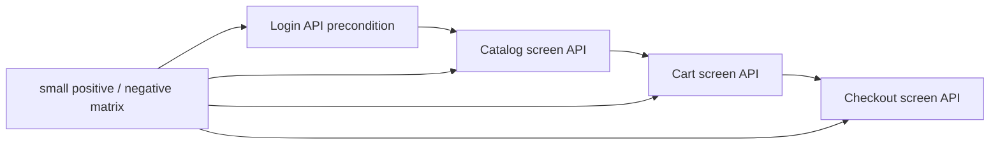

# Practice Shop — API screen pyramid feedback



<details>
<summary><strong>Legendă — feedback activ pentru piramida API/UI</strong></summary>

- săgeata solidă indică ordinea precondițiilor dintre ecrane;
- `Variants` este matricea mică de cazuri, nu o multiplicare de E2E;
- fiecare boundary trebuie coborât în component/integration înainte de a extinde journey-ul;
- diagrama descrie gap-ul urmărit, nu declară ToDo-ul închis.

</details>

## Scope

Acest feedback urmărește separarea dintre runtime-ul reutilizabil al aplicației
Practice Shop și testele care îl consumă. `src/main/java/atf/ui/practiceshop`
deține configurația typed, locatori, page objects, flow-uri UI, clientul API
și screen API flows. `src/test/java/atf/ui/tests/practiceshop` deține numai
teste organizate pe `component`, `api/component`, `api/integration` și `e2e`.

## Închise în această iterație

| Item | Rezultat | Dovadă |
|---|---|---|
| `SHOP-API-SCREEN-01` | ✅ screen boundaries | `PracticeShopLoginApi`, `PracticeShopCatalogApi`, `PracticeShopCartApi`, `PracticeShopCheckoutApi` compuse de `PracticeShopApiScreenFlow` |
| `SHOP-API-SCREEN-02` | ✅ login reutilizabil ca precondiție | `PracticeShopApiSession` păstrează token-ul; screen flow-ul următor reutilizează aceeași sesiune |
| `SHOP-API-SCREEN-03` | ✅ variație fără multiplicare E2E | fake transport pentru `401` login/current user, `404` product, `400` quantity și `2xx` payment; enum pentru metodele de payment |
| `SHOP-API-SCREEN-04` | ✅ packaging | reusable support mutat în `src/main/java`; testele au rămas exclusiv în namespace-ul `atf.ui.tests.practiceshop` |
| `SHOP-API-SCREEN-05` | ✅ locator boundary | locatorul de produs folosește ruta UI exactă configurată, nu text parțial ambiguu; `waitForEnabled` sincronizează controlul după încărcarea datelor |
| `SHOP-API-SCREEN-06` | ✅ standalone API evidence | `PracticeShopStandaloneApiReportTest` rulează screen flow-ul pe transport fake și publică în `artifacts/reports` request JSON, response JSON, headers, auth, status și execution evidence, fără browser |
| `SHOP-API-SCREEN-07` | ✅ live opt-in account fixture | `PracticeShopApiScreenFlowIntegrationTest` și account E2E sunt activate numai cu `api-mode=live` și account file extern; acceptance/guest rămân implicite și niciun secret nu este comis |
| `SHOP-API-SCREEN-08` | ✅ product selection diagnostic | purchase flow publică `productName`, ruta configurată, ruta selectată și URL-ul încărcat; fallback-ul pe nume nu mai poate ascunde o schimbare de catalog |
| `SHOP-API-SCREEN-09` | ✅ catalog/cart variation matrix | query typed pentru sort/filter/category și `in_stock`, plus `PUT` quantity / `DELETE` product cart, sunt acoperite în component tests; nu s-a adăugat un al doilea E2E |
| `SHOP-UI-VALIDATION-01` | ✅ contracte declarative pe fiecare ecran traversat | `@PracticeShopPageContract` + `PracticeShopPageValidator` pentru home, product, cart, guest, billing, payment, confirmation, login și account; `PracticeShopPageContractTest` verifică rutele, controalele semantice și rezultatul agregat |
| `SHOP-UI-VALIDATION-02` | ✅ validator plug-and-play și gate pentru toate contractele declarate | `PracticeShopPageValidator` oferă `validate`, `validateValues` și `validateValue`; testul component verifică cele 9 ecrane și numărul de controale, fără browser/network |
| `SHOP-UI-VALIDATION-03` | ✅ home screen modularizat în sub-checkpoint-uri | același purchase E2E publică structure, filters și product-grid; fiecare are Playwright actions, assertions dinamice de cardinalitate/style și screenshot inline; HOME contract are 16 controale semantice |
| `SHOP-UI-VALIDATION-04` | ✅ celelalte ecrane au component evidence fără multiplicare E2E | `PracticeShopPurchaseScreenValidator` adaugă, în checkpoint-ul existent al fiecărui ecran, assertions compacte de cardinalitate, bounding box și readiness interactivă pentru product, cart, guest, billing, payment și confirmation; fiecare păstrează screenshot-ul complet la zoom 100% |
| `SHOP-API-SCREEN-10` | ✅ jurnalul API este modular și nu amestecă orchestration, assertions și reporting | `PracticeShopApiNetworkJournal` capturează/selectează, `PracticeShopApiAssertions` validează JSON/headers/status, iar `PracticeShopApiEvidenceMapper` publică request/response/execution evidence |
| `SHOP-AUTH-01` | ✅ registration a fost explorat manual și modelat semantic | ATF Debug/browser MCP a confirmat formularul `first_name`, `last_name`, `dob`, `country`, `postal_code`, `house_number`, `street`, `city`, `state`, `phone`, `email`, `password` și submit-ul; `PracticeShopRegistrationPage` + `PracticeShopRegistrationData` dețin automatizarea fără selectori în test |
| `SHOP-AUTH-02` | ✅ cont reutilizabil, configurabil și redacted | `practice-software-testing-account.properties` este fixture module-owned în `src/test/resources`; `PracticeShopConfigurationLoader` permite override extern; `PracticeShopCredentials` nu publică parola în actions/assertions/HTML |
| `SHOP-AUTH-03` | ✅ login setup + purchase authenticated complet | `PracticeShopAuthenticatedPurchaseE2eTest` reutilizează login-ul, account precondition, catalog, product, cart, authenticated checkout, billing, payment și confirmarea finală; nu se adaugă E2E pentru fiecare endpoint |
| `SHOP-AUTH-04` | ✅ evidence API a fost legată de precondiția UI | login POST, users/me GET, headers/auth/status și execution evidence sunt atașate checkpoint-ului `GIVEN reusable account login...`; cart/payment păstrează request și response JSON în checkpoint-urile lor |
| `SHOP-AUTH-05` | ✅ fallback documentat pentru body-ul login-ului extern | dacă Chromium eliberează payload-ul gzip înainte de `Network.getResponseBody`, raportul afișează explicit `body unavailable` plus content-type/content-length; sesiunea este validată prin `/users/me` 200, fără token inventat; politica are test component dedicat |
| `SHOP-AUTH-06` | ✅ component gate pentru politica de login | `PracticeShopApiLoginAssertionsTest` verifică status 200, request JSON redacted și acceptarea transportului JSON non-empty atunci când body-ul nu mai este accesibil CDP |
| `SHOP-AUTH-07` | ✅ fixture live revalidat și înlocuit chirurgical | contul demo expirat a fost înlocuit prin registration JSON real (`201`), apoi login-ul a fost verificat separat (`200` + token); fixture-ul rămâne în `src/test/resources`, iar credentialele nu sunt copiate în evidence |

Nota de robustețe: locatorii de colecție rămân utilizați pentru count/cardinality,
iar sincronizarea folosește explicit primul element (`homeProductGridFirst`),
deoarece API-ul Playwright pentru `waitForVisible` este strict.

Selecția produsului este plug-and-play: o rută `/product/<id>` configurată are
prioritate și rămâne strictă; pentru fixture-ul extern volatil, `productPath: auto`
alege primul card pentru `productName` și validează obligatoriu ruta `/product/*`.
ID-ul observat din catalog rămâne sursa de adevăr pentru product detail și cart;
nu se maschează o lipsă a produsului, deoarece selecția eșuează dacă nici numele
nu apare.

### Regula de validare a formularelor

Validarea se face înainte ca UI-ul să treacă la ecranul următor. Flow-ul
folosește `fill → validate → submit`: valorile dinamice din YAML sunt verificate
în câmpurile reale înainte de submit, iar tranziția este acoperită de checkpoint-ul
următor. Aceasta evită contracte fragile pentru controale tranzitorii și păstrează
în raport motivul exact al unui fail.

Pentru ecranele purchase, component evidence este intenționat agregat pe ecran:
un checkpoint = o captură completă + acțiuni + assertions de componente. Nu
creăm sub-checkpoint-uri doar pentru a separa câmpuri care încap în aceeași
imagine. `guest-proceed` este tranzitoriu și se validează prin acțiunea de
submit/proceed, nu prin contractul ecranului Guest înainte de submit.

## Matricea minimă intenționată

```text
component/API
  login valid                 → 2xx + JSON token
  login invalid               → 401 + application/json
  current user anonim         → 401 + application/json
  product inexistent          → 404 + application/json
  cart quantity <= 0          → fail-fast înainte de transport
  payment cash/card variants  → request JSON + 2xx JSON

integration/API (opt-in)
  login credential file       → session token
  catalog → cart → checkout   → dynamic IDs și status/content-type

E2E (un singur journey)
  UI product → cart → billing → payment
  API evidence atașat checkpoint-urilor UI existente
```

Nu adăugăm câte un E2E pentru fiecare endpoint. Varianta rapidă aparține
component tests; integrarea live este opt-in și necesită account file extern;
E2E-ul rămâne dovada de orchestration UI + API.

## Refactor findings

| `SHOP-ARCH-11` | ✅ test-source purity | `PracticeShopStandaloneApiReportTest` nu mai deține publisher-ul Extent/API; responsabilitatea reusable este în `src/main/java/atf/ui/practiceshop/support/PracticeShopApiReportPublisher`, iar testul păstrează doar scenariul, fake transport-ul și assertions-ul artifactului |
| `SHOP-ARCH-12` | ✅ architecture guard pentru test-only scope | `PracticeShopArchitectureTest` permite în `src/test` doar clase `*Test`, `*TestSupport` sau `*Fixture` și continuă să respingă Page/Flow/Locators/E2eContext reutilizabile; fake transports rămân intenționat test-only |
| `SHOP-ARCH-13` | 🔎 observat, neînchis | `PracticeShopPurchaseFlow` și `PracticeShopApiNetworkJournal` sunt cele mai mari clase de runtime; următoarea decompoziție trebuie făcută separat, pe seam-uri testate, fără mutarea logicii în `src/test` |

## ToDo rămase

`SHOP-ARCH-13` rămâne singurul ToDo activ pe această analiză. Criteriul de
închidere este decompoziția pe responsabilități verificabile (capture/select,
redaction/evidence, orchestration UI/API) cu gate component și E2E verde; nu se
acceptă doar împărțirea mecanică a fișierului.

Nu mai există ToDo-uri active pe scope-ul `SHOP-API-SCREEN-06..09`. Orice
extensie nouă trebuie să adauge mai întâi un contract component sau integration
în aceeași piramidă; nu se multiplică purchase E2E pentru o variație de endpoint.

Pentru scope-ul registration → login → authenticated purchase nu mai există ToDo
activ: explorarea, fixture-ul, page object-ul, component gate-ul și E2E-ul au fost
închise și verificate. Singura limită observată este tehnică și documentată, nu
un defect mascat: body-ul POST `/users/login` poate fi eliberat de Chromium
înaintea citirii prin CDP. Se redeschide `SHOP-AUTH-05` numai dacă versiunea
Playwright/Chromium trebuie să ofere body-ul brut în raport; criteriul este
`RESPONSE JSON` redacted disponibil pentru login fără a introduce un al doilea
request sau credentiale în clar.

`SHOP-INT-04` este închis împreună cu acest boundary: `/users/me` `401` rămâne
ramură guest acceptată, iar `PracticeShopRuntimeDiagnostics` capturează separat
console errors și page errors. Un `TypeError` real este fail al singurului E2E,
nu este confundat cu statusul API.

`SHOP-INT-05` este închis: `postcode-lookup` este contractat ca advisory, iar
`PracticeShopCheckoutApi.CheckoutScreen` păstrează valorile introduse ca sursă
de adevăr. Răspunsul lookup-ului poate informa UI-ul, dar nu suprascrie billing.

`SHOP-INT-06` este închis pentru boundary-urile documentate ale aplicației:
sort/filter/category, `in_stock`, quantity update și product removal. Invalid
guest/billing/payment rămân variații UI/API separate când contractele lor vor
fi observate, fără a pretinde că există endpoint-uri care nu au fost capturate.

`PracticeShopCatalogFlow` aplică aceeași regulă de selecție ca purchase flow-ul:
un fixture exact rămâne strict, iar `auto` este explicit și acceptă doar o rută
`/product/*`; nu există fallback tăcut între cele două politici.
`PracticeShopGuestResilienceTest`
apelează clientul API pe transport fake, astfel încât contractul `401` este testat
prin aceeași cale de execuție ca aplicația, iar canalul de runtime browser rămâne
separat.

Fixture-ul YAML folosește acum `productPath: auto`, deoarece raporturile live au
confirmat rotația ID-ului pentru `Pliers` între rulări. O rută exactă rămâne
disponibilă pentru medii cu fixture stabil; schimbarea este acoperită de
`PracticeShopConfigurationTest` și de gate-ul complet.

## Verificare și sync

Build-ul acestei iterații se face în staging extern proiectului. Promovarea în
live trebuie să fie selectivă: se recitesc versiunile live ale fișierelor
existente, se aplică numai hunks-urile acestui boundary, iar refactorizările
paralele din alte module nu se suprascriu. După sync se rulează component/API
gate, apoi singurul E2E și se verifică fresh report-ul UI prin ATF Debug sau
Chromium/Playwright headless.
