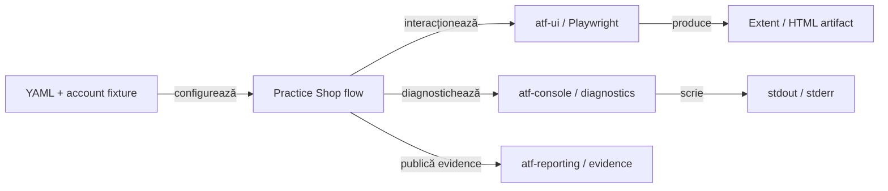
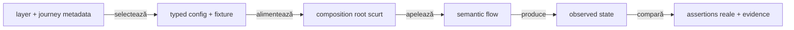

# Practice Shop — feedback live pentru API, UI și evidence

## Verdict curent

- `atf-test-practice-shop` este consumerul aplicației, nu owner-ul suportului
  generic de reporting, capture sau console;
- runtime-ul reutilizabil stă în `src/main/java`; testele rămân în
  `component`, `api/component`, `api/integration` și `e2e`;
- contractele stabile sunt în [`atf-test-practice-shop/README.md`](../../atf-test-practice-shop/README.md);
- feedback-ul păstrează numai limite externe, decizii cross-module și dovezi
  care trebuie reobținute;
- mock/component nu poate declara PASS pentru un business journey live.

## Boundary-ul consumerului



<details>
<summary><strong>Legendă — ce consumă Practice Shop și unde se oprește</strong></summary>

- YAML-ul configurează consumerul; nu mută rute sau locatori în librăria generică;
- `atf-ui` execută acțiuni și observații Playwright;
- `atf-console` este canalul diagnostic pentru pașii UI;
- `atf-reporting` publică artifactul semantic, fără să cunoască Practice Shop;
- testele verifică suportul generic în `atf-reporting-tests`, nu în acest modul;
- `src/main` deține suportul reutilizabil al aplicației, iar `src/test` deține
  orchestration-ul și transporturile de test.

</details>

## Scor pe axe

Scorurile au fost recalibrate pe implementarea și testele live curente; ele nu
înlocuiesc verdictul gate-urilor și nu transformă un test `SKIP` într-o dovadă
de business.

| Axă | Notă | Verdict actual |
|---|---:|---|
| API screen contracts | 98 | login, catalog, product, cart și checkout sunt typed, cu variații component și flow live verificabile |
| UI page validation | 97 | contractele declarative și validatorul semantic acoperă ecranele traversate fără E2E multiplicat |
| API evidence în UI | 98 | binding-ul per checkpoint, exchange-ul typed și atașarea single-node sunt confirmate în artifactul UI regenerat: un singur card Gherkin deține `UI validation` și `API validation`, iar request/response/execution rămân nested fără digesturi brute |
| E2E client–server trace | 98 | ordinea cauzală este confirmată vizual: `un singur Gherkin → UI validation + API validation → Exchange → Request/Response/Execution`; POST/GET rămân exchange-uri distincte, iar retry-ul nu creează pași API suplimentari |
| Overview configuration observability | 96 | snapshot-ul typed publică doar configurația relevantă, bounded și redacted, cu etichete operaționale și destinații UI/API separate |
| console wiring | 97 | Practice Shop consumă `atf-console` prin composition boundary; nu există mapping sau scriere directă în consumer |
| E2E discipline | 97 | guest și authenticated sunt journey-uri distincte; variațiile rămân component/API integration, iar contextul este per test |
| Test assertion trust | 97 | verdicturile provin din DOM, config și network observate; guard-ul respinge literal-`true`, iar preflight-ul respinge fixture-uri cu domenii demonstrative înainte de opt-in |
| E2E composition quality | 97 | `@WithE2eHarness` injectează context per metodă, iar `harness.run(...)` deține lifecycle-ul scenariului, teardown-ul și publicarea failure-ului; flow-ul și checkpoint-urile business rămân explicite în test |
| Test readability/OOP | 94 | compozițiile E2E exprimă flow-ul business și assertions observate; deschiderea contextului, diagnosticarea guest și finalizarea raportului sunt delegate suportului test-only |
| Plug-and-play test selection | 96 | adnotările și condițiile typed selectează fixture-ul authenticated/live fără metode `isConfigured()` duplicate |
| live business proof | 98 | run live cu fixture seeded alternativ a trecut login/current-user, catalog, product/cart, billing/payment și confirmarea purchase-ului; validarea vizuală manuală a artifactului rămâne un gate separat |
| **scor consumer** | **97** | authenticated purchase este dovedit prin E2E live și JSON/network evidence; rămâne verificarea vizuală manuală a artifactului proaspăt |

Scorul consumer este `97/100`; este evaluarea contractelor și a dovezii
disponibile, nu numărul de teste dintr-un run. Nu este `100` până când raportul
fresh nu este inspectat vizual în browserul de debug.

- Journey-ul guest păstrează purchase-ul complet până la confirmation observată.
- Fixture-ul authenticated a trecut login-ul și `GET /users/me`; explorarea ATF
  Debug a izolat apoi un false negative la checkout: `body` întorcea doar
  rândurile tabelului, deși UI afișa salutul și controlul de continuare.
- Codul verifică acum controlul semantic `AUTHENTICATED_PROCEED`, nu textul
  incidental din body; fixture-ul blocat nu a mai fost reutilizat.
- Run fresh `2026-10-21 19:58` cu un cont seeded distinct a trecut `1/1` și a
  observat `POST /users/login → 200`, `GET /users/me → 200` cu bearer,
  `POST /payment/check → 200`, request/response JSON și textul DOM
  `Payment was successful`; flow-ul nu mai este blocat de fixture.
- Raportul fresh este în staging extern, sub
  `<ATF_WORKSPACE>/.tmp/practice-shop-auth-20261021/artifacts/reports/ui/`;
  numele artifactului nu este păstrat în feedback.
  Inspecția structurală confirmă dovezile de mai sus, dar deschiderea în browserul
  MCP a fost refuzată pentru URL-ul `file://`; randarea nu este declarată
  verificată și artifactul nu este promovat în `artifacts/reports/ui` încă.
- Artifactul trebuie deschis în browserul de debug printr-o cale acceptată de
  acesta; până atunci dovada business este închisă, însă gate-ul de publicare
  vizuală rămâne activ. Nu se păstrează ca gap afirmația veche că purchase-ul
  authenticated nu ajunge la confirmation.
- Run-ul este `Warning`, nu `Pass`, deoarece aplicația emite diagnostice de
  bootstrap anonim (`GET /users/me → 401` și console `ERR_ABORTED`) care sunt
  păstrate vizibil. Acestea nu anulează aserțiunile de business, dar trebuie
  citite ca warning în raport, nu mascate.

## Închideri promovate în README-ul ownerului

| Grup | Stare | Dovadă stabilă |
|---|---|---|
| `SHOP-API-SCREEN-01..10` | ✅ | screen flows, transport mock, selecție, jurnal, assertions și evidence mapper |
| `SHOP-UI-VALIDATION-01..04` | ✅ | `@PracticeShopPageContract`, `PracticeShopPageValidator`, component evidence |
| `SHOP-MIX-01..03` | ✅ | checkpoint-ul UI și exchange-urile API sunt în ordinea cauzală corectă, fără JSON duplicat; `UI validation` și `API validation` sunt copii ai aceluiași card Gherkin |
| `SHOP-AUTH-01..07` | ✅ implementare și business live | checkout-ul folosește controlul semantic `AUTHENTICATED_PROCEED`; run-ul fresh cu fixture seeded distinct a trecut login/current-user, checkout, billing și payment până la confirmation; rămâne gate-ul de randare manuală a raportului |
| `SHOP-AUTH-08` | ✅ safety gate local | `PracticeShopCredentials.hasLiveAccountCandidate`, `PracticeShopConfiguration.accountConfigured` și testele component resping fixture-uri demonstrative; override-ul extern este disponibil, fără a pretinde că preflight-ul validează contul remote |
| `SHOP-JSON-03..04` | ✅ | JSON tree/path și vocabular typed; substring-ul nu este contract |
| `SHOP-CONFIG-02` și `SHOP-ROUTE-04..05` | ✅ | owner unic pentru host, rute relative, segmente dinamice validate și output separat `artifacts/reports/ui` / `artifacts/reports/api` |
| `SHOP-ARCH-11..13` | ✅ | runtime în `src/main`, test-only support în `src/test`, capture/select separate |
| `SHOP-REPORT-FAILURE-01` | ✅ | cauza failure-ului este proiectată în `Fails`, nu ascunsă de primul assertion verde |
| `SHOP-API-REAL-02` | ✅ guest și authenticated live | guest-ul verifică product/cart/payment prin `LIVE_HTTP`; authenticated run-ul fresh confirmă login/current-user, billing și `POST /payment/check 200` cu request/response JSON și `Payment was successful` |
| `SHOP-NET-02` | ✅ guest live | boundary-ul warning-ului guest este corect: target `GET /users/me → 401`, assertions observabile și evidence type `runtime-diagnostic`, fără copilul generic `UI validation`; deduplicarea aggregate este închisă |
| `SHOP-DIAGNOSTIC-03` | ✅ guest live | `Scenario.warningDiagnostics` și `PracticeShopRuntimeDiagnosticsTest` proiectează o singură assertion per semnătură semantică, cu count/sources observabile; response și console nu mai produc assertions duplicate |
| `SHOP-API-TRACE-01` | ✅ guest live | checkpoint-ul compus păstrează request/response/execution canonical și inspectorul final compact sub `API validation`; nu mai materializează al doilea card Gherkin |
| `SHOP-API-TRACE-02` | ✅ guest live — parity lower-level | disclosure-ul UI reutilizează labels, redaction policy, filtrarea browser noise și replay-ul API direct; `API validation` păstrează request/response/execution per exchange și este atașat cardului UI |
| `SHOP-DIAGNOSTIC-SEMANTICS-01` | ✅ | `UiEvidencePublisher.publishDiagnostic(...)`, test component și guest E2E produc `Runtime diagnostic` + status/target/assertions observabile |
| `SHOP-TRACE-INTERLEAVE-01` | ✅ | `UiPhaseLifecycle.apiTrace(...)` și `PracticeShopE2eContext.Scenario.checkpoint(...)` verifică ordinea UI → API → UI, un singur nod Gherkin și o singură proiecție JSON per exchange |
| `SHOP-REPORT-BODY-01` | ✅ pe owner generic | `ReportingSettings.bodyMaxDisplayCharacters=100` este încărcat din `atf.yaml`, aplicat după redaction/pretty-print și păstrat în disclosure; `0` dezactivează limita, iar System îl publică bounded, fără copiere în sumar |
| `SHOP-CONSOLE-01` | ✅ pe consumer | sink-ul configurat este injectat la composition root; flow-urile nu folosesc `println` |
| `SHOP-CONSOLE-02` | ✅ pe composition boundary | adapterul este test-only în `atf-reporting-tests`; modulele production rămân independente, iar Practice Shop nu face mapping |
| `SHOP-REPORT-SYSTEM-01`, `SHOP-REPORT-NET-01`, `SHOP-REPORT-AUTH-01` | ✅ pe consumer/generic owner | System/Environment și primitivele de network/auth sunt typed, bounded, redacted și verificate component/integration; fresh MCP/Chromium confirmă configurația operațională fără `Suite`/`Test package`/`Flow`/`Fixture`/`Checkout`, durate umane (`20s`, `45s`), disclosure-urile API canonical și separarea `API precondition` / `UI journey precondition`; aggregate-ul journey este acum typed și namespaced în aceeași cerere collapsed |
| `SHOP-PLAYWRIGHT-RETRY-01` | ✅ | `PracticeShopUiRetryConfiguration` încarcă `maxAttempts`, `backoff`, operațiile read-only și motivul fără boolean redundant; YAML-ul live este fail-closed (`maxAttempts=1`, `eligibleOperations=[]`), iar `UiActionRecorder` publică attempt-ul eșuat ca `Info` înaintea rândului de retry; `UiRetryPolicyTest`, `PracticeShopUiRetryConfigurationTest` și `PlaywrightActionSequenceTest` verifică policy-ul și istoricul ordonat. Dacă un consumer schimbă ulterior `eligibleOperations`, acesta redeschide explicit dovada E2E vizuală. |
| `SHOP-REPORT-SYSTEM-02` | ✅ | `PracticeShopReportSystemMetadata` publică numai configurație operațională allowlist-uită: runtime, ținte, browser, timp, network, retry, evidence și reporting; component test-ul respinge durate ISO și orice identitate de test în `System` |
| `SHOP-E2E-ROOT-01` | ✅ | `PracticeShopE2eTestSupport.E2eExtension` și `E2eHarness` compun configurația, contextul per metodă și locatorii; `PracticeShopTestSupport` rămâne owner doar pentru selecția fixture-urilor |
| `SHOP-E2E-ISOLATION-01` | ✅ | `@WithE2eHarness` injectează un context separat fiecărei metode; `PracticeShopArchitectureTest` respinge lifecycle duplicat, `PER_CLASS` și browser partajat |
| `SHOP-TEST-READ-02` | ✅ | `PracticeShopE2eTestSupport` standardizează lifecycle-ul, rularea scenariului și diagnosticarea; composition roots rămân scurte. Guest și authenticated au dovadă live până la confirmation; raportul authenticated fresh așteaptă numai auditul vizual MCP |
| `SHOP-HTML-CONTRACT-01` | ✅ | `PracticeShopReportHtmlTestSupport` separă text, celulă exactă, ordine și absență; component/integration checks nu mai depind de un singur șir HTML mare pentru contractul principal |
| `SHOP-TEST-LIFECYCLE-01` | ✅ | `PracticeShopApiClient` este `AutoCloseable`, curăță bearer state și refuză utilizarea după close; integration tests folosesc try-with-resources |
| `SHOP-TEST-DSL-01` | ✅ | `PracticeShopTestSupport` oferă condiții compuse typed pentru authenticated fixture și live API; gating-ul nu mai este duplicat prin `isConfigured()` în fiecare clasă |
| `SHOP-TEST-TRUST-01` | ✅ component + live business | setup-ul compară expected/actual, checkout-ul observă markerul DOM, testele component verifică controlul authenticated/payment, iar run-ul live confirmă login/current-user și purchase confirmation; orice verdict literal sau self-comparison reaprinde item-ul |
| `REP-TRACE-03` | ✅ owner generic | publisher-ul generic și rendererele Extent/fallback publică trace-ul per exchange sub `API validation`; fresh consumer proof-ul arată un singur card Gherkin cu copii `UI validation` și `API validation` |
| `REP-EVID-08` | ✅ owner generic | URL value cells păstrează textul complet și wrapping controlat, verificat prin component/integration/MCP |
| `REP-TRACE-04` | ✅ owner generic | Practice Shop folosește signature-ul și fingerprint-ul numai intern pentru corelare/deduplicare; publisher-ul proiectează body-state marker și linkuri locale `screenshot-n`, fără digest brut în HTML |

## Audit live — calitatea testelor



<details>
<summary><strong>Legendă — constatări prioritare și boundary-ul testelor</strong></summary>

- `PracticeShopAccountAndCatalogE2eTest` folosește acum
  `PracticeShopPageValidator` pentru identity și redaction, iar ruta este
  verificată prin `URI` + contractul de path;
- assertions-urile hardcodate din account/catalog E2E, purchase flow și setup au
  fost eliminate; component/report contracts rămân lower-level, iar
  `PracticeShopReportHtmlTestSupport` le separă de dovada business live;
- `PracticeShopE2eContext` publică acum setup assertions cu expected/actual
  observabil: modul guest/authenticated, fixture availability și profilul de
  evidence; `PracticeShopReportSystemMetadata` explică separat precondiția API
  configurată și precondiția efectivă a journey-ului UI;
- payment selection folosește textul opțiunii selectate din DOM, nu repetă
  valoarea YAML în coloana `ACTUAL`; authenticated checkout verifică faptul că
  butonul semantic de continuare este randat și enabled. ATF Debug a arătat că
  mesajul `already logged in` este vizibil, dar extractorul generic pentru
  `body` returnează numai rânduri când pagina conține tabel; aserțiunea pe text
  era deci o observație fals negativă, nu o problemă de autentificare;
- ultimul rerun authenticated nu a ajuns la checkout: screenshot-ul ATF Debug
  arată mesajul serviciului `Account locked, too many failed attempts`; acest
  fixture nu se mai reutilizează până la deblocare sau provisionarea unui
  cont separat, iar lipsa purchase-confirmation rămâne un gap explicit;
- `PracticeShopApiAssertionsTest.loginWithoutCurrentUserDoesNotPassWhenTheObservedJsonTransportIsInvalid`
  fixează negativ ramura în care `current-user` nu este emis: verdictul trebuie
  să derive din status, content-type și transportul observat, nu din absența
  exchange-ului și nu dintr-un `true` implicit;
- guard-ul component extins scanează `src/main/.../flow` și `support`, nu doar
  clasele E2E, astfel încât o aserțiune sintetică să nu poată fi ascunsă în
  suportul reutilizabil;
- `PracticeShopPurchaseE2eTest`, `PracticeShopAuthenticatedPurchaseE2eTest` și
  `PracticeShopAccountAndCatalogE2eTest` folosesc acum
  `@WithE2eHarness`/`harness.run(...)`; extensia creează configurația, contextul
  și locatorii per metodă, iar scenariul atașează cleanup failure ca suppressed
  fără să înlocuiască failure-ul business;
- `Scenario.warning(...)` folosește acum seam-ul generic `diagnostic(...)`;
  raportul publică `Runtime diagnostic` și `runtime-diagnostic`, păstrând
  warning status, target-ul și assertions fără să-l clasifice ca `UI validation`.
- `Scenario.checkpoint(...)` publică un singur checkpoint Gherkin, cu
  `UI validation` și `API validation` ca copii frați; request/response/execution
  sunt proiectate o singură dată per exchange. Ordinea și forma single-node sunt
  verificate prin component/integration contract și fresh MCP/Chromium proof.
- contractele HTML principale folosesc acum `PracticeShopReportHtmlTestSupport`
  pentru text semantic, celule exacte, ordine și absență; `contains` rămâne doar
  pentru smoke text sau tokeni explicit interziși, nu pentru structura raportului;
- `PracticeShopApiScreenFlowIntegrationTest` și `PracticeShopStandaloneApiReportTest`
  închid acum clientul prin try-with-resources; orice revenire la `client = null`
  este regresie de lifecycle, nu stil acceptat;
- `PracticeShopE2eContext` rămâne boundary-ul runtime, iar lifecycle-ul de test
  este compus de `PracticeShopE2eTestSupport`: `@WithE2eHarness` injectează un
  harness per metodă, iar `harness.run(...)` deține teardown-ul și atașarea
  cleanup failure ca suppressed; `PracticeShopTestSupport` păstrează numai
  selecția fixture-urilor. `PracticeShopE2eTestSupportTest` acoperă idempotency
  și ambele căi de failure, iar `PracticeShopArchitectureTest` respinge
  lifecycle duplicat și context partajat. Limita `SHOP-TEST-READ-02` este
  închisă; nu mutăm verdictul sau semantica business în extensia JUnit.

</details>

## Ținta de refactorizare a testelor

```text
@AtfE2eTest + metadata typed
  → context/extension configurat o singură dată
  → fixture semantic
  → flow semantic
  → assertions observate
  → evidence și teardown în support
```

Reguli de calitate:

- testul descrie business intent; nu construiește manual infrastructura de
  raportare, browser sau transport;
- un test E2E are puține linii și un singur rezultat de business verificat;
- `expected` vine din config/fixture, `actual` vine din page/API/DOM observat;
- orice assertion care se termină cu `true` hardcodat este respinsă;
- suportul care publică assertions este guvernat identic cu testul: niciun flow,
  page helper sau evidence publisher nu poate transforma o presupunere într-un
  verdict verde;
- ruta se validează prin parser/path contract, nu prin `contains`;
- fiecare composition root poate fi rulat singur și nu depinde de ordinea altui
  test;
- variations matrix rămâne în component tests; integration dovedește boundary-ul;
- adnotarea exprimă layer, journey, transport și precondiție; nu se repetă
  `isConfigured()` în fiecare clasă;
- static imports sunt permise pentru assertions și constante cu owner evident;
- lifecycle, retry, screenshot și report close aparțin extension/harness-ului,
  nu corpului testului.

## Criterii pentru închiderea limitelor active

- code owner-ul și source-set-ul afectat sunt identificați explicit;
- fixul păstrează separarea component → integration → E2E și nu adaugă browser
  pentru o variație care poate fi verificată lower-level;
- testul focalizat dovedește comportamentul la nivelul potrivit;
- o excepție este documentată cu owner, motiv și boundary verificabil, nu doar
  adăugată într-o allow-list;
- regula stabilă rezultată este promovată în README-ul ownerului;
- feedback-ul rămâne cu gap-ul activ și criteriul de redeschidere.

## Închideri promovate în owner docs

| ID | Dovadă | Verdict |
|---|---|---|
| `SHOP-REPORT-NET-02` | `ReportNetworkInspector.JourneyAggregate`, `ReportNetworkInspectorTest` și consumer E2E | aggregate-ul journey calculează authentication, correlation, transport, signatures și diagnostics fără JSON duplicat; collision handling-ul necorelat este închis generic prin `REP-DIAGNOSTIC-04` |
| `SHOP-REPORT-NET-03` | `ReportNetworkAggregateMarkup`, `ReportNetworkInspectorTest` și fresh MCP/Chromium | Extent și fallback publică inspectorul nested, cu cele cinci secțiuni typed și fără fields flat `network.aggregate.*`; `Response details` are numai indexul bounded, `Scenario correlation` este separat de request-uri, iar `Unique request signatures` afișează fiecare semnătură o singură dată ca un card compact; request/response/execution per exchange rămân în checkpoint-ul canonical prin `REP-TRACE-03` |
| `SHOP-REPORT-AUTH-02` | `AuthenticationObservation` + component/HTML contract | method/source/status/count sunt grupate determinist și rămân credential-free; semantică „observed” |
| `SHOP-DIAGNOSTIC-02` | `DiagnosticObservation` + component/HTML contract | response și console pentru aceeași semnătură sunt un singur observation cu count/sources; alte rute/statusuri rămân distincte |
| `SHOP-DIAGNOSTIC-03` | `Scenario.warningDiagnostics`, `PracticeShopRuntimeDiagnosticsTest` și fresh guest E2E/MCP | warning-ul consumerului grupează diagnosticele după semnătură semantică și publică count/sources într-o singură assertion; erorile neașteptate rămân failure |
| `SHOP-API-BIND-01` | `PracticeShopApiCheckpoint`, `PracticeShopApiEvidenceBinding`, `PracticeShopApiEvidenceBindingTest` și fresh E2E/MCP | binding-ul per journey/checkpoint este citit din YAML/override, journal-ul publică `evidence(checkpoint)`, iar System confirmă checkpoint-urile efective |

## Limite active și criterii de redeschidere

| ID | Owner | Limită actuală | Criteriu de închidere |
|---|---|---|---|
| `SHOP-API-REAL-01` | Practice Shop + raportare | ✅ business gate: run fresh `1/1`, login/current-user `200`, checkout autenticat, billing, `POST /payment/check 200`, JSON și `Payment was successful`; contul blocat anterior nu a mai fost folosit | deschide artifactul fresh în MCP/ATF Debug, verifică vizual ordinea checkpoint-urilor, expanded request/response/execution, screenshots și zero render/console defects; apoi promovează exact artifactul verificat în `artifacts/reports/ui` |

Preflight-ul local (`PracticeShopCredentials.hasLiveAccountCandidate`) respinge
domeniile rezervate `example`, `example.com`, `example.net`, `example.org`,
`.test`, `.invalid` și `.localhost`, inclusiv subdomeniile; acesta previne
trimiterea accidentală a fixture-ului demonstrativ, dar nu validează parola și
nu închide dovada business.

### Explorare manuală în ATF Debug — checkpoint-uri observate

1. Run-ul fresh trece `SETUP`; `GIVEN` login produce `POST /users/login → 200`
   și `GET /users/me → 200` cu bearer, apoi validează contul și precondiția API.
2. `GIVEN` catalogul, filtrele, cardurile și pagina produsului trec; în UI sunt
   corelate exchange-urile reale de căutare/produs, fără a le dubla ca pași
   Gherkin independenți.
3. `WHEN` cart-ul verifică produsul și cantitatea; `POST /carts/{id}` și
   `GET /carts/{id}` sunt exchange-uri distincte și raportate sub checkpoint.
4. După click pe `button[data-test='proceed-1']`, screenshot-ul checkout arată
   salutul autentificat și butonul `button[data-test='proceed-2']`. Totuși,
   `readableText(body)` întoarce doar rândurile tabelului coșului; aserțiunea
   pe text a fost fals negativă. Fixul așteaptă controlul semantic, apoi
   verifică `rendered` și `enabled` înainte de click.
5. Run-ul fresh continuă din `button[data-test='proceed-2']`, completează billing,
   selectează metoda `Cash on Delivery`, apoi click `button[data-test='finish']`;
   DOM-ul confirmă `Payment was successful`, iar network journal-ul leagă
   `POST /payment/check → 200` de checkpoint-ul final. Request JSON este
   `payment_method=cash-on-delivery`, response JSON conține mesajul de succes.
6. Raportul fresh nu a putut fi deschis în browserul MCP: politica browserului a
   refuzat protocolul local `file://`. Prin urmare, pașii și payload-urile sunt
   confirmate din artifactul HTML și rezultatul testului, dar verificarea
   vizuală manuală rămâne explicit deschisă; nu pretindem că randarea a fost
   inspectată sau că screenshot-urile au fost validate vizual.

<details>
<summary><strong>Interpretare și limite de redeschidere</strong></summary>

- collision handling pentru diagnosticele necorelate este închis generic prin
  `REP-DIAGNOSTIC-04`; Practice Shop consumă contractul, fără ownership pentru
  algoritmul generic;
- `REP-TRACE-03` este închis: fresh UI proof-ul arată un singur card cu aceeași
  propoziție Gherkin și `API validation` ca frate al `UI validation`; se redeschide
  numai la regresie vizibilă;
- `REP-EVID-08` rămâne închis pentru wrapping și se redeschide numai la regresie
  verificată;
- nu există ToDo local separat pentru `SHOP-API-SCREEN-01..10`, UI validation,
  evidence policy, JSON semantic sau split-ul capture/select; orice extensie nouă
  începe cu contract component, nu cu E2E pentru o variație de endpoint sau selector.

</details>

## Dovadă necesară pentru închiderea unui ToDo

- component: contract typed, variație pozitivă și negativă, fără browser real;
- integration: boundary-ul real și lifecycle-ul resursei sunt verificabile;
- E2E: journey-ul selectat produce assertions observate, evidence și verdict
  semantic, fără a transforma raportul în sursă de contract;
- MCP/Chromium: se folosește numai când criteriul este vizual — randare,
  disclosure, ordine sau System/Environment;
- feedback-ul păstrează criteriul și dovada lipsă, nu nume de artifact,
  timestamp, număr istoric de teste sau transcript de rulare.

## Piramida de testare intenționată

```text
component
  route/config/page contract → input invalid → JSON/status/header matrix

integration (opt-in)
  account fixture → LIVE_HTTP session → catalog → cart → checkout

E2E
  guest purchase       → UI + API evidence pe checkpoint-uri
  authenticated purchase → login setup + UI + API evidence
```

<details>
<summary><strong>Reguli de interpretare</strong></summary>

- component test dovedește contractul și este rapid, determinist și browser-free;
- integration test dovedește boundary-ul de transport și este opt-in;
- E2E dovedește orchestration-ul, nu fiecare endpoint în parte;
- screenshot policy și flow mode sunt configurate typed, nu prin flag-uri ad-hoc;
- `validation.profile` și `validation.apiEvidence` selectează checkpoint-urile API;
  inspectorul browser este opt-in separat prin `networkInspector.enabled`;
  retry policy-ul Playwright este declarat în YAML, implicit o singură încercare fără
  operații eligibile;
- screenshot-urile pot fi per checkpoint, final-only sau none, dar cardinalitatea
  trebuie verificată fără browser înainte de journey;
- `atf-reporting-tests` este ownerul dovezii generice; Practice Shop este doar
  consumerul configurat.
- guest evidence-ul curent este suficient pentru auditul typed al întregului
  journey: `UI step → auth → attempt → exchange → retry → assertion` este
  păstrat în ledger și în disclosure-urile locale; forma vizuală conformă este
  `un Gherkin checkpoint → UI validation + API validation → UI continuation`.
  Raportul fresh confirmă această topologie, iar diagnosticul guest rămâne
  `Runtime diagnostic`, nu `UI validation`.
- inspectorul final este un index compact al journey-ului, nu o a doua copie a
  cardurilor API și nici o zonă pentru System; aggregate-ul typed de auth,
  diagnostics, correlation, counters și signatures este publicat în aceeași
  cerere collapsed și rămâne ușor de scanat.

</details>

## Reguli promovate în README-ul ownerului

Regulile stabile pentru flow-uri, assertions, evidence, lifecycle și selecția
testelor sunt în [`atf-test-practice-shop/README.md`](../../atf-test-practice-shop/README.md).
Acest feedback păstrează numai limitele care încă pot schimba codul sau
contractul și criteriile lor de redeschidere.

## Protocol de revalidare

<details>
<summary><strong>Când se schimbă flow-ul sau contractul consumerului</strong></summary>

1. modifică ownerul semantic: config, route, locator, page, flow sau evidence mapper;
2. rulează component gate-ul focalizat;
3. rulează integration numai cu fixture-ul explicit necesar;
4. rulează unul dintre cele două journey-uri E2E numai când schimbarea atinge
   orchestration-ul browser;
5. verifică în MCP/Chromium artifactul fresh dacă afirmația este vizuală;
6. actualizează acest registru doar dacă statusul sau criteriul de închidere s-a
   schimbat;
7. mută regula stabilă în README, nu o copia în feedback.

</details>

## Referințe normative

- [`atf-test-practice-shop/README.md`](../../atf-test-practice-shop/README.md) —
  config, routes, pages, flows, evidence și gates;
- [`atf-reporting/README.md`](../../atf-reporting/README.md) — suportul generic
  de reporting și publication;
- [`atf-reporting-tests/README.md`](../../atf-reporting-tests/README.md) —
  component/integration/browser proof pentru librărie;
- [`docs/ATF_Evidence_Capture_Contract.md`](../ATF_Evidence_Capture_Contract.md)
  — contract transversal pentru capture policy;
- [`docs/feedback/README.md`](README.md) — registrul central.
