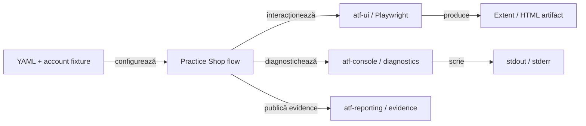

# Practice Shop — feedback live pentru API, UI și evidence

## Verdict curent

- `atf-test-practice-shop` este consumerul aplicației, nu owner-ul suportului
  generic de reporting, capture sau console;
- runtime-ul reutilizabil stă în `src/main/java`; testele rămân în
  `component`, `api/component`, `api/integration` și `e2e`;
- contractele stabile sunt în [`atf-test-practice-shop/README.md`](../../atf-test-practice-shop/README.md);
- feedback-ul păstrează numai limite externe, decizii cross-module și dovezi
  care trebuie reobținute;
- mock/component nu poate declara PASS pentru un business journey live.

## Boundary-ul consumerului



<details>
<summary><strong>Legendă — ce consumă Practice Shop și unde se oprește</strong></summary>

- YAML-ul configurează consumerul; nu mută rute sau locatori în librăria generică;
- `atf-ui` execută acțiuni și observații Playwright;
- `atf-console` este canalul diagnostic pentru pașii UI;
- `atf-reporting` publică artifactul semantic, fără să cunoască Practice Shop;
- testele verifică suportul generic în `atf-reporting-tests`, nu în acest modul;
- `src/main` deține suportul reutilizabil al aplicației, iar `src/test` deține
  orchestration-ul și transporturile de test.

</details>

## Scor pe axe

| Axă | Notă | Verdict actual |
|---|---:|---|
| API screen contracts | 96 | login, catalog, product, cart și checkout sunt typed și testate lower-level |
| UI page validation | 95 | contractele declarative acoperă ecranele traversate fără E2E multiplicat |
| API evidence în UI | 94 | request/response/execution sunt atașate checkpoint-ului care le-a cauzat |
| E2E client–server trace | 92 | exchange-urile LIVE_HTTP sunt vizibile per checkpoint, cu JSON, status, trace și signature; lipsește încă o vedere agregată a întregului journey |
| Overview configuration observability | 68 | System/Environment este încă generic și nu publică snapshot-ul configurat al run-ului |
| console wiring | 96 | Practice Shop consumă `atf-console`; reconcilierea cross-module este explicită în composition root-ul `atf-reporting-tests`, fără mapping duplicat în consumer |
| E2E discipline | 96 | guest și authenticated sunt journey-uri distincte; variațiile rămân component/integration |
| live business proof | 78 | journey-ul guest product → cart → payment este verificat prin `LIVE_HTTP`; login-ul reutilizabil rămâne blocat de fixture-ul extern |
| **scor consumer** | **91** | dovada guest este solidă, dar observabilitatea configurației și vizualizarea agregată client–server încă nu sunt la nivelul reperului RegressionExtent |

## Închideri promovate în README-ul ownerului

| Grup | Stare | Dovadă stabilă |
|---|---|---|
| `SHOP-API-SCREEN-01..10` | ✅ | screen flows, transport mock, selecție, jurnal, assertions și evidence mapper |
| `SHOP-UI-VALIDATION-01..04` | ✅ | `@PracticeShopPageContract`, `PracticeShopPageValidator`, component evidence |
| `SHOP-MIX-01..03` | ✅ | API precondition și exchange-uri atașate checkpoint-urilor UI existente |
| `SHOP-AUTH-01..07` | ✅ pe implementare; live proof pending | registration, fixture loading, login setup, redaction și purchase authenticated sunt implementate; authenticated E2E/API rămân skip până la fixture extern acceptat |
| `SHOP-JSON-03..04` | ✅ | JSON tree/path și vocabular typed; substring-ul nu este contract |
| `SHOP-CONFIG-02` și `SHOP-ROUTE-04..05` | ✅ | owner unic pentru host, rute relative și segmente dinamice validate |
| `SHOP-ARCH-11..13` | ✅ | runtime în `src/main`, test-only support în `src/test`, capture/select separate |
| `SHOP-REPORT-FAILURE-01` | ✅ | cauza failure-ului este proiectată în `Fails`, nu ascunsă de primul assertion verde |
| `SHOP-API-REAL-02` | ✅ guest live | `PracticeShopPurchaseE2eTest` verifică în aceeași sesiune LIVE_HTTP `product_id`, `name`, `quantity`, `cart_items`, `payment_method` și `Payment was successful`; authenticated API rămâne separat blocat de fixture |
| `SHOP-NET-02` | ✅ cu excepție explicită | warning-ul guest este publicat cu target `GET /users/me → 401`, iar assertions păstrează `source`, `route`, `status`, URL și mesaj; erorile necunoscute încă eșuează |
| `SHOP-API-TRACE-01` | ✅ guest live, per checkpoint | în MCP, checkpoint-ul cart afișează `POST /carts/...` și `GET /carts/...`, request/response JSON, status `200`, transport `LIVE / HTTP`, retry history, `phase=cart`, `sequence`, `correlation`, request/response digest și `source=UI_BROWSER` |
| `SHOP-CONSOLE-01` | ✅ pe consumer | sink-ul configurat este injectat la composition root; flow-urile nu folosesc `println` |
| `SHOP-CONSOLE-02` | ✅ pe composition boundary | adapterul este test-only în `atf-reporting-tests`; modulele production rămân independente, iar Practice Shop nu face mapping |

## Limite active și criterii de închidere

| ID | Owner | Limită actuală | Criteriu de închidere |
|---|---|---|---|
| `SHOP-API-REAL-01` | Practice Shop + mediu extern | fixture-ul local este placeholder, `authenticatedE2eEnabled=false`, iar login-ul live nu este dovadă de sesiune validă | fixture extern non-placeholder, `authenticatedE2eEnabled=true`, testele authenticated și standalone API nu mai sunt skip, login/current-user `200`, apoi rerun `LIVE_HTTP` cu login → catalog → cart → payment |
| `SHOP-REPORT-SYSTEM-01` | `atf-reporting` + Practice Shop | Overview → `System/Environment` publică `Environment=LOCAL`, `API base URL=configured per ApiExecutor`, runtime/OS/client generice; nu știm din raport browser/headless, viewport, zoom, timeout-uri, validation profile, API endpoint/mode/precondition, screenshot policy, report destinations, product fixture, quantity/payment sau dacă authenticated E2E este activ | provider typed de metadata, alimentat de snapshot-ul de config al consumerului, cu câmpuri stabile și valori redacted/normalizate; Overview trebuie să distingă runtime/config/reporting fără parole, token-uri, căi temporare sau nume dinamice de HTML; component + integration + E2E MCP verifică markup-ul și vizibilitatea |
| `SHOP-REPORT-NET-01` | `atf-reporting` + Practice Shop | raportul dovedește exchange-urile în checkpoint-uri, dar nu are încă o secțiune compactă de tip network inspector care să ordoneze întregul journey `UI step → 0..n request-uri → response → assertion` într-o singură vedere | disclosure collapsed-by-default, per run/phase, cu `sequence`, `phase`, initiator/UI step, method, relative route, status, content-type, transport/provenance, request/response digest și link intern către JSON/evidence detaliat; nu se duplică body-ul în tabelul sumar |

Nu există ToDo local separat pentru `SHOP-API-SCREEN-01..10`, UI validation,
evidence policy, JSON semantic sau split-ul capture/select. Orice extensie nouă
trebuie să înceapă cu contract component; nu se adaugă E2E pentru o variație de
endpoint sau selector.

## Dovadă de rerun live și audit MCP

- Rerun extern: `mvn -pl atf-test-practice-shop -am test -DforkCount=0` — **91 teste totale, 0 failures, 0 errors, 5 skipped**; guest E2E live este executat, iar cele 5 skip-uri sunt doar ramurile care cer account fixture.
- Rerun focalizat ulterior: `mvn -pl atf-test-practice-shop test -Dtest=PracticeShopPurchaseE2eTest -DforkCount=0` — **1 test, 0 failures, 0 errors, 0 skipped**; raportul fresh a fost deschis în MCP/Chromium și verificat manual prin expand/click.
- `PracticeShopPurchaseE2eTest` a executat browserul real pe aplicația externă și a trecut catalog, produs, coș, identity, billing, payment și confirmarea `Payment was successful`.
- Raportul UI a fost deschis și expandat în MCP/Chromium: `SETUP`, `TEST BODY`, toate fazele Gherkin, acțiunile Playwright, screenshot-ul inline, auditul și assertions sunt prezente.
- Pentru checkpoint-ul `WHEN cart displays the configured product with the requested quantity`, raportul fresh publică efectiv `POST /carts/{id}` și `GET /carts/{id}`; am verificat manual `Request details`, `Response details` și `Execution evidence`. Request-ul conține JSON pretty cu `product_id` și `quantity`, răspunsurile sunt JSON pretty, iar trace-ul leagă `sequence=17`, `phase=cart`, `ActionCaused`, `correlation`, `request signature`, digest-urile și `source=UI_BROWSER`.
- Reperul static `RegressionExtent.html` are un `System/Environment` mult mai util: Portal, API-uri separate, Browser/headless/viewport, transport/auth, API evidence, UI checkpoints, suite/lane, expected/discovered scenarios, deferred și manifest + SHA256. ATF-ul nostru trebuie să adopte aceeași idee prin metadata typed, fără să copieze nume de artifact sau date sensibile.
- Warning-ul este controlat, nu failure mascat: `GET /users/me → 401` apare ca warning cu două assertions reale — canal `response` și canal `console` — iar `assertClean()` păstrează erorile necunoscute ca failure.
- Cele cinci skip-uri rămân legitime până la un account fixture acceptat: screen-flow integration, standalone API report, cele două teste account/catalog și authenticated purchase. Nu sunt promovate artificial ca PASS.
- Corecția de audit verificată în cod: target-ul warning-ului nu mai este URL-ul curent `/checkout`, ci ruta/statusul care a produs diagnosticul (`GET /users/me → 401`). Contractul este întărit prin `PracticeShopGuestResilienceTest`.

## Piramida de testare intenționată

```text
component
  route/config/page contract → input invalid → JSON/status/header matrix

integration (opt-in)
  account fixture → LIVE_HTTP session → catalog → cart → checkout

E2E
  guest purchase       → UI + API evidence pe checkpoint-uri
  authenticated purchase → login setup + UI + API evidence
```

<details>
<summary><strong>Reguli de interpretare</strong></summary>

- component test dovedește contractul și este rapid, determinist și browser-free;
- integration test dovedește boundary-ul de transport și este opt-in;
- E2E dovedește orchestration-ul, nu fiecare endpoint în parte;
- screenshot policy și flow mode sunt configurate typed, nu prin flag-uri ad-hoc;
- screenshot-urile pot fi per checkpoint, final-only sau none, dar cardinalitatea
  trebuie verificată fără browser înainte de journey;
- `atf-reporting-tests` este ownerul dovezii generice; Practice Shop este doar
  consumerul configurat.
- evidence-ul curent este suficient pentru auditul unui checkpoint, dar nu încă
  pentru un network inspector agregat al întregului journey; aceasta este
  diferența dintre `SHOP-API-TRACE-01` închis și `SHOP-REPORT-NET-01` activ.

</details>

## Reguli care rămân normative

- `fill → validate → submit` pentru formulare;
- rutele stabile sunt constante, iar segmentele dinamice sunt validate;
- request/response se capturează o singură dată în aliasuri semantice;
- JSON-ul se parsează ca tree/path, nu prin `contains`, exceptând smoke text;
- importurile statice sunt nominale și fără wildcard;
- testele nu folosesc `try/catch/finally` pentru lifecycle;
- suportul închide raportul și păstrează failure-ul primar;
- credentials, artifacte generate și timestamp-uri nu intră în feedback normativ.

## Protocol de revalidare

<details>
<summary><strong>Când se schimbă flow-ul sau contractul consumerului</strong></summary>

1. modifică ownerul semantic: config, route, locator, page, flow sau evidence mapper;
2. rulează component gate-ul focalizat;
3. rulează integration numai cu fixture-ul explicit necesar;
4. rulează unul dintre cele două journey-uri E2E numai când schimbarea atinge
   orchestration-ul browser;
5. verifică în MCP/Chromium artifactul fresh dacă afirmația este vizuală;
6. actualizează acest registru doar dacă statusul sau criteriul de închidere s-a
   schimbat;
7. mută regula stabilă în README, nu o copia în feedback.

</details>

## Referințe normative

- [`atf-test-practice-shop/README.md`](../../atf-test-practice-shop/README.md) —
  config, routes, pages, flows, evidence și gates;
- [`atf-reporting/README.md`](../../atf-reporting/README.md) — suportul generic
  de reporting și publication;
- [`atf-reporting-tests/README.md`](../../atf-reporting-tests/README.md) —
  component/integration/browser proof pentru librărie;
- [`docs/ATF_Evidence_Capture_Contract.md`](../ATF_Evidence_Capture_Contract.md)
  — contract transversal pentru capture policy;
- [`docs/feedback/README.md`](README.md) — registrul central.
