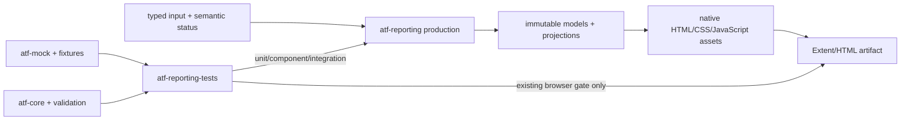
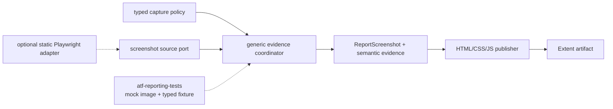

# ATF Reporting — feedback specializat pentru librărie și testarea ei

## Overall

- **producție**: `atf-reporting` publică modele typed, evidence și artifacte Extent/HTML;
- **teste**: `atf-reporting-tests` este composition root-ul pentru unit, component,
  integration și E2E;
- **independență**: `atf-reporting` nu trebuie să importe mock, browser, fixture sau
  module ATF;
- **prioritate**: mutăm acoperirea în unit/component/integration înainte de a adăuga
  orice scenariu E2E;
- **evidence vizual**: contractul generic pentru flow mode, policy și source este
  evidențiat în [`docs/ATF_Evidence_Capture_Contract.md`](../ATF_Evidence_Capture_Contract.md);
  publisherul typed rămâne în `atf-reporting`, iar suportul se verifică cu imagini
  mock în `atf-reporting-tests`;
- **ordine de livrare**: un flow Practice Shop nu poate deveni dovada suportului
  de captură înainte ca suportul să fie demonstrat fără browser prin component și
  integration tests;
- **documentație**: acest fișier păstrează gap-urile evolutive; README-urile ownerilor
  rămân neschimbate până la o cerință explicită și o dovadă nouă.

## Diagramă de boundary și feedback



<details>
<summary><strong>Legendă — ce aparține fiecărei zone</strong></summary>

- `atf-reporting` transformă inputul typed în model semantic și artifact;
- `atf-reporting-tests` compune inputul, execută testele și verifică output-ul;
- `atf-mock`, `atf-core` și `atf-validation` sunt infrastructură de test, nu producție reporting;
- browserul observă artifactul numai în E2E-ul existent;
- un defect de model, markup, asset sau validator se testează mai jos decât browserul;
- un README de modul explică contractul stabil; acest feedback explică doar ce mai trebuie verificat.

</details>

## Recalibrare — suportul pentru capturi se construiește înaintea consumatorului



<details>
<summary><strong>Legendă — ordinea corectă a responsabilităților</strong></summary>

- `atf-reporting` deține modelul și publicarea; policy-ul de publication este API-ul
  existent, iar coordinator-ul generic nu trebuie ascuns în renderer;
- `ScreenshotSource` este un port; reporting-ul nu importă Playwright;
- `atf-reporting-tests` furnizează mai întâi imagini deterministe mock;
- un adapter Playwright pe HTML static este opțional și vine după component tests;
- Practice Shop nu este precondiție pentru a valida suportul reporting;
- YAML-ul consumatorului este mapat într-un obiect typed înainte de a intra în
  bibliotecă;
- aceeași cale semantică trebuie să accepte UI evidence mock, Playwright evidence
  și input API fără să dubleze renderer-ul.

</details>

### Contractul generic minim

Separăm două axe care nu trebuie ascunse într-un singur flag:

```java
enum UiExecutionMode {
    SCREEN_CHECKPOINTS,
    UNIFIED_FLOW
}

enum ScreenshotPolicy {
    EACH_CHECKPOINT,
    FINAL_ONLY,
    FAILURE_ONLY,
    FINAL_AND_FAILURE,
    NONE
}
```

Modelul generic trebuie să păstreze:

- `UiExecutionMode` — cum este reprezentat flow-ul;
- `ScreenshotPolicy` — când se cere o imagine;
- un `EvidenceTarget` opac, definit de consumator;
- lista ordonată de acțiuni și assertions;
- screenshot-ul final și screenshot-ul diagnostic separat;
- cardinalitatea calculată și statusul semantic;
- sursa evidence-ului, fără să transporte direct un obiect Playwright în
  production reporting.

`atf-reporting` poate reutiliza `Phase.screenshot(...)` ca sink existent. Nu se
introduce un al doilea API raw pentru Base64 dacă un coordinator poate decide
momentul capturii și poate apela portul existent. Schimbarea necesară este
politica tipizată și testarea cardinalității, nu multiplicarea metodelor string.

Regula de boundary este strictă:

- YAML-ul și mapping-ul `PracticeShopScreen` rămân în composition root;
- `atf-reporting` primește configurare typed sau builder programmatic;
- `atf-reporting-tests` folosește mock image provider și fixture-uri locale;
- `atf-ui` poate furniza provider-ul real Playwright;
- renderer-ul nu cunoaște Practice Shop, endpoint-uri sau locatori;
- ownership-ul transversal și direcția de reutilizare rămân în contractul dedicat,
  nu în feedback-ul unui singur modul.

## Audit live pe axe

| Axă | Notă | Verdict agresiv constructiv | Dovadă live |
|---|---:|---|---|
| boundary production | 99 | foarte solid; importurile externe ATF nu apar în `src/main`, dar consumerii direcți din alte module mențin boundary-ul de packaging incomplet | scanarea importurilor și POM-ului `atf-reporting` |
| model semantic | 93 | există modele typed și snapshot-uri, dar `HtmlReportSemanticDocument` încă adună mutation lifecycle, modele nested și proiecție într-un singur boundary | `model`, `semantic`, `html` |
| vocabular HTML/CSS | 88 | enum-urile există, dar markup-ul real încă scapă în `NavigationView`, overview markup, fallback views și contracte ca string-uri brute; facade-ul rămâne prea larg | `markup/vocabulary` + `markup` + `html` |
| compoziție asset-uri | 96 | asset-urile native sunt guvernate acum de un manifest complet, ordonat și validat; rămân doar reduceri viitoare ale suprafeței facade-ului | `ReportAssetManifest`, `ReportAssetComposer`, `ReportAssetContractTest` |
| renderere evidence | 90 | renderer-ele sunt separate pe transport/UI, dar `ExtentUiEvidenceRenderer` și `HtmlReportEvidenceView` încă amestecă tabel, status, disclosure și serializare | `evidence`, `html/evidence` |
| audit static | 96 | validatorii pe secțiuni și projection-urile sunt bine delimitate; trebuie o matrice explicită contract → validator → test | `ui/audit`, `ui/contract`, `artifact/contract` |
| unit/component coverage | 89 | consumerul are 99 unit, 35 component și 9 integration annotations, dar `atf-reporting/src/test` are numai 5 teste native; matricea seam → test nu este încă gate-uită | `atf-reporting/src/test`, `atf-reporting-tests/src/test` |
| integration coverage | 93 | există API/report artifact/replay; trebuie stabilizat contractul de input și manifest fără browser | `api/reporting` și `ui/tests/extent` |
| E2E discipline | 96 | suite-ul existent acoperă navigare, failure, disclosure și secțiuni; orice E2E nou ar masca un gap de component sau integration | `ui/tests/extent/e2e` |
| test readability | 88 | `ExtentReportSessionContractTest`, `ReportUiLocators` și câțiva inspectori rămân facades mari; testele funcționează, dar costă prea mult la mentenanță | clasele de support/test cu responsabilități multiple |
| build/test isolation | 96 | standalone discovery este acum allowlist-uit pe testele native; un consumer stale rămas în `target/test-classes` nu mai intră în Surefire, iar staging-ul extern rămâne reproducibil | `atf-reporting/pom.xml`, standalone build cu stale class injectată |

**Scorul recalibrat pentru această reevaluare este 91/100.** Funcționalitatea
demonstrată rămâne puternică — aproximativ 97/100 — dar modularitatea și
mentenabilitatea nu susțin încă acel scor global: façadele sunt prea late,
rendererele repetă responsabilități, iar `atf-reporting-tests` este mai degrabă
un reactor de compoziție decât o suită clar delimitată pentru reporting. Scorul
anterior de 97/100 a fost prea generos pentru codul live analizat acum. Nu este
un verdict de release și nu închide singur niciun ToDo.

## Închise în această revizie

| ID | Dovadă | Rezultat |
|---|---|---|
| `REP-ASSET-08` | `ReportAssetManifest`, `ReportAsset.Format.extension()`, `ReportAssetComposer.manifest()` și `ReportAssetContractTest` | ✅ asset-urile CSS/JavaScript au un inventar complet și determinist; sunt respinse duplicatele, owner-ii/path-urile duplicate, extensiile incompatibile, namespace-ul invalid și manifestele incomplete |
| `REP-BUILD-01` | `atf-reporting/pom.xml` limitează Surefire la `atf/api/reporting/standalone/**/*Test.java`; run-ul standalone a rămas verde după injectarea controlată a unei clase stale de consumer în `target/test-classes` | ✅ discovery-ul standalone nu mai traversează clasele stale ale consumerului; build-ul extern rămâne izolat și reproductibil |
| `REP-ADAPTER-01` | `ReportModelAdapterException`, `ReportModelAdaptersTest` și query-adapter tests | ✅ reflection este izolat la compatibility boundary; câmpurile obligatorii, map-urile, numericele, duratele, listele de retry și provenance invalidă eșuează cu `sourceType`/`field`, fără `null`/`0`/map gol tăcut |
| `REP-BOUNDARY-01` | `ArchitectureOwnershipBoundaryTest`, `PracticeShopArchitectureTest`, POM-urile live și `atf-reporting-tests` composition root | ✅ regula a fost reconciliată: `atf-reporting-tests` este consumerul canonical al bibliotecii, dar `atf-test-practice-shop` poate consuma reporting în compile scope pentru runtime-ul reutilizabil din `src/main`; doar composition roots fără production runtime sunt test-scope |
| `REP-EVID-01` | `ReportScreenshotPolicy`, `UiExtentReportSession` și `UiEvidencePublisher` | ✅ politica este typed și browser-neutral (`each-checkpoint`, `final-only`, `failure-only`, `final-and-failure`, `none`); punctul de captură este explicit, iar un screenshot publicat fără target eșuează diagnostic |
| `REP-EVID-02` | `ReportScreenshotPolicyTest`, `UiScreenshotPolicyIntegrationTest`, `ReportScreenshotTest` și contractele UI existente cu fixture-uri PNG deterministe | ✅ capturile mock sunt verificate fără browser pentru payload, target, zero/una/multe, duplicate, failure/final și statusurile deja acoperite de consumer; nu se introduce provider Playwright în production |
| `REP-EVID-03` | `UiScreenshotPolicyIntegrationTest` | ✅ session → semantic Extent → HTML este verificat pentru toate cele cinci politici, cu cardinalitatea exactă a linkurilor Base64 și fără endpoint/browser extern |
| `REP-EVID-06` | `ReportEvidenceFlowMode`, `ReportEvidenceCaptureSource`, `ReportEvidenceProfile`, `ReportEvidenceProfileTest`, `ReportEvidenceProfileIntegrationTest` și contractul transversal | ✅ cele trei axe sunt typed și independente; mapping-ul YAML/builder este browser-neutral, iar profilul traversează `UiExtentReportSession` până la HTML fără renderer duplicat; package-cohesion gate rămâne verde |
| `REP-JSON-01` | `ReportJsonBodyFormatter`, `ReportJsonBodyFormatterTest`, `HtmlReportViewsTest` și `ExtentReportUiEvidencePublishingTest` | ✅ body-urile JSON sunt formatate determinist, renderer-neutral, după redaction și înainte de display-limit; obiectele/array-urile, scalarul și `null` sunt păstrate, payload-ul invalid rămâne diagnostic; Extent și fallback HTML au parity verificat |
| `REP-FACADE-01` | `UiExtentReportOptions`, `UiExtentReportSessionCompositionTest` și testele de lifecycle UI | ✅ output-ul, numele, console sink-ul, profilul typed și timestamp-ul sunt compuse într-un singur options builder; `UiExtentReportSession` încarcă configurația o singură dată pe traseu și toate overload-urile legacy delegă în aceeași cale canonicală |
| `REP-OVERVIEW-01` | `ExtentReportOverviewMarkup` și `ExtentReportMarkupContractTest` | ✅ publication-ul overview este idempotent și se ancorează pe containerul semantic `category-container`; variațiile de whitespace/ordine a claselor sunt acceptate, iar metadata nu se dublează la reinjectare |
| `REP-RENDER-08` | `ExtentUiActionRenderer`, `ExtentUiObservationRenderer`, `ExtentUiAssertionRenderer`, `ExtentUiEvidenceMarkup` și contractele UI evidence | ✅ facade-ul UI nu mai conține markup pentru toate cele trei responsabilități; action/observation/assertion au renderere independente, escaping/status/publication sunt comune, iar testele existente păstrează parity-ul screenshot/action/observation/assertion |

Dovada de rulare a acestei revizii: suitea reporting în staging extern
`430/0/0/3` (teste/failures/errors/skips), inclusiv testul de arhitectură pentru
limita de opt clase pe pachet, plus rapoartele API/UI fresh din
`atf-reporting-feedback-gate-live-20261020l`, verificate în ATF Debug/Chromium.
În raportul API s-au verificat navigarea, statusurile și semnele `＋` inline; în
raportul UI s-au verificat cele 6 scenarii PASS, `SETUP → TEST BODY → THEN`,
`Screen validation`, tabela cu 5 acțiuni Playwright, cele 2 observații, cele 5
assertions și screenshot-ul inline. Nu există `<hr>` sau overflow vizibil în
renderarea verificată; contractele browser/E2E ale suitei au rămas verzi.
Observație de audit: căutarea lexicală găsește un text `onclick` în sursa
JavaScript generată, dar acesta nu este handler inline în DOM și nu se raportează
ca defect de renderare.
Reactorul root nu este folosit ca dovadă pentru acest scope când un test de
arhitectură paralel din `atf-test-kit` este modificat incomplet.

## Reaudit live — dovezi și limite observate

| Observație | Stare verificată | Interpretare constructivă |
|---|---|---|
| boundary production | `atf-reporting/pom.xml` este parentless, iar scanarea `src/main` nu găsește importuri din alte module ATF | fundația standalone este solidă și trebuie protejată |
| suprafață production | 236 clase Java și 51 resurse în reporting | modulul este substanțial; refactorizarea trebuie făcută pe seam-uri, nu prin clase utilitare aruncate |
| testare nativă | `ReportingStandaloneContractTest` + `ReportingStandaloneDependencyTest`: 5 teste filtrate, toate PASS | compilarea standalone este demonstrată; comportamentul complet rămâne testat în consumer |
| composition suite | 99 unit, 35 component, 9 integration și 8 E2E pe adnotări în `atf-reporting-tests` | piramida există; nu se adaugă E2E, ci se mută gap-urile spre component/integration |
| distribuția reporting-only | în package-ul `atf.api.reporting` apar 93 unit, 1 component și 3 integration annotations | componentele UI există în alte package-uri, dar owner-ul testului trebuie să fie urmărit explicit prin matrice |
| build incremental | live poate păstra clase stale în `target/test-classes`, dar `atf-reporting/pom.xml` include explicit numai testele native; staging-ul cu o clasă consumer injectată a trecut fără discovery contaminat | gate-ul este fail-closed la nivel de Surefire; staging-ul extern rămâne obligatoriu pentru build-ul complet |
| targeted lower-level evidence | asset/vocabulary/runtime gates plus `ReportModelAdaptersTest`: toate trecute în staging | manifestul automat guvernează inventarul asset-urilor, iar adapterele invalid/legacy sunt verificate separat; selecția nu înlocuiește gate-ul complet |
| markup real | `AtfReportHtmlVocabulary` este folosit, dar există tag/class/id literals în views, navigation, overview și contract checks | centralizarea este parțială; trebuie eliminată deriva, nu doar extins enum-ul la nesfârșit |
| adapter boundary | `ReportModelAdapters`, `ReportQueryParameters` și overload-urile `Object` păstrează reflection numai la compatibility boundary; `ReportModelAdapterException` identifică `sourceType` și `field`, iar inputul invalid nu mai este tăcut | `ReportModelAdaptersTest` acoperă typed/legacy valid/missing field/map invalid/provenance invalid/retry invalid; fallback-ul semantic rămas este numai pentru proprietăți opționale documentate |
| screenshot policy boundary | `ReportScreenshotPolicy` este singurul vocabular al politicii; `UiEvidencePublisher` primește punctul explicit și validează target-ul doar când evidence se publică | `ReportScreenshotPolicyTest` + `UiScreenshotPolicyIntegrationTest`; toate cele cinci valori și final/failure sunt verificate în HTML local |
| asset formatting | sursa CSS/JavaScript este multiline și formatată; publication pipeline folosește copia compactată după token replacement | politica este centralizată în `ReportAssetCompactor`; rămâne de urmărit doar baseline-ul de dimensiune pe segmente, nu formatarea surselor |

## Audit live de formatare și dimensiune

Raportul a fost inspectat în două forme:

- vizual, prin browser, pentru layout, disclosure-uri, tab-uri și statusuri;
- textual, ca HTML brut, pentru structură, whitespace și payload-uri inline.

| Zonă observată | API report curent | UI report curent | Interpretare |
|---|---:|---:|---|
| artifact total | ~2,4 MB | ~6,2 MB | dimensiunea nu trebuie judecată prin whitespace singur; evidence-ul vizual și vendor assets domină artefactul |
| markup după excluderea `<style>`/`<script>` | ~66,7 k caractere | ~3,84 MB | markup-ul UI include payload-uri vizuale; trebuie separat de HTML-ul structural înainte de optimizare |
| newline-uri în body | 1.678 | 1.448 | există spațiu de compactare, dar nu justifică minificare oarbă |
| whitespace între tag-uri (`> ... <`) | 1.168 | 1.437 | se poate elimina selectiv în nodurile structurale; spațiul din text, `pre`, JSON și evidence nu se atinge |
| evidence PNG inline | câteva icon-uri | 12 payload-uri, ~3,7 MB | deduplicarea și politica de captură au impact mai mare decât eliminarea câtorva enter-uri |
| asset-uri native reporting | 19 CSS + 32 JavaScript, ~175 kB | aceeași compoziție | source-ul este deja relativ compact; trebuie păstrat lizibil pentru review și compactat doar la publicare |

Concluzia nu este „ștergem toate spațiile”. Politica corectă este:

- source CSS/JavaScript: mai multe linii, ownership clar și review ușor;
- HTML structural publicat: un minim de newline-uri și spații, păstrând delimitarea logică a secțiunilor;
- text values, `pre`, JSON, body/headers, screenshot data și script strings: conținut byte-safe;
- vendor assets și evidence binar: măsurate separat, fără a le atribui artificial formatterului ATF;
- regresia de dimensiune: măsurată pe segmente și comparată cu un baseline configurabil, nu cu un număr inventat.

Rapoartele curente demonstrează randarea și două stări reale, dar nu constituie singure matricea completă de contract. Testele component trebuie să construiască fixture-uri typed pentru `pass`, `fail`, `warning` și `skip`, plus payload gol/lung, request/response, assertion, audit, disclosure și screenshot. Testul integration trebuie să publice artifactul și să compare structura semantică a variantelor readable/compact; E2E-ul existent rămâne verificarea browserului, nu mecanismul de minificare.

Valorile de mai sus sunt evidence de audit pentru această revizie, nu exemple normative
de raport și nu trebuie copiate în README-urile ownerilor. Contractul permanent este
politica de măsurare pe segmente, conservarea semanticii și matricea de teste.

## Reaudit agresiv constructiv — producție și consumer tests

| Axă | Notă | Ce este solid | Ce este încă prea scump sau ambiguu |
|---|---:|---|---|
| standalone production boundary | 99 | `atf-reporting/pom.xml` este parentless, iar `src/main` nu importă module ATF | consola are însă un port duplicat față de `atf-core`; independența Maven nu rezolvă singură interoperabilitatea |
| model semantic și lifecycle | 91 | există modele immutable, recorder și snapshot parity | `HtmlReportSemanticDocument`, recorder-ul și lifecycle scopes păstrează încă mutation, snapshot și projection în seam-uri care se suprapun |
| public API ergonomics | 82 | overload-urile păstrează compatibilitatea | `UiExtentReportSession` are 282 linii și 37 metode, cu multe overload-uri și tipuri nested; utilizatorul nu vede un singur traseu canonic de compoziție |
| evidence/rendering cohesion | 84 | UI și transport au renderere numite separat | `ExtentTransportEvidenceRenderer` (310 linii), `ExtentUiEvidenceRenderer` (316) și `HtmlReportEvidenceView` (223) repetă disclosure, tabel, status, escaping și serializare în pipeline-uri paralele |
| vendor adaptation / overview | 80 | publication pipeline este centralizat | `replace`/`replaceFirst`, markeri dependenți de whitespace și markup raw fac integrarea fragilă; overview-ul secundar poate deveni o a doua sursă de adevăr |
| vocabulary discipline | 88 | enum-urile și facade-urile există | `NavigationView`, `OverviewMarkup`, fallback views și contract checks încă emit tag/class/id/string-uri în afara unui builder semantic unic |
| test pyramid depth | 92 | 102 unit, 35 component, 11 integration și 8 E2E sunt detectabile în consumer | 136 clase de support/fixture nu declară strat; acoperirea există, dar ownership-ul și ruta de execuție sunt greu de auditat |
| suite isolation | 82 | POM-ul ține dependențele la test scope | `atf-reporting-tests` depinde simultan de reporting, core, mock, validation, console, ui, debug-ui și test-kit și include `atf.api.execution` plus API/UI/E2E; „reporting tests” nu mai este o unitate conceptuală suficient de precisă |
| locator/test readability | 78 | locatorii sunt împărțiți intern pe domenii și folosesc contracte typed | `ReportUiLocators` are 411 linii și 263 metode de delegare; facade-ul public rămâne un punct de cuplare masiv și descurajează teste focused |
| E2E economy | 96 | cele 8 clase E2E trebuie păstrate ca proof browser | următoarea investiție trebuie să fie în component/integration și în profile de rulare, nu în noi scenarii browser |

**Verdict:** `atf-reporting` este o bază funcțională serioasă, dar codul nu este
încă „aerisit” în sensul cerut. Extinderea enum-urilor sau încă un helper nu
rezolvă problema. Următorul pas corect este reducerea suprafeței publice,
unificarea seam-urilor de markup/evidence și delimitarea explicită a suitei de
consumer tests.

### Dovezi concrete care au generat recalibrarea

- `atf-reporting/src/main/java` conține 242 clase Java și 51 resurse; refactorizarea trebuie făcută pe boundary-uri observabile, nu prin mutări cosmetice de pachete;
- `atf-reporting/src/test/java` conține 2 clase native cu 5 teste filtrate de gate-ul standalone; verificarea completă este externalizată în consumer și trebuie urmărită prin matrice, nu presupusă;
- `atf-reporting-tests/src/test/java` conține 292 clase: 102 unit, 35 component, 11 integration, 8 E2E și 136 support neadnotat;
- `UiExtentReportSession` reîncarcă configurația în unele căi de deschidere (`openConfigured(AtfConsoleSink)` și `openConfiguredResolved`), deși configurația este documentată ca snapshot immutable;
- `AtfConsoleEvent` și `AtfConsoleSink` există atât în `atf.api.reporting.console`, cât și în portul `atf.api.core.reporting.console`; testele trebuie să facă explicit diferența între no-op, disabled și reporter configurat;
- `ExtentReportOverviewMarkup` și `ExtentReportNavigationView` construiesc fragmente HTML cu string-uri raw și modifică HTML vendor prin înlocuiri textuale;
- `ReportUiLocators` păstrează o fațadă de compatibilitate foarte largă peste șase proprietari interni; testele noi nu trebuie să mai adauge metode aici fără justificare de API.

### Concluzie agresivă

- Nu avem o problemă de lipsă de funcționalitate de bază; avem o problemă de
  **ownership și verificare a seam-urilor**.
- Enum-urile au ajutat, dar nu justifică păstrarea unor string-uri brute în alte
  views. Un vocabular central cu facade uriașă nu este suficient dacă publisher-ul
  poate ocoli facade-ul.
- Cele 8 E2E existente sunt suficient de multe pentru proof browser. Valoarea
  următoarei iterații trebuie să fie: build izolat, modele typed, rendering
  compact controlat și component tests care mută defectul mai aproape de cauza
  lui. Inventarul asset-urilor este deja un contract componentar închis.
- Un test care trece după ce a încărcat clase stale din alt modul nu este un gate
  de calitate; este doar o execuție aparent verde. Izolarea build-ului devine
  criteriu de acceptare, nu detaliu operațional.

## Ce este deja bine și nu trebuie desfăcut

- production reporting este parentless și nu depinde de modulele ATF;
- statusurile, tag-urile, clasele CSS și elementele HTML au vocabular centralizat;
- asset-urile CSS/JavaScript sunt native, iar Java este în principal facade/composer;
- modelele de request, response, JSON, evidence și assertion sunt typed;
- validatorii de secțiuni sunt separați de flow-urile browser;
- `atf-reporting-tests` păstrează mock-ul, fixture-urile și composition root-ul;
- E2E-ul existent rămâne proof pentru interacțiune și randare, nu locul implicit
  pentru orice regulă nouă.

## Hotspot-uri de cod și test

<details>
<summary><strong>Detaliile hotspot-urilor și direcția de refactorizare</strong></summary>

### Producție

- `AtfReportHtmlVocabulary`
  - păstrează enum-urile finite;
  - separă conceptual tag-uri, atribute, clase CSS, view-uri și element IDs;
  - păstrează un facade de compatibilitate numai dacă API-ul public o cere;
  - mută escaping și compunerea atributelor într-un seam de markup distinct;
  - verifică fiecare grup prin teste unitare fără browser.

- `ReportAssetComposer`
  - tratează asset-ul ca `ReportAsset` typed, nu ca metodă statică izolată;
  - folosește `ReportAssetManifest` ca inventar complet și determinist pentru
    asset-uri, format, namespace, owner și ordine declarativă;
  - separă CSS, JavaScript și boot order la nivel de builder/composer;
  - păstrează component contract-ul pentru unicitate, ordine și token substitution;
  - nu introduce string-uri brute noi în facade-uri.

- `ReportAssetLoader` și publication pipeline
  - păstrează resursele CSS/JavaScript formatate pe mai multe linii în source,
    pentru review, debugging și teste component lizibile;
  - expune două API-uri explicite: `load/render` pentru sursa lizibilă și
    `loadForPublication/renderForPublication` pentru copia compactată;
  - păstrează compactarea într-un singur `ReportAssetCompactor`, nu în fiecare
    publisher și nu prin `replace` ad-hoc;
  - în modul compact, elimină din HTML-ul Extent spațiile, indentarea și newline-urile
    care nu schimbă structura sau semantica; rezultatul trebuie să fie minim, dar
    încă elegant și inspectabil la nivel de elemente;
  - compactează numai după token replacement și numai printr-un mecanism sigur
    pentru CSS/JavaScript; nu elimina newline-uri orbește din string-uri, regex-uri,
    comentarii sau construcții JavaScript dependente de ASI;
  - component tests verifică separat sursa lizibilă, output-ul compact,
    token-urile rezolvate, ordinea asset-urilor și absența asset-urilor duplicate;
   - component fixtures acoperă statusurile `pass`/`fail`/`warning`/`skip`, valorile
     goale și lungi, tabelele, disclosure-urile și evidence-ul vizual;
   - integration test verifică faptul că raportul Extent primește un singur payload
     compact per asset, păstrând DOM-ul semantic și comportamentul; E2E-ul existent
     rămâne doar proof.

- `ReportModelAdapters`, `ReportQueryParameters` și overload-urile `Object`
  - typed ports sunt API-ul principal; reflection rămâne compatibility boundary
    izolat;
  - `ReportModelAdapterException` identifică sursa și câmpul, iar inputul invalid
    nu mai este convertit în `null`, `0`, map gol sau provenance ghicită;
  - map-urile sunt copiate și validate fără cast unchecked, iar duratele/numericele
    acceptă numai forme explicite;
  - `ReportModelAdaptersTest` acoperă typed, legacy valid, missing field, map
    invalid, provenance invalid și retry container invalid.

- markup-ul produs în `ExtentReportNavigationView`, `ExtentReportOverviewMarkup`,
  `HtmlReportSession` și views fallback
  - mută tag-urile, atributele, clasele și id-urile stabile în vocabularul typed;
  - lasă literal doar textul vendor-specific sau fragmentul documentat ca excepție;
  - adaugă guard de architecture/lint pentru literals noi, cu allowlist minim și
    owner explicit;
  - testează semantic structura, nu whitespace-ul accidental al HTML-ului.

- `ExtentUiEvidenceRenderer`
  - separă renderarea acțiunilor, observațiilor, assertions și statusului;
  - păstrează `AtfReportHtmlVocabulary` ca owner pentru tag/class/attribute;
  - folosește modele de rând sau builder-e immutable înainte de serializare;
  - testează markup-ul și cardinalitatea fără a porni browserul;
  - păstrează escaping-ul într-un singur boundary.

- `HtmlReportSemanticDocument`
  - extrage modelele mutabile nested în POJO/record-uri de model cu responsabilități mici;
  - separă lifecycle mutation de snapshot/projection;
  - testează egalitatea și convergența semantică fără a compara HTML brut inutil;
  - păstrează rendererul ignorant față de setup-ul mock și de browser.

- `ReportAuditSnapshot`
  - grupează snapshot-urile pe tab/secțiune și păstrează reguli pure;
  - evită un singur container cu Overview, Tests, Failures, JSON, screenshot și duration;
  - expune rezultate typed, nu map-uri anonime sau flag-uri fără nume semantic.

### Testare în `atf-reporting-tests`

- `ExtentReportSessionContractTest`
  - se sparge după contract: lifecycle, evidence, theme, failure și redaction;
  - fixture-ul de report se reutilizează, dar fiecare test rămâne focused;
  - assertions comune se mută în support typed, nu se copiază în fiecare test.

- `ReportUiLocators`
  - facade-ul trebuie să rămână subțire;
  - fiecare zonă — page, tree, evidence, screen, category, failure — rămâne owner separat;
  - selectorii `element[attribute=value]` rămân centralizați;
  - testele verifică boundary-ul locatorilor, nu reconstruiesc selectorii în flow.

- support-ul neexecutabil
  - nu primește adnotare de layer doar pentru a intra în matrice;
  - helper-ele de fixture, extraction și audit rămân în `support`;
  - doar clasele executabile declară `unit`, `component`, `integration` sau `e2e`.

</details>

## Matricea de acoperire dorită

| Contract reporting | Nivel principal | Input | Dovadă fără E2E |
|---|---|---|---|
| status, tags, vocabulary, escaping | unit | POJO/enum/string | output determinist și invalid input |
| semantic model și snapshot | unit | records/model builders | egalitate, cardinalitate, convergență |
| capture policy și screenshot cardinality | unit | policy typed + fake source | `each`, `final`, `failure`, `none`, duplicate și lipsă target |
| HTML/CSS/JavaScript asset manifest | component | asset loader/composer | ordine, unicitate, token-uri, funcții |
| screenshot evidence component | component | mock PNG/base64 + typed flow | markup, media reference, status, disclosure și număr exact de capturi |
| asset formatting and publication mode | component + integration | readable source + compact artifact | newline policy, token safety, script semantics, one payload per asset |
| artifact size and evidence budget | component + integration | status matrix + visual evidence | segment sizes, duplicate payloads, safe whitespace reduction, preserved text/JSON |
| request/response/evidence renderer | component | typed evidence | markup, JSON, disclosure, redaction |
| tab/section contract validators | component | static/generated artifact | projection, links, status, cardinality |
| report publication pipeline | integration | mock-backed model | artifact complet, replay, contract audit |
| screenshot publication pipeline | integration | session + mock capture provider | artifact complet, final/failure placement, zero browser dependency |
| API → UI report input | integration | fixture API + generated report | setup, source resolution, audit input |
| browser interaction și cross-tab rendering | E2E existent | artifact publicat | click, filter, disclosure, deep-link, screenshot |

### Ownership matrix pentru testarea în modulul separat

| Seam production | Test owner | Nivel preferat | Ce trebuie observat fără browser |
|---|---|---|---|
| `ReportAssetLoader` + `ReportAssetComposer` | `atf-reporting-tests/api/reporting/asset` și `runtime` | component | manifest, format, token replacement, ordine, unicitate, payload compact |
| `AtfReportHtmlVocabulary` + markup builders | `atf-reporting-tests/api/reporting/markup` | unit + component | tag/class/id ownership, escaping, DOM skeleton, literals permise |
| `ReportModelAdapters` + query adapters | `atf-reporting-tests/api/reporting/api` | unit | typed/legacy/invalid input, erori explicite, zero fallback semantic tăcut |
| `HtmlReportSemanticDocument` + views fallback | `atf-reporting-tests/api/reporting/html` | unit + component | lifecycle → snapshot → projection, cardinalitate, redaction și output structural |
| policy/coordinator + `ReportScreenshot` | `atf-reporting-tests/api/reporting/ui` | unit + component | politici valide/invalide, cardinalitate, duplicate, final/failure evidence |
| `ExtentUiEvidenceRenderer` + `ReportAuditSnapshot` | `atf-reporting-tests/api/reporting/ui` și `audit` | component | action/observation/assertion, status, disclosure, evidence și reguli pure pe secțiuni |
| `ExtentReportPublicationPipeline` | `atf-reporting-tests/api/reporting/extent` | integration | artifact complet, asset order, compact output, replay și cleanup |
| screenshot publication seam | `atf-reporting-tests/api/reporting/ui` și `extent` | integration | mock provider → session → HTML; exact una sau zero capturi după policy |
| Playwright capture adapter | `atf-reporting-tests/ui/tests/extent` | integration opțional | HTML static local → PNG → `ReportScreenshot`; fără Practice Shop și fără endpoint extern |
| navigare, filtre, deep-link, viewport | `atf-reporting-tests/ui/tests/extent/e2e` existent | E2E | doar comportamentul browser pe contracte deja verificate lower-level |

Regula de ownership este intenționată: production rămâne fără mock și browser,
iar `atf-reporting-tests` rămâne consumerul care compune fixture-ul și dovada.
Un test nu devine component doar pentru că citește HTML; nivelul este component
numai când verifică seam-ul dintre două responsabilități production, fără să
pornească browserul. E2E-ul nu este fallback pentru o matrice de coverage lipsă.

## Politica E2E

- nu se adaugă teste E2E pentru reguli care pot fi verificate prin unit/component;
- nu se mută validatori puri în browser doar pentru a obține un raport vizual;
- suite-ul E2E existent rămâne smoke/proof pentru:
  - navigarea între tab-uri;
  - filtre și selecție;
  - expand/collapse;
  - failure evidence și deep-link;
  - randarea finală și overflow;
- orice cerință nouă trebuie să demonstreze mai întâi de ce component/integration
  nu poate observa defectul;
- un singur E2E poate acoperi mai multe statusuri și secțiuni prin input configurat,
  fără multiplicarea claselor.

## Revizia chirurgicală 2026-10-20 — Overview package și delimitarea Request details

Această revizie a închis două regresii observabile în raportul Extent, fără să
introducă un E2E nou:

| Contract | Implementare și dovadă |
|---|---|
| package-ul din Overview trebuie să fie același cu cel afișat sub test name în `Tests` | `runtime-core-metadata.js` citește fallback-ul real `.detail-head .p-v-10 > .m-t-10`, îl normalizează ca `atf-test-package` și îl publică pe test root; `OverviewSecondaryContractValidator` reconciliază seturile din cele două tab-uri |
| cele două zone ATF secundare din Overview trebuie să existe și să fie colapsate implicit | același validator verifică `2 found / 0 open`; este executat în modulul existent `OverviewSectionAuditModule` |
| `Request details` standalone trebuie să aibă marginea inferioară | `evidence-stack.css` închide cadrul numai când `request-evidence` este marcat `data-atf-evidence-last=true`, fără separator între request/response/execution |

Acoperirea lower-level este în `ExtentReportRuntimeScriptTest`,
`ReportAssetContractTest` și `OverviewSecondaryContractValidatorTest`. Verificarea
browser reală a fost făcută pe raportul fresh prin ATF Debug + Playwright MCP:

`http://127.0.0.1:55369/api-atf-reporting-overview-package-boundaries-final_2026-10-20_15-07-43-491.html`

Rezultatul observat: `Test packages = atf.api.reporting.ui`, ambele disclosure-uri
Overview `open=false`, iar `Request details` are `border-bottom` vizibil și raze
inferioare. Numărul de clase E2E nu a crescut.

## ToDo active

| ID | Prioritate | Owner | ToDo | Criteriu de închidere |
|---|---:|---|---|---|
| `REP-EVID-04` | P1 | `atf-reporting-tests` | adaugă un adapter Playwright minimal pe HTML static numai pentru a verifica generarea reală de PNG | integration opțional; nu accesează Practice Shop, nu accesează endpoint extern și nu devine precondiție pentru component tests |
| `REP-EVID-05` | P1 | `atf-reporting` + `atf-reporting-tests` | aplică aceeași strategie fixture → component → integration pentru evidence API | request/response, headers, body, assertions, status și replay sunt testate cu mock; HTML-ul este validat direct, fără E2E nou |
| `REP-REVIEW-01` | P1 | `atf-reporting` + `atf-reporting-tests` | păstrează această analiză sincronizată cu production și consumer tests, fără a edita README-urile ownerilor | fiecare claim are clasă/test/guard identificabil și fiecare item este închis sau redeschis numai prin feedback |
| `REP-MODEL-01` | P1 | `atf-reporting` | separă lifecycle mutation, semantic snapshot și HTML projection în modele/servicii coezive | unit tests verifică modelul și snapshot-ul fără renderer; component tests verifică projection-ul |
| `REP-VOCAB-01` | P1 | `atf-reporting` | reduce suprafața `AtfReportHtmlVocabulary` și închide scăpările de markup raw din views/contract checks | facade compatibil, enum-uri pe domenii, allowlist explicit pentru vendor literals, zero literals noi nejustificate și teste unitare pe fiecare grup |
| `REP-FORMAT-01` | P1 | `atf-reporting` + `atf-reporting-tests` | ✅ sursele CSS/JS native sunt formatate lizibil și păstrate pentru review/component tests; numai copia publicată în HTML este compactată lexical, fără atingerea textelor, valorilor quoted, JSON-ului sau evidence-ului | `ReportAssetCompactorTest` verifică string safety, selectorii CSS, `calc(...)`, comentarii și operatorii JS; `ReportAssetContractTest` verifică newline-uri în sursă și payload fără newline la publication; `ReportAssetComposer` folosește exclusiv API-ul `loadForPublication`/`renderForPublication` |
| `REP-SIZE-01` | P1 | `atf-reporting` + `atf-reporting-tests` | măsoară dimensiunea pe segmente — structural HTML, native CSS/JS, vendor assets și evidence — și reduce numai duplicarea/whitespace-ul sigur | component/integration verifică baseline configurabil, duplicate data-uri, matricea statusurilor și conservarea textului, JSON-ului, screenshot-ului și structurii DOM |
| `REP-AUDIT-08` | P2 | `atf-reporting` | normalizează `ReportAuditSnapshot` în modele de secțiune și reguli pure | component tests acoperă Overview, Tests, Categories, Fails, JSON și visual evidence fără browser |
| `REP-TEST-08` | P1 | `atf-reporting-tests` | sparge testele mari după contract și păstrează fixture-urile reutilizabile | clasele de test au un singur motiv; support-ul nu devine executabil și coverage-ul lower-level crește |
| `REP-COVERAGE-08` | P1 | `atf-reporting-tests` | construiește matrice contract → production seam → test unit/component/integration | fiecare seam public are dovadă lower-level; excepțiile sunt listate explicit |
| `REP-E2E-08` | P2 | `atf-reporting-tests` | îngheață numărul de E2E și reutilizează suite-ul existent pentru proof browser | orice E2E nou necesită justificare de imposibilitate component/integration și aprobare prin feedback |
| `REP-RENDER-09` | P1 | `atf-reporting` | unifică primitivele pentru disclosure, tabel, status, escaping și serialization între `ExtentTransportEvidenceRenderer`, `ExtentUiEvidenceRenderer` și `HtmlReportEvidenceView` | rândurile și secțiunile sunt modele typed; fiecare renderer compune aceleași primitive fără copiere de markup; parity component tests verifică request/response/UI evidence în Extent și fallback HTML |
| `REP-CONSOLE-01` | P1 | `atf-core` + `atf-console` + `atf-reporting` + `atf-reporting-tests` | reconciliază `AtfConsoleEvent/Sink` duplicate și elimină ambiguitatea dintre `noOp`, disabled și reporter configurat | port comun sau adapter owner-uit explicit, fără dependență reporting → core; in-memory sink verifică `scenario → phase → request/UI action → complete(status)` pentru `PASS/FAIL/WARNING/SKIP`; testul standalone rămâne compilabil |
| `REP-SUITE-01` | P1 | `atf-reporting-tests` | face explicită delimitarea dintre reporting contract tests, API fixture/execution, UI audit support și E2E; nu șterge support valid și nu multiplică teste | profile/launcher sau boundary test reproducibil pentru rularea reporting-only fără execution/browser; fiecare clasă executabilă are owner și layer; cele 8 E2E rămân plafon, iar helper-ele rămân neexecutabile |
| `REP-LOCATOR-01` | P2 | `atf-reporting-tests` | reduce dependența de `ReportUiLocators` ca god-facade; domeniile page/tree/evidence/screen/category/failure trebuie consumate prin surface-uri clare | testele noi nu adaugă delegări în facade-ul legacy; surface-urile typed sunt testate separat, locatorii rămân `element[attribute=value]`, iar API-ul de compatibilitate este măsurat și documentat |

## Reaudit API request title și parity între renderere — 2026-10-20

Raportul trebuie să răspundă din titlu la întrebarea „ce request este acesta?”
fără să oblige auditorul să ghicească dintr-un pseudo-verb sau să deschidă
imediat toate disclosure-urile. Contractul generic este:

```text
HTTP_METHOD relativePath — very-short business intent
```

| ID | Status | Dovadă |
|---|---:|---|
| `REP-API-TITLE-01` | ✅ | `ApiOperationLabel` acceptă method/path/description și normalizează label-ul fără a introduce date dinamice în vocabulary. |
| `REP-API-TITLE-02` | ✅ | `ExtentReportNodeSupport.renderRequestTitle` și `HtmlReportTestsView` folosesc aceeași regulă; `HtmlReportComponentContractTest` și `ExtentReportSessionContractTest` verifică fallback/Extent parity. |
| `REP-API-TITLE-03` | ✅ | `ApiOperationDescriptorContractTest` verifică descriptorul typed în core; `atf-reporting` rămâne independent și primește titlul/route ca input deja semantic. |
| `REP-API-TITLE-04` | ✅ | Gate targetat reporting: 13 teste, 0 failures, 0 errors; Practice Shop consumer: 15 teste, 0 failures, 0 errors în staging extern. |

### Limită arhitecturală

Descriptorul nu este introdus în `atf-reporting` și titlul nu este re-parsat
pentru a reconstrui method/path. Consumerul este owner-ul intenției aplicației;
reportingul este owner-ul renderării și păstrării evidence. Pentru Practice Shop,
`SEARCH` rămâne intenție, `GET` rămâne transport, iar `OPERATION KIND` și
`ROUTE TEMPLATE` sunt evidence tehnică separată. Această separare permite
înlocuirea modulului cu JAR fără a muta enum-uri de business în librărie.

## Gate de regresie după aliasul de capture și documentația relocatabilă — 2026-10-20

| ID | Status | Dovadă |
|---|---:|---|
| `REP-API-TITLE-05` | ✅ | Full `atf-reporting-tests` reactor: **453 teste, 0 failures, 0 errors, 3 skipped**; component, integration și E2E au trecut, iar cele 3 skip-uri sunt explicite în suita existentă. |
| `REP-API-TITLE-06` | ✅ | `ArchitectureCohesionBoundaryTest` include excepția revizuită pentru `atf.api.core.http.response`, introdusă de descriptorul typed, fără waiver global. |
| `REP-DOC-RELOC-01` | ✅ | `DynamicPathDocumentationArchitectureTest` trece după înlocuirea căilor locale absolute din feedback cu descrierea relocatabilă a staging-ului extern. |

Consumerii pot păstra metoda raw observată ca metadata proprie, dar reporting-ul
nu o interpretează și nu o transformă în pseudo-verb. Contractul librăriei rămâne
transport method + relative path + evidence semantică furnizată de consumer.

## Regula de închidere

- un item nu se închide prin schimbarea unui README;
- feedback-ul se actualizează numai după cod live + test relevant + dovadă;
- regula stabilă se promovează ulterior în README-ul ownerului doar prin cerință explicită;
- până atunci, README-urile proiectului rămân neatinse;
- rapoartele generate, screenshot-urile și timestamp-urile rămân evidence externă,
  nu sursă normativă.

## Gate final autoritativ al regresiei — 2026-10-20 14:09

Full `atf-reporting-tests` a fost rerulat din staging extern, în afara
proiectului și fără oprirea rulărilor curente: **453 teste, 0 failures, 0 errors, 3 skipped**, cu toate
modulele reactorului în `BUILD SUCCESS`. Sunt confirmate inclusiv contractele
de asset compaction, JSON pretty, sections, architecture boundaries, locator
boundaries și E2E browser.

Consumerul Practice Shop a fost rerulat separat: **66 teste, 0 failures, 0
errors, 4 skipped**, iar `PracticeShopPurchaseE2eTest` a trecut **1/1**.
Artifactele API și UI au fost deschise manual în browserul MCP după rerun; nu
se consideră suficientă numai existența fișierului HTML.

| Verificare | Rezultat |
|---|---:|
| API report: titlu canonical `GET /products/search — find configured product` | ✅ |
| API report: request/response JSON și response JSON pretty vizibile | ✅ |
| UI report: acțiuni, audit observations, assertions și screenshot inline | ✅ |
| Capture alias `QUERY` publicat doar ca metadata `observed method=QUERY` | ✅ |
| `<hr>` decorativ în artifactul UI final | 0 |
| Rapoarte finale lăsate deschise în MCP | ✅ |

Artifactele finale sunt:

- [`api-atf-practice-shop-standalone_2026-10-20T11-01-51.141445600Z.html`](../../artifacts/reports/api-atf-practice-shop-standalone_2026-10-20T11-01-51.141445600Z.html)
- [`ui-atf-practice-shop-e2e_2026-10-20_14-01-54-960.html`](../../artifacts/reports/ui/ui-atf-practice-shop-e2e_2026-10-20_14-01-54-960.html)

