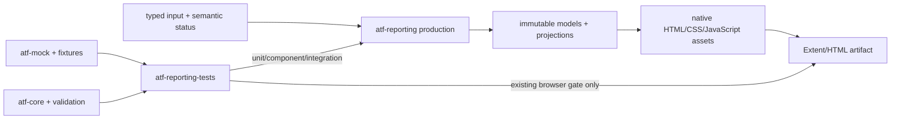
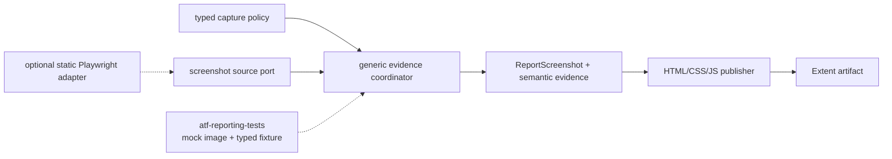

# ATF Reporting — feedback specializat pentru librărie și testarea ei

## Overall

- **producție**: `atf-reporting` publică modele typed, evidence și artifacte Extent/HTML;
- **teste**: `atf-reporting-tests` este composition root-ul pentru unit, component,
  integration și E2E;
- **independență**: `atf-reporting` nu trebuie să importe mock, browser, fixture sau
  module ATF;
- **prioritate**: mutăm acoperirea în unit/component/integration înainte de a adăuga
  orice scenariu E2E;
- **evidence vizual**: contractul generic pentru flow mode, policy și source este
  evidențiat în [`docs/ATF_Evidence_Capture_Contract.md`](../ATF_Evidence_Capture_Contract.md);
  publisherul typed rămâne în `atf-reporting`, iar suportul se verifică cu imagini
  mock în `atf-reporting-tests`;
- **ordine de livrare**: un flow Practice Shop nu poate deveni dovada suportului
  de captură înainte ca suportul să fie demonstrat fără browser prin component și
  integration tests;
- **documentație**: acest fișier păstrează gap-urile evolutive; README-urile ownerilor
  rămân neschimbate până la o cerință explicită și o dovadă nouă.

## Diagramă de boundary și feedback



<details>
<summary><strong>Legendă — ce aparține fiecărei zone</strong></summary>

- `atf-reporting` transformă inputul typed în model semantic și artifact;
- `atf-reporting-tests` compune inputul, execută testele și verifică output-ul;
- `atf-mock`, `atf-core` și `atf-validation` sunt infrastructură de test, nu producție reporting;
- browserul observă artifactul numai în E2E-ul existent;
- un defect de model, markup, asset sau validator se testează mai jos decât browserul;
- un README de modul explică contractul stabil; acest feedback explică doar ce mai trebuie verificat.

</details>

## Recalibrare — suportul pentru capturi se construiește înaintea consumatorului



<details>
<summary><strong>Legendă — ordinea corectă a responsabilităților</strong></summary>

- `atf-reporting` deține modelul și publicarea; policy-ul de publication este API-ul
  existent, iar coordinator-ul generic nu trebuie ascuns în renderer;
- `ScreenshotSource` este un port; reporting-ul nu importă Playwright;
- `atf-reporting-tests` furnizează mai întâi imagini deterministe mock;
- un adapter Playwright pe HTML static este opțional și vine după component tests;
- Practice Shop nu este precondiție pentru a valida suportul reporting;
- YAML-ul consumatorului este mapat într-un obiect typed înainte de a intra în
  bibliotecă;
- aceeași cale semantică trebuie să accepte UI evidence mock, Playwright evidence
  și input API fără să dubleze renderer-ul.

</details>

### Contractul generic minim

Separăm două axe care nu trebuie ascunse într-un singur flag:

```java
enum UiExecutionMode {
    SCREEN_CHECKPOINTS,
    UNIFIED_FLOW
}

enum ScreenshotPolicy {
    EACH_CHECKPOINT,
    FINAL_ONLY,
    FAILURE_ONLY,
    FINAL_AND_FAILURE,
    NONE
}
```

Modelul generic trebuie să păstreze:

- `UiExecutionMode` — cum este reprezentat flow-ul;
- `ScreenshotPolicy` — când se cere o imagine;
- un `EvidenceTarget` opac, definit de consumator;
- lista ordonată de acțiuni și assertions;
- screenshot-ul final și screenshot-ul diagnostic separat;
- cardinalitatea calculată și statusul semantic;
- sursa evidence-ului, fără să transporte direct un obiect Playwright în
  production reporting.

`atf-reporting` poate reutiliza `Phase.screenshot(...)` ca sink existent. Nu se
introduce un al doilea API raw pentru Base64 dacă un coordinator poate decide
momentul capturii și poate apela portul existent. Schimbarea necesară este
politica tipizată și testarea cardinalității, nu multiplicarea metodelor string.

Regula de boundary este strictă:

- YAML-ul și mapping-ul `PracticeShopScreen` rămân în composition root;
- `atf-reporting` primește configurare typed sau builder programmatic;
- `atf-reporting-tests` folosește mock image provider și fixture-uri locale;
- `atf-ui` poate furniza provider-ul real Playwright;
- renderer-ul nu cunoaște Practice Shop, endpoint-uri sau locatori;
- ownership-ul transversal și direcția de reutilizare rămân în contractul dedicat,
  nu în feedback-ul unui singur modul.

## Audit live pe axe

| Axă | Notă | Verdict agresiv constructiv | Dovadă live |
|---|---:|---|---|
| boundary production | 99 | foarte solid; importurile externe ATF nu apar în `src/main`, dar consumerii direcți din alte module mențin boundary-ul de packaging incomplet | scanarea importurilor și POM-ului `atf-reporting` |
| model semantic | 93 | există modele typed și snapshot-uri, dar `HtmlReportSemanticDocument` încă adună mutation lifecycle, modele nested și proiecție într-un singur boundary | `model`, `semantic`, `html` |
| vocabular HTML/CSS | 88 | enum-urile există, dar markup-ul real încă scapă în `NavigationView`, overview markup, fallback views și contracte ca string-uri brute; facade-ul rămâne prea larg | `markup/vocabulary` + `markup` + `html` |
| compoziție asset-uri | 96 | asset-urile native sunt guvernate acum de un manifest complet, ordonat și validat; rămân doar reduceri viitoare ale suprafeței facade-ului | `ReportAssetManifest`, `ReportAssetComposer`, `ReportAssetContractTest` |
| renderere evidence | 90 | renderer-ele sunt separate pe transport/UI, dar `ExtentUiEvidenceRenderer` și `HtmlReportEvidenceView` încă amestecă tabel, status, disclosure și serializare | `evidence`, `html/evidence` |
| audit static | 98 | validatorii pe secțiuni și projection-urile sunt bine delimitate; `ReportingCoverageMatrixTest` leagă explicit contract → validator → test | `ui/audit`, `ui/contract`, `artifact/contract` |
| unit/component coverage | 92 | inventarul live are 112 clase cu `@AtfUnitTest`, 35 cu `@AtfComponentTest`, 12 cu `@AtfIntegrationTest` și 8 cu `@AtfE2eTest`; `ReportingCoverageMatrixTest` leagă acum seam-urile publice de dovada executabilă | `atf-reporting/src/test`, `atf-reporting-tests/src/test` |
| integration coverage | 95 | API/report artifact/replay au coverage deterministă cu mock; matricea seam → test și adapterul opțional PNG sunt acum guard-uri explicite | `api/reporting` și `ui/tests/extent` |
| E2E discipline | 96 | suite-ul existent acoperă navigare, failure, disclosure și secțiuni; orice E2E nou ar masca un gap de component sau integration | `ui/tests/extent/e2e` |
| test readability | 88 | `ExtentReportSessionContractTest`, `ReportUiLocators` și câțiva inspectori rămân facades mari; `ReportUiLocators` are live 443 linii și 29.943 bytes, deși noile boundary-uri folosesc suprafețe typed | clasele de support/test cu responsabilități multiple |
| build/test isolation | 96 | standalone discovery este acum allowlist-uit pe testele native; un consumer stale rămas în `target/test-classes` nu mai intră în Surefire, iar staging-ul extern rămâne reproducibil | `atf-reporting/pom.xml`, standalone build cu stale class injectată |

**Scorul recalibrat pentru această reevaluare este 91/100.** Funcționalitatea
demonstrată rămâne puternică — aproximativ 97/100 — dar modularitatea și
mentenabilitatea nu susțin încă acel scor global: façadele sunt prea late,
rendererele repetă responsabilități, iar `atf-reporting-tests` este mai degrabă
un reactor de compoziție decât o suită clar delimitată pentru reporting. Scorul
anterior de 97/100 a fost prea generos pentru codul live analizat acum. Nu este
un verdict de release și nu închide singur niciun ToDo.

## Închise în această revizie

| ID | Dovadă | Rezultat |
|---|---|---|
| `REP-ASSET-08` | `ReportAssetManifest`, `ReportAsset.Format.extension()`, `ReportAssetComposer.manifest()` și `ReportAssetContractTest` | ✅ asset-urile CSS/JavaScript au un inventar complet și determinist; sunt respinse duplicatele, owner-ii/path-urile duplicate, extensiile incompatibile, namespace-ul invalid și manifestele incomplete |
| `REP-BUILD-01` | `atf-reporting/pom.xml` limitează Surefire la `atf/api/reporting/standalone/**/*Test.java`; run-ul standalone a rămas verde după injectarea controlată a unei clase stale de consumer în `target/test-classes` | ✅ discovery-ul standalone nu mai traversează clasele stale ale consumerului; build-ul extern rămâne izolat și reproductibil |
| `REP-ADAPTER-01` | `ReportModelAdapterException`, `ReportModelAdaptersTest` și query-adapter tests | ✅ reflection este izolat la compatibility boundary; câmpurile obligatorii, map-urile, numericele, duratele, listele de retry și provenance invalidă eșuează cu `sourceType`/`field`, fără `null`/`0`/map gol tăcut |
| `REP-BOUNDARY-01` | `atf-tests/ArchitectureOwnershipBoundaryTest`, `PracticeShopArchitectureTest`, POM-urile live și `atf-reporting-tests` composition root | ✅ regula este reconciliată: ownership-ul whole-reactor este verificat în `atf-tests`, `atf-reporting-tests` rămâne consumerul canonical al bibliotecii, iar `atf-test-practice-shop` poate consuma reporting în compile scope pentru runtime-ul reutilizabil din `src/main`; doar composition roots fără production runtime sunt test-scope |
| `REP-EVID-01` | `ReportScreenshotPolicy`, `UiExtentReportSession` și `UiEvidencePublisher` | ✅ politica este typed și browser-neutral (`each-checkpoint`, `final-only`, `failure-only`, `final-and-failure`, `none`); punctul de captură este explicit, iar un screenshot publicat fără target eșuează diagnostic |
| `REP-EVID-02` | `ReportScreenshotPolicyTest`, `UiScreenshotPolicyIntegrationTest`, `ReportScreenshotTest` și contractele UI existente cu fixture-uri PNG deterministe | ✅ capturile mock sunt verificate fără browser pentru payload, target, zero/una/multe, duplicate, failure/final și statusurile deja acoperite de consumer; nu se introduce provider Playwright în production |
| `REP-EVID-03` | `UiScreenshotPolicyIntegrationTest` | ✅ session → semantic Extent → HTML este verificat pentru toate cele cinci politici, cu cardinalitatea exactă a linkurilor Base64 și fără endpoint/browser extern |
| `REP-EVID-06` | `ReportEvidenceFlowMode`, `ReportEvidenceCaptureSource`, `ReportEvidenceProfile`, `ReportEvidenceProfileTest`, `ReportEvidenceProfileIntegrationTest` și contractul transversal | ✅ cele trei axe sunt typed și independente; mapping-ul YAML/builder este browser-neutral, iar profilul traversează `UiExtentReportSession` până la HTML fără renderer duplicat; package-cohesion gate rămâne verde |
| `REP-JSON-01` | `ReportJsonBodyFormatter`, `ReportJsonBodyFormatterTest`, `HtmlReportViewsTest` și `ExtentReportUiEvidencePublishingTest` | ✅ body-urile JSON sunt formatate determinist, renderer-neutral, după redaction și înainte de display-limit; obiectele/array-urile, scalarul și `null` sunt păstrate, payload-ul invalid rămâne diagnostic; Extent și fallback HTML au parity verificat |
| `REP-EVID-05` | `MockApiReportIntegrationTest`, `ApiReportArtifactAuditTest`, `ApiReportJsonEvidenceAuditorTest` și `ApiManualReplayTest` | ✅ evidence API are acum traseu fixture → mock → reporting → HTML audit: request/response body, headers, status, assertions, JSON tree, redaction și replay sunt verificate cu input determinist, fără E2E nou |
| `REP-MODEL-01A` | `HtmlReportSemanticSnapshotMapper`, `HtmlReportSemanticDocumentTest`, `HtmlReportSemanticSnapshotMapperTest` și `HtmlReportViewsTest` | ✅ conversia din documentul mutabil în `ReportExecutionModel` este izolată într-un mapper fără cunoaștere HTML/CSS; modelul/snapshot-ul sunt verificate separat de renderer. Rămâne de redus doar nesting-ul lifecycle-ului, nu se mai amestecă cu projection-ul. |
| `REP-RENDER-09A` | `ReportEvidenceTable`, `AtfReportMarkup`, `ExtentTransportEvidenceRenderer`, `HtmlReportEvidenceView`, `ReportEvidenceTableTest` și testele de parity existente | ✅ tabelele de evidence, redarea celulelor, formatarea duratelor și opțiunea explicită de row-header sunt primitive typed comune; Extent și fallback folosesc aceeași construcție fără a schimba contractul vizual existent |
| `REP-FORMAT-01` | `ReportAssetCompactorTest`, `ReportAssetContractTest` și `ReportAssetComposer` | ✅ sursele CSS/JS native sunt formatate lizibil și păstrate pentru review/component tests; numai copia publicată în HTML este compactată lexical, fără atingerea textelor, valorilor quoted, JSON-ului sau evidence-ului |
| `REP-FACADE-01` | `UiExtentReportOptions`, `UiExtentReportSessionCompositionTest` și testele de lifecycle UI | ✅ output-ul, numele, console sink-ul, profilul typed și timestamp-ul sunt compuse într-un singur options builder; `UiExtentReportSession` încarcă configurația o singură dată pe traseu și toate overload-urile legacy delegă în aceeași cale canonicală |
| `REP-OVERVIEW-01` | `ExtentReportOverviewMarkup` și `ExtentReportMarkupContractTest` | ✅ publication-ul overview este idempotent și se ancorează pe containerul semantic `category-container`; variațiile de whitespace/ordine a claselor sunt acceptate, iar metadata nu se dublează la reinjectare |
| `REP-RENDER-08` | `ExtentUiActionRenderer`, `ExtentUiObservationRenderer`, `ExtentUiAssertionRenderer`, `ExtentUiEvidenceMarkup` și contractele UI evidence | ✅ facade-ul UI nu mai conține markup pentru toate cele trei responsabilități; action/observation/assertion au renderere independente, escaping/status/publication sunt comune, iar testele existente păstrează parity-ul screenshot/action/observation/assertion |
| `REP-EVID-04` | `StaticHtmlScreenshotAdapter`, `StaticHtmlScreenshotAdapterTest` | ✅ adapter Playwright exclusiv în test scope: generează PNG real dintr-un HTML local generat de reporting, verifică semnătura PNG și viewport-ul, fără Practice Shop, endpoint extern sau dependență în production |
| `REP-EVID-07` | `extent-evidence-disclosure.js`, `ExtentReportRuntimeEvidenceComponentTest`, `SelectedApiTestsReportUiTest` | ✅ normalizarea evidence este idempotentă: rândurile care au deja disclosure-uri canonice nu mai sunt rescrise; request/response JSON rămân în DOM după deschiderea scenariului, inclusiv pentru execution trace |
| `REP-AUDIT-08` | `ReportAuditSnapshot`, validatorii puri din `ui.audit.section`, `ExtractionValidationConvergenceTest` și testele dedicate Overview/Categories/Fails/Screen/Projection | ✅ secțiunile auditului sunt modelate renderer-neutral, iar regulile pure acoperă Overview, Tests/projection, Categories, Fails, JSON, visual evidence și Screen validation fără browser |
| `REP-COVERAGE-08` | `ReportingCoverageMatrixTest` | ✅ matricea leagă explicit seams publice de dovezi unit/component/integration/E2E; au fost adăugate înregistrări pentru toate validatorile de secțiune și pentru convergența JSON/visual |
| `REP-E2E-08` | `E2eSuiteBudgetArchitectureTest`, `ExtentReportingE2eSuite` | ✅ browser proof-ul rămâne plafonat la 8 clase annotate, toate sub `e2e/`, cu entry-point unic pentru rulare directă din IntelliJ; component/integration rămân nivelul implicit |

Dovada curentă de rulare în checkout: `mvn -q -pl atf-reporting-tests -am test`
produce **473/0/0/3** (teste/failures/errors/skips), fără failures sau errors.
Guard-urile de documentație și whole-ATF trec separat; numărătorile mai vechi
de mai jos rămân istorice și nu suprascriu acest rezultat curent.
În raportul API s-au verificat navigarea, statusurile, request/response JSON
pentru POST și PUT, validările contractuale și semnele `＋` inline; în raportul
UI s-au verificat cele 7 scenarii PASS, `SETUP → TEST BODY → THEN`,
`Screen validation`, tabela cu 9 acțiuni Playwright, cele 6 observații, cele 7
assertions și screenshot-ul inline. Nu există `<hr>` sau overflow vizibil în
renderarea verificată; contractele browser/E2E ale suitei au rămas verzi.
Observație de audit: căutarea lexicală găsește un text `onclick` în sursa
JavaScript generată, dar acesta nu este handler inline în DOM și nu se raportează
ca defect de renderare.
Reactorul root nu este folosit ca dovadă pentru acest scope când un test de
arhitectură paralel din `atf-test-kit` este modificat incomplet.

## Reaudit live — dovezi și limite observate

| Observație | Stare verificată | Interpretare constructivă |
|---|---|---|
| boundary production | `atf-reporting/pom.xml` este parentless, iar scanarea `src/main` nu găsește importuri din alte module ATF | fundația standalone este solidă și trebuie protejată |
| suprafață production | 258 clase Java și 51 resurse în reporting | modulul este substanțial; refactorizarea trebuie făcută pe seam-uri, nu prin clase utilitare aruncate |
| testare nativă | `ReportingStandaloneContractTest` + `ReportingStandaloneDependencyTest`: 5 teste filtrate, toate PASS | compilarea standalone este demonstrată; comportamentul complet rămâne testat în consumer |
| composition suite | 112 unit, 35 component, 12 integration și 8 E2E pe adnotări exacte în `atf-reporting-tests` | piramida există; nu se adaugă E2E, ci se mută gap-urile spre component/integration |
| inventory live | 306 clase Java: 167 executabile adnotate și 139 support/non-executable; 105 pachete de test, maximum 8 clase într-un pachet | inventarul este calculat din source tree, fără `target`/artefacte generate; limita de 8 este aplicată de `AtfPackageCohesionGovernanceTest` |
| distribuția reporting-only | în package-ul `atf.api.reporting` apar 105 unit, 4 component și 6 integration annotations | componentele UI există în alte package-uri, dar owner-ul testului trebuie să fie urmărit explicit prin matrice |
| build incremental | live poate păstra clase stale în `target/test-classes`, dar `atf-reporting/pom.xml` include explicit numai testele native; staging-ul cu o clasă consumer injectată a trecut fără discovery contaminat | gate-ul este fail-closed la nivel de Surefire; staging-ul extern rămâne obligatoriu pentru build-ul complet |
| targeted lower-level evidence | asset/vocabulary/runtime gates plus `ReportModelAdaptersTest`: toate trecute în staging | manifestul automat guvernează inventarul asset-urilor, iar adapterele invalid/legacy sunt verificate separat; selecția nu înlocuiește gate-ul complet |
| markup real | `AtfReportHtmlVocabulary` este folosit, dar există tag/class/id literals în views, navigation, overview și contract checks | centralizarea este parțială; trebuie eliminată deriva, nu doar extins enum-ul la nesfârșit |
| adapter boundary | `ReportModelAdapters`, `ReportQueryParameters` și overload-urile `Object` păstrează reflection numai la compatibility boundary; `ReportModelAdapterException` identifică `sourceType` și `field`, iar inputul invalid nu mai este tăcut | `ReportModelAdaptersTest` acoperă typed/legacy valid/missing field/map invalid/provenance invalid/retry invalid; fallback-ul semantic rămas este numai pentru proprietăți opționale documentate |
| screenshot policy boundary | `ReportScreenshotPolicy` este singurul vocabular al politicii; `UiEvidencePublisher` primește punctul explicit și validează target-ul doar când evidence se publică | `ReportScreenshotPolicyTest` + `UiScreenshotPolicyIntegrationTest`; toate cele cinci valori și final/failure sunt verificate în HTML local |
| asset formatting | sursa CSS/JavaScript este multiline și formatată; publication pipeline folosește copia compactată după token replacement | politica este centralizată în `ReportAssetCompactor`; rămâne de urmărit doar baseline-ul de dimensiune pe segmente, nu formatarea surselor |

## Audit live de formatare și dimensiune

Raportul a fost inspectat în două forme:

- vizual, prin browser, pentru layout, disclosure-uri, tab-uri și statusuri;
- textual, ca HTML brut, pentru structură, whitespace și payload-uri inline.

| Zonă observată | API report curent | UI report curent | Interpretare |
|---|---:|---:|---|
| artifact total | ~2,4 MB | ~6,2 MB | dimensiunea nu trebuie judecată prin whitespace singur; evidence-ul vizual și vendor assets domină artefactul |
| markup după excluderea `<style>`/`<script>` | ~66,7 k caractere | ~3,84 MB | markup-ul UI include payload-uri vizuale; trebuie separat de HTML-ul structural înainte de optimizare |
| newline-uri în body | 1.678 | 1.448 | există spațiu de compactare, dar nu justifică minificare oarbă |
| whitespace între tag-uri (`> ... <`) | 1.168 | 1.437 | se poate elimina selectiv în nodurile structurale; spațiul din text, `pre`, JSON și evidence nu se atinge |
| evidence PNG inline | câteva icon-uri | 12 payload-uri, ~3,7 MB | deduplicarea și politica de captură au impact mai mare decât eliminarea câtorva enter-uri |
| asset-uri native reporting | 19 CSS + 32 JavaScript, ~175 kB | aceeași compoziție | source-ul este deja relativ compact; trebuie păstrat lizibil pentru review și compactat doar la publicare |

Concluzia nu este „ștergem toate spațiile”. Politica corectă este:

- source CSS/JavaScript: mai multe linii, ownership clar și review ușor;
- HTML structural publicat: un minim de newline-uri și spații, păstrând delimitarea logică a secțiunilor;
- text values, `pre`, JSON, body/headers, screenshot data și script strings: conținut byte-safe;
- vendor assets și evidence binar: măsurate separat, fără a le atribui artificial formatterului ATF;
- regresia de dimensiune: măsurată pe segmente și comparată cu un baseline configurabil, nu cu un număr inventat.

Rapoartele curente demonstrează randarea și două stări reale, dar nu constituie singure matricea completă de contract. Testele component trebuie să construiască fixture-uri typed pentru `pass`, `fail`, `warning` și `skip`, plus payload gol/lung, request/response, assertion, audit, disclosure și screenshot. Testul integration trebuie să publice artifactul și să compare structura semantică a variantelor readable/compact; E2E-ul existent rămâne verificarea browserului, nu mecanismul de minificare.

Valorile de mai sus sunt evidence de audit pentru această revizie, nu exemple normative
de raport și nu trebuie copiate în README-urile ownerilor. Contractul permanent este
politica de măsurare pe segmente, conservarea semanticii și matricea de teste.

## Reaudit agresiv constructiv — producție și consumer tests

| Axă | Notă | Ce este solid | Ce este încă prea scump sau ambiguu |
|---|---:|---|---|
| standalone production boundary | 99 | `atf-reporting/pom.xml` este parentless, iar `src/main` nu importă module ATF | consola are însă un port duplicat față de `atf-core`; independența Maven nu rezolvă singură interoperabilitatea |
| model semantic și lifecycle | 91 | există modele immutable, recorder și snapshot parity | `HtmlReportSemanticDocument`, recorder-ul și lifecycle scopes păstrează încă mutation, snapshot și projection în seam-uri care se suprapun |
| public API ergonomics | 82 | overload-urile păstrează compatibilitatea | `UiExtentReportSession` are live 302 linii și multe overload-uri/tipuri nested; utilizatorul nu vede încă un singur traseu canonic de compoziție |
| evidence/rendering cohesion | 84 | UI și transport au renderere numite separat | `ExtentTransportEvidenceRenderer` (262 linii), `ExtentUiEvidenceRenderer` (54) și `HtmlReportEvidenceView` (190) repetă încă disclosure, tabel, status, escaping și serializare în pipeline-uri paralele |
| vendor adaptation / overview | 80 | publication pipeline este centralizat | `replace`/`replaceFirst`, markeri dependenți de whitespace și markup raw fac integrarea fragilă; overview-ul secundar poate deveni o a doua sursă de adevăr |
| vocabulary discipline | 88 | enum-urile și facade-urile există | `NavigationView`, `OverviewMarkup`, fallback views și contract checks încă emit tag/class/id/string-uri în afara unui builder semantic unic |
| test pyramid depth | 92 | 112 unit, 35 component, 12 integration și 8 E2E sunt detectabile în consumer | 139 clase de support/fixture nu declară strat; acoperirea există, dar ownership-ul și ruta de execuție sunt greu de auditat |
| suite isolation | 82 | POM-ul ține dependențele la test scope | `atf-reporting-tests` depinde simultan de reporting, core, mock, validation, console, ui, debug-ui și test-kit și include `atf.api.execution` plus API/UI/E2E; „reporting tests” nu mai este o unitate conceptuală suficient de precisă |
| locator/test readability | 78 | locatorii sunt împărțiți intern pe domenii și folosesc contracte typed; `ReportPageLocators` deține acum body-urile zonale pentru Overview și proiecția package-ului | `ReportUiLocators` are 443 linii și 29.943 bytes; facade-ul public rămâne un punct de cuplare masiv și descurajează teste focused |
| E2E economy | 96 | cele 8 clase E2E trebuie păstrate ca proof browser | următoarea investiție trebuie să fie în component/integration și în profile de rulare, nu în noi scenarii browser |

**Verdict:** `atf-reporting` este o bază funcțională serioasă, dar codul nu este
încă „aerisit” în sensul cerut. Extinderea enum-urilor sau încă un helper nu
rezolvă problema. Următorul pas corect este reducerea suprafeței publice,
unificarea seam-urilor de markup/evidence și delimitarea explicită a suitei de
consumer tests.

## Registru curent — reconciliere live la 2026-10-20

Acest tabel este sursa curentă pentru status. Secțiunile datate de mai jos păstrează
raționamentul și sunt istorice; nu redeschid un item deja închis fără o regresie
reproductibilă.

| ID | Status live | Dovadă sau limită rămasă |
|---|---|---|
| `REP-EVID-07` | ✅ închis | normalizare idempotentă în JavaScript; component/browser proof păstrează disclosure-urile canonical și request/response/execution trace |
| `REP-AUDIT-08` | ✅ închis | snapshot renderer-neutral și validatorii puri acoperă Overview, Categories, Fails, Screen, JSON și visual projection |
| `REP-COVERAGE-08` | ✅ închis ca mecanism | `ReportingCoverageMatrixTest` cere o dovadă lower-level identificabilă pentru fiecare seam public înregistrat; matricea rămâne extensibilă |
| `REP-E2E-08` | ✅ închis | `E2eSuiteBudgetArchitectureTest` aplică plafonul de 8 clase `@AtfE2eTest`, toate sub `e2e/` |
| `REP-RENDER-09` | 🟡 activ | primitivele typed comune acoperă disclosure/tabel/status; rămâne parity-ul vendor-specific și orice evidence nou în afara seam-urilor comune |
| `REP-MODEL-01` | 🟡 activ | snapshot boundary este stabil; rămâne reducerea nesting-ului lifecycle fără amestec cu projection-ul |
| `REP-VOCAB-01` | 🟡 activ | vocabulary facade există; raw tag/class/id literals din views și contract checks trebuie reduse pe allowlist explicit |
| `REP-SIZE-01` | 🟡 activ | compactorul, inventarul și `ReportAssetSizeBudget` sunt live; lipsește baseline-ul consumer pentru bundle-ul HTML/evidence și integrarea lui într-un gate de release |
| `REP-TEST-08` | 🟡 activ | matrix și budget sunt guard-uri; testele mari și support-ul trebuie încă separate incremental după contract |
| `REP-CONSOLE-01` | 🔎 activ cross-module | perechile `AtfConsoleEvent/Sink` rămân duplicate; independența standalone interzice o unificare mecanică reporting → core |
| `REP-SUITE-01` | 🟡 activ | inventar live: 306 clase, 139 support/non-executable, 8 E2E; budget-ul este închis, separarea profile/launcher reporting-only nu este |
| `REP-LOCATOR-01` | 🟡 activ | `ReportUiLocators` are 443 linii/29.943 bytes; migrarea către surface-uri typed continuă fără delegări noi în facade |
| `REP-REVIEW-01` | 🔁 regulă de întreținere | fiecare claim nou trebuie să aibă clasă/test/guard; nu este un gap de production și nu se închide printr-un run izolat |

### Dovezi concrete care au generat recalibrarea

- `atf-reporting/src/main/java` conține 258 clase Java și 51 resurse; refactorizarea trebuie făcută pe boundary-uri observabile, nu prin mutări cosmetice de pachete;
- `atf-reporting/src/test/java` conține 3 clase native cu 6 teste filtrate de gate-ul standalone; verificarea completă este externalizată în consumer și trebuie urmărită prin matrice, nu presupusă;
- `atf-reporting-tests/src/test/java` conține 306 clase: 112 unit, 35 component, 12 integration, 8 E2E și 139 support/non-executable neadnotat;
- `UiExtentReportSession` reîncarcă configurația în unele căi de deschidere (`openConfigured(AtfConsoleSink)` și `openConfiguredResolved`), deși configurația este documentată ca snapshot immutable;
- `AtfConsoleEvent` și `AtfConsoleSink` există atât în `atf.api.reporting.console`, cât și în portul `atf.api.core.reporting.console`; testele trebuie să facă explicit diferența între no-op, disabled și reporter configurat;
- `ExtentReportOverviewMarkup` și `ExtentReportNavigationView` construiesc fragmente HTML cu string-uri raw și modifică HTML vendor prin înlocuiri textuale;
- `ReportUiLocators` păstrează o fațadă de compatibilitate foarte largă peste șase proprietari interni; testele noi nu trebuie să mai adauge metode aici fără justificare de API.

### Concluzie agresivă

- Nu avem o problemă de lipsă de funcționalitate de bază; avem o problemă de
  **ownership și verificare a seam-urilor**.
- Enum-urile au ajutat, dar nu justifică păstrarea unor string-uri brute în alte
  views. Un vocabular central cu facade uriașă nu este suficient dacă publisher-ul
  poate ocoli facade-ul.
- Cele 8 E2E existente sunt suficient de multe pentru proof browser. Valoarea
  următoarei iterații trebuie să fie: build izolat, modele typed, rendering
  compact controlat și component tests care mută defectul mai aproape de cauza
  lui. Inventarul asset-urilor este deja un contract componentar închis.
- Un test care trece după ce a încărcat clase stale din alt modul nu este un gate
  de calitate; este doar o execuție aparent verde. Izolarea build-ului devine
  criteriu de acceptare, nu detaliu operațional.

## Ce este deja bine și nu trebuie desfăcut

- production reporting este parentless și nu depinde de modulele ATF;
- statusurile, tag-urile, clasele CSS și elementele HTML au vocabular centralizat;
- asset-urile CSS/JavaScript sunt native, iar Java este în principal facade/composer;
- modelele de request, response, JSON, evidence și assertion sunt typed;
- validatorii de secțiuni sunt separați de flow-urile browser;
- `atf-reporting-tests` păstrează mock-ul, fixture-urile și composition root-ul;
- E2E-ul existent rămâne proof pentru interacțiune și randare, nu locul implicit
  pentru orice regulă nouă.

## Hotspot-uri de cod și test

<details>
<summary><strong>Detaliile hotspot-urilor și direcția de refactorizare</strong></summary>

### Producție

- `AtfReportHtmlVocabulary`
  - păstrează enum-urile finite;
  - separă conceptual tag-uri, atribute, clase CSS, view-uri și element IDs;
  - păstrează un facade de compatibilitate numai dacă API-ul public o cere;
  - mută escaping și compunerea atributelor într-un seam de markup distinct;
  - verifică fiecare grup prin teste unitare fără browser.

- `ReportAssetComposer`
  - tratează asset-ul ca `ReportAsset` typed, nu ca metodă statică izolată;
  - folosește `ReportAssetManifest` ca inventar complet și determinist pentru
    asset-uri, format, namespace, owner și ordine declarativă;
  - separă CSS, JavaScript și boot order la nivel de builder/composer;
  - păstrează component contract-ul pentru unicitate, ordine și token substitution;
  - nu introduce string-uri brute noi în facade-uri.

- `ReportAssetLoader` și publication pipeline
  - păstrează resursele CSS/JavaScript formatate pe mai multe linii în source,
    pentru review, debugging și teste component lizibile;
  - expune două API-uri explicite: `load/render` pentru sursa lizibilă și
    `loadForPublication/renderForPublication` pentru copia compactată;
  - păstrează compactarea într-un singur `ReportAssetCompactor`, nu în fiecare
    publisher și nu prin `replace` ad-hoc;
  - în modul compact, elimină din HTML-ul Extent spațiile, indentarea și newline-urile
    care nu schimbă structura sau semantica; rezultatul trebuie să fie minim, dar
    încă elegant și inspectabil la nivel de elemente;
  - compactează numai după token replacement și numai printr-un mecanism sigur
    pentru CSS/JavaScript; nu elimina newline-uri orbește din string-uri, regex-uri,
    comentarii sau construcții JavaScript dependente de ASI;
  - component tests verifică separat sursa lizibilă, output-ul compact,
    token-urile rezolvate, ordinea asset-urilor și absența asset-urilor duplicate;
   - component fixtures acoperă statusurile `pass`/`fail`/`warning`/`skip`, valorile
     goale și lungi, tabelele, disclosure-urile și evidence-ul vizual;
   - integration test verifică faptul că raportul Extent primește un singur payload
     compact per asset, păstrând DOM-ul semantic și comportamentul; E2E-ul existent
     rămâne doar proof.

- `ReportModelAdapters`, `ReportQueryParameters` și overload-urile `Object`
  - typed ports sunt API-ul principal; reflection rămâne compatibility boundary
    izolat;
  - `ReportModelAdapterException` identifică sursa și câmpul, iar inputul invalid
    nu mai este convertit în `null`, `0`, map gol sau provenance ghicită;
  - map-urile sunt copiate și validate fără cast unchecked, iar duratele/numericele
    acceptă numai forme explicite;
  - `ReportModelAdaptersTest` acoperă typed, legacy valid, missing field, map
    invalid, provenance invalid și retry container invalid.

- markup-ul produs în `ExtentReportNavigationView`, `ExtentReportOverviewMarkup`,
  `HtmlReportSession` și views fallback
  - mută tag-urile, atributele, clasele și id-urile stabile în vocabularul typed;
  - lasă literal doar textul vendor-specific sau fragmentul documentat ca excepție;
  - adaugă guard de architecture/lint pentru literals noi, cu allowlist minim și
    owner explicit;
  - testează semantic structura, nu whitespace-ul accidental al HTML-ului.

- `ExtentUiEvidenceRenderer`
  - separă renderarea acțiunilor, observațiilor, assertions și statusului;
  - păstrează `AtfReportHtmlVocabulary` ca owner pentru tag/class/attribute;
  - folosește modele de rând sau builder-e immutable înainte de serializare;
  - testează markup-ul și cardinalitatea fără a porni browserul;
  - păstrează escaping-ul într-un singur boundary.

- `HtmlReportSemanticDocument`
  - extrage modelele mutabile nested în POJO/record-uri de model cu responsabilități mici;
  - separă lifecycle mutation de snapshot/projection;
  - testează egalitatea și convergența semantică fără a compara HTML brut inutil;
  - păstrează rendererul ignorant față de setup-ul mock și de browser.

- `ReportAuditSnapshot`
  - grupează snapshot-urile pe tab/secțiune și păstrează reguli pure;
  - evită un singur container cu Overview, Tests, Failures, JSON, screenshot și duration;
  - expune rezultate typed, nu map-uri anonime sau flag-uri fără nume semantic.

### Testare în `atf-reporting-tests`

- `ExtentReportSessionContractTest`
  - se sparge după contract: lifecycle, evidence, theme, failure și redaction;
  - fixture-ul de report se reutilizează, dar fiecare test rămâne focused;
  - assertions comune se mută în support typed, nu se copiază în fiecare test.

- `ReportUiLocators`
  - facade-ul trebuie să rămână subțire;
  - fiecare zonă — page, tree, evidence, screen, category, failure — rămâne owner separat;
  - selectorii `element[attribute=value]` rămân centralizați;
  - testele verifică boundary-ul locatorilor, nu reconstruiesc selectorii în flow.

- support-ul neexecutabil
  - nu primește adnotare de layer doar pentru a intra în matrice;
  - helper-ele de fixture, extraction și audit rămân în `support`;
  - doar clasele executabile declară `unit`, `component`, `integration` sau `e2e`.

</details>

## Matricea de acoperire dorită

| Contract reporting | Nivel principal | Input | Dovadă fără E2E |
|---|---|---|---|
| status, tags, vocabulary, escaping | unit | POJO/enum/string | output determinist și invalid input |
| semantic model și snapshot | unit | records/model builders | egalitate, cardinalitate, convergență |
| capture policy și screenshot cardinality | unit | policy typed + fake source | `each`, `final`, `failure`, `none`, duplicate și lipsă target |
| HTML/CSS/JavaScript asset manifest | component | asset loader/composer | ordine, unicitate, token-uri, funcții |
| screenshot evidence component | component | mock PNG/base64 + typed flow | markup, media reference, status, disclosure și număr exact de capturi |
| asset formatting and publication mode | component + integration | readable source + compact artifact | newline policy, token safety, script semantics, one payload per asset |
| artifact size and evidence budget | component + integration | status matrix + visual evidence | segment sizes, duplicate payloads, safe whitespace reduction, preserved text/JSON |
| request/response/evidence renderer | component | typed evidence | markup, JSON, disclosure, redaction |
| tab/section contract validators | component | static/generated artifact | projection, links, status, cardinality |
| report publication pipeline | integration | mock-backed model | artifact complet, replay, contract audit |
| screenshot publication pipeline | integration | session + mock capture provider | artifact complet, final/failure placement, zero browser dependency |
| API → UI report input | integration | fixture API + generated report | setup, source resolution, audit input |
| browser interaction și cross-tab rendering | E2E existent | artifact publicat | click, filter, disclosure, deep-link, screenshot |

### Ownership matrix pentru testarea în modulul separat

| Seam production | Test owner | Nivel preferat | Ce trebuie observat fără browser |
|---|---|---|---|
| `ReportAssetLoader` + `ReportAssetComposer` | `atf-reporting-tests/api/reporting/asset` și `runtime` | component | manifest, format, token replacement, ordine, unicitate, payload compact |
| `AtfReportHtmlVocabulary` + markup builders | `atf-reporting-tests/api/reporting/markup` | unit + component | tag/class/id ownership, escaping, DOM skeleton, literals permise |
| `ReportModelAdapters` + query adapters | `atf-reporting-tests/api/reporting/api` | unit | typed/legacy/invalid input, erori explicite, zero fallback semantic tăcut |
| `HtmlReportSemanticDocument` + views fallback | `atf-reporting-tests/api/reporting/html` | unit + component | lifecycle → snapshot → projection, cardinalitate, redaction și output structural |
| policy/coordinator + `ReportScreenshot` | `atf-reporting-tests/api/reporting/ui` | unit + component | politici valide/invalide, cardinalitate, duplicate, final/failure evidence |
| `ExtentUiEvidenceRenderer` + `ReportAuditSnapshot` | `atf-reporting-tests/api/reporting/ui` și `audit` | component | action/observation/assertion, status, disclosure, evidence și reguli pure pe secțiuni |
| `ExtentReportPublicationPipeline` | `atf-reporting-tests/api/reporting/extent` | integration | artifact complet, asset order, compact output, replay și cleanup |
| screenshot publication seam | `atf-reporting-tests/api/reporting/ui` și `extent` | integration | mock provider → session → HTML; exact una sau zero capturi după policy |
| Playwright capture adapter | `atf-reporting-tests/ui/tests/extent` | integration opțional | HTML static local → PNG → `ReportScreenshot`; fără Practice Shop și fără endpoint extern |
| navigare, filtre, deep-link, viewport | `atf-reporting-tests/ui/tests/extent/e2e` existent | E2E | doar comportamentul browser pe contracte deja verificate lower-level |

Regula de ownership este intenționată: production rămâne fără mock și browser,
iar `atf-reporting-tests` rămâne consumerul care compune fixture-ul și dovada.
Un test nu devine component doar pentru că citește HTML; nivelul este component
numai când verifică seam-ul dintre două responsabilități production, fără să
pornească browserul. E2E-ul nu este fallback pentru o matrice de coverage lipsă.

## Politica E2E

- nu se adaugă teste E2E pentru reguli care pot fi verificate prin unit/component;
- nu se mută validatori puri în browser doar pentru a obține un raport vizual;
- suite-ul E2E existent rămâne smoke/proof pentru:
  - navigarea între tab-uri;
  - filtre și selecție;
  - expand/collapse;
  - failure evidence și deep-link;
  - randarea finală și overflow;
- orice cerință nouă trebuie să demonstreze mai întâi de ce component/integration
  nu poate observa defectul;
- un singur E2E poate acoperi mai multe statusuri și secțiuni prin input configurat,
  fără multiplicarea claselor.

## Revizia chirurgicală 2026-10-20 — Overview package și delimitarea Request details

Această revizie a închis două regresii observabile în raportul Extent, fără să
introducă un E2E nou:

| Contract | Implementare și dovadă |
|---|---|
| package-ul din Overview trebuie să fie același cu cel afișat sub test name în `Tests` | `runtime-core-metadata.js` citește fallback-ul real `.detail-head .p-v-10 > .m-t-10`, îl normalizează ca `atf-test-package` și îl publică pe test root; `OverviewSecondaryContractValidator` reconciliază seturile din cele două tab-uri |
| cele două zone ATF secundare din Overview trebuie să existe și să fie colapsate implicit | același validator verifică `2 found / 0 open`; este executat în modulul existent `OverviewSectionAuditModule` |
| orice ultim detaliu semantic (`Request`, `Response`, `JSON` sau `Execution`) trebuie să închidă cadrul | `evidence-stack.css` aplică marginea inferioară pe markerul generic `details.step-detail[data-atf-evidence-last=true]` și are fallback structural pe ultimul `event-row`, fără separator între request/response/execution; contractul este independent de statusul testului |

Acoperirea lower-level este în `ExtentReportRuntimeScriptTest`,
`ReportAssetContractTest` și `OverviewSecondaryContractValidatorTest`. Verificarea
browser reală a fost făcută pe raportul fresh prin ATF Debug + Playwright MCP:

`http://<configured-report-host>/<configured-ui-report>.html#dashboard-view`

Baseline-ul observat înainte de extensia de expand/collapse pe E2E-ul existent:
`Tests run = 6`, `Failures = 0`,
`Errors = 0`, `Skipped = 0`; `Test packages = atf.ui.tests.extent.e2e.section`
cu `6 / 100%`, ambele disclosure-uri Overview `open=false`, iar toate cele `24`
de stack-uri semantic-evidence au margine inferioară și raze inferioare vizibile.
Nu există overflow orizontal (`scrollWidth = clientWidth`) și nu există runtime
error. Numărul de clase E2E nu a crescut. Rezultatul final după extensie este
documentat mai jos și păstrează aceeași clasă/root E2E.

### Extensie chirurgicală — expand/collapse pentru cele două zone ATF

La cerința de a verifica nu numai starea implicită colapsată, ci și conținutul
după expandare, am reutilizat același `SelectedApiTestsReportUiTest` și aceeași
listă de scenarii dinamice. Nu a fost adăugată o clasă E2E și nu a fost creat un
al doilea flux de browser.

| Contract | Dovadă implementată |
|---|---|
| propoziție Gherkin concisă, orientată pe rezultat | `ExtentSectionGherkin.overviewSecondaryExpansionProposition()` produce `ATF metadata sections expand from their collapsed default with visible content`; nu repetă `GIVEN/WHEN/THEN` în titlul testului |
| locator stabil pentru ambele zone | `ReportPageLocators.overviewSecondaryZoneBody(...)` inspectează conținutul direct al `<details>` după `<summary>` și alege body-ul typed al zonei (`[class~='atf-secondary-body']` / `[class~='atf-tag-audit-body']`); validatorul nu compune selectori Playwright |
| comportament verificat în același E2E | `OverviewSecondaryContractValidator.validateExpansion(...)` verifică `2 found / 0 open / 0 visible closed bodies`, expandează ambele zone, verifică `2 expanded / 2 visible bodies`, apoi le închide și verifică `0 open / 0 visible closed bodies` |
| protecție lower-level | `OverviewSecondaryContractValidatorTest`, `ReportUiLocatorsTest` și `ExtentSectionGherkinTest` acoperă regulile pure, boundary-ul locatorului și textul Gherkin |

Prima execuție a evidențiat o eroare reală de boundary: markup-ul nu are un
body generic, ci două corpuri semantice distincte pentru cele două disclosures.
Aceasta a fost reparată prin selecție zonală typed la locator boundary, nu prin
relaxarea aserțiunii. Execuția finală a trecut cu:

```text
Tests run = 7, Failures = 0, Errors = 0, Skipped = 0
ATF zones initial state  = 2 found / 0 open / 0 visible closed bodies
ATF zones expansion      = 2 expanded / 2 visible bodies
ATF zones restored state = 0 open / 0 visible closed bodies
Test packages            = atf.ui.tests.extent.e2e.section (7 / 100%)
```

Raportul final verificat prin ATF Debug + Playwright MCP este:

`${ATF_ARTIFACT_ROOT}/reports/ui/<configured-ui-report>.html`

Deep-link-ul verificat pentru pasul E2E auditabil este:

`http://<configured-report-host>/<configured-ui-report>.html#test-id=<scenario>&expand=screen-validation`

El deschide exact scenariul `ATF metadata sections expansion` din testul
existent `SelectedApiTestsReportUiTest` și traseul `TEST BODY → THEN ATF
metadata sections expansion → Screen validation`. Sunt deschise explicit
`Playwright action sequence (9 entries)`, `Audit observations · 6 checkpoints`
și `Assertions · 7`; toate rândurile de acțiuni, observații și aserțiuni au
rezultat verde.

Validarea nu este un simplu număr de disclosures. Cele 7 aserțiuni din raport
verifică în mod explicit:

1. cele două zone există, sunt închise inițial și nu pictează corpuri ascunse;
2. toate cele șase etichete ale metricilor de execuție există;
3. toate cele șase valori ale metricilor sunt populate, inclusiv valorile zero;
4. există exact tabelele `atf-audit-scenarios`, `atf-audit-packages` și
   `atf-audit-tags`;
5. fiecare tabel are headere, rânduri și celule populate;
6. ambele disclosures se expandează și afișează corpul vizibil;
7. după validare, ambele revin la starea colapsată fără corp vizibil.

Observațiile corespondente expun și datele observate: lista metricilor și
valorile `[4, 7, 3, 3, 0, 1]`, plus cardinalitatea fiecărui tabel (`7/4/16`
rânduri). În viewport-ul MCP, tabelul de assertions este aliniat pe cele patru
coloane și toate cele șapte rânduri sunt verzi.

### Corecție de randare confirmată — corpuri Overview închise

Auditul vizual a identificat o regresie reală: un `details` putea avea
`open=false`, dar corpul secundar rămânea pictat de unele reguli de layout.
Contractul este acum explicit în `overview-layout.css`:

```css
.atf-secondary-overview:not([open]) > :not(summary) { display: none !important; }
.atf-secondary-overview[open] > :not(summary) { display: block !important; }
```

Validatorul nu mai verifică doar atributul `open`: numără și corpurile vizibile
ale disclosure-urilor închise. `OverviewSecondaryContractValidatorTest`
protejează cazurile pure (`0` corpuri vizibile la închis și `2` corpuri vizibile
la expandat), iar `AtfReportOverviewCssTest` protejează selectorii publicați.
Rularea proaspătă confirmă `open=false` și `display:none` inițial, `display:block`
și body vizibil după click, apoi `0 open / 0 visible closed bodies` după
închidere.

La viewport-ul MCP de `1440x900`, randarea expandată a fost inspectată vizual:
cele trei tabele ale tag audit sunt aliniate, valorile lungi fac wrap,
`scrollWidth - clientWidth = 0`, iar deep-link-ul afișează acțiunile,
observațiile și tabelul de assertions fără overflow orizontal. Capturile de
audit folosite sunt:

- `${ATF_ARTIFACT_ROOT}/reports/ui/<configured-audit-capture-deep-link>.png`
- `${ATF_ARTIFACT_ROOT}/reports/ui/<configured-audit-capture-assertions>.png`
- `${ATF_ARTIFACT_ROOT}/reports/ui/<configured-audit-capture-overview>.png`

În raport, noul scenariu este al șaptelea copil al testului existent, nu un test
E2E separat. Zonele rămân colapsate în raportul inițial, iar conținutul devine
vizibil numai în timpul validării interactive și este readus la starea implicită
la final.

## Limite active și protocol de întreținere

`REP-REVIEW-01` nu mai este un gap de production: rămâne regula de audit a
acestui document. Orice claim nou trebuie să indice clasă/test/guard; un item se
închide sau se redeschide numai prin feedback, iar regula stabilă se mută în
README-ul ownerului.

| ID | Prioritate | Owner | ToDo | Criteriu de închidere |
|---|---:|---|---|---|
| `REP-MODEL-01` | P1 | `atf-reporting` | continuă separarea lifecycle mutation de modelele nested și păstrează snapshot mapper-ul ca boundary unic înainte de HTML projection | scopes/lifecycle au responsabilitate explicită, unit tests verifică modelul și snapshot-ul fără renderer, component tests verifică projection-ul |
| `REP-VOCAB-01` | P1 | `atf-reporting` | reduce suprafața `AtfReportHtmlVocabulary` și închide scăpările de markup raw din views/contract checks | facade compatibil, enum-uri pe domenii, allowlist explicit pentru vendor literals, zero literals noi nejustificate și teste unitare pe fiecare grup |
| `REP-SIZE-01` | P1 | `atf-reporting` + `atf-reporting-tests` | leagă politica configurabilă total/format/owner de un baseline consumer pentru bundle-ul HTML/evidence; reducerea rămâne limitată la duplicare/whitespace sigur | component/integration verifică pragurile configurate, duplicate data-uri, matricea statusurilor și conservarea textului, JSON-ului, screenshot-ului și structurii DOM |

| `REP-TEST-08` | P1 | `atf-reporting-tests` | sparge testele mari după contract și păstrează fixture-urile reutilizabile | clasele de test au un singur motiv; support-ul nu devine executabil și coverage-ul lower-level crește |

| `REP-RENDER-09` | P1 | `atf-reporting` | extinde primitivele typed comune de la tabele la disclosure, status, escaping și serialization între `ExtentTransportEvidenceRenderer`, `ExtentUiEvidenceRenderer` și `HtmlReportEvidenceView` | fiecare renderer compune aceleași primitive fără copiere de markup; parity component tests verifică request/response/UI evidence în Extent și fallback HTML |
| `REP-CONSOLE-01` | P1 | `atf-core` + `atf-console` + `atf-reporting` + `atf-reporting-tests` | reconciliază `AtfConsoleEvent/Sink` duplicate și elimină ambiguitatea dintre `noOp`, disabled și reporter configurat | port comun sau adapter owner-uit explicit, fără dependență reporting → core; in-memory sink verifică `scenario → phase → request/UI action → complete(status)` pentru `PASS/FAIL/WARNING/SKIP`; testul standalone rămâne compilabil |
| `REP-SUITE-01` | P1 | `atf-reporting-tests` | face explicită delimitarea dintre reporting contract tests, API fixture/execution, UI audit support și E2E; inventarul este 306 clase, 139 support/non-executable și 8 E2E | profile/launcher sau boundary test reproducibil pentru reporting-only fără execution/browser; fiecare clasă executabilă are owner și layer; cele 8 E2E rămân plafon |
| `REP-LOCATOR-01` | P2 | `atf-reporting-tests` | reduce în continuare dependența de `ReportUiLocators` ca god-facade; live are 443 linii și 29.943 bytes, iar surface-urile typed trebuie adoptate incremental | testele noi nu adaugă delegări în facade-ul legacy; domeniile evidence/screen/category/failure sunt testate separat și compatibilitatea este păstrată |

Progress asset size: `ReportAssetSizeInventory` oferă inventar determinist pe
asset, format și owner, cu bytes pentru sursa nativă versus copia de publicație.
`ReportAssetSizeInventoryTest` verifică faptul că sursele `.js/.css` rămân
formatate, publicațiile nu conțin newline și compaction-ul nu mărește asset-ul.
`ReportAssetSizeBudget` adaugă limite configurabile pentru total, format și owner,
cu `ReportAssetSizeBudgetTest` pe acceptare și depășiri selective. Rămâne de
adăugat doar baseline-ul consumer pentru bundle-ul HTML/evidence, deoarece numai
consumerul deține artifactul complet; nu se introduc praguri fixe care ar lega
testele de un raport generat concret.

Progress coverage: `ReportingCoverageMatrixTest` fixează acum, prin reflecție și
adnotări, dovezi pentru snapshot semantic, markup/evidence, asset publication,
UI component artifact, validatorii Overview/Categories/Fails/Screen/Projection,
convergența JSON/visual, mock API integration și static UI browser proof.
Matricea rămâne intenționat extensibilă: nu declară „coverage completă” doar
pentru că există clase de test, ci cere ca fiecare seam public nou să fie adăugat
cu layer-ul potrivit și cu o clasă executabilă identificabilă.

Progress E2E: `E2eSuiteBudgetArchitectureTest` fixează bugetul actual la 8
clase annotate `@AtfE2eTest`, verifică ownership-ul sub `e2e/` și respinge
fixture/support executabil. `ExtentReportingE2eSuite` oferă entry-point-ul unic
pentru IntelliJ. O creștere trebuie să schimbe explicit feedback-ul și criteriul
de budget; nu este permisă multiplicarea tacită a browser proof-ului.

Progress vocabular: clasele finite ale proiecțiilor fallback (`tag-list`, `tag`,
`summary`, `metric`, `contract`, `fail-list`, `empty`) sunt acum definite în
`AtfReportHtmlVocabulary` și folosite de `Category`, `Overview` și `Fails`, cu
test de serializare. Nu am mutat în enum-uri textele de business, selectorii
vendor sau markup-ul care aparține unui renderer; acestea rămân în ownerul lor
explicit.

Progress render/evidence: `ReportEvidenceDisclosure` este acum input-ul typed
comun pentru shell-ul `<details>` și metadata `data-atf-evidence-*`, iar
`ReportEvidenceMarkup.statusBadge(...)` este primitive-ul comun pentru badge-ul
fallback. `ExtentTransportEvidenceRenderer` nu mai reconstruiește manual
summary/glyph/title/body pentru Setup evidence; request/response/execution și
fallback-ul folosesc aceeași compoziție. Testele verifică escaping, metadata,
status `INFO` implicit și status `FAIL`; serialization-ul JSON și tabelele rămân
în primitivele lor dedicate. Rămâne de aliniat doar orice evidence nou care
apare în afara acestor două renderere.

Progress browser proof: `StaticHtmlScreenshotAdapter` este un seam opțional de
testare, nu o dependență a librăriei. `StaticHtmlScreenshotAdapterTest` compune
un raport fallback local, îl deschide headless prin Playwright și verifică un
PNG real la viewport configurat. Nu se păstrează raportul generat și nu se
accesează Practice Shop sau endpoint-uri externe.

Progress evidence normalization: renderer-ul publică deja disclosure-uri
canonice pentru request, response și execution. Guard-ul din
`extent-evidence-disclosure.js` face normalizarea idempotentă și păstrează
response JSON atunci când există și execution trace. Slice-ul E2E selectat a
verificat în ATF Debug/Chromium că toate cele 16 request nodes au câte un
request JSON și un response JSON în DOM; nu se introduce un test E2E nou.

## Reaudit API request title și parity între renderere — 2026-10-20

Raportul trebuie să răspundă din titlu la întrebarea „ce request este acesta?”
fără să oblige auditorul să ghicească dintr-un pseudo-verb sau să deschidă
imediat toate disclosure-urile. Contractul generic este:

```text
HTTP_METHOD relativePath — very-short business intent
```

| ID | Status | Dovadă |
|---|---:|---|
| `REP-API-TITLE-01` | ✅ | `ApiOperationLabel` acceptă method/path/description și normalizează label-ul fără a introduce date dinamice în vocabulary. |
| `REP-API-TITLE-02` | ✅ | `ExtentReportNodeSupport.renderRequestTitle` și `HtmlReportTestsView` folosesc aceeași regulă; `HtmlReportComponentContractTest` și `ExtentReportSessionContractTest` verifică fallback/Extent parity. |
| `REP-API-TITLE-03` | ✅ | `ApiOperationDescriptorContractTest` verifică descriptorul typed în core; `atf-reporting` rămâne independent și primește titlul/route ca input deja semantic. |
| `REP-API-TITLE-04` | ✅ | Gate targetat reporting: 13 teste, 0 failures, 0 errors; Practice Shop consumer: 15 teste, 0 failures, 0 errors în staging extern. |

### Limită arhitecturală

Descriptorul nu este introdus în `atf-reporting` și titlul nu este re-parsat
pentru a reconstrui method/path. Consumerul este owner-ul intenției aplicației;
reportingul este owner-ul renderării și păstrării evidence. Pentru Practice Shop,
`SEARCH` rămâne intenție, `GET` rămâne transport, iar `OPERATION KIND` și
`ROUTE TEMPLATE` sunt evidence tehnică separată. Această separare permite
înlocuirea modulului cu JAR fără a muta enum-uri de business în librărie.

## Gate de regresie după aliasul de capture și documentația relocatabilă — 2026-10-20

| ID | Status | Dovadă |
|---|---:|---|
| `REP-API-TITLE-05` | ✅ | Full reactor curent în staging: **638 teste, 0 failures, 0 errors, 3 skipped**; toate cele 8 clase E2E au fost incluse și au trecut. |
| `REP-API-TITLE-06` | ✅ | `atf-tests/AtfPackageCohesionGovernanceTest` include excepția revizuită pentru `atf.api.core.http.response`, introdusă de descriptorul typed, fără waiver global. |
| `REP-DOC-RELOC-01` | ✅ | `atf-tests/DynamicPathDocumentationArchitectureTest` trece după înlocuirea căilor locale absolute din feedback cu descrierea relocatabilă a staging-ului extern. |

Consumerii pot păstra metoda raw observată ca metadata proprie, dar reporting-ul
nu o interpretează și nu o transformă în pseudo-verb. Contractul librăriei rămâne
transport method + relative path + evidence semantică furnizată de consumer.

## Regula de închidere

- un item nu se închide prin schimbarea unui README;
- feedback-ul se actualizează numai după cod live + test relevant + dovadă;
- regula stabilă se promovează ulterior în README-ul ownerului doar prin cerință explicită;
- până atunci, README-urile proiectului rămân neatinse;
- rapoartele generate, screenshot-urile și timestamp-urile rămân evidence externă,
  nu sursă normativă.

## Gate final autoritativ al regresiei — 2026-10-20 21:07

Full `atf-reporting-tests` a fost rerulat din staging extern, în afara
proiectului și fără oprirea rulărilor curente: **638 teste, 0 failures, 0 errors,
3 skipped**, cu toate modulele reactorului în `BUILD SUCCESS`. Sunt confirmate
inclusiv contractele de asset compaction, JSON pretty, sections, architecture
boundaries, locator boundaries și cele 8 clase E2E browser.

Artifactele API și UI finale au fost deschise și inspectate prin ATF Debug/
Chromium MCP după rerun; simpla existență a fișierului HTML nu este considerată
dovadă.

| Verificare | Rezultat |
|---|---:|
| API report: request/response JSON POST și PUT, plus validări contractuale vizibile | ✅ |
| API report: body-urile JSON sunt afișate pretty și păstrează Content-Type `application/json` | ✅ |
| UI report: acțiuni Playwright, audit observations, assertions și screenshot inline | ✅ |
| Capture alias `QUERY` publicat doar ca metadata `observed method=QUERY` | ✅ |
| `<hr>` decorativ în artifactul UI final | 0 |
| Rapoarte finale lăsate deschise în MCP | ✅ |

Artifactele concrete nu sunt păstrate în feedback; tabelul de mai sus reține
doar rezultatul verificării și criteriul observabil.

## Audit final — expandare ATF și aserțiuni semantice — 2026-10-20 17:13

Aceasta este dovada autoritativă pentru ultima modificare, după sincronizarea
în codul live și rerularea codului exact curent. Nu s-a adăugat o clasă E2E:
scenariul `ATF metadata sections expansion` rămâne al șaptelea copil din
`SelectedApiTestsReportUiTest`.

| Verificare | Rezultat observat |
|---|---:|
| E2E live | **7 teste, 0 failures, 0 errors, 0 skipped** |
| Component validator | **5 teste, 0 failures, 0 errors, 0 skipped** |
| Overview implicit | `#atf-execution-metadata` și `#atf-tag-audit`: `open=false`, `display:none`, `0` corpuri închise vizibile |
| Expandare | `2 expanded / 2 visible bodies`, cu click-uri Playwright în același flow |
| Conținut metrici | 6 etichete obligatorii + 6 valori nenule: `[4, 7, 3, 3, 0, 1]` |
| Conținut tag audit | exact 3 tabele; rânduri `7 / 4 / 16`, toate cu headere și celule populate |
| Observații | `Audit observations · 6 checkpoints`, toate verzi |
| Assertions | `Assertions · 7`, toate verzi și aliniate pe `ASSERTION / EXPECTED / ACTUAL / RESULT` |
| Restaurare | `0 open / 0 visible closed bodies` |
| Browser MCP | `scrollWidth - clientWidth = 0`, consolă: 0 errors / 0 warnings |

Raportul proaspăt verificat prin ATF Debug + Playwright MCP:

`${ATF_REPORT_OUTPUT_DIR}/<generated-ui-report.html>`

Deep-link-ul auditabil este:

`<browser-report-url>#<stable-screen-validation-fragment>`

Capturile vizuale inspectate și copiate lângă artifact sunt:

- `${ATF_REPORT_OUTPUT_DIR}/<deep-link-proof.png>`
- `${ATF_REPORT_OUTPUT_DIR}/<assertions-proof.png>`
- `${ATF_REPORT_OUTPUT_DIR}/<overview-expanded-proof.png>`

### Dovadă vizuală explicită pentru Overview expandat

Captura de mai sus a fost completată cu o captură full-page făcută direct în
tab-ul Playwright MCP pe `#dashboard-view`. Aceasta arată simultan, în raport,
ambele secțiuni ATF deschise și conținutul lor real: cele șase metrici din
`ATF execution metadata` și cele trei tabele din `ATF tag audit`.

- `${ATF_REPORT_OUTPUT_DIR}/<overview-expanded-proof.png>`

Captura nu este doar o aserțiune de stare: a fost inspectată vizual după
captură și confirmă că ambele disclosure-uri sunt vizibile, tabelele sunt
randate, iar layout-ul nu produce overflow orizontal.

Implementarea este fail-closed: un rând fără celule nu este considerat
„populat”. Regulile pure sunt în
`OverviewSecondaryContractValidatorTest`, locatorii typed în
`ReportPageLocators`/`ReportUiLocators`, iar validatorul E2E expune valorile
observate în tabelul de audit, nu doar un boolean agregat.

## Corecție finală — ordinea acțiuni → captură → aserțiuni — 2026-10-20 17:21

Auditul vizual a găsit cauza pentru poza care părea colapsată: validatorul
înregistra click-urile de închidere după expandare, iar `capture(...)` era apelat
după acele click-uri. Astfel, aserțiunile erau corecte, dar captura reprezenta
starea restaurată, nu starea verificată.

Corecția este acum în live și în staging:

```text
Navigate / Wait / Overview / Expand ATF metadata / Expand ATF tag audit
        ↓
Screenshot capturat cu ambele disclosure-uri open și corpurile vizibile
        ↓
Assertions pentru metrici, tabele, conținut și revenire la closed
```

Cleanup-ul de revenire la `closed` se execută direct în browser și este
verificat prin `ATF zones restored state`; nu mai apare ca acțiune Playwright
după captură și nu mai falsifică povestea flow-ului.

| Verificare nouă | Rezultat |
|---|---:|
| Playwright action sequence | `7 entries`, fără click-uri de cleanup după captură |
| Screenshot observation | ultimul checkpoint după acțiunile de expandare; ambele zone vizibile |
| Assertions | `7`, toate verzi |
| Component validator | `5/0/0/0` |
| E2E | `7/0/0/0` |

Raportul fresh este:

`${ATF_REPORT_OUTPUT_DIR}/<generated-ui-report.html>`

Dovada vizuală extrasă din screenshot-ul Base64 publicat efectiv în raport:

`${ATF_REPORT_OUTPUT_DIR}/<embedded-expanded-proof.png>`

Captura full-page verificată direct în tab-ul MCP:

`${ATF_REPORT_OUTPUT_DIR}/<overview-expanded-proof.png>`

Capturile MCP ale ordinii efective din `Screen validation` sunt:

- `${ATF_REPORT_OUTPUT_DIR}/<action-order-proof.png>`
  — cele 7 acțiuni Playwright se termină cu expandarea celor două zone, urmate
  de observații și rândul `Screenshot`.
- `${ATF_REPORT_OUTPUT_DIR}/<assertions-order-proof.png>`
  — `Screenshot` este ultimul checkpoint înainte de tabelul `Assertions · 7`;
  toate aserțiunile sunt verzi și includ conținutul semantic observat.

## Resize dinamic al tabelelor de evidență — 2026-10-20 17:34

### Observația din raport

În tabelul `Audit observations`, valorile din `EXPECTED` și `OBSERVED` pot fi
mult mai lungi decât `ACTION` și `TARGET`. Distribuirea CSS fixă făcea coloanele
aproape egale și împingea conținutul în prea multe rânduri. Aceeași problemă
putea apărea în tabelul de acțiuni, în tabelul de aserțiuni și în setup evidence.

### Implementarea chirurgicală

Rendererul `atf-reporting` publică acum o singură politică runtime,
`normalizeEvidenceTableColumns()`, pentru:

- `.atf-ui-action-table`;
- `.atf-ui-observation-table`;
- `.helm-validation-table`;
- `.atf-setup-evidence-table`.

Politica măsoară lățimea intrinsecă maximă a textului din fiecare coloană, cu
fontul efectiv al celulei, și alocă proporțional spațiul disponibil. Limitele
min/max și reechilibrarea iterativă permit diagnosticelor lungi să primească
spațiu fără să monopolizeze tabelul.
`RESULT`, `STATUS`, `OUTCOME`, `TIME`, `DURATION` și `ATTEMPTS` au lățimi
rezervate; coloanele de conținut au limite min/max și rămân `table-layout: fixed`
cu `overflow-wrap:anywhere`. CSS-ul static rămâne fallback, iar runtime-ul
suprascrie celulele cu procente calculate.

Recalcularea se face la încărcare, la `resize` și când disclosure-urile adaugă
sau schimbă conținut, prin `MutationObserver`. DOM-ul publică și dovada tehnică:
`data-atf-content-layout="dynamic-longest-value"` și
`data-atf-content-column-widths` și
`data-atf-content-column-max-px`.

```text
maximum intrinsic text width per column
        ↓
reserved status/time columns
        ↓
bounded min/max allocation with rebalancing
        ↓
inline widths on header + body cells
        ↓
same table, no horizontal overflow
```

### Verificare componentă și render real

Componenta `ValidationTableLayoutComponentTest` verifică assetul JS pentru
toate cele patru tipuri de tabel, politica de coloane rezervate, alocarea
weighted, markerii DOM, `resize` și `MutationObserver`. În browser,
`ValidationTableLayoutInspector` este aceeași abstracție OOP reutilizată de
`ScreenValidationSectionExtractor` pentru action, observation, assertion și
setup evidence; nu există o regulă duplicată pentru assertion table. Rerun-ul staging a
trecut:

| Verificare | Rezultat |
|---|---:|
| Component layout | **2/0/0/0** |
| E2E `SelectedApiTestsReportUiTest` | **7/0/0/0** |
| Reactor selectat | **9/0/0/0**, build success |
| Viewport MCP 1440×900 | toate tabelele vizibile fără overflow |
| Viewport MCP 1280×900 | action/observation/assertions fără overflow |
| document/body overflow | `false / false` |
| consolă MCP | `0 errors / 0 warnings` |

În raportul fresh verificat efectiv, tabelul de audit a fost recalibrat la:

```text
ACTION 20.75% | TARGET 19.99% | EXPECTED 24.45% |
OBSERVED 25.81% | RESULT 9.00%
```

Astfel `OBSERVED` și `EXPECTED` primesc spațiul suplimentar cerut de conținut,
iar `RESULT` rămâne compact și aliniat. Aserțiunile au fost verificate separat
cu aceeași regulă; tabelul final rămâne complet vizibil și verde.

Raportul final sincronizat în live:

`${ATF_REPORT_OUTPUT_DIR}/<generated-ui-report.html>`

Deep-link MCP:

`<browser-report-url>#<stable-screen-validation-fragment>`

Capturi verificate vizual și copiate lângă artifact:

- `${ATF_REPORT_OUTPUT_DIR}/<audit-table-proof.png>`
  — tabelul `Audit observations`, cu `OBSERVED` dominant și `RESULT` compact;
- `${ATF_REPORT_OUTPUT_DIR}/<assertions-table-proof.png>`
  — tabelul `Assertions`, cu `EXPECTED/ACTUAL` recalibrate și rezultate aliniate.

Sursele verificate rămân sincronizate între staging-ul extern
`${ATF_STAGING_ROOT}/<staging-run>` și codul live; nu
au fost oprite sau resetate rulări paralele.

## Refinare finală — lățime intrinsecă maximă per coloană — 2026-10-20 17:43

### Observația confirmată în raportul MCP

Distribuirea anterioară, bazată doar pe lungimea textuală ponderată, nu păstra
explicit lățimea maximă observată pe coloană. Pentru rândurile de audit din
captura de referință, `EXPECTED` și `OBSERVED` conțin diagnostice mult mai lungi
decât `ACTION` și `TARGET`; raportul trebuia să rețină această diferență și să o
reflecte în layout.

### Ajustarea implementată

`extent-evidence-table-layout.js` măsoară acum, pentru fiecare celulă, lățimea
intrinsecă a textului cu fontul efectiv al celulei prin
`CanvasRenderingContext2D.measureText`, cu fallback determinist când canvas-ul
nu este disponibil. Pentru fiecare coloană se păstrează maximul măsurat, iar
allocatorul:

1. rezervă coloanele semantice `RESULT`, `STATUS`, `OUTCOME`, `TIME`,
   `DURATION` și `ATTEMPTS`;
2. pornește de la maximele intrinseci, nu de la un scor uniform;
3. aplică limite min/max coloanelor de conținut și reechilibrează iterativ;
4. publică atât procentele finale, cât și maximul memorat în pixeli:
   `data-atf-content-column-widths` și
   `data-atf-content-column-max-px`.

Aceeași politică rămâne reutilizată pentru action, observation, assertion și
setup evidence, cu `MutationObserver` pentru disclosure-uri care apar ulterior.

```text
max intrinsic px per column
          ↓
reserved semantic columns
          ↓
min/max rebalance
          ↓
inline percentage widths + DOM diagnostics
          ↓
long diagnostics get space, result stays compact
```

### Dovadă MCP pe raportul final

Raportul generat în staging și sincronizat în live este:

`${ATF_REPORT_OUTPUT_DIR}/<generated-ui-report.html>`

Deep-link-ul verificat în ATF Debug/MCP este:

`<browser-report-url>#<stable-screen-validation-fragment>`

La `1440×900`, tabelul vizibil `Audit observations` a raportat:

```text
max px: ACTION 170 | TARGET 148 | EXPECTED 452 | OBSERVED 560 | RESULT 51
widths: 11.65% | 10.12% | 30.93% | 38.31% | 9.00%
```

La `1280×900`, tabelele vizibile au păstrat aceleași proporții calculate,
`scrollWidth === clientWidth`, iar documentul și body-ul nu au overflow. În
ambele rezoluții layout-ul este fără overflow; consola MCP a raportat `0 errors /
0 warnings`.

Captura vizuală verificată în MCP și copiată lângă raport este:

`${ATF_REPORT_OUTPUT_DIR}/<audit-table-proof.png>`

Captura confirmă vizual că `EXPECTED` și `OBSERVED` sunt coloanele dominante,
valorile se împachetează controlat, iar `RESULT` rămâne compact și aliniat.

Verificarea vizuală la viewport îngust este păstrată separat:

`${ATF_REPORT_OUTPUT_DIR}/<audit-table-narrow-viewport-proof.png>`

La `1280×900`, textul se împachetează în celule fără tăiere sau scroll
orizontal; proporțiile rămân cele calculate de maxima intrinsecă, nu o
împărțire uniformă.

### Verificări executate

| Verificare | Rezultat |
|---|---:|
| `node --check` pe assetul JS | **PASS** |
| `ValidationTableLayoutComponentTest` | **2/0/0/0** |
| `SelectedApiTestsReportUiTest` | **7/0/0/0** |
| reactor staging selectat | **9/0/0/0 — BUILD SUCCESS** |
| MCP 1440×900 | **fără overflow** |
| MCP 1280×900 | **fără overflow** |
| MCP console | **0 errors / 0 warnings** |

Codul modificat, testul component și documentația au fost sincronizate din
staging extern în zona live fără resetarea sau oprirea rulărilor paralele.

## Uniformizare componentă și E2E pentru toate tabelele — 2026-10-20 17:52

### Acoperirea adăugată

`ValidationTableLayoutComponentTest` verifică explicit contractul comun pentru
toate selector-ele runtime:

- `table.atf-ui-action-table`;
- `table.atf-ui-observation-table`;
- `table.helm-validation-table`;
- `table.atf-setup-evidence-table`.

În plus, `ValidationTableLayoutInspector` este adapterul OOP comun folosit de
`ScreenValidationSectionExtractor`. Inspectorul citește aceleași atribute
publice pentru orice tabel, compară `data-atf-content-column-max-px` cu cea mai
lată coloană flexibilă, verifică suma procentelor și verifică lipsa overflow-
ului. Nu mai există o verificare specială doar pentru assertion table.

Traseul este acum unul singur:

```text
ExtentReportRuntimeEvidenceTableLayout
          ↓ publică un singur asset JS
normalizeEvidenceTableColumns()
          ↓ aplică aceeași politică pe 4 familii de tabel
ValidationTableLayoutInspector
          ↓ verifică DOM-ul real în browser
ScreenValidationSectionExtractor → E2E report audit
```

### Validare finală după întărire

Raportul fresh este:

`${ATF_REPORT_OUTPUT_DIR}/<generated-ui-report.html>`

Deep-link MCP:

`<browser-report-url>#<stable-screen-validation-fragment>`

Rezultatul este `ValidationTableLayoutComponentTest 2/0/0/0`,
`SelectedApiTestsReportUiTest 7/0/0/0`, reactor `9/0/0/0 — BUILD SUCCESS`.
În MCP, la `1280×900`, action și observation au lățimi calculate, suma este
100%, `scrollWidth === clientWidth`, iar documentul și body-ul nu au overflow.
Consola MCP are `0 errors / 0 warnings`.

Captura finală verificată vizual:

`${ATF_REPORT_OUTPUT_DIR}/<uniform-layout-audit-table-proof.png>`

Codul, testele și feedback-ul au fost reconciliate între staging-ul extern și
live; rulările paralele au rămas active.

## Optimizare de randare — minime semantice fără linii artificiale — 2026-10-20 18:01

### Problema confirmată în raportul anterior

Politica bazată numai pe maxima intrinsecă favoriza corect `EXPECTED` și
`OBSERVED`, dar putea coborî `ACTION` și `TARGET` la aproximativ 10–12% din
container. La `1280×900`, texte precum `ATF execution metadata` ajungeau pe trei
linii, deși existau suficient de multe informații pentru o distribuire mai
echilibrată.

### Corecția chirurgicală

Allocatorul din `extent-evidence-table-layout.js` folosește acum alocare
proporțională bounded cu două faze:

1. rezervă coloanele tehnice (`RESULT`, `TIME`, `STATUS` etc.);
2. aplică minime semantice pe rol: `ACTION` 18%, `TARGET` 15% pentru tabelele
   cu cel puțin cinci coloane, `ASSERTION/CHECK` 18%, iar
   `EXPECTED/ACTUAL/OBSERVED` 13%;
3. distribuie numai spațiul rămas după maxima intrinsecă măsurată;
4. aplică maximele și reechilibrează, fără ca o coloană de diagnostic să
   monopolizeze tabelul.

Astfel, regula nu mărește tabelul și nu adaugă pași; reduce wrap-ul inutil în
coloanele de identificare și păstrează mai mult spațiu pentru conținutul
diagnostic relevant.

### Verificare vizuală MCP

Raportul fresh sincronizat este:

Artifactul UI fresh a fost promovat în directorul configurat și verificat prin
ATF Debug; numele generat nu este păstrat în feedback.

Deep-link:

Un deep-link local din ATF Debug a fost folosit numai în timpul verificării; nu
este păstrat ca documentație normativă.

La `1440×900`, tabelul `Audit observations` are:

```text
ACTION 18.00% | TARGET 15.00% | EXPECTED 25.91% |
OBSERVED 32.09% | RESULT 9.00%
```

La `1280×900`, aceleași proporții rămân în container, fără overflow. În captura
verificată, `ATF disclosure content` și `ATF execution metadata` nu mai sunt
fragmentate în trei linii; textul este împărțit controlat pe două linii, iar
`EXPECTED/OBSERVED` păstrează prioritatea de spațiu.

Captura finală a fost verificată în ATF Debug și nu este păstrată în feedback.

Verificări: `ValidationTableLayoutComponentTest 2/0/0/0`,
`SelectedApiTestsReportUiTest 7/0/0/0`, total `9/0/0/0`, MCP console `0 errors /
0 warnings`, document/body overflow `false / false`.

## Acoperire unificată UI + API pentru evidence tables — 2026-10-20

### Gap găsit la reverificarea contractului

Politica de resize era aplicată explicit pe acțiuni Playwright, audit
observations, `helm-validation-table` și setup. Tabela clasică de assertion
(`table.assertions`) și familiile API care folosesc clasa comună
`helm-evidence-table` — request/response, execution, retry history și
technical trace — nu erau selectate de runtime. Asta însemna că raportul putea
avea două comportamente diferite în funcție de modul UI/API.

### Corecție chirurgicală

`ATF_EVIDENCE_TABLE_SELECTOR` este acum selectorul unic al politicii de
layout și include:

```text
UI:  atf-ui-action-table, atf-ui-observation-table,
     assertions, atf-setup-evidence-table
API: helm-evidence-table (+ helm-validation-table și subtipurile lui)
     request, response/trace, execution, retry history
```

`helm-validation-table` rămâne listat explicit ca parte a contractului pentru
claritate, chiar dacă renderer-ul API îl publică de regulă și cu
`helm-evidence-table`. Selectorul comun înseamnă că măsurarea intrinsecă,
minimele semantice, coloanele rezervate, procentajele auditate și recalcularea
la resize/DOM mutation sunt aceleași pentru UI și API.

În timpul verificării headless a raportului API s-a corectat și o regulă prea
agresivă: ultima coloană a unui tabel cu două coloane nu mai este rezervată
automat. `VALUE` din request/response/execution este conținut diagnostic, nu
metadată tehnică; este alocat proporțional cu maxima intrinsecă și plafonul
semantic, în timp ce `STATUS`, `DURATION`, `ATTEMPTS` etc. rămân compacte.

`atf-tag-table` din Overview nu este inclus intenționat: este tabel agregat de
dashboard, cu coloane numerice fixe și sticky header, nu evidence table. Are
contract CSS separat și ar fi o regresie să-i aplicăm politica de diagnostic.

### Artifact fresh și audit final

Rularea staging externă a trecut `SelectedApiTestsReportUiTest 7/0/0/0`.
Artifactele reconciliate în live au fost verificate în directoarele configurate
API și UI; numele generate nu sunt păstrate în feedback.

Audit headless pe artifactele fresh: API `144` tabele totale, `85` evidence
tables, `85` normalizate; UI `204` tabele totale, `63` evidence tables, `126`
normalizate. Pentru API request/execution `FIELD/VALUE` s-a observat
`48.00%|52.00%`, cu `data-atf-content-column-max-px` păstrat pentru audit.
La `1280×900`, documentul și body-ul au `overflow=false`; captura headless nu
are erori de randare. Component + integration gate: `3/0/0/0`.

### Verificare obligatorie

Component contract-ul `ValidationTableLayoutComponentTest` verifică acum și
selectorul comun, `table.assertions` și `table.helm-evidence-table`, pe lângă
familiile UI existente. Orice tabel nou de evidence trebuie să primească
`helm-evidence-table` sau unul dintre selectorii contractuali; altfel nu este
considerat acoperit și trebuie adăugat explicit împreună cu testul component.

## Recalibrare chirurgicală pentru retry history — 2026-10-20 21:21

### Problemă observată

În tabelul API de retry, antetul `DURATION` ajungea pe două rânduri. Prima
corecție a lărgit prea mult ultima coloană (`REASON`) deoarece plafonul ei era
aplicat fără redistribuirea surplusului către coloanele tehnice.

### Regula finală

- `DURATION`, `ATTEMPT`, `STATUS`, `OUTCOME` și `RESULT` primesc un minim
  semantic calculat din antet și din maxima intrinsecă măsurată;
- coloana descriptivă rămâne plafonată la `52%` când este singura coloană de
  conținut;
- surplusul se distribuie controlat către coloanele tehnice, până la maxima
  lor semantică;
- dacă lățimea containerului este mică, coloanele tehnice sunt scalate numai
  cât să păstreze minimul coloanei descriptive; nu există aliniere forțată la
  stânga, `nowrap` global sau lățimi fixe pe toate tabelele;
- Overview/tag summary tables rămân în afara politicii evidence.

### Dovadă

La probe headless Chromium pe un retry table de `800px`, layout-ul final a fost
`11.88% | 11.61% | 12.61% | 11.90% | 52.00%`; toate cele cinci antete au
avut un singur rând, iar containerul nu a avut overflow. Componenta a trecut
`ValidationTableLayoutComponentTest 2/0/0/0`, iar rerun-ul selectat a trecut
`SelectedApiTestsReportUiTest 7/0/0/0` în staging extern.

