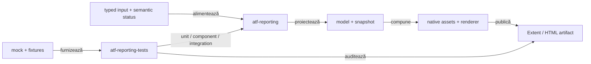
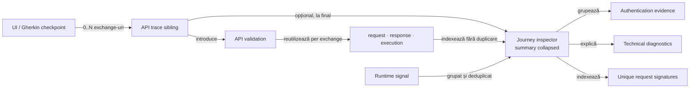

# ATF Reporting — feedback live pentru librărie și composition tests

## Verdict curent

- `atf-reporting` este librăria standalone pentru model semantic, evidence și
  publicare Extent/HTML;
- `atf-reporting-tests` este consumerul și composition root-ul pentru unit,
  component, integration și browser proof;
- `atf-reporting` nu importă mock, browser, fixture sau alt modul ATF în
  production runtime;
- publisher-ul păstrează datele typed; diagnosticele runtime au acum seam
  semantic separat de `UI validation`, iar API trace-ul poate fi publicat ca
  sibling cauzal după checkpoint-ul UI;
- inspectorul agregat de journey este acum o proiecție typed lower-level, cu
  secțiuni nested pentru auth/correlation/transport/signatures/diagnostics;
  însă trace-ul UI încă aplatizează mai multe exchange-uri în tabele comune și
  nu a închis reutilizarea structurală per exchange a raportului API;
- suportul generic se dovedește mai întâi cu input typed și imagini mock;
- E2E rămâne proof de interacțiune și randare, nu mecanismul implicit de
  acoperire;
- contractul stabil este în [`atf-reporting/README.md`](../../atf-reporting/README.md),
  [`atf-reporting-tests/README.md`](../../atf-reporting-tests/README.md) și
  [`ATF_Reporting_Contract.md`](../ATF_Reporting_Contract.md);
- acest fișier păstrează numai limite, decizii și criterii de redeschidere.

## Boundary-ul verificat

<strong>Legendă — ownership și limite</strong>

- `atf-reporting` deține API-ul public, modelele, renderer-ele și publicarea;
- `atf-reporting-tests` compune inputul și verifică output-ul;
- `atf-mock`, fixture-urile și Playwright aparțin consumerului de test;
- browserul validează interacțiunea cu artifactul, nu înlocuiește validatorii
  puri;
- un defect de model, markup, asset sau contract trebuie coborât la cel mai jos
  nivel observabil;
- Practice Shop consumă suportul generic, dar nu este owner-ul lui.

## Scor pe axe

Scorurile sunt instrument de prioritizare, nu verdict de release. Se schimbă
numai când codul, testele sau un guard produc o dovadă nouă.

| Axă | Notă | Citire agresiv-constructivă | Dovadă live |
|---|---:|---|---|
| boundary standalone | 99 | fundația este solidă; orice dependență nouă către ATF ar fi regresie | POM parentless, `ReportingStandaloneDependencyTest` |
| model semantic | 96 | snapshot-ul și proiecțiile typed sunt verificate; mutația lifecycle este izolată într-un boundary intern, iar recorderul public a rămas fațadă compatibilă; modelele nested încă pot fi simplificate | `ReportExecutionProjectionTest`, `AtfReportSemanticSnapshotTest`, `HtmlReportSemanticSnapshotMapperTest` |
| vocabular HTML/CSS | 97 | Navigation, Overview, Category și fallback views folosesc builder-e typed; seam-urile vendor și labels sunt allowlist-uit explicit | `AtfReportHtmlVocabulary`, `ExtentReportMarkupContractTest`, `ExtentReportCategoryMarkupTest`, `AtfReportHtmlVocabularyTest` |
| renderer parity | 98 | primitivele comune și parity test-ul acoperă tabel, disclosure, status, failure și category empty-state; seam-urile vendor rămân explicit allowlist-uite | `ReportRendererParityTest`, `ReportAssetContractTest`, `HtmlReportViewsTest` |
| asset publication | 98 | manifestul, compactorul și baseline-ul consumer pentru bundle-ul de asset-uri sunt centralizate; HTML-ul generat rămâne dependent de fixture | `ReportAssetContractTest`, `ReportAssetSizeInventoryTest` |
| audit static | 98 | validatorii pe secțiuni sunt puri și legați de matricea de coverage | `ReportingCoverageMatrixTest` |
| unit/component/integration | 95 | suitele dedicate, matrix-ul și provider-ele typed separă lower-level proof de composition; support-ul mai are câteva facades de simplificat | suitele ATF + `ReportingCoverageMatrixTest` |
| semantică diagnostic și trace UI/API | 88 | aggregate-ul corelează response/console și warning projection este grupat; semnalele necorelate rămân limita `REP-DIAGNOSTIC-04`, iar UI trace-ul nu are încă stratul semantic `API validation` între pasul Gherkin și disclosures | `ReportNetworkInspectorTest`, `PracticeShopRuntimeDiagnosticsTest`, fresh UI HTML |
| inspector journey și auth evidence | 89 | aggregate-ul este typed, bounded și nested; nu trebuie confundat cu disclosure-ul exchange-ului: raportul fresh arată `API 1/API 2` în tabele comune, iar titlul `Execution evidence · 1 attempts` se repetă fără identitate de exchange | `ReportNetworkInspectorTest`, `ExtentReportUiEvidencePublishingTest`, `HtmlReportViewsTest`, fresh MCP HTML/API |
| API binding configurabil | 96 | binding-ul este typed și configurabil per checkpoint/journey; YAML/override-ul selectează contractul, iar journal-ul expune maparea `evidence(checkpoint)` fără liste `last*` | `PracticeShopApiEvidenceBindingTest`, `PracticeShopConfigurationTest`, `PracticeShopE2eContext` și fresh MCP/System |
| disciplină E2E | 96 | cele 8 clase sunt suficiente pentru browser proof; nu se multiplică pentru variații de contract | `E2eSuiteBudgetArchitectureTest` |
| lizibilitate test-kit | 97 | `ReportUiLocators` păstrează numai compatibilitatea publică; ownership-ul selectorilor este împărțit pe ports coezive și guard-uit | `ReportUiLocatorsTest` + surface tests |
| proiecție Extent/HTML | 82 | aggregate-ul nested există, dar UI nu reutilizează încă forma API directă ca structură per exchange, nu publică `API validation`, repetă titluri de execution fără context, pune metadata de trace în response table, iar URL-ul lung se rupe arbitrar la viewport îngust | `ExtentReportUiEvidencePublishingTest` (roșu pe aggregate), `HtmlReportViewsTest`, fresh MCP HTML/API |
| **scor global** | **87** | boundary-ul și modelul typed sunt puternice; reducerea este justificată de ierarhia UI incompletă, reuse-ul structural per exchange, execution headings ambigue, URL readability, collision-ul diagnosticelor necorelate și fixture-ul authenticated extern | combinația de mai sus |

## Recalibrare live — trace per checkpoint versus inspector agregat

<strong>Legendă — ce este închis și ce rămâne activ</strong>

- `REP-TRACE-01` rămâne închis: fiecare checkpoint UI are sibling API cu titlul
  Gherkin exact și ordinea cauzală este păstrată;
- `REP-TRACE-02` este închis numai pentru vocabular, redaction, filtrarea
  browser noise, replay și execution evidence; forma canonicală per exchange
  rămâne `REP-TRACE-03`;
- `API validation` lipsește încă din UI trace: pasul Gherkin și disclosures trebuie
  să aibă aceeași ierarhie vizibilă ca `UI validation`, fără un verdict duplicat;
- un titlu repetat `Execution evidence · 1 attempts` nu este suficient pentru
  mai multe exchange-uri; contextul `API 1`, `API 2` trebuie să provină din
  disclosure-ul per exchange, nu din rânduri flat;
- `Runtime diagnostic` este semantic separat de `UI validation`, iar guest
  `401` response+console este acum o observație agregată cu count și sources;
- dedupe-ul este sigur numai pentru diagnostice corelate prin method/route/status;
  console/page signals fără aceste facts nu pot folosi tripletul gol drept identitate;
- `API network inspector — ordered UI journey` rămâne un singur nod synthetic
  `TRACE`; aggregate-ul typed este deja publicat nested și scanabil. Asta nu
  repară faptul că request/response pentru `0..N` exchange-uri sunt încă
  serializate în tabele comune;
- `ReportAuthObservation` și aggregate-ul lui descriu ce s-a observat și
  redacționează credential-ul; nu pretind validarea tokenului, issuerului sau
  claims-urilor;
- `Overview → System` rămâne pentru configurație operațională relevantă, nu
  pentru trace, auth map, body-uri sau identitate de test;
- reference report păstrează trace-ul ordonat în JSON și afișează agregarea în
  disclosure-uri colapsabile; aceasta este ținta de UX, nu o invitație la
  copierea markup-ului vendor;
- testul `publishesTheJourneyAggregateAsOneCollapsedInspectableRequest` este
  momentan roșu: verifică label-uri care nu mai corespund markup-ului nested și
  o interdicție în întreg artifactul; trebuie rescris pe structură semantică și
  zonă scoped, apoi completat cu dovadă per exchange.

## Inventar live folosit de registru

| Zonă | Stare observată | Interpretare |
|---|---|---|
| production `atf-reporting` | standalone | modelul, renderer-ele, asset-urile și publicarea rămân independente de mock, browser și fixture |
| `atf-reporting-tests` | composition root separat | unit, component și integration sunt nivelurile implicite; E2E rămâne proof de interacțiune și randare |
| package cohesion | boundary valid, maximum 8 | production `ui.network` și test support `support.api`/`support.config.environment` sunt split-uri semantice; nu există allowlist nouă |
| consumer gate | ⚠️ PARTIAL | `ReportNetworkInspectorTest` și guest E2E sunt utile, dar publisher proof-ul aggregate este roșu; fresh MCP confirmă și aplatizarea multi-exchange și wrapping-ul slab al URL-urilor |

Numărătorile de clase și de teste se obțin din build, suite și guard-uri. Nu sunt
baseline editorial și nu se păstrează aici ca istoric.

## Închideri promovate în owner docs

Acestea nu mai sunt ToDo-uri. Contractul detaliat este în README-ul indicat,
iar testele de mai jos sunt dovada executabilă.

| ID | Owner / dovadă | Verdict |
|---|---|---|
| `REP-BOUNDARY-01` | `ArchitectureOwnershipBoundaryTest`, POM-uri, composition roots | ownership-ul production versus consumer este explicit |
| `REP-BUILD-01` | allowlist Surefire și standalone dependency tests | clase stale ale consumerului nu contaminează build-ul standalone |
| `REP-ADAPTER-01` | `ReportModelAdaptersTest` | compatibility boundary fail-closed; câmpul invalid rămâne diagnostic |
| `REP-EVID-01..06` | policy, profile, session și integration tests | flow mode, screenshot policy, source și cardinalitatea sunt typed și browser-neutral |
| `REP-JSON-01` | formatter, HTML views și parity tests | JSON-ul este redacted, determinist și identic ca regulă în renderer-ele suportate |
| `REP-FORMAT-01` | `ReportAssetCompactorTest` | sursa CSS/JS rămâne multiline; numai copia publicată este compactată sigur |
| `REP-ASSET-08` | manifest, composer și asset contract | asset-urile au owner, format, ordine și namespace verificabile |
| `REP-FACADE-01` | `UiExtentReportOptions` și composition tests | configurația este snapshot-uită o singură dată pe traseul canonical |
| `REP-OVERVIEW-01` | `ExtentReportOverviewMarkup` și contract test | overview injection este semantic și idempotent |
| `REP-RENDER-08` | renderere action/observation/assertion | facade-ul UI nu mai deține toate responsabilitățile de markup |
| `REP-EVID-04` | `StaticHtmlScreenshotAdapterTest` | PNG-ul real este verificat din HTML local, fără Practice Shop sau endpoint extern |
| `REP-EVID-07` | disclosure component test și browser proof | normalizarea evidence este idempotentă; request/response/execution rămân împreună |
| `REP-AUDIT-08` | `ReportAuditSnapshot` și validatorii puri | Overview, Categories, Fails, Screen, JSON și visual projection au reguli separate |
| `REP-COVERAGE-08` | `ReportingCoverageMatrixTest` | fiecare seam public înregistrat cere o dovadă lower-level identificabilă |
| `REP-E2E-08` | `E2eSuiteBudgetArchitectureTest` | plafonul de 8 clase și entry-point-ul E2E sunt guvernate |
| `REP-SIZE-01` | `ReportAssetSizeBudget`, `ReportAssetSizeInventoryTest` | baseline explicit pentru bundle-ul CSS/JavaScript native și publicat, cu limite pe format |
| `REP-VOCAB-01` | `AtfReportHtmlVocabulary`, `ExtentReportMarkupContractTest`, `AtfReportHtmlVocabularyTest` | tokenii HTML/CSS/attribute pentru renderer-ele production sunt centralizați; seam-ul `toggleView` rămâne allowlist vendor explicit |
| `REP-BODY-01` | `ReportingSettings`, `ExtentReportNodeSupport`, formatter/config/Extent/HTML tests | politica body este centrală după redaction/pretty-print; default `100`, `0` dezactivează limita, iar markerul publică `first N of TOTAL` |
| `REP-AUTH-01` | `ReportAuthMethod`, `ReportAuthObservation`, `ReportAuthObservationTest` și Network Inspector/UI evidence component tests | taxonomy-ul per exchange este typed și renderer-neutral: method + source (`none`, `bearer`, `cookie`, `api/function-key`, `signed-url`, `token-acquisition`, `basic`, `other/unknown`); clasificarea fără credential este publicată; harta aggregate este verificată prin `ReportNetworkInspectorTest` |
| `REP-LOCATOR-01` | `ReportUiLocatorsTest` și `atf-reporting-tests/.../support/locators/*` | ownership-ul selectorilor este împărțit pe page/tree/evidence/screen/category/failure ports; fațada rămâne compatibilitate publică, fără selector ownership monolitic |
| `REP-NET-02` | `ReportNetworkInspectorTest`, `ReportAuthObservationTest`, `UiRetryPolicyTest`, `PlaywrightActionSequenceTest` și `ExtentReportUiEvidenceRenderingTest` | primitivele de network sunt typed și compacte, iar retry-ul UI este separat, explicit și fail-closed; aggregate-ul journey este acum construit de aceeași proiecție typed |
| `REP-RETRY-01` | `UiRetryPolicy`, `UiRetryOperation`, `UiActionRecorder` și loader/component/render tests | retry fail-closed: implicit un singur attempt; YAML poate declara max attempts, backoff, motiv și numai operații read-only; retry-ul apare ca rând `Info`, iar failure-ul final rămâne verdictul acțiunii |
| `REP-CONSOLE-01` | `atf-reporting-tests/.../AtfConsoleBridge`, `AtfConsoleBridgeTest` | adapterul este deținut de composition tests; `atf-reporting` rămâne standalone și `atf-console` nu depinde de reporting |
| `REP-DIAGNOSTIC-01` | `UiEvidencePublisher.publishDiagnostic`, `ExtentReportUiEvidencePublishingTest` și guest consumer proof | boundary-ul semantic este închis: diagnostic runtime are status/target/assertions și `Runtime diagnostic`; agregarea cross-source este verificată de `ReportNetworkInspectorTest` |
| `REP-TRACE-01` | `UiPhaseLifecycle.apiTrace`, `ExtentReportUiEvidencePublishingTest` și guest Practice Shop E2E | API trace-ul este sibling după UI, păstrează parent step și disclosures canonical; JSON-ul nu este duplicat în inspectorul sumar |
| `REP-TRACE-02` | `UiEvidencePublisher`, `EvidenceTableFormatter`, `ApiManualReplayProjectionTest` și publisher tests | parity-ul de vocabular, redaction, browser-noise filtering, replay și execution evidence este închis; nu pretinde încă disclosure-uri separate per exchange |
| `REP-NET-03` | `ReportNetworkInspector.JourneyAggregate`, `ReportNetworkInspectorTest` | modelul typed agregă authentication, correlation, transport, signatures și diagnostics; fields sunt bounded și credential-free |
| `REP-NET-04` | `ReportNetworkAggregateMarkup`, `ReportNetworkInspectorTest`, `HtmlReportViewsTest` și fresh MCP HTML | Extent și fallback publică același inspector collapsed cu `Authentication evidence`, `Scenario correlation`, `Transport counters`, `Unique request signatures` și `Technical diagnostics`; flat `network.aggregate.*` nu mai este expus în trace |
| `REP-AUTH-02` | `ReportNetworkInspector.AuthenticationObservation`, `ReportNetworkInspectorTest` și UI publishing contract | auth este agregat determinist după method/source/status/count, fără credentiale; semantica rămâne „observed”, nu validarea tokenului |
| `REP-DIAGNOSTIC-02` | `ReportNetworkInspector.DiagnosticObservation`, `ReportNetworkInspectorTest` | response și console corelate pentru aceeași semnătură method/route/status sunt un singur observation cu `count` și `sources`; mesajele volatile nu sunt copiate în summary, iar semnalele necorelate rămân limitate de `REP-DIAGNOSTIC-04` |
| `REP-RENDER-09` | `ReportRendererParityTest`, `ReportAssetContractTest`, `ExtentReportCategoryMarkupTest`, `HtmlReportViewsTest` | fallback și Extent folosesc tokenii comuni pentru failure rows, status și category empty-state; seam-urile vendor rămân explicit allowlist-uite |
| `REP-MODEL-01` | `AtfReportSemanticSnapshotTest`, `ReportExecutionProjectionTest` | state mutation, snapshot și projection au boundary-uri explicite; lifecycle-ul refuză mutații după complete sau închiderea părintelui, iar nested state rămâne co-localizat intenționat |
| `REP-TEST-08` | `ReportingCoverageMatrixTest`, suitele layer-izate și `E2eSuiteBudgetArchitectureTest` | fiecare seam nou are motiv și proof class declarate; matrix-ul verifică unicitatea și layer-ul, iar support/fixture nu devine test executabil |
| `REP-OVERVIEW-02` | `ReportEnvironmentSnapshotTest`, `ExtentReportSessionContractTest`, factory-urile typed | toate composition roots publică snapshot typed; publisher-ul filtrează central identitatea de run (`Suite`, `Test package`, `Flow`, `Fixture`) din System, păstrând doar configurația operațională redacted și bounded |
| `REP-SUITE-01` | `AtfReportingUnitSuite`, `AtfReportingComponentSuite`, `AtfReportingIntegrationSuite`, `AtfReportingApiFixtureSuite`, `AtfReportingUiAuditSuite` și `ReportingCoverageMatrixTest` | fiecare layer reporting are launcher dedicat, cu package și tag explicit; plafonul E2E rămâne neschimbat |
| `REP-API-BIND-01` | `PracticeShopApiCheckpoint`, `PracticeShopApiEvidenceBinding`, `PracticeShopConfigurationLoader`, `PracticeShopApiEvidenceBindingTest`, `PracticeShopApiNetworkJournalTest` și fresh Practice Shop E2E/MCP | binding-ul typed și configurabil per checkpoint/journey este citit din YAML/override, jurnalul păstrează `evidence(checkpoint)`, iar agregarea publică doar `selectedEvidence()`; renderer-ul primește numai contractul generic |

## Limite active și criterii de redeschidere

`REP-RENDER-09`, `REP-MODEL-01`, `REP-TEST-08`, `REP-OVERVIEW-02`, `REP-NET-03`,
`REP-NET-04`, `REP-AUTH-02`, `REP-DIAGNOSTIC-02` și `REP-API-BIND-01` sunt închise prin dovezile de mai sus.
Rămân aici doar limitele care cer încă o schimbare de contract, nu doar un run verde.

| ID | Owner | Limită actuală | Criteriu de închidere |
|---|---|---|---|
| `REP-DIAGNOSTIC-04` | `atf-reporting` + `atf-reporting-tests` | key-ul actual `(method, route, status)` nu distinge două console/page signals fără facts de transport; count-ul live poate masca evenimente diferite | fingerprint/category bounded pentru semnal necorelat, test pozitiv pentru distincte și repetări, fără mesaj brut în aggregate |
| `REP-TRACE-03` | `atf-reporting` + `atf-reporting-tests` | UI trace-ul combină `0..N` exchange-uri în tabele comune, nu are copilul semantic `API validation` și pune `TRACE PARENT STEP`/`TRACE POSITION` în response details; execution headings se repetă fără context, în timp ce raportul API direct separă request/response/execution per request | un singur sibling Gherkin cu un copil `API validation` în stilul `UI validation`; sub acesta, aceeași proiecție typed și același pipeline de renderer request/response/execution reutilizat per exchange, fără re-encodare în chei flat, metadata în header/context, JSON o singură dată și execution evidence identificabil |
| `REP-EVID-08` | `atf-reporting` + `atf-reporting-tests` | URL-urile lungi se rup arbitrar în identificator și reduc scanarea în raportul UI | wrapping controlat pe delimitatori sau o proiecție semantică echivalentă, fără overflow și cu valoarea completă păstrată în Extent/fallback |

<strong>Calibrare portabilă din modelul extern</strong>

- auth inspectorul descrie ce s-a observat pe transport; nu afirmă validarea
  tokenului, issuerului sau claims-urilor dacă acestea nu au fost verificate;
- browser traffic și `HttpClient` traffic folosesc același vocabular de evidence,
  cu `service`, `source`, `method`, `status`, `auth method` și `outcome`;
- `System/Environment` descrie configurația efectivă a run-ului, separat de
  request evidence și separat de verdictul Extent;
- body preview-ul este o proiecție bounded, nu ștergerea evidence-ului: sumarul
  arată lungimea totală și limita, iar datele sensibile sunt redactate înainte
  de truncare;
- retry-ul este permis numai la boundary-ul explicit al operației și numai când
  policy-ul îl declară sigur; fiecare attempt rămâne auditabil, iar failure-ul
  inițial nu devine PASS implicit;
- Playwright events (`request`, `response`, `request-failed`, console/page error)
  se corelează cu aceeași acțiune/UI step; un timeout fără exchange observat nu
  poate fi confundat cu un răspuns negativ real.

<strong>Contractul obligatoriu pentru Overview → System</strong>

`System` răspunde rapid la întrebarea „cu ce configurație operațională a rulat
artifactul?”, nu la întrebarea „ce test sau ce business flow a rulat?”.

- **runtime** — environment, JVM/OS și clientul efectiv;
- **targets** — UI/API origin normalizate, transport mode și precondition;
- **browser** — engine/channel, headless, viewport și zoom, dacă există UI;
- **time** — limitele efective UI/API/navigation în limbaj uman (`20s`, `45s`);
- **network** — inspector, capture source și body-preview bound, numai când sunt active;
- **retry** — stare efectivă, attempts, eligibility și motivul policy-ului;
- **evidence** — API/screenshot/console policy, numai ca mecanisme active;
- **reporting** — formatul și rolul output-ului.

`Suite`, `Test package`, `Flow`, `Fixture`, `Checkout`, numele scenariului și
payload-ul business nu apar în `System`. Identitatea testului rămâne în `Tests`,
pașii și verdicturile rămân în `TEST BODY`, iar request/response facts rămân în
disclosure-ul lor.

Reguli de afișare:

- se publică numai allowlist-ul de configurări operaționale importante, nu un dump arbitrar;
- fiecare valoare este `configured` sau `effective`, după caz;
- eticheta trebuie să explice ce controlează valoarea, nu să repete numele tehnic al proprietății;
- valoarea trebuie prezentată în limbaj operațional: `Timp maxim de așteptare pentru acțiunile UI: 20 s`, nu `UI timeout: PT20S`;
- unitățile și scopul sunt vizibile în aceeași intrare; forma tehnică (`PT20S`, cheia YAML, sursa) rămâne doar în detaliul colapsat;
- configurările se grupează pe scop — runtime, target, browser, timp, network, retry, evidence și reporting — nu într-o listă plată de chei;
- body-urile și mesajele lungi folosesc limita comună
  `maxBodyPreviewChars`;
- `System` descrie configurația, iar evidence-ul din `TEST BODY` descrie ce s-a
  observat efectiv pe flow.

### Politica disclosure-ului API în flow-ul UI

Cardul `TRACE` dintr-un raport UI este o proiecție de network evidence, nu o
copie a raportului API direct. Titlul cardului identifică deja pagina și faptul
că este trace, iar parent step-ul din response evidence păstrează legătura
cauzală. Pentru fiecare exchange rămân numai câmpurile care permit identificarea
și auditarea acțiunii: metodă, path, URL, profil/tip de auth, query, request
headers relevante, transport, replay safe, status, content type și JSON-urile
request/response. Acestea folosesc aceleași label-uri și aceeași redaction policy
ca raportul API direct. `API n ·` este numai corelare pentru un checkpoint cu mai
multe exchange-uri; nu este un nou vocabular.
Headerele browserului și response headers volatile sunt filtrate; response
headers stabile/relevante pot apărea prin aceeași disclosure opțională ca în
raportul API direct.

Root cause-ul observat în implementarea live este:

- `UiEvidencePublisher` iterează exchange-urile, dar scrie toate câmpurile
  într-un singur `AtfReportPorts.Request`;
- `publishApiTrace(...)` nu creează încă un `API validation` semantic; de aceea
  Gherkin-ul și disclosure-urile nu au stratul intermediar vizibil cerut;
- `ExtentRequestScope` și `HtmlReportEvidenceView` renderizează un singur
  request table, un singur response table și execuțiile la nivelul scope-ului;
- reutilizarea actuală este de vocabular și redaction, nu de structură
  canonicală;
- fixul trebuie să refolosească proiecția API typed pentru fiecare exchange și
  să lase `TRACE` doar ca sibling/owner al journey-ului.

Un trace cu mai multe exchange-uri trebuie să publice un execution disclosure
pentru fiecare exchange. Păstrarea numai a ultimului execution ar face raportul
neauditabil: request/response ar arăta două schimburi, dar durata, retry-ul și
attempt history ar aparține doar celui din urmă.

Suprafața vizibilă minimă trebuie să rămână scurtă:

- **Runtime** — mediu, client și identity tehnică relevantă;
- **Ținte** — aplicația UI și API-ul folosite;
- **Browser** — engine, headless și viewport, dacă există UI;
- **Timp** — limitele efective relevante pentru UI/API/navigation, într-o formulare umană;
- **Precondition** — transport/auth mode, fără identitate de test sau secret;
- **Evidence** — network/auth inspector, retry și screenshot policy, numai când sunt active sau relevante;
- **Reporting** — tipul artefactului și rolul destinației.

Într-un detaliu tehnic separat pot rămâne cheile YAML și valorile ISO necesare
pentru debugging, dar niciodată `Suite`, `Test package`, fixture, checkout,
payload business sau path-uri temporare. Acestea nu trebuie să aglomereze prima
privire și nu se repetă în `TEST BODY`.

## Contracte verificate în consumerul Practice Shop

- contractul guest E2E a fost verificat prin component/integration tests și
  browser proof MCP/Chromium;
- `Overview/System` arată metadata consumerului;
- Practice Shop nu mai publică `Suite`, `Test package`, `Flow`, `Fixture` sau
  `Checkout` în `Overview/System`; snapshot-ul typed rămâne limitat la
  configurația operațională efectivă;
- `TEST BODY` păstrează inspectorul collapsed-by-default, iar `Request details`
  și `Response details` sunt expandabile;
- warning-ul guest este acum `Runtime diagnostic`, cu status/target/assertions;
  fiecare checkpoint care are exchange-uri are acum un card API `TRACE` sibling
  imediat după UI, iar inspectorul final adaugă aggregate-ul typed compact;
- prezența textuală în HTML nu este suficientă: dovada cere component test,
  rerun E2E și verificare vizuală.

`REP-REVIEW-01` este regulă de întreținere, nu gap de production: orice claim
nou trebuie să indice o clasă, un test sau un guard; un run izolat nu închide un
ToDo.

## Contracte live — shell-ul Category și verificarea de markup

Situația curentă a shell-ului Category, a view-ului Fails și a fallback-ului:

- `ExtentReportCategoryMarkup`, `HtmlReportFailsView`, `HtmlReportTestsView` și `ExtentReportPublicationPipeline` folosesc aceeași graniță semantică precum Navigation și Overview;
- `Tag`, `CssClass`, `Attribute`, `ViewId` și `AtfReportLabels` descriu contractul repetat;
- builder-ele compun separat lista, toolbar-ul, back-link-ul și empty-state-ul;
- singurul fragment raw rămas este markerul vendor `atf-fails-view`, păstrat ca boundary de integrare.
- `ExtentReportScreenshotDeduplicator` folosește vocabularul pentru anchor, emoji și referința inline; fingerprint-ul rămâne intern și nu este afișat ca nume sau link de raport.

Dovada lower-level este distribuită astfel:

- `ExtentReportCategoryMarkupTest`, `ExtentReportMarkupContractTest`,
  `HtmlReportViewsTest` și `HtmlReportSessionTest` verifică shell-ul semantic;
- `ExtentReportAssetsTest` verifică deduplicarea screenshot-urilor;
- contracte verificate: idempotency, ordine, empty-state, CSS classes, fallback Fails, redaction și navigare;
  - gate-ul focalizat de model este verde, dar publisher proof-ul aggregate este
    încă roșu; lista exactă de teste rămâne responsabilitatea suitei și a
    build-ului, nu a acestui registru.
- verificarea fresh prin MCP/Chromium confirmă `SETUP` → `TEST BODY` → `Screen validation`, tabelul `Setup evidence` cu PASS, acțiunile Playwright expandabile și simbolul `+` inline; nu există delimitatori `
` în artefactele API/UI auditate.

REP-VOCAB-01 este închis pentru tokenii production acoperiți de contractele
actuale; seam-urile vendor rămase sunt explicit allowlist-uri, nu ToDo-uri:

- nu se deschide un refactor mecanic al fiecărui token vendor;
- următorul pas adaugă întâi o dovadă component;
- markerii vendor rămân într-un allowlist explicit.

## Progres live — metadata typed în composition roots

`ReportEnvironmentSnapshot` este acum folosit direct în următoarele boundary-uri
de compoziție:

- `AtfExtentReportTestExtension` pentru API contract tests;
- `ApiReportAuditSetup` pentru precondiția API mock a testelor UI;
- `ReportAuditContext` pentru auditul browser al unui artifact existent;
- fixture-urile de failure, category-cardinality și THEN disclosure;
- `PracticeShopReportSystemMetadata` pentru consumerul Practice Shop.

`ApiReportAuditSetup` nu mai construiește direct vocabularul metadata: delegă
factory-ului `ApiReportEnvironmentSnapshotFactory`, iar contractul component
verifică allowlist-ul API precondition separat de orchestration-ul mock/runner.

- aceste roots publică numai câmpuri din `ReportEnvironmentField`;
- valorile sunt bounded și nu includ credentiale sau path-uri tehnice;
- overload-urile cu `Map<String,String>` rămân doar compatibilitate, nu calea
  recomandată pentru cod nou;
- contractul `System` este filtrat central prin `systemDisplayValues()`;
- binding-ul typed per checkpoint/journey este închis în consumer;
- gap-urile rămase sunt identity collision pentru semnale runtime necorelate
  (`REP-DIAGNOSTIC-04`), reutilizarea structurală per exchange (`REP-TRACE-03`)
  și wrapping-ul URL-urilor (`REP-EVID-08`).

### Revalidare recentă a modelului typed

`ReportExecutionProjectionTest` verifică acum și agregatul
`ReportExecutionProjections`, inclusiv coerența dintre fațadele istorice,
snapshot-ul typed și failure-ul nested. Agregatul folosește acum un collector
single-pass, iar testul a trecut în staging extern după sincronizarea live;
această dovadă reduce riscul de proiecții divergente și de traversări duplicate,
dar nu închide încă simplificarea stărilor nested din lifecycle.

`AtfReportSemanticRecorder` nu mai conține storage-ul mutabil: el păstrează
contractul de handle folosit de Extent și fallback, `AtfReportSemanticLifecycle`
este orchestration boundary, iar `AtfReportSemanticState` deține graful mutable
și materializarea snapshot-ului. `AtfReportSemanticSnapshotTest` verifică
snapshot-uri independente înainte și după mutație, fără ca rendererul să fie
implicat. Stările concrete rămân co-localizate în state aggregate deoarece
formează un singur graf de mutație; un split ulterior este justificat numai de
un seam testabil nou, nu de reducerea artificială a numărului de linii.

## Ce nu se redeschide

- o regulă stabilă mutată în README-ul ownerului;
- un test E2E existent doar pentru că se dorește o variantă de date;
- un defect de whitespace când contractul semantic și randarea sunt intacte;
- un artifact local, timestamp, path sau captură care nu este reproductibilă;
- o separare de package propusă fără owner, motiv și test de boundary.

## Protocol de revalidare

<strong>Pași obligatorii când se schimbă reporting-ul</strong>

1. rulează testul focalizat pe seam-ul schimbat;
2. rulează `ReportingCoverageMatrixTest` și testele component/integration relevante;
3. pentru HTML/CSS/JavaScript, rulează consumer gate-ul în reactor și verifică
   artifactul fresh prin adapterul static sau browser proof-ul existent;
4. pentru schimbări de package/ownership, rulează `WholeAtfGovernanceSuiteTest`;
5. dacă se face o afirmație vizuală, verifică în MCP/Chromium:
   disclosure-uri, statusuri, overflow, screenshot placement și console errors;
6. actualizează tabelul curent, nu adăuga un jurnal datat;
7. mută regula stabilă în README-ul ownerului și păstrează aici numai limita
   care poate redeschide decizia.

## Regula de evidence pentru feedback

- feedback-ul nu păstrează nume de artifacte generate, timestamp-uri sau URL-uri
  temporare;
- dovada normativă este o clasă/test/guard și, când este necesar, un criteriu
  de rerun configurabil;
- MCP/Chromium este verificare de randare, nu sursă de adevăr pentru contractul
  Java;
- un failure de infrastructură se notează separat de un failure de produs și se
  reclasifică numai după rerun;
- dacă același failure de mediu se reproduce, se deschide un item separat pentru
  stabilitatea runner-ului, nu se contaminează verdictul reporting.

## Referințe normative

- [`atf-reporting/README.md`](../../atf-reporting/README.md) — API, assets,
  publication și formatul sursei versus copia HTML;
- [`atf-reporting-tests/README.md`](../../atf-reporting-tests/README.md) — matrice,
  fixture-uri, coverage și buget E2E;
- [`docs/ATF_Reporting_Contract.md`](../ATF_Reporting_Contract.md) — contractul
  transversal al artifactului Extent/HTML;
- [`docs/ATF_Evidence_Capture_Contract.md`](../ATF_Evidence_Capture_Contract.md)
  — capture policy, source și target generic;
- [`docs/README_Atf_CodeBestPractices.md`](../README_Atf_CodeBestPractices.md)
  — reguli de cod, teste și boundary-uri;
- [`docs/feedback/README.md`](README.md) — registrul central și ownership-ul
  feedback-ului.
