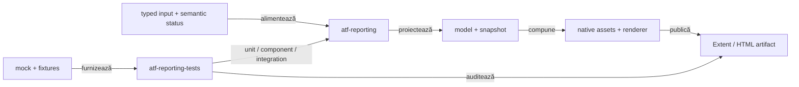

# ATF Reporting — feedback live pentru librărie și composition tests

## Verdict curent

- `atf-reporting` este librăria standalone pentru model semantic, evidence și
  publicare Extent/HTML;
- `atf-reporting-tests` este consumerul și composition root-ul pentru unit,
  component, integration și browser proof;
- `atf-reporting` nu importă mock, browser, fixture sau alt modul ATF în
  production runtime;
- suportul generic se dovedește mai întâi cu input typed și imagini mock;
- E2E rămâne proof de interacțiune și randare, nu mecanismul implicit de
  acoperire;
- contractul stabil este în [`atf-reporting/README.md`](../../atf-reporting/README.md),
  [`atf-reporting-tests/README.md`](../../atf-reporting-tests/README.md) și
  [`ATF_Reporting_Contract.md`](../ATF_Reporting_Contract.md);
- acest fișier păstrează numai limite, decizii și criterii de redeschidere.

## Boundary-ul verificat

<strong>Legendă — ownership și limite</strong>

- `atf-reporting` deține API-ul public, modelele, renderer-ele și publicarea;
- `atf-reporting-tests` compune inputul și verifică output-ul;
- `atf-mock`, fixture-urile și Playwright aparțin consumerului de test;
- browserul validează interacțiunea cu artifactul, nu înlocuiește validatorii
  puri;
- un defect de model, markup, asset sau contract trebuie coborât la cel mai jos
  nivel observabil;
- Practice Shop consumă suportul generic, dar nu este owner-ul lui.

## Scor pe axe

Scorurile sunt instrument de prioritizare, nu verdict de release. Se schimbă
numai când codul, testele sau un guard produc o dovadă nouă.

| Axă | Notă | Citire agresiv-constructivă | Dovadă live |
|---|---:|---|---|
| boundary standalone | 99 | fundația este solidă; orice dependență nouă către ATF ar fi regresie | POM parentless, `ReportingStandaloneDependencyTest` |
| model semantic | 93 | snapshot boundary este bun, dar lifecycle-ul nested încă are mutații prea concentrate | `HtmlReportSemanticSnapshotMapperTest` |
| vocabular HTML/CSS | 93 | Navigation, Overview și Category folosesc acum builder-e typed; literals raw rămân doar la boundary-uri vendor explicite și în contracte de verificare | `AtfReportHtmlVocabulary`, `ExtentReportMarkupContractTest`, `ExtentReportCategoryMarkupTest` |
| renderer parity | 92 | primitivele comune acoperă tabel, disclosure și status; parity-ul vendor-specific nu este complet | `ReportEvidenceMarkupTest`, parity component tests |
| asset publication | 98 | manifestul, compactorul și baseline-ul consumer pentru bundle-ul de asset-uri sunt centralizate; HTML-ul generat rămâne dependent de fixture | `ReportAssetContractTest`, `ReportAssetSizeInventoryTest` |
| audit static | 98 | validatorii pe secțiuni sunt puri și legați de matricea de coverage | `ReportingCoverageMatrixTest` |
| unit/component/integration | 92 | piramida este bună; support-ul rămâne voluminos și cere delimitare mai clară | adnotări ATF + matrix |
| disciplină E2E | 96 | cele 8 clase sunt suficiente pentru browser proof; nu se multiplică pentru variații de contract | `E2eSuiteBudgetArchitectureTest` |
| lizibilitate test-kit | 88 | `ReportUiLocators` rămâne facade de compatibilitate largă; migrarea typed continuă | `ReportUiLocators` + surface tests |
| **scor global** | **92** | funcționalitate puternică, mentenabilitate încă sub nivelul dorit | combinația de mai sus |

## Inventar live folosit de registru

| Zonă | Stare observată | Interpretare |
|---|---:|---|
| production `atf-reporting` | 259 clase Java, 51 resurse | modul substanțial; refactorizare numai pe seam-uri observabile |
| `atf-reporting-tests` | 308 clase Java | 168 executabile adnotate și 140 support/non-executable |
| distribuție executabilă | 112 unit, 36 component, 12 integration, 8 E2E | browser proof plafonat; lower-level este nivelul implicit |
| package cohesion | ✅ | `atf-reporting` rămâne fără import sau dependency production către `atf.api.console`; adapterul este exclusiv în composition tests |
| gate consumer | 479 teste / 0 failures / 0 errors / 3 skipped | ultima execuție a modulului `atf-reporting-tests`; gate-ul complet al reactorului a însumat 643 teste |

## Închideri promovate în owner docs

Acestea nu mai sunt ToDo-uri. Contractul detaliat este în README-ul indicat,
iar testele de mai jos sunt dovada executabilă.

| ID | Owner / dovadă | Verdict |
|---|---|---|
| `REP-BOUNDARY-01` | `ArchitectureOwnershipBoundaryTest`, POM-uri, composition roots | ownership-ul production versus consumer este explicit |
| `REP-BUILD-01` | allowlist Surefire și standalone dependency tests | clase stale ale consumerului nu contaminează build-ul standalone |
| `REP-ADAPTER-01` | `ReportModelAdaptersTest` | compatibility boundary fail-closed; câmpul invalid rămâne diagnostic |
| `REP-EVID-01..06` | policy, profile, session și integration tests | flow mode, screenshot policy, source și cardinalitatea sunt typed și browser-neutral |
| `REP-JSON-01` | formatter, HTML views și parity tests | JSON-ul este redacted, determinist și identic ca regulă în renderer-ele suportate |
| `REP-FORMAT-01` | `ReportAssetCompactorTest` | sursa CSS/JS rămâne multiline; numai copia publicată este compactată sigur |
| `REP-ASSET-08` | manifest, composer și asset contract | asset-urile au owner, format, ordine și namespace verificabile |
| `REP-FACADE-01` | `UiExtentReportOptions` și composition tests | configurația este snapshot-uită o singură dată pe traseul canonical |
| `REP-OVERVIEW-01` | `ExtentReportOverviewMarkup` și contract test | overview injection este semantic și idempotent |
| `REP-RENDER-08` | renderere action/observation/assertion | facade-ul UI nu mai deține toate responsabilitățile de markup |
| `REP-EVID-04` | `StaticHtmlScreenshotAdapterTest` | PNG-ul real este verificat din HTML local, fără Practice Shop sau endpoint extern |
| `REP-EVID-07` | disclosure component test și browser proof | normalizarea evidence este idempotentă; request/response/execution rămân împreună |
| `REP-AUDIT-08` | `ReportAuditSnapshot` și validatorii puri | Overview, Categories, Fails, Screen, JSON și visual projection au reguli separate |
| `REP-COVERAGE-08` | `ReportingCoverageMatrixTest` | fiecare seam public înregistrat cere o dovadă lower-level identificabilă |
| `REP-E2E-08` | `E2eSuiteBudgetArchitectureTest` | plafonul de 8 clase și entry-point-ul E2E sunt guvernate |
| `REP-SIZE-01` | `ReportAssetSizeBudget`, `ReportAssetSizeInventoryTest` | baseline explicit pentru bundle-ul CSS/JavaScript native și publicat, cu limite pe format |
| `REP-CONSOLE-01` | `atf-reporting-tests/.../AtfConsoleBridge`, `AtfConsoleBridgeTest` | adapterul este deținut de composition tests; `atf-reporting` rămâne standalone și `atf-console` nu depinde de reporting |

## Limite active și criterii de închidere

| ID | Owner | Limită actuală | Criteriu de închidere |
|---|---|---|---|
| `REP-RENDER-09` | `atf-reporting` | Fails și Category fallback folosesc acum primitive comune, dar parity-ul complet al badge-urilor și evidence-ului vendor-specific încă nu este închis | fiecare renderer compune aceleași primitive; parity component tests acoperă Extent și fallback fără markup copiat |
| `REP-MODEL-01` | `atf-reporting` | snapshot boundary este stabil; lifecycle mutation și modelele nested au încă nesting | scopes explicite, unit tests pe model/snapshot și component tests pe projection |
| `REP-VOCAB-01` | `atf-reporting` | shell-urile Navigation, Overview și Category sunt typed; mai există literals în alte views/contract checks și în seam-uri vendor | allowlist vendor explicit, zero literals noi nejustificate, teste pe fiecare grup |
| `REP-TEST-08` | `atf-reporting-tests` | câteva teste și facades support sunt încă prea largi | fiecare test are un motiv, support-ul rămâne neexecutabil, coverage-ul lower-level crește |
| `REP-SUITE-01` | `atf-reporting-tests` | 308 clase includ 140 support; reporting-only, API fixture, UI audit și E2E nu sunt încă profile distincte | profile/launcher sau boundary reproducibil, owner/layer pentru executabile, plafonul de 8 E2E păstrat |
| `REP-LOCATOR-01` | `atf-reporting-tests` | `ReportUiLocators` are 443 linii și 29.943 bytes și rămâne facade legacy | testele noi folosesc surface-uri typed; facade-ul nu primește delegări noi fără motiv de compatibilitate |

`REP-REVIEW-01` este regulă de întreținere, nu gap de production: orice claim
nou trebuie să indice o clasă, un test sau un guard; un run izolat nu închide un
ToDo.

## Progres live — shell-ul Category și verificarea de markup

Situația curentă a shell-ului Category, a view-ului Fails și a fallback-ului:

- `ExtentReportCategoryMarkup`, `HtmlReportFailsView`, `HtmlReportTestsView` și `ExtentReportPublicationPipeline` folosesc aceeași graniță semantică precum Navigation și Overview;
- `Tag`, `CssClass`, `Attribute`, `ViewId` și `AtfReportLabels` descriu contractul repetat;
- builder-ele compun separat lista, toolbar-ul, back-link-ul și empty-state-ul;
- singurul fragment raw rămas este markerul vendor `atf-fails-view`, păstrat ca boundary de integrare.
- `ExtentReportScreenshotDeduplicator` folosește vocabularul pentru anchor, emoji și referința inline; fingerprint-ul rămâne intern și nu este afișat ca nume sau link de raport.

Dovada lower-level este distribuită astfel:

- `ExtentReportCategoryMarkupTest` — 4 teste;
- `ExtentReportMarkupContractTest` — 3 teste;
- `HtmlReportViewsTest` — 5 teste;
- `HtmlReportSessionTest` — 5 teste;
- `ExtentReportAssetsTest` — 6 teste pentru deduplicarea screenshot-urilor;
- contracte verificate: idempotency, ordine, empty-state, CSS classes, fallback Fails, redaction și navigare;
- ultimul gate al consumerului: 479 teste, 0 failures, 0 errors, 3 skipped; reactorul complet verificat a însumat 643 teste, 0 failures și 0 errors.

REP-VOCAB-01 rămâne limitat la seam-urile care nu au fost încă mutate în
vocabularul typed:

- nu se deschide un refactor mecanic al fiecărui token vendor;
- următorul pas adaugă întâi o dovadă component;
- markerii vendor rămân într-un allowlist explicit.

## Ce nu se redeschide

- o regulă stabilă mutată în README-ul ownerului;
- un test E2E existent doar pentru că se dorește o variantă de date;
- un defect de whitespace când contractul semantic și randarea sunt intacte;
- un artifact local, timestamp, path sau captură care nu este reproductibilă;
- o separare de package propusă fără owner, motiv și test de boundary.

## Protocol de revalidare

<strong>Pași obligatorii când se schimbă reporting-ul</strong>

1. rulează testul focalizat pe seam-ul schimbat;
2. rulează `ReportingCoverageMatrixTest` și testele component/integration relevante;
3. pentru HTML/CSS/JavaScript, rulează consumer gate-ul în reactor și verifică
   artifactul fresh prin adapterul static sau browser proof-ul existent;
4. pentru schimbări de package/ownership, rulează `WholeAtfGovernanceSuiteTest`;
5. dacă se face o afirmație vizuală, verifică în MCP/Chromium:
   disclosure-uri, statusuri, overflow, screenshot placement și console errors;
6. actualizează tabelul curent, nu adăuga un jurnal datat;
7. mută regula stabilă în README-ul ownerului și păstrează aici numai limita
   care poate redeschide decizia.

## Regula de evidence pentru feedback

- feedback-ul nu păstrează nume de artifacte generate, timestamp-uri sau URL-uri
  temporare;
- dovada normativă este o clasă/test/guard și, când este necesar, un criteriu
  de rerun configurabil;
- MCP/Chromium este verificare de randare, nu sursă de adevăr pentru contractul
  Java;
- un failure de infrastructură se notează separat de un failure de produs și se
  reclasifică numai după rerun;
- dacă același failure de mediu se reproduce, se deschide un item separat pentru
  stabilitatea runner-ului, nu se contaminează verdictul reporting.

## Referințe normative

- [`atf-reporting/README.md`](../../atf-reporting/README.md) — API, assets,
  publication și formatul sursei versus copia HTML;
- [`atf-reporting-tests/README.md`](../../atf-reporting-tests/README.md) — matrice,
  fixture-uri, coverage și buget E2E;
- [`docs/ATF_Reporting_Contract.md`](../ATF_Reporting_Contract.md) — contractul
  transversal al artifactului Extent/HTML;
- [`docs/ATF_Evidence_Capture_Contract.md`](../ATF_Evidence_Capture_Contract.md)
  — capture policy, source și target generic;
- [`docs/README_Atf_CodeBestPractices.md`](../README_Atf_CodeBestPractices.md)
  — reguli de cod, teste și boundary-uri;
- [`docs/feedback/README.md`](README.md) — registrul central și ownership-ul
  feedback-ului.
