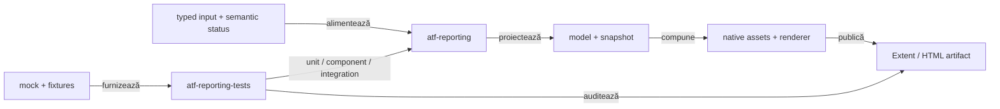
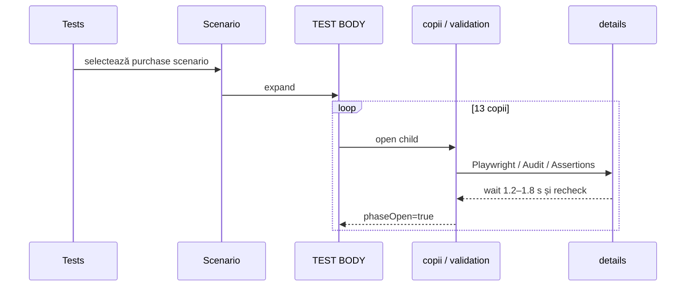
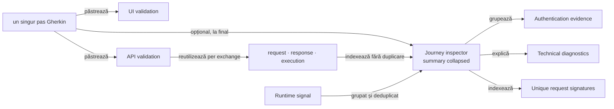

# ATF Reporting — feedback live pentru librărie și composition tests

## Verdict curent

- `atf-reporting` este librăria standalone pentru model semantic, evidence și
  publicare Extent/HTML;
- `atf-reporting-tests` este consumerul și composition root-ul pentru unit,
  component, integration și browser proof;
- `atf-reporting` nu importă mock, browser, fixture sau alt modul ATF în
  production runtime;
- publisher-ul păstrează datele typed; diagnosticele runtime au seam semantic
  separat de `UI validation`, iar pipeline-ul API trace poate construi
  `API validation → Exchange → request/response/execution`; compoziția live
  atașează acum această validare la checkpoint-ul Gherkin existent, fără un al
  doilea nod semantic pentru aceeași propoziție;
- inspectorul agregat de journey este acum o proiecție typed lower-level, cu
  secțiuni nested pentru auth/correlation/transport/signatures/diagnostics, iar
  trace-ul UI reutilizează structura per exchange a raportului API sub
  `API validation`;
- suportul generic se dovedește mai întâi cu input typed și imagini mock;
- E2E rămâne proof de interacțiune și randare, nu mecanismul implicit de
  acoperire;
- contractul stabil este în [`atf-reporting/README.md`](../../atf-reporting/README.md),
  [`atf-reporting-tests/README.md`](../../atf-reporting-tests/README.md) și
  [`ATF_Reporting_Contract.md`](../ATF_Reporting_Contract.md);
- acest fișier păstrează numai limite, decizii și criterii de redeschidere.

## Boundary-ul verificat



<details>
<summary><strong>Legendă — ownership și limite</strong></summary>

- `atf-reporting` deține API-ul public, modelele, renderer-ele și publicarea;
- `atf-reporting-tests` compune inputul și verifică output-ul;
- `atf-mock`, fixture-urile și Playwright aparțin consumerului de test;
- browserul validează interacțiunea cu artifactul, nu înlocuiește validatorii
  puri;
- un defect de model, markup, asset sau contract trebuie coborât la cel mai jos
  nivel observabil;
- Practice Shop consumă suportul generic, dar nu este owner-ul lui.

</details>

## Scor pe axe

Scorurile sunt instrument de prioritizare, nu verdict de release. Se schimbă
numai când codul, testele sau un guard produc o dovadă nouă.

| Axă | Notă | Citire agresiv-constructivă | Dovadă live |
|---|---:|---|---|
| boundary standalone | 99 | fundația este solidă; orice dependență nouă către ATF ar fi regresie | POM parentless, `ReportingStandaloneDependencyTest` |
| model semantic | 96 | snapshot-ul și proiecțiile typed sunt verificate; mutația lifecycle este izolată într-un boundary intern, iar recorderul public a rămas fațadă compatibilă; modelele nested încă pot fi simplificate | `ReportExecutionProjectionTest`, `AtfReportSemanticSnapshotTest`, `HtmlReportSemanticSnapshotMapperTest` |
| vocabular HTML/CSS | 97 | Navigation, Overview, Category și fallback views folosesc builder-e typed; seam-urile vendor și labels sunt allowlist-uit explicit | `AtfReportHtmlVocabulary`, `ExtentReportMarkupContractTest`, `ExtentReportCategoryMarkupTest`, `AtfReportHtmlVocabularyTest` |
| renderer parity | 98 | primitivele comune și parity test-ul acoperă tabel, disclosure, status, failure și category empty-state; seam-urile vendor rămân explicit allowlist-uite | `ReportRendererParityTest`, `ReportAssetContractTest`, `HtmlReportViewsTest` |
| asset publication | 98 | manifestul, compactorul și baseline-ul consumer pentru bundle-ul de asset-uri sunt centralizate; HTML-ul generat rămâne dependent de fixture | `ReportAssetContractTest`, `ReportAssetSizeInventoryTest` |
| audit static | 98 | validatorii pe secțiuni sunt puri și legați de matricea de coverage | `ReportingCoverageMatrixTest` |
| unit/component/integration | 95 | suitele dedicate, matrix-ul și provider-ele typed separă lower-level proof de composition; support-ul mai are câteva facades de simplificat | suitele ATF + `ReportingCoverageMatrixTest` |
| semantică diagnostic și trace UI/API | 98 | aggregate-ul, exchange-urile nested și compoziția consumer sunt coerente: un singur checkpoint Gherkin deține `UI validation` și `API validation`; retry-ul rămâne local în execution evidence | `ReportNetworkInspectorTest`, `PracticeShopRuntimeDiagnosticsTest`, `ExtentReportUiEvidencePublishingTest`, fresh UI HTML/MCP |
| inspector journey și auth evidence | 97 | aggregate-ul este typed, bounded și nested; fiecare exchange are identitate proprie, request/response/execution canonical și retry history local, fără JSON duplicat | `ReportNetworkInspectorTest`, `ExtentReportUiEvidencePublishingTest`, `HtmlReportViewsTest`, fresh MCP HTML/API |
| API binding configurabil | 96 | binding-ul este typed și configurabil per checkpoint/journey; YAML/override-ul selectează contractul, iar journal-ul expune maparea `evidence(checkpoint)` fără liste `last*` | `PracticeShopApiEvidenceBindingTest`, `PracticeShopConfigurationTest`, `PracticeShopE2eContext` și fresh MCP/System |
| disciplină E2E | 96 | cele 8 clase sunt suficiente pentru browser proof; nu se multiplică pentru variații de contract | `E2eSuiteBudgetArchitectureTest` |
| lizibilitate test-kit | 97 | `ReportUiLocators` păstrează numai compatibilitatea publică; ownership-ul selectorilor este împărțit pe ports coezive și guard-uit | `ReportUiLocatorsTest` + surface tests |
| proiecție Extent/HTML | 97 | forma API directă este reutilizată per exchange sub `API validation`, iar nodul este atașat aceluiași card Gherkin ca validarea UI; URL-urile păstrează wrapping controlat, iar digestul intern rămâne bounded | `ExtentReportUiEvidencePublishingTest`, `HtmlReportViewsTest`, `ExtentReportInteractionContractTest`, fresh MCP HTML/UI |
| collapse/expand determinism | 98 | toate tranzițiile trec prin `setDisclosureState`; panelul, flag-ul `data-atf-*-open`, `aria-expanded` și glyph-ul sunt sincronizate, iar închiderea scenariului resetează descendenții | component/interaction tests + fresh guest E2E artifact după rebuild: close → delayed normalize → reopen |
| UI startup și interaction performance | 89 | scheduler-ul de readiness este idempotent, ferestrele duplicate de timer sunt coalesced, observerii filtrează burst-urile fără noduri relevante, iar asset-ul separat `extent-navigation-performance.js` publică snapshot-ul diagnostic pentru normalizări, toggle-uri, readiness, mutații și long-task-uri suportate; bugetele reproductibile pe raport mare încă nu sunt impuse | `ExtentReportRuntimeNavigationComponentTest`, `ReportAssetSizeInventoryTest`, `extent-navigation-performance.js`, fresh MCP HTML |
| **scor global** | **95** | foundation-ul standalone, trace-ul single-node și determinismul disclosure-urilor sunt solide; rămân costul de recalibrare, stress fixture și fixture-ul authenticated extern | combinația de mai sus |

## Exploratory click audit — `PracticeShopPurchaseE2eTest`

- Artifact auditat: un raport guest E2E proaspăt, regenerat după recompilarea claselor
  și resurselor reporting.
- Explorarea folosește o instanță headless Playwright a aceluiași HTML.
- Tab-ul utilizatorului nu a fost închis sau modificat; politica browserului nu
  permite observarea directă a unui `file://` prin suprafața CUA.
- Au fost verificate două căi: încărcare directă cu `#test-view` și încărcare
  inițială urmată de selectarea tab-ului `Tests`.
- Criteriul este comportamental și repetabil; numele artifactului și numărătoarea
  unui run nu sunt parte din contract.

### Revalidare după sincronizarea codului live

Poarta completă a consumerului reporting a fost rerulată în staging extern după
fixul contractelor JavaScript: 519 teste, zero failure/error și trei skip-uri
explicite. Cele 13 contracte focalizate pentru runtime navigation au trecut, iar
governance-ul whole-ATF a trecut cu 68/68 teste. Aceste rezultate confirmă că
normalizarea whitespace-ului din verificarea statică nu slăbește contractul
publicat; doar previne false-negative atunci când asset-ul este compactat.

Explorarea MCP a fost repetată pe artifactele proaspete lăsate deschise: în UI
se poate parcurge manual `TEST BODY → GIVEN product page → API validation →
Exchange 1 → Request details / Response details / Execution evidence`, cu JSON
pretty, HTTP 200, transport LIVE/HTTP și semnătura schimbului; în raportul API
se poate deschide `POST /carts — create cart`, cu request/response JSON, status
200, execution evidence și `ACCEPTANCE / MOCK`. La suprafața MCP curentă,
`body.scrollWidth == body.clientWidth`, `<hr> == 0` și nu există erori
console/page observate.

Limite rămase după acest gate:

- `REP-UX-PERF-01`: lipsesc pragurile reproductibile pe raport mare;
- `REP-UX-PERF-02`: lipsește fixture-ul component configurabil pentru
  open/close repetat;
- `REP-EVID-08-STRESS`: lipsește fixture-ul browser cu minimum șase semnături
  la viewport standard și îngust;
- `SHOP-API-REAL-01`: authenticated fixture-ul extern rămâne placeholder și
  `authenticatedE2eEnabled=false`.



<details>
<summary>Legendă — arborele verificat în auditul de expandare</summary>

- `T` — tab-ul `Tests` și selecția scenariului.
- `S` — cardul scenariului.
- `B` — faza `TEST BODY`.
- `C` — copilul semantic: checkpoint, request sau validation.
- `D` — disclosure-urile de evidence din copil.
- Săgeata inversă confirmă că faza rămâne deschisă după inspectarea copilului.

</details>

| Contract verificat | Rezultat observat |
|---|---|
| `TEST BODY` rămâne deschis după expand | ✅ `phaseOpen=true`, `aria-expanded=true` |
| închiderea scenariului resetează descendenții | ✅ toate phase/request/validation au `open=false`, `aria-expanded=false`, panel `display:none` |
| redeschiderea scenariului este deterministică | ✅ scenariul revine `open=true`, iar copiii rămân închiși până la click explicit |
| disclosure-uri `Playwright action sequence`, `Audit observations`, `Assertions` | ✅ expandate succesiv în copiii disponibili; părintele a rămas deschis |
| exchange API auditabil | ✅ `GET /products/search — Exchange 1` deschis manual; `Request details` (8 fields), `Response details` (4 fields), `Execution evidence` (1 attempt), request/response JSON pretty, HTTP 200 și trace live vizibile |
| JSON evidence inventory | ✅ 9 request JSON blocks și 15 response JSON blocks în artifactul fresh |
| console/page errors | ✅ 0 |
| overflow la viewport 1280 | ✅ `scrollWidth=clientWidth=bodyScrollWidth=1280` |
| decorative separators | ✅ `hr=0` |

Concluzie pentru `REP-UX-TOGGLE-01`: ✅ închis.

- un singur helper de tranziție resetează explicit întregul subarbore la
  închiderea scenariului;
- contractele component/interaction și auditul MCP confirmă sincronizarea
  panelului, flag-ului, `aria-expanded` și glyph-ului după normalizări întârziate;
- baseline-ul exploratoriu rămâne extern și nu devine input de producție.

### Boundary de interpretare pentru artefactele Practice Shop

Reauditul MCP al run-ului curent confirmă că aceeași formă de evidence nu
înseamnă aceeași proveniență:

- raportul UI guest păstrează `API validation` sub checkpoint-ul Gherkin și
  publică per exchange request/response/execution, JSON pretty, status și
  `LIVE / HTTP — network was executed`;
- raportul API component publică aceleași disclosure-uri canonical și JSON
  pretty, dar poate avea `ACCEPTANCE / MOCK — network was not executed`; acesta
  este contract component, nu assertion live asupra serviciului extern;
- warning-ul guest apare în Overview/Categories, în timp ce Fails rămâne fără
  failed tests; warning-ul diagnostic nu trebuie promovat sau ascuns ca
  failure.
- `Precondition` și `UI journey precondition` sunt acum două câmpuri distincte:
  primul descrie setup-ul API configurat, al doilea descrie journey-ul UI
  efectiv. Nu se mai poate interpreta un flow guest ca authenticated dintr-un
  singur câmp ambiguu.

Prin urmare, `REP-TRACE-03` și parity-ul rendererelor sunt validate separat de
`SHOP-API-REAL-01`: forma HTML poate fi verde pe mock, dar dovada de business
live se închide numai cu transport observat `LIVE_HTTP`.

## Recalibrare live — trace per checkpoint versus inspector agregat



<details>
<summary><strong>Legendă — ce este închis și ce rămâne activ</strong></summary>

- `REP-TRACE-01` rămâne închis pentru cauzalitate, sequence și parity lower-level;
  consumer proof-ul confirmă și atașarea vizuală la același checkpoint Gherkin;
- `REP-TRACE-02` rămâne închis pentru parity de vocabular, redaction, filtrarea
  browser noise, replay și execution evidence;
- `REP-TRACE-03` este închis: lower-level `API validation` și exchange-urile
  typed sunt compuse în același checkpoint Gherkin cu `UI validation`; fresh UI
  proof-ul confirmă un singur titlu semantic, exchange-uri unice și retry local;
- fiecare exchange are disclosure propriu și heading identificabil; contextul
  nu mai este codificat în chei flat `API n · ...`, iar metadata de trace nu mai
  ajunge în response details;
- un retry al aceluiași request nu creează un nou `API n`: logical exchange-ul
  rămâne unic, iar attempts/history rămân în `Execution evidence`;
- `Runtime diagnostic` este semantic separat de `UI validation`, iar guest
  `401` response+console este acum o observație agregată cu count și sources;
- dedupe-ul este sigur numai pentru diagnostice corelate prin method/route/status;
  console/page signals fără aceste facts nu pot folosi tripletul gol drept identitate;
- `API network inspector — ordered UI journey` rămâne un singur nod synthetic
  `TRACE`; aggregate-ul typed este publicat nested și scanabil, iar disclosure-ul
  per exchange este separat sub `API validation`. Această zonă nu justifică un
  al doilea pas Gherkin cu același titlu ca checkpoint-ul UI;
- `ReportAuthObservation` și aggregate-ul lui descriu ce s-a observat și
  redacționează credential-ul; nu pretind validarea tokenului, issuerului sau
  claims-urilor;
- `Overview → System` rămâne pentru configurație operațională relevantă, nu
  pentru trace, auth map, body-uri sau identitate de test;
- reference report păstrează trace-ul ordonat în JSON și afișează agregarea în
  disclosure-uri colapsabile; aceasta este ținta de UX, nu o invitație la
  copierea markup-ului vendor;
- `ExtentReportUiEvidencePublishingTest` verifică acum publisher-ul semantic,
  inclusiv un exchange cu retry: un singur node logical, attempts/history în
  execution evidence și JSON publicat o singură dată per request/response.

</details>

## Inventar live folosit de registru

| Zonă | Stare observată | Interpretare |
|---|---|---|
| production `atf-reporting` | standalone | modelul, renderer-ele, asset-urile și publicarea rămân independente de mock, browser și fixture |
| `atf-reporting-tests` | composition root separat | unit, component și integration sunt nivelurile implicite; E2E rămâne proof de interacțiune și randare |
| package cohesion | boundary valid, maximum 8 | production `ui.network` și test support `support.api`/`support.config.environment` sunt split-uri semantice; nu există allowlist nouă |
| consumer gate | ✅ PASS | lower-level publisher-ul, renderer parity și consumer proof-ul confirmă `API validation → Exchange → request/response/execution` sub un singur checkpoint Gherkin; MCP/Chromium verifică forma vizibilă |

Numărătorile de clase și de teste se obțin din build, suite și guard-uri. Nu sunt
baseline editorial și nu se păstrează aici ca istoric.

## Închideri promovate în owner docs

Acestea nu mai sunt ToDo-uri. Contractul detaliat este în README-ul indicat,
iar testele de mai jos sunt dovada executabilă.

| ID | Owner / dovadă | Verdict |
|---|---|---|
| `REP-BOUNDARY-01` | `ArchitectureOwnershipBoundaryTest`, POM-uri, composition roots | ownership-ul production versus consumer este explicit |
| `REP-BUILD-01` | allowlist Surefire și standalone dependency tests | clase stale ale consumerului nu contaminează build-ul standalone |
| `REP-ADAPTER-01` | `ReportModelAdaptersTest` | compatibility boundary fail-closed; câmpul invalid rămâne diagnostic |
| `REP-EVID-01..06` | policy, profile, session și integration tests | flow mode, screenshot policy, source și cardinalitatea sunt typed și browser-neutral |
| `REP-JSON-01` | formatter, HTML views și parity tests | JSON-ul este redacted, determinist și identic ca regulă în renderer-ele suportate |
| `REP-FORMAT-01` | `ReportAssetCompactorTest` | sursa CSS/JS rămâne multiline; numai copia publicată este compactată sigur |
| `REP-ASSET-08` | manifest, composer și asset contract | asset-urile au owner, format, ordine și namespace verificabile |
| `REP-FACADE-01` | `UiExtentReportOptions` și composition tests | configurația este snapshot-uită o singură dată pe traseul canonical |
| `REP-OVERVIEW-01` | `ExtentReportOverviewMarkup` și contract test | overview injection este semantic și idempotent |
| `REP-RENDER-08` | renderere action/observation/assertion | facade-ul UI nu mai deține toate responsabilitățile de markup |
| `REP-EVID-04` | `StaticHtmlScreenshotAdapterTest` | PNG-ul real este verificat din HTML local, fără Practice Shop sau endpoint extern |
| `REP-EVID-07` | disclosure component test și browser proof | normalizarea evidence este idempotentă; request/response/execution rămân împreună |
| `REP-AUDIT-08` | `ReportAuditSnapshot` și validatorii puri | Overview, Categories, Fails, Screen, JSON și visual projection au reguli separate |
| `REP-COVERAGE-08` | `ReportingCoverageMatrixTest` | fiecare seam public înregistrat cere o dovadă lower-level identificabilă |
| `REP-E2E-08` | `E2eSuiteBudgetArchitectureTest` | plafonul de 8 clase și entry-point-ul E2E sunt guvernate |
| `REP-SIZE-01` | `ReportAssetSizeBudget`, `ReportAssetSizeInventoryTest` | baseline explicit pentru bundle-ul CSS/JavaScript native și publicat, cu limite pe format |
| `REP-VOCAB-01` | `AtfReportHtmlVocabulary`, `ExtentReportMarkupContractTest`, `AtfReportHtmlVocabularyTest` | tokenii HTML/CSS/attribute pentru renderer-ele production sunt centralizați; seam-ul `toggleView` rămâne allowlist vendor explicit |
| `REP-BODY-01` | `ReportingSettings`, `ExtentReportNodeSupport`, formatter/config/Extent/HTML tests | politica body este centrală după redaction/pretty-print; default `100`, `0` dezactivează limita, iar markerul publică `first N of TOTAL` |
| `REP-AUTH-01` | `ReportAuthMethod`, `ReportAuthObservation`, `ReportAuthObservationTest` și Network Inspector/UI evidence component tests | taxonomy-ul per exchange este typed și renderer-neutral: method + source (`none`, `bearer`, `cookie`, `api/function-key`, `signed-url`, `token-acquisition`, `basic`, `other/unknown`); clasificarea fără credential este publicată; harta aggregate este verificată prin `ReportNetworkInspectorTest` |
| `REP-LOCATOR-01` | `ReportUiLocatorsTest` și `atf-reporting-tests/.../support/locators/*` | ownership-ul selectorilor este împărțit pe page/tree/evidence/screen/category/failure ports; fațada rămâne compatibilitate publică, fără selector ownership monolitic |
| `REP-NET-02` | `ReportNetworkInspectorTest`, `ReportAuthObservationTest`, `UiRetryPolicyTest`, `PlaywrightActionSequenceTest` și `ExtentReportUiEvidenceRenderingTest` | primitivele de network sunt typed și compacte, iar retry-ul UI este separat, explicit și fail-closed; aggregate-ul journey este acum construit de aceeași proiecție typed |
| `REP-RETRY-01` | `UiRetryPolicy`, `UiRetryOperation`, `UiActionRecorder` și loader/component/render tests | retry fail-closed: implicit un singur attempt; YAML poate declara max attempts, backoff, motiv și numai operații read-only; retry-ul apare ca rând `Info`, iar failure-ul final rămâne verdictul acțiunii |
| `REP-CONSOLE-01` | `atf-reporting-tests/.../AtfConsoleBridge`, `AtfConsoleBridgeTest` | adapterul este deținut de composition tests; `atf-reporting` rămâne standalone și `atf-console` nu depinde de reporting |
| `REP-DIAGNOSTIC-01` | `UiEvidencePublisher.publishDiagnostic`, `ExtentReportUiEvidencePublishingTest` și guest consumer proof | boundary-ul semantic este închis: diagnostic runtime are status/target/assertions și `Runtime diagnostic`; agregarea cross-source este verificată de `ReportNetworkInspectorTest` |
| `REP-TRACE-01` | `UiPhaseLifecycle.apiTrace`, `ExtentReportUiEvidencePublishingTest` și guest Practice Shop E2E | cauzalitatea, sequence, disclosures canonical și atașarea la checkpoint-ul Gherkin sunt păstrate |
| `REP-TRACE-02` | `UiEvidencePublisher`, `EvidenceTableFormatter`, `ApiManualReplayProjectionTest` și publisher tests | parity-ul de vocabular, redaction, browser-noise filtering, replay și execution evidence este închis; compoziția consumer este verificată separat prin `REP-TRACE-03` |
| `REP-NET-03` | `ReportNetworkInspector.JourneyAggregate`, `ReportNetworkInspectorTest` | modelul typed agregă authentication, correlation, transport, signatures și diagnostics; fields sunt bounded și credential-free |
| `REP-NET-04` | `ReportNetworkAggregateMarkup`, `ReportNetworkInspectorTest`, `HtmlReportViewsTest` și fresh MCP HTML | Extent și fallback publică același inspector collapsed cu `Authentication evidence`, `Scenario correlation`, `Transport counters`, `Unique request signatures` și `Technical diagnostics`; flat `network.aggregate.*` nu mai este expus în trace |
| `REP-AUTH-02` | `ReportNetworkInspector.AuthenticationObservation`, `ReportNetworkInspectorTest` și UI publishing contract | auth este agregat determinist după method/source/status/count, fără credentiale; semantica rămâne „observed”, nu validarea tokenului |
| `REP-DIAGNOSTIC-02` | `ReportNetworkInspector.DiagnosticObservation`, `ReportNetworkInspectorTest` | response și console corelate pentru aceeași semnătură method/route/status sunt un singur observation cu `count` și `sources`; mesajele volatile nu sunt copiate în summary, iar semnalele necorelate folosesc token-uri bounded `UNBOUND-n` |
| `REP-RENDER-09` | `ReportRendererParityTest`, `ReportAssetContractTest`, `ExtentReportCategoryMarkupTest`, `HtmlReportViewsTest` | fallback și Extent folosesc tokenii comuni pentru failure rows, status și category empty-state; seam-urile vendor rămân explicit allowlist-uite |
| `REP-MODEL-01` | `AtfReportSemanticSnapshotTest`, `ReportExecutionProjectionTest` | state mutation, snapshot și projection au boundary-uri explicite; lifecycle-ul refuză mutații după complete sau închiderea părintelui, iar nested state rămâne co-localizat intenționat |
| `REP-TEST-08` | `ReportingCoverageMatrixTest`, suitele layer-izate și `E2eSuiteBudgetArchitectureTest` | fiecare seam nou are motiv și proof class declarate; matrix-ul verifică unicitatea și layer-ul, iar support/fixture nu devine test executabil |
| `REP-OVERVIEW-02` | `ReportEnvironmentSnapshotTest`, `ExtentReportSessionContractTest`, factory-urile typed | toate composition roots publică snapshot typed; publisher-ul filtrează central identitatea de run (`Suite`, `Test package`, `Flow`, `Fixture`) din System, păstrând doar configurația operațională redacted și bounded |
| `REP-SUITE-01` | `AtfReportingUnitSuite`, `AtfReportingComponentSuite`, `AtfReportingIntegrationSuite`, `AtfReportingApiFixtureSuite`, `AtfReportingUiAuditSuite` și `ReportingCoverageMatrixTest` | fiecare layer reporting are launcher dedicat, cu package și tag explicit; plafonul E2E rămâne neschimbat |
| `REP-API-BIND-01` | `PracticeShopApiCheckpoint`, `PracticeShopApiEvidenceBinding`, `PracticeShopConfigurationLoader`, `PracticeShopApiEvidenceBindingTest`, `PracticeShopApiNetworkJournalTest` și fresh Practice Shop E2E/MCP | binding-ul typed și configurabil per checkpoint/journey este citit din YAML/override, jurnalul păstrează `evidence(checkpoint)`, iar agregarea publică doar `selectedEvidence()`; renderer-ul primește numai contractul generic |
| `REP-DIAGNOSTIC-04` | `ReportNetworkInspectorTest`, `ExtentReportUiEvidencePublishingTest` și `ReportNetworkAggregateMarkup` | semnalele necorelate folosesc identity exactă numai intern, sunt separate când mesajele diferă, repetările reale au count comun, iar HTML-ul afișează doar token-uri bounded `UNBOUND-n`, fără mesaj brut și fără SHA digest |
| `REP-TRACE-03` | `ExtentReportUiEvidencePublishingTest` (10 teste, inclusiv combined node și retry), `HtmlReportViewsTest`, `ExtentReportInteractionContractTest` și fresh UI E2E/MCP | ✅ închis: `PracticeShopE2eContext.checkpoint(...)` atașează `API validation` la checkpoint-ul Gherkin existent; fresh proof-ul arată un singur titlu semantic, copii `UI validation`/`API validation`, fiecare exchange o singură dată și retry-ul în `Execution evidence` |
| `REP-EVID-08` | `AtfReportMarkup`, `evidence-table.css`, `HtmlReportViewsTest`, `ExtentReportInteractionContractTest` și fresh UI E2E/MCP | URL value cells au wrapping controlat semantic; valoarea completă rămâne în Extent/fallback, iar browser proof-ul confirmă lipsa overflow-ului la lățimea suportată |
| `REP-TRACE-04` | `ReportRequestSignature`, `ReportTraceMetadataRenderingTest`, `ReportNetworkInspectorTest`, `ExtentReportAssetsTest`, publisher-ul Practice Shop și fresh API/UI MCP HTML | digestul rămâne identitate internă pentru grouping/deduplicare; HTML-ul public proiectează doar `body=present|absent`, `internal digest hidden` și referințe locale `screenshot-n`; nu apar hash-uri brute în trace, assertions sau ancorele screenshot |
| `REP-UX-TABLE-01` | `ValidationTableLayoutComponentTest`, `SelectedApiTestsReportUiTest` și poarta completă `atf-reporting-tests` | ✅ închis: layout-ul evidence este scoped/dirty, folosește fingerprint + cache/diff, reacționează incremental prin `ResizeObserver` sau `requestAnimationFrame`, iar testele acoperă hidden→visible, resize și open/close fără recalculare globală inutilă |

## Limite active și criterii de redeschidere

- Închise prin dovezile de mai sus: `REP-RENDER-09`, `REP-MODEL-01`,
  `REP-TEST-08`, `REP-OVERVIEW-02`, `REP-NET-03`, `REP-NET-04`,
  `REP-AUTH-02`, `REP-DIAGNOSTIC-02`, `REP-DIAGNOSTIC-04`,
  `REP-API-BIND-01`, `REP-EVID-08` și `REP-UX-TOGGLE-01`.
- Structura `REP-TRACE-03` este închisă prin testele lower-level și fresh UI proof;
  se redeschide numai dacă o rulare nouă produce două carduri Gherkin pentru aceeași
  intenție sau pierde copilul `API validation`.
- Active pentru UX/performance: `REP-UX-PERF-01` și `REP-UX-PERF-02`; toggle-ul
  este închis, iar o redeschidere este permisă numai dacă un artifact proaspăt
  reproduce desincronizarea panel/flag/aria/glyph în MCP.
- Progres `REP-UX-PERF-01`: readiness-ul folosește acum un scheduler
  idempotent cu registry de timer-e și fallback `requestAnimationFrame`, iar
  observerii de navigare/durate filtrează burst-urile irelevante înainte de a
  rebinda sau normaliza. Normalizarea păstrează acum fazele/nodurile deschise
  de utilizator, iar resetarea copiilor este rezervată toggle-ului explicit al
  scenariului. `extent-navigation-performance.js` măsoară acum, fără a modifica
  verdictul, numărul și durata normalizărilor, burst-urile relevante, toggle-urile,
  readiness-ul și long-task-urile atunci când browserul oferă Long Tasks API.
  Rămân de impus pragurile reproductibile pe un raport mare; condiționarea rebinding-ului trebuie păstrată
  deoarece detaliile proiectate dinamic au nevoie de handlers după apariția lor
  în DOM.
- `REP-UX-PERF-02` are acum instrumentarea necesară pentru secvența
  `load → test → phase → request/validation → details → collapse`, dar nu are
  încă fixture-ul component configurabil și pragurile aprobate; snapshot-ul este
  diagnostic, nu verdict.
- `REP-UX-TABLE-01` este închis: algoritmul de lățime este scoped pe tabelele
  afectate, dirty/fingerprint-based și idempotent; cache-ul evită rescrierea
  când conținutul, fontul sau lățimea disponibilă nu s-au schimbat. Dovada este
  component test-ul de layout plus E2E-ul UI selectat și poarta completă.

| ID | Owner | Limită actuală | Criteriu de închidere |
|---|---|---|---|
| `REP-UX-PERF-01` | `atf-reporting` + `atf-reporting-tests` | calea observerilor este filtrată, scheduler-ul este idempotent, iar `window.__atfReportPerformance` publică readiness/counters; nu există încă praguri reproducibile pentru raport mare | observer scoped și idempotent, readiness barrier unic, normalizare incrementală; audit component/HTML cu praguri de load, expand și long-task, fără loop de mutații sau flicker |
| `REP-UX-PERF-02` | `atf-reporting-tests` | secvența UI este instrumentată cu normalizări, toggle-uri și long-task-uri, dar nu există încă fixture DOM/component configurabil și buget aprobat pentru costul repetării | fixture DOM/component configurabil cu praguri pentru load, primul expand și repetarea open/close; raportarea counters + long-task-uri; fără journey E2E business nou |
| `REP-EVID-08-STRESS` | `atf-reporting-tests` | proof-ul consumerului guest acoperă multi-exchange, JSON pretty și overflow la viewport `1280px`; nu există încă un fixture browser dedicat cu minimum 6 semnături la viewport standard și îngust | generează un artifact de stress din run-ul curent, expandează manual minimum 6 semnături și request/response JSON mare în MCP, apoi verifică `scrollWidth <= clientWidth`, `hr=0` și zero page/console errors |

ToDo-uri active:

- `REP-UX-PERF-01` și `REP-UX-PERF-02` — măsurarea costului de runtime și a
  readiness-ului end-to-end rămâne lipsă;
- `REP-EVID-08-STRESS` — gate de regresie vizuală pentru fixture-ul îngust.

`REP-UX-TABLE-01` este închis; layout-ul reduce suprafața de lucru a
observer-ului, dar nu substituie măsurarea end-to-end a costului de runtime.
Gate-ul stress nu contrazice contractul de wrapping deja verificat.
Regulile rămân criterii de redeschidere dacă un checkpoint multi-exchange pierde
copilul `API validation`, disclosure-ul per exchange, metadata contextuală,
retry history, valoarea completă a URL-ului sau controlul overflow-ului.

<details>
<summary><strong>Calibrare portabilă din modelul extern</strong></summary>

- auth inspectorul descrie ce s-a observat pe transport; nu afirmă validarea
  tokenului, issuerului sau claims-urilor dacă acestea nu au fost verificate;
- browser traffic și `HttpClient` traffic folosesc același vocabular de evidence,
  cu `service`, `source`, `method`, `status`, `auth method` și `outcome`;
- `System/Environment` descrie configurația efectivă a run-ului, separat de
  request evidence și separat de verdictul Extent;
- body preview-ul este o proiecție bounded, nu ștergerea evidence-ului: sumarul
  arată lungimea totală și limita, iar datele sensibile sunt redactate înainte
  de truncare;
- retry-ul este permis numai la boundary-ul explicit al operației și numai când
  policy-ul îl declară sigur; fiecare attempt rămâne auditabil, iar failure-ul
  inițial nu devine PASS implicit;
- Playwright events (`request`, `response`, `request-failed`, console/page error)
  se corelează cu aceeași acțiune/UI step; un timeout fără exchange observat nu
  poate fi confundat cu un răspuns negativ real.

</details>

<details>
<summary><strong>Contractul obligatoriu pentru Overview → System</strong></summary>

`System` răspunde rapid la întrebarea „cu ce configurație operațională a rulat
artifactul?”, nu la întrebarea „ce test sau ce business flow a rulat?”.

- **runtime** — environment, JVM/OS și clientul efectiv;
- **targets** — UI/API origin normalizate, transport mode și precondition;
- **browser** — engine/channel, headless, viewport și zoom, dacă există UI;
- **time** — limitele efective UI/API/navigation în limbaj uman (`20s`, `45s`);
- **network** — inspector, capture source și body-preview bound, numai când sunt active;
- **retry** — stare efectivă, attempts, eligibility și motivul policy-ului;
- **evidence** — API/screenshot/console policy, numai ca mecanisme active;
- **reporting** — formatul și rolul output-ului.

`Suite`, `Test package`, `Flow`, `Fixture`, `Checkout`, numele scenariului și
payload-ul business nu apar în `System`. Identitatea testului rămâne în `Tests`,
pașii și verdicturile rămân în `TEST BODY`, iar request/response facts rămân în
disclosure-ul lor.

Reguli de afișare:

- se publică numai allowlist-ul de configurări operaționale importante, nu un dump arbitrar;
- fiecare valoare este `configured` sau `effective`, după caz;
- eticheta trebuie să explice ce controlează valoarea, nu să repete numele tehnic al proprietății;
- valoarea trebuie prezentată în limbaj operațional: `Timp maxim de așteptare pentru acțiunile UI: 20 s`, nu `UI timeout: PT20S`;
- unitățile și scopul sunt vizibile în aceeași intrare; forma tehnică (`PT20S`, cheia YAML, sursa) rămâne doar în detaliul colapsat;
- configurările se grupează pe scop — runtime, target, browser, timp, network, retry, evidence și reporting — nu într-o listă plată de chei;
- body-urile și mesajele lungi folosesc limita comună
  `maxBodyPreviewChars`;
- `System` descrie configurația, iar evidence-ul din `TEST BODY` descrie ce s-a
  observat efectiv pe flow.

### Politica disclosure-ului API în flow-ul UI

Cardul `TRACE` dintr-un raport UI este o proiecție de network evidence, nu o
copie a raportului API direct. Titlul cardului identifică deja pagina și faptul
că este trace, iar parent step-ul din response evidence păstrează legătura
cauzală. Pentru fiecare exchange rămân numai câmpurile care permit identificarea
și auditarea acțiunii: metodă, path, URL, profil/tip de auth, query, request
headers relevante, transport, replay safe, status, content type și JSON-urile
request/response. Acestea folosesc aceleași label-uri și aceeași redaction policy
ca raportul API direct. Fiecare exchange este un disclosure propriu sub
`API validation`; corelarea vine din ordinea și titlul typed al exchange-ului,
nu din re-encodarea câmpurilor în chei `API n · ...`.
Headerele browserului și response headers volatile sunt filtrate; response
headers stabile/relevante pot apărea prin aceeași disclosure opțională ca în
raportul API direct.

Pipeline-ul lower-level verificat este structurat astfel; atașarea consumerului
la checkpoint-ul UI este acum parte din contractul închis `REP-TRACE-03`:

- `UiEvidencePublisher` oferă copilul `API validation` și câte un request nested
  pentru fiecare exchange; consumerul îl atașează checkpoint-ului Gherkin existent,
  fără al doilea card;
- `ExtentRequestScope`/`HtmlReportRequestScope` propagă statusul copilului și
  păstrează retry-urile aceluiași exchange în execution evidence;
- `HtmlReportEvidenceView` reutilizează renderer-ele request/response/execution
  pentru fiecare node, iar metadata `TRACE PARENT STEP`/`TRACE POSITION` rămâne
  în request context, nu în response table;
- URL value cells folosesc o clasă semantică comună Extent/fallback pentru
  wrapping controlat, fără trunchierea valorii.

Un trace cu mai multe exchange-uri trebuie să publice un execution disclosure
pentru fiecare exchange. Păstrarea numai a ultimului execution ar face raportul
neauditabil: request/response ar arăta două schimburi, dar durata, retry-ul și
attempt history ar aparține doar celui din urmă.

Suprafața vizibilă minimă trebuie să rămână scurtă:

- **Runtime** — mediu, client și identity tehnică relevantă;
- **Ținte** — aplicația UI și API-ul folosite;
- **Browser** — engine, headless și viewport, dacă există UI;
- **Timp** — limitele efective relevante pentru UI/API/navigation, într-o formulare umană;
- **Precondition** — transport/auth mode, fără identitate de test sau secret;
- **Evidence** — network/auth inspector, retry și screenshot policy, numai când sunt active sau relevante;
- **Reporting** — tipul artefactului și rolul destinației.

Într-un detaliu tehnic separat pot rămâne cheile YAML și valorile ISO necesare
pentru debugging, dar niciodată `Suite`, `Test package`, fixture, checkout,
payload business sau path-uri temporare. Acestea nu trebuie să aglomereze prima
privire și nu se repetă în `TEST BODY`.

</details>

## Contracte verificate în consumerul Practice Shop

- contractul guest E2E a fost verificat prin component/integration tests și
  browser proof MCP/Chromium;
- `Overview/System` arată metadata consumerului;
- Practice Shop nu mai publică `Suite`, `Test package`, `Flow`, `Fixture` sau
  `Checkout` în `Overview/System`; snapshot-ul typed rămâne limitat la
  configurația operațională efectivă;
- `TEST BODY` păstrează inspectorul collapsed-by-default, iar `Request details`
  și `Response details` sunt expandabile;
- warning-ul guest este acum `Runtime diagnostic`, cu status/target/assertions;
  inspectorul final adaugă aggregate-ul typed compact; fresh UI proof-ul arată
  `UI validation` și `API validation` sub același card Gherkin;
- prezența textuală în HTML nu este suficientă: dovada cere component test,
  rerun E2E și verificare vizuală.

`REP-REVIEW-01` este regulă de întreținere, nu gap de production: orice claim
nou trebuie să indice o clasă, un test sau un guard; un run izolat nu închide un
ToDo.

## Contracte live — shell-ul Category și verificarea de markup

Situația curentă a shell-ului Category, a view-ului Fails și a fallback-ului:

- `ExtentReportCategoryMarkup`, `HtmlReportFailsView`, `HtmlReportTestsView` și `ExtentReportPublicationPipeline` folosesc aceeași graniță semantică precum Navigation și Overview;
- `Tag`, `CssClass`, `Attribute`, `ViewId` și `AtfReportLabels` descriu contractul repetat;
- builder-ele compun separat lista, toolbar-ul, back-link-ul și empty-state-ul;
- singurul fragment raw rămas este markerul vendor `atf-fails-view`, păstrat ca boundary de integrare.
- `ExtentReportScreenshotDeduplicator` folosește vocabularul pentru anchor, emoji și referința inline; fingerprint-ul rămâne intern și nu este afișat ca nume sau link de raport.

Dovada lower-level este distribuită astfel:

- `ExtentReportCategoryMarkupTest`, `ExtentReportMarkupContractTest`,
  `HtmlReportViewsTest` și `HtmlReportSessionTest` verifică shell-ul semantic;
- `ExtentReportAssetsTest` verifică deduplicarea screenshot-urilor;
- contracte verificate: idempotency, ordine, empty-state, CSS classes, fallback Fails, redaction și navigare;
  - gate-ul focalizat de model și publisher proof-ul aggregate sunt verzi; lista
    exactă de teste rămâne responsabilitatea suitei și a build-ului, nu a acestui
    registru.
- verificarea fresh prin MCP/Chromium confirmă `SETUP` → `TEST BODY` → `Screen validation`, tabelul `Setup evidence` cu PASS, acțiunile Playwright expandabile și simbolul `+` inline; nu există delimitatori `<hr>` în artefactele API/UI auditate.

REP-VOCAB-01 este închis pentru tokenii production acoperiți de contractele
actuale; seam-urile vendor rămase sunt explicit allowlist-uri, nu ToDo-uri:

- nu se deschide un refactor mecanic al fiecărui token vendor;
- următorul pas adaugă întâi o dovadă component;
- markerii vendor rămân într-un allowlist explicit.

## Progres live — metadata typed în composition roots

`ReportEnvironmentSnapshot` este acum folosit direct în următoarele boundary-uri
de compoziție:

- `AtfExtentReportTestExtension` pentru API contract tests;
- `ApiReportAuditSetup` pentru precondiția API mock a testelor UI;
- `ReportAuditContext` pentru auditul browser al unui artifact existent;
- fixture-urile de failure, category-cardinality și THEN disclosure;
- `PracticeShopReportSystemMetadata` pentru consumerul Practice Shop.

`ApiReportAuditSetup` nu mai construiește direct vocabularul metadata: delegă
factory-ului `ApiReportEnvironmentSnapshotFactory`, iar contractul component
verifică allowlist-ul API precondition separat de orchestration-ul mock/runner.

- aceste roots publică numai câmpuri din `ReportEnvironmentField`;
- valorile sunt bounded și nu includ credentiale sau path-uri tehnice;
- overload-urile cu `Map<String,String>` rămân doar compatibilitate, nu calea
  recomandată pentru cod nou;
- contractul `System` este filtrat central prin `systemDisplayValues()`;
- binding-ul typed per checkpoint/journey este închis în consumer;
- `REP-TRACE-03` este închis pentru compoziția single-node observată în fresh UI;
  se redeschide numai la regresie verificată în Extent/fallback/MCP. `REP-EVID-08`
  rămâne închis pentru wrapping și se redeschide numai la regresie verificată.

### Revalidare recentă a modelului typed

`ReportExecutionProjectionTest` verifică acum și agregatul
`ReportExecutionProjections`, inclusiv coerența dintre fațadele istorice,
snapshot-ul typed și failure-ul nested. Agregatul folosește acum un collector
single-pass, iar testul a trecut în staging extern după sincronizarea live;
această dovadă reduce riscul de proiecții divergente și de traversări duplicate,
dar nu închide încă simplificarea stărilor nested din lifecycle.

`AtfReportSemanticRecorder` nu mai conține storage-ul mutabil: el păstrează
contractul de handle folosit de Extent și fallback, `AtfReportSemanticLifecycle`
este orchestration boundary, iar `AtfReportSemanticState` deține graful mutable
și materializarea snapshot-ului. `AtfReportSemanticSnapshotTest` verifică
snapshot-uri independente înainte și după mutație, fără ca rendererul să fie
implicat. Stările concrete rămân co-localizate în state aggregate deoarece
formează un singur graf de mutație; un split ulterior este justificat numai de
un seam testabil nou, nu de reducerea artificială a numărului de linii.

## Key/value evidence — trace/API diagnostics cu valoare dominantă

Auditul artifactului API `api-atf-practice-shop-standalone` a evidențiat o
asimetrie reală în tabelele cu header `FIELD | VALUE`: allocatorul generic
împărțea conținutul aproape egal, deși `VALUE` conținea semnături și
observații mult mai lungi. Regula corectă este semantică și limitată la acest
contract:

```text
FIELD = lățimea maximă intrinsecă a cheilor, bounded 20%..38%
VALUE = spațiul rămas, minimum 62% când tabelul are toată lățimea
other tables = allocatorul content-aware existent, nemodificat
```

Runtime-ul publică `data-atf-key-column-width` ca dovadă auditabilă a alocării
semantice; markerul istoric `data-atf-key-value-layout` nu mai este emis.
Astfel `TRACE CONTRACT`,
`SIGNATURE n`, `REQUEST/RESPONSE details` și execution metadata rămân lizibile
în coloana-cheie, iar JSON-ul/trace-ul primește spațiul dominant fără o lățime
hard-coded pentru toate tabelele. La viewport îngust, limita de 38% permite
wrap controlat; nu se introduce overflow orizontal și nu se forțează coloane
artificialmente late.

`ValidationTableLayoutInspector` tratează explicit acest caz: pentru
`FIELD | VALUE` verifică faptul că `VALUE` este coloana mai lată, iar pentru
restul tabelelor păstrează regula „cea mai lată valoare flexibilă primește
cea mai lată coloană”. `ValidationTableLayoutComponentTest` păstrează
contractul pentru detectare, bounded allocation și markerii DOM. Nu s-a
adăugat niciun test E2E în `atf.ui.tests.extent.e2e`; variațiile sunt acoperite
la nivel component al modulului `atf-reporting-tests`.

ToDo operațional:

- [x] layout key/value separat pentru trace și request/response evidence;
- [x] audit semantic în inspector, fără a slăbi regula pentru tabelele
  `ACTION`, `ASSERTION`, audit sau setup;
- [x] component contract pentru markerii și limitele dinamice;
- [x] consumer proof MCP pe raportul guest curent: două exchange-uri au fost
  expandate manual, cu request/response JSON pretty și execution trace; la
  viewport `1280px` document/body `scrollWidth == clientWidth`, celulele URL
  au `scrollWidth == clientWidth`, iar `hr=0` și console/page errors sunt zero.
- [ ] stress proof separat pentru un raport cu cel puțin 6 semnături și JSON
  mare la viewport standard și îngust; acesta este un gate de regresie vizuală
  neblocant pentru guest business flow, nu o afirmație că raportul actual are
  șase exchange-uri.

## Ce nu se redeschide

- o regulă stabilă mutată în README-ul ownerului;
- un test E2E existent doar pentru că se dorește o variantă de date;
- un defect de whitespace când contractul semantic și randarea sunt intacte;
- un artifact local, timestamp, path sau captură care nu este reproductibilă;
- o separare de package propusă fără owner, motiv și test de boundary.

## Protocol de revalidare

<details>
<summary><strong>Pași obligatorii când se schimbă reporting-ul</strong></summary>

1. rulează testul focalizat pe seam-ul schimbat;
2. rulează `ReportingCoverageMatrixTest` și testele component/integration relevante;
3. pentru HTML/CSS/JavaScript, rulează consumer gate-ul în reactor și verifică
   artifactul fresh prin adapterul static sau browser proof-ul existent;
4. pentru schimbări de package/ownership, rulează `WholeAtfGovernanceSuiteTest`;
5. dacă se face o afirmație vizuală, verifică în MCP/Chromium:
   disclosure-uri, statusuri, overflow, screenshot placement și console errors;
6. actualizează tabelul curent, nu adăuga un jurnal datat;
7. mută regula stabilă în README-ul ownerului și păstrează aici numai limita
   care poate redeschide decizia.

</details>

## Regula de evidence pentru feedback

- feedback-ul nu păstrează nume de artifacte generate, timestamp-uri sau URL-uri
  temporare;
- dovada normativă este o clasă/test/guard și, când este necesar, un criteriu
  de rerun configurabil;
- MCP/Chromium este verificare de randare, nu sursă de adevăr pentru contractul
  Java;
- un failure de infrastructură se notează separat de un failure de produs și se
  reclasifică numai după rerun;
- dacă același failure de mediu se reproduce, se deschide un item separat pentru
  stabilitatea runner-ului, nu se contaminează verdictul reporting.

## Referințe normative

- [`atf-reporting/README.md`](../../atf-reporting/README.md) — API, assets,
  publication și formatul sursei versus copia HTML;
- [`atf-reporting-tests/README.md`](../../atf-reporting-tests/README.md) — matrice,
  fixture-uri, coverage și buget E2E;
- [`docs/ATF_Reporting_Contract.md`](../ATF_Reporting_Contract.md) — contractul
  transversal al artifactului Extent/HTML;
- [`docs/ATF_Evidence_Capture_Contract.md`](../ATF_Evidence_Capture_Contract.md)
  — capture policy, source și target generic;
- [`docs/README_Atf_CodeBestPractices.md`](../README_Atf_CodeBestPractices.md)
  — reguli de cod, teste și boundary-uri;
- [`docs/feedback/README.md`](README.md) — registrul central și ownership-ul
  feedback-ului.
