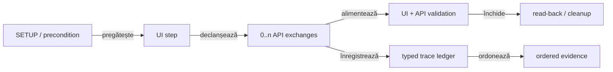

# ATF — feedback live pentru request traceability și intercalarea UI/API

## Verdict curent

- traceability-ul local este suficient pentru contractul typed și pentru auditul
  artifactului;
- `SETUP → UI step → API exchange → assertion → cleanup` este modelul de
  cauzalitate urmărit;
- `atf-reporting` publică structura generică, iar Practice Shop furnizează
  operațiile și corelația consumerului;
- replay-ul și MCP/Chromium verifică prezentarea, dar nu înlocuiesc testele
  unit/component/integration;
- guest product → cart → payment este deja dovedit prin `LIVE_HTTP` în aceeași
  sesiune UI; singura limită de business rămasă este dovada authenticated cu
  fixture extern acceptat, nu modelul local de trace.

## Traseul canonical

<strong>Legendă — cauzalitate și limite</strong>

- `0..n` este intenționat: un pas UI poate produce zero, unul sau mai multe
  request-uri;
- ledger-ul păstrează `eventId`, `sequence`, `phase`, `role` și `correlation`;
- `unique request signature` este agregare, nu înlocuiește trace-ul ordonat;
- `SETUP` descrie precondiția, `UI step` descrie acțiunea, `CLEANUP` descrie
  read-back-ul sau închiderea controlată;
- artifactul primește evidence deja semantică; renderer-ul nu reconstruiește
  business meaning din text liber.

## Scor pe axe

| Axă | Notă | Limită actuală |
|---|---:|---|
| identitate și sequence | 96 | orice schimbare de cardinalitate trebuie prinsă de component audit |
| request/response evidence | 95 | JSON, headers, status și redaction sunt typed; body-ul extern poate fi unavailable |
| UI → API cauzalitate | 94 | exchange-ul poate fi copilul pasului UI și păstrează corelația |
| network inspector de journey | 82 | fiecare checkpoint are evidence bogată, dar lipsește încă o proiecție agregată, ordonată, a tuturor exchange-urilor din flow |
| precondiții și cleanup | 92 | contractul este stabil; business live rămâne dependent de mediu |
| unique signatures | 95 | agregă fără a șterge trace-ul complet |
| proiecție Extent/HTML | 94 | disclosure-urile canonical sunt collapsed și normalizarea este idempotentă |
| **scor global** | **94** | contractul local este matur; dovada externă nu se simulează |

## Închideri promovate

| ID | Dovadă live | Verdict |
|---|---|---|
| `TRACE-REQ-01..10` | `ReportTraceMetadata`, `ReportRequestSignature`, publisher și teste de trace | event identity, role, phase, sequence și correlation sunt păstrate |
| trace în artifact | disclosure component/browser proof | request JSON, response JSON și execution trace rămân în aceeași proiecție |
| `SHOP-MIX-01..03` | `PracticeShopApiNetworkJournal` și evidence mapper | precondiția API și exchange-urile cauzate de UI sunt atașate checkpoint-ului existent |
| guest live chain | `PracticeShopPurchaseE2eTest` + MCP artifact | catalog → product → cart → checkout → payment păstrează request/response/execution evidence, assertions business și `LIVE_HTTP` provenance |
| cart network proof | fresh guest E2E + MCP | `POST /carts/{id}` și `GET /carts/{id}` sunt vizibile în același checkpoint; JSON-urile sunt pretty, iar trace-ul păstrează `sequence=17`, `phase=cart`, `correlation`, signature, digest-uri și `UI_BROWSER` |
| JSON semantic | `PracticeShopJsonEvidence` + typed fields | body-urile sunt parse-uite ca structură, nu căutate prin substring |
| replay local | mock-backed integration | replay-ul verifică transportul și contractul local, fără să pretindă business live |

## Limite care pot redeschide feedback-ul

| Situație | Status | Criteriu de redeschidere |
|---|---|---|
| event id/sequence/phase/role/correlation pierdut | activabil | component audit arată diferența față de ledger |
| cardinalitate `observations` versus `unique signatures` schimbată | activabil | aceeași operație apare agregată sau duplicată incorect |
| request/response JSON separat de execution trace | activabil | disclosure normalization sau publisher-ul rupe aceeași cauzalitate |
| authenticated login/catalog/cart/payment fără sesiune validă | blocat extern | fixture non-placeholder + `authenticatedE2eEnabled=true`, testele nu mai sunt skip, login/current-user `200` și comparații business reale pe `LIVE_HTTP` |
| replay/MCP | verificare de prezentare | nu redeschide singur contractul typed |
| agregare network inspector | ToDo P1 | se redeschide până când raportul are o disclosure compactă, collapsed-by-default, care ordonează `UI step → 0..n exchange-uri → assertions` și trimite la evidence-ul detaliat fără body duplicat |

## Contractul de date păstrat de owneri

| Element | Cerință |
|---|---|
| operation | intenție semantică, nu doar method/path |
| route | path relativ și template stabil; URL-ul complet nu devine contract |
| phase | `SETUP`, `TEST BODY`, `THEN`, `CLEANUP` sau rolul typed echivalent |
| role | precondition, action, validation, cleanup |
| correlation | leagă UI step-ul de exchange-urile cauzate |
| request | method, route, headers/auth redacted, query și body JSON |
| response | status, headers, duration și body JSON sau indisponibilitate explicită |
| execution | attempt, transport, provenance și verdict semantic |
| signature | agregare deterministă pentru citire rapidă |

`atf-reporting` nu ghicește operation, phase sau business route din textul unui
test. Consumerul furnizează inputul typed, iar librăria păstrează și publică
ceea ce a primit.

## ToDo — snapshot configurabil de execuție

`RegressionExtent.html` arată de ce o secțiune System/Environment utilă nu se
poate limita la `Environment`, runtime și o frază generică despre client. Pentru
un consumer UI/API, snapshot-ul typed trebuie să poată publica, redacted și
fără căi temporare:

- host UI și endpoint API normalizate;
- browser, headless, viewport, zoom și timeout-uri;
- transport, API mode și precondition;
- validation profile, screenshot policy și report destinations ca roluri, nu
  ca nume timestampate;
- suite/lane, test selection, expected/discovered/deferred counts;
- fixture mode, product/flow inputs non-sensitive și authenticated flag;
- provenance pentru `LIVE_HTTP`, mock/fixture sau unavailable.

Nu se publică password, token, account-file secret, absolute temp path sau
identitatea unui artifact generat. `ReportEnvironment.defaults()` rămâne fallback
generic; consumerul trebuie să poată adăuga metadata typed fără să mute
business logic în renderer.

## Protocol de revalidare

<strong>Când se schimbă traceability-ul</strong>

1. verifică modelul ledger-ului prin unit tests;
2. verifică mapper-ul și disclosure-ul prin component tests;
3. verifică fixture → mock → report prin integration tests;
4. folosește browser proof numai pentru click, expand/collapse, navigare și
   layout;
5. dacă mediul extern este implicat, separă explicit verdictul transportului
   de verdictul business;
6. actualizează statusul curent și criteriul, nu adăuga o secțiune datată sau un
   nume de artifact generat.

## Referințe normative

- [`atf-test-practice-shop/README.md`](../../atf-test-practice-shop/README.md) —
  flow-uri, API journal, evidence și business boundaries;
- [`docs/ATF_Reporting_Contract.md`](../ATF_Reporting_Contract.md) — contractul
  Extent/HTML;
- [`atf-reporting/README.md`](../../atf-reporting/README.md) — model, publisher,
  disclosure și artifact;
- [`atf-reporting-tests/README.md`](../../atf-reporting-tests/README.md) — test
  matrix și proof lower-level;
- [`docs/feedback/README.md`](README.md) — registrul central.
