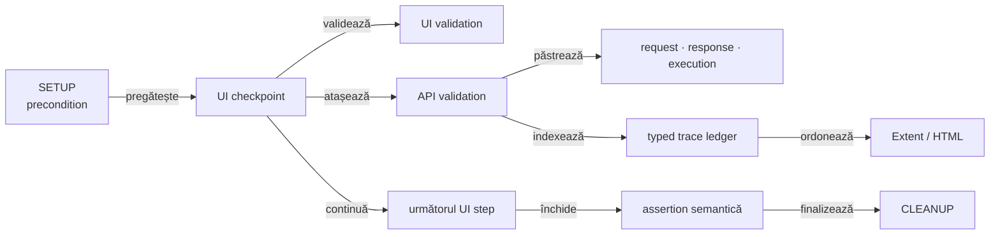
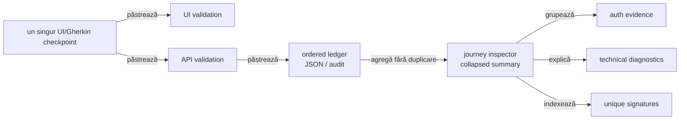

# ATF — feedback live pentru request traceability și intercalarea UI/API

## Verdict curent

- ledger-ul typed păstrează identitatea, ordinea și cauzalitatea unui schimb de
  rețea fără să transforme renderer-ul în sursă de business meaning;
- Practice Shop păstrează ordinea cauzală UI → API → UI și ledger-ul typed;
  fresh report-ul publică acum un singur checkpoint Gherkin care deține
  `UI validation` și `API validation`;
- diagnosticul guest are seam semantic separat: `Runtime diagnostic`, nu
  `UI validation`;
- request, response și execution rămân canonical în cardul API;
- inspectorul final este un sumar compact, colapsabil și renderer-neutral; el
  publică nested `Authentication evidence`, `Scenario correlation`, `Transport
  counters`, `Unique request signatures` și `Technical diagnostics`, fără să
  mute body-urile din cardurile canonical;
- toate tabelele scrollabile din UI/API, inclusiv `System/Environment`, folosesc
  aceeași înălțime de viewport prin `AtfReportThemeTokens.TABLE_SCROLL_HEIGHT`
  (`500px` curent); summary-ul poate avea geometria lui 2×, dar tabela nu are
  o dimensiune locală per secțiune;
- UI API trace-ul reutilizează exact vocabularul și nivelul de detaliu al
  raportului API direct: method, path, URL, auth profile/type, request headers
  relevante, transport, replay safe, status, content type, response headers
  stabile, JSON și execution; fiecare exchange este disclosure propriu sub
  `API validation`, fără re-encodare în chei `API n · ...`;
- titlul trace-ului este pasul Gherkin exact; URL-ul nu este prefixat în titlu,
  iar headerele browserului și response headers volatile sunt filtrate din
  proiecția UI compactă;
- guest product → cart → payment este acoperit prin `LIVE_HTTP`; dovada
  authenticated rămâne dependentă de un fixture extern acceptat;
- calibrarea vizuală se face pe un raport guest proaspăt regenerat după
  recompilarea reporting și Practice Shop; un nume datat nu este contract;
- feedback-ul păstrează numai limitele care pot redeschide contractul, nu un
  jurnal de artifacte sau de rulări.

## Traseul canonical

<strong>Legendă — relația dintre UI, API și artifact</strong>

- `UI checkpoint` este cauza observabilă și containerul semantic al acțiunii;
- `UI validation` și `API validation` sunt copii frați ai aceluiași checkpoint;
  aceeași propoziție Gherkin nu se repetă într-un al doilea card;
- `request · response · execution` se publică o singură dată sub `API validation`;
- `typed trace ledger` păstrează `eventId`, `sequence`, `phase`, `role` și
  `correlation` pentru audit și agregare;
- `Extent / HTML` primește evidence semantică deja pregătită; nu reconstruiește
  operation, business route sau verdict din text liber;
- un checkpoint poate avea zero, unul sau mai multe exchange-uri, inclusiv
  failure și retry eligibil.

## Scor pe axe

Scorurile reflectă codul și dovezile typed curente; limitele externe rămân
intenționat vizibile și nu sunt ascunse de un run guest verde.

| Axă | Notă | Citire actuală |
|---|---:|---|
| identitate și sequence | 98 | `eventId`, `sequence`, `phase`, `role` și `correlation` sunt păstrate în ledger și verificate lower-level |
| request/response evidence | 98 | status, headers, auth redacted, body și indisponibilitatea explicită sunt typed și vizibile în disclosure-urile canonical ale exchange-ului |
| UI → API cauzalitate | 98 | cauzalitatea, continuation order și topologia single-node sunt confirmate în raportul regenerat: același checkpoint deține `UI validation` și `API validation` |
| network inspector de journey | 99 | `JourneyAggregate` rămâne index nested bounded; `API network inspector` are copilul real `Network aggregate · N exchanges`, iar UI trace-ul publică separat forma canonicală request/response/execution pentru fiecare exchange sub `API validation`, fără duplicare |
| precondiții și cleanup | 93 | lifecycle-ul și guest precondition sunt demonstrate; business authenticated rămâne dependent de mediu |
| unique signatures | 99 | grupurile deterministe cu count și status sunt corecte, copilul aggregate este unic, iar summary-ul este proiectat la 2× și collapsed implicit; proof-ul fresh de randare/interacțiune închide `REP-NET-07`; cardul trace păstrează exchange-urile distincte înainte de indexare |
| runtime diagnostics | 92 | aggregate-ul dedupează response/console corelate, iar consumerul publică o singură assertion per semnătură cu count/sources; semnalele console/page fără facts folosesc identity internă exactă și token-uri bounded, conform contractului închis `REP-DIAGNOSTIC-04` |
| API binding configurabil | 96 | `PracticeShopApiEvidenceBinding` și `PracticeShopApiCheckpoint` mută selecția în YAML/override typed; journal-ul expune `evidence(checkpoint)` și fresh System confirmă binding-ul efectiv |
| proiecție Extent/HTML | 98 | `API validation` și disclosure-urile request/response/execution per exchange sunt verificate lower-level și vizibile sub același checkpoint Gherkin; URL-ul complet are wrapping controlat, iar fresh UI proof-ul confirmă forma fără duplicarea cardului Gherkin |
| **scor global** | **95** | ledger-ul, binding-ul și exchange-ul canonical sunt solide, iar topologia single-node este dovedită; authenticated rămâne separat blocat extern |

## Recalibrare live — două proiecții care nu trebuie confundate

<strong>Legendă — constatarea care redeschide doar agregarea</strong>

- ordinea cauzală UI → API → UI rămâne corectă, iar un checkpoint cu mai multe
  exchange-uri păstrează disclosure-uri distincte sub `API validation`;
- `REP-TRACE-03` este închis pentru forma vizibilă: fresh UI report-ul
  materializează `UI validation` și `API validation` ca doi copii ai aceluiași
  card Gherkin; fiecare exchange apare o singură dată;
- inspectorul final are aggregate typed și disclosure-uri deterministe pentru
  `Authentication`, `Scenario correlation`, `Transport counters`, `Unique request
  signatures` și `Technical diagnostics`; fiecare secțiune rămâne index, nu
  duplicare de body canonical;
- `unique signatures` are count și statuses per signature; nu trebuie copiate body-uri
  sau credentiale în această zonă;
- `Runtime diagnostic` are deduplicare semantică în aggregate, iar warning-ul
  consumerului consumă observațiile grupate cu count/sources, fără să ascundă
  erori neașteptate;
- semnalele fără method/route/status folosesc deja identitate internă exactă
  și token-uri publice bounded; tripletul gol nu le contopește;
- `System/Environment` nu trebuie să primească aceste date: rămâne numai pentru
  configurația operațională relevantă a run-ului;
- proiecția typed, renderer-neutral și colapsabilă a aggregate-ului este
  implementată în Extent și fallback; shape-ul canonical per exchange este
  închis prin publisher și contractele ambelor renderere.

## Închideri promovate

| ID | Dovadă stabilă | Verdict |
|---|---|---|
| `TRACE-REQ-01..10` | `ReportTraceMetadata`, `ReportRequestSignature`, publisher și teste de trace | event identity, role, phase, sequence și correlation sunt păstrate |
| `SHOP-MIX-01..03` | `PracticeShopApiNetworkJournal`, `UiPhaseLifecycle` și evidence mapper | precondiția API și exchange-urile cauzate de UI sunt legate de checkpoint-ul corect; single-node Gherkin este verificat în fresh UI proof |
| `REP-DIAGNOSTIC-01` | `UiEvidencePublisher.publishDiagnostic` și teste component/integration | boundary-ul semantic este închis: diagnostic runtime publică status, target și assertions fără copilul `UI validation`; deduplicarea rămâne activă separat |
| `REP-TRACE-01` | `UiPhaseLifecycle.apiTrace` și `ExtentReportUiEvidencePublishingTest` | cauzalitatea, ordinea, disclosure-ul API și forma single-node vizibilă sunt typed și fără JSON duplicat în sumar |
| `REP-TRACE-02` | `UiEvidencePublisher`, `EvidenceTableFormatter`, `ApiManualReplayProjectionTest` și publisher tests | vocabularul, redaction policy, filtrarea browser noise, replay-ul și execution evidence sunt aliniate cu API direct; forma single-node este verificată prin contractul consumer |
| `SHOP-DIAGNOSTIC-SEMANTICS-01` | publisher, component contract și consumer flow | warning-ul guest rămâne diagnostic semantic, nu verdict UI implicit |
| `SHOP-TRACE-INTERLEAVE-01` | `PracticeShopE2eContext.Scenario.checkpoint` și integration contract | ordinea UI → API → UI și forma single-node Gherkin sunt verificate; `API validation` rămâne copilul checkpoint-ului |
| auth observation vocabulary | `ReportAuthObservationTest` și publisher component coverage | method/source sunt typed și redacted; clasificarea nu pretinde validarea credentialului |
| `REP-NET-03`, `REP-AUTH-02` | `ReportNetworkInspector.JourneyAggregate`, `ReportNetworkInspectorTest` și UI publishing contract | journey aggregate grupează auth method/source/status/count, correlation, transport counters și unique signatures fără body-uri sau credentiale |
| `REP-DIAGNOSTIC-02` | `DiagnosticObservation`, `ReportNetworkInspectorTest` și `ExtentReportUiEvidencePublishingTest` | response și console pentru aceeași rută/status sunt o singură observație cu count și sources; semnalele distincte rămân separate |
| `REP-NET-04` | `ReportNetworkAggregateMarkup`, `ReportNetworkInspectorTest`, `HtmlReportViewsTest` și fresh MCP/Chromium | inspectorul journey este collapsed și nested în ambele renderere, cu cele cinci secțiuni typed; `Response details` rămâne doar indexul bounded, `Scenario correlation` deține pașii Gherkin, iar `Unique request signatures` deține request-urile deduplicate; nu există copiere flat `network.aggregate.*` sau repetarea aceleiași propoziții |
| `REP-NET-06` | `ExtentRequestScope`, `ReportNetworkAggregateMarkup`, `ExtentReportUiEvidencePublishingTest` și fresh MCP/Chromium | ✅ închis: `Network aggregate · N exchanges` este un singur copil real al inspectorului; `Unique request signatures` și `Technical diagnostics` au summary-uri 2× mai înalte, cu aceeași familie CSS și fără request-uri repetate |
| `REP-NET-07` | `evidence-table.css`, `evidence-stack.css`, `AtfReportThemeTokensTest`, `AtfReportEvidenceCssTest` și fresh MCP/Chromium | ✅ închis: summary-urile `Unique request signatures` și `Technical diagnostics` folosesc `68px` față de standardul `34px`, rămân collapsed implicit și păstrează aceeași familie CSS fără overflow sau duplicarea exchange-urilor |
| `REP-UX-TABLE-02` | `AtfReportThemeTokens`, `evidence-stack.css`, `fallback.css`, renderer-ele UI, component tests și fresh MCP | ✅ închis: `Playwright action sequence`, `Audit observations` și `Assertions` folosesc aceeași geometrie de summary 2× și viewport vertical bounded cu header sticky; proof-ul responsive confirmă nesting-ul, glyph-ul inline și lipsa overflow-ului |
| `REP-UX-TABLE-03` | `AtfReportThemeTokens.TABLE_SCROLL_HEIGHT`, `AtfReportThemeTokensTest`, `AtfReportEvidenceCssTest`, `AtfReportOverviewCssTest` și rendererele Extent/fallback | ✅ închis: toate tabelele scrollabile folosesc viewport-ul comun al `System/Environment` (`500px` curent), inclusiv Overview/Category, tag audit, action/audit/assertion și API/UI evidence; tokenul este unic, iar header-ele rămân sticky |
| `SHOP-DIAGNOSTIC-03` | `Scenario.warningDiagnostics`, `PracticeShopRuntimeDiagnosticsTest` și guest E2E | warning-ul consumerului grupează response/console într-o singură assertion per semnătură, cu count/sources observabile |
| JSON semantic | `PracticeShopJsonEvidence` și typed fields | body-urile sunt parse-uite ca structură, nu căutate prin substring |
| replay local | mock-backed integration | replay-ul verifică transportul și contractul local fără să pretindă business live |
| `REP-TRACE-03` | `ExtentReportUiEvidencePublishingTest` (combined node + retry), `HtmlReportViewsTest`, `ExtentReportInteractionContractTest` și fresh MCP/Chromium | ✅ închis: un singur card Gherkin deține `UI validation` și `API validation`, fiecare exchange este unic, iar retry history rămâne în `Execution evidence` |
| `REP-EVID-08` | `AtfReportMarkup`, `evidence-table.css`, `HtmlReportViewsTest` și fresh MCP/Chromium | URL value cells păstrează valoarea completă și folosesc wrapping controlat în Extent/fallback |
| `REP-TRACE-04` | `ReportRequestSignature`, `ReportTraceMetadataRenderingTest`, `ReportNetworkInspectorTest`, `ExtentReportAssetsTest` și fresh API/UI MCP | digestul folosit pentru identitate și fingerprint-ul de deduplicare rămân interne; trace-ul HTML afișează doar `body=present|absent`, markerul bounded `internal digest hidden` și linkuri locale `screenshot-n` |
| `REP-CONSUMER-01` | `ReportEnvironmentSnapshot`, `ReportTraceMetadata`, `AtfReportPorts` și `ReportTraceMetadataRenderingTest` | ✅ închis: un consumer sintetic livrează snapshot-ul per run și trace-ul per exchange prin contractele publice, fără business logic în renderer; System este allowlist-uit și credentialele sunt redacted |

## Criterii de redeschidere — fără ToDo local activ

Rândurile „activabil” sunt condiții de regresie, nu itemi deschiși. Singura
limită externă din această listă este `SHOP-API-REAL-01`, deținută de Practice
Shop; nu se numără de două ori ca gap de traceability.

| Situație | Status | Criteriu |
|---|---|---|
| event id, sequence, phase, role sau correlation pierdut | activabil | component audit evidențiază diferența față de ledger |
| cardinalitate `observations` versus `unique signatures` schimbată | activabil | aceeași operație apare agregată sau duplicată incorect |
| request/response separat de execution trace | activabil | publisher-ul sau disclosure normalization rupe aceeași cauzalitate |
| intercalare UI/API regresată | activabil | redeschide numai dacă raportul arată același titlu Gherkin de două ori sau pierde `un singur checkpoint → UI validation + API validation → UI continuation`; body-ul duplicat este un failure separat |
| retry prezentat ca verdict nou | activabil | attempt history nu mai este distinctă ori retry-ul schimbă verdictul semantic |
| inspector aggregate flat sau fără disclosure-uri typed | activabil | redeschide numai dacă un renderer pierde una dintre secțiunile collapsed pentru auth/correlation/transport/signatures/diagnostics |
| diagnostic runtime duplicat | activabil | redeschide numai dacă aceeași semnătură observată prin response și console revine ca assertions repetate, în loc de count + sources |
| diagnostic necorelat contopit | activabil | două console/page signals distincte primesc aceeași cheie goală și apar ca un singur observation cu count agregat |
| binding API regresat la listă globală | activabil | `PracticeShopApiEvidenceBinding` sau YAML-ul per checkpoint este ignorat, iar consumerul reintroduce liste locale ori agregă traffic ne-selectat |
| authenticated login/catalog/cart/payment fără sesiune validă | blocat extern | fixture non-placeholder, flag activ, login/current-user `200` și journey business verificat prin `LIVE_HTTP` |

`REP-EVID-08` este închis generic prin publisher, renderer parity și browser
proof. `REP-TRACE-03` este închis pentru forma single-node observată în fresh UI
și se redeschide numai la regresie. Raportul trebuie să păstreze:
un singur card Gherkin cu `UI validation` și `API validation` ca copii frați,
fiecare exchange publicat o singură dată, retry history păstrat local în
`Execution evidence` și URL-uri fără overflow în Extent/fallback.

## Contractul de date păstrat de owneri

| Element | Cerință |
|---|---|
| operation | intenție semantică, nu doar method/path |
| route | path relativ și template stabil; URL-ul complet nu devine contract |
| phase | `SETUP`, `TEST BODY`, `THEN`, `CLEANUP` sau rolul typed echivalent |
| role | precondition, action, validation, cleanup |
| correlation | leagă UI checkpoint-ul de exchange-urile cauzate |
| request | method, route, headers/auth redacted, query și body JSON |
| response | status, headers, duration și body JSON sau indisponibilitate explicită |
| execution | attempt, transport, provenance și verdict semantic |
| signature | agregare deterministă pentru citire rapidă |

`atf-reporting` nu ghicește operation, phase sau business route din textul unui
test. Consumerul furnizează inputul typed, iar librăria păstrează și publică
ceea ce a primit.

## Snapshot configurabil de execuție

Practice Shop publică în `Overview/System` un snapshot typed, redacted și bounded:

- host UI și endpoint API normalizate;
- browser, headless, viewport, zoom și timeout-uri;
- transport, API mode și precondition;
- validation profile, screenshot policy și report destinations ca roluri;
- provenance pentru `LIVE_HTTP`, mock/fixture sau unavailable, numai ca
  setare operațională; identitatea suitei/testului, fixture-ul și inputurile
  business aparțin secțiunilor de test/evidence, nu tabelului System;
- body preview bounded, fără password, token, account-file secret sau path local.

Acest snapshot este responsabilitatea consumerului. `ReportEnvironment.defaults()`
rămâne fallback generic; renderer-ul nu inventează configurarea sau semnificația
business. `REP-CONSUMER-01` este închis prin contractele typed existente:
snapshot-ul per run și trace-ul per exchange sunt furnizate separat de consumer,
iar testul de integrare dovedește publicarea lor împreună.

## Protocol de revalidare

<strong>Când se schimbă traceability-ul</strong>

1. verifică modelul ledger-ului prin unit tests;
2. verifică mapper-ul, atașarea validation-ului și disclosure-ul prin component tests;
3. verifică fixture → mock → report prin integration tests;
4. folosește browser proof numai pentru ordine, expand/collapse, navigare și
   layout;
5. separă verdictul transportului de verdictul business când mediul extern este
   implicat;
6. actualizează statusul curent și criteriul, fără secțiune datată sau nume de
   artifact generat.

## Referințe normative

- [`atf-test-practice-shop/README.md`](../../atf-test-practice-shop/README.md) —
  flow-uri, API journal, evidence și business boundaries;
- [`docs/ATF_Reporting_Contract.md`](../ATF_Reporting_Contract.md) — contractul
  Extent/HTML;
- [`atf-reporting/README.md`](../../atf-reporting/README.md) — model, publisher,
  disclosure și artifact;
- [`atf-reporting-tests/README.md`](../../atf-reporting-tests/README.md) — test
  matrix și proof lower-level;
- [`docs/feedback/README.md`](README.md) — registrul central.
