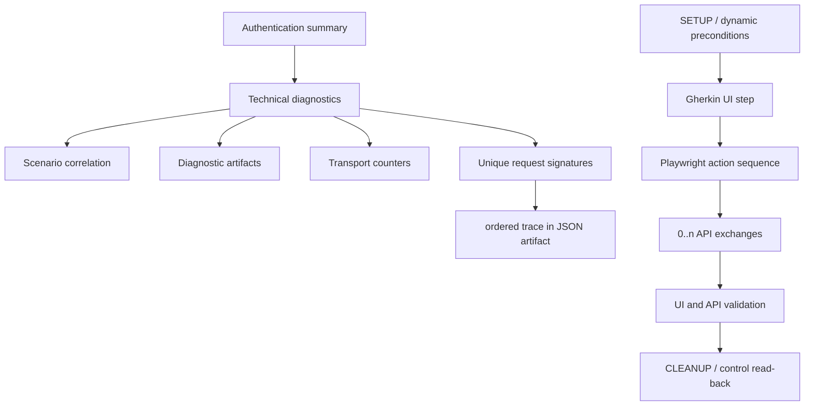
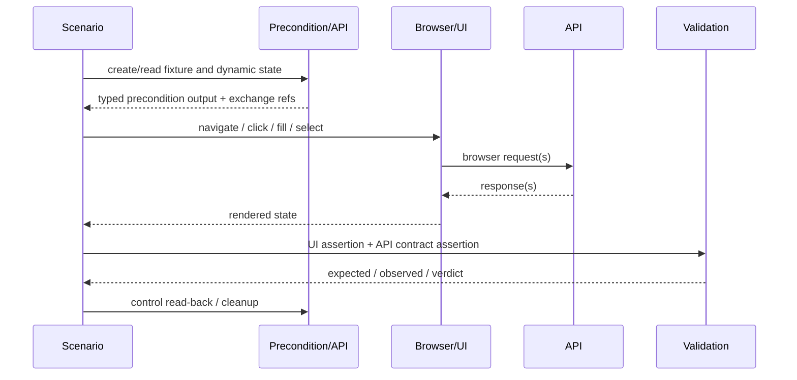
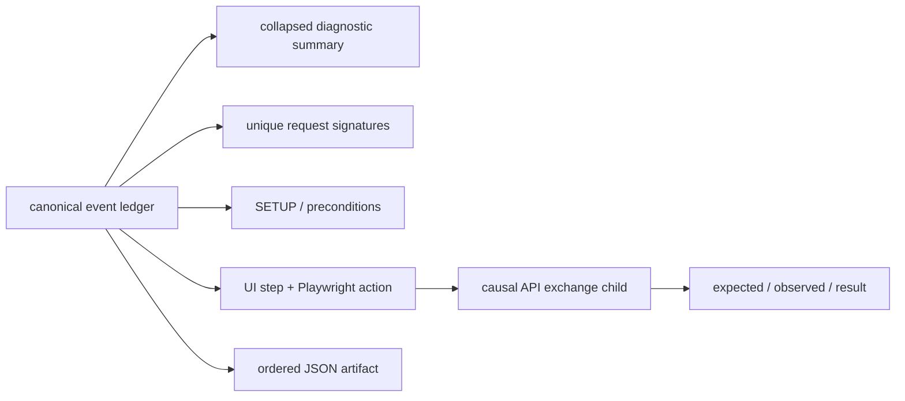

# ATF — Request traceability și intercalarea UI/API

## Overall

Acest feedback extrage un contract de proiectare din raportul de referință
`RegressionExtent.html` și îl traduce pentru ATF Java. Scopul nu este copierea
raportului extern, ci definirea unei proiecții care permite unui cititor să
înțeleagă, în ordine:

1. ce precondiție din API a construit starea testului;
2. ce acțiune Playwright a fost executată în UI;
3. ce request-uri API au fost cauzate de acea acțiune;
4. ce răspunsuri și validări au justificat continuarea;
5. ce read-back sau cleanup a închis fluxul.

Scorul orientativ al contractului ATF actual este **76/100**:

| Dimensiune | Scor | Observație |
|---|---:|---|
| rezumat auth/transport | 88 | `AuthObservationHtmlFormatter` are deja summary, counters și semnături de transport |
| schimburi API complete | 84 | `BrowserApiExchange` și `UiActionEvidenceFormatter` păstrează request/response JSON |
| intercalare API sub pasul UI | 82 | HTTP exchange-ul poate fi copilul acțiunii Playwright, dar cauza nu este un model typed stabil |
| semnătură request business | 66 | proiecția auth grupează fără body, operation, phase sau correlation |
| precondiții dinamice | 68 | există setup/read-back în titluri și workflow-uri, nu o secțiune semantică uniformă |
| replay și trace ordonat | 70 | există liste globale/pe pas și artifact JSON, dar legătura event → pas UI nu este completă |
| contract vizual | 84 | disclosure-uri, cards și payload previews sunt deja apropiate de referință |

Scorul nu închide niciun ToDo; este numai o hartă de risc pentru implementare.

## Ce am extras din raportul de referință

Raportul extern este util prin structură, nu prin numele testelor sau timestamp-
urile sale. Pentru fiecare scenariu, informația este stratificată astfel:



### Elemente care trebuie păstrate în proiecția ATF

| Element de referință | Informația utilă | Regula ATF propusă |
|---|---|---|
| `Authentication summary` | environment, rezultat, transport și auth pe scurt | rămâne rezumat; nu pretinde validarea tokenului dacă doar header-ul a fost observat |
| `Technical diagnostics` | context operațional și probleme de captură | rămâne collapsed implicit și nu concurează cu business steps |
| `Scenario correlation` | fixture, submission, review, quote, document și run identity | fiecare exchange important trebuie să poată indica aceeași corelație |
| `Diagnostic artifacts` | artifact JSON, artifact reutilizabil și PDF | linkurile trebuie să fie raportabile fără a publica path-uri de mașină ca contract |
| `Transport counters` | setup, seed, submit, polling, read-back | separă numărul de observații de numărul de schimburi logice |
| `Unique request signatures` | method, URL, status-uri, count, service, auth, source | este o proiecție compactă, nu înlocuiește trace-ul complet |
| `API exchange — ...` | operation, endpoint, auth, status, request body, response body | apare în `SETUP` sau sub pasul UI care l-a cauzat |
| `UI prerequisite` / `PRECONDITION` | ce stare este necesară înainte de interacțiune | devine un rol semantic, nu doar un prefix în titlu |
| `Playwright action sequence` | acțiuni în ordinea reală și rezultatul observat | rămâne singura sursă pentru pașii UI executați |
| `CLEANUP` | read-back și lipsa mutațiilor neașteptate | este separat de verdictul business, dar face parte din audit |

## Modelul de cauzalitate dorit



Un pas UI poate produce zero, unul sau mai multe request-uri. Un request poate
fi polling, retry, read-back sau mutație. Raportul nu trebuie să sugereze că
orice request observat este cauzat de click-ul curent; trebuie să publice
explicit `initiator`, `phase` și `role`.

## Ce există astăzi în ATF

### Părți deja bune

- `ScenarioReportComposer` separă `SETUP`, `Business proposition / acceptance`
  și `CLEANUP`.
- `UiActionEvidenceReporter` și `UiActionEvidenceFormatter` pot păstra un
  `HTTP exchange — request/response` ca sub-disclosure al acțiunii Playwright.
- `BrowserApiExchange` are deja `EvidenceSource`, `CorrelationId`, auth source,
  retry history și body-uri.
- `Hooks.RecordApiExchange` păstrează body-urile în `ApiTraceEntry`, atât în
  trace-ul scenariului, cât și în trace-ul pasului curent.
- `AuthObservationHtmlFormatter` afișează deja summary, correlation, artifact,
  transport counters și cards pentru request signatures.
- `ConsecutiveApiEvidenceDeduplicator` nu confundă polling-ul consecutiv cu
  pierderea trace-ului: deduplică numai proiecția Extent, nu artifactul JSON.
- redacția query/auth este centralizată în `ApiAuthenticationEvidence`; acest
  boundary trebuie păstrat pentru orice proiecție nouă.

### Gap-uri găsite prin comparația cod–raport

| ID | Gap observat | De ce contează | Prioritate |
|---|---|---|---:|
| `TRACE-REQ-01` | `ApiTraceEntry` nu are timestamp, sequence, phase, role, step identity, source sau correlation key | trace-ul poate fi citit, dar nu poate demonstra complet cauza și ordinea | P0 |
| `TRACE-REQ-02` | `AuthObservationHtmlFormatter.FormatRequests` grupează după method, URL, service, auth și source, fără request body | două POST/PUT cu aceeași rută, dar payload-uri diferite, pot deveni aceeași „unique signature” | P0 |
| `TRACE-REQ-03` | `AuthObservationRecord` este intenționat metadata-only și nu are operation/body/response | este corect pentru auth audit, dar insuficient ca proiecție business API | P0 |
| `TRACE-REQ-04` | `ApiDetail` corelează prin ultimul `Operation` din `CurrentStepApiTrace` | operații repetate cu aceeași denumire pot atașa evidence la exchange-ul greșit | P0 |
| `TRACE-REQ-05` | phase/role sunt exprimate mai ales prin titluri (`fixture`, `precondition`, `read-back`) | titlul este text volatil și nu poate guverna filtrarea, grouping-ul sau replay-ul | P1 |
| `TRACE-REQ-06` | precondiția dinamică nu are output typed care să fie referit de pasul UI | cititorul vede request-ul, dar nu vede explicit ce valoare a făcut UI-ul posibil | P1 |
| `TRACE-REQ-07` | retry history există în `BrowserApiExchange`, dar nu există uniform în summary/signature projection | count-ul poate amesteca încercări tehnice cu schimburi logice | P1 |
| `TRACE-REQ-08` | trace-ul global și trace-ul pasului sunt colecții separate, fără event id comun | legătura dintre artifact, card și UI action nu este verificabilă fără heuristici | P1 |
| `TRACE-REQ-09` | validarea de request/response poate fi prezentă în card, dar nu este obligatoriu declarată ca assertion | un body afișat nu dovedește singur că a fost validat | P1 |
| `TRACE-REQ-10` | proiecția compactă și trace-ul complet nu au un contract comun de cardinalitate | cititorul nu știe dacă `count` înseamnă observații, încercări sau schimburi logice | P2 |

`TRACE-REQ-02` nu cere eliminarea rezumatului auth existent. Cere două
proiecții distincte: auth/transport grouping și business request signature.

## Contractul de date propus

### Event ledger canonic

Se recomandă un model intern unic, produs la boundary-ul de captură și apoi
proiectat în Extent, JSON și assertions:

```text
ApiExchangeEvent
  EventId              stable per observed exchange
  Sequence             monotonic scenario order
  TimestampUtc         capture time
  Phase                Setup | UiAction | Assertion | Cleanup
  Role                 Precondition | ActionCaused | Polling | ReadBack | Retry | Cleanup
  StepId               stable identity of the Gherkin step, nullable for setup
  StepIndex            human-readable sequence, nullable for setup
  Initiator            business operation or Playwright action
  Operation            semantic API operation
  Method               HTTP method
  SafeUrl              canonical URL with sensitive query values redacted
  Service              logical backend service
  CorrelationKey       stable method + canonical route identity
  RequestSignature     method + safe URL + normalized request-body digest
  Attempt              logical exchange attempt number
  Status               HTTP status or transport failure
  RequestBody          redacted, bounded preview / artifact reference
  ResponseBody         redacted, bounded preview / artifact reference
  RequestBodyDigest    stable digest for grouping and equality
  ResponseBodyDigest   stable digest for variants and replay
  EvidenceSource       Browser | HttpClient | Fixture | Replay
  ExpectedContract     what the test expected from this exchange
  ObservedOutcome      what actually happened
```

Nu toate câmpurile trebuie afișate în tabelul compact. Toate trebuie să fie
disponibile în artifact sau în disclosure-ul exchange-ului atunci când sunt
relevante.

### Definiția corectă a unei unique request signature

```text
logical signature = METHOD
                  + canonical safe URL
                  + SHA-256(canonical normalized request body)
```

Reguli:

- query-ul păstrează numele și valorile non-sensibile; credentialele sunt
  redacted înainte de signature;
- JSON-ul se normalizează recursiv: proprietățile obiectelor se ordonează,
  whitespace-ul dispare, dar ordinea array-urilor se păstrează;
- body-ul gol/absent este distinct de un JSON `{}`;
- response body-ul nu face parte din request signature; polling-ul rămâne o
  singură semnătură logică, cu status/response variants și count separat;
- retry-urile sunt attempts ale aceleiași semnături, nu semnături noi;
- `service`, `auth`, `evidence source` și `role` sunt dimensiuni de observație,
  afișate în card, nu motive de a uni body-uri diferite;
- trace-ul ordonat păstrează toate observațiile chiar când proiecția compactă
  le grupează.

### Precondiție dinamică

O precondiție trebuie să aibă semantic următoarele câmpuri:

| Câmp | Exemplu conceptual | Rol |
|---|---|---|
| `PreconditionId` | `quote-ready-for-review` | referință stabilă din UI step |
| `Provider` | `POST /quotes/inject` sau `GET /reviews/pending` | sursa stării |
| `Input` | fixture profile + identificatori | ce a fost trimis |
| `Output` | `quoteId`, `reviewId`, route, state | ce va consuma UI-ul |
| `Expected` | review pending pentru quote-ul creat | contractul verificat |
| `Observed` | status/body/read-back rezultat | dovada concretă |
| `ExchangeIds` | `[E12, E13]` | legătura cu trace-ul API |
| `Blocking` | `true/false` | dacă UI-ul poate continua |

Un `Given` trebuie să poată spune „consum precondiția X”, nu doar să repete
într-un titlu că a fost făcut setup. Dacă precondiția nu este produsă sau
read-back-ul nu confirmă output-ul, UI-ul nu trebuie să primească un verdict
ambiguu.

## Proiecția Extent ATF



### Ordinea obligatorie a afișării

1. `SETUP` — identity, fixture, preconditions, API setup și read-back;
2. `TEST BODY` / business proposition — pașii Gherkin în ordinea reală;
3. pentru fiecare pas UI: acțiunile Playwright, request-urile cauzate, response,
   assertions și screenshot-ul checkpoint;
4. `API diagnostics` — rezumatul global și linkul către trace-ul ordonat;
5. `CLEANUP` — control read-back, cleanup și eventuale warning-uri.

În interiorul unui pas UI, API-ul trebuie afișat după acțiunea care îl inițiază
și înainte de assertion-ul care consumă răspunsul. Nu este suficient să fie
mutat într-un bloc final de diagnostics.

### Cardul compact pentru o semnătură

Cardul collapsed trebuie să rămână ușor de scanat:

```text
POST  /api/quotes/{quoteNumber}  · Status 200  · Count 1
Service: Policy · Auth: Anonymous — None · Source: API client / HttpClient
Role: Precondition · Phase: SETUP · Body: sha256:abcd1234 · Responses: 200
```

Disclosure-ul poate conține body-urile JSON, headers redacted, correlation,
attempts, expected/observed și linkul către artifact. Nu se afișează token-uri,
cookie-uri sau valori de secret query.

## Matrice de implementare și testare

| ID | Schimbare necesară | Owner probabil | Test minim | Gate de închidere |
|---|---|---|---|---|
| `TRACE-REQ-01` | event ledger cu sequence, phase, role, step și event id | `atf-reporting` / `atf-ui` | unit + component | două exchange-uri în aceeași acțiune păstrează ordinea și refs comune |
| `TRACE-REQ-02` | canonical request signature cu body digest | reporting projection | unit | POST/PUT cu body diferit nu se unesc; JSON reordonat se unește |
| `TRACE-REQ-03` | exchange ref explicit în UI action evidence | UI evidence | component | cardul UI indică exact exchange-ul cauzat, fără matching după titlu |
| `TRACE-REQ-04` | role/phase typed, nu doar titlu HTML | scenario composer | unit + integration | setup, action, assertion, polling, read-back și cleanup apar distinct |
| `TRACE-REQ-05` | precondition model + output consumption | workflow owner | unit + integration | UI step eșuează clar când output-ul precondiției lipsește |
| `TRACE-REQ-06` | projection compactă + ordered JSON artifact | reporting | component + artifact audit | `Displayed: N unique signatures from M observations` este reconciliabil |
| `TRACE-REQ-07` | retry logical vs attempt | browser capture / transport | unit | retry-ul crește attempts, nu cardinalitatea logical signatures |
| `TRACE-REQ-08` | request/response validators legați de event id | API/UI tests | component + E2E | body prezent nu este raportat ca validat fără assertion explicit |
| `TRACE-REQ-09` | display contract și overflow | reporting UI | Chromium/ATF Debug | `scrollWidth <= clientWidth`, disclosure-uri accesibile, body-uri inline |
| `TRACE-REQ-10` | manual replay contract | reporting tests | E2E exploratory | cititorul poate repeta setup → UI → API → validation fără cod intern |

## Plan de implementare, în ordinea riscului

### P0 — identitate și pierdere de informație

- introducerea event ledger-ului sau extinderea modelului existent fără a dubla
  capturarea Browser/HttpClient;
- signature canonicală cu body digest și redacție înainte de persistare;
- `EventId`/`Sequence` comun între `ApiTraceEntry`, UI action evidence și JSON;
- teste pentru body-uri distincte, polling, retry, request fără body și JSON
  reordonat;
- păstrarea trace-ului lossless chiar dacă Extent afișează grupat.

### P1 — cauzalitate și precondiții

- `Phase` și `Role` typed în locul deducției din titlu;
- API exchange refs atașate explicit la acțiunea UI și la assertion-ul care le
  consumă;
- precondition output typed pentru `quoteId`, `reviewId`, `documentId`, route și
  state;
- diferențierea clară între `fixture setup`, `UI prerequisite`, `action-caused`,
  `polling`, `assertion read-back` și `cleanup`;
- status/expected/observed pentru fiecare exchange, nu doar pentru scenariul
  părinte.

### P2 — citire, replay și robustețe vizuală

- summary collapsed cu carduri compacte și count-uri reconciliabile;
- body-urile complete în disclosure/artefact, previews bounded în tabel;
- link inline către artifact JSON și screenshot în aceeași unitate de evidence;
- E2E manual prin ATF Debug/Chromium pentru `Overview`, `Tests`, `Fails`,
  `Categories`, `SETUP`, `TEST BODY`, `Preconditions`, `API exchange`,
  `Assertions` și `CLEANUP`;
- verificarea overflow, `<hr>` decorative, console/page errors și a orientării
  verticale a disclosure-urilor.

## Reguli de siguranță și non-obiective

- nu se publică body-uri sau headers cu credentiale; redacția se face înainte de
  hashing, render și artifact;
- nu se tratează HTTP 200 ca dovadă business fără assertion pe body/state;
- nu se transformă fiecare request static sau polling în pas Gherkin;
- nu se deduplicatează trace-ul ordonat; se deduplicatează numai proiecția de
  prezentare;
- nu se potrivește un response cu UI-ul după textul titlului când există
  `EventId`/reference explicit;
- nu se mută în enum-uri valori dinamice precum quote IDs, review IDs, URLs sau
  body-uri;
- raportul de referință este inspirație structurală și evidence exploratorie,
  nu fixture permanent și nu sursă de timestamp-uri în README.

## Definition of done pentru acest feedback

- [ ] există o signature canonicală testată pentru method + safe URL + body;
- [ ] `Unique request signatures` separă body-uri diferite și explică count-ul;
- [ ] fiecare exchange are sequence, phase, role și correlation ref;
- [ ] un UI step poate indica explicit toate exchange-urile cauzate de el;
- [ ] setup-ul publică precondiția, output-ul și read-back-ul înainte de UI;
- [ ] assertion-ul API este distinct de simpla afișare a body-ului;
- [ ] trace-ul complet rămâne disponibil în JSON, chiar dacă Extent este compact;
- [ ] component/integration/E2E gates verifică atât contractul datelor, cât și
  efectul real în browser MCP/ATF Debug;
- [ ] README-ul owner primește regulile stabilizate, iar feedback-ul păstrează
  numai gap-urile rămase.

## Referințe ATF

- [ATF Reporting Contract](../ATF_Reporting_Contract.md)
- [ATF Build and Execution Safety](../ATF_Build_And_Execution_Safety.md)
- UI evidence/reporting source boundary: `Automation.UI/Specs/Reporting/README.md`
- [ATF reporting composition tests](../../atf-reporting-tests/src/test/java/atf/ui/tests/extent/README.md)
- [ATF feedback registry](README.md)

Acest document rămâne activ până când codul, testele, raportul fresh și
artifact manifest demonstrează aceeași poveste cauzală. O captură sau un HTML
vechi poate deschide o investigație, dar nu închide singur un ToDo.


