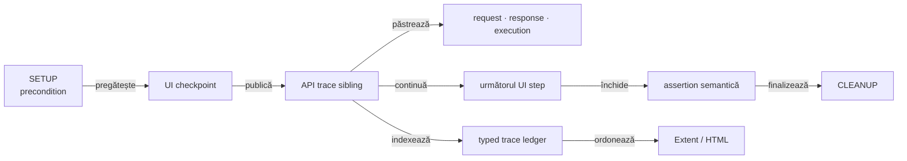
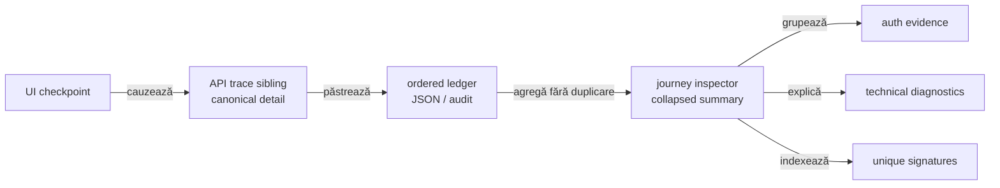

# ATF — feedback live pentru request traceability și intercalarea UI/API

## Verdict curent

- ledger-ul typed păstrează identitatea, ordinea și cauzalitatea unui schimb de
  rețea fără să transforme renderer-ul în sursă de business meaning;
- Practice Shop publică acum `UI checkpoint → API trace sibling → UI continuation`
  în ordinea cauzală a journey-ului;
- diagnosticul guest are seam semantic separat: `Runtime diagnostic`, nu
  `UI validation`;
- request, response și execution rămân canonical în cardul API; inspectorul
  final este doar sumar compact și nu dublează JSON-ul;
- inspectorul final este un sumar compact, colapsabil și renderer-neutral; el
  publică nested `Authentication evidence`, `Scenario correlation`, `Transport
  counters`, `Unique request signatures` și `Technical diagnostics`, fără să
  mute body-urile din cardurile canonical;
- UI API trace-ul reutilizează exact vocabularul și nivelul de detaliu al
  raportului API direct: method, path, URL, auth profile/type, request headers
  relevante, transport, replay safe, status, content type, response headers
  stabile, JSON și execution;
  `API n ·` este numai corelare pentru mai multe exchange-uri;
- titlul trace-ului este pasul Gherkin exact; URL-ul nu este prefixat în titlu,
  iar headerele browserului și response headers volatile sunt filtrate din
  proiecția UI compactă;
- guest product → cart → payment este acoperit prin `LIVE_HTTP`; dovada
  authenticated rămâne dependentă de un fixture extern acceptat;
- feedback-ul păstrează numai limitele care pot redeschide contractul, nu un
  jurnal de artifacte sau de rulări.

## Traseul canonical

<strong>Legendă — relația dintre UI, API și artifact</strong>

- `UI checkpoint` este cauza observabilă a acțiunii;
- `API trace sibling` este proiecția cauzală a exchange-urilor produse de acel
  checkpoint, nu un copil generic al UI-ului;
- `request · response · execution` se publică o singură dată în cardul API;
- `typed trace ledger` păstrează `eventId`, `sequence`, `phase`, `role` și
  `correlation` pentru audit și agregare;
- `Extent / HTML` primește evidence semantică deja pregătită; nu reconstruiește
  operation, business route sau verdict din text liber;
- un checkpoint poate avea zero, unul sau mai multe exchange-uri, inclusiv
  failure și retry eligibil.

## Scor pe axe

Scorurile reflectă codul și dovezile typed curente; limitele externe rămân
intenționat vizibile și nu sunt ascunse de un run guest verde.

| Axă | Notă | Citire actuală |
|---|---:|---|
| identitate și sequence | 98 | `eventId`, `sequence`, `phase`, `role` și `correlation` sunt păstrate în ledger și verificate lower-level |
| request/response evidence | 97 | status, headers, auth redacted, body și indisponibilitatea explicită sunt typed |
| UI → API cauzalitate | 99 | trace-ul sibling urmează checkpoint-ul cauzal și păstrează parent step și continuation order |
| network inspector de journey | 89 | `JourneyAggregate` publică secțiuni nested bounded, dar acesta este indexul journey-ului; nu rezolvă forma canonicală request/response/execution per exchange și nici stratul `API validation` din UI trace |
| precondiții și cleanup | 93 | lifecycle-ul și guest precondition sunt demonstrate; business authenticated rămâne dependent de mediu |
| unique signatures | 96 | grupurile deterministe cu count și status sunt corecte; valoarea auditabilă scade deoarece cardul trace poate amesteca mai multe exchange-uri înainte de indexarea lor |
| runtime diagnostics | 92 | aggregate-ul dedupează response/console corelate, iar consumerul publică o singură assertion per semnătură cu count/sources; semnalele console/page fără facts rămân limita `REP-DIAGNOSTIC-04` |
| API binding configurabil | 96 | `PracticeShopApiEvidenceBinding` și `PracticeShopApiCheckpoint` mută selecția în YAML/override typed; journal-ul expune `evidence(checkpoint)` și fresh System confirmă binding-ul efectiv |
| proiecție Extent/HTML | 80 | inspectorul aggregate este nested, dar request/response pentru `API 1/API 2` sunt tabele comune, lipsește `API validation`, execution headings sunt ambigue, metadata de trace este în response details, iar URL-ul lung se rupe arbitrar în viewport îngust |
| **scor global** | **87** | cauzalitatea și binding-ul sunt solide, însă ierarhia UI și proiecția per exchange sunt sub raportul API direct; rămân și URL readability, collision-ul diagnosticelor și fixture-ul authenticated extern |

## Recalibrare live — două proiecții care nu trebuie confundate

<strong>Legendă — constatarea care redeschide doar agregarea</strong>

- `UI checkpoint → API trace sibling → UI continuation` rămâne contract închis;
  ordinea este corectă, dar un checkpoint cu mai multe exchange-uri încă pune
  request/response într-un tabel comun; `REP-TRACE-03` urmărește reutilizarea
  disclosure-urilor API per exchange;
- inspectorul final are aggregate typed și disclosure-uri deterministe pentru
  `Authentication`, `Scenario correlation`, `Transport counters`, `Unique request
  signatures` și `Technical diagnostics`; fiecare secțiune rămâne index, nu
  duplicare de body canonical;
- `unique signatures` are count și statuses per signature; nu trebuie copiate body-uri
  sau credentiale în această zonă;
- `Runtime diagnostic` are deduplicare semantică în aggregate, iar warning-ul
  consumerului consumă observațiile grupate cu count/sources, fără să ascundă
  erori neașteptate;
- semnalele fără method/route/status au nevoie de o identitate bounded separată:
  tripletul gol nu poate reprezenta toate console/page errors;
- `System/Environment` nu trebuie să primească aceste date: rămâne numai pentru
  configurația operațională relevantă a run-ului;
- proiecția typed, renderer-neutral și colapsabilă a aggregate-ului este acum
  implementată în Extent și fallback; shape-ul canonical per exchange nu este
  încă închis, iar `REP-TRACE-03` trebuie verificat în ambele renderere.

## Închideri promovate

| ID | Dovadă stabilă | Verdict |
|---|---|---|
| `TRACE-REQ-01..10` | `ReportTraceMetadata`, `ReportRequestSignature`, publisher și teste de trace | event identity, role, phase, sequence și correlation sunt păstrate |
| `SHOP-MIX-01..03` | `PracticeShopApiNetworkJournal`, `UiPhaseLifecycle` și evidence mapper | precondiția API și exchange-urile cauzate de UI sunt legate de checkpoint-ul corect |
| `REP-DIAGNOSTIC-01` | `UiEvidencePublisher.publishDiagnostic` și teste component/integration | boundary-ul semantic este închis: diagnostic runtime publică status, target și assertions fără copilul `UI validation`; deduplicarea rămâne activă separat |
| `REP-TRACE-01` | `UiPhaseLifecycle.apiTrace` și `ExtentReportUiEvidencePublishingTest` | API trace-ul este sibling, ordonat și fără JSON duplicat în sumar |
| `REP-TRACE-02` | `UiEvidencePublisher`, `EvidenceTableFormatter`, `ApiManualReplayProjectionTest` și publisher tests | vocabularul, redaction policy, filtrarea browser noise și replay-ul sunt aliniate cu API direct; disclosure-urile separate per exchange rămân `REP-TRACE-03` |
| `SHOP-DIAGNOSTIC-SEMANTICS-01` | publisher, component contract și consumer flow | warning-ul guest rămâne diagnostic semantic, nu verdict UI implicit |
| `SHOP-TRACE-INTERLEAVE-01` | `PracticeShopE2eContext.Scenario.checkpoint` și integration contract | ordinea UI → API → UI este verificată înainte de browser proof |
| auth observation vocabulary | `ReportAuthObservationTest` și publisher component coverage | method/source sunt typed și redacted; clasificarea nu pretinde validarea credentialului |
| `REP-NET-03`, `REP-AUTH-02` | `ReportNetworkInspector.JourneyAggregate`, `ReportNetworkInspectorTest` și UI publishing contract | journey aggregate grupează auth method/source/status/count, correlation, transport counters și unique signatures fără body-uri sau credentiale |
| `REP-DIAGNOSTIC-02` | `DiagnosticObservation`, `ReportNetworkInspectorTest` și `ExtentReportUiEvidencePublishingTest` | response și console pentru aceeași rută/status sunt o singură observație cu count și sources; semnalele distincte rămân separate |
| `REP-NET-04` | `ReportNetworkAggregateMarkup`, `ReportNetworkInspectorTest`, `HtmlReportViewsTest` și fresh MCP/Chromium | inspectorul journey este collapsed și nested în ambele renderere, cu cele cinci secțiuni typed; fields flat `network.aggregate.*` nu mai sunt expuse în trace |
| `SHOP-DIAGNOSTIC-03` | `Scenario.warningDiagnostics`, `PracticeShopRuntimeDiagnosticsTest` și guest E2E | warning-ul consumerului grupează response/console într-o singură assertion per semnătură, cu count/sources observabile |
| JSON semantic | `PracticeShopJsonEvidence` și typed fields | body-urile sunt parse-uite ca structură, nu căutate prin substring |
| replay local | mock-backed integration | replay-ul verifică transportul și contractul local fără să pretindă business live |

## Limite active și criterii de redeschidere

| Situație | Status | Criteriu |
|---|---|---|
| event id, sequence, phase, role sau correlation pierdut | activabil | component audit evidențiază diferența față de ledger |
| cardinalitate `observations` versus `unique signatures` schimbată | activabil | aceeași operație apare agregată sau duplicată incorect |
| request/response separat de execution trace | activabil | publisher-ul sau disclosure normalization rupe aceeași cauzalitate |
| intercalare UI/API regresată | activabil | raportul nu mai arată `UI checkpoint → API trace sibling → UI continuation`, sau body-ul este duplicat |
| retry prezentat ca verdict nou | activabil | attempt history nu mai este distinctă ori retry-ul schimbă verdictul semantic |
| inspector aggregate flat sau fără disclosure-uri typed | activabil | redeschide numai dacă un renderer pierde una dintre secțiunile collapsed pentru auth/correlation/transport/signatures/diagnostics |
| diagnostic runtime duplicat | activabil | redeschide numai dacă aceeași semnătură observată prin response și console revine ca assertions repetate, în loc de count + sources |
| diagnostic necorelat contopit | activabil | două console/page signals distincte primesc aceeași cheie goală și apar ca un singur observation cu count agregat |
| request/response multi-exchange aplatizat | activabil — `REP-TRACE-03` | un checkpoint cu `API 1/API 2` nu are copilul `API validation`, nu păstrează disclosure-uri canonical request/response/execution per exchange, re-encodează totul în chei flat, repetă execution headings fără context sau pune metadata de trace în tabelul response |
| URL evidence greu de scanat | activabil — `REP-EVID-08` | URL-ul complet rămâne semantic, dar se rupe arbitrar în identificator sau produce overflow la viewport îngust |
| binding API regresat la listă globală | activabil | `PracticeShopApiEvidenceBinding` sau YAML-ul per checkpoint este ignorat, iar consumerul reintroduce liste locale ori agregă traffic ne-selectat |
| authenticated login/catalog/cart/payment fără sesiune validă | blocat extern | fixture non-placeholder, flag activ, login/current-user `200` și journey business verificat prin `LIVE_HTTP` |
| consumer nou fără provider typed | limită generică | `atf-reporting` primește un contract/provider pentru snapshot și trace fără business logic în renderer |

## Contractul de date păstrat de owneri

| Element | Cerință |
|---|---|
| operation | intenție semantică, nu doar method/path |
| route | path relativ și template stabil; URL-ul complet nu devine contract |
| phase | `SETUP`, `TEST BODY`, `THEN`, `CLEANUP` sau rolul typed echivalent |
| role | precondition, action, validation, cleanup |
| correlation | leagă UI checkpoint-ul de exchange-urile cauzate |
| request | method, route, headers/auth redacted, query și body JSON |
| response | status, headers, duration și body JSON sau indisponibilitate explicită |
| execution | attempt, transport, provenance și verdict semantic |
| signature | agregare deterministă pentru citire rapidă |

`atf-reporting` nu ghicește operation, phase sau business route din textul unui
test. Consumerul furnizează inputul typed, iar librăria păstrează și publică
ceea ce a primit.

## Snapshot configurabil de execuție

Practice Shop publică în `Overview/System` un snapshot typed, redacted și bounded:

- host UI și endpoint API normalizate;
- browser, headless, viewport, zoom și timeout-uri;
- transport, API mode și precondition;
- validation profile, screenshot policy și report destinations ca roluri;
- suite/lane, selecția testului, fixture mode și inputuri business non-sensitive;
- provenance pentru `LIVE_HTTP`, mock/fixture sau unavailable;
- body preview bounded, fără password, token, account-file secret sau path local.

Acest snapshot este responsabilitatea consumerului. `ReportEnvironment.defaults()`
rămâne fallback generic; renderer-ul nu inventează configurarea sau semnificația
business. Provider-ul typed generic pentru consumeri noi rămâne limită activă în
feedback-ul `ATF_Reporting_Feedback.md`.

## Protocol de revalidare

<strong>Când se schimbă traceability-ul</strong>

1. verifică modelul ledger-ului prin unit tests;
2. verifică mapper-ul, sibling publication și disclosure-ul prin component tests;
3. verifică fixture → mock → report prin integration tests;
4. folosește browser proof numai pentru ordine, expand/collapse, navigare și
   layout;
5. separă verdictul transportului de verdictul business când mediul extern este
   implicat;
6. actualizează statusul curent și criteriul, fără secțiune datată sau nume de
   artifact generat.

## Referințe normative

- [`atf-test-practice-shop/README.md`](../../atf-test-practice-shop/README.md) —
  flow-uri, API journal, evidence și business boundaries;
- [`docs/ATF_Reporting_Contract.md`](../ATF_Reporting_Contract.md) — contractul
  Extent/HTML;
- [`atf-reporting/README.md`](../../atf-reporting/README.md) — model, publisher,
  disclosure și artifact;
- [`atf-reporting-tests/README.md`](../../atf-reporting-tests/README.md) — test
  matrix și proof lower-level;
- [`docs/feedback/README.md`](README.md) — registrul central.
