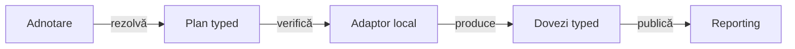

# ATF Test Infrastructure — canale UI, API și UI+API

## Pe scurt

- **Implementat parțial și probat:** TestKit rezolvă canalul typed; adaptoarele Shop îl validează înaintea resurselor, iar E2E Reporting declară canalul UI. Matricea completă de evidence/verdict rămâne deschisă mai jos.
- **Trei valori:** `UI`, `API`, `UI_API`; nivelul unit/component/integration/E2E rămâne o axă separată.
- **Raportare standard:** UI păstrează acțiuni, observații, assertions și capturi; API păstrează exchange-uri și contracte locale; UI+API le corelează și include Network Inspector.

| Alegere propusă | Execuție și dovezi obligatorii | Ce nu implică |
|---|---|---|
| `@AtfTestChannel(UI)` | adaptor UI, pași Gherkin și validări UI | validare API, inspector publicat sau blocarea traficului aplicației |
| `@AtfTestChannel(API)` | adaptor API fără browser, request/response/execution și contract asociat | numai răspunsuri 2xx, transport obligatoriu live sau screenshot |
| `@AtfTestChannel(UI_API)` | aceeași sesiune UI, contracte API selectate și inspector terminal | al doilea cart/client mutabil, dublarea pașilor ori același verdict la toți copiii |

**Criteriu de acceptare:** aceleași intrări semantice produc aceleași dovezi și
rezultate locale prin noua selecție; abaterile cunoscute se corectează explicit,
nu se conservă sub numele de compatibilitate. Numerele de câmpuri, acțiuni și
assertions sunt calculate din fixture, nu fixate după o captură.

## Inventarul inițial și diferența rămasă

Tabelul următor descrie punctul de plecare înainte de implementare. Pentru
starea actuală verificată folosește matricea ToDo de mai jos: rezolvarea
canalului și preflight-ul Shop au fost adăugate; gaps precum verdictul local,
cauzalitatea și aliasul legacy nu au dispărut prin simpla adnotare.

<details>
<summary>Inventar verificabil: implementare, acoperire existentă și lacună</summary>

| Zonă / sursă | Există | Lipsește pentru standardul transversal |
|---|---|---|
| [ShopValidationProfile](../../atf-test-practice-shop/src/main/java/atf/ui/practiceshop/config/ShopValidationProfile.java) | `UI_ONLY`, `UI_API`; șirul `api` este alias pentru `UI_API` | API-only distinct; migrarea aliasului fără schimbare tăcută de sens |
| [ShopE2eTestSupport](../../atf-test-practice-shop/src/test/java/atf/ui/tests/practiceshop/support/ShopE2eTestSupport.java) | `WithE2eHarness`: profil, flow și disclosure; lifecycle per metodă, raport partajat opțional în suită | declarație generică; rezolvare compusă/moștenită explicită și verificarea capabilităților înaintea browserului |
| [ShopE2eTestSupportTest](../../atf-test-practice-shop/src/test/java/atf/ui/tests/practiceshop/support/ShopE2eTestSupportTest.java) | profiluri distincte, screenshot policy YAML, teardown idempotent și failure primar păstrat | matricea celor trei canale, consumator neutru și conflicte de declarații |
| [ShopApiCallComponentTest](../../atf-test-practice-shop/src/test/java/atf/ui/tests/practiceshop/api/support/ShopApiCallComponentTest.java) | compoziție locală: layer component, tag și extensie de audit API | aceeași clasificare de canal ca la UI; nu trebuie transformată într-un layer nou |
| [ShopApiReportPublisher](../../atf-test-practice-shop/src/main/java/atf/ui/practiceshop/support/ShopApiReportPublisher.java) | API standalone, proiecție comună și `publishObserved` cu contract explicit; fără contract exchange-ul este INFO | politica de contract negativ trebuie păstrată distinct de publisherul succesului 2xx |
| [ShopApiCallAuditTestSupport](../../atf-test-practice-shop/src/test/java/atf/ui/tests/practiceshop/api/reporting/ShopApiCallAuditTestSupport.java) | asociază apelurile capturate cu contracte; păstrează failure JUnit și diagnosticul asocierii | contract transversal pentru aborted/disabled, apel fără contract și completitudine, separat de verdictul metodei |
| [ShopPurchaseCheckpoint](../../atf-test-practice-shop/src/main/java/atf/ui/practiceshop/support/ShopPurchaseCheckpoint.java), [UiEvidencePublisher](../../atf-reporting/src/main/java/atf/api/reporting/ui/UiEvidencePublisher.java) | UI și API sunt frați; exchange-urile folosesc proiecția comună | lista de assertions este încă amestecată; statusul grupului poate contamina frații/exchange-urile — owner API-06 |
| [ShopApiEvidenceBinding](../../atf-test-practice-shop/src/main/java/atf/ui/practiceshop/config/ShopApiEvidenceBinding.java) | selecție typed per checkpoint; `UI_ONLY` produce selecție goală | prezența/absența selecției trebuie păstrată la conversie; o listă explicit goală nu trebuie confundată cu default-ul |
| [ShopApiNetworkJournal](../../atf-test-practice-shop/src/main/java/atf/ui/practiceshop/support/ShopApiNetworkJournal.java), [ShopE2eContext](../../atf-test-practice-shop/src/main/java/atf/ui/practiceshop/support/ShopE2eContext.java) | journal al aceleiași sesiuni, selecție business și aggregate terminal pentru UI+API | preflight comun pentru inspector indisponibil; cauzalitate și republicare rămân API-04 |
| [UiNetworkInspectionConfiguration](../../atf-ui/src/main/java/atf/api/ui/config/UiNetworkInspectionConfiguration.java), [UiNetworkInspector](../../atf-ui/src/main/java/atf/api/ui/network/UiNetworkInspector.java) | allowlist, limite și settlement; configurația dezactivată nu livrează observații | `UI_API` nu poate pretinde suport complet dacă sursa este dezactivată; nu activăm captură nelimitată implicit |
| [ShopCheckoutPurchaseStage](../../atf-test-practice-shop/src/main/java/atf/ui/practiceshop/flow/ShopCheckoutPurchaseStage.java) | UI-only păstrează adresa din lookup; UI+API verifică valori configurate | migrarea păstrează politica locală; nu presupune că diferența este exclusiv cosmetică |
| [ShopTestSupport](../../atf-test-practice-shop/src/test/java/atf/ui/tests/practiceshop/support/ShopTestSupport.java) | auth, fixture local și opt-in separat pentru registration persistent | nu se mută permisiunea business în adnotarea generică |

</details>

Nu este necesară rescrierea rendererului: proiecția API comună există deja.
Probe precum [ApiExchangeParityComponentTest](../../atf-reporting-tests/src/test/java/atf/ui/tests/extent/component/inspection/ApiExchangeParityComponentTest.java)
și [UiCheckpointEvidenceProjectionTest](../../atf-reporting-tests/src/test/java/atf/api/reporting/ui/contract/UiCheckpointEvidenceProjectionTest.java)
sunt puncte de extindere, nu dovada că noile adnotări funcționează deja.

## Declarația recomandată și axele independente

Contractul implementat este `AtfTestChannel` + enum-ul `TestChannel`, în
`atf.api.testkit.channel`. Nu introducem trei extensii complete sau booleene
`ui.enabled` / `api.enabled` care pot genera combinații contradictorii.

```java
import atf.api.testkit.AtfE2eTest;
import atf.api.testkit.channel.AtfTestChannel;
import atf.ui.tests.practiceshop.support.ShopE2eTestSupport.WithE2eHarness;

import static atf.api.testkit.channel.TestChannel.UI_API;

@AtfE2eTest
@AtfTestChannel(UI_API)
@WithE2eHarness
class ShopPurchaseE2eTest {
    // Harness-ul local citește canalul generic înainte să deschidă resursele.
}
```

Exemplul folosește API-ul implementat în TestKit.
`WithE2eHarness` rămâne adaptor Shop, nu devine parte din TestKit.
La migrare, parametrul său `profile` nu mai constituie o a doua selecție activă.

<details>
<summary>Cum se compune fără o matrice de adnotări redundante</summary>

| Axă | Exemple | Regulă |
|---|---|---|
| Layer | `AtfComponentTest`, `AtfIntegrationTest`, `AtfE2eTest` | exact unul; nu este dedus din UI/API |
| Canal | `UI`, `API`, `UI_API` | exact unul efectiv, fără valoare implicită în adnotare |
| Transport / proveniență | acceptance mock, live HTTP, captură browser | se declară și se dovedește separat; canalul nu autorizează live |
| Setup | fixture auth, selecție exactă de teste API | precondiții separate; un setup API nu reclasifică automat testul UI ca UI+API |
| Validări | contract HTTP, contract de pagină, corelare UI/API | input typed și owner explicit; adnotarea nu inventează așteptările |
| Prezentare | checkpoints/unified-flow, detalii acțiuni | nu elimină assertions și nu schimbă verdictul |
| Captură | screenshot policy și provider | păstrează [contractul existent](../ATF_Evidence_Capture_Contract.md); `NONE` nu dezactivează testarea UI |
| Output | baza UI/API și project-relative | contract separat în [feedback-ul infrastructurii output/setup/docs](ATF_Test_Infrastructure_Annotations_Feedback.md) |

- API component poate compune `@ShopApiCallComponentTest` cu `@AtfTestChannel(API)`; primul furnizează deja layer-ul și auditul local.
- Testul UI de audit al unui raport API rămâne `UI`, dacă validează numai pagina raportului; tipul fișierului de intrare nu clasifică executorul.
- Un component care inspectează markup-ul UI fără browser poate folosi canalul UI și un adaptor deterministic; adnotarea nu forțează lansarea browserului.
- Nu impunem UI/API testelor de parser, utilitare sau model pur; layer-ul existent rămâne suficient dacă nu consumă acest contract.
- Aliasuri de comoditate precum `@UiTest` se pot adăuga ulterior doar ca meta-adnotări ale aceluiași contract, fără resolver ori lifecycle propriu.

</details>

### Rezolvare și preflight

- `RUNTIME`, `TYPE` și `ANNOTATION_TYPE`; prima versiune este per clasă, nu per metodă.
- Resolverul caută declarația clasei concrete, inclusiv compozițiile ei; apoi cel mai apropiat superclass declarat. Override-ul explicit al clasei este documentat; nu depinde de ordinea reflection.
- Meta-adnotările sunt traversate cu detectarea ciclurilor. Declarațiile echivalente se deduplică; valori diferite la același nivel sunt eroare, nu „ultima câștigă”.
- Interfețele și clasele enclosing nu devin surse implicite de moștenire. Cazurile nested se declară explicit până la un contract separat.
- Testele parametrizate/dinamice moștenesc planul clasei, dar au identitate și evidence per invocare; nu schimbă canalul unui harness deja deschis.
- Canalul declarat este autoritar față de default-ul YAML legacy. O selecție explicită locală contradictorie se respinge; nu se ignoră adnotarea și nu se modifică proprietăți globale.
- Fără adnotare, adaptorul legacy păstrează temporar comportamentul documentat. Acest fallback nu intră în enum ca al patrulea canal `CONFIGURED` și are un plan de migrare verificabil.
- Înainte de IO, adaptorul verifică resursele și contractele selectate. Declarație invalidă, adaptor lipsă, selecție necunoscută sau capabilitate obligatorie absentă sunt erori de configurație; nu PASS și nu SKIP comod.
- O precondiție externă indisponibilă produce SKIP numai prin politica explicită de precondiții. Aborted, disabled, FAIL și erorile teardown nu se reduc la test reușit.

### Particularități care trebuie migrate explicit

- Aliasul YAML legacy `api → UI_API` nu se remapează direct la API-only. Se depreciază cu diagnostic și migrare la valorile canonice; parserul generic nou nu acceptă această ambiguitate.
- `ShopConfiguration.withValidationProfile` poate reface selecția „all” la trecerea din UI-only în UI+API. Modelul de configurare trebuie să distingă lipsa selecției de `[]`; pentru noul UI+API, o selecție contractuală explicit goală se respinge înainte de execuție.
- Politica YAML de screenshot rămâne autoritară; canalul UI/UI+API nu o rescrie în `EACH_CHECKPOINT`.
- Configurația browserului se încarcă numai când adaptorul o cere; API-only nu instanțiază `ShopE2eContext`, Playwright sau page objects.
- Permisiunile de registration, purchase ori alt efect extern rămân la consumer. Noua adnotare nu pornește automat setup-uri live și nu reexecută un POST/PUT capturat pentru a obține body-ul.

## Diferențe de canal și criterii de integrare

Detaliile de markup, disclosure, tabele, capturi și structura Extent sunt
canonice în [Contractul de raportare](../ATF_Reporting_Contract.md). Acest
feedback nu le repetă; stabilește doar ce date trebuie să furnizeze fiecare
canal și ce diferențe trebuie protejate la integrare.

| Canal | Diferența obligatorie pentru adaptor | Criteriu de integrare |
|---|---|---|
| `UI` | acțiuni Playwright, observații, assertions și eventual captură; fără contract API publicat | raportul nu creează request/response tehnic doar pentru metadata internă; traficul aplicației nu este blocat |
| `API` | request/response/execution și contractul asociat fiecărui exchange; fără browser | body-ul, headers, metoda, statusul, durata și proveniența rămân fidele; lipsa contractului nu devine PASS |
| `UI_API` | aceleași date din sesiunea UI, contracte API selectate și un Network Inspector terminal | UI/API au owneri și statusuri locale, corelarea este cauzală, iar inspectorul nu reexecută apeluri |

Regulile de integrare care rămân aici sunt:

- selecția canalului este distinctă de layer, transport, setup, validări și output;
- preflight-ul verifică adaptorul și capabilitățile înainte de IO; API-only nu deschide browser, iar UI+API refuză inspectorul dezactivat sau fără allowlist;
- `UI_API` păstrează un singur aggregate terminal și separă `SETUP` de `TEST BODY`; observațiile necontractate sunt marcate, nu transformate în validări;
- verdictul UI, verdictul API și verdictul corelării se calculează local înainte de agregare; un failure al unui canal nu recolorează dovezile celuilalt;
- lipsa apelului obligatoriu, body necapturat, overflow, timeout sau eroarea subscriberului sunt diagnostice de completitudine, nu PASS implicit;
- checkpoint și unified-flow trebuie să păstreze aceeași semantică, chiar dacă prezentarea diferă conform contractului Reporting;
- imaginile de referință sunt criteriu de semantică și layout, nu sursă pentru cardinalități fixe sau exemple persistente.

Pentru API, contractele POST/PUT JSON și excepțiile explicite precum 204 sunt
definite de ownerul Reporting și testate acolo; pentru UI, acțiunile, observațiile
și assertions sunt definite de contractul UI. Aici verificăm numai că adaptorul
selectat livrează datele potrivite canalului și nu mută responsabilitatea între
module.

## Compoziție OOP și ownership



<details>
<summary><strong>Legendă — contract reutilizabil, fără framework paralel</strong></summary>

- TestKit deține adnotarea, enum-ul, rezolvarea și un rezultat imutabil al selecției; nu execută flow-uri sau request-uri.
- Adaptorul local consumă planul înainte de deschiderea resurselor și verifică suportul necesar; declarația nu este doar un tag JUnit decorativ.
- Extension-ul consumerului existent este composition root: Shop adaptează harness-ul UI și auditul API, Reporting Tests propriile fixture-uri. Nu introducem încă un dispatcher global, service locator sau extensii care concurează pentru același teardown.
- Dacă două adaptoare cer o interfață comună, seam-ul minim de capabilități/configurare poate aparține kit-ului; obiectele browser, client, `AtfModule` și DTO-urile Reporting nu intră în el.
- Modelul dovezilor și publisherul rămân Reporting; nu duplicăm modelele request/response/status într-o nouă familie TestKit.
- Graful conceptual descrie responsabilități, nu noi dependențe de producție. Kit-ul nu importă Core: Core îl consumă deja în test scope. Reporting standalone nu importă TestKit.
- Pachetele `kind`, resolver și eventualele adaptoare rămân mici, cu cel mult opt clase per pachet; nu creăm o clasă pentru fiecare valoare de enum.

</details>

### Validări plug-and-play

- Nucleul impune forma și completitudinea dovezilor canalului. Consumerul selectează validări suplimentare typed: status/schema/body/headers, contract de pagină, captură ori corelare.
- Refolosim contractele/modelul și builderii existenți. Un nou port de validare este justificat de doi consumatori reali, nu de posibilitatea teoretică de extensie.
- Fiecare validare primește input explicit și întoarce assertions cu owner și referință la sursă; nu deduce contractul din titlul Gherkin sau din prefixul `API` al assertion-ului.
- Setup-ul poate selecta teste API exacte, cu parametri și mock predictibil, prin contractul generic urmărit separat; catalogul concret rămâne la consumer.
- Network Inspector nu execută validări business și nu creează request-uri pentru a „completa” dovezile; redarea unei observații nu este un nou apel HTTP.
- Resursele sunt per invocare; raportul partajat în suită nu impune un canal unic tuturor scenariilor. Profilul efectiv se păstrează per scenariu, fără cache static global sau scurgere de evidence între teste.

## Matricea dovezilor înainte de migrare

<details>
<summary>Unit, component, contract, display, integrare și guvernanță</summary>

| Nivel / owner | Probe obligatorii | Ce nu este suficient |
|---|---|---|
| Unit — TestKit | cele trei valori; direct/compus/moștenit; override declarat, conflicte, cicluri; lipsă adaptor/capabilitate; plan imutabil | simpla existență a adnotării sau a tagului |
| Unit — configurare consumer | precedență explicită, alias legacy, absent versus `[]`, screenshot YAML neschimbat; UI-only fără API; API fără browser | un singur test al enum-ului |
| Component — TestKit + consumer neutru | fake adaptoare cu contoare: prepare/execute/close; eșec înainte de IO, excepții și resurse închise o dată | numai Shop demonstrând contractul său local |
| Contract — Reporting | aceeași intrare directă/audit/imbricată; request/response/execution/contract per exchange, JSON și auth redactat; negativ așteptat și lipsă contract | tokenuri globale prezente undeva în HTML |
| Component — verdict | UI PASS/API FAIL, UI FAIL/API PASS, ambele PASS/FAIL; două exchange-uri diferite; INFO/WARNING/SKIP și corelare eșuată | același status transmis tuturor copiilor |
| Component — API | POST/PUT JSON bilateral, content-type bilateral, schema/câmp greșit, răspuns indisponibil și 204 explicit; attempt/retry fidel | `body.contains(...)` sau status 2xx ca unic contract |
| Component — UI | acțiuni versus observații, citiri text, assertions expected/actual; policy NONE, final/failure; fără tabel API fictiv | verificarea doar a titlului `UI validation` |
| Component — network | un subscribe/detach, scope per scenariu/fază, cursor și settlement; missing/late/failure/overflow/redaction, zero exchange și apel obligatoriu lipsă | număr de rânduri fără asociere cu apelurile așteptate |
| Integration — JUnit | clase individuale IntelliJ și suite mixte UI/API/UI+API; parameterized/dynamic; disabled/aborted/failure/teardown; fără cache inter-run | verdictul derivat doar din `getExecutionException() == null` |
| Display — Reporting Tests | browser pe fixture local: disclosure click/tastatură, `+` pe prima linie, JSON scroll, viewport, media inline/lightbox, default collapsed | numai parsare HTML ori comparație de string |
| Display — proiecții | Tests, Categories și Fails păstrează owner/verdict, deep-link; Overview nu inventează pași; Extent și fallback | contract valid doar în nodul original |
| Guvernanță — TestKit / ATF Tests | layer separat de canal, adaptor obligatoriu la consumatori, raportare prin portul comun, test-only/no-cycle/no-browser API, limite pachete și participarea suitelor | scanare după nume `ApiTest` sau număr mare de teste |
| E2E minim — consumer | un exemplu reprezentativ UI, API și UI+API; numai integrarea reală care nu poate fi demonstrată inferior | matricea tuturor variațiilor pe site extern |

</details>

### Echivalență, nu duplicare de E2E

- Se compară configurația efectivă, lista ordonată de apeluri/acțiuni și assertions cu ownerii lor, nu octeții HTML, ID-urile sau timpii unui run.
- Metamorfism: schimbarea disclosure-ului ori screenshot policy nu schimbă aserțiunile/verdictul; checkpoint versus unified-flow păstrează conținutul semantic și cauzalitatea.
- UI-only și UI+API nu au obligatoriu aceeași listă de aserțiuni: al doilea adaugă contractele API/corelările. Politica locală de billing existentă se probează separat, nu se „normalizează” incidental.
- Fixture-urile cu eșec contractual așteptat pot trece testul JUnit care verifică rendererul; raportul-țintă rămâne FAIL. Verdictul probei și verdictul scenariului verificat sunt obiecte diferite.
- Matricea semantică rulează fără site extern; componentele browser locale probează numai comportamentul real JS/CSS/HTML. E2E Shop rămâne mic și autorizat explicit.
- La modificarea randării se generează un raport nou în staging extern și se deschide personal prin MCP sau ATF Debug; verificarea statică nu înlocuiește click-ul, scroll-ul și capturile relevante.

## ToDo-uri și ordine de implementare

| Prioritate / ID | Stare | Rezultat verificat / rest |
|---|---|---|
| P1 — KIND-01 | Închis pentru contractul neutru | `AtfTestChannelResolverTest`: UI/API/UI_API, direct/meta/superclass, override, dedup, conflict, ciclu meta și excluderea interfeței/enclosing; fake consumer refuză adaptorul nesuportat înainte de IO. TestKit nu importă Core/UI/Reporting. |
| P1 — KIND-02 | Parțial | Shop E2E și API audit consumă planul în `beforeEach`; API nu deschide browser. Rămâne migrarea explicită a aliasului YAML legacy `api → UI_API` și paritatea semantică a tuturor profilurilor. |
| P1 — KIND-03 | Parțial | Preflight respinge UI_API fără binding/inspector/allowlist și API în harness UI; lipsa contractelor per exchange și fiecare selecție necunoscută cer probe distincte. |
| P1 — KIND-04 | Parțial | Inspectorul dezactivat ori neallowlisted este refuzat înainte de browser. Causalitate, aggregate terminal și diagnosticele de completitudine rămân la API-04 / Shop. |
| P1 — KIND-05 | Parțial | Raport UI nou și raport API component au fost deschise prin MCP; JSON, disclosure, Categories/Fails/Overview și 960 px verificate. Paritatea Extent/fallback și verdictul local API-06 nu sunt închise aici. |
| P2 — KIND-06 | Deschis | Lipsește guard structural complet și matricea individual/suită/disabled/aborted/concurență; guvernanța existentă a trecut în staging, dar nu demonstrează toate cazurile noi. |
| P2 — KIND-07 | Amânat conform scope-ului | Documentăm starea în feedback; utilizatorul a limitat editările README normative. |

<details>
<summary>Dependențe și criterii operaționale</summary>

- [API-06](ATF_Reporting_Feedback.md#api-06--aserțiuni-și-verdict-local-înainte-de-agregare) deține separarea assertion/verdict; [API-04](ATF_Reporting_Feedback.md#api-04--intenție-identitate-și-cauzalitate) deține intenția și cauzalitatea. Noua adnotare nu închide aceste cerințe prin etichetare.
- [GOV-API-01](ATF_Reporting_Feedback.md#gov-api-01--guvernanță-mai-puternică-pentru-formatul-api) deține matricea structurală comună API; această propunere adaugă selecția și dovada aplicării ei la consumer.
- [Feedback-ul infrastructurii output/setup/docs](ATF_Test_Infrastructure_Annotations_Feedback.md) deține extracția adnotărilor de director, selecția setup API și limitele dependențelor; nu mutăm contractele publice Reporting în TestKit.
- [Contractul de raportare](../ATF_Reporting_Contract.md) și [contractul capturii](../ATF_Evidence_Capture_Contract.md) rămân sursele regulilor deja implementate. Politicile noi de canal se promovează acolo numai după verificare.
- Înaintea schimbării/mutării testelor se declară scope-uri `testChanges` exacte, cu baseline, expirare, motiv, proof și `allowDelete` când este cazul; analiza curentă nu autorizează anticipat scope-uri executabile.
- Sursele live se recitesc înaintea fiecărui patch. Build-ul se izolează în staging extern, fără oprirea rulărilor sau sincronizarea înapoi a directoarelor `target`/artifactelor.
- Componentele și guvernanța sunt gate-uri înaintea E2E; raportul final se validează interactiv înaintea promovării. Nu se păstrează în documentație nume de rapoarte, capturi sau URL-uri temporare.

</details>

Implementarea a modificat Java și testele în staging extern. Nu a schimbat
rendererul ori raportul istoric; a generat rapoarte noi pentru probe. E2E Shop
live pe site extern nu a fost rulat și nu este implicat de probele locale.
