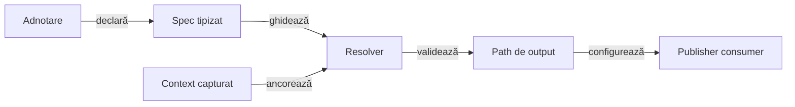

# ATF Test Infrastructure — adnotări reutilizabile și directoare de raport

Analiză pe codul live; mutările și adnotarea nouă nu sunt implementate.
Ținta este reutilizarea contractelor test-only, fără dependențe de renderer,
browser, aplicație sau de structura unui singur proiect.

## Cerințe deschise

| Prioritate / ID | Owner | De făcut | Criteriu de închidere |
|---|---|---|---|
| P1 — ANN-OUTPUT-01 | TestKit + Reporting Tests | Extrage `UiReportSubdirectory` și politica neutră de rezolvare | Același comportament existent, consumabil fără clase din Reporting Tests |
| P1 — ANN-PROJECT-02 | TestKit + Reporting Tests | Adaugă `ProjectRelativeUiReportDirectory` și folosește-o în E2E Reporting | Calea este relativă la proiect, identică în Maven și IntelliJ |
| P2 — ANN-SETUP-03 | TestKit + Core + Reporting Tests | Mută declarațiile generice `ApiScenarioSetup` / `ApiTestRef` din Core | Fără consumator main dependent de TestKit; selecția exactă rămâne neschimbată |
| P2 — ANN-DOC-04 | TestKit + guvernanță | Extrage declarația `DocumentationTarget`, inclusiv containerul repeatable | Validatorii și selecția documentelor rămân în guvernanță |
| P2 — ANN-BOUNDARY-05 | TestKit + ownerii adnotărilor | Decide extracțiile condiționate și ownership-ul extensiilor | Fără ciclu Maven, contract de domeniu mutat sau side-effect ascuns |

Starea se schimbă numai după probele de mai jos. Acest fișier este ownerul
unic al extracției transversale; feedback-ul Reporting doar trimite aici.

Canalele executabile `UI`, `API` și `UI_API`, aplicarea lor prin adaptoare și
matricea de probe sunt analizate separat în
[feedback-ul adnotărilor de canal](ATF_Test_Channel_Annotations_Feedback.md).
Ele nu schimbă ancora output-ului sau ownership-ul setup-ului descris aici.

## Ce arată codul actual

- [Adnotarea output](../../atf-reporting-tests/src/test/java/atf/ui/tests/extent/support/config/output/UiReportSubdirectory.java) este o declarație JDK-only, dar există numai în sursele de test ale unui consumer.
- [Resolverul actual](../../atf-reporting-tests/src/test/java/atf/ui/tests/extent/support/config/output/UiReportOutputDirectory.java) ancorează valoarea în directorul UI primit, nu în proiect; verifică normalizarea și containment-ul lexical.
- [Composition root-ul](../../atf-reporting-tests/src/test/java/atf/ui/tests/extent/support/config/ReportingTestResources.java) descoperă rădăcina prin markerul specific `atf-reporting/pom.xml` și impune apoi directorul standard UI, după încărcarea YAML.
- [Testele existente](../../atf-reporting-tests/src/test/java/atf/ui/tests/extent/support/config/output/UiReportSubdirectoryTest.java) protejează subdirectorul, absența adnotării și respingerea valorilor goale, absolute sau cu traversal; nu dovedesc încă ancora project-relative, moștenirea ori symlink-urile.
- Kit-ul nu depinde acum de alte module ATF; [Core](../../atf-core/pom.xml) îl consumă în test scope, iar [Reporting](../../atf-reporting/pom.xml) este o librărie standalone independentă.

### Inventarul adnotărilor și decizia de ownership

<details>
<summary>Toate familiile de adnotări ATF găsite în declarațiile Java live</summary>

| Adnotare / familie | Owner actual | Decizie propusă și limită |
|---|---|---|
| `AtfUnitTest`, `AtfComponentTest`, `AtfIntegrationTest`, `AtfE2eTest` | TestKit | Sunt deja generice; se păstrează, fără adnotări noi care dublează layer-ele |
| `UiReportSubdirectory` | Reporting Tests, `support.config.output` | Mutare în TestKit împreună cu rezolvarea neutră; aceeași ancoră UI |
| `ProjectRelativeUiReportDirectory` | Nu există | Contract distinct, în TestKit; ancoră în proiect, folosit explicit de E2E Reporting |
| `ApiScenarioSetup`, `ApiTestRef` | [Core / testing.api](../../atf-core/src/main/java/atf/api/core/testing/api/ApiScenarioSetup.java) | Candidați direcți pentru TestKit; consumatorii găsiți sunt în testele Reporting, nu în runtime-ul Core |
| `DocumentationTarget`, `DocumentationTarget.Container` | [Guvernanță](../../atf-tests/src/test/java/atf/api/tests/governance/documentation/DocumentationTarget.java) | Declarația JDK-only este reutilizabilă; validatorii și documentele selectate nu se mută în kit |
| `AtfModuleTest` + `AtfModuleTestCondition` | [Reporting Tests](../../atf-reporting-tests/src/test/java/atf/api/reporting/test/AtfModuleTest.java) | Candidat condiționat: importă `AtfModule` și loaderul Core; nu se mută mecanic în kit |
| `UiExtentSectionAudit`, `UiExtentReportContract`, `UiFailureReportAudit` | Reporting, contract public | Rămân în Reporting: secțiuni, tab-uri, checks și surfaces sunt vocabularul librăriei, nu al platformei test-only |
| `ShopPageContract` | Practice Shop, main | Rămâne local: depinde de `ShopScreen` și `ShopControl`, fiind contract al paginilor aplicației |
| `AuthenticatedE2e`, `RequiresAuthenticatedFixture`, `RequiresLiveAuthenticatedApi` | [ShopTestSupport](../../atf-test-practice-shop/src/test/java/atf/ui/tests/practiceshop/support/ShopTestSupport.java) | Rămân adaptoare Shop; folosesc configurația, fixture-urile și condițiile aplicației |
| `AllowsRegistrationPerRun` | ShopTestSupport | Opt-in-ul pentru efect extern nu se ascunde într-o adnotare generică sau compusă |
| `WithE2eHarness` | [ShopE2eTestSupport](../../atf-test-practice-shop/src/test/java/atf/ui/tests/practiceshop/support/ShopE2eTestSupport.java) | Se pot analiza politici neutre separat; lifecycle-ul harness-ului, auth și profilurile Shop rămân locale |
| `ShopApiCallComponentTest` | Shop API tests | Compoziție locală peste layer-ul generic; extensia și auditul apelurilor Shop nu aparțin kit-ului |

</details>

Reutilizarea cere un contract neutru și consumatori reali, nu doar o adnotare
cu parametri. JUnit păstrează ownership-ul adnotărilor sale; nu le clonăm în ATF.

## Două ancore diferite, nu o redenumire

Numele recomandat este `ProjectRelativeUiReportDirectory`: explică proiectul,
relativitatea și faptul că valoarea este un director de output UI, nu un fișier.

| Declarație | Bază | Rezultat propus |
|---|---|---|
| `@UiReportSubdirectory("a/b/c")` | directorul UI ales de compoziție | `<ui-report-base>/a/b/c` |
| `@ProjectRelativeUiReportDirectory("a/b/c")` | rădăcina proiectului | `<project-root>/a/b/c` |
| Fără adnotare | politica implicită/configurată a consumerului | Comportamentul existent, fără relocare incidentală |
| Ambele pe același nivel de declarație | Ambiguu | Eroare explicită înainte de publicare |

Exemplu de migrare dorită pentru E2E Reporting, nu API disponibil astăzi:

```java
@AtfE2eTest
@ProjectRelativeUiReportDirectory("artifacts/reports/ui/e2e")
class SelectedApiTestsReportUiTest {
    // Setup-ul și testele existente rămân neschimbate.
}
```

- Nu se adaugă implicit încă un prefix `artifacts/reports/ui` valorii project-relative.
- Nu se schimbă sensul lui `UiReportSubdirectory`; o mutare de package nu autorizează schimbarea ancorei.
- Noua adnotare nu implică automat layer-ul E2E; rămâne compozabilă cu layer-ul potrivit.
- Nu se introduc în paralel alte nume pentru același contract sau o booleană UI nouă.

## Compoziția propusă



<details>
<summary><strong>Legendă — contract generic și adaptor de consumer</strong></summary>

- TestKit deține declarația, ancora tipizată, contextul și rezolvarea neutră; publisherul rămâne la consumer.
- O singură politică rezolvă ambele ancore, fără două implementări paralele ale validării căilor.
- Contextul primește rădăcina proiectului și baza UI explicit, capturate o dată; resolverul nu recitește `user.dir` la fiecare test.
- Un record de tip `ReportDirectorySpec` și un enum cu ancorele `PROJECT_ROOT` / `UI_REPORT_BASE` sunt potrivite; numele helperilor nu sunt obligații de a introduce clase fără responsabilitate.
- Pachete candidate: `atf.api.testkit.output`, `atf.api.testkit.setup.api`, `atf.api.testkit.documentation`; cel mult opt clase per pachet, fără umflarea rădăcinii kit-ului.
- Resolverul întoarce un `Path`; nu creează directoare, nu generează HTML și nu pornește browserul.

</details>

### Contractul rădăcinii și al configurației

- Pentru ATF, `<project-root>` este rădăcina reactorului ATF; nu directorul modulului curent, directorul YAML sau rădăcina Git a unui eventual monorepo părinte.
- Alt proiect consumator furnizează propria rădăcină; kit-ul nu caută obligatoriu `atf-reporting/pom.xml` și nu importă un helper din testele de guvernanță.
- Maven și IntelliJ trebuie să obțină aceeași ancoră; un root explicit este autoritar, iar discovery-ul de fallback trebuie delimitat și probat, nu ghicit după numele proiectului.
- În staging extern, proiectul este copia de staging; nicio adnotare relativă nu trebuie să redirecționeze scrierea în checkout-ul live.
- Compoziția stabilește separat baza UI și relația ei cu YAML; suprascrierea actuală din `ReportingTestResources` trebuie decisă explicit, nu transportată ca efect ascuns în resolverul generic.
- Adnotarea project-relative selectează output-ul direct; adnotarea subdirectory selectează numai un copil al bazei UI. Absența lor nu schimbă automat precedence-ul existent.
- `atf.ui.report` rămâne selector de raport de intrare pentru audit; nu se reutilizează ca override al directorului de ieșire.

### Declarații compuse și căi invalide

| Arie | Contract de implementat |
|---|---|
| Retention / target | RUNTIME; TYPE și ANNOTATION_TYPE pentru compoziție; documentare explicită a moștenirii |
| Precedență | Declarația clasei concrete înaintea celei moștenite; conflictele la același nivel sunt respinse, nu rezolvate prin ordinea reflection |
| Meta-adnotări | Rezolvare delimitată, cu detectarea ciclurilor; nu se presupune că `getAnnotation` vede automat compoziția |
| Path | Director relativ nevid, normalizat, conținut în ancora selectată; fără URI, cale absolută, UNC sau formă Windows drive-relative |
| Filesystem | Containment-ul lexical nu dovedește siguranța unui symlink/junction; se verifică și strămoșul existent înaintea scrierii, prin boundary-ul IO potrivit |
| Scope / concurență | Context imutabil; directoarele pot fi comune, dar publisherul păstrează identitatea fișierelor și nu suprascrie alt run |
| Eroare | Diagnostic cu owner, adnotare și ancoră; nicio publicare parțială înainte de validare |

Rădăcina și baza UI sunt concepte distincte chiar când, într-un fixture,
se întâmplă să indice același director.

## Limite pentru celelalte extracții

- `ApiScenarioSetup` și `ApiTestRef` sunt declarații JDK-only; se păstrează selecția exactă, prioritatea `tests()` față de families și validarea referințelor.
- Catalogul concret, mock-urile și publicarea scenariilor API rămân la consumer; mutarea adnotărilor nu mută automat `ApiScenarioSetupCatalog` în kit.
- Mutarea din Core cere inventarierea importurilor și o decizie de compatibilitate pentru consumatori externi; nu se introduce un alias Core care depinde de TestKit în producție.
- `AtfModuleTest` nu poate aduce Core în kit: Core consumă deja kit-ul în test scope, deci dependența inversă creează un ciclu în reactor.
- Pentru acel gate se păstrează adaptorul Core local sau se proiectează separat un SPI neutru; nu se dublează enum-ul `AtfModule` și nu se înlocuiește siguranța typed cu string-uri doar pentru a muta un fișier.
- `DocumentationTarget` poate fi extras împreună cu containerul său repeatable; lista documentelor, validatoarele și diagnosticele rămân în `atf-tests`.
- Contractele publice Reporting rămân utilizabile standalone, fără o dependență de kit; opțiunile business și permisiunile pentru efecte externe rămân explicite la consumer.

## Probe și pași de implementare

<details>
<summary>Matricea de verificare pentru migrare, fără reducerea acoperirii</summary>

| Nivel | Probe cerute |
|---|---|
| Unit — output | Ambele ancore cu baze diferite, lipsa adnotării, spații/Unicode și normalizare; modelul/contextul nu se modifică |
| Unit — selecție | Direct, moștenit și compus; conflicte și cicluri; fără prioritate accidentală dată de reflection |
| Unit / component — negativ | Gol, absolut, UNC, drive-relative, URI, traversal; symlink/junction cu path nou și strămoș existent |
| Component — consumer | Reporting aplică path-ul rezultat, păstrează input-ul auditului și politica screenshot; un consumer neutru dovedește reutilizarea fără dependency pe Reporting Tests |
| Integration — launcher | Maven din root/modul și IntelliJ dintr-un working directory diferit produc aceeași ancoră, inclusiv în staging extern |
| API setup / docs | Referințe exacte, familii fallback, erori de selecție; `DocumentationTarget` repeatable păstrează aceleași documente și aceiași validatori |
| Guvernanță | Graful Maven fără ciclu, test scope păstrat, Reporting standalone și limita de opt clase; nicio relaxare a guard-urilor existente |
| E2E / MCP | Adnotarea nouă pe E2E Reporting; fișier în directorul declarat, raport deschis în MCP, Gherkin, evidence, JSON, screenshot inline și navigare păstrate |

</details>

- [ ] ANN-OUTPUT-01: extrage declarația și politica neutră; consumerul păstrează numai adaptorul către `UiConfiguration`.
- [ ] ANN-PROJECT-02: definește captura rădăcinii și precedence-ul, apoi migrează clasele E2E Reporting la adnotarea nouă.
- [ ] ANN-SETUP-03: verifică din nou toate referințele main/test și migrează declarațiile fără un catalog API ascuns în kit.
- [ ] ANN-DOC-04: mută doar declarația repeatable, cu actualizarea importurilor și probe pentru aceiași validatori.
- [ ] ANN-BOUNDARY-05: păstrează explicit ce rămâne Reporting/Shop și motivează orice SPI nou pentru module.
- [ ] Înaintea modificării testelor: înregistrează scope-uri `testChanges` cu path-uri exacte, baseline, expirare, proof și `allowDelete` unde se mută fișiere; nu dubla ownerii eligibili existenți.
- [ ] Build și teste numai în staging extern; reconciliază sursele live înaintea promovării, fără oprirea rulărilor paralele.
- [ ] După probe și MCP, promovează contractul implementat în README-urile TestKit/Reporting Tests și elimină numai ToDo-urile demonstrate.

Această analiză nu modifică adnotări, POM-uri, teste sau gate-uri și nu
înregistrează anticipat o autorizare executabilă pentru schimbări de teste.
