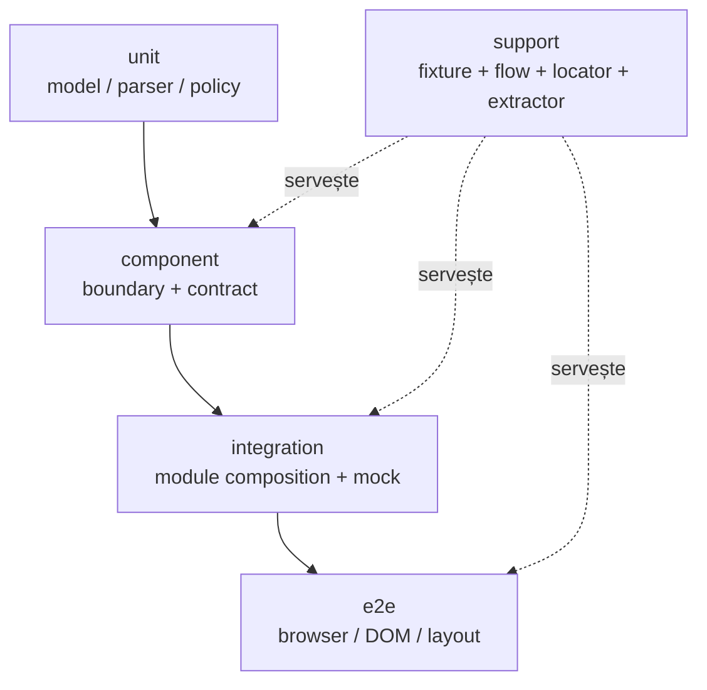
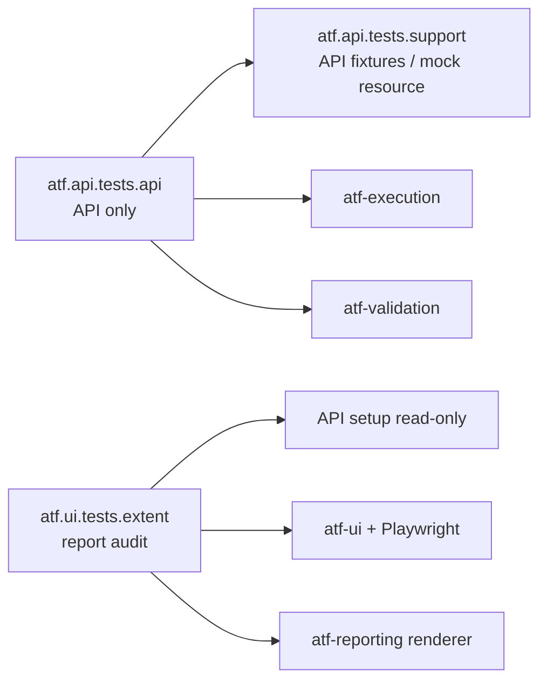

# ATF Java — feedback pentru layering și ownership

Acest document fixează stratificarea testelor și limitele de ownership. Nu este
jurnal de execuții și nu păstrează nume de fișiere HTML generate.

## Matricea canonicală



| Nivel | Verifică | Owner tipic | Nu verifică |
|---|---|---|---|
| unit | modele immutable, enum-uri, builder-e, parser-e, politici pure | producția modulului | DOM, browser, endpoint |
| component | un boundary al modulului și contractul său public | `atf-core`, `atf-validation`, `atf-reporting` | flow complet sau browser dacă nu este necesar |
| integration | compoziția reală între module, mock, execution, validation și publication | test scope-ul `atf-reporting` | endpoint real implicit |
| e2e | click, navigare, collapse, computed-style, wrapping și randare efectivă | `atf-reporting/src/test/.../extent/e2e` | reguli care pot fi dovedite static |
| support | infrastructură reutilizabilă pentru nivelurile de mai sus | `.../extent/support` | clase `*Test` executabile și verdict implicit |

`support` nu este un nivel de test. Fixture-urile nu devin teste, iar testele
`*Tests`/`*Test` exprimă doar intenția, setup-ul și verdictul.

## Reconciliere închisă — guvernanță globală versus ownership reporting

Auditul a identificat o eroare de ownership: `ArchitectureModuleBoundaryTest`
verifica întregul reactor, dar era executat și păstrat în `atf-reporting`.
Acum testul este în `atf-tests/src/test/java/atf/api/tests/governance`, cu
suport local de guvernanță și dependențe minimale (`atf-core`, `atf-test-kit`,
JUnit). `ArchitectureOwnershipBoundaryTest` rămâne în reporting și verifică
doar ownership-ul production/test/support al reporting-ului.

Identificatorii fizici Maven (`atf-core`, `atf-reporting`, `atf-tests` etc.) au
un singur owner în `atf-core/src/main/java/atf/api/core/config/module/AtfModuleIds`.
Testele nu mai repetă string-uri de module și nu mai confundă enum-ul logic
`AtfModule` (`core`, `reporting`, `ui`) cu artifact-id-ul Maven.

### Reanaliză boundary — catalogul reactorului și source roots

Auditul ulterior a închis două ambiguități:

- `REACTOR_MODULES` este catalogul complet al root POM, inclusiv
  `atf-test-kit`; testul global verifică faptul că fiecare ID canonic există în
  reactor.
- `SOURCE_GOVERNED_MODULES` este lista explicită scanată de guardul whole-ATF.
  `atf-test-kit` nu este omis din guvernanță, ci își păstrează guardul propriu
  pentru test layers (`AtfTestLayerArchitectureTest`).
- resolverul comun din `AtfGovernanceTestSupport` recunoaște atât layout-ul
  Maven `src/main/java` / `src/test/java`, cât și layout-ul intenționat legacy
  al modulului `atf-tests` (`src/main` / `src/test`). Scanările de import,
  stdout/stderr și static state nu mai pot verifica accidental un director gol.

Aceste reguli păstrează un singur owner pentru fiecare invariantă: catalogul
fizic în `atf-core`, guvernanța reactorului în `atf-tests`, iar layering-ul
test-kit-ului în `atf-test-kit`.

În test-kit rămâne o excepție intenționată: `AtfTestLayerArchitectureTest`
este bootstrap-ul care poate rula înainte ca `atf-core` să fie disponibil, deci
nu îl facem dependent de `AtfModuleIds`. Această excepție este limitată la
clasificarea layer-urilor de test; toate guard-urile reporting și whole-ATF
folosesc catalogul canonic din core.

**Criteriu de redeschidere:** orice nouă regulă care inspectează toate modulele,
reactorul sau import graph-ul intră în `atf-tests`; orice regulă despre Extent,
audit, publisher, fixture, locator sau UI test rămâne în `atf-reporting`.

### Regula runtime și raport Extent

Refactorizarea JavaScript trebuie să urmeze ownership-ul semantic, nu numărul
de linii:

| Zonă | Nivel recomandat | Contract |
|---|---|---|
| `ExtentReportRuntimeVocabulary` și builder-ele pure | unit | nume, selector, atribut, clasă CSS și status tipizate |
| `ExtentReportRuntimeCore` și runtime section scripts | component | funcții publicate o singură dată, DOM projection și parity |
| `ExtentReportRuntimeModule` + `ExtentReportRuntimeBehaviour` | component | registry owner/source, ordine și compoziție fără duplicate |
| mock/API report → publication → artifact | integration | JSON body, provenance, evidence și secțiuni coerente |
| ATF Debug + Playwright MCP | E2E | randare, click, tab, disclosure, computed-style, screenshot și consolă |

Un input API folosit de un test UI este setup read-only. Dacă o regulă poate fi
dovedită din HTML/CSS/JavaScript sau din contractul JSON, ea se mută în
component/integration; E2E-ul nu o repetă. Orice split nou cere un boundary
semantic și un test independent, nu doar o clasă mai scurtă.

## Boundary API versus UI



`atf.api.tests.api` nu importă `atf.ui.tests`, Playwright, DOM sau Debug UI.
Setup-ul mock API pentru aceste teste este accesat prin helper-ul API-only din
`atf.api.tests.support`. Un architecture guard verifică această regulă.

`atf.ui.tests.extent` poate selecta metode API pentru a genera un input read-only,
dar aceasta este compoziție de test UI, nu transferă browserul în namespace-ul
API. Direcția este:

```text
API setup/mock → API report → UI browser audit → UI validation report
```

## Ownership-ul test-kit-ului Extent

| Pachet | Owner semantic | Conține |
|---|---|---|
| `component` | contracte fără browser | modele, projection, policies, architecture guards |
| `e2e` | interacțiune reală | composition roots, suite, browser-backed tests |
| `support/api` | setup și flow API read-only | selecție, fixture, setup, exploration |
| `support/locators` | selectorii Playwright | facade-uri și familii de locatori |
| `support/section/extract` | extracția DOM | snapshot input pentru validatorii puri |
| `support/section/module` | audit pe secțiuni | module declarative, fără publisher |
| `support/section/publish` | output de audit | Extent/JUnit adapter separat |
| `support/navigation` | flow-uri de navigare | tab-uri și disclosure-uri |
| `support/inspection` | observații browser | computed-style, failure, projection, duration |
| `support/config` | configurația test-only | YAML UI/report și contextul de proces |

Regulile globale ale reactorului sunt apărate de
`atf-tests/src/test/java/atf/api/tests/governance/ArchitectureModuleBoundaryTest`.
Regulile de ownership ale reporting-ului sunt apărate de `ArchitectureOwnershipBoundaryTest`,
`ArchitectureCohesionBoundaryTest`, `UiSelectorBoundaryArchitectureTest`,
`SectionAuditArchitectureGuardTest` și `ApiTestBoundaryArchitectureTest`.
Niciun pachet principal nu depășește limita de opt clase fără o excepție
justificată prin coeziune și testată.

## Contract stabil mutat în documentația ownerilor

Layering-ul și ownership-ul închis sunt normative în
[`docs/ATF_Architecture.md`](../ATF_Architecture.md),
[`atf-reporting/README.md`](../../atf-reporting/README.md) și în README-ul
test-kit-ului Extent. Guvernanța whole-ATF este în
[`atf-tests/README.md`](../../atf-tests/README.md). Acest fișier păstrează matricea de responsabilități și
doar gap-urile care cer încă o schimbare verificabilă.

## Stare și criterii

Nu există gap-uri active în această matrice. Promovarea guarded este
implementată în `atf-core` prin `AtfPromotionManifest`/`AtfPromotionGuard`, iar
adaptorul live explicit este `ApiLiveTransportCatalog`; detaliile stabile sunt
în README-urile ownerilor.

Parity-ul semantic Extent↔fallback este închis prin adaptorul comun și testul
dedicat; nu mai există ToDo separat pentru providerii CSS/JavaScript, status projection,
subțierea E2E sau mutarea configurației Extent: aceste responsabilități sunt
deja în ownerii corecți. Un split nou este permis numai dacă introduce un
boundary semantic și un test independent, nu doar reduce numărul de linii. Split-ul
contractelor Extent este deja închis prin `ExtentReportInteractionContractTest`,
`ExtentReportFailureProjectionContractTest`, `ExtentReportNavigationContractTest`
și guard-ul `ExtentReportContractCohesionArchitectureTest`.

Pentru funcțiile JavaScript generate, aceeași regulă se aplică în interiorul
runtime-ului: un singur owner pentru fiecare funcție globală, helperi separați
pentru citire/derivare/proiecție și teste statice care verifică artifactul publicat.
`failureContext`/`renderFails` și agregarea duratelor au fost refactorizate pe
aceste boundary-uri; un viitor split se redeschide numai dacă apare un contract
semantic nou sau o regresie observabilă în DOM.

Pentru durate, owner-ul de producție rămâne facade-ul
`ExtentReportDurationRuntime`, iar parsing-ul, aggregation-ul, projection-ul și
lifecycle-ul sunt seams independente. `ExtentReportDurationRuntimeComponentTest`
acoperă contractul static; testele de integrare/E2E acoperă compoziția și
paritatea DOM. În acest strat nu se adaugă clase de test pentru fiecare funcție
JavaScript: se extinde component test-ul numai când apare un contract nou, iar
randarea se revalidează prin ATF Debug + Playwright MCP.

## Criterii de promovare

1. Se pornește de la codul live și se creează staging extern; nu se lucrează în
   `.tmp` din proiect și nu se opresc rulări active.
2. Se rulează testul focalizat, apoi gate-ul nivelului afectat și gate-ul de
   architecture/cohesion.
3. Pentru reporting se verifică static HTML/CSS/JavaScript, apoi artifactul
   exact prin ATF Debug + Chromium/Playwright MCP.
4. Se verifică `Tests`, `Overview`, `Categories`, `Fails`, JSON evidence,
   disclosures, `＋/−` inline, screenshot link inline, overflow, computed-style,
   consolă și navigare.
5. Se compară live↔staging înainte de sync; drift-ul paralel produce
   reconciliere, nu overwrite.
6. Regula stabilă se mută în README-ul ownerului; feedback-ul păstrează numai
   gap-ul real și criteriul de redeschidere.

## Regula de redeschidere

Se redeschide un item închis numai după o regresie reproductibilă, o schimbare
de ownership, o nouă clasă de input sau o schimbare de contract. Numele unui
raport generat, un timestamp sau o captură locală nu sunt criterii de arhitectură
și nu se păstrează în documentație.
