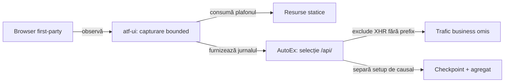

# ATF — capturarea și selecția traficului UI

**Stare:** deschis, confirmat prin observarea pasivă a browserului folosit de
`AutoExPurchaseUiApiE2eTest`. Testul business trece, dar evidence-ul network
publicat omite trafic real.

**Prioritate:** 92/100: impact 37, lacună 27, lucrabil 20, documentare 8.
Regulile deja validate pentru setup și baseline rămân în
[README-ul AutoEx](../../atf-test-auto-ex/README.md#boundary-ul-cauzal-pentru-ui_api).

## Pierderile confirmate

| Boundary | Comportament actual | Efect observabil |
|---|---|---|
| Capturare `atf-ui` | allowlist doar pe host; asset-urile și traficul business folosesc același plafon | jurnalul se poate umple înainte de checkout |
| Selecție AutoEx | `apiObservations()` acceptă numai prefixul `/api/` | XHR-ul real `GET /add_to_cart/1` este exclus după capturare |
| Agregat | precondiția catalogului este exclusă prin baseline, iar restul este deja filtrat | `0 exchanges` nu dovedește absența traficului relevant sau capturarea completă |

<strong>Legendă — două puncte independente de pierdere</strong>

- **Capturare:** selecția relevantă trebuie aplicată înainte de citirea body-ului
  și consumarea bugetului jurnalului.
- **Selecție AutoEx:** o rută poate fi XHR/fetch fără prefix `/api/`.
- **Raport:** valoarea zero trebuie interpretată împreună cu scope-ul și
  completitudinea capturii.

## UI-NETWORK-CAPTURE-01 — selecție și buget la boundary-ul browserului

**Owner:** `atf-ui`; prezentarea generică a completitudinii aparține
`atf-reporting`, cu probe în `atf-reporting-tests`.

Dovada din cod este în
[inspector](../../atf-ui/src/main/java/atf/api/ui/network/UiNetworkInspector.java)
și [configurația sa](../../atf-ui/src/main/java/atf/api/ui/config/UiNetworkInspectionConfiguration.java):

- `forHosts` setează implicit 256 de observații; filtrul pe host permite și
  imagini, fonturi, scripturi și CSS.
- Plafonul este verificat la stocarea observației typed; `capture(Response)`
  construiește mai întâi observația și citește body-ul.
- Metadatele typed pierd `resourceType`, necesar pentru selecția transportului
  fără presupuneri despre numele rutei sau formatul răspunsului.

### Criterii rămase

- [ ] O politică generică, typed și configurabilă selectează traficul înainte de
      body capture și consumarea bugetului; distinge XHR/fetch, navigări/formulare
      și resurse statice, păstrând allowlist-ul de host.
- [ ] Rutele business și includerea opțională a documentelor/formularelor sunt
      configurate de consumer; `atf-ui` păstrează un vocabular independent de
      aplicație.
- [ ] Selecția păstrează XHR/fetch cu răspuns `text/html`; acest Content-Type
      este folosit de site inclusiv pentru răspunsurile catalogului și coșului.
- [ ] Bugetul rămâne bounded, iar overflow-ul expune scope, accepted/retained/
      dropped și limitReached, cu semantica cursorului păstrată.
- [ ] Evenimentele excluse și cele respinse la plafon evită citirea inutilă a
      body-ului; mărirea limitei implicite este insuficientă drept remediere.
- [ ] Redactarea, proveniența și metadatele de auth sunt păstrate până la adaptorul
      Reporting; diagnosticul nu expune body-uri, headere sensibile sau query-uri.
- [ ] Inspectorul afișează completitudinea capturii în propria zonă; verdictul
      business rămâne legat de aserțiunile aplicației.

## AUTOEX-NETWORK-01 — traficul business observat în checkpoint-ul său

**Owner:** adaptorul AutoEx pentru selecția rutelor și corelarea cu journey-ul.
[Filtrul actual](../../atf-test-auto-ex/src/test/java/atf/ui/autoex/support/AutoExE2eRun.java)
elimină XHR-ul coșului pentru că ruta nu începe cu `/api/`.

### Criterii rămase

- [ ] Profilul `UI_API` include XHR-ul real `GET /add_to_cart/1` prin politica
      de selecție; configurarea nav/form este explicită și documentată.
- [ ] Request-ul original, observat în aceeași sesiune UI, este publicat sub
      checkpoint-ul adăugării în coș, cu Request → Response → Execution comune.
- [ ] Precondiția `GET /api/productsList` rămâne marcată ca setup; baseline-ul
      și totalurile agregatului explică separarea setup/causal.
- [ ] Totalurile reflectă selecția și completitudinea; valoarea zero este
      susținută de absența evenimentelor relevante și de lipsa pierderilor.
- [ ] Extinderea suportului păstrează testele E2E ca expresie a journey-ului
      business; comportamentele generice au probe la modulele owner.

## Reproducere și ownership-ul probelor

1. Rulează clasa E2E exactă, opt-in, într-un staging izolat.
2. Atașează pasiv observatori Playwright pentru metodă, rută, resourceType și
   status, pe aceeași pagină; nu reexecuta request-uri pentru a popula raportul.
3. Compară evenimentele cu jurnalul ATF, selecția consumerului și agregatul.
4. Pentru plafon, compară jurnalul normal cu un inspector independent cu buget
   mai mare; păstrează doar metadate în diagnosticul comparației.

| Owner al probei | Scenariu necesar | Dovada de închidere |
|---|---|---|
| `atf-ui` | mai multe asset-uri decât bugetul, urmate de XHR/fetch reușit și eșuat; răspuns non-JSON; overflow relevant | filtrare înainte de body, trafic relevant păstrat, limitare și cursor corecte |
| `atf-reporting-tests` | fixtures neutre: setup + trafic cauzal, captură goală completă și captură trunchiată | request/response/execution și totaluri coerente; stare de captură incompletă verificată în artifact și browser |
| AutoEx component | ruta coșului, originea setup și asocierea cu pasul business | selecție și corelare specifice aplicației, fără teste de renderer generic |
| AutoEx E2E | clasa existentă, aceeași sesiune browser | XHR-ul coșului vizibil la pasul potrivit; cleanup păstrat; totaluri conforme politicii |

Închiderea cere probe de componentă la ownerii de mai sus și verificarea
artifactului fresh în TAB MCP/ATF Debug. Numărul total de request-uri al
site-ului public este variabil și nu devine assertion fixă.

Protocolul de execuție este în
[siguranța build-ului](../ATF_Build_And_Execution_Safety.md); schimbarea testelor
existente urmează [guvernanța ATF Tests](../../atf-tests/README.md#guvernanța-schimbării-testelor).

