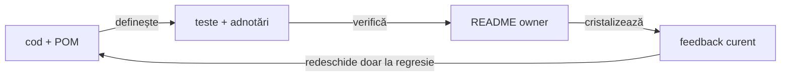

# ATF Java — registrul curent de feedback

## Overall

- feedback-ul păstrează numai riscuri, limite sau decizii care se pot schimba;
- fiecare ToDo are owner, dovadă lipsă și criteriu de închidere;
- regula stabilă se mută în README-ul ownerului;
- analiza datată fără acțiune și artifactele generate nu sunt documentație
  permanentă;
- un run verde nu închide un ToDo fără dovadă relevantă.

## Regula de reconciliere cu codul live

<strong>Legendă — ordinea dovezii</strong>

- codul și POM-ul stabilesc modulele, dependențele și boundary-ul real;
- testele și adnotările stabilesc comportamentul verificat și nivelul lui;
- configurația stabilește inputul plug-and-play, nu capability-uri inexistente;
- README-ul explică regula stabilă și ownerul;
- feedback-ul păstrează limita, criteriul și dovada lipsă;
- artifactul este evidence de run, nu sursă normativă.

## Verdict whole-ATF

| Zonă | Verdict | Owner / dovadă |
|---|---|---|
| `atf-reporting` production | ✅ standalone | POM parentless, dependency guard |
| reporting tests | ✅ consumer separat | `atf-reporting-tests` și matrix lower-level |
| Practice Shop | ✅ consumer separat | `atf-test-practice-shop` |
| whole-reactor governance | ✅ separat | `atf-tests` |
| documentație | ✅ guvernată | diagram, prose, structure, style și target guards |
| `atf-execution` | ✅ eliminat | mecanica generică este în `atf-core` |

## Gate-uri curente

| Gate | Rezultat | Interpretare |
|---|---|---|
| documentation governance | ✅ PASS | structura, prose, stil, target și diagrame sunt conforme |
| `atf-console` focused gate | ✅ PASS | bridge-ul are test component și round-trip-ul vocabularului este verificat |
| whole-ATF governance | ✅ PASS | adapterul consolei este test-only în `atf-reporting-tests`; `atf-console` și `atf-reporting` rămân independente |
| reporting consumer gate | ✅ PASS | 479 teste, 0 failures, 0 errors, 3 skipped; reactor complet 643 teste |

## ToDo active

| Prioritate | ID | Owner | Limită | Criteriu de închidere |
|---|---|---|---|---|
| P1 | `REP-RENDER-09` | `atf-reporting` | parity vendor-specific incomplet după primitivele comune | Extent și fallback compun aceleași primitive, fără markup copiat |
| P1 | `REP-MODEL-01` | `atf-reporting` | lifecycle nested încă prea concentrat | mutation, snapshot și projection au responsabilități separate și testate |
| P1 | `REP-VOCAB-01` | `atf-reporting` | literals raw în afara allowlist-ului | allowlist explicit, zero literals noi nejustificate |
| P1 | `REP-TEST-08` | `atf-reporting-tests` | teste/facades support încă largi | un motiv per test, support neexecutabil, coverage lower-level crescut |
| P1 | `REP-SUITE-01` | `atf-reporting-tests` | 308 clase, 140 support, 8 E2E; profilele nu sunt separate complet | launcher/profile sau guard reproducibil pentru reporting-only |
| P2 | `REP-LOCATOR-01` | `atf-reporting-tests` | `ReportUiLocators` rămâne facade legacy de 443 linii | surface-uri typed adoptate; delegări noi interzise fără motiv |
| P0 | `SHOP-API-REAL-01` | Practice Shop + mediu extern | fixture placeholder și `authenticatedE2eEnabled=false`; authenticated tests sunt skip | fixture non-placeholder, flag activ, login/current-user `200`, apoi journey live complet |
| P1 | `SHOP-REPORT-SYSTEM-01` | `atf-reporting` + Practice Shop | `System/Environment` este generic și nu expune snapshot-ul redacted al configurației consumerului | metadata typed pentru browser/API/config/reporting, verificată component + integration + MCP E2E, fără secrete sau path-uri dinamice |
| P1 | `SHOP-REPORT-NET-01` | `atf-reporting` + Practice Shop | request/response sunt vizibile per checkpoint, dar nu există network inspector agregat pentru întregul journey | disclosure ordonată `UI step → 0..n exchange-uri → assertion`, collapsed-by-default, cu link la evidence detaliată |
| P3 | `TEST-ARCH-07` | `atf-tests` | suportul poate avea subzone greu de navigat | mutare numai cu owner, motiv și boundary test |

## Închideri care nu mai sunt active

| Grup | Dovadă stabilă |
|---|---|
| `TRACE-REQ-01..10` | `ReportTraceMetadata`, `ReportRequestSignature` și testele de trace |
| `REP-EVID-01..07` | policy/profile/session, mock evidence și normalizare idempotentă |
| `REP-AUDIT-08` | snapshot renderer-neutral și validatorii puri |
| `REP-COVERAGE-08` | `ReportingCoverageMatrixTest` |
| `REP-E2E-08` | `E2eSuiteBudgetArchitectureTest`, plafon 8 |
| `REP-FORMAT-01` | source multiline versus publication compactată |
| `REP-SIZE-01` | `ReportAssetSizeBudget` și `ReportAssetSizeInventoryTest`; baseline explicit pentru asset bundle-ul CSS/JavaScript |
| `REP-ASSET-08` | manifest, owner, format, ordine și namespace |
| `REP-BUILD-01` | standalone discovery allowlist-uit |
| `REP-BOUNDARY-01` | architecture ownership și POM guards |
| `SHOP-API-SCREEN-01..10` | screen flows, journal, assertions și evidence mapper |
| `SHOP-UI-VALIDATION-01..04` | page contracts și validator component |
| `SHOP-MIX-01..03` | API evidence pe checkpoint-ul UI existent |
| `SHOP-AUTH-01..07` | registration, fixture loading, login și authenticated purchase implementate; live proof pending până la fixture non-placeholder |
| `SHOP-ARCH-11..13` | runtime/main versus test-only support |
| `SHOP-REPORT-FAILURE-01` | failure projection în `Fails` |
| `SHOP-CONSOLE-01` | sink configurat injectat la composition root |
| `SHOP-CONSOLE-02` | `atf-reporting-tests/.../AtfConsoleBridgeTest`; adapter test-only, fără mapping în Practice Shop sau dependency production inversă |
| `SHOP-API-REAL-02` | guest live product/cart/payment assertions și Payment success verificate prin `LIVE_HTTP`; authenticated standalone rămâne separat în `SHOP-API-REAL-01` |
| `SHOP-API-TRACE-01` | fresh guest E2E + MCP: cart checkpoint cu POST/GET live, JSON request/response, status, transport, retry, trace și signature |
| `SHOP-NET-02` | warning guest explicit `GET /users/me → 401`, source/route/status/message în assertions; unknown diagnostics fail |
| `REP-CONSOLE-01` | `atf-reporting-tests/.../AtfConsoleBridgeTest`; round-trip pentru toate statusurile și porturile production independente |
| `DOC-READ-01`, `DOC-READ-02` | digestie vizuală și documente owner refăcute |
| `DOC-DIAG-01..05` | forme, orientări, legende și guard-uri de diagramă |
| `ROOT-README-01..04` | root baseline stabil și protejat |

## Ownership-ul documentației

| Contract | Document normativ |
|---|---|
| module și reactor | [`docs/ATF_Architecture.md`](../ATF_Architecture.md) |
| reporting standalone | [`atf-reporting/README.md`](../../atf-reporting/README.md) |
| reporting tests | [`atf-reporting-tests/README.md`](../../atf-reporting-tests/README.md) |
| Practice Shop | [`atf-test-practice-shop/README.md`](../../atf-test-practice-shop/README.md) |
| whole-ATF governance | [`atf-tests/README.md`](../../atf-tests/README.md) |
| reporting contract | [`docs/ATF_Reporting_Contract.md`](../ATF_Reporting_Contract.md) |
| code and test best practices | [`docs/README_Atf_CodeBestPractices.md`](../README_Atf_CodeBestPractices.md) |
| documentation best practices | [`docs/README_Atf_DocumentationBestPractices.md`](../README_Atf_DocumentationBestPractices.md) |
| build and sync | [`docs/ATF_Build_And_Execution_Safety.md`](../ATF_Build_And_Execution_Safety.md) |

## Protocol de închidere

<strong>Checklist pentru orice schimbare</strong>

- [ ] codul live și POM-ul confirmă ownerul real;
- [ ] testul focalizat reproduce comportamentul la nivelul potrivit;
- [ ] guard-ul relevant trece: module, architecture, documentation sau coverage;
- [ ] dacă se schimbă HTML/CSS/JavaScript, artifactul este fresh și verificat
      prin adapter static sau MCP/Chromium;
- [ ] statusul curent este actualizat, fără secțiune datată nouă;
- [ ] regula stabilă este mutată în README-ul ownerului;
- [ ] feedback-ul păstrează numai limita și criteriul de redeschidere;
- [ ] nu se păstrează nume de artifact, path local, timestamp sau secret.

## Regula de redeschidere

Un item se redeschide numai pentru:

- regresie reproductibilă;
- schimbare de ownership sau dependency boundary;
- consumer nou care nu este acoperit de contract;
- input/configurație nouă;
- schimbare de contract public.

Un screenshot, un timestamp, o eroare de runner izolată sau o schimbare locală
de stil nu redeschide singur un item închis.
