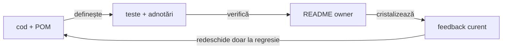

# ATF Java — registrul curent de feedback

## Overall

- feedback-ul păstrează numai riscuri, limite sau decizii care se pot schimba;
- fiecare ToDo are owner, dovadă lipsă și criteriu de închidere;
- regula stabilă se mută în README-ul ownerului;
- analiza datată fără acțiune și artifactele generate nu sunt documentație
  permanentă;
- un run verde nu închide un ToDo fără dovadă relevantă.

## Regula de reconciliere cu codul live

<strong>Legendă — ordinea dovezii</strong>

- codul și POM-ul stabilesc modulele, dependențele și boundary-ul real;
- testele și adnotările stabilesc comportamentul verificat și nivelul lui;
- configurația stabilește inputul plug-and-play, nu capability-uri inexistente;
- README-ul explică regula stabilă și ownerul;
- feedback-ul păstrează limita, criteriul și dovada lipsă;
- artifactul este evidence de run, nu sursă normativă.

## Verdict whole-ATF

| Zonă | Verdict | Owner / dovadă |
|---|---|---|
| `atf-reporting` production | ✅ standalone | POM parentless, dependency guard |
| reporting tests | ✅ consumer separat | `atf-reporting-tests` și matrix lower-level |
| Practice Shop | ✅ consumer separat | `atf-test-practice-shop` |
| whole-reactor governance | ✅ ownership separat, gate verde | `atf-tests`; boundary-urile production/test și lizibilitatea sunt verificate fără prag relaxat |
| documentație | ✅ guvernată | diagram, prose, structure, style și target guards |
| `atf-execution` | ✅ eliminat | mecanica generică este în `atf-core` |

## Gate-uri curente

| Gate | Rezultat | Interpretare |
|---|---|---|
| documentation governance | ✅ PASS | structura, prose, stil, target și diagrame sunt conforme |
| `atf-console` focused gate | ✅ PASS | bridge-ul are test component și round-trip-ul vocabularului este verificat |
| whole-ATF governance | ✅ PASS | `AtfPackageCohesionGovernanceTest` confirmă maximum 8 clase pe pachet după split-urile `ui.network`, `support.api` și `support.config.environment`; `AtfSourceReadabilityGovernanceTest` confirmă importuri normale |
| reporting consumer gate | ⚠️ PARTIAL | modelul aggregate și Practice Shop guest sunt verificabile, dar publisher proof-ul pentru aggregate rămâne roșu; raportul fresh MCP confirmă și că un checkpoint cu mai multe exchange-uri aplatizează request/response într-un singur tabel |

## ToDo active

| Prioritate | ID | Owner | Limită | Criteriu de închidere |
|---|---|---|---|---|
| P1 | `REP-DIAGNOSTIC-04` | `atf-reporting` + `atf-reporting-tests` | diagnosticele console/page fără method/route/status pot fi contopite în aceeași cheie goală; raportul live a redus zeci de evenimente la un singur observation `status=-1` | cheie bounded și stabilă pentru semnale necorelate, cu count numai pentru repetări reale; două mesaje distincte nu se contopesc și mesajul brut nu ajunge în sumar |
| P1 | `REP-TRACE-03` | `atf-reporting` + `atf-reporting-tests` | UI trace-ul pune toate exchange-urile unui checkpoint într-un singur `Request details` și un singur `Response details`; lipsește un copil semantic `API validation`, iar mai multe exchange-uri produc titluri indistincte `Execution evidence · 1 attempts`; raportul API direct păstrează disclosure-uri canonical per request | un singur sibling Gherkin cu un copil `API validation` în același stil ca `UI validation`; sub el, aceeași proiecție typed și același pipeline de renderer request/response/execution sunt reutilizate per exchange, fără re-encodare flat în chei `API n · ...`, cu execution evidence identificabil și fără JSON duplicat |
| P2 | `REP-EVID-08` | `atf-reporting` + `atf-reporting-tests` | URL-urile lungi din tabelul UI se rup arbitrar în interiorul identificatorului și scad scanarea la viewport îngust | wrapping controlat pe delimitatori sau o proiecție semantică echivalentă, fără overflow și fără pierderea textului complet; dovada trebuie să acopere Extent, fallback și browser |
| P0 | `SHOP-API-REAL-01` | Practice Shop + mediu extern | fixture placeholder și `authenticatedE2eEnabled=false`; authenticated tests sunt skip | fixture non-placeholder, flag activ, login/current-user `200`, apoi journey live complet |
| P3 | `TEST-ARCH-07` | `atf-tests` | suportul poate avea subzone greu de navigat | mutare numai cu owner, motiv și boundary test |

## Închideri care nu mai sunt active

| Grup | Dovadă stabilă |
|---|---|
| `TRACE-REQ-01..10` | `ReportTraceMetadata`, `ReportRequestSignature` și testele de trace |
| `REP-EVID-01..07` | policy/profile/session, mock evidence și normalizare idempotentă |
| `REP-AUDIT-08` | snapshot renderer-neutral și validatorii puri |
| `REP-COVERAGE-08` | `ReportingCoverageMatrixTest` |
| `REP-E2E-08` | `E2eSuiteBudgetArchitectureTest`, plafon 8 |
| `REP-FORMAT-01` | source multiline versus publication compactată |
| `REP-SIZE-01` | `ReportAssetSizeBudget` și `ReportAssetSizeInventoryTest`; baseline explicit pentru asset bundle-ul CSS/JavaScript |
| `REP-VOCAB-01` | `AtfReportHtmlVocabulary` și contractele de markup; tokenii production sunt typed, iar `toggleView` este seam vendor explicit |
| `REP-BODY-01` | `ReportingSettings`, `ExtentReportNodeSupport` și testele formatter/config/Extent/HTML; default `100`, `0` dezactivează limita, marker `first N of TOTAL` |
| `REP-LOCATOR-01` | `ReportUiLocatorsTest` și ports din `support/locators`; fațada este compatibilitate publică, iar ownership-ul selectorilor este vertical/coeziv |
| `REP-ASSET-08` | manifest, owner, format, ordine și namespace |
| `REP-BUILD-01` | standalone discovery allowlist-uit |
| `REP-BOUNDARY-01` | architecture ownership și POM guards |
| `CORE-FILES-01` | `atf-core.files.AtfPathLocator.locateModuleRoot`, `AtfFileTree.regularFiles`, `AtfPathLocatorTest`, `AtfFileTreeTest` și `PracticeShopArchitectureTest`; consumerul nu mai reimplementează root discovery sau file traversal |
| `SHOP-API-SCREEN-01..10` | screen flows, journal, assertions și evidence mapper |
| `SHOP-CONFIG-02`, `SHOP-ROUTE-04..05` | host și rute relative; output UI/API separat în `artifacts/reports/ui` și `artifacts/reports/api` |
| `SHOP-UI-VALIDATION-01..04` | page contracts și validator component |
| `SHOP-MIX-01..03` | `UiPhaseLifecycle.apiTrace` + guest E2E proof: UI checkpoint și API trace sibling sunt intercalate cauzal, fără JSON duplicat |
| `SHOP-AUTH-01..07` | registration, fixture loading, login și authenticated purchase implementate; live proof pending până la fixture non-placeholder |
| `SHOP-ARCH-11..13` | runtime/main versus test-only support |
| `SHOP-REPORT-FAILURE-01` | failure projection în `Fails` |
| `SHOP-CONSOLE-01` | sink configurat injectat la composition root |
| `SHOP-CONSOLE-02` | `atf-reporting-tests/.../AtfConsoleBridgeTest`; adapter test-only, fără mapping în Practice Shop sau dependency production inversă |
| `SHOP-API-REAL-02` | guest live product/cart/payment assertions și Payment success verificate prin `LIVE_HTTP`; authenticated standalone rămâne separat în `SHOP-API-REAL-01` |
| `SHOP-API-TRACE-01` | screen flow + network journal: request/response, status, transport, retry, trace și signature rămân legate de checkpoint-ul care le-a cauzat; presentation ordering rămâne activ separat |
| `REP-RENDER-09`, `REP-MODEL-01`, `REP-TEST-08`, `REP-OVERVIEW-02` | `ReportRendererParityTest`, `AtfReportSemanticSnapshotTest`, `ReportingCoverageMatrixTest`, `ReportEnvironmentSnapshotTest` și guard-urile existente; parity, lifecycle guards, matrix proof și System allowlist sunt verificate |
| `REP-NET-03`, `REP-AUTH-02`, `REP-DIAGNOSTIC-02` | `JourneyAggregate` și `ReportNetworkInspectorTest`; modelul semantic are authentication/correlation/transport/signatures/diagnostics, auth este method/source/status/count, iar response+console corelate se deduplicatează cu count/sources; collision handling pentru semnale necorelate rămâne `REP-DIAGNOSTIC-04` |
| `REP-NET-04` | `ReportNetworkAggregateMarkup`, `ReportNetworkInspectorTest`, `HtmlReportViewsTest` și fresh guest E2E/MCP | Extent și fallback publică un singur inspector collapsed cu cinci disclosure-uri nested; `network.aggregate.*` nu mai este expus ca tabel flat în trace. Această închidere acoperă indexul journey-ului, nu forma canonicală per exchange din `REP-TRACE-03` |
| `SHOP-REPORT-NET-02`, `SHOP-REPORT-AUTH-02`, `SHOP-DIAGNOSTIC-02` | Practice Shop consumă aggregate-ul generic; binding-ul și dovada de consumer sunt separate de renderer, fără JSON duplicat și fără credentiale în sumar |
| `REP-API-BIND-01`, `SHOP-API-BIND-01` | `PracticeShopApiCheckpoint`, `PracticeShopApiEvidenceBindingTest`, YAML și override system property | selecția per journey/checkpoint este typed și fail-closed; journal-ul publică numai evidence-ul selectat |
| `REP-TRACE-02`, `SHOP-API-TRACE-02` | UI API trace-ul reutilizează vocabularul, redaction policy, filtrarea browser noise, replay-ul redacted și execution evidence ale raportului API; titlul este pasul Gherkin exact, fără prefix URL/`API trace ·` | forma structurală per exchange nu este inclusă în această închidere; aplatizarea request/response și metadata de trace sunt urmărite separat în `REP-TRACE-03` |
| `SHOP-REPORT-SYSTEM-01` | `PracticeShopReportSystemMetadataTest` + MCP/Chromium proof: Overview/System păstrează configurația bounded/redacted și separă explicit precondiția API configurată de precondiția journey-ului UI |
| `SHOP-REPORT-SYSTEM-02` | `PracticeShopReportSystemMetadata` + component test: `Overview/System` publică numai configurație operațională allowlist-uită; nu publică `Suite`, `Test package`, `Flow`, `Fixture` sau `Checkout`, iar duratele sunt umane (`20s`, `45s`) |

| `SHOP-E2E-ROOT-01` | `PracticeShopTestSupport.openE2e()` și `E2eHarness` centralizează configurația, contextul și locatorii; testele E2E rămân compoziții business scurte |
| `SHOP-E2E-ISOLATION-01` | cele trei E2E folosesc `BeforeEach/AfterEach`, fără `PER_CLASS`/`BeforeAll`; `PracticeShopArchitectureTest` verifică izolarea contextului per test |
| `SHOP-HTML-CONTRACT-01` | `PracticeShopReportHtmlTestSupport` verifică semantic text, celule exacte, ordine și absență; contractele report nu mai depind de un singur `html.contains(...)` pentru fiecare regulă |
| `SHOP-TEST-LIFECYCLE-01` | `PracticeShopApiClient implements AutoCloseable`, close-ul curăță bearer state și respinge utilizarea ulterioară; integration tests folosesc try-with-resources |
| `SHOP-TEST-DSL-01` | `PracticeShopTestSupport` oferă adnotări/condiții typed pentru authenticated fixture și live API; gating-ul nu mai este copiat prin metode locale `isConfigured()` |
| `SHOP-REPORT-NET-01` | `ReportNetworkInspectorTest` + contract de publisher: proiecție collapsed cu sequence/step/role/initiator/correlation/auth/attempts/retries și aggregate typed; body-ul rămâne în evidence locală |
| `SHOP-TEST-TRUST-01` | `PracticeShopPageValidator`, valori DOM observate, `PracticeShopPaymentPage`, testul negativ pentru login fără `current-user` și guard-ul `PracticeShopArchitectureTest` acoperă E2E plus flow/evidence support; verdicturile literal-`true` din journey și setup au fost eliminate |
| `REP-AUTH-01`, `SHOP-REPORT-AUTH-01` | `ReportAuthMethod`, `ReportAuthObservation`, `ReportNetworkInspectorTest` și publisher integration: taxonomy typed per exchange și aggregate method/source/status/count, cu valorile credential excluse |
| `REP-NET-02`, `REP-RETRY-01` | `ReportNetworkInspector`, `UiRetryPolicy`, `UiRetryOperation`, action/config/render tests; primitivele sunt renderer-neutral, aggregate-ul este namespaced și retry-ul rămâne fail-closed |
| `SHOP-NET-02` | `Scenario.warning` + `publishDiagnostic` + aggregate inspector: facts guest sunt typed (`GET /users/me → 401`), warning-ul este `Runtime diagnostic`, iar response/console sunt agregate cu count/sources |
| `SHOP-DIAGNOSTIC-03` | `Scenario.warningDiagnostics`, `PracticeShopRuntimeDiagnosticsTest` și fresh guest E2E/MCP | warning-ul consumerului proiectează o singură assertion per semnătură semantică, cu count/sources observabile; response și console nu mai apar ca assertions duplicate |
| `REP-DIAGNOSTIC-01`, `REP-DIAGNOSTIC-02`, `REP-TRACE-01` | `UiEvidencePublisher.publishDiagnostic`, `UiPhaseLifecycle.apiTrace`, `ReportNetworkInspectorTest` și consumer proof; boundary-ul semantic, sibling ordering și dedupe-ul aggregate sunt închise; numai collision handling pentru semnale necorelate rămâne `REP-DIAGNOSTIC-04` |
| `SHOP-DIAGNOSTIC-SEMANTICS-01`, `SHOP-TRACE-INTERLEAVE-01` | warning semantic și sibling API trace verificate component/integration/E2E; intercalarea și agregarea diagnosticelor sunt închise |
| `REP-CONSOLE-01` | `atf-reporting-tests/.../AtfConsoleBridgeTest`; round-trip pentru toate statusurile și porturile production independente |
| `REP-SUITE-01` | `AtfReportingUnitSuite`, `AtfReportingComponentSuite`, `AtfReportingIntegrationSuite`, `AtfReportingApiFixtureSuite`, `AtfReportingUiAuditSuite` și `ReportingCoverageMatrixTest`; fiecare layer are launcher IntelliJ/Maven distinct, package/tag explicit și plafon E2E păstrat |
| `GOV-PACKAGE-08` | `AtfPackageCohesionGovernanceTest`; `ui.network`, `support.api` și `support.config.environment` separă boundary-urile semantice; maximum 8 clase pe pachet | split coeziv verificat, fără excepție artificială și fără relaxarea pragului |
| `TEST-READ-01` | `AtfSourceReadabilityGovernanceTest` + `ExtentReportSessionContractTest`; constructorul folosește importuri normale pentru settings, sink și redactor | invocațiile fully-qualified eliminate și guard-ul whole-ATF este verde |
| `DOC-READ-01`, `DOC-READ-02` | digestie vizuală și documente owner refăcute |
| `DOC-DIAG-01..05` | forme, orientări, legende și guard-uri de diagramă |
| `ROOT-README-01..04` | root baseline stabil și protejat |

## Ownership-ul documentației

| Contract | Document normativ |
|---|---|
| module și reactor | [`docs/ATF_Architecture.md`](../ATF_Architecture.md) |
| reporting standalone | [`atf-reporting/README.md`](../../atf-reporting/README.md) |
| reporting tests | [`atf-reporting-tests/README.md`](../../atf-reporting-tests/README.md) |
| Practice Shop | [`atf-test-practice-shop/README.md`](../../atf-test-practice-shop/README.md) |
| whole-ATF governance | [`atf-tests/README.md`](../../atf-tests/README.md) |
| reporting contract | [`docs/ATF_Reporting_Contract.md`](../ATF_Reporting_Contract.md) |
| code and test best practices | [`docs/README_Atf_CodeBestPractices.md`](../README_Atf_CodeBestPractices.md) |
| documentation best practices | [`docs/README_Atf_DocumentationBestPractices.md`](../README_Atf_DocumentationBestPractices.md) |
| build and sync | [`docs/ATF_Build_And_Execution_Safety.md`](../ATF_Build_And_Execution_Safety.md) |

## Protocol de închidere

<strong>Checklist pentru orice schimbare</strong>

- [ ] codul live și POM-ul confirmă ownerul real;
- [ ] testul focalizat reproduce comportamentul la nivelul potrivit;
- [ ] guard-ul relevant trece: module, architecture, documentation sau coverage;
- [ ] dacă se schimbă HTML/CSS/JavaScript, artifactul este fresh și verificat
      prin adapter static sau MCP/Chromium;
- [ ] statusul curent este actualizat, fără secțiune datată nouă;
- [ ] regula stabilă este mutată în README-ul ownerului;
- [ ] feedback-ul păstrează numai limita și criteriul de redeschidere;
- [ ] nu se păstrează nume de artifact, path local, timestamp sau secret.

## Regula de redeschidere

Un item se redeschide numai pentru:

- regresie reproductibilă;
- schimbare de ownership sau dependency boundary;
- consumer nou care nu este acoperit de contract;
- input/configurație nouă;
- schimbare de contract public.

Un screenshot, un timestamp, o eroare de runner izolată sau o schimbare locală
de stil nu redeschide singur un item închis.
