# ATF Java — registru de feedback

Acest fișier păstrează numai gap-uri reproductibile, decizii care cer încă un
contract nou sau hardening condiționat de un trigger observabil. O capabilitate
închisă se mută în README-ul ownerului și este apărată de teste; nu rămâne aici
ca jurnal de rulări și nu conține linkuri către rapoarte HTML timestamped.

## Fluxul de închidere

```mermaid
flowchart LR
    Observe[gap reproductibil] --> Classify[owner + nivel de test]
    Classify --> Implement[schimbare chirurgicală]
    Implement --> Verify[unit / component / integration / e2e]
    Verify --> Stage[staging extern]
    Stage --> Render[ATF Debug + Chromium/Playwright MCP]
    Render --> Promote[sincronizare selectivă în live]
    Promote --> Docs[README owner actualizat]
    Docs --> Close[feedback redus la gap-ul rămas]
```



Un build verde nu închide singur un gap de reporting. Pentru markup, CSS,
JavaScript, layout sau interacțiune sunt necesare atât contracte statice, cât și
verificarea artifactului generat prin ATF Debug și Playwright/Chromium headless.
Browserul Windows real nu face parte din protocol, iar procesele active nu se
opresc.

## Unde este informația stabilă

| Document | Owner | Conținut stabil |
|---|---|---|
| [`README.md`](../../README.md) | proiect | arhitectura de ansamblu, fluxul API, boundary API/UI și configurația comună |
| [`docs/README.md`](../README.md) | documentație | hartă, reguli de documentare și protocolul comun de verificare |
| [`docs/ATF_Architecture.md`](../ATF_Architecture.md) | arhitectură | module, dependențe și direcția boundary-urilor |
| [`atf-core/README.md`](../../atf-core/README.md) | core | modele immutable, porturi, selecție și reguli renderer-neutral |
| [`atf-reporting/README.md`](../../atf-reporting/README.md) | reporting | semantic model, vocabulary, renderer, publisher, test matrix și coeziunea contractelor Extent |
| [`atf-reporting/src/test/java/atf/ui/tests/extent/README.md`](../../atf-reporting/src/test/java/atf/ui/tests/extent/README.md) | reporting test-kit | `component/e2e/support`, setup API, fixture-uri și contractul UI |
| [`docs/README_Atf_BestPractices.md`](../README_Atf_BestPractices.md) | toate modulele | OOP, constante/enum-uri, POJO-uri, coeziune și refactorizare sigură |
| [`ATF_Test_Layering_Feedback.md`](ATF_Test_Layering_Feedback.md) | test architecture | matricea nivelurilor de test și criteriile de promovare |

Feedback-ul nu repetă contractele de mai sus și nu indexează fișiere generate.
Pentru un gap nou sunt obligatorii: owner, nivel de test, reproducer, criteriu
de acceptare și regula de redeschidere.

### Hardening închis — `E2E-RENDER-CONTRACT-01`

Auditul profund al pachetului `atf.ui.tests.extent.e2e` a găsit inițial o
acoperire funcțională bună, dar verdictul comun nu impunea complet toate
regulile din contractul E2E al randării: nu erau centralizate overflow-ul
semantic, `<hr>` decorative, ordinea markerului `＋/−`, imagini rupte și
diagnosticele console/page/request; în plus, `Screen validation` nu cerea
explicit ca toate cele trei zone de evidence să existe.

Gap-ul este închis și reconciliat:

- ✅ `UiReportStyleValidator` verifică document/body și elementele vizibile
  non-scrollable, fără să trateze wrapper-ele intenționat scrollable ale
  tabelelor ca defect;
- ✅ gate-ul verifică zero `<hr>`/separatoare decorative, imagini complete,
  markerul `＋/−` înaintea titlului și alinierea inline;
- ✅ `ReportAuditContext` colectează erori de consolă, page errors și request
  failures pe întregul lifecycle, iar acestea intră în verdictul tab-ului;
- ✅ `ScreenValidationSectionExtractor` cere Playwright action sequence,
  Audit observations, Assertions și screenshot inline;
- ✅ cauza page error observată la baseline a fost reală: scriptul de zoom din
  `PlaywrightUiSession` accesa `document.documentElement.style` prea devreme.
  Aplicarea este acum guarded și are test de componentă;
- ✅ verificarea focalizată a raportului real a trecut toate cele patru tab-uri:
  4 teste, 0 failures, 0 errors, fără oprirea sesiunilor active.

Regula de redeschidere: orice schimbare de markup/CSS/runtime, policy de zoom,
asset evidence sau viewport trebuie să reruleze raportul fresh prin ATF Debug /
Chromium headless și să confirme aceeași listă de diagnostice zero. O suprafață
MCP sub limita de viewport suportată rămâne explorare `known issue`, nu verdict
de release.

### Audit E2E închis — `E2E-RENDER-CONTRACT-02`

Explorarea manuală a raportului UI generat și a raportului API pereche a arătat
un boundary important: inputul API pur nu publică `Screen validation`; această
evidence aparține raportului UI care îl auditează. Încercarea de a cere zona
în modulul de input API a fost lăsată să eșueze explicit și a fost retrasă, nu
relaxată printr-un assertion fals. Planul final este:

- ✅ `SelectedApiTestsReportUiTest` include request-ul PUT configurabil, astfel
  selecția generated API verifică împreună POST și PUT cu request/response JSON;
- ✅ `SectionAuditDynamicEngine` rulează un render-health gate comun pe toate
  tab-urile API și colectează console errors, page errors, request failures,
  overflow semantic, `<hr>` și imagini broken;
- ✅ `StaticUiExtentReportContractTest` verifică artefactul UI rezultat în
  ATF Debug/Chromium: SETUP → TEST BODY → THEN → Screen validation, acțiuni,
  audit observations, assertions, screenshot Base64 și disclosure-uri;
- ✅ extractorul de Screen validation validează PNG data URI, markerul
  `📷 base64 img` și centrare verticală, pe lângă cele trei zone directe și
  ordinea lor verticală;
- ✅ explorarea MCP a confirmat manual POST și PUT JSON, lightbox Base64,
  toate tab-urile, `scrollWidth == clientWidth`, zero `<hr>` și zero imagini
  broken la viewport-ul configurat.

Dovada executabilă a acestui audit rămâne în run-ul curent și în artifactul
promovat; README-ul nu păstrează nume sau timestamp-uri generate. Regula de
redeschidere este aceeași: schimbarea ownerului unei secțiuni, a markup-ului,
CSS-ului, evidence-ului, viewport-ului sau a selecției API cere rerun generated
API plus gate static pe UI fresh prin ATF Debug/Chromium și explorare MCP.

### Gap închis — `E2E-RENDER-CONTRACT-03`

Rerularea pe artefactul UI produs de suita E2E a găsit un caz real: când două
stări vizuale aveau același PNG, publisher-ul păstra bytes-ul o singură dată,
dar în a doua zonă publica doar un `<span>` cu textul `same image`. Asta făcea
evidence-ul neclickabil și încălca regula de screenshot inline per stare.

- ✅ `ExtentReportScreenshotDeduplicator` păstrează deduplicarea bytes, dar
  publică pentru fiecare stare un anchor inline cu `📷 base64 img`,
  `data-atf-screenshot="base64"` și `data-atf-screenshot-ref`;
- ✅ prima captură primește ancora PNG canonică, iar duplicatele duc la ea prin
  fragment link; nu se reintroduc payload-uri Base64 duplicate;
- ✅ `ScreenValidationSectionExtractor` validează atât PNG-ul direct, cât și
  referința deduplicată către un PNG canonic real, inclusiv geometria/centrarea
  linkului în rândul său;
- ✅ testele component/unit pentru asset-uri și screenshot contract sunt
  verzi: 11/11;
- ✅ problema a fost găsită de gate-ul E2E pe artefact fresh, nu prin relaxarea
  assertion-ului și nu prin validarea unui HTML istoric.

Regula rămâne: hash-ul singur nu este evidence; numai un link inline vizibil,
cu marker și țintă PNG verificabilă, este acceptat.

### Reconfirmare de contract — `E2E-RENDER-CONTRACT-04`

Auditul comparativ al pachetului `atf.ui.tests.extent.e2e` pe artifacte fresh a
reconfirmat contractul fără a depinde de un nume de fișier generat:

- ✅ raportul UI static acoperă `Overview`, `Tests`, `Categories`, `Fails`,
  `SETUP → TEST BODY → THEN → Screen validation`, acțiuni Playwright,
  `Audit observations`, assertions, screenshot PNG inline, overflow semantic,
  delimitări și diagnostice browser;
- ✅ raportul API generated verifică în Chromium toate cele patru tab-uri,
  proiecția Tests/Overview/Categories/Fails și request/response JSON pentru
  POST și PUT; matricea lifecycle expune intenționat și ramurile FAIL în Fails,
  cu cauză și navigare, fără ca acestea să fie confundate cu o regresie de
  randare;
- ✅ flow-ul de navigare a repetat manual `Tests → status/tag filters → Clear
  → Categories → Overview`, iar fixture-urile Categories au acoperit zero,
  one și many;
- ✅ sanity-ul pentru disclosure a confirmat separat `THEN` și fazele
  `SETUP`/`TEST BODY`, inclusiv absența corectă a `TEARDOWN` când nu este cerut;
- ✅ diagnosticele Chromium au rămas zero, `scrollWidth <= clientWidth`, fără
  `<hr>` decorative și fără imagini rupte la viewport-ul configurat.

Nu există un gap de produs deschis în urma acestei explorări. Rularea wrapper-
ului integral poate fi limitată de instalarea Playwright driver în mediul local;
criteriul de release rămâne rerun-ul direct al claselor E2E relevante plus gate-ul
static/generated și verificarea Chromium. O eroare de provisioning nu se
transformă într-un verdict fals despre HTML și nu justifică oprirea altor rulări.

## Contracte închise și mutate în documentație

Itemii închiși nu mai sunt păstrați ca tabel de feedback. Contractele lor sunt
normative în README-urile ownerilor:

| Contract | Document owner |
|---|---|
| module, boundary API/UI, guvernanță globală în `atf-tests` și layering | [`docs/ATF_Architecture.md`](../ATF_Architecture.md) și [`atf-tests/README.md`](../../atf-tests/README.md) |
| semantic model, parity Extent↔fallback, vocabulary, CSS/JavaScript și publication | [`atf-reporting/README.md`](../../atf-reporting/README.md) |
| status vocabulary și discovery de fișiere/source roots | [`atf-core/README.md`](../../atf-core/README.md) și [`atf-reporting/README.md`](../../atf-reporting/README.md) |
| component/e2e/support, locatori și selecție configurabilă | [`atf-reporting/src/test/java/atf/ui/tests/extent/README.md`](../../atf-reporting/src/test/java/atf/ui/tests/extent/README.md) |
| layering, ownership și criterii de promovare | [`ATF_Test_Layering_Feedback.md`](ATF_Test_Layering_Feedback.md) |
| guvernanță whole-ATF, module IDs și boundary-ul reactorului | [`atf-tests/README.md`](../../atf-tests/README.md) și [`ATF_Test_Layering_Feedback.md`](ATF_Test_Layering_Feedback.md) |
| politica lowercase pentru tag-uri/adnotări și normalizarea comună Extent/runtime | [`ATF_Report_Tag_Lowercase_Feedback.md`](ATF_Report_Tag_Lowercase_Feedback.md) și [`atf-reporting/README.md`](../../atf-reporting/README.md) |

Feedback-ul de aici rămâne registru de gap-uri, nu istoric de implementare.

## Stare ToDo-uri

Starea curentă este: boundary-ul runtime este închis, dar rămân verificări de
artifact și packaging documentate în analiza live. Guard-ul de promovare și
catalogul live explicit sunt implementate și apărate de teste unitare; contractele
lor permanente sunt în [`atf-core/README.md`](../../atf-core/README.md) și în
[`docs/ATF_Build_And_Execution_Safety.md`](../ATF_Build_And_Execution_Safety.md).
Contractele Extent care fuseseră grupate într-o clasă mixtă sunt acum separate
în interaction, failure projection și navigation, cu guard de coeziune în
`atf-reporting`; detaliul stabil este în [`atf-reporting/README.md`](../../atf-reporting/README.md).
Nu se recreează ToDo-uri pentru split cosmetic de CSS/JavaScript, status
projection, mutări deja apărate de architecture guards sau rapoarte generate
care nu fac parte din sursa permanentă.
Pentru starea curentă a decuplării reporting/execution și lista ordonată de
verificări rămase, se urmărește [`ATF_Live_Analysis_2026-10-19.md`](ATF_Live_Analysis_2026-10-19.md).

### Hardening închis — `RUNTIME-JS-FUNCTION-COHESION-01`

Auditul funcțiilor generate a fost închis pe boundary-urile cu risc verificabil:
`failureContext` are un singur owner și separă colectarea DOM, derivarea și
proiecția; `renderFails` delegă selecția, sortarea și construirea rândului;
`ExtentReportDurationRuntime` separă traversarea arborelui, decizia de agregare
și publicarea duratelor. Contractele statice verifică helperii și unicitatea
funcțiilor în artifact, iar gate-ul browser rămâne criteriul pentru orice
schimbare de comportament. Nu s-a făcut split cosmetic și nu s-au păstrat
rapoarte generate ca exemple.

### Hardening închis — `RUNTIME-JS-DURATION-FRAGMENTS-07`

Refactorizarea live a închis monolitul de durată în patru seams testabile:
`ExtentReportDurationParsing`, `ExtentReportDurationAggregation`,
`ExtentReportDurationProjection` și `ExtentReportDurationLifecycle`; facade-ul
public rămâne `ExtentReportDurationRuntime`. `ExtentReportDurationRuntimeComponentTest`
verifică ordinea, owner-ul unic și delimitarea funcțiilor, iar gate-ul de
integrare/E2E verifică parity pentru durate măsurate, agregate și absente.
Verificarea finală în ATF Debug a confirmat `data-atf-duration-ready`, fără
overflow orizontal, fără `<hr>` decorative și fără erori de consolă. Nu se
deschide un ToDo nou pentru o împărțire cosmetică a stringurilor JavaScript.

### Hardening închis — `RUNTIME-JS-VOCABULARY-02`

Reconcilierea live a închis și ultimul gap de lizibilitate din core-ul runtime:
`ExtentReportRuntimeVocabulary` deține acum funcțiile injectate, selectorii,
atributele, clasele CSS semantice și statusurile/match-token-urile lor, iar
`ExtentReportRuntimeCore` le emite prin helperi coeziți. Nu mai există statusuri
sau clase semantice duplicate în builder-ul JavaScript. `ExtentReportRuntimeScriptTest`
verifică unicitatea declarațiilor și prezența contractului public. Acesta este
un hardening închis, nu un motiv pentru un nou pachet de constante generic.

### Hardening închis — `RUNTIME-JS-MODULE-GRAPH-03`

Auditul claselor `ExtentReportDurationRuntime`, `ExtentReportRuntimeEvidence`,
`ExtentReportRuntimeOverview`, `ExtentReportRuntimeNavigation`,
`ExtentReportRuntimeTests` și `ExtentReportFailureRuntime` a confirmat că
responsabilitățile lor sunt semantice și nu trebuie combinate într-un runtime
monolitic. Pentru a elimina singura duplicare structurală rămasă,
`ExtentReportRuntimeModule` deține registry-ul tipizat al producerilor și al
owner-ilor de publicare, iar `ExtentReportRuntimeBehaviour` doar îl compune.
`ExtentReportRuntimeModuleTest` verifică ordinea, source-ul non-empty și
unicitatea globală a declarațiilor de funcții. Durata, evidence, overview,
navigarea, Tests și Fails au acum fiecare un seam component stabil; nu se adaugă
clase noi doar pentru a împărți string-uri JavaScript și nu se păstrează rapoarte
generate ca fixtures.

### Hardening închis — `HTML-VOCABULARY-04`

Gate-ul complet a relevat și a închis un defect punctual în vocabularul HTML:
`AtfReportHtmlVocabulary.escapeHtml` encodează acum și apostroful (`&#39;`), la
fel ca celelalte caractere rezervate. Fixul este acoperit de
`AtfReportHtmlVocabularyTest`; nu schimbă contractul runtime, dar elimină
diferența dintre textul HTML și valorile de atribut înainte de publicare.

### Regulă permanentă — promovarea verificărilor spre component

Pentru orice test E2E care produce sau consumă un raport Extent, auditul se
împarte astfel:

| Conținut | Nivel corect | Motiv |
|---|---|---|
| HTML/CSS/JavaScript static, enum-uri și builders | unit/component | poate fi verificat fără browser |
| mock body, request/response JSON și reconciliere de contract | component/integration | inputul este determinist și auditabil |
| raport API folosit ca setup pentru UI | setup read-only | este precondiție, nu screen validation |
| click, tab, collapse, computed-style, wrapping, screenshot și consolă | E2E | depinde de randarea browserului |

`SelectedApiTestsReportUiTest` rămâne composition root configurabil; nu se
duplică aceeași verificare în câte un test pentru fiecare secțiune. La fiecare
refactorizare se verifică mai întâi dacă o aserțiune poate coborî în component;
E2E-ul rămâne minim și păstrează numai comportamentul imposibil de demonstrat
static. Nu se păstrează rapoarte HTML concrete ca exemple în feedback.

## Îmbunătățiri urmărite fără ToDo activ

Acestea sunt criterii de revizie pentru schimbări viitoare, nu lucrări restante.
Se activează numai dacă apare trigger-ul din prima coloană:

| Trigger observabil | Invariant urmărit | Dovadă necesară |
|---|---|---|
| secțiune nouă în raport | vocabular tipizat, model runtime și proiecții coerente în toate tab-urile | component contract + parity + E2E doar pentru interacțiune/layout |
| input sau opțiune nouă de publicare | cale și nume rezolvate la boundary, fără scurgere de filesystem în evidence sau docs | loader/publication test + verificare statică a documentației |
| mutare de package sau owner | `production`, `test`, `support` și nivelul de test rămân separabile | architecture guard + inventory live |
| status nou sau failure-path nou | `Tests`, `Overview`, `Categories` și `Fails` spun aceeași poveste | caz pozitiv și negativ + parity assertion |
| explorare MCP sub limita de viewport suportată | gate-ul folosește viewport-ul configurat și o probă cu cel mult 25% mai îngustă; abaterile mai jos sunt `known issue`, nu verdict de release | observație fără nume de HTML, owner + limită de redeschidere |
| documentația ar cere un raport generat ca exemplu | contractul nu este suficient de self-explanatory | rescriere cu diagramă, tabel și placeholder semantic; niciun fișier generat păstrat |

La fiecare audit se verifică întâi dacă trigger-ul există în codul live. Dacă nu
există, nu se deschide un ToDo speculativ și nu se adaugă un README de pachet doar
pentru inventar.

## Criterii de redeschidere

Un gap închis se redeschide numai dacă apare unul dintre următoarele:

| Trigger | Dovadă necesară |
|---|---|
| schimbare de markup/CSS/JavaScript | test component/static actualizat și verificare browser a comportamentului afectat |
| schimbare în arborele semantic | parity test sau contract de model nou |
| mutare de package/owner | architecture guard și inventory al surselor |
| schimbare de output/configurație | test de loader + test de publication path; fără cale absolută în documentație |
| schimbare de sync/promovare | manifest/guard actualizat și staging extern; niciun run activ oprit |

## Protocol repetabil

```text
cod live curent
  → staging extern nou, cu target/artifacts excluse
  → test focalizat și apoi gate-ul relevant
  → raport HTML proaspăt în staging, dacă schimbarea produce reporting
  → ATF Debug + Chromium/Playwright MCP: DOM, computed-style, tab-uri, click/collapse, consolă
  → sincronizare selectivă live, după reconcilierea driftului paralel
  → README owner actualizat; aici rămâne numai gap-ul observabil
```

Output-ul generat este verificat prin tipul și locația configurată, nu printr-un
nume concret păstrat în documentație. Rapoartele temporare nu sunt exemple
normative și nu sunt referențiate de README-uri.
