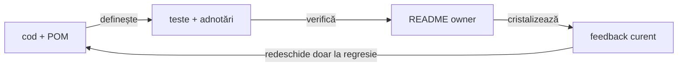

# ATF Java — registrul curent de feedback

## Overall

- feedback-ul păstrează numai riscuri, limite sau decizii care se pot schimba;
- fiecare ToDo are owner, dovadă lipsă și criteriu de închidere;
- regula stabilă se mută în README-ul ownerului;
- analiza datată fără acțiune și artifactele generate nu sunt documentație
  permanentă;
- un run verde nu închide un ToDo fără dovadă relevantă.

## Regula de reconciliere cu codul live

<strong>Legendă — ordinea dovezii</strong>

- codul și POM-ul stabilesc modulele, dependențele și boundary-ul real;
- testele și adnotările stabilesc comportamentul verificat și nivelul lui;
- configurația stabilește inputul plug-and-play, nu capability-uri inexistente;
- README-ul explică regula stabilă și ownerul;
- feedback-ul păstrează limita, criteriul și dovada lipsă;
- artifactul este evidence de run, nu sursă normativă.

## Verdict whole-ATF

| Zonă | Verdict | Owner / dovadă |
|---|---|---|
| `atf-reporting` production | ✅ standalone | POM parentless, dependency guard |
| reporting tests | ✅ consumer separat | `atf-reporting-tests` și matrix lower-level |
| Practice Shop | ✅ consumer separat | `atf-test-practice-shop` |
| whole-reactor governance | ✅ ownership separat, gate verde | `atf-tests`; boundary-urile production/test și lizibilitatea sunt verificate fără prag relaxat |
| documentație | ✅ guvernată | diagram, prose, structure, style și target guards |
| `atf-execution` | ✅ eliminat | mecanica generică este în `atf-core` |

## Gate-uri curente

| Gate | Rezultat | Interpretare |
|---|---|---|
| documentation governance | ✅ PASS | structura, prose, stil, target și diagrame sunt conforme |
| `atf-console` focused gate | ✅ PASS | bridge-ul are test component și round-trip-ul vocabularului este verificat |
| whole-ATF governance | ✅ PASS | `AtfPackageCohesionGovernanceTest` confirmă maximum 8 clase pe pachet după split-urile `ui.network`, `support.api` și `support.config.environment`; `AtfSourceReadabilityGovernanceTest` confirmă importuri normale |
| reporting consumer gate | ✅ PASS | publisher-ul, renderer-ele Extent/fallback și retry-ul per exchange trec; fresh MCP/Chromium confirmă un singur checkpoint Gherkin cu `UI validation` și `API validation` ca copii frați, iar exchange-urile rămân nested și unice |
| reporting în staging exclusiv | ✅ PASS | rulare inițială și rerun incremental: fiecare 530 teste, 0 failure/error, 3 skip-uri; artifactele UI/API au proof browser separat |
| shared scroll-table geometry | ✅ PASS | toate tabelele scrollabile folosesc tokenul unic `AtfReportThemeTokens.TABLE_SCROLL_HEIGHT` / `--atf-table-scroll-height`, egal cu viewport-ul `System/Environment`; guard-urile Extent/fallback acoperă Overview, tag audit, action, audit, assertion și API/UI evidence |

Eșecurile de classloading din checkout-ul partajat au coincis cu build-uri
Maven concurente pe același `target`. Același reactor a trecut de două ori,
inclusiv incremental, într-un staging exclusiv; `REP-BUILD-02` este închis ca
finding de execuție, iar regula anti-coliziune este în
[`ATF_Build_And_Execution_Safety.md`](../ATF_Build_And_Execution_Safety.md).

### Finding reparat în registrul feedback

`WARNING` rămâne un statut distinct și auditabil, dar este inclus în totalul
pass-like al Overview (`Tests Passed`, cardurile `Tests`/`Steps` și procentele
lor). În acest fel, un diagnostic warning nu mai produce `0 tests` într-un run
fără failure.

Verificarea și dovada rămân separate:

- graficele, categoriile, badge-ul și linia `warnings` păstrează semnalul
  original;
- `ExtentReportInteractionContractTest` protejează contractul;
- rerunul E2E a confirmat `Tests Passed = 1`, `Tests Failed = 0`, `1 test
  classes passed`, `1 steps passed`, `1 warnings` în Overview/Categories și
  `No failed tests.` în Fails;
- `SETUP`/`TEST BODY`, `UI validation`/`API validation`, request/response JSON
  pretty, `LIVE / HTTP`, `scrollWidth <= clientWidth` și zero `
` au fost
  verificate manual pe același artifact.

## ToDo active

| Prioritate | ID | Owner | Limită | Criteriu de închidere |
|---|---|---|---|---|
| P0 | `SHOP-API-REAL-01` | Practice Shop + mediu extern | fixture placeholder și `authenticatedE2eEnabled=false`; authenticated tests sunt skip | fixture non-placeholder, flag activ, login/current-user `200`, apoi journey live complet |
| P2 | `UI-NET-11` | `atf-ui` + consumer adapters | mutation retry rămâne intenționat design-only până la identity/payload proof; request-failed și aliasul consumer sunt închise | identity/payload proof pentru retry activ, fără replay implicit |
| P3 | `TEST-ARCH-07` | `atf-tests` | suportul poate avea subzone greu de navigat | mutare numai cu owner, motiv și boundary test |

`REP-BUILD-02`, `UI-NET-17`, `REP-CAPTURE-01`, `REP-UX-TABLE-01`, `REP-UX-PERF-01`, `REP-UX-PERF-02` și
`REP-EVID-08-STRESS`, `REP-NET-07`, `REP-UX-TABLE-02` și `REP-UX-TABLE-03` sunt închise și rămân în istoricul de închideri din
`ATF_Reporting_Feedback.md`. Diagnosticul de performanță rămâne separat de
verdictul business; se redeschide doar la o regresie verificată a gate-ului.

### Dovadă exploratorie recentă — trace composition și toggle stability

Pe artifacte fresh generate de testul configurabil au fost parcurse manual în
MCP/Chromium testul selectat, `TEST BODY`, `Screen validation`, request/response
evidence și `Execution evidence`. Se vede un singur card Gherkin, pașii de UI
și API rămân separați semantic, exchange-urile sunt nested și JSON-ul este
pretty. Auditul DOM standard și responsive a confirmat `scrollWidth <=
clientWidth`, zero `
` și zero diagnostice browser; numele artifactelor nu
este păstrat în documentație.

Acest proof închide `REP-TRACE-03` și `REP-UX-TOGGLE-01`. Contractele
component/interaction verifică helper-ul comun, iar MCP confirmă manual pe
artifactul fresh secvența `open → delayed normalize → close → reopen`: scenariul,
phase/request/validation, `aria-expanded`, glyph-ul și panourile rămân coerente;
copiii sunt închiși până la un click explicit.

### Reaudit live — delimitarea evidence-ului UI/API

Reauditul manual al run-ului curent păstrează două dovezi distincte:

| Suprafață | Ce s-a verificat | Interpretare |
|---|---|---|
| UI guest E2E | `TEST BODY` → `GIVEN product page` → `API validation` → `GET /products/search — Exchange 1` → `Request details` / `Response details` / `Execution evidence`; request JSON pretty, response JSON pretty, `HTTP 200`, `LIVE / HTTP` | dovadă reală client–server, legată de checkpoint-ul UI care a cauzat schimbul |
| API component | `POST /carts — create cart`, request/response JSON și technical trace, cu `ACCEPTANCE / MOCK — network was not executed` | contract component determinist; nu este dovadă de business journey live și nu poate înlocui `LIVE_HTTP` |
| Overview / Categories / Fails | System/Environment și Tags sunt populate; categoria raportează warning-ul guest; `Fails` spune explicit `No failed tests` | warning-ul diagnostic nu este reinterpretat ca failure și rămâne vizibil în raport |

Observația semantică găsită în acest audit a fost reparată: `Precondition`
rămâne precondiția API configurată, iar `UI journey precondition` descrie
separat journey-ul efectiv (`guest checkout configuration ready` sau fixture-ul
authenticated). Astfel un run guest nu mai pare authenticated doar pentru că
configurația API are precondiția `authenticated`.

La lățimea MCP implicită și la viewport-ul responsive configurat, verificarea
structurală confirmă `scrollWidth <= clientWidth`, zero `
`/separatoare și
zero console/page/request diagnostics. Viewport-ul este furnizat prin configurație;
nu se hardcodează în feedback și nu se păstrează un raport generat ca exemplu.

## Închideri care nu mai sunt active

<strong>Istoric de închideri — dovezi, nu ToDo-uri active</strong>

| Grup | Dovadă stabilă |
|---|---|
| `TRACE-REQ-01..10` | `ReportTraceMetadata`, `ReportRequestSignature` și testele de trace |
| `REP-EVID-01..07` | policy/profile/session, mock evidence și normalizare idempotentă |
| `REP-AUDIT-08` | snapshot renderer-neutral și validatorii puri |
| `REP-COVERAGE-08` | `ReportingCoverageMatrixTest` |
| `REP-E2E-08` | `E2eSuiteBudgetArchitectureTest`, plafon 8 |
| `REP-FORMAT-01` | source multiline versus publication compactată |
| `REP-SIZE-01` | `ReportAssetSizeBudget` și `ReportAssetSizeInventoryTest`; baseline explicit pentru asset bundle-ul CSS/JavaScript |
| `REP-EVID-08-STRESS` | ✅ închis: `SelectedApiTestsReportUiTest`, `UiReportStyleValidator`, `ReportAuditContext` și `ReportRuntimePerformanceBrowserProbe` verifică minimum șase semnături la standard+narrow, expandări controlate, evidence JSON, glyph inline și overflow/diagnostics |
| `REP-NET-07`, `REP-UX-TABLE-02` | ✅ închise: component CSS/markup proof și MCP fresh pe Practice Shop confirmă inspectorul nested, summary-uri 2×, collapsed implicit, viewport vertical bounded, header sticky, screenshot în afara viewport-ului action și zero duplicate/overflow |
| `REP-CONSUMER-01` | ✅ închis: `ReportEnvironmentSnapshot` per run și `ReportTraceMetadata` per exchange sunt contracte typed publice; `ReportTraceMetadataRenderingTest` verifică un consumer sintetic, System allowlist și redaction |
| `REP-VOCAB-01` | `AtfReportHtmlVocabulary` și contractele de markup; tokenii production sunt typed, iar `toggleView` este seam vendor explicit |
| `REP-BODY-01` | `ReportingSettings`, `ExtentReportNodeSupport` și testele formatter/config/Extent/HTML; default `100`, `0` dezactivează limita, marker `first N of TOTAL` |
| `REP-LOCATOR-01` | `ReportUiLocatorsTest` și ports din `support/locators`; fațada este compatibilitate publică, iar ownership-ul selectorilor este vertical/coeziv |
| `REP-ASSET-08` | manifest, owner, format, ordine și namespace |
| `REP-BUILD-01` | standalone discovery allowlist-uit |
| `REP-BUILD-02` | două rulări `mvn -o -pl atf-reporting-tests -am test` în staging exclusiv, inclusiv incremental, au trecut cu 530/0/0/3; coliziunea pe `target` din checkout-ul partajat nu este defect de reporting |
| `REP-BOUNDARY-01` | architecture ownership și POM guards |
| `CORE-FILES-01` | `atf-core.files.AtfPathLocator.locateModuleRoot`, `AtfFileTree.regularFiles`, `AtfPathLocatorTest`, `AtfFileTreeTest` și `PracticeShopArchitectureTest`; consumerul nu mai reimplementează root discovery sau file traversal |
| `SHOP-API-SCREEN-01..10` | screen flows, journal, assertions și evidence mapper |
| `SHOP-CONFIG-02`, `SHOP-ROUTE-04..05` | host și rute relative; output UI/API separat în `artifacts/reports/ui` și `artifacts/reports/api` |
| `SHOP-UI-VALIDATION-01..04` | page contracts și validator component |
| `SHOP-MIX-01..03` | `UiPhaseLifecycle` + guest E2E proof: selecția, ordinea cauzală și forma single-node sunt verificate; checkpoint-ul are `UI validation` + `API validation` în același nod |
| `SHOP-AUTH-01..07` | registration, fixture loading, login și authenticated purchase implementate; live proof pending până la fixture non-placeholder |
| `SHOP-ARCH-11..13` | runtime/main versus test-only support |
| `SHOP-REPORT-FAILURE-01` | failure projection în `Fails` |
| `SHOP-CONSOLE-01` | sink configurat injectat la composition root |
| `SHOP-CONSOLE-02` | `atf-reporting-tests/.../AtfConsoleBridgeTest`; adapter test-only, fără mapping în Practice Shop sau dependency production inversă |
| `SHOP-API-REAL-02` | guest live product/cart/payment assertions și Payment success verificate prin `LIVE_HTTP`; authenticated standalone rămâne separat în `SHOP-API-REAL-01` |
| `SHOP-API-TRACE-01` | screen flow + network journal: request/response, status, transport, retry, trace și signature rămân legate de checkpoint-ul care le-a cauzat; ordinea de prezentare este verificată prin `UI validation → API validation → Exchange` |
| `SHOP-NET-03` | `UiNetworkInspector`, `PracticeShopUiNetworkSettlementFixture`, `PracticeShopUiNetworkSettlementComponentTest` și `UiNetworkInspectionConfigurationTest` — compactare consecutivă, read-back bounded și timeout fără replay |
| `UI-NET-15/16/17` | `UiNetworkInspector`, `UiNetworkObservation`, `UiNetworkInspectionConfigurationTest`, `PracticeShopApiNetworkJournalTest` și `ReportTraceMetadata` — request-failed explicit, alias injectat doar la adapter și custom capture resanitizat înainte de storage/subscriber |
| `REP-CAPTURE-01` | `ReportEvidenceProfileTest`, `ReportEvidenceProfileIntegrationTest`, `PracticeShopScreenshotPolicyTest`, `PracticeShopBrowserCaptureProviderTest`, `PracticeShopReportSystemMetadataTest` și guest E2E/MCP — provider browser typed reutilizat, policy filtrată înainte de captură, provenance verificată, iar Overview și capturile inline reflectă aceeași policy efectivă |
| `REP-RENDER-09`, `REP-MODEL-01`, `REP-TEST-08`, `REP-OVERVIEW-02` | `ReportRendererParityTest`, `AtfReportSemanticSnapshotTest`, `ReportingCoverageMatrixTest`, `ReportEnvironmentSnapshotTest` și guard-urile existente; parity, lifecycle guards, matrix proof și System allowlist sunt verificate |
| `REP-NET-03`, `REP-AUTH-02`, `REP-DIAGNOSTIC-02`, `REP-DIAGNOSTIC-04` | `JourneyAggregate` și `ReportNetworkInspectorTest`; modelul semantic are authentication/correlation/transport/signatures/diagnostics, auth este method/source/status/count, response+console corelate se deduplicatează cu count/sources, iar semnalele necorelate distincte folosesc identity internă exactă și token-uri bounded `UNBOUND-n` |
| `REP-NET-04` | `ReportNetworkAggregateMarkup`, `ReportNetworkInspectorTest`, `HtmlReportViewsTest` și guest E2E — inspector collapsed cu cinci secțiuni nested, fără câmpuri aggregate flat |
| `REP-TRACE-03` | `ExtentReportUiEvidencePublishingTest`, `HtmlReportViewsTest`, `ExtentReportInteractionContractTest` și guest E2E — un singur checkpoint Gherkin cu copii UI/API, exchange unic și retry în `Execution evidence` |
| `REP-STYLE-01` | `ExtentReportRuntimeScriptTest`, `AtfReportThemeTokensTest` și publisher tests — accent tehnic comun, fără schimbarea statusurilor semantice |
| `REP-UX-TOGGLE-01` | `setDisclosureState`, component/interaction tests — panel, flag, `aria-expanded` și glyph sincronizate la close/reopen |
| `REP-EVID-08` | `AtfReportMarkup`, `evidence-table.css`, HTML/interaction tests — URL complet cu wrapping controlat, fără overflow |
| `REP-TRACE-04` | `ReportRequestSignature`, trace/asset tests — digest și fingerprint interne; HTML-ul public arată numai markeri bounded și linkuri locale |
| `SHOP-REPORT-NET-02`, `SHOP-REPORT-AUTH-02`, `SHOP-DIAGNOSTIC-02` | Practice Shop consumă aggregate-ul generic; binding-ul și dovada de consumer sunt separate de renderer, fără JSON duplicat și fără credentiale în sumar |
| `REP-API-BIND-01`, `SHOP-API-BIND-01` | `PracticeShopApiCheckpoint`, `PracticeShopApiEvidenceBindingTest`, YAML și override — selecție typed/fail-closed, numai evidence selectat |
| `REP-TRACE-02`, `SHOP-API-TRACE-02` | UI API trace-ul reutilizează vocabularul, redaction policy, filtrarea browser noise, replay-ul redacted și execution evidence ale raportului API; titlul este pasul Gherkin exact, fără prefix URL/`API trace ·`; parity-ul per exchange și atașarea single-node sunt închise |
| `SHOP-REPORT-SYSTEM-01` | `PracticeShopReportSystemMetadataTest` + MCP/Chromium proof: Overview/System păstrează configurația bounded/redacted și separă explicit precondiția API configurată de precondiția journey-ului UI |
| `SHOP-REPORT-SYSTEM-02` | `PracticeShopReportSystemMetadata` + component test: `Overview/System` publică numai configurație operațională allowlist-uită; nu publică `Suite`, `Test package`, `Flow`, `Fixture` sau `Checkout`, iar duratele sunt umane (`20s`, `45s`) |

| `SHOP-E2E-ROOT-01` | `PracticeShopTestSupport.openE2e()` și `E2eHarness` centralizează configurația, contextul și locatorii; testele E2E rămân compoziții business scurte |
| `SHOP-E2E-ISOLATION-01` | cele trei E2E folosesc `BeforeEach/AfterEach`, fără `PER_CLASS`/`BeforeAll`; `PracticeShopArchitectureTest` verifică izolarea contextului per test |
| `SHOP-HTML-CONTRACT-01` | `PracticeShopReportHtmlTestSupport` verifică semantic text, celule exacte, ordine și absență; contractele report nu mai depind de un singur `html.contains(...)` pentru fiecare regulă |
| `SHOP-TEST-LIFECYCLE-01` | `PracticeShopApiClient implements AutoCloseable`, close-ul curăță bearer state și respinge utilizarea ulterioară; integration tests folosesc try-with-resources |
| `SHOP-TEST-DSL-01` | `PracticeShopTestSupport` oferă adnotări/condiții typed pentru authenticated fixture și live API; gating-ul nu mai este copiat prin metode locale `isConfigured()` |
| `SHOP-REPORT-NET-01` | `ReportNetworkInspectorTest` + contract de publisher: inspector collapsed cu index bounded și aggregate typed; `Response details` nu copiază request-uri, response-uri sau propoziții Gherkin, `Scenario correlation` păstrează relația cu pașii, iar `Unique request signatures` păstrează method/route/status/count și metadate redacted; body-ul și attempt history rămân în evidence canonicală locală |
| `SHOP-TEST-TRUST-01` | `PracticeShopPageValidator`, valori DOM observate, `PracticeShopPaymentPage`, testul negativ pentru login fără `current-user` și guard-ul `PracticeShopArchitectureTest` acoperă E2E plus flow/evidence support; verdicturile literal-`true` din journey și setup au fost eliminate |
| `REP-AUTH-01`, `SHOP-REPORT-AUTH-01` | `ReportAuthMethod`, `ReportAuthObservation`, `ReportNetworkInspectorTest` și publisher integration: taxonomy typed per exchange și aggregate method/source/status/count, cu valorile credential excluse |
| `REP-NET-02`, `REP-RETRY-01` | `ReportNetworkInspector`, `UiRetryPolicy`, `UiRetryOperation`, action/config/render tests; primitivele sunt renderer-neutral, aggregate-ul este namespaced și retry-ul rămâne fail-closed |
| `SHOP-NET-02` | `Scenario.warning` + `publishDiagnostic` + aggregate inspector: facts guest sunt typed (`GET /users/me → 401`), warning-ul este `Runtime diagnostic`, iar response/console sunt agregate cu count/sources |
| `SHOP-DIAGNOSTIC-03` | `Scenario.warningDiagnostics`, `PracticeShopRuntimeDiagnosticsTest` și guest E2E — o assertion per semnătură, count/sources, fără duplicate response/console |
| `REP-DIAGNOSTIC-01`, `REP-DIAGNOSTIC-02`, `REP-DIAGNOSTIC-04`, `REP-TRACE-01` | `UiEvidencePublisher.publishDiagnostic`, `UiPhaseLifecycle.apiTrace`, `ReportNetworkInspectorTest` și consumer proof; boundary-ul semantic, ordinea cauzală, dedupe-ul aggregate și tokenizarea bounded a semnalelor necorelate sunt închise |
| `SHOP-DIAGNOSTIC-SEMANTICS-01`, `SHOP-TRACE-INTERLEAVE-01` | warning semantic și ordinea cauzală UI/API sunt verificate component/integration/E2E; compoziția single-node este închisă prin `UI validation` + `API validation` sub același checkpoint |
| `REP-CONSOLE-01` | `atf-reporting-tests/.../AtfConsoleBridgeTest`; round-trip pentru toate statusurile și porturile production independente |
| `REP-SUITE-01` | `AtfReportingUnitSuite`, `AtfReportingComponentSuite`, `AtfReportingIntegrationSuite`, `AtfReportingApiFixtureSuite`, `AtfReportingUiAuditSuite` și `ReportingCoverageMatrixTest`; fiecare layer are launcher IntelliJ/Maven distinct, package/tag explicit și plafon E2E păstrat |
| `GOV-PACKAGE-08` | `AtfPackageCohesionGovernanceTest` — maximum 8 clase pe pachet după split-uri coezive, fără relaxarea pragului |
| `TEST-READ-01` | `AtfSourceReadabilityGovernanceTest` și `ExtentReportSessionContractTest` — importuri normale și guard whole-ATF |
| `DOC-READ-01`, `DOC-READ-02` | digestie vizuală și documente owner refăcute |
| `DOC-DIAG-01..05` | forme, orientări, legende și guard-uri de diagramă |
| `ROOT-README-01..04` | root baseline stabil și protejat |

## Ownership-ul documentației

| Contract | Document normativ |
|---|---|
| module și reactor | [`docs/ATF_Architecture.md`](../ATF_Architecture.md) |
| reporting standalone | [`atf-reporting/README.md`](../../atf-reporting/README.md) |
| reporting tests | [`atf-reporting-tests/README.md`](../../atf-reporting-tests/README.md) |
| Practice Shop | [`atf-test-practice-shop/README.md`](../../atf-test-practice-shop/README.md) |
| whole-ATF governance | [`atf-tests/README.md`](../../atf-tests/README.md) |
| reporting contract | [`docs/ATF_Reporting_Contract.md`](../ATF_Reporting_Contract.md) |
| code and test best practices | [`docs/README_Atf_CodeBestPractices.md`](../README_Atf_CodeBestPractices.md) |
| documentation best practices | [`docs/README_Atf_DocumentationBestPractices.md`](../README_Atf_DocumentationBestPractices.md) |
| build and sync | [`docs/ATF_Build_And_Execution_Safety.md`](../ATF_Build_And_Execution_Safety.md) |

## Protocol de închidere

<strong>Checklist pentru orice schimbare</strong>

- [ ] codul live și POM-ul confirmă ownerul real;
- [ ] testul focalizat reproduce comportamentul la nivelul potrivit;
- [ ] guard-ul relevant trece: module, architecture, documentation sau coverage;
- [ ] dacă se schimbă HTML/CSS/JavaScript, artifactul este fresh și verificat
      prin adapter static sau MCP/Chromium;
- [ ] statusul curent este actualizat, fără secțiune datată nouă;
- [ ] regula stabilă este mutată în README-ul ownerului;
- [ ] feedback-ul păstrează numai limita și criteriul de redeschidere;
- [ ] nu se păstrează nume de artifact, path local, timestamp sau secret.

## Regula de redeschidere

Un item se redeschide numai pentru:

- regresie reproductibilă;
- schimbare de ownership sau dependency boundary;
- consumer nou care nu este acoperit de contract;
- input/configurație nouă;
- schimbare de contract public.

Un screenshot, un timestamp, o eroare de runner izolată sau o schimbare locală
de stil nu redeschide singur un item închis.
