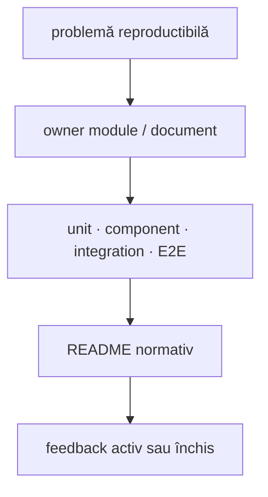

# ATF Java — registru de feedback activ

## Overall

Acest director păstrează numai riscuri sau decizii care mai pot schimba codul,
testele ori contractele publice. Un ToDo este activ numai dacă are owner,
reproducere, criteriu de acceptare și nivel de test. Regulile deja implementate
se mută în README-ul ownerului; analizele datate fără acțiune se arhivează în
afara proiectului.

În checkout rămân intenționat registrul și feedback-urile care au ToDo-uri
reproductibile. Pentru consumerul Practice Shop, piramida API/UI este urmărită în
[`ATF_Practice_Shop_API_Screen_Pyramid_Feedback.md`](ATF_Practice_Shop_API_Screen_Pyramid_Feedback.md).
Boundary-ul standalone al
`atf-reporting` este deja documentat de owner și nu are un feedback duplicat.
Contractul transversal pentru semnături request, precondiții dinamice și
intercalarea API cu pașii UI este urmărit în
[`ATF_Request_Traceability_Feedback.md`](ATF_Request_Traceability_Feedback.md).
Nu se creează câte un fișier
pentru fiecare rulare sau captură; un raport HTML este dovadă de execuție, nu
documentație permanentă.

## Reconcilierea cu codul live

Aceasta este regula de lucru pentru orice feedback, nu un contract de produs:
un TODO se închide numai după ce implementarea live, testul relevant și README-ul
ownerului descriu aceeași realitate.

<strong>Ordinea dovezii și criteriul de închidere</strong>

1. **Cod și POM** — confirmă modulele, dependențele, package-urile și boundary-ul
   public real;
2. **Teste și adnotări** — confirmă comportamentul verificat și stratul în care
   este verificat;
3. **Configurația runtime** — confirmă inputul configurabil, fără a transforma
   un exemplu de run într-un contract permanent;
4. **README-urile de owner** — explică responsabilitatea și modul de utilizare,
   dar nu pot inventa clase, căi sau capability-uri absente din cod;
5. **Feedback-ul activ** — păstrează TODO-ul, ownerul, criteriul de închidere și
   dovada lipsă; nu poate înlocui codul sau testul care îl dovedește;
6. **Rapoartele generate** — sunt evidence pentru un run și nu devin referințe
   normative în documentație.

Dacă doar documentația a fost actualizată, TODO-ul rămâne deschis. Când
implementarea este stabilă, regula permanentă se mută în README-ul ownerului,
iar feedback-ul păstrează numai limita rămasă, criteriul de redeschidere și
dovada relevantă.

<strong>Legendă — cum se închide un feedback</strong>

- problema trebuie să fie reproductibilă și să aibă owner explicit;
- testul potrivit verifică implementarea la nivel unit, component, integration sau E2E;
- regula stabilă se mută în README-ul ownerului, iar registrul păstrează numai limita și dovada;
- un raport generat rămâne evidence de run, nu devine documentație permanentă.

## Verdict arhitectural curent

| Zonă | Verdict | Dovadă / owner |
|---|---|---|
| `atf-reporting` production | ✅ standalone | POM parentless, zero module ATF, `ReportingStandaloneDependencyTest` |
| reporting unit/component | ✅ închis | teste pure în `atf-reporting/src/test` și contracte component în consumer |
| API/integration pentru reporting | ✅ consumator separat | `atf-reporting-tests/src/test`, mock + core + validation + fixtures API test-local |
| UI/E2E reporting | ✅ consumator separat | `atf.ui.tests.extent.e2e`, ATF Debug + Chromium/Playwright MCP |
| aplicații consumatoare | ✅ separat | Practice Shop este în `atf-test-practice-shop`; `atf-tests` rămâne governance-only |
| whole-reactor governance | ✅ separat | `atf-tests` și `AtfModuleIds` din `atf-core` |
| `atf-execution` | ✅ eliminat | mecanica generică în `atf-core`; rutele, serviciile și bootstrap-ul concrete sunt fixture-uri în `atf-reporting-tests` |

Distribuția se verifică reproducibil prin `mvn -f atf-reporting/pom.xml test`,
`mvn package -DskipTests` și printr-un consumer extern compilat numai cu JAR-ul
produs. Rezultatele unui run nu sunt documentație permanentă și nu se păstrează
în acest registru. Decizia de packaging este JAR Maven normal cu vendorii
declarați explicit; nu există motiv pentru shaded JAR în acest moment.

`atf-reporting` este librăria. `atf-reporting-tests` este un consumer/reference
composition root care dovedește API și E2E fără să contamineze librăria cu mock,
browser sau fixture-uri ale unei aplicații. `atf-test-practice-shop` este
composition root-ul pentru aplicația Practice Shop, iar `atf-tests` este numai
composition root-ul guvernanței whole-ATF. Aceasta este separarea necesară pentru
un viitor framework care va folosi reporting ca dependency.

## ToDo active, ordonate după impact și risc

| Prioritate | Owner | ToDo | Criteriu de închidere |
|---|---|---|---|
| P1 | `atf-test-practice-shop` | `SHOP-INT-01`: elimină ambiguitatea `productPath`; catalog search trebuie să fie sursa de adevăr și să se verifice propagarea `productId` până în detail și cart | ✅ închis pentru boundary-ul local: `PracticeShopCatalogApi` descoperă ID-ul din search, iar component flow verifică propagarea; integrarea live rămâne opt-in |
| P1 | `atf-test-practice-shop` | `SHOP-INT-02`: contract checks pentru `products/search`, product detail, cart create/add/read și payment, cu request JSON, response JSON, headers, status și content-type | ✅ închis pentru component matrix: transport fake acoperă 401/404/2xx, JSON și payment variants; evidence Extent standalone rămâne `SHOP-API-SCREEN-06` |
| P1 | `atf-test-practice-shop` | `SHOP-INT-04`: tratează `/users/me` 401 ca ramură guest explicită și elimină/izolează `TypeError: null.cart_items` observat repetat în console | test de component/integration pentru guest resilience; doar erorile runtime neașteptate eșuează, iar happy path rămâne verde fără TypeError |
| P1 | `atf-reporting` boundary | `REP-BOUNDARY-01`: elimină dependențele directe test-scope către `atf-reporting` din `atf-tests` și `atf-test-practice-shop`; `atf-reporting-tests` rămâne singurul consumer canonical | POM-urile și importurile live arată `atf-reporting` doar în `atf-reporting-tests`; adaptoarele de reporting sunt mutate sau eliminate fără a contamina production și fără ștergeri speculative |
| P0 | `atf-ui` + `atf-reporting` | `TRACE-REQ-01..04`: event ledger, request signature canonicală, intercalare UI/API și corelare explicită a exchange-ului cu pasul UI | fiecare exchange are `EventId`, sequence, phase, role, correlation și body digest; POST/PUT cu body diferit nu se unesc; artifactul ordonat rămâne lossless |
| P1 | `atf-ui` + consumerii UI | `TRACE-REQ-05..08`: precondiții dinamice typed, logical exchange versus retry, output consumat de UI și assertions API distincte de body display | setup-ul publică input/output/read-back; pasul UI indică exchange-urile cauzate; retry-ul nu falsifică signature count; expected/observed/result sunt verificabile |
| P2 | `atf-reporting-tests` | `TRACE-REQ-09..10`: projection compactă și manual replay al raportului | component/integration/E2E verifică disclosure-urile, artifact manifest, overflow și fluxul SETUP → UI → API → validation → CLEANUP prin ATF Debug/Chromium MCP |
| P2 | `atf-test-practice-shop` | `SHOP-INT-05`: clarifică dacă `postcode-lookup` este advisory sau autoritativ, deoarece răspunsul demo nu coincide cu adresa introdusă | contractul este scris în README și testul verifică fie popularea valorilor din lookup, fie păstrarea explicită a valorilor introduse |
| P2 | `atf-test-practice-shop` | `SHOP-INT-06`: acoperă rapid prin component/integration sort/filter/category, out-of-stock, cart update/remove și invalid guest/billing/payment; păstrează un singur E2E lung | matricea de test are boundary owner și nu duplică același flow UI; un al doilea E2E se adaugă numai după stabilizarea contractelor API |
| P2 | `atf-reporting` | `REP-ASSET-07`: audit final al vocabularului/builder-ului CSS și al seam-urilor mici de publicare Java; nu reintroduce corpuri JS/CSS mari în facade-uri | `ScenarioCss`/`CssBuilder` rămân builders typed mici sau sunt mutate numai dacă există duplicare observabilă; `HtmlReportNavigationScript` și boot-ul Extent rămân fațade peste asset-uri native; testele de asset/component și raportul fresh păstrează paritatea |
| P3 | structura testelor | `TEST-ARCH-07`: gruparea semantică a support-ului fără ștergeri speculative | fiecare mutare are owner, motiv observabil, test de boundary și zero ștergeri speculative; detaliile sunt în [`ATF_Test_Architecture_Feedback.md`](ATF_Test_Architecture_Feedback.md) |
| P2 | documentație și guvernanță | `DOC-DIAG-01` (redeschis): revizuiește strict secțiunea `## Diagramă de bază`; overview-ul principal trebuie să fie orizontal, schematic și urmat imediat de o singură legendă colapsată | `README.md` păstrează conținutul agreat; se schimbă numai forma diagramei dacă este necesar, fără rescrierea overview-ului; guard-ul verifică `LR`, legendă imediată și lipsa textului explicativ redundant |

### Observație de explorare live — nu este încă închisă

`SHOP-NET-01` rămâne o observație exploratorie: network capture-ul a evidențiat
request-uri guest către `/users/me` și un posibil `null.cart_items`. Capturile
brute sunt externe proiectului și nu sunt referințe normative. Observația
alimentează `SHOP-INT-01..06`; nu se marchează drept
rezolvată până când contractele și testele aferente există în modul.

`SHOP-MIX-01`, `SHOP-MIX-02` și `SHOP-MIX-03` sunt închise în zona Practice
Shop: `PracticeShopApiNetworkJournal`, profilul typed și overload-ul flow-ului
publică evidence API în checkpoint-ul UI, fără teste E2E suplimentare. Fiecare
exchange păstrează request JSON, response JSON, headers, auth type, status,
transport și execution evidence în disclosure-uri închise implicit. Sunt
verificate prin component test și purchase E2E; rămâne de urmărit separat
`SHOP-INT-04`, deoarece cere reziliență explicită pentru guest și rezolvarea
erorii runtime `null.cart_items`.

`SHOP-API-SCREEN-01..05` sunt închise: runtime-ul reutilizabil este în
`src/main/java/atf/ui/practiceshop`, testele sunt separate în
`component`, `api/component`, `api/integration` și `e2e`, iar login-ul API este
precondiție reutilizabilă pentru screen flow. Rămân numai
`SHOP-API-SCREEN-06` (raport API dedicat pentru component matrix),
`SHOP-API-SCREEN-07` (fixture de cont live opt-in), `SHOP-API-SCREEN-08`
(validare configurabilă name/path) și `SHOP-API-SCREEN-09` (variații
catalog/cart).

`SHOP-MODULE-01` este închis: modulul există în root POM, sursele și YAML-ul
au fost mutate, iar `atf-tests`/`atf-reporting-tests` nu mai conțin cod de
Practice Shop. Guard-ul whole-reactor și build-ul extern au trecut. Component
tests acoperă config/checkout/locator boundary, `PracticeShopPurchaseE2eTest`
acoperă guest purchase până la confirmarea reală de payment, iar
`PracticeShopAccountAndCatalogE2eTest` rămâne condiționat de configurația externă
de cont, fără a face guest journey-ul dependent de credențiale.

`EXEC-COLLAPSE-01` este închis: modulul concret `atf-execution` nu mai există;
executorul, lifecycle-ul și cleanup-ul generic sunt în `atf-core`, iar
`ApiModule`, rutele, modelele și serviciile concrete rămân în test scope-ul
`atf-reporting-tests`. Dovada se reface prin architecture guard și prin gate-ul
extern; staging-ul este doar un spațiu de lucru și nu este documentație.

`REP-01` și `REP-02` sunt închise: contractul stabil este documentat în README-ul
`atf-reporting`, iar verificarea se reface prin protocolul de build și browser gate.

### Sincronizare staging → live

Regula normativă este în
[`docs/ATF_Build_And_Execution_Safety.md`](../ATF_Build_And_Execution_Safety.md):
staging-ul nu este sursă autoritară și nu justifică undo sau ștergeri implicite.
La revenirea în live se promovează numai fișierele aprobate, după recitirea
versiunii live și reconcilierea modificărilor paralele; conflictele blochează
doar fișierul conflictual și devin ToDo auditabil.

## Închideri tehnice recente

<strong>Deschide închiderile și dovezile tehnice</strong>

| Item | Rezultat | Dovadă |
|---|---|---|
| `LOC-03` | ✅ eliminat busy-polling-ul `waitForTimeout` din runtime-ul UI | `PlaywrightBrowserActions` folosește `Page.waitForCondition`; se verifică prin gate-ul testelor modulului |
| `REP-CSS-01` | ✅ action/validation tables responsive fără celule flex care rup layout-ul, fără margine laterală care lărgește wrapperul și cu `ACTUAL`/`RESULT` lizibile | `AtfReportEvidenceCssTest`; gate-ul browser verifică viewport-ul contractual, overflow 0, antetele assertions pe un singur rând și randarea vizuală |
| `REP-CSS-02` | ✅ tabelul de assertions își recalibrează dinamic coloanele după cele mai lungi valori reale; `ACTUAL` nu mai este strangulat de o lățime statică, iar `RESULT` rămâne compact | `ExtentReportRuntimeEvidenceTableLayout` + `ValidationTableLayoutInspector`; verificare component și E2E pe markup-ul rezultat |
| `REP-UI-SEQ-01` | ✅ delimitatorul numeric al fiecărei acțiuni/observații este token compact `#n`, cu lățime naturală; nu mai reutilizează containerul colapsabil și acoperă inclusiv indici cu două cifre | `ExtentReportUiEvidenceRenderingTest` (`#1`, `#27`) + `AtfReportEvidenceCssTest` (`inline-block`, `max-content`, `nowrap`, `vertical-align`) |
| `REP-HTML-01` | ✅ titlu `ATF Report`, tags lowercase și link Base64 inline păstrate | raport UI explorat manual prin Chromium/Playwright MCP |
| `REP-UI-LOC-ATTR-01` | ✅ locatorii UI contractuali folosesc forma explicită `element[attribute=value]`; clasele folosesc `class~=`, id-urile și atributele `data-atf-*` sunt centralizate, iar shorthand-ul `.class` rămâne numai în CSS | `ReportUiLocatorsTest` + `UiSelectorBoundaryArchitectureTest`; artifact UI fresh verificat prin browser MCP pe `Tests` și `Fails` |
| `REP-UI-LOC-ATTR-02` | ✅ validarea valorilor dinamice pentru selectori este centralizată și nu recompilă regex-ul pentru fiecare locator; `ReportEvidenceLocators` și `ReportCategoryLocators` reutilizează același seam | `ReportLocatorSupport.SAFE_ATTRIBUTE` cu `Pattern` compilat o singură dată; auditul full gate nu mai consumă CPU în compilări repetitive în timpul navigării failure |
| `REP-ASSET-02` | ✅ CSS-ul de evidence este asset nativ, cu owner semantic și facade Java stabilă | `ReportAsset` + `ReportAssetLoader` + `ReportAssetComposer`; `ReportAssetContractTest` și `AtfReportEvidenceCssTest` |
| `REP-ASSET-03` | ✅ Tests filters folosesc corp JavaScript nativ, placeholder-e tipizate și vocabular Java central pentru funcțiile comune; contractul artefactului rămâne compatibil | `ExtentReportRuntimeTestFilters` → `extent-tests-filters.js`; `Template` + `ExtentReportRuntimeVocabulary.Function`; verificare component și gate E2E selectat |
| `REP-ASSET-04` | ✅ tema fallback, navigarea și evidence roles folosesc aceeași limită facade Java → asset nativ | `HtmlReportNavigationScript`, `ExtentReportRuntimeEvidenceRoles`, `AtfFallbackTheme` și testele lor de componentă |
| `REP-ASSET-05` | ✅ `NavigationController`, DOM și disclosure sunt fațade Java subțiri peste trei asset-uri JavaScript native, cu ordine de compoziție stabilă | `ExtentReportRuntimeNavigation` + `ReportAssetComposer`; contractele component verifică funcțiile și manifestul |
| `REP-ASSET-05B` | ✅ `Overview` este împărțit semantic în audit, labels, charts și cleanup; fiecare fragment are owner și resursă proprie | `ExtentReportRuntimeOverview` + patru asset-uri; fără corpuri JS mari în Java |
| `REP-ASSET-06` | ✅ `Scenarios` și `Categories` sunt asset-uri native, controlate de fațade Java; adnotările, filtrele și cardinalitățile rămân testabile componentar | `extent-scenarios.js`, `extent-categories.js`, `ReportAssetContractTest` și raport UI fresh |
| `REP-ASSET-06B` | ✅ disclosure-ul de evidence, proiecția failure evidence și layout-ul dinamic al tabelelor sunt asset-uri native separate | `extent-evidence-disclosure.js`, `extent-evidence-failures.js`, `extent-evidence-table-layout.js`; fațade Java mici |
| `REP-ASSET-06C` | ✅ detection, context/cause-chain și projection pentru Fails sunt asset-uri JavaScript native distincte; `ExtentReportFailureRuntime` rămâne composition root | `extent-failure-detection.js`, `extent-failure-context.js`, `extent-failure-cause-chain.js`, `extent-failure-projection.js`; contract asset + component |
| `REP-ASSET-06D` | ✅ CSS-ul Overview nu mai este un string Java monolitic și nu mai dublează status rules; layout-ul, tag-audit, tabelele de categorie și status badges sunt asset-uri CSS native distincte | `overview-layout.css`, `overview-tag-audit.css`, `overview-category-tables.css`, `overview-category-status.css`; `AtfReportOverviewCss` este facade, token-urile de culoare sunt rezolvate central în `ReportAssetComposer`, iar component tests verifică split-ul și compoziția |
| `REP-ASSET-06E` | ✅ `Responsive`, `Base`, `Category`, `CategoryStatus`, `FailsLayout` și `FailsStatus` nu mai emit CSS inline din Java; token-urile dinamice se rezolvă prin `ReportAssetComposer` | asset-uri `theme-responsive.css`, `theme-base.css`, `theme-category.css`, `theme-category-status.css`, `theme-fails-layout.css`, `theme-fails-status.css`; facades mici și contracte de asset/compoziție |
| `REP-ASSET-06F` | ✅ familiile mari `EvidenceInteraction`, `EvidenceTable`, `EvidenceDisclosure` și `EvidenceStack` folosesc resurse CSS native; `evidence-table.css` a fost adăugat pentru a elimina ultima lipsă din compoziția evidence | `ReportAsset`, `ReportAssetLoader`, `ReportAssetComposer`, facades evidence și `ReportAssetContractTest`; placeholder-ele de paletă sunt rezolvate central |
| `REP-ASSET-06G` | ✅ `ThemeNavigation`, `ThemeDetail` și fallback theme sunt acum facades Java peste asset-uri native; `ThemeDetail` compune explicit doar seams dinamice (`FailsStatus`, Overview metrics/status, Category) | `theme-navigation.css`, `theme-detail.css`, `fallback.css`; precedence-ul rămâne în `AtfReportTheme`, iar component tests verifică manifestul și absența concatenărilor în facades |
| `REP-ASSET-06H` | ✅ `AtfUiEvidenceCss` nu mai construiește stylesheet-ul prin `String.format` și concatenări Java; selectorii typed și paleta sunt singurele intrări ale compoziției | `ui-evidence.css` + `ReportAssetComposer.uiEvidenceCss(...)`; `AtfUiEvidenceCssTest`, `ReportAssetContractTest` și `AtfReportThemeCompositionTest` verifică asset-ul, placeholder-ele și facade-ul |
| `REP-ASSET-06I` | ✅ familia `Duration` este externalizată pe nouă asset-uri JavaScript native: parsing, DOM, memory, aggregation, projection lookup/views/publication, scheduling și lifecycle | `ExtentReportDurationRuntime` păstrează cele șapte fragmente și ordinea; `ReportAssetComposer` guvernează asset-urile, iar component tests verifică unicitatea funcțiilor și fațadele fără concatenări |
| `REP-ASSET-06J` | ✅ `ExtentReportRuntimeCore` este împărțit în `DOM`, `scenario projection` și `metadata`; Java rămâne composition facade, nu depozit de corpuri JavaScript | `runtime-core-dom.js`, `runtime-core-scenarios.js`, `runtime-core-metadata.js`; `ExtentReportRuntimeModuleTest`, `ReportAssetContractTest` și `ExtentReportRuntimeScriptTest` confirmă boundary-ul și ordinea |
| `REP-ASSET-06K` | ✅ fallback navigation și boot-ul runtime Extent nu mai reconstruiesc JavaScript executabil în Java | `fallback-navigation.js` și `runtime-boot.js`; `HtmlReportNavigationScript`/`ExtentReportRuntimeBehaviour` sunt fațade typed, iar `ReportAssetContractTest` verifică placeholder-ele și boot-ul compus |
| `REP-ASSET-06L` | ✅ conversia CSS nu mai permite comentarii JavaScript-style (`//`) lipite de selectori; regresia care făcea `.uri-anchor` vizibilă a fost corectată | `theme-navigation.css` folosește comentarii CSS valide; `ReportAssetContractTest` verifică regula `.uri-anchor{display:none!important}` și respinge `//` în CSS-ul randat |
| `REP-E2E-01` | ✅ artifact fresh după orice schimbare CSS/asset JavaScript, verificat manual și niciodată reutilizat dintr-un run anterior | `SelectedApiTestsReportUiTest`; MCP: `Screen validation`, Base64 screenshot links inline, plus/minus pe aceeași linie, console errors 0 și gate-ul relevant verde |
| `REP-API-01` | ✅ raportul API pereche verificat prin `Fails → Tests → request details → response details → execution evidence` | request/response JSON prezente; POST și PUT verificate ambele cu JSON în request și response; `scrollWidth=clientWidth` inclusiv în disclosure-urile JSON, overflow intern 0, `
` 0, console errors 0; artifact fresh verificat în Chromium/Playwright MCP la 1080px |
| `EXEC-COLLAPSE-01` | ✅ eliminarea modulului concret și mutarea responsabilităților | `ArchitectureModuleBoundaryTest`; build reactor extern; fixture API în `atf-reporting-tests` |
| `SHOP-MODULE-01` | ✅ extragerea completă a aplicației Practice Shop | `atf-test-practice-shop`: config typed, locatori, pages, flows, component tests, guest purchase E2E și account/catalog E2E condiționat; `atf-tests`: governance-only |
| `SHOP-LAYER-01` | ✅ policy-ul global de test layers recunoaște modulul nou | `AtfTestLayerArchitectureTest`: `component/` → component, `e2e/` → E2E; full module gate verde |
| `SHOP-EVIDENCE-01` | ✅ un singur purchase E2E publică evidence separat pentru fiecare ecran | șapte checkpoint-uri Gherkin cu assertions, acțiuni și screenshot inline; YAML `zoomPercent: 70`; flow guest fără cont și fără secret în raport |
| `SHOP-UI-VALIDATION-01` | ✅ validare declarativă și profundă pentru fiecare ecran al purchase flow-ului | `@PracticeShopPageContract` + `PracticeShopPageValidator` verifică route, controale semantice și valori configurate; guest folosește `fill → validate → submit`; `PracticeShopPageContractTest` acoperă contractele și agregarea immutable |
| `SHOP-UI-VALIDATION-02` | ✅ validator plug-and-play pentru toate ecranele declarate | component gate-ul acoperă 9 contracte: home, product, cart, guest, billing, payment, confirmation, login și account; `validateValue` permite checkpoint punctual fără duplicare |
| `SHOP-API-SCREEN-10` | ✅ journal API decomposed pe responsabilități | capture/select în `PracticeShopApiNetworkJournal`, assertions pure în `PracticeShopApiAssertions`, evidence Extent în `PracticeShopApiEvidenceMapper`; component gate 27/27 |
| `SHOP-INT-03` | ✅ orchestration UI + API în același purchase E2E, fără teste E2E suplimentare | `PracticeShopApiNetworkJournal` verifică dinamic search/detail înainte de add, cart POST/GET după add și payment POST după confirmare; raportul fresh păstrează assertions API în checkpoint-uri |
| `SHOP-MIX-01` | ✅ API precondition și confirmation pe aceeași sesiune UI | `PracticeShopApiNetworkJournal`; `productId` este extras din `QUERY /products/search`, iar evidence este atașat checkpoint-urilor UI |
| `SHOP-MIX-02` | ✅ piramidă configurabilă prin profil typed, fără `ui.enabled` | `PracticeShopValidationProfileTest`; YAML `validation.profile: ui-api`, fallback explicit `ui-only` |
| `SHOP-MIX-03` | ✅ API request evidence este proiectată în checkpoint-ul UI existent | `UiExtentReportSession.step(...)` + `UiEvidencePublisher.publishApiEvidence(...)`; component test acoperă request/response JSON, headers, auth și execution, toate disclosure-urile collapsed by default |
| `SHOP-OBS-01` | ✅ product detail nu mai selectează fals endpoint-ul `/related` | jurnalul folosește path exact și status 200; purchase E2E final are `FailValidation=0` |
| `SHOP-REPORT-01` | ✅ raportul UI arată request-urile API preliminar și per checkpoint | setup-ul declară profilul/disclosures, iar `Request details`, `Response details` și `Execution evidence` păstrează method/path/url/query/auth/headers/status/attempts cu body limitat și redacted |
| `DOC-READ-01` | ✅ digestie vizuală aplicată în root, owner docs și feedback | audit static pe README-urile normative: Mermaid cu legendă imediată, bullets/tabele pentru conținut scanabil, orientarea aleasă după întrebare, hărți compacte fără lățire artificială, linkuri locale valide și fără path-uri de run |
| `TEST-ARCH-01..06` | ✅ policy-ul de layer, excepția standalone, matricea automată, ownership-ul și integration boundaries sunt închise | `AtfTestLayerArchitectureTest`, `atf-reporting-tests/README.md`, root/module README-uri și build-ul de guvernanță |
| `ROOT-README-01..04` | ✅ root README este top-down, subțire și aliniat cu modulele live, cu excepția formei urmărite de `DOC-DIAG-01` | conținutul, ownership table și referințele către owner docs rămân stabile; forma overview-ului este urmărită separat în ToDo |
| `DOC-DIAG-02` | ✅ diagrama modulelor este acceptată: orientare orizontală compactă, grupuri semantice și puține muchii principale | feedback confirmat: „Harta modulelor” este clară și elegantă; detaliile rămân în legenda colapsată, tabel și owner docs |

`DOC-DIAG-02` și `DOC-READ-01` rămân închise pentru harta modulelor și digestia
vizuală. `DOC-DIAG-01` este redeschis pentru forma secțiunii `## Diagramă de
bază`; se închide numai după dovadă reproductibilă și fără rescrierea
conținutului stabil al README-ului rădăcină.

## Contracte stabile mutate în owneri

| Contract | Document normativ |
|---|---|
| module, dependențe și direcția reactorului | [`docs/ATF_Architecture.md`](../ATF_Architecture.md), [`README.md`](../../README.md) |
| standalone reporting, API public și test matrix | [`atf-reporting/README.md`](../../atf-reporting/README.md) |
| API/UI/E2E composition, mock-backed projection și locatori | [`atf-reporting-tests/src/test/java/atf/ui/tests/extent/README.md`](../../atf-reporting-tests/src/test/java/atf/ui/tests/extent/README.md) |
| teste de aplicație, config/flows/locators/pages și guvernanță whole-ATF | [`atf-tests/README.md`](../../atf-tests/README.md) |
| reguli OOP, constante, hex colors, naming și test layering | [`docs/README_Atf_CodeBestPractices.md`](../README_Atf_CodeBestPractices.md) |
| build extern, sync live și browser gate | [`docs/ATF_Build_And_Execution_Safety.md`](../ATF_Build_And_Execution_Safety.md) |
| vizual, evidence și raport Extent | [`docs/ATF_Reporting_Contract.md`](../ATF_Reporting_Contract.md) |

## Protocol de închidere

1. se pornește din checkout-ul live și se creează staging în afara proiectului;
2. se rulează testul focalizat, apoi gate-ul relevant și architecture guards;
3. dacă se schimbă HTML/CSS/JavaScript, se generează artifact fresh;
4. raportul se deschide prin ATF Debug/Chromium headless și se verifică manual:
   `Tests`, `Overview`, `Categories`, `Fails`, `SETUP → TEST BODY → THEN`,
   actions, audit observations, assertions, screenshot inline, overflow și
   console/page errors;
5. regula stabilă se mută în README-ul ownerului, iar aici rămâne numai limita
   sau ToDo-ul observabil;
6. sincronizarea este selectivă și nu atinge `target`, `artifacts`, `.tmp` ori
   procesele active.

## Arhivare și redeschidere

Feedback-ul închis se păstrează recuperabil în afara checkout-ului numai când
este util ca audit istoric. Analizele datate și feedback-ul fără ToDo-uri active
se arhivează în afara checkout-ului. Se redeschide un item doar pentru o regresie
reproductibilă, schimbare de ownership, input nou sau schimbare de contract;
un timestamp de HTML sau o captură locală nu este motiv suficient.
