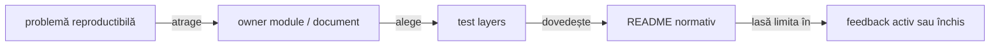

# ATF Java — registru de feedback activ

## Overall

- **scope:** riscuri sau decizii care mai pot schimba codul, testele ori contractele
  publice;
- **ToDo activ:** owner, reproducere, criteriu de acceptare și nivel de test;
- **regulă implementată:** se mută în README-ul ownerului;
- **analiză datată fără acțiune:** se arhivează în afara proiectului.

- registrul și feedback-urile cu ToDo-uri reproductibile rămân în checkout;
- piramida API/UI Practice Shop este urmărită în
  [`ATF_Practice_Shop_API_Screen_Pyramid_Feedback.md`](ATF_Practice_Shop_API_Screen_Pyramid_Feedback.md);
- boundary-ul standalone `atf-reporting` rămâne în README-ul ownerului;
- semnăturile request, precondițiile dinamice și intercalarea API/UI sunt urmărite
  în [`ATF_Request_Traceability_Feedback.md`](ATF_Request_Traceability_Feedback.md);
- nu se creează câte un fișier pentru fiecare run sau captură;
- raportul HTML este dovadă de execuție, nu documentație permanentă.

## Reconcilierea cu codul live

Aceasta este regula de lucru pentru orice feedback, nu un contract de produs:
un TODO se închide numai după ce implementarea live, testul relevant și README-ul
ownerului descriu aceeași realitate.

<strong>Ordinea dovezii și criteriul de închidere</strong>

1. **Cod și POM** — confirmă modulele, dependențele, package-urile și boundary-ul
   public real;
2. **Teste și adnotări** — confirmă comportamentul verificat și stratul în care
   este verificat;
3. **Configurația runtime** — confirmă inputul configurabil, fără a transforma
   un exemplu de run într-un contract permanent;
4. **README-urile de owner** — explică responsabilitatea și modul de utilizare,
   dar nu pot inventa clase, căi sau capability-uri absente din cod;
5. **Feedback-ul activ** — păstrează TODO-ul, ownerul, criteriul de închidere și
   dovada lipsă; nu poate înlocui codul sau testul care îl dovedește;
6. **Rapoartele generate** — sunt evidence pentru un run și nu devin referințe
   normative în documentație.

Dacă doar documentația a fost actualizată, TODO-ul rămâne deschis. Când
implementarea este stabilă, regula permanentă se mută în README-ul ownerului,
iar feedback-ul păstrează numai limita rămasă, criteriul de redeschidere și
dovada relevantă.

<strong>Legendă — cum se închide un feedback</strong>

- problema trebuie să fie reproductibilă și să aibă owner explicit;
- testul potrivit verifică implementarea la nivel unit, component, integration sau E2E;
- regula stabilă se mută în README-ul ownerului, iar registrul păstrează numai limita și dovada;
- un raport generat rămâne evidence de run, nu devine documentație permanentă.

## Verdict arhitectural curent

| Zonă | Verdict | Dovadă / owner |
|---|---|---|
| `atf-reporting` production | ✅ standalone | POM parentless, zero module ATF, `ReportingStandaloneDependencyTest` |
| reporting unit/component | ✅ închis | teste pure în `atf-reporting/src/test` și contracte component în consumer |
| API/integration pentru reporting | ✅ consumator separat | `atf-reporting-tests/src/test`, mock + core + validation + fixtures API test-local |
| UI/E2E reporting | ✅ consumator separat | `atf.ui.tests.extent.e2e`, ATF Debug + Chromium/Playwright MCP |
| aplicații consumatoare | ✅ separat | Practice Shop este în `atf-test-practice-shop`; `atf-tests` rămâne governance-only |
| whole-reactor governance | ✅ separat | `atf-tests` și `AtfModuleIds` din `atf-core` |
| `atf-execution` | ✅ eliminat | mecanica generică în `atf-core`; rutele, serviciile și bootstrap-ul concrete sunt fixture-uri în `atf-reporting-tests` |

Distribuția se verifică reproducibil prin `mvn -f atf-reporting/pom.xml test`,
`mvn package -DskipTests` și printr-un consumer extern compilat numai cu JAR-ul
produs. Rezultatele unui run nu sunt documentație permanentă și nu se păstrează
în acest registru. Decizia de packaging este JAR Maven normal cu vendorii
declarați explicit; nu există motiv pentru shaded JAR în acest moment.

- `atf-reporting` — librăria standalone;
- `atf-reporting-tests` — consumer/reference composition root pentru API și E2E;
- `atf-test-practice-shop` — composition root pentru aplicația Practice Shop;
- `atf-tests` — composition root pentru guvernanța whole-ATF;
- boundary-ul păstrează reporting-ul reutilizabil ca dependency pentru consumatori
  viitori.

- `SHOP-CONSOLE-01` — închis pe consumer;
  - Practice Shop declară `atf-console`;
  - reporterul configurat intră în sesiunile Playwright;
  - același reporter ajunge la publisher-ul API standalone;
  - lifecycle-ul urmărit este `REQUEST → VALIDATION → COMPLETE`;
- `SHOP-CONSOLE-02` — activ ca decizie cross-module pentru porturile standalone
  `AtfConsoleEvent/Sink`;
- Practice Shop nu copiază un adapter.

## ToDo active, ordonate după impact și risc

| Prioritate | Owner | ToDo | Criteriu de închidere |
|---|---|---|---|
| ~~P0~~ | `atf-ui` + `atf-reporting` | `TRACE-REQ-01..04` ✅ închis | `ReportTraceMetadata` + `ReportRequestSignature` oferă EventId, sequence, phase, role, correlation și body digest; body-uri diferite nu se unesc. |
| ~~P1~~ | `atf-ui` + consumerii UI | `TRACE-REQ-05..08` ✅ închis pe Practice Shop/reporting | checkpoint-ul păstrează output/read-back, exchange-ul poartă trace explicit, retry-ul nu falsifică signature count, iar assertions sunt distincte de body display. |
| P1 | `atf-core` + `atf-console` + `atf-reporting` | `SHOP-CONSOLE-02`: reconcilierea typed a celor două perechi `AtfConsoleEvent/Sink` | există un port comun sau un adapter owner-uit explicit; Practice Shop nu face mapping duplicat; component/integration tests verifică aceeași secvență și nu rup independența reportingului |
| ~~P1~~ | `atf-reporting` | `SHOP-REPORT-FAILURE-01` ✅ închis | `Fails` prioritizează `Failure evidence`/cauza concretă; component + failure-flow E2E au fost verificate în MCP. |
| P1 | `atf-reporting` | `REP-RENDER-09`: rendererele transport/UI/fallback folosesc acum disclosure, tabel key/value, escaping, politica JSON și vocabularul typed de marker/label status; rămâne doar parity-ul vendor-specific al badge-urilor Extent | primitive typed comune și parity component tests pentru Extent + fallback HTML, fără copiere de disclosure/tabel/JSON |
| P1 | `atf-core` + `atf-console` + `atf-reporting` + `atf-reporting-tests` | `REP-CONSOLE-01`: există perechi duplicate `AtfConsoleEvent/Sink`, iar no-op-ul poate ascunde wiring-ul | port comun sau adapter clar, standalone păstrat, in-memory sink și matrice `PASS/FAIL/WARNING/SKIP` verificată component/integration |
| P2 | `atf-test-practice-shop` + mediu extern | `SHOP-NET-02`: E2E-ul autentificat primește diagnosticuri de bootstrap anonim (`401`, `Unauthorized`, `/users/me` și `TypeError` pe `cart_items`) clasificate acum ca warning | mediul extern este curățat sau excepția este aprobată explicit; evidence păstrează source/route/status/message, guest și authenticated rămân distincte, iar diagnosticul necunoscut continuă să eșueze E2E-ul |
| ~~P2~~ | `atf-reporting` (consumer seam închis) | `SHOP-CONFIG-01` ✅ închis pe consumer | `api.mode`, directoarele de raport și evidence policy sunt consumate typed; parity-ul generic este contractul reporting, nu ToDo Practice Shop. |
| P1 | `atf-test-practice-shop` | `SHOP-FLOW-01` ✅ închis pe component scope: fixture-ul stateful acoperă create → add → read → update → read → remove → read | testul verifică status, quantity și lista goală după remove; fără E2E nou |
| P1 | `atf-reporting-tests` | `REP-SUITE-01`: consumerul are 295 clase, 135 support neadnotat și dependențe către opt module; reporting-only, API fixture și UI/E2E nu sunt suficient de separabile la rulare | profile/launcher și boundary guard pentru reporting-only; fiecare executabil are owner/layer; numărul E2E rămâne plafonat |
| P2 | `atf-reporting-tests` | `REP-LOCATOR-01`: `ReportUiLocators` are 400 linii și 256 delegări, devenind god-facade pentru testele UI | surface-uri typed pe domenii, fără delegări noi legacy, locator boundary testat și API compatibil măsurat |
| P2 | `atf-reporting-tests` | `TRACE-REQ-09..10`: projection compactă și manual replay al raportului | component/integration/E2E verifică disclosure-urile, artifact manifest, overflow și fluxul SETUP → UI → API → validation → CLEANUP prin ATF Debug/Chromium MCP |
| ~~P2~~ | `atf-reporting` | `REP-ASSET-07` ✅ închis | auditul asset-urilor și seam-urilor Java are teste component; nu se reintroduc corpuri JS/CSS monolitice în facade-uri. |
| P1 | `atf-tests` + ownerii README | `DOC-DIAG-05`: guard-ul whole-ATF identifică flowchart-uri non-root cu relații multiple fără verb scurt pe muchie | fiecare flowchart non-root trece `DocumentationDiagramGovernanceTest`; relațiile sunt etichetate semantic, legenda rămâne imediată, iar `WholeAtfGovernanceSuiteTest` revine verde |
| P3 | structura testelor | `TEST-ARCH-07`: gruparea semantică a support-ului fără ștergeri speculative | fiecare mutare are owner, motiv observabil, test de boundary și zero ștergeri speculative; detaliile sunt în [`ATF_Test_Architecture_Feedback.md`](ATF_Test_Architecture_Feedback.md) |

<strong>Închideri și explorări istorice — dovadă tehnică</strong>

### Observație de explorare live — închisă prin contract și gate

`SHOP-NET-01` a fost transformat în contract: network capture-ul a evidențiat
request-uri guest către `/users/me` și un posibil `null.cart_items`. Capturile
brute rămân externe și nu sunt referințe normative. `PracticeShopGuestResilienceTest`
separă statusul guest de diagnosticul browserului, iar `PracticeShopRuntimeDiagnostics`
face ca erorile runtime neașteptate să eșueze singurul E2E; `401` nu este raportat
ca fail JavaScript.

`SHOP-MIX-01`, `SHOP-MIX-02` și `SHOP-MIX-03` sunt închise în zona Practice
Shop: `PracticeShopApiNetworkJournal`, profilul typed și overload-ul flow-ului
publică evidence API în checkpoint-ul UI, fără teste E2E suplimentare. Fiecare
exchange păstrează request JSON, response JSON, headers, auth type, status,
transport și execution evidence în disclosure-uri închise implicit. Sunt
verificate prin component test și purchase E2E; guest resilience este guvernată
de diagnosticul runtime separat.

`SHOP-API-SCREEN-01..09` sunt închise: runtime-ul reutilizabil este în
`src/main/java/atf/ui/practiceshop`, testele sunt separate în
`component`, `api/component`, `api/integration` și `e2e`, iar login-ul API este
precondiție reutilizabilă pentru screen flow. `PracticeShopStandaloneApiReportTest`
acoperă report-ul API fără browser,
fixture-ul live este opt-in, iar selecția produsului are politică explicită:
rută exactă sau `productPath: auto` pentru ID-uri rotite. Matrix-ul catalog/cart
folosește rutele documentate și fake transport.

`SHOP-AUTH-01..06` sunt închise în feedback-ul dedicat: registration-ul a fost
explorat prin ATF Debug/browser MCP, contul demo este fixture reutilizabil în
`atf-test-practice-shop/src/test/resources`, iar `PracticeShopAuthenticatedPurchaseE2eTest`
face login setup → catalog → cart → billing → payment. Credentialele nu apar în
actions sau HTML. Limitarea body-ului login-ului extern este raportată explicit
ca evidence tehnică (`body unavailable` + content metadata), iar sesiunea este
confirmată prin `/users/me` 200; nu se inventează JSON și nu se adaugă request
duplicat.

`SHOP-MODULE-01` este închis: modulul există în root POM, sursele și YAML-ul
au fost mutate, iar `atf-tests`/`atf-reporting-tests` nu mai conțin cod de
Practice Shop. Guard-ul whole-reactor și build-ul extern au trecut. Component
tests acoperă config/checkout/locator boundary, `PracticeShopPurchaseE2eTest`
acoperă guest purchase până la confirmarea reală de payment, iar
`PracticeShopAccountAndCatalogE2eTest` rămâne condiționat de configurația externă
de cont, fără a face guest journey-ul dependent de credențiale.

`EXEC-COLLAPSE-01` este închis: modulul concret `atf-execution` nu mai există;
executorul, lifecycle-ul și cleanup-ul generic sunt în `atf-core`, iar
`ApiModule`, rutele, modelele și serviciile concrete rămân în test scope-ul
`atf-reporting-tests`. Dovada se reface prin architecture guard și prin gate-ul
extern; staging-ul este doar un spațiu de lucru și nu este documentație.

`REP-01` și `REP-02` sunt închise: contractul stabil este documentat în README-ul
`atf-reporting`, iar verificarea se reface prin protocolul de build și browser gate.

### Sincronizare staging → live

Regula normativă este în
[`docs/ATF_Build_And_Execution_Safety.md`](../ATF_Build_And_Execution_Safety.md):
staging-ul nu este sursă autoritară și nu justifică undo sau ștergeri implicite.
La revenirea în live se promovează numai fișierele aprobate, după recitirea
versiunii live și reconcilierea modificărilor paralele; conflictele blochează
doar fișierul conflictual și devin ToDo auditabil.

## Închideri tehnice recente

<strong>Deschide închiderile și dovezile tehnice</strong>

| Item | Rezultat | Dovadă |
|---|---|---|
| `LOC-03` | ✅ eliminat busy-polling-ul `waitForTimeout` din runtime-ul UI | `PlaywrightBrowserActions` folosește `Page.waitForCondition`; se verifică prin gate-ul testelor modulului |
| `REP-CSS-01` | ✅ action/validation tables responsive fără celule flex care rup layout-ul, fără margine laterală care lărgește wrapperul și cu `ACTUAL`/`RESULT` lizibile | `AtfReportEvidenceCssTest`; gate-ul browser verifică viewport-ul contractual, overflow 0, antetele assertions pe un singur rând și randarea vizuală |
| `REP-CSS-02` | ✅ tabelul de assertions își recalibrează dinamic coloanele după cele mai lungi valori reale; `ACTUAL` nu mai este strangulat de o lățime statică, iar `RESULT` rămâne compact | `ExtentReportRuntimeEvidenceTableLayout` + `ValidationTableLayoutInspector`; verificare component și E2E pe markup-ul rezultat |
| `REP-UI-SEQ-01` | ✅ delimitatorul numeric al fiecărei acțiuni/observații este token compact `#n`, cu lățime naturală; nu mai reutilizează containerul colapsabil și acoperă inclusiv indici cu două cifre | `ExtentReportUiEvidenceRenderingTest` (`#1`, `#27`) + `AtfReportEvidenceCssTest` (`inline-block`, `max-content`, `nowrap`, `vertical-align`) |
| `REP-HTML-01` | ✅ titlu `ATF Report`, tags lowercase și link Base64 inline păstrate | raport UI explorat manual prin Chromium/Playwright MCP |
| `REP-UI-LOC-ATTR-01` | ✅ locatorii UI contractuali folosesc forma explicită `element[attribute=value]`; clasele folosesc `class~=`, id-urile și atributele `data-atf-*` sunt centralizate, iar shorthand-ul `.class` rămâne numai în CSS | `ReportUiLocatorsTest` + `UiSelectorBoundaryArchitectureTest`; artifact UI fresh verificat prin browser MCP pe `Tests` și `Fails` |
| `REP-UI-LOC-ATTR-02` | ✅ validarea valorilor dinamice pentru selectori este centralizată și nu recompilă regex-ul pentru fiecare locator; `ReportEvidenceLocators` și `ReportCategoryLocators` reutilizează același seam | `ReportLocatorSupport.SAFE_ATTRIBUTE` cu `Pattern` compilat o singură dată; auditul full gate nu mai consumă CPU în compilări repetitive în timpul navigării failure |
| `REP-ASSET-02` | ✅ CSS-ul de evidence este asset nativ, cu owner semantic și facade Java stabilă | `ReportAsset` + `ReportAssetLoader` + `ReportAssetComposer`; `ReportAssetContractTest` și `AtfReportEvidenceCssTest` |
| `REP-ASSET-03` | ✅ Tests filters folosesc corp JavaScript nativ, placeholder-e tipizate și vocabular Java central pentru funcțiile comune; contractul artefactului rămâne compatibil | `ExtentReportRuntimeTestFilters` → `extent-tests-filters.js`; `Template` + `ExtentReportRuntimeVocabulary.Function`; verificare component și gate E2E selectat |
| `REP-ASSET-04` | ✅ tema fallback, navigarea și evidence roles folosesc aceeași limită facade Java → asset nativ | `HtmlReportNavigationScript`, `ExtentReportRuntimeEvidenceRoles`, `AtfFallbackTheme` și testele lor de componentă |
| `REP-ASSET-05` | ✅ `NavigationController`, DOM și disclosure sunt fațade Java subțiri peste trei asset-uri JavaScript native, cu ordine de compoziție stabilă | `ExtentReportRuntimeNavigation` + `ReportAssetComposer`; contractele component verifică funcțiile și manifestul |
| `REP-ASSET-05B` | ✅ `Overview` este împărțit semantic în audit, labels, charts și cleanup; fiecare fragment are owner și resursă proprie | `ExtentReportRuntimeOverview` + patru asset-uri; fără corpuri JS mari în Java |
| `REP-ASSET-06` | ✅ `Scenarios` și `Categories` sunt asset-uri native, controlate de fațade Java; adnotările, filtrele și cardinalitățile rămân testabile componentar | `extent-scenarios.js`, `extent-categories.js`, `ReportAssetContractTest` și raport UI fresh |
| `REP-ASSET-06B` | ✅ disclosure-ul de evidence, proiecția failure evidence și layout-ul dinamic al tabelelor sunt asset-uri native separate | `extent-evidence-disclosure.js`, `extent-evidence-failures.js`, `extent-evidence-table-layout.js`; fațade Java mici |
| `REP-ASSET-06C` | ✅ detection, context/cause-chain și projection pentru Fails sunt asset-uri JavaScript native distincte; `ExtentReportFailureRuntime` rămâne composition root | `extent-failure-detection.js`, `extent-failure-context.js`, `extent-failure-cause-chain.js`, `extent-failure-projection.js`; contract asset + component |
| `REP-ASSET-06D` | ✅ CSS-ul Overview nu mai este un string Java monolitic și nu mai dublează status rules; layout-ul, tag-audit, tabelele de categorie și status badges sunt asset-uri CSS native distincte | `overview-layout.css`, `overview-tag-audit.css`, `overview-category-tables.css`, `overview-category-status.css`; `AtfReportOverviewCss` este facade, token-urile de culoare sunt rezolvate central în `ReportAssetComposer`, iar component tests verifică split-ul și compoziția |
| `REP-ASSET-06E` | ✅ `Responsive`, `Base`, `Category`, `CategoryStatus`, `FailsLayout` și `FailsStatus` nu mai emit CSS inline din Java; token-urile dinamice se rezolvă prin `ReportAssetComposer` | asset-uri `theme-responsive.css`, `theme-base.css`, `theme-category.css`, `theme-category-status.css`, `theme-fails-layout.css`, `theme-fails-status.css`; facades mici și contracte de asset/compoziție |
| `REP-ASSET-06F` | ✅ familiile mari `EvidenceInteraction`, `EvidenceTable`, `EvidenceDisclosure` și `EvidenceStack` folosesc resurse CSS native; `evidence-table.css` a fost adăugat pentru a elimina ultima lipsă din compoziția evidence | `ReportAsset`, `ReportAssetLoader`, `ReportAssetComposer`, facades evidence și `ReportAssetContractTest`; placeholder-ele de paletă sunt rezolvate central |
| `REP-ASSET-06G` | ✅ `ThemeNavigation`, `ThemeDetail` și fallback theme sunt acum facades Java peste asset-uri native; `ThemeDetail` compune explicit doar seams dinamice (`FailsStatus`, Overview metrics/status, Category) | `theme-navigation.css`, `theme-detail.css`, `fallback.css`; precedence-ul rămâne în `AtfReportTheme`, iar component tests verifică manifestul și absența concatenărilor în facades |
| `REP-ASSET-06H` | ✅ `AtfUiEvidenceCss` nu mai construiește stylesheet-ul prin `String.format` și concatenări Java; selectorii typed și paleta sunt singurele intrări ale compoziției | `ui-evidence.css` + `ReportAssetComposer.uiEvidenceCss(...)`; `AtfUiEvidenceCssTest`, `ReportAssetContractTest` și `AtfReportThemeCompositionTest` verifică asset-ul, placeholder-ele și facade-ul |
| `REP-FORMAT-01` | ✅ sursele native CSS/JavaScript sunt formatate pe mai multe linii; la publicarea în HTML se aplică o compactare lexicală conservatoare, centralizată în `ReportAssetCompactor`, fără minificare semantică oarbă | `ReportAssetLoader.load/render` păstrează sursa; `loadForPublication/renderForPublication` compactează numai copia publicată; `ReportAssetCompactorTest` și `ReportAssetContractTest` verifică quoted values, `calc`, operatori JS, token replacement și politica newline |
| `REP-ASSET-06I` | ✅ familia `Duration` este externalizată pe nouă asset-uri JavaScript native: parsing, DOM, memory, aggregation, projection lookup/views/publication, scheduling și lifecycle | `ExtentReportDurationRuntime` păstrează cele șapte fragmente și ordinea; `ReportAssetComposer` guvernează asset-urile, iar component tests verifică unicitatea funcțiilor și fațadele fără concatenări |
| `REP-ASSET-06J` | ✅ `ExtentReportRuntimeCore` este împărțit în `DOM`, `scenario projection` și `metadata`; Java rămâne composition facade, nu depozit de corpuri JavaScript | `runtime-core-dom.js`, `runtime-core-scenarios.js`, `runtime-core-metadata.js`; `ExtentReportRuntimeModuleTest`, `ReportAssetContractTest` și `ExtentReportRuntimeScriptTest` confirmă boundary-ul și ordinea |
| `REP-ASSET-06K` | ✅ fallback navigation și boot-ul runtime Extent nu mai reconstruiesc JavaScript executabil în Java | `fallback-navigation.js` și `runtime-boot.js`; `HtmlReportNavigationScript`/`ExtentReportRuntimeBehaviour` sunt fațade typed, iar `ReportAssetContractTest` verifică placeholder-ele și boot-ul compus |
| `REP-ASSET-06L` | ✅ conversia CSS nu mai permite comentarii JavaScript-style (`//`) lipite de selectori; regresia care făcea `.uri-anchor` vizibilă a fost corectată | `theme-navigation.css` folosește comentarii CSS valide; `ReportAssetContractTest` verifică regula `.uri-anchor{display:none!important}` și respinge `//` în CSS-ul randat |
| `REP-ASSET-06M` | ✅ screenshot-ul de acțiune este centrat vertical pe același rând cu markerul `📷`, fără să piardă linkul inline sau wrapping-ul sigur | `evidence-interaction.css` folosește `align-items/align-self:center`; contractele CSS și validatorul E2E verifică stilul randat |
| `REP-UI-EVIDENCE-04` | ✅ validatorul Screen validation acceptă atât payload-ul Base64 canonical, cât și linkul inline deduplicat cu `data-atf-screenshot-ref`; hash-ul rămâne intern și nu este afișat ca text | `ReportScreenValidationLocators` folosește toate linkurile screenshot, iar `ScreenValidationSectionExtractor` validează PNG-ul canonical prin referință; `StaticUiExtentReportContractTest` trece pe artifact fresh |
| `REP-E2E-01` | ✅ artifact fresh după orice schimbare CSS/asset JavaScript, verificat manual și niciodată reutilizat dintr-un run anterior | `SelectedApiTestsReportUiTest`; MCP: `Screen validation`, Base64 screenshot links inline, plus/minus pe aceeași linie, console errors 0 și gate-ul relevant verde |
| `REP-BUILD-01` | ✅ discovery-ul standalone este izolat de clasele stale ale consumerilor | `atf-reporting/pom.xml` allowlist-uiește `atf/api/reporting/standalone/**/*Test.java`; staging extern a trecut și cu o clasă stale injectată controlat în `target/test-classes` |
| `REP-ADAPTER-01` | ✅ compatibility adapters fail-closed și raportează câmpul pierdut | `ReportModelAdapterException`, `ReportModelAdaptersTest`, `ReportQueryParameters` typed map validation; lipsa/tipul invalid nu mai devine default semantic tăcut |
| `REP-EVID-06` | ✅ profil generic typed pentru flow mode, screenshot policy și capture source | `ReportEvidenceProfile` în `atf-reporting`, mapping `fromConfig(...)`/builder, overload `UiExtentReportSession` și teste unit/integration browser-neutral; Practice Shop nu este necesar |
| `REP-JSON-01` | ✅ JSON evidence este lizibil și identic ca regulă între renderere | `ReportJsonBodyFormatter` aplică pretty-print determinist după redaction și înainte de limita de display; unit test pentru obiecte/array-uri/scalari/invalid și parity verificat în fallback HTML + Extent |
| `REP-FACADE-01` | ✅ compoziția UI are o singură intrare typed preferată | `UiExtentReportOptions` builder deține output, file name, console, evidence profile și timestamp; overload-urile vechi delegă la `open(configuration, options)`, iar testul de compoziție verifică seam-ul |
| `REP-OVERVIEW-01` | ✅ overview injection este semantic și idempotent | `ExtentReportOverviewMarkup` folosește anchor regex pe `category-container`, acceptă variații de whitespace și refuză reinjectarea metadata; contractul dedicat acoperă ordinea și duplicatele |
| `REP-RENDER-08` | ✅ evidence UI este compus din renderere mici și testabile | `ExtentUiActionRenderer`, `ExtentUiObservationRenderer`, `ExtentUiAssertionRenderer` și `ExtentUiEvidenceMarkup`; facade-ul doar separă sursa și delegă, iar testele UI existente verifică output-ul integral |
| `REP-BOUNDARY-01` | ✅ boundary-ul este reconciliat pe owner real, nu pe scope Maven aplicat mecanic | `atf-tests/ArchitectureOwnershipBoundaryTest`, `PracticeShopArchitectureTest` și POM-urile live: reporting-tests este consumerul canonical, Practice Shop păstrează compile-scope numai pentru runtime-ul din `src/main`, iar composition roots fără production runtime folosesc test-scope |
| `REP-API-01` | ✅ raportul API pereche verificat prin `Fails → Tests → request details → response details → execution evidence` | request/response JSON prezente; POST și PUT verificate ambele cu JSON în request și response; `scrollWidth=clientWidth` inclusiv în disclosure-urile JSON, overflow intern 0, `
` 0, console errors 0; artifact fresh verificat în Chromium/Playwright MCP la 1080px |
| `EXEC-COLLAPSE-01` | ✅ eliminarea modulului concret și mutarea responsabilităților | `ArchitectureModuleBoundaryTest`; build reactor extern; fixture API în `atf-reporting-tests` |
| `SHOP-MODULE-01` | ✅ extragerea completă a aplicației Practice Shop | `atf-test-practice-shop`: config typed, locatori, pages, flows, component tests, guest purchase E2E și account/catalog E2E condiționat; `atf-tests`: governance-only |
| `SHOP-LAYER-01` | ✅ policy-ul global de test layers recunoaște modulul nou | `AtfTestLayerArchitectureTest`: `component/` → component, `e2e/` → E2E; full module gate verde |
| `SHOP-EVIDENCE-01` | ✅ guest și authenticated purchase publică evidence separat pentru fiecare ecran | două journey-uri E2E intenționate; variațiile API/login rămân în component/integration tests; checkpoint-uri Gherkin cu assertions, acțiuni și screenshot inline; YAML `zoomPercent: 70`; niciun secret în raport |
| `SHOP-UI-VALIDATION-01` | ✅ validare declarativă și profundă pentru fiecare ecran al purchase flow-ului | `@PracticeShopPageContract` + `PracticeShopPageValidator` verifică route, controale semantice și valori configurate; guest folosește `fill → validate → submit`; `PracticeShopPageContractTest` acoperă contractele și agregarea immutable |
| `SHOP-UI-VALIDATION-02` | ✅ validator plug-and-play pentru toate ecranele declarate | component gate-ul acoperă 9 contracte: home, product, cart, guest, billing, payment, confirmation, login și account; `validateValue` permite checkpoint punctual fără duplicare |
| `SHOP-UI-VALIDATION-03` | ✅ primul ecran modularizat fin, fără E2E suplimentar | HOME are 16 controale semantice și 3 checkpoint-uri distincte: structure, filters, product-grid; cardinalități dinamice, style/render-area assertions, acțiuni Playwright și screenshot inline; `productLinkFirst`/`homeProductGridFirst` respectă strict mode |
| `SHOP-UI-VALIDATION-04` | ✅ celelalte ecrane au component evidence fără E2E suplimentar | `PracticeShopPurchaseScreenValidator` adaugă pe checkpoint-urile existente assertions compacte de cardinalitate, bounding box și readiness interactivă pentru product, cart, guest, billing, payment și confirmation; fiecare păstrează screenshot-ul complet la zoom 100% |
| `SHOP-API-SCREEN-10` | ✅ journal API decomposed pe responsabilități | capture/sanitization în `PracticeShopApiTrafficCapture`, selecție pură în `PracticeShopApiExchangeSelector`, orchestration/state în `PracticeShopApiNetworkJournal`, assertions pure în `PracticeShopApiAssertions`, evidence Extent în `PracticeShopApiEvidenceMapper`; component gate dedicat 9/9 și full module gate menținut |
| `SHOP-INT-03` | ✅ orchestration UI + API în același purchase E2E, fără teste E2E suplimentare | `PracticeShopApiNetworkJournal` verifică dinamic search/detail înainte de add, cart POST/GET după add și payment POST după confirmare; raportul fresh păstrează assertions API în checkpoint-uri |
| `SHOP-MIX-01` | ✅ API precondition și confirmation pe aceeași sesiune UI | `PracticeShopApiNetworkJournal`; `productId` este extras din `QUERY /products/search`, iar evidence este atașat checkpoint-urilor UI |
| `SHOP-MIX-02` | ✅ piramidă configurabilă prin profil typed, fără `ui.enabled` | `PracticeShopValidationProfileTest`; YAML `validation.profile: ui-api`, fallback explicit `ui-only` |
| `SHOP-MIX-03` | ✅ API request evidence este proiectată în checkpoint-ul UI existent | `UiExtentReportSession.step(...)` + `UiEvidencePublisher.publishApiEvidence(...)`; component test acoperă request/response JSON, headers, auth și execution, toate disclosure-urile collapsed by default |
| `SHOP-OBS-01` | ✅ product detail nu mai selectează fals endpoint-ul `/related` | jurnalul folosește path exact și status 200; purchase E2E final are `FailValidation=0` |
| `SHOP-REPORT-01` | ✅ raportul UI arată request-urile API preliminar și per checkpoint | setup-ul declară profilul/disclosures, iar `Request details`, `Response details` și `Execution evidence` păstrează method/path/url/query/auth/headers/status/attempts cu body limitat și redacted |
| `SHOP-AUTH-01..06` | ✅ registration explorat, fixture reutilizabil, login setup și purchase authenticated | `PracticeShopRegistrationPage`, properties fixture, `PracticeShopAuthenticatedPurchaseE2eTest`, `PracticeShopApiLoginAssertionsTest`; raport fresh verificat prin browser MCP, status Pass, disclosures collapsed by default, secret absent |
| `SHOP-CONST-02` | ✅ vocabular API typed, module-local | `PracticeShopApiHttpStatus`, `PracticeShopApiJsonField`, `PracticeShopApiQueryParameter` și `PracticeShopApiReportMetadataFixture`; datele dinamice rămân în `PracticeShopApiScenarioFixture`, nu în enum-uri |
| `SHOP-READ-05..08` | ✅ lizibilitate și lifecycle pentru testele Practice Shop | screen APIs și audit support folosesc alias-uri locale pentru request/response; `PracticeShopStandaloneApiReportTest` nu mai repetă lanțuri în stream; mutation tests separă arrange/act/assert cu `updateExecution`/`removeExecution`; E2E-urile folosesc `Scenario.execute`, publisher-ul deține lifecycle-ul raportului, iar static imports sunt nominale și fără wildcard |
| `SHOP-JSON-03..04` | ✅ validare JSON semantică în variațiile Practice Shop | request/response bodies sunt parse-uite prin `PracticeShopJsonEvidence` și verificate prin `PracticeShopApiJsonField`; substring-ul nu mai este folosit pentru contractele cart/catalog/login/payment |
| `SHOP-CONFIG-02` | ✅ owner unic pentru hostul UI Practice Shop | `practiceShop.baseUrl` este în YAML; testele/page objects folosesc `PracticeShopUiRoutes` și `PracticeShopConfiguration.uri(...)`, fără URL-uri UI complete duplicate |
| `SHOP-ROUTE-04..05` | ✅ vocabular și resolver UI relativ | rutele stabile sunt constante, segmentele dinamice sunt validate, iar testele component acoperă compunerea product/checkout |
| `SHOP-FACTORY-02` | ✅ factory și fixture fără routing textual al body-ului | factory tests verifică exact câmpurile JSON, iar component fixture identifică login-ul invalid prin `email` parse-uit; datele dinamice rămân în `PracticeShopApiScenarioFixture` |
| `SHOP-GATE-03` | ✅ gate Practice Shop reprodus în staging extern | 51 teste, 0 failures, 0 errors, 0 skipped; artifact standalone fresh copiat în `artifacts/reports` și verificat prin Chromium headless/MCP |
| `SHOP-PROVENANCE-01` | ✅ provenance transport păstrat corect | `live(...)` → `LIVE_HTTP`, fixture local → `ACCEPTANCE_MOCK`; nu se poate confunda un raport component cu trafic real |
| `SHOP-ARCH-11..12` | ✅ boundary test/main întărit | publisher-ul API reusable este în `src/main/java`, testul păstrează doar orchestration/fake transport/assertions, iar architecture gate impune clase `*Test` sau helper-e explicit test-scoped în `src/test` |
| `SHOP-ARCH-13` | ✅ închis pe scope-ul Practice Shop | `PracticeShopApiNetworkJournal` are capture/select separate, iar `PracticeShopPurchaseFlow` compune `PracticeShopCatalogPurchaseStage`, `PracticeShopCheckoutPurchaseStage` și `PracticeShopPurchaseJourneyContext`; API-ul public a rămas compatibil, fără E2E suplimentar |
| `DOC-READ-01` | ✅ digestie vizuală aplicată în root, owner docs și feedback | audit static pe README-urile normative: Mermaid cu legendă imediată, bullets/tabele pentru conținut scanabil, orientarea aleasă după întrebare, hărți compacte fără lățire artificială, linkuri locale valide și fără path-uri de run |
| `TEST-ARCH-01..06` | ✅ policy-ul de layer, excepția standalone, matricea automată, ownership-ul și integration boundaries sunt închise | `AtfTestLayerArchitectureTest`, `atf-reporting-tests/README.md`, root/module README-uri și build-ul de guvernanță |
| `ROOT-README-01..04` | ✅ root README este top-down, subțire și aliniat cu modulele live | conținutul, ownership table și referințele către owner docs rămân stabile; root-ul este baseline protejat |
| `DOC-DIAG-02` | ✅ diagrama modulelor este acceptată: orientare orizontală compactă, grupuri semantice și puține muchii principale | feedback confirmat: „Harta modulelor” este clară și elegantă; detaliile rămân în legenda colapsată, tabel și owner docs |
| `DOC-DIAG-01` | ✅ forma overview-ului root este închisă fără modificarea baseline-ului | `## Diagramă de bază` rămâne forma aprobată; regula de documentație formalizează când `TB` este justificat, iar documentele noi folosesc `LR` când lectura este naturală stânga → dreapta |
| `DOC-DIAG-03` | ✅ hărțile din docs au fost recalibrate fără a duplica harta root | `docs/README.md` păstrează o singură hartă de navigare; `ATF_Architecture.md` grupează platforma și consumatorii, iar `ATF_Reporting_Contract.md` folosește o ierarhie semantică fără muchii duplicate sau noduri inexistente |
| `DOC-READ-02` | ✅ documentele greoaie au fost subțiate și reorganizate | `ATF_Build_And_Execution_Safety.md` are gate rapid și protocol detaliat colapsat; `ATF_Api_Test_Guide.md` are checklist și verificare schematică; linkurile, `&lt;details&gt;` și legendele au fost validate |
| `DOC-DIAG-04` | ✅ diagramele Practice Shop și composition boundary sunt parse-abile și compacte | toate flowchart-urile sunt `LR`, label-urile cu sintaxă sensibilă sunt quoted, break-urile sunt ` `, iar auditul global a validat 65 diagrame fără erori |

`DOC-DIAG-01`, `DOC-DIAG-02` și `DOC-READ-01` rămân închise pentru baseline-ul
root, harta modulelor și digestia vizuală. Nu se deschide un ToDo doar pentru a
normaliza mecanic o diagramă deja aprobată; orice abatere nouă trebuie evaluată
după întrebarea diagramei, costul vizual și criteriul formal din bunele practici.

## Contracte stabile mutate în owneri

| Contract | Document normativ |
|---|---|
| module, dependențe și direcția reactorului | [`docs/ATF_Architecture.md`](../ATF_Architecture.md), [`README.md`](../../README.md) |
| standalone reporting, API public și test matrix | [`atf-reporting/README.md`](../../atf-reporting/README.md) |
| API/UI/E2E composition, mock-backed projection și locatori | [`atf-reporting-tests/src/test/java/atf/ui/tests/extent/README.md`](../../atf-reporting-tests/src/test/java/atf/ui/tests/extent/README.md) |
| teste de aplicație, config/flows/locators/pages și guvernanță whole-ATF | [`atf-tests/README.md`](../../atf-tests/README.md) |
| reguli OOP, constante, hex colors, naming și test layering | [`docs/README_Atf_CodeBestPractices.md`](../README_Atf_CodeBestPractices.md) |
| build extern, sync live și browser gate | [`docs/ATF_Build_And_Execution_Safety.md`](../ATF_Build_And_Execution_Safety.md) |
| proiecție diagnostică stdout/stderr | [`atf-console/README.md`](../../atf-console/README.md) |
| vizual, evidence și raport Extent | [`docs/ATF_Reporting_Contract.md`](../ATF_Reporting_Contract.md) |

## Protocol de închidere

1. se pornește din checkout-ul live și se creează staging în afara proiectului;
2. se rulează testul focalizat, apoi gate-ul relevant și architecture guards;
3. dacă se schimbă HTML/CSS/JavaScript, se generează artifact fresh;
4. raportul se deschide prin ATF Debug/Chromium headless și se verifică manual:
   `Tests`, `Overview`, `Categories`, `Fails`, `SETUP → TEST BODY → THEN`,
   actions, audit observations, assertions, screenshot inline, overflow și
   console/page errors;
5. regula stabilă se mută în README-ul ownerului, iar aici rămâne numai limita
   sau ToDo-ul observabil;
6. sincronizarea este selectivă și nu atinge `target`, `artifacts`, `.tmp` ori
   procesele active.

## Arhivare și redeschidere

Feedback-ul închis se păstrează recuperabil în afara checkout-ului numai când
este util ca audit istoric. Analizele datate și feedback-ul fără ToDo-uri active
se arhivează în afara checkout-ului. Se redeschide un item doar pentru o regresie
reproductibilă, schimbare de ownership, input nou sau schimbare de contract;
un timestamp de HTML sau o captură locală nu este motiv suficient.

### SHOP-EVIDENCE-01 — Journey coverage boundary

✅ Închis. Cele două journey-uri E2E intenționate sunt guest purchase și
authenticated purchase cu login reutilizabil. Variațiile API/login rămân în
component/integration tests; nu se multiplică testele UI pentru fiecare
endpoint.
